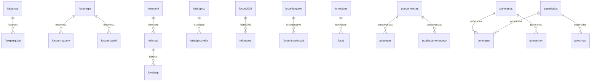

# Modelo — Pessoal - nucleo (rascunho em lote)

> Gerado por `src/model/gerar_docs_modelo.py` a partir de `src/model/modulos/pessoal_nucleo.yaml`, do catálogo e do perfil de colunas. **Não edite à mão.**

98 entidades. A coluna *Preench.* é o % de linhas com valor útil (nem nulo, nem em branco, nem zero, nem 1900-01-01; para colunas de código o zero conta como valor).

## Diagrama

## Entidades

| Entidade | Tabela | Linhas | Volume | Filtro obrigatório |
|---|---|---|---|---|
| [fobasesirrf](#fobasesirrf) | `fobasesirrf` | 683.502 | medio | um de: numero_sequencial_que_identifica_a_base |
| [focalculos](#focalculos) | `focalculos` | 624.116 | medio | um de: codigo_do_calculo |
| [fobasesservirrf](#fobasesservirrf) | `fobasesservirrf` | 338.941 | medio | empresa |
| [foprovisoes](#foprovisoes) | `foprovisoes` | 154.110 | medio | empresa |
| [foexparquivo](#foexparquivo) | `foexparquivo` | 111.587 | medio | um de: codigo_do_banco, numero_banco |
| [foformulas](#foformulas) | `foformulas` | 69.902 | medio | empresa |
| [foavisosvencimentos](#foavisosvencimentos) | `FOAVISOSVENCIMENTOS` | 48.139 | medio | empresa |
| [foliquidosfil](#foliquidosfil) | `foliquidosfil` | 44.929 | medio | empresa |
| [foguiainssserv](#foguiainssserv) | `foguiainssserv` | 29.609 | medio | empresa |
| [foguiainssemissao](#foguiainssemissao) | `foguiainssemissao` | 21.244 | medio | — |
| [foguiainss](#foguiainss) | `foguiainss` | 20.627 | medio | empresa |
| [folanctomedias](#folanctomedias) | `folanctomedias` | 18.103 | medio | empresa |
| [fofgtsfilial](#fofgtsfilial) | `fofgtsfilial` | 14.301 | medio | empresa |
| [fomediascalc](#fomediascalc) | `fomediascalc` | 13.362 | medio | empresa |
| [focalcirrf](#focalcirrf) | `focalcirrf` | 10.387 | medio | empresa |
| [fopagtoparcial](#fopagtoparcial) | `fopagtoparcial` | 8.520 | pequeno | — |
| [fopagto](#fopagto) | `fopagto` | 8.255 | pequeno | — |
| [foeventosbasesdef](#foeventosbasesdef) | `foeventosbasesdef` | 7.755 | pequeno | — |
| [fopagtoparciallancto](#fopagtoparciallancto) | `fopagtoparciallancto` | 7.350 | pequeno | empresa |
| [foraismunic](#foraismunic) | `foraismunic` | 5.591 | pequeno | — |
| [foguiagrfc](#foguiagrfc) | `foguiagrfc` | 4.129 | pequeno | empresa |
| [fohorarios](#fohorarios) | `FOHORARIOS` | 4.005 | pequeno | empresa |
| [fofilhos](#fofilhos) | `fofilhos` | 3.828 | pequeno | empresa |
| [focbo2002](#focbo2002) | `focbo2002` | 3.611 | pequeno | — |
| [fovaletrplanctos](#fovaletrplanctos) | `fovaletrplanctos` | 3.161 | pequeno | empresa |
| [fojornadas](#fojornadas) | `FOJORNADAS` | 2.804 | pequeno | empresa |
| [focbo](#focbo) | `focbo` | 2.798 | pequeno | — |
| [fopagtoparcialepr](#fopagtoparcialepr) | `fopagtoparcialepr` | 2.458 | pequeno | empresa |
| [fohistemprant](#fohistemprant) | `fohistemprant` | 2.098 | pequeno | empresa |
| [fopagtogrupo](#fopagtogrupo) | `fopagtogrupo` | 2.070 | pequeno | — |
| [focontrrpa](#focontrrpa) | `focontrrpa` | 1.994 | pequeno | empresa |
| [focontrrpaserv](#focontrrpaserv) | `focontrrpaserv` | 1.994 | pequeno | empresa |
| [focontrrpairrf](#focontrrpairrf) | `focontrrpairrf` | 1.993 | pequeno | empresa |
| [fovaletrp](#fovaletrp) | `fovaletrp` | 1.611 | pequeno | empresa |
| [fofpas](#fofpas) | `FOFPAS` | 1.475 | pequeno | — |
| [foeprfoto](#foeprfoto) | `foeprfoto` | 1.290 | pequeno | empresa |
| [foparsit](#foparsit) | `foparsit` | 1.238 | pequeno | empresa |
| [forescisoesaviso](#forescisoesaviso) | `forescisoesaviso` | 1.225 | pequeno | empresa |
| [fobancos](#fobancos) | `fobancos` | 1.218 | pequeno | — |
| [foguiapis](#foguiapis) | `foguiapis` | 1.066 | pequeno | empresa |
| [foguiapisfiliais](#foguiapisfiliais) | `foguiapisfiliais` | 1.066 | pequeno | empresa |
| [foguiapisemissao](#foguiapisemissao) | `foguiapisemissao` | 1.061 | pequeno | — |
| [folanctosauto](#folanctosauto) | `folanctosauto` | 848 | pequeno | empresa |
| [fomedicos](#fomedicos) | `FOMEDICOS` | 720 | pequeno | — |
| [fotabelas](#fotabelas) | `fotabelas` | 546 | pequeno | — |
| [fotabcalcfap](#fotabcalcfap) | `FOTABCALCFAP` | 481 | pequeno | empresa |
| [fopppatividades](#fopppatividades) | `fopppatividades` | 239 | pequeno | empresa |
| [fointegcontitens](#fointegcontitens) | `FOINTEGCONTITENS` | 225 | pequeno | — |
| [folinhas](#folinhas) | `folinhas` | 223 | pequeno | — |
| [fosindpisovalor](#fosindpisovalor) | `FOSINDPISOVALOR` | 191 | pequeno | — |
| [focalculando](#focalculando) | `focalculando` | 186 | pequeno | empresa |
| [fotreinamentos](#fotreinamentos) | `FOTREINAMENTOS` | 177 | pequeno | — |
| [fofuncoes](#fofuncoes) | `FOFUNCOES` | 140 | pequeno | empresa |
| [fosindpiso](#fosindpiso) | `FOSINDPISO` | 111 | pequeno | — |
| [fodadoutraemp](#fodadoutraemp) | `fodadoutraemp` | 91 | pequeno | empresa |
| [fotabcalcinss](#fotabcalcinss) | `FOTABCALCINSS` | 80 | pequeno | — |
| [fotabcalcsalminimo](#fotabcalcsalminimo) | `FOTABCALCSALMINIMO` | 80 | pequeno | — |
| [fohistempregados](#fohistempregados) | `fohistempregados` | 75 | pequeno | empresa |
| [foinssdata](#foinssdata) | `foinssdata` | 75 | pequeno | empresa |
| [foformulasdef](#foformulasdef) | `foformulasdef` | 71 | pequeno | — |
| [fotabcalcirrf](#fotabcalcirrf) | `FOTABCALCIRRF` | 70 | pequeno | — |
| [fotabcalc](#fotabcalc) | `fotabcalc` | 56 | pequeno | — |
| [forais](#forais) | `forais` | 48 | pequeno | empresa |
| [foemponi](#foemponi) | `foemponi` | 46 | pequeno | — |
| [fosindicatospatronal](#fosindicatospatronal) | `fosindicatospatronal` | 34 | pequeno | — |
| [foconfarquivocols](#foconfarquivocols) | `foconfarquivocols` | 30 | pequeno | — |
| [fooperadoraplanosaude](#fooperadoraplanosaude) | `FOOPERADORAPLANOSAUDE` | 28 | pequeno | — |
| [foavisosconf](#foavisosconf) | `foavisosconf` | 22 | pequeno | — |
| [foidentificadores](#foidentificadores) | `FOIDENTIFICADORES` | 16 | pequeno | — |
| [foccustosct](#foccustosct) | `foccustosct` | 13 | pequeno | empresa |
| [focat](#focat) | `FOCAT` | 10 | pequeno | empresa |
| [foconfarquivo](#foconfarquivo) | `foconfarquivo` | 8 | pequeno | empresa |
| [fosaldosimp](#fosaldosimp) | `fosaldosimp` | 4 | pequeno | empresa |
| [fosindicatosaviso](#fosindicatosaviso) | `fosindicatosaviso` | 4 | pequeno | — |
| [fostatus](#fostatus) | `FOSTATUS` | 4 | pequeno | — |
| [fosindicatospisosal](#fosindicatospisosal) | `fosindicatospisosal` | 2 | pequeno | — |
| [fopppresp](#fopppresp) | `fopppresp` | 2 | pequeno | empresa |
| [fosindicatosadicfer](#fosindicatosadicfer) | `fosindicatosadicfer` | 2 | pequeno | — |
| [focalcgrci](#focalcgrci) | `focalcgrci` | 1 | pequeno | empresa |
| [foparmtofil](#foparmtofil) | `foparmtofil` | 1 | pequeno | empresa |
| [fohorasaula](#fohorasaula) | `fohorasaula` | 1 | pequeno | empresa |
| [pomarcacao](#pomarcacao) | `pomarcacao` | 1.228 | pequeno | empresa |
| [postatemp](#postatemp) | `postatemp` | 445 | pequeno | empresa |
| [poocoger](#poocoger) | `poocoger` | 307 | pequeno | empresa |
| [poocorrencias](#poocorrencias) | `poocorrencias` | 24 | pequeno | empresa |
| [poocorrenciasdef](#poocorrenciasdef) | `poocorrenciasdef` | 24 | pequeno | — |
| [poferiados](#poferiados) | `poferiados` | 11 | pequeno | empresa |
| [poafastamentosoco](#poafastamentosoco) | `poafastamentosoco` | 11 | pequeno | empresa |
| [poafastamentos](#poafastamentos) | `poafastamentos` | 10 | pequeno | empresa |
| [pohorsper](#pohorsper) | `pohorsper` | 7 | pequeno | empresa |
| [pomarchor](#pomarchor) | `pomarchor` | 4 | pequeno | empresa |
| [pohorarios](#pohorarios) | `pohorarios` | 3 | pequeno | empresa |
| [poeventos](#poeventos) | `poeventos` | 2 | pequeno | empresa |
| [poperiodos](#poperiodos) | `poperiodos` | 1 | pequeno | empresa |
| [porelogios](#porelogios) | `porelogios` | 1 | pequeno | — |
| [poprocedim](#poprocedim) | `poprocedim` | 1 | pequeno | empresa |
| [poturmas](#poturmas) | `poturmas` | 1 | pequeno | empresa |
| [poparmto](#poparmto) | `poparmto` | 1 | pequeno | empresa |

## fobasesirrf

**Bases de IRRF** — tabela `fobasesirrf` (683.502 linhas)

Bases de IRRF. 683.502 linhas no catálogo; chave: I_BASESIRRF.

- **Chave:** `I_BASESIRRF`
- **Empresa:** `não se aplica (tabela global)`
- **Período:** `data_pagto` · exige um de: `numero_sequencial_que_identifica_a_base`
- **Ordem padrão:** `data_pagto desc`, `I_BASESIRRF asc`

**Regras de negócio validadas:**

- Medido em 2026-10-18: 683.532 linhas, data_pagto de 1900-01-01 a 2300-06-30.
- enviar_para_o_esocial_0_nao_1_sim: todos os valores reais estão no comentário do banco (1=683.532).
- gerar_retificacao_esocial: todos os valores reais estão no comentário do banco (0=683.532).
- marcacao_do_evento_para_gerar_o_evento_d: todos os valores reais estão no comentário do banco (0=683.532).
- tipo_deducao: todos os valores reais estão no comentário do banco (1=513.867, 2=169.665).

| Campo | Coluna | Tipo | Preench. | Domínio | Descrição (banco) |
|---|---|---|---|---|---|
| numero_sequencial_que_identifica_a_base | `i_basesirrf` | uniqueidentifier(16) |  |  | Numero sequencial que identifica a base |
| i_basesirrf_old | `i_basesirrf_old` | integer(4) |  |  | Numero sequencial que identifica a base - Renomeado |
| tipo_da_base | `tipo` | integer(4) |  |  | Tipo da base |
| classificacao_da_base_de_irrf_normal_13o | `classificacao` | integer(4) |  |  | Classificacao da base de irrf(normal, 13o., dif 13o. etc...) |
| data_de_pagamento | `data_pagto` | date(4) |  |  | Data de pagamento |
| base_de_irrf | `base` | numeric(13) |  |  | Base de IRRF |
| desconto_por_lei_de_r_100_00_usado_no_pe | `base_desc_lei` | numeric(13) |  |  | Desconto por lei de R$100,00 usado no periodo de 2004 |
| abatimentos_da_base_inss_pensao 🔒 | `abatimentos` | numeric(13) |  |  | Abatimentos da base (Inss, pensao...) |
| numero_de_dependentes | `depend_no` | integer(4) |  |  | Numero de dependentes |
| valor_total_descontado_por_causa_dos_dep | `depend_desconto` | numeric(13) |  |  | Valor total descontado por causa dos dependentes |
| taxa | `taxa` | numeric(13) |  |  | Taxa |
| valor_de_irrf_do_calculo | `valor` | numeric(13) |  |  | Valor de irrf do calculo |
| deducoes_do_valor_valor_da_tabela_de_cal | `deducao` | numeric(13) |  |  | Deducoes do valor(valor da tabela de calculo) |
| enviar_para_o_esocial_0_nao_1_sim | `enviar_esocial` | smallint(2) |  | fobasesirrf_enviar_para_o_esocial_0_nao_1_sim | Enviar para o eSocial. (0=Não/1=Sim) |
| gerar_retificacao_esocial | `gerar_retificacao_esocial` | smallint(2) |  | fobasesirrf_gerar_retificacao_para_o_esocial_0_n | Gerar retificação para o eSocial. (0=Não/1=Sim) |
| marcacao_do_evento_para_gerar_o_evento_d | `processar_exclusao_esocial` | smallint(2) |  | fobasesirrf_marcacao_do_evento_para_gerar_o_even | Marcação do evento para gerar o evento de exclusão no eSocial. (0=Não/1=Sim) |
| renomeado | `i_basesirrf_expimp_old` | integer(4) |  |  | Renomeado |
| tipo_deducao | `tipo_deducao` | integer(4) |  | fobasesirrf_tipo_de_deducao_irrf_1_deducoes_lega | Tipo de dedução IRRF (1=Deduções Legais/2=Dedução Simplificada Mensal) |
| valor_da_deducao_simplificada | `deducao_simplificada` | numeric(13) |  |  | Valor da dedução simplificada. |
| valor_de_reducao | `reducao` | numeric(13) |  |  | Valor de redução. |

**Filtros:** `numero_sequencial_que_identifica_a_base` (eq/in), `data_de_pagamento` (entre/gte/lte), `i_basesirrf_old` (eq/in), `tipo_da_base` (eq/in), `renomeado` (eq/in), `tipo_deducao` (eq/in)

## focalculos

**Calculo - Sequencia de calculos** — tabela `focalculos` (624.116 linhas)

Calculo - Sequencia de calculos. 624.116 linhas no catálogo; chave: I_CALCULOS.

- **Chave:** `I_CALCULOS`
- **Empresa:** `não se aplica (tabela global)`
- **Período:** `—` · exige um de: `codigo_do_calculo`
- **Ordem padrão:** `I_CALCULOS asc`

**Regras de negócio validadas:**

- Medido em 2026-10-18: 624.171 linhas.

| Campo | Coluna | Tipo | Preench. | Domínio | Descrição (banco) |
|---|---|---|---|---|---|
| codigo_do_calculo | `i_calculos` | uniqueidentifier(16) |  |  | Codigo do calculo |
| codigo_do_calculo_renomeado | `i_calculos_old` | integer(4) |  |  | Codigo do calculo - Renomeado |
| codigo_do_calculo_para_usar_no_exporta_i | `i_calculos_exporta_importa_old` | integer(4) |  |  | Código do cálculo para usar no exporta/importa - Renomeado |

**Filtros:** `codigo_do_calculo` (eq/in), `codigo_do_calculo_renomeado` (eq/in), `codigo_do_calculo_para_usar_no_exporta_i` (eq/in)

## fobasesservirrf

**Bases de Calculo - Base de IRRF** — tabela `fobasesservirrf` (338.941 linhas)

Bases de Calculo - Base de IRRF. 338.941 linhas no catálogo; chave: codi_emp, i_empregados, competencia, tipo_process, i_servicos, rateio, I_CALCULOS, I_BASESIRRF.

- **Chave:** `codi_emp, i_empregados, competencia, tipo_process, i_servicos, rateio, I_CALCULOS, I_BASESIRRF`
- **Empresa:** `codi_emp`
- **Período:** `competencia`
- **Ordem padrão:** `competencia desc`, `i_empregados asc`, `tipo_process asc`

**Regras de negócio validadas:**

- Medido em 2026-10-18: 338.953 linhas, 637 empresa(s), competencia de 2013-01-01 a 2026-11-30.
- enviar_para_o_esocial_0_nao_1_sim: todos os valores reais estão no comentário do banco (1=338.953).
- gerar_retificacao_esocial: todos os valores reais estão no comentário do banco (0=338.953).
- marcacao_do_evento_para_gerar_o_evento_d: todos os valores reais estão no comentário do banco (0=338.953).

| Campo | Coluna | Tipo | Preench. | Domínio | Descrição (banco) |
|---|---|---|---|---|---|
| codigo_da_empresa | `codi_emp` | integer(4) |  |  | Codigo da empresa |
| codigo_do_empregado | `i_empregados` | integer(4) |  |  | Código do empregado |
| competencia | `competencia` | date(4) |  |  | Competência |
| tipo_da_folha | `tipo_process` | integer(4) |  |  | Tipo da Folha |
| codigo_do_servico | `i_servicos` | integer(4) |  |  | Código do serviço |
| indica_se_a_linha_e_resultado_de_um_rate | `rateio` | integer(4) |  |  | Indica se a linha e resultado de um rateio de calculo |
| codigo_do_calculo | `i_calculos` | uniqueidentifier(16) |  |  | Código do cálculo |
| numero_sequencia_que_identifica_a_base | `i_basesirrf` | uniqueidentifier(16) |  |  | Numero sequencia que identifica a base |
| numero_sequencia_que_identifica_a_base_r | `i_basesirrf_old` | integer(4) |  |  | Numero sequencia que identifica a base - Renomeado |
| teve_rpa_1_sim_0_nao | `teve_rpa` | integer(4) |  |  | teve rpa? (1=sim, 0=nao) |
| codigo_do_calculo_renomeado | `i_calculos_old` | integer(4) |  |  | Código do cálculo - Renomeado |
| enviar_para_o_esocial_0_nao_1_sim | `enviar_esocial` | smallint(2) |  | fobasesservirrf_enviar_para_o_esocia | Enviar para o eSocial. (0=Não/1=Sim) |
| gerar_retificacao_esocial | `gerar_retificacao_esocial` | smallint(2) |  | fobasesservirrf_gerar_retificacao_pa | Gerar retificação para o eSocial. (0=Não/1=Sim) |
| marcacao_do_evento_para_gerar_o_evento_d | `processar_exclusao_esocial` | smallint(2) |  | fobasesservirrf_marcacao_do_evento_p | Marcação do evento para gerar o evento de exclusão no eSocial. (0=Não/1=Sim) |

**Filtros:** `codigo_do_empregado` (eq/in), `competencia` (eq/in), `tipo_da_folha` (eq/in), `codigo_do_servico` (eq/in), `indica_se_a_linha_e_resultado_de_um_rate` (eq/in), `codigo_do_calculo` (eq/in), `numero_sequencia_que_identifica_a_base` (eq/in), `numero_sequencia_que_identifica_a_base_r` (eq/in), `codigo_do_calculo_renomeado` (eq/in)

## foprovisoes

**Provisoes** — tabela `foprovisoes` (154.110 linhas)

Provisoes. 154.110 linhas no catálogo; chave: codi_emp, i_empregados, competencia, tipo.

- **Chave:** `codi_emp, i_empregados, competencia, tipo`
- **Empresa:** `codi_emp`
- **Período:** `vencto_ferias`
- **Ordem padrão:** `vencto_ferias desc`, `i_empregados asc`, `competencia asc`

**Regras de negócio validadas:**

- Medido em 2026-10-18: 154.110 linhas, 321 empresa(s), vencto_ferias de 1900-01-01 a 2027-09-15.
- Vínculo geempre (geempre): 0 de 126 linhas sem registro relacionado (empresa 346).
- Vínculo fofiliais (fofiliais): 0 de 126 linhas sem registro relacionado (empresa 346).
- Vínculo fodepto (fodepto): 0 de 126 linhas sem registro relacionado (empresa 346).
- Vínculo foccustos (foccustos): 0 de 126 linhas sem registro relacionado (empresa 346).
- Vínculo foservicos (foservicos): 0 de 126 linhas sem registro relacionado (empresa 346).
- Vínculo foempregados (foempregados): 0 de 126 linhas sem registro relacionado (empresa 346).

| Campo | Coluna | Tipo | Preench. | Domínio | Descrição (banco) |
|---|---|---|---|---|---|
| codigo_empresa | `codi_emp` | integer(4) |  |  | Codigo empresa |
| empregado | `i_empregados` | integer(4) |  |  | Empregado |
| competencia | `competencia` | date(4) |  |  | Competencia |
| tipo_provisao | `tipo` | tinyint(1) |  |  | Tipo provisao |
| filial | `i_filiais` | integer(4) |  |  | Filial |
| departamento | `i_depto` | integer(4) |  |  | Departamento |
| centro_de_custos | `i_ccustos` | integer(4) |  |  | Centro de custos |
| servico | `i_servicos` | integer(4) |  |  | Servico |
| origem_do_registro_0_sistema_1_imp_tabel | `origem_reg` | tinyint(1) |  |  | Origem do registro 0 - Sistema, 1 - Imp. Tabelas, 2 - Imp. Layout, 3- Imp. Tabelas Concorrentes |
| salario 🔒 | `salario` | numeric(13) |  |  | Salario |
| numero_de_avos | `avos` | integer(4) |  |  | Numero de avos |
| numero_de_dias | `dias_ferias` | numeric(13) |  |  | Numero de dias |
| vencimento_de_ferias | `vencto_ferias` | date(4) |  |  | Vencimento de ferias |
| numero_de_dias_de_faltas | `faltas` | integer(4) |  |  | Numero de dias de faltas |
| o_empregado_perdeu_direito_ao_periodo | `perdeu_periodo` | tinyint(1) |  |  | O empregado perdeu direito ao periodo |
| dias_afastados_pela_previdencia | `afastamento_previdencia` | integer(4) |  |  | Dias afastados pela previdência |
| dias_afastados_sem_remuneracao 🔒 | `afastamento_sem_remuneracao` | integer(4) |  |  | Dias afastados sem remuneração |
| dias_afastados_com_remuneracao 🔒 | `afastamento_com_remuneracao` | integer(4) |  |  | Dias afastados com remuneração |
| salario_do_mes_anterior 🔒 | `salario_mes_anterior` | numeric(13) |  |  | Salário do mês anterior |
| meses_perdidos_por_faltas | `meses_perdidos_por_faltas` | smallint(2) |  |  | Meses perdidos por faltas |
| meses_perdidos_por_afastamento | `meses_perdidos_por_afastamento` | smallint(2) |  |  | Meses perdidos por afastamento |
| taxa_inss_empresa | `taxa_inss_empresa` | numeric(17) |  |  | Taxa INSS Empresa. |
| taxa_inss_rat | `taxa_inss_rat` | numeric(17) |  |  | Taxa INSS RAT. |

**Vínculos (LEFT JOIN, acrescentam colunas legíveis):**

- `geempre` → `geempre` por `codi_emp` = `codi_emp`; colunas: `geempre_nome`
- `fofiliais` → `fofiliais` por `codi_emp` = `codi_emp` e `i_filiais` = `i_filiais`; colunas: `fofiliais_nome`
- `fodepto` → `fodepto` por `codi_emp` = `codi_emp` e `i_depto` = `i_depto`; colunas: `fodepto_nome`
- `foccustos` → `foccustos` por `codi_emp` = `codi_emp` e `i_ccustos` = `i_ccustos`; colunas: `foccustos_nome`
- `foservicos` → `foservicos` por `codi_emp` = `codi_emp` e `i_servicos` = `i_servicos`; colunas: `foservicos_nome`
- `foempregados` → `foempregados` por `codi_emp` = `codi_emp` e `i_empregados` = `i_empregados`; colunas: `foempregados_nome`

**Filtros:** `empregado` (eq/in), `competencia` (eq/in), `tipo_provisao` (eq/in), `vencimento_de_ferias` (entre/gte/lte), `filial` (eq/in), `departamento` (eq/in), `centro_de_custos` (eq/in), `servico` (eq/in)

## foexparquivo

**Configuracao Arquivo Credito em Conta** — tabela `foexparquivo` (111.587 linhas)

Configuracao Arquivo Credito em Conta. 111.587 linhas no catálogo; chave: num_banco, i_arquivos, i_posicao, i_sequencia, I_BANCOS.

- **Chave:** `num_banco, i_arquivos, i_posicao, i_sequencia, I_BANCOS`
- **Empresa:** `não se aplica (tabela global)`
- **Período:** `—` · exige um de: `codigo_do_banco, numero_banco`
- **Ordem padrão:** `num_banco asc`, `i_arquivos asc`

**Regras de negócio validadas:**

- Medido em 2026-10-18: 111.587 linhas.
- Vínculo fobancos (fobancos): 0 de 111.587 linhas sem registro relacionado.

| Campo | Coluna | Tipo | Preench. | Domínio | Descrição (banco) |
|---|---|---|---|---|---|
| numero_banco | `num_banco` | integer(4) |  |  | Numero banco |
| codigo_arquivo | `i_arquivos` | smallint(2) |  |  | Codigo arquivo |
| posicao | `i_posicao` | smallint(2) |  |  | Posicao |
| sequencia | `i_sequencia` | smallint(2) |  |  | Sequencia |
| codigo_do_banco | `i_bancos` | integer(4) |  |  | CÓDIGO DO BANCO |
| separacao | `separacao` | tinyint(1) |  |  | Separacao |
| sequencia_do_campo | `seq_campo` | smallint(2) |  |  | Sequencia do campo |
| conteudo | `conteudo` | char(30) |  |  | Conteudo |
| tamanho | `tamanho` | smallint(2) |  |  | Tamanho |
| mascara | `mascara` | char(30) |  |  | Mascara |
| tipo_campo | `tipo_campo` | smallint(2) |  |  | Tipo campo |
| valor_fixo | `valor_fixo` | char(30) |  |  | Valor fixo |
| origem_do_registro_0_sistema_1_imp_tabel | `origem_reg` | tinyint(1) |  |  | Origem do registro 0 - Sistema, 1 - Imp. Tabelas, 2 - Imp. Layout, 3- Imp. Tabelas Concorrentes |

**Vínculos (LEFT JOIN, acrescentam colunas legíveis):**

- `fobancos` → `fobancos` por `i_bancos` = `i_bancos`; colunas: `fobancos_nome`

**Filtros:** `numero_banco` (eq/in), `codigo_arquivo` (eq/in), `posicao` (eq/in), `sequencia` (eq/in), `codigo_do_banco` (eq/in), `conteudo` (contem/prefixo), `mascara` (contem/prefixo), `tipo_campo` (eq/in), `valor_fixo` (contem/prefixo)

## foformulas

**Eventos - Cadastro - Formulas** — tabela `foformulas` (69.902 linhas)

Eventos - Cadastro - Formulas. 69.902 linhas no catálogo; chave: codi_emp, i_eventos.

- **Chave:** `codi_emp, i_eventos`
- **Empresa:** `codi_emp`
- **Período:** `—`
- **Ordem padrão:** `i_eventos asc`

**Regras de negócio validadas:**

- Medido em 2026-10-18: 69.973 linhas, 723 empresa(s).
- Vínculo foeventos (foeventos): 0 de 115 linhas sem registro relacionado (empresa 809).

| Campo | Coluna | Tipo | Preench. | Domínio | Descrição (banco) |
|---|---|---|---|---|---|
| codigo_empresa | `codi_emp` | integer(4) |  |  | Codigo empresa |
| evento | `i_eventos` | integer(4) |  |  | Evento |
| origem_do_registro_0_sistema_1_imp_tabel | `origem_reg` | tinyint(1) |  |  | Origem do registro 0 - Sistema, 1 - Imp. Tabelas, 2 - Imp. Layout, 3- Imp. Tabelas Concorrentes |

**Vínculos (LEFT JOIN, acrescentam colunas legíveis):**

- `foeventos` → `foeventos` por `codi_emp` = `codi_emp` e `i_eventos` = `i_eventos`; colunas: `foeventos_nome`

**Filtros:** `evento` (eq/in)

## foavisosvencimentos

**GUARDA OS AVISOS DE VENCIMENTOS PARA CONSULTA** — tabela `FOAVISOSVENCIMENTOS` (48.139 linhas)

GUARDA OS AVISOS DE VENCIMENTOS PARA CONSULTA. 48.139 linhas no catálogo; chave: CODI_EMP, I_EMPREGADOS, I_AVISOSVENCIMENTOS.

- **Chave:** `CODI_EMP, I_EMPREGADOS, I_AVISOSVENCIMENTOS`
- **Empresa:** `CODI_EMP`
- **Período:** `DATA_ENTREGA_EPI`
- **Ordem padrão:** `DATA_ENTREGA_EPI desc`, `I_EMPREGADOS asc`, `I_AVISOSVENCIMENTOS asc`

**Regras de negócio validadas:**

- Medido em 2026-10-18: 48.189 linhas, 977 empresa(s), DATA_ENTREGA_EPI de 2017-01-02 a 2017-01-02.

| Campo | Coluna | Tipo | Preench. | Domínio | Descrição (banco) |
|---|---|---|---|---|---|
| codigo_da_empresa | `codi_emp` | integer(4) |  |  | CÓDIGO DA EMPRESA |
| codigo_do_empregado | `i_empregados` | integer(4) |  |  | CÓDIGO DO EMPREGADO |
| codigo_sequencial_para_chave_primaria 🔒 | `i_avisosvencimentos` | integer(4) |  |  | CÓDIGO SEQUENCIAL PARA CHAVE PRIMÁRIA |
| c_5_contrato_de_experiencia_6_aviso_de_r 🔒 | `tipo` | integer(4) |  |  | 5=CONTRATO DE EXPERIÊNCIA,6=AVISO DE RESCISÃO,7=PROGRAMAÇÃO DE FÉRIAS,8=CARTEIRA VACINAÇÃO DEPENDENTE,9=ATESTADO DE FREQUENCIA,10=CARTEIRA DE MOTORISTA,11=ATESTADOS OCUPACIONAIS,12=CONSELHOS REGIONAIS |
| data_vencimento | `vencimento` | date(4) |  |  | DATA VENCIMENTO |
| descricao_especial | `descricao_especial` | char(50) |  |  | DESCRIÇÃO ESPECIAL |
| codigo_do_filho_do_empregado | `i_filhos` | integer(4) |  |  | CÓDIGO DO FILHO DO EMPREGADO |
| codigo_da_programacao_de_ferias | `i_ferias_programacao` | integer(4) |  |  | CÓDIGO DA PROGRAMAÇÃO DE FÉRIAS |
| codigo_do_atestado_ocupacional | `i_atestado_ocupacional` | integer(4) |  |  | CÓDIGO DO ATESTADO OCUPACIONAL |
| codigo_do_conselho_regional | `i_conselho_regional` | integer(4) |  |  | CÓDIGO DO CONSELHO REGIONAL |
| codigo_do_afastamento | `i_afastamentos` | integer(4) |  |  | Código do afastamento. |
| data_real_dn_do_afastamento | `data_real_dn` | numeric(10) |  |  | DATA_REAL_DN do afastamento |
| codigo_do_epi | `i_epi` | integer(4) |  |  | Código do EPI |
| data_entrega_epi | `data_entrega_epi` | date(4) |  |  | Código do EPI |
| codigo_do_periodo_aquisitivo | `i_ferias_aquisitivos` | integer(4) |  |  | Código do período aquisitivo |
| codigo_do_monitoramento_de_saude | `i_monitoramento_saude` | integer(4) |  |  | Código do monitoramento de saúde |

**Filtros:** `codigo_do_empregado` (eq/in), `codigo_sequencial_para_chave_primaria` (eq/in), `data_vencimento` (entre/gte/lte), `data_entrega_epi` (entre/gte/lte), `c_5_contrato_de_experiencia_6_aviso_de_r` (eq/in), `descricao_especial` (contem/prefixo), `codigo_do_filho_do_empregado` (eq/in), `codigo_da_programacao_de_ferias` (eq/in), `codigo_do_atestado_ocupacional` (eq/in), `codigo_do_conselho_regional` (eq/in), `codigo_do_afastamento` (eq/in), `codigo_do_epi` (eq/in), `codigo_do_periodo_aquisitivo` (eq/in), `codigo_do_monitoramento_de_saude` (eq/in)

## foliquidosfil

**Liquidos por filial** — tabela `foliquidosfil` (44.929 linhas)

Liquidos por filial. 44.929 linhas no catálogo; chave: I_LIQUIDOSFIL.

- **Chave:** `I_LIQUIDOSFIL`
- **Empresa:** `codi_emp`
- **Período:** `competencia`
- **Ordem padrão:** `competencia desc`, `I_LIQUIDOSFIL asc`

**Regras de negócio validadas:**

- Medido em 2026-10-18: 44.934 linhas, 866 empresa(s), competencia de 2013-01-01 a 2026-11-01.
- origem_do_complemento_1_lancamento_de_ev: todos os valores reais estão no comentário do banco (nulo=44.831, 2=54, 1=37, 3=12).
- Vínculo fofiliais (fofiliais): 0 de 17 linhas sem registro relacionado (empresa 871).

| Campo | Coluna | Tipo | Preench. | Domínio | Descrição (banco) |
|---|---|---|---|---|---|
| sequencial | `i_liquidosfil` | uniqueidentifier(16) |  |  | Sequencial |
| sequencial_renomeado 🔒 | `i_liquidosfil_old` | integer(4) |  |  | Sequencial - Renomeado |
| codigo_da_empresa | `codi_emp` | integer(4) |  |  | Codigo da empresa |
| codigo_da_filial | `i_filiais` | integer(4) |  |  | Código da filial |
| competencia_do_calculo | `competencia` | date(4) |  |  | Competencia do calculo |
| tipo_de_calculo | `tipo_process` | integer(4) |  |  | Tipo de calculo |
| data_de_vencimento_pagto_da_folha | `vencimento` | date(4) |  |  | Data de vencimento/pagto da folha |
| tipo_de_contribuinte | `tipo_contrib` | char(1) |  |  | Tipo de contribuinte |
| liquido_da_folha 🔒 | `liquido` | numeric(13) |  |  | Liquido da folha |
| sequencia_de_pagamento | `i_pagto` | integer(4) |  |  | Sequencia de pagamento |
| origem_do_complemento_1_lancamento_de_ev | `origem_complemento` | smallint(2) |  | foliquidosfil_origem_do_complemento_1_lancam | Origem do complemento. (1=Lançamento de eventos/2=Alteração salarial/3=Rescisão/4=Alteração salarial CCT) |
| individualizado_por_rpa | `individualizado` | smallint(2) |  |  | Individualizado por RPA. |

**Vínculos (LEFT JOIN, acrescentam colunas legíveis):**

- `fofiliais` → `fofiliais` por `codi_emp` = `codi_emp` e `i_filiais` = `i_filiais`; colunas: `fofiliais_nome`

**Filtros:** `sequencial` (eq/in), `competencia_do_calculo` (entre/gte/lte), `data_de_vencimento_pagto_da_folha` (entre/gte/lte), `sequencial_renomeado` (eq/in), `codigo_da_filial` (eq/in), `tipo_de_calculo` (eq/in), `tipo_de_contribuinte` (eq/in), `sequencia_de_pagamento` (eq/in)

## foguiainssserv

**Guia Inss vs Servico** — tabela `foguiainssserv` (29.609 linhas)

Guia Inss vs Servico. 29.609 linhas no catálogo; chave: codi_emp, i_servicos, I_GUIAINSS.

- **Chave:** `codi_emp, i_servicos, I_GUIAINSS`
- **Empresa:** `codi_emp`
- **Período:** `—`
- **Ordem padrão:** `i_servicos asc`, `I_GUIAINSS asc`

**Regras de negócio validadas:**

- Medido em 2026-10-18: 29.610 linhas, 554 empresa(s).
- Vínculo foservicos (foservicos): 0 de 21 linhas sem registro relacionado (empresa 750).

| Campo | Coluna | Tipo | Preench. | Domínio | Descrição (banco) |
|---|---|---|---|---|---|
| codigo_da_empresa | `codi_emp` | integer(4) |  |  | Codigo da empresa |
| codigo_do_servico | `i_servicos` | integer(4) |  |  | Código do serviço |
| sequencial_da_guia | `i_guiainss` | uniqueidentifier(16) |  |  | Sequencial da Guia |
| sequencial_da_guia_renomeado | `i_guiainss_old` | integer(4) |  |  | Sequencial da Guia - Renomeado |

**Vínculos (LEFT JOIN, acrescentam colunas legíveis):**

- `foservicos` → `foservicos` por `codi_emp` = `codi_emp` e `i_servicos` = `i_servicos`; colunas: `foservicos_nome`

**Filtros:** `codigo_do_servico` (eq/in), `sequencial_da_guia` (eq/in), `sequencial_da_guia_renomeado` (eq/in)

## foguiainssemissao

**Controle de emissao da guia** — tabela `foguiainssemissao` (21.244 linhas)

Controle de emissao da guia. 21.244 linhas no catálogo; chave: I_GUIAINSS, I_GUIAINSS_EMISSAO.

- **Chave:** `I_GUIAINSS, I_GUIAINSS_EMISSAO`
- **Empresa:** `não se aplica (tabela global)`
- **Período:** `—`
- **Ordem padrão:** `I_GUIAINSS asc`, `I_GUIAINSS_EMISSAO asc`

**Regras de negócio validadas:**

- Medido em 2026-10-18: 21.245 linhas.

| Campo | Coluna | Tipo | Preench. | Domínio | Descrição (banco) |
|---|---|---|---|---|---|
| sequencial_da_guia | `i_guiainss` | uniqueidentifier(16) |  |  | Sequencial da Guia |
| sequencial_da_guia_que_pagou_em_caso_de | `i_guiainss_emissao` | uniqueidentifier(16) |  |  | Sequencial da Guia que pagou(em caso de acumulo) |
| sequencial_da_guia_renomeado | `i_guiainss_old` | integer(4) |  |  | Sequencial da Guia - Renomeado |
| i_guiainss_emissao_old | `i_guiainss_emissao_old` | integer(4) |  |  | Sequencial da Guia que pagou(em caso de acumulo) - Renomeado |

**Filtros:** `sequencial_da_guia` (eq/in), `sequencial_da_guia_que_pagou_em_caso_de` (eq/in), `sequencial_da_guia_renomeado` (eq/in), `i_guiainss_emissao_old` (eq/in)

## foguiainss

**Guia de INSS** — tabela `foguiainss` (20.627 linhas)

Guia de INSS. 20.627 linhas no catálogo; chave: I_GUIAINSS.

- **Chave:** `I_GUIAINSS`
- **Empresa:** `codi_emp`
- **Período:** `competencia`
- **Ordem padrão:** `competencia desc`, `I_GUIAINSS asc`

**Regras de negócio validadas:**

- Medido em 2026-10-18: 20.628 linhas, 554 empresa(s), competencia de 2013-01-01 a 2026-10-01.
- Colunas expostas nulas em 100% das linhas (3): codigo_do_parcelamento, codigo_do_item_do_parcelamento, valor_parcelado_no_parcelamento.
- somou_encargos_da_folha_complementar_na: todos os valores reais estão no comentário do banco (0=20.606, 1=22).
- Vínculo fofiliais (fofiliais): 0 de 21 linhas sem registro relacionado (empresa 750).

| Campo | Coluna | Tipo | Preench. | Domínio | Descrição (banco) |
|---|---|---|---|---|---|
| sequencial_da_guia | `i_guiainss` | uniqueidentifier(16) |  |  | Sequencial da Guia |
| sequencial_da_guia_renomeado | `i_guiainss_old` | integer(4) |  |  | Sequencial da Guia - Renomeado |
| codigo_da_empresa | `codi_emp` | integer(4) |  |  | Codigo da empresa |
| competencia_da_guia | `competencia` | date(4) |  |  | Competencia da Guia |
| tipo_servico | `tipo_servico` | integer(4) |  |  | tipo_servico |
| tipo_da_guia_1_normal_2_apenas_terceiros | `tipo_guia` | integer(4) |  |  | Tipo da guia: 1=Normal/2=Apenas terceiros/3=Normal CCT/4=Apenas terceiros CCT |
| codigo_da_filial | `i_filiais` | integer(4) |  |  | Código da filial |
| tipo_de_calculo_11_mensal_42_complementa 🔒 | `tipo_process` | integer(4) |  |  | Tipo de calculo: 11=Mensal/42=Complementar/52=13o. salario/91=Resilicao Professor |
| data_de_vencimento | `vencimento` | date(4) |  |  | Data de vencimento |
| inicio_do_acumulo_renomeado | `i_guiainss_ini_acum_old` | integer(4) |  |  | Inicio do acumulo - Renomeado |
| se_a_guia_esta_acumulada_1_emitida_2_acu | `situacao` | tinyint(1) |  |  | Se a guia esta acumulada(1=Emitida, 2=Acumulada) |
| valor_do_inss_campo_6_da_gps | `valor_inss` | numeric(13) |  |  | Valor do Inss(campo 6 da GPS) |
| valor_outras_entidades_campo_9_da_gps | `terceiros_guia` | numeric(13) |  |  | Valor outras entidades(campo 9 da GPS) |
| valor_da_multa | `multa` | numeric(13) |  |  | Valor da multa |
| total_da_guia_campo_11_da_gps | `total_guia` | numeric(13) |  |  | Total da guia(campo 11 da GPS) |
| valor_inss_empresa | `empresa` | numeric(13) |  |  | Valor inss empresa |
| valor_inss_segurados | `segurados` | numeric(13) |  |  | Valor INSS segurados |
| valor_rat | `acid_trab` | numeric(13) |  |  | Valor RAT |
| valor_de_terceiros_do_mes | `terceiros` | numeric(13) |  |  | Valor de terceiros do mes |
| valor_pagos_a_cooperativas 🔒 | `cooperativas` | numeric(13) |  |  | Valor pagos a cooperativas |
| valor_de_inss_retido_do_mes | `retencao_mes_acomp` | numeric(13) |  |  | Valor de INSS retido do mes |
| valor_de_inss_retido_compensado_no_propr | `retencao_mes_comp` | numeric(13) |  |  | Valor de INSS retido compensado no proprio mês |
| valor_de_inss_retido_compensado_100_de_o | `retencao_comp_100` | numeric(13) |  |  | Valor de INSS retido compensado 100% de outros mes |
| valor_de_inss_retido_compensado_30_de_ou | `retencao_comp_30` | numeric(13) |  |  | Valor de INSS retido compensado 30% de outros mes |
| valor_do_mes_a_compesar | `acompensar_mes` | numeric(13) |  |  | Valor do mes a compesar |
| valores_de_outras_competencias_a_100_com | `acomp_100` | numeric(13) |  |  | Valores de outras competencias a 100% compensar no mes |
| valores_de_outras_competencias_a_30_comp | `acomp_30` | numeric(13) |  |  | Valores de outras competencias a 30% compensar no mes |
| data_inicio_compencacao | `acomp_inicio` | date(4) |  |  | Data inicio compencacao |
| data_fim_compensacao | `acomp_fim` | date(4) |  |  | Data fim compensacao |
| sequencial_de_pagamento | `i_pagto` | integer(4) |  |  | Sequencial de pagamento |
| valor_deducos_salario_familia_compensado 🔒 | `deducoes_comp_sf` | numeric(13) |  |  | Valor deduçõs salário família compensado |
| valor_deducoes_salario_maternidade_compe 🔒 | `deducoes_comp_sm` | numeric(13) |  |  | Valor deduções salário maternidade compensado |
| valor_deducos_salario_familia_a_compensa 🔒 | `deducoes_acomp_sf` | numeric(13) |  |  | Valor deduçõs salário família a compensar |
| valor_deducoes_salario_maternidade_a_com 🔒 | `deducoes_acomp_sm` | numeric(13) |  |  | Valor deduções salário maternidade a compensar |
| competencia_retroativa_alteracao_salaria | `competencia_retroativa` | date(4) |  |  | Competência retroativa (Alteração salarial CCT) |
| valor_deducoes_diferenca_inss_13o_descon | `ded_comp_dif_inss_13_desc_maior` | numeric(13) |  |  | Valor deduções diferença INSS 13º descontado a maior compensado |
| ded_acomp_dif_inss_13_desc_maior | `ded_acomp_dif_inss_13_desc_maior` | numeric(13) |  |  | Valor deduções diferença INSS 13º descontado a maior a compensar |
| isencao_filantropia_inss_empresa | `insencao_filantropia_empresa` | numeric(13) |  |  | Isenção Filantropia INSS Empresa |
| isencao_filantropia_inss_rat | `insencao_filantropia_rat` | numeric(13) |  |  | Isenção Filantropia INSS RAT |
| somou_encargos_da_folha_complementar_na | `somou_encargos_na_folha_mensal` | smallint(2) |  | foguiainss_somou_encargos_da_folha_complementar_ | Somou encargos da folha complementar na folha mensal quando forem inferiores ao mínimo de recolhimento. (0=Não/1=Sim) |
| codigo_do_parcelamento | `i_parcelamento_encargo_pagamento` | integer(4) |  |  | Código do parcelamento. |
| codigo_do_item_do_parcelamento | `i_parcelamento_item` | integer(4) |  |  | Código do item do parcelamento. |
| valor_parcelado_no_parcelamento | `valor_parcelado` | numeric(13) |  |  | Valor parcelado no parcelamento. |
| valor_deducoes_salario_familia_retroativ 🔒 | `deducoes_comp_sf_retroativo` | numeric(13) |  |  | Valor deduções salário família retroativo compensado |
| deducoes_acomp_sf_retroativo 🔒 | `deducoes_acomp_sf_retroativo` | numeric(13) |  |  | Valor deduções salário família retroativo a compensar |
| saldo_de_retencao_para_ser_compensado_em | `saldo_retencao_acomp` | numeric(13) |  |  | Saldo de retenção para ser compensado em meses posteriores. |
| valor_compensado_do_saldo_de_retencao_do | `valor_compensado_retencao_meses_anteriores` | numeric(13) |  |  | Valor compensado do saldo de retenção dos meses anteriores. |
| valor_compensado_do_lancamento_de_compen 🔒 | `valor_compensado_retencao_13` | numeric(13) |  |  | Valor compensado do lançamento de compensação no mês devido à retenção de 13º salário. |
| valor_inss_empresa_aviso_previo | `empresa_aviso_previo` | numeric(13) |  |  | Valor inss empresa Aviso Prévio |
| valor_inss_segurados_aviso_previo | `segurados_aviso_previo` | numeric(13) |  |  | Valor INSS segurados Aviso Prévio |
| valor_rat_aviso_previo | `acid_trab_aviso_previo` | numeric(13) |  |  | Valor RAT Aviso Prévio |
| valor_de_terceiros_do_mes_aviso_previo | `terceiros_aviso_previo` | numeric(13) |  |  | Valor de terceiros do mês Aviso Prévio |
| isencao_filantropia_inss_empresa_aviso_p | `isencao_filantropia_empresa_aviso_previo` | numeric(13) |  |  | Isenção Filantropia INSS Empresa Aviso Prévio |
| isencao_filantropia_inss_rat_aviso_previ | `isencao_filantropia_rat_aviso_previo` | numeric(13) |  |  | Isenção Filantropia INSS RAT Aviso Prévio |
| deducoes_compensacao_de_diferenca_de_sal 🔒 | `deducoes_comp_dif_sm` | numeric(13) |  |  | Deduções compensação de diferença de salário maternidade. |
| deducoes_a_compensar_de_diferenca_de_sal 🔒 | `deducoes_acomp_dif_sm` | numeric(13) |  |  | Deduções a compensar de diferença de salário maternidade. |
| campo_para_identificar_que_a_guia_esta_c | `guia_apenas_patronal` | integer(4) |  |  | Campo para identificar que a guia esta considerando apenas os valores patronais recolhimento portaria 139/2020 |
| i_guiainss_ini_acum | `i_guiainss_ini_acum` | uniqueidentifier(16) |  |  | Inicio do acumulo |

**Vínculos (LEFT JOIN, acrescentam colunas legíveis):**

- `fofiliais` → `fofiliais` por `codi_emp` = `codi_emp` e `i_filiais` = `i_filiais`; colunas: `fofiliais_nome`

**Filtros:** `sequencial_da_guia` (eq/in), `competencia_da_guia` (entre/gte/lte), `data_de_vencimento` (entre/gte/lte), `data_inicio_compencacao` (entre/gte/lte), `data_fim_compensacao` (entre/gte/lte), `competencia_retroativa_alteracao_salaria` (entre/gte/lte), `sequencial_da_guia_renomeado` (eq/in), `tipo_servico` (eq/in), `tipo_da_guia_1_normal_2_apenas_terceiros` (eq/in), `codigo_da_filial` (eq/in), `tipo_de_calculo_11_mensal_42_complementa` (eq/in), `inicio_do_acumulo_renomeado` (eq/in), `se_a_guia_esta_acumulada_1_emitida_2_acu` (eq/in), `sequencial_de_pagamento` (eq/in), `i_guiainss_ini_acum` (eq/in)

## folanctomedias

**Lancamento de eventos para medias** — tabela `folanctomedias` (18.103 linhas)

Lancamento de eventos para medias. 18.103 linhas no catálogo; chave: codi_emp, i_empregados, competencia, i_eventos, origem.

- **Chave:** `codi_emp, i_empregados, competencia, i_eventos, origem`
- **Empresa:** `codi_emp`
- **Período:** `competencia`
- **Ordem padrão:** `competencia desc`, `i_empregados asc`, `i_eventos asc`

**Regras de negócio validadas:**

- Medido em 2026-10-18: 18.106 linhas, 149 empresa(s), competencia de 2014-12-01 a 2026-12-01.
- Vínculo foempregados (foempregados): 0 de 33 linhas sem registro relacionado (empresa 9004).

| Campo | Coluna | Tipo | Preench. | Domínio | Descrição (banco) |
|---|---|---|---|---|---|
| codigo_da_empresa | `codi_emp` | integer(4) |  |  | codigo da empresa |
| codigo_do_empregado | `i_empregados` | integer(4) |  |  | Codigo do empregado |
| competencia | `competencia` | date(4) |  |  | Competencia |
| codigo_do_evento | `i_eventos` | integer(4) |  |  | Codigo do evento |
| c_1_usuario_2_ferias_3_afastamentos | `origem` | tinyint(1) |  |  | 1=Usuario, 2=Ferias, 3=Afastamentos |
| valor | `valor` | numeric(13) |  |  | Valor |
| codigo_do_gozo | `i_ferias_gozo` | integer(4) |  |  | Código do gozo |

**Vínculos (LEFT JOIN, acrescentam colunas legíveis):**

- `foempregados` → `foempregados` por `codi_emp` = `codi_emp` e `i_empregados` = `i_empregados`; colunas: `foempregados_nome`

**Filtros:** `codigo_do_empregado` (eq/in), `competencia` (eq/in), `codigo_do_evento` (eq/in), `c_1_usuario_2_ferias_3_afastamentos` (eq/in), `codigo_do_gozo` (eq/in)

## fofgtsfilial

**Valor de fgts por filial** — tabela `fofgtsfilial` (14.301 linhas)

Valor de fgts por filial. 14.301 linhas no catálogo; chave: I_FGTSFILIAL.

- **Chave:** `I_FGTSFILIAL`
- **Empresa:** `codi_emp`
- **Período:** `competencia`
- **Ordem padrão:** `competencia desc`, `I_FGTSFILIAL asc`

**Regras de negócio validadas:**

- Medido em 2026-10-18: 14.301 linhas, 324 empresa(s), competencia de 2013-01-01 a 2026-10-01.
- Colunas expostas nulas em 100% das linhas (3): codigo_do_parcelamento, codigo_do_item_do_parcelamento, valor_parcelado_no_parcelamento.
- Vínculo fofiliais (fofiliais): 0 de 29 linhas sem registro relacionado (empresa 666).

| Campo | Coluna | Tipo | Preench. | Domínio | Descrição (banco) |
|---|---|---|---|---|---|
| sequencial | `i_fgtsfilial` | uniqueidentifier(16) |  |  | Sequencial |
| sequencial_renomeado | `i_fgtsfilial_old` | integer(4) |  |  | Sequencial - Renomeado |
| codigo_da_empresa | `codi_emp` | integer(4) |  |  | Codigo da empresa |
| codigo_da_filial | `i_filiais` | integer(4) |  |  | Código da filial |
| competencia_do_calculo | `competencia` | date(4) |  |  | Competencia do calculo |
| tipo_de_calculo | `tipo_process` | integer(4) |  |  | Tipo de calculo |
| total_de_fgts_do_mes | `total_fgts` | numeric(13) |  |  | Total de fgts do mes |
| sequencia_de_pagamento | `i_pagto` | integer(4) |  |  | Sequencia de pagamento |
| data_de_vencimento | `vencimento` | date(4) |  |  | Data de vencimento |
| tipo_de_fgts_1_fgts_normal_2_fgts_cct | `tipo_fgts` | tinyint(1) |  |  | Tipo de FGTS 1 FGTS Normal 2 FGTS CCT |
| competencia_retroativa_cct | `competencia_retroativa` | date(4) |  |  | Competência retroativa(CCT) |
| codigo_do_parcelamento | `i_parcelamento_encargo_pagamento` | integer(4) |  |  | Código do parcelamento. |
| codigo_do_item_do_parcelamento | `i_parcelamento_item` | integer(4) |  |  | Código do item do parcelamento. |
| valor_parcelado_no_parcelamento | `valor_parcelado` | numeric(13) |  |  | Valor parcelado no parcelamento. |

**Vínculos (LEFT JOIN, acrescentam colunas legíveis):**

- `fofiliais` → `fofiliais` por `codi_emp` = `codi_emp` e `i_filiais` = `i_filiais`; colunas: `fofiliais_nome`

**Filtros:** `sequencial` (eq/in), `competencia_do_calculo` (entre/gte/lte), `data_de_vencimento` (entre/gte/lte), `competencia_retroativa_cct` (entre/gte/lte), `sequencial_renomeado` (eq/in), `codigo_da_filial` (eq/in), `tipo_de_calculo` (eq/in), `sequencia_de_pagamento` (eq/in), `tipo_de_fgts_1_fgts_normal_2_fgts_cct` (eq/in), `codigo_do_parcelamento` (eq/in), `codigo_do_item_do_parcelamento` (eq/in)

## fomediascalc

**Medias da rescisao** — tabela `fomediascalc` (13.362 linhas)

Medias da rescisao. 13.362 linhas no catálogo; chave: codi_emp, i_empregados, tipo_inf, tipo_calculo, tipo, I_CALCULOS.

- **Chave:** `codi_emp, i_empregados, tipo_inf, tipo_calculo, tipo, I_CALCULOS`
- **Empresa:** `codi_emp`
- **Período:** `—`
- **Ordem padrão:** `i_empregados asc`, `tipo_inf asc`

**Regras de negócio validadas:**

- Medido em 2026-10-18: 13.362 linhas, 177 empresa(s).
- tipo_de_calculo_de_rescisao_1_normal_2_c: todos os valores reais estão no comentário do banco (1=12.615, 2=747).

| Campo | Coluna | Tipo | Preench. | Domínio | Descrição (banco) |
|---|---|---|---|---|---|
| codigo_empresa | `codi_emp` | integer(4) |  |  | Codigo empresa |
| empregado | `i_empregados` | integer(4) |  |  | Empregado |
| tipo_informado | `tipo_inf` | tinyint(1) |  |  | Tipo informado |
| tipo_calculo | `tipo_calculo` | tinyint(1) |  |  | Tipo Calculo |
| tipo_de_calculo_de_rescisao_1_normal_2_c 🔒 | `tipo` | integer(4) |  | fomediascalc_tipo_de_calculo_de_rescisao_1_n | Tipo de cálculo de rescisão. (1=Normal/2=Complementar/3=Parcial/4=Simulação) |
| codigo_do_calculo | `i_calculos` | uniqueidentifier(16) |  |  | Código do cálculo |
| valor | `valor` | numeric(13) |  |  | Valor |
| origem_do_registro_0_sistema_1_imp_tabel | `origem_reg` | tinyint(1) |  |  | Origem do registro 0 - Sistema, 1 - Imp. Tabelas, 2 - Imp. Layout, 3- Imp. Tabelas Concorrentes |
| codigo_do_calculo_renomeado | `i_calculos_old` | integer(4) |  |  | Código do cálculo - Renomeado |

**Filtros:** `empregado` (eq/in), `tipo_informado` (eq/in), `tipo_calculo` (eq/in), `tipo_de_calculo_de_rescisao_1_normal_2_c` (eq/in), `codigo_do_calculo` (eq/in), `codigo_do_calculo_renomeado` (eq/in)

## focalcirrf

**Calculo da Guia de IRRF** — tabela `focalcirrf` (10.387 linhas)

Calculo da Guia de IRRF. 10.387 linhas no catálogo; chave: codi_emp, periodo_inicio, codigo_rec, TIPO_GUIA.

- **Chave:** `codi_emp, periodo_inicio, codigo_rec, TIPO_GUIA`
- **Empresa:** `codi_emp`
- **Período:** `data_pagto`
- **Ordem padrão:** `data_pagto desc`, `periodo_inicio asc`, `codigo_rec asc`

**Regras de negócio validadas:**

- Medido em 2026-10-18: 10.387 linhas, 278 empresa(s).
- Colunas expostas nulas em 100% das linhas (4): data_pagamento, codigo_do_parcelamento, codigo_do_item_do_parcelamento, valor_parcelado_no_parcelamento.
- tipo_de_guia_1_empregados_e_contribuinte: todos os valores reais estão no comentário do banco (1=10.387).
- Vínculo geempre (geempre): 0 de 27 linhas sem registro relacionado (empresa 890).

| Campo | Coluna | Tipo | Preench. | Domínio | Descrição (banco) |
|---|---|---|---|---|---|
| empresa | `codi_emp` | integer(4) |  |  | Empresa |
| inicio_periodo | `periodo_inicio` | date(4) |  |  | Inicio periodo |
| codigo_recolhimento | `codigo_rec` | integer(4) |  |  | Codigo recolhimento |
| tipo_de_guia_1_empregados_e_contribuinte | `tipo_guia` | smallint(2) |  | focalcirrf_tipo_de_guia_1_empregados_ | Tipo de guia. (1=Empregados e Contribuintes/2=Domésticos) |
| fim_periodo | `periodo_fim` | date(4) |  |  | Fim periodo |
| valor | `valor` | numeric(13) |  |  | Valor |
| juros | `juros` | numeric(13) |  |  | Juros |
| multa | `multa` | numeric(13) |  |  | Multa |
| valor_acumulado | `valor_acum` | numeric(13) |  |  | Valor acumulado |
| data_pagamento | `data_pagto` | date(4) |  |  | Data pagamento |
| is_guia_emitida | `guia_emitida` | tinyint(1) |  |  | is Guia emitida |
| origem_do_registro_0_sistema_1_imp_tabel | `origem_reg` | tinyint(1) |  |  | Origem do registro 0 - Sistema, 1 - Imp. Tabelas, 2 - Imp. Layout, 3- Imp. Tabelas Concorrentes |
| sequencial_de_pagamento | `i_pagto` | integer(4) |  |  | Sequencial de pagamento |
| data_de_vencimento | `vencimento` | date(4) |  |  | Data de vencimento |
| codigo_do_parcelamento | `i_parcelamento_encargo_pagamento` | integer(4) |  |  | Código do parcelamento. |
| codigo_do_item_do_parcelamento | `i_parcelamento_item` | integer(4) |  |  | Código do item do parcelamento. |
| valor_parcelado_no_parcelamento | `valor_parcelado` | numeric(13) |  |  | Valor parcelado no parcelamento. |

**Vínculos (LEFT JOIN, acrescentam colunas legíveis):**

- `geempre` → `geempre` por `codi_emp` = `codi_emp`; colunas: `geempre_nome`

**Filtros:** `inicio_periodo` (eq/in), `codigo_recolhimento` (eq/in), `tipo_de_guia_1_empregados_e_contribuinte` (eq/in), `fim_periodo` (entre/gte/lte), `data_pagamento` (entre/gte/lte), `data_de_vencimento` (entre/gte/lte), `sequencial_de_pagamento` (eq/in), `codigo_do_parcelamento` (eq/in), `codigo_do_item_do_parcelamento` (eq/in)

## fopagtoparcial

**Pagamentos parciais** — tabela `fopagtoparcial` (8.520 linhas)

Pagamentos parciais. 8.520 linhas no catálogo; chave: i_pagto, i_pagtoitem.

- **Chave:** `i_pagto, i_pagtoitem`
- **Empresa:** `não se aplica (tabela global)`
- **Período:** `data_pagto`
- **Ordem padrão:** `data_pagto desc`, `i_pagto asc`, `i_pagtoitem asc`

**Regras de negócio validadas:**

- Medido em 2026-10-18: 8.520 linhas, data_pagto de 2013-02-06 a 2025-08-20.
- Colunas expostas nulas em 100% das linhas (4): conta_corrente_cliente_honorarios, conta_corrente_cliente_sequencial_honora, sequencial_baixa_parcial_conta_azul, identificador_integracao_conta_azul.
- enviar_para_o_esocial_0_nao_1_sim: todos os valores reais estão no comentário do banco (1=8.520).
- gerar_retificacao_esocial: todos os valores reais estão no comentário do banco (0=8.520).
- marcacao_do_evento_para_gerar_o_evento_d: todos os valores reais estão no comentário do banco (0=8.520).
- origem_do_registro_0_sistema_1_importaca: todos os valores reais estão no comentário do banco (0=8.503, 5=17).
- Vínculo hrhistorico (HRHISTORICO): 1.136 de 8.520 linhas sem registro relacionado.

| Campo | Coluna | Tipo | Preench. | Domínio | Descrição (banco) |
|---|---|---|---|---|---|
| sequencia_de_pagamento | `i_pagto` | integer(4) |  |  | Sequencia de pagamento |
| sequencial_de_pagamentos | `i_pagtoitem` | integer(4) |  |  | Sequencial de Pagamentos |
| data_do_pagamento | `data_pagto` | date(4) |  |  | Data do pagamento |
| valor_do_pagamento | `valor` | numeric(13) |  |  | Valor do pagamento |
| valor_da_multa | `multa` | numeric(13) |  |  | Valor da multa |
| valor_de_juros | `juros` | numeric(13) |  |  | Valor de juros |
| valor_pago_de_gps_referente_a_inss 🔒 | `gps_inss` | numeric(13) |  |  | Valor pago de GPS referente a inss |
| valor_pago_de_gps_referente_a_terceiros 🔒 | `gps_terceiros` | numeric(13) |  |  | Valor pago de GPS referente a terceiros |
| sequencial_de_pagamentos_em_grupos | `i_pagtogrupos` | integer(4) |  |  | Sequencial de pagamentos em grupos |
| codigo_do_escritorio_honorarios | `codigo_escritorio` | integer(4) |  |  | Codigo do escritorio Honorarios |
| conta_corrente_escritorio_honorarios | `i_movimento_escritorio` | integer(4) |  |  | Conta corrente escritorio Honorarios |
| conta_corrente_cliente_honorarios | `i_movimento_cliente` | integer(4) |  |  | Conta corrente cliente Honorarios |
| conta_corrente_cliente_sequencial_honora | `i_movimento_cliente_seq` | integer(4) |  |  | Conta corrente cliente sequencial Honorarios |
| codigo_do_historico_honorarios | `i_historico_hr` | integer(4) |  |  | Codigo do historico Honorarios |
| historico_honorarios | `historico_hr` | varchar(512) |  |  | Historico Honorarios |
| valor_de_ajuste_para_a_gfip | `ajuste_gfip` | numeric(13) |  |  | Valor de ajuste para a GFIP. |
| valor_pago_a_maior 🔒 | `valor_pago_maior` | numeric(13) |  |  | Valor pago a maior. |
| enviar_para_o_esocial_0_nao_1_sim | `enviar_esocial` | smallint(2) |  | fopagtoparcial_enviar_para_o_esocial_0_nao_1_ | Enviar para o eSocial. (0=Não/1=Sim) |
| gerar_retificacao_esocial | `gerar_retificacao_esocial` | smallint(2) |  | fopagtoparcial_gerar_retificacao_para_o_esoci | Gerar retificação para o eSocial. (0=Não/1=Sim) |
| marcacao_do_evento_para_gerar_o_evento_d | `processar_exclusao_esocial` | smallint(2) |  | fopagtoparcial_marcacao_do_evento_para_gerar_ | Marcação do evento para gerar o evento de exclusão no eSocial. (0=Não/1=Sim) |
| sequencial_baixa_parcial_conta_azul | `i_pagamento_conta_azul` | integer(4) |  |  | Sequencial Baixa parcial Conta Azul |
| identificador_integracao_conta_azul | `guid_contabil` | varchar(36) |  |  | Identificador integração Conta Azul |
| origem_do_registro_0_sistema_1_importaca | `origem_registro` | smallint(2) |  | fopagtoparcial_origem_do_registro_0_sistema_1 | Origem do registro. (0=Sistema/1=Importação de tabelas/2=Importação de layout/3=Importação tabelas concorrentes/4=Importação de baixas Conta Azul/5=Importação de baixas Banco Digital) |

**Vínculos (LEFT JOIN, acrescentam colunas legíveis):**

- `hrhistorico` → `HRHISTORICO` por `codigo_escritorio` = `codi_emp` e `i_historico_hr` = `i_historico`; colunas: `hrhistorico_nome`

**Filtros:** `sequencia_de_pagamento` (eq/in), `sequencial_de_pagamentos` (eq/in), `data_do_pagamento` (entre/gte/lte), `sequencial_de_pagamentos_em_grupos` (eq/in), `codigo_do_escritorio_honorarios` (eq/in), `conta_corrente_escritorio_honorarios` (eq/in), `conta_corrente_cliente_honorarios` (eq/in), `conta_corrente_cliente_sequencial_honora` (eq/in), `codigo_do_historico_honorarios` (eq/in), `historico_honorarios` (contem/prefixo), `sequencial_baixa_parcial_conta_azul` (eq/in), `identificador_integracao_conta_azul` (contem/prefixo)

## fopagto

**Controle de pagamentos** — tabela `fopagto` (8.255 linhas)

Controle de pagamentos. 8.255 linhas no catálogo; chave: i_pagto.

- **Chave:** `i_pagto`
- **Empresa:** `não se aplica (tabela global)`
- **Período:** `—`
- **Ordem padrão:** `i_pagto asc`

**Regras de negócio validadas:**

- Medido em 2026-10-18: 8.255 linhas.

| Campo | Coluna | Tipo | Preench. | Domínio | Descrição (banco) |
|---|---|---|---|---|---|
| sequencia_de_pagamento | `i_pagto` | integer(4) |  |  | Sequencia de pagamento |
| tipo_de_pagamento | `tipo_pagto` | integer(4) |  |  | Tipo de pagamento |
| saldo_devedor | `saldo_devedor` | numeric(13) |  |  | saldo_devedor |

**Filtros:** `sequencia_de_pagamento` (eq/in), `tipo_de_pagamento` (eq/in)

## foeventosbasesdef

**Eventos bases padrao** — tabela `foeventosbasesdef` (7.755 linhas)

Eventos bases padrao. 7.755 linhas no catálogo; chave: i_eventos, i_cadbases.

- **Chave:** `i_eventos, i_cadbases`
- **Empresa:** `não se aplica (tabela global)`
- **Período:** `—`
- **Ordem padrão:** `i_eventos asc`, `i_cadbases asc`

**Regras de negócio validadas:**

- Medido em 2026-10-18: 7.755 linhas.

| Campo | Coluna | Tipo | Preench. | Domínio | Descrição (banco) |
|---|---|---|---|---|---|
| codigo_do_evento | `i_eventos` | integer(4) |  |  | Código do evento |
| codigo_da_base | `i_cadbases` | integer(4) |  |  | Codigo da base |

**Filtros:** `codigo_do_evento` (eq/in), `codigo_da_base` (eq/in)

## fopagtoparciallancto

**Lançamento na contabilidade dos pagamentos** — tabela `fopagtoparciallancto` (7.350 linhas)

Lançamento na contabilidade dos pagamentos. 7.350 linhas no catálogo; chave: codi_emp, nume_lan, i_pagto, i_pagtoitem.

- **Chave:** `codi_emp, nume_lan, i_pagto, i_pagtoitem`
- **Empresa:** `codi_emp`
- **Período:** `—`
- **Ordem padrão:** `nume_lan asc`, `i_pagto asc`

**Regras de negócio validadas:**

- Medido em 2026-10-18: 7.350 linhas, 189 empresa(s).
- lancamento_de_partida_simples_0_nao_1_si: todos os valores reais estão no comentário do banco (0=7.341, 1=9).

| Campo | Coluna | Tipo | Preench. | Domínio | Descrição (banco) |
|---|---|---|---|---|---|
| codigo_da_empresa | `codi_emp` | integer(4) |  |  | Codigo da empresa |
| nume_lan | `nume_lan` | integer(4) |  |  | nume_lan |
| sequencia_de_pagamento | `i_pagto` | integer(4) |  |  | Sequencia de pagamento |
| sequencial_de_pagamentos | `i_pagtoitem` | integer(4) |  |  | Sequencial de Pagamentos |
| lancamento_de_partida_simples_0_nao_1_si | `partida_simples` | smallint(2) |  | fopagtoparciallancto_lancamento_ | Lançamento de partida simples. (0=Não/1=Sim) |

**Filtros:** `nume_lan` (eq/in), `sequencia_de_pagamento` (eq/in), `sequencial_de_pagamentos` (eq/in)

## foraismunic

**Municipios da RAIS** — tabela `foraismunic` (5.591 linhas)

Municipios da RAIS. 5.591 linhas no catálogo; chave: i_municipio.

- **Chave:** `i_municipio`
- **Empresa:** `não se aplica (tabela global)`
- **Período:** `—`
- **Ordem padrão:** `i_municipio asc`

**Regras de negócio validadas:**

- Medido em 2026-10-18: 5.591 linhas.

| Campo | Coluna | Tipo | Preench. | Domínio | Descrição (banco) |
|---|---|---|---|---|---|
| codigo | `i_municipio` | integer(4) |  |  | Codigo |
| nome | `nome` | char(40) |  |  | Nome |
| origem_do_registro_0_sistema_1_imp_tabel | `origem_reg` | tinyint(1) |  |  | Origem do registro 0 - Sistema, 1 - Imp. Tabelas, 2 - Imp. Layout, 3- Imp. Tabelas Concorrentes |

**Filtros:** `codigo` (eq/in), `nome` (contem/prefixo)

## foguiagrfc

**Guia GRFC** — tabela `foguiagrfc` (4.129 linhas)

Guia GRFC. 4.129 linhas no catálogo; chave: codi_emp, i_empregados, tipo, I_CALCULOS.

- **Chave:** `codi_emp, i_empregados, tipo, I_CALCULOS`
- **Empresa:** `codi_emp`
- **Período:** `vencimento`
- **Ordem padrão:** `vencimento desc`, `i_empregados asc`, `tipo asc`

**Regras de negócio validadas:**

- Medido em 2026-10-18: 4.130 linhas, 260 empresa(s), vencimento de 2012-12-12 a 2026-10-23.
- tipo_de_calculo_de_rescisao_1_normal_2_c: todos os valores reais estão no comentário do banco (1=3.969, 2=161).
- agrupar_pagamentos_por_competencia_compl: todos os valores reais estão no comentário do banco (0=4.009, 1=121).
- tipo_de_encargo_1_grrf_2_fgts_rescisorio: todos os valores reais estão no comentário do banco (1=2.994, 2=1.136).

| Campo | Coluna | Tipo | Preench. | Domínio | Descrição (banco) |
|---|---|---|---|---|---|
| codigo_da_empresa | `codi_emp` | integer(4) |  |  | Codigo da empresa |
| codigo_do_empregado | `i_empregados` | integer(4) |  |  | Código do empregado |
| tipo_de_calculo_de_rescisao_1_normal_2_c 🔒 | `tipo` | integer(4) |  | foguiagrfc_tipo_de_calculo_de_rescisao_1_normal_2_c | Tipo de cálculo de rescisão. (1=Normal/2=Complementar/3=Parcial/4=Simulação) |
| codigo_do_calculo | `i_calculos` | uniqueidentifier(16) |  |  | Código do cálculo |
| base_de_fgts_do_mes_anterior | `mes_ant_base` | numeric(13) |  |  | Base de fgts do mes anterior |
| valor_de_fgts_do_mes_anterior | `mes_ant_valor` | numeric(13) |  |  | valor de fgts do mes anterior |
| base_de_fgts_da_rescisao 🔒 | `resc_base` | numeric(13) |  |  | Base de fgts da rescisao |
| valor_de_fgts_da_rescisao 🔒 | `resc_valor` | numeric(13) |  |  | Valor de fgts da rescisao |
| base_de_fgts_do_aviso_previo_indenizado | `aviso_previo_base` | numeric(13) |  |  | Base de fgts do aviso previo indenizado |
| valor_de_fgts_do_aviso_previo_indenizado | `aviso_previo_valor` | numeric(13) |  |  | Valor de fgts do aviso previo indenizado |
| saldo_para_fins_rescisorios 🔒 | `saldo_fins_resc` | numeric(16) |  |  | Saldo para fins rescisórios |
| multa_de_fgts | `multa_fgts` | numeric(15) |  |  | Multa de fgts |
| sequencia_de_pagamento | `i_pagto` | integer(4) |  |  | Sequencia de pagamento |
| data_de_vencimento | `vencimento` | date(4) |  |  | Data de vencimento |
| codigo_do_calculo_renomeado | `i_calculos_old` | integer(4) |  |  | Código do cálculo - Renomeado |
| agrupar_pagamentos_por_competencia_compl | `agrupar_pagamentos_competencia_complementar` | smallint(2) |  | foguiagrfc_agrupar_pagamentos_por_competencia_compl | Agrupar pagamentos por competência complementar. (0=Não/1=Sim) |
| tipo_de_encargo_1_grrf_2_fgts_rescisorio 🔒 | `tipo_encargo` | integer(4) |  | foguiagrfc_tipo_de_encargo_1_grrf_2_fgts_rescisorio | Tipo de Encargo (1=GRRF/2=FGTS Rescisório) |

**Filtros:** `codigo_do_empregado` (eq/in), `tipo_de_calculo_de_rescisao_1_normal_2_c` (eq/in), `codigo_do_calculo` (eq/in), `data_de_vencimento` (entre/gte/lte), `sequencia_de_pagamento` (eq/in), `codigo_do_calculo_renomeado` (eq/in), `tipo_de_encargo_1_grrf_2_fgts_rescisorio` (eq/in)

## fohorarios

**Horários.** — tabela `FOHORARIOS` (4.005 linhas)

Horários.. 4.005 linhas no catálogo; chave: CODI_EMP, I_HORARIO.

- **Chave:** `CODI_EMP, I_HORARIO`
- **Empresa:** `CODI_EMP`
- **Período:** `DATA_INICIO`
- **Ordem padrão:** `DATA_INICIO desc`, `I_HORARIO asc`

**Regras de negócio validadas:**

- Medido em 2026-10-18: 4.006 linhas, 804 empresa(s), DATA_INICIO de 1964-06-27 a 6200-02-25.
- situacao_do_horario_0_inativo_1_ativo: todos os valores reais estão no comentário do banco (1=3.941, 0=65).
- tipo_de_horario_1_trabalhado_2_compensad: todos os valores reais estão no comentário do banco (1=3.571, 3=376, 2=59).
- variacao_diaria_entrada_saida_0_nao_1_si: todos os valores reais estão no comentário do banco (0=3.973, 1=33).
- enviar_para_o_esocial_0_nao_1_sim: todos os valores reais estão no comentário do banco (1=3.572, 0=434).
- gerar_retificacao_esocial: todos os valores reais estão no comentário do banco (0=3.998, 1=8).
- marcacao_do_evento_para_gerar_o_evento_d: todos os valores reais estão no comentário do banco (0=4.006).
- Vínculo geempre (geempre): 0 de 2 linhas sem registro relacionado (empresa 465).

| Campo | Coluna | Tipo | Preench. | Domínio | Descrição (banco) |
|---|---|---|---|---|---|
| codigo_da_empresa | `codi_emp` | integer(4) |  |  | Código da empresa. |
| codigo_do_horario | `i_horario` | integer(4) |  |  | Código do horário. |
| nome_do_horario | `nome` | varchar(30) |  |  | Nome do horário. |
| data_de_inicio_do_horario | `data_inicio` | date(4) |  |  | Data de início do horário. |
| situacao_do_horario_0_inativo_1_ativo | `situacao` | smallint(2) |  | fohorarios_situacao_do_horario_0_inativo_1_ativo | Situação do horário. (0=Inativo/1=Ativo) |
| data_de_inativacao_do_horario | `data_inativacao` | date(4) |  |  | Data de inativação do horário. |
| tipo_de_horario_1_trabalhado_2_compensad | `tipo` | smallint(2) |  | fohorarios_tipo_de_horario_1_trabalhado_2_compensad | Tipo de horário. (1=Trabalhado/2=Compensado/3=Folga) |
| hora_de_entrada | `hora_entrada` | time(8) |  |  | Hora de entrada. |
| hora_de_saida_1_trabalhado_2_compensado | `hora_saida` | time(8) |  |  | Hora de saída. (1=Trabalhado/2=Compensado/3=Folga) |
| tipo_intervalo | `tipo_intervalo` | smallint(2) |  |  | Tipo de intervalo (0,1,2,3) 0=Não possui/1=Em horário variável/2=Em horário fixo/3=Em horário variável noturno |
| origem_do_registro_0_sistema_1_imp_tabel | `origem_reg` | smallint(2) |  |  | Origem do registro 0 - Sistema, 1 - Imp. Tabelas, 2 - Imp. Layout, 3- Imp. Tabelas Concorrentes, 4-Importação eSocial |
| codigo_no_esocial | `codigo_esocial` | varchar(30) |  |  | Código no eSocial. |
| variacao_diaria_entrada_saida_0_nao_1_si | `variacao_diaria_entrada_saida` | smallint(2) |  | fohorarios_variacao_diaria_entrada_saida_0_nao_1_si | Variação diária entrada/saída. (0=Não/1=Sim) |
| duracao_da_jornada_em_minutos | `duracao_jornada_minutos` | smallint(2) |  |  | Duração da jornada em minutos. |
| duracao_do_intervalo_em_minutos | `duracao_intervalo_minutos` | smallint(2) |  |  | Duração do intervalo em minutos. |
| enviar_para_o_esocial_0_nao_1_sim | `enviar_esocial` | smallint(2) |  | fohorarios_enviar_para_o_esocial_0_nao_1_sim | Enviar para o eSocial. (0=Não/1=Sim) |
| gerar_retificacao_esocial | `gerar_retificacao_esocial` | smallint(2) |  | fohorarios_gerar_retificacao_para_o_esocial_0_nao_1 | Gerar retificação para o eSocial. (0=Não/1=Sim) |
| marcacao_do_evento_para_gerar_o_evento_d | `processar_exclusao_esocial` | smallint(2) |  | fohorarios_marcacao_do_evento_para_gerar_o_evento_d | Marcação do evento para gerar o evento de exclusão no eSocial. (0=Não/1=Sim) |
| duracao_da_hora_noturna | `duracao_hora_noturna` | numeric(13) |  |  | Duração da hora noturna. |

**Vínculos (LEFT JOIN, acrescentam colunas legíveis):**

- `geempre` → `geempre` por `codi_emp` = `codi_emp`; colunas: `geempre_nome`

**Filtros:** `codigo_do_horario` (eq/in), `data_de_inicio_do_horario` (entre/gte/lte), `data_de_inativacao_do_horario` (entre/gte/lte), `nome_do_horario` (contem/prefixo), `situacao_do_horario_0_inativo_1_ativo` (eq/in), `tipo_de_horario_1_trabalhado_2_compensad` (eq/in), `tipo_intervalo` (eq/in), `codigo_no_esocial` (contem/prefixo)

## fofilhos

**Empregados - Cadastro - Dependentes** — tabela `fofilhos` (3.828 linhas)

Empregados - Cadastro - Dependentes. 3.828 linhas no catálogo; chave: codi_emp, i_empregados, i_filhos.

- **Chave:** `codi_emp, i_empregados, i_filhos`
- **Empresa:** `codi_emp`
- **Período:** `data_nascto`
- **Ordem padrão:** `data_nascto desc`, `i_empregados asc`, `i_filhos asc`

**Regras de negócio validadas:**

- Medido em 2026-10-18: 3.833 linhas, 303 empresa(s), data_nascto de 1927-12-28 a 2026-09-07.
- Colunas expostas nulas em 100% das linhas (1): competencia_de_fim_da_compensacao_para_o.
- recebe_pensao_alimenticia_0_nao_1_sim: todos os valores reais estão no comentário do banco (0=3.766, 1=67).
- determinar_fim_do_recebimento_da_pensao: todos os valores reais estão no comentário do banco (0=3.830, 1=3).
- gerar_compensacao_para_o_per_dcomp_0_nao: todos os valores reais estão no comentário do banco (0=3.833).
- determinar_o_fim_da_compensacao_para_o_p: todos os valores reais estão no comentário do banco (0=3.833).
- possui_deficiencia_fisica_ou_mental_0_na: todos os valores reais estão no comentário do banco (0=3.833).
- enviar_para_o_esocial_0_nao_1_sim: todos os valores reais estão no comentário do banco (1=3.833).
- gerar_retificacao_esocial: todos os valores reais estão no comentário do banco (0=3.833).
- marcacao_do_evento_para_gerar_o_evento_d: todos os valores reais estão no comentário do banco (0=3.833).
- origem_do_dependente_1_normal_2_transfer: todos os valores reais estão no comentário do banco (1=3.712, 2=121).
- enviar_dependente_ao_esocial_0_nao_1_sim: todos os valores reais estão no comentário do banco (1=3.832, 0=1).
- sexo_do_dependente_m_masculino_f_feminin: todos os valores reais estão no comentário do banco (M=3.833).
- Vínculo foempregados (foempregados): 0 de 3 linhas sem registro relacionado (empresa 1521).

| Campo | Coluna | Tipo | Preench. | Domínio | Descrição (banco) |
|---|---|---|---|---|---|
| codigo_empresa | `codi_emp` | integer(4) |  |  | Codigo empresa |
| codigo_empregado | `i_empregados` | integer(4) |  |  | Codigo Empregado |
| codigo_do_dependente | `i_filhos` | integer(4) |  |  | Codigo do dependente |
| nome_do_dependente 🔒 | `nome` | char(60) |  |  | Nome do dependente |
| data_nascimento 🔒 | `data_nascto` | date(4) |  |  | Data nascimento |
| local_nascimento 🔒 | `local_nascto` | char(40) |  |  | Local nascimento |
| cartorio_registro | `cartorio_registro` | char(40) |  |  | Cartorio registro |
| num_reg_cart | `num_reg_cart` | char(10) |  |  | Num. Reg. Cart. |
| filho | `filho` | char(1) |  |  | Filho |
| valido_ate_filho | `idade_fim_fil` | integer(4) |  |  | Valido ate (filho) |
| dependente 🔒 | `dependente` | char(1) |  |  | dependente |
| valido_ate_dependente | `idade_fim_dep` | integer(4) |  |  | Valido ate (dependente) |
| grau_parentesco | `grau_parentesco` | integer(4) |  |  | Grau parentesco. |
| no_livro | `nlivro` | char(8) |  |  | No. livro |
| no_folha | `nfolha` | char(8) |  |  | No. folha |
| entrega_doc | `data_entrega` | date(4) |  |  | Entrega doc. |
| vencto_at_freq | `vencto_cart_vacina` | date(4) |  |  | Vencto. At. Freq. |
| vencto_cart_vacina | `vencto_atest_freq` | date(4) |  |  | Vencto. Cart. Vacina |
| origem_do_registro_0_sistema_1_imp_tabel | `origem_reg` | tinyint(1) |  |  | Origem do registro 0 - Sistema, 1 - Imp. Tabelas, 2 - Imp. Layout, 3- Imp. Tabelas Concorrentes |
| data_fim_para_dependencia_salario_famili | `sal_fam_fim` | date(4) |  |  | Data fim para dependencia salario familia |
| possui_data_fim_do_salario_familia_deter | `sal_fam_fim_determinado` | char(1) |  |  | Possui data fim do salario familia determinado |
| data_fim_para_dependencia_do_irrf | `depend_irrf_fim` | date(4) |  |  | Data fim para dependencia do IRRF |
| possui_data_fim_dependencia_para_o_irrf | `depend_irrf_fim_determinado` | char(1) |  |  | Possui data fim dependencia para o IRRF determinado |
| numero_da_declaracao_de_nascido_vivo 🔒 | `declaracao_nascido_vivo` | char(11) |  |  | NUmero da declaraCAo de Nascido Vivo |
| numero_da_matricula_da_certidao_de_nasci 🔒 | `matricula_certidao_nascimento` | char(34) |  |  | NUmero da matricula da certidAo de nascimento |
| cpf 🔒 | `cpf` | char(11) |  |  | CPF |
| recebe_pensao_alimenticia_0_nao_1_sim | `recebe_pensao_alimenticia` | smallint(2) |  | fofilhos_recebe_pensao_alim | Recebe pensão alimentícia. (0=Não/1=Sim) |
| determinar_fim_do_recebimento_da_pensao | `determinar_fim_pensao_alimenticia` | smallint(2) |  | fofilhos_determinar_fim_do_ | Determinar fim do recebimento da pensão alimentícia. (0=Não/1=Sim) |
| data_fim_do_recebimento_da_pensao_alimen | `data_fim_pensao_alimenticia` | date(4) |  |  | Data fim do recebimento da pensão alimentícia. |
| gerar_compensacao_para_o_per_dcomp_0_nao | `gerar_compensacao_per_dcomp` | smallint(2) |  | fofilhos_gerar_compensacao_ | Gerar compensação para o PER/DCOMP. (0=Não/1=Sim) |
| competencia_de_inicio_da_compensacao_par | `competencia_inicio_compensacao_per_dcomp` | date(4) |  |  | Competência de início da compensação para o PER/DCOMP. |
| determinar_o_fim_da_compensacao_para_o_p | `determinar_fim_compensacao_per_dcomp` | smallint(2) |  | fofilhos_determinar_o_fim_d | Determinar o fim da compensação para o PER/DCOMP. (0=Não/1=Sim) |
| competencia_de_fim_da_compensacao_para_o | `competencia_fim_compensacao_per_dcomp` | date(4) |  |  | Competência de fim da compensação para o PER/DCOMP. |
| possui_deficiencia_fisica_ou_mental_0_na | `possui_deficiencia_fisica_mental` | smallint(2) |  | fofilhos_possui_deficiencia | Possui deficiência física ou mental. (0=Não/1=Sim) |
| enviar_para_o_esocial_0_nao_1_sim | `enviar_esocial` | smallint(2) |  | fofilhos_enviar_para_o_esoc | Enviar para o eSocial. (0=Não/1=Sim) |
| gerar_retificacao_esocial | `gerar_retificacao_esocial` | smallint(2) |  | fofilhos_gerar_retificacao_ | Gerar retificação para o eSocial. (0=Não/1=Sim) |
| marcacao_do_evento_para_gerar_o_evento_d | `processar_exclusao_esocial` | smallint(2) |  | fofilhos_marcacao_do_evento | Marcação do evento para gerar o evento de exclusão no eSocial. (0=Não/1=Sim) |
| endpoint_utilizado_para_a_exclusao_do_re | `endpoint_exclusao` | varchar(1024) |  |  | Endpoint utilizado para a exclusão do registro. |
| origem_do_dependente_1_normal_2_transfer | `origem` | smallint(2) |  | fofilhos_origem_do_dependen | Origem do dependente. (1=Normal/2=Transferência) |
| enviar_dependente_ao_esocial_0_nao_1_sim | `considerar_enviar_esocial` | smallint(2) |  | fofilhos_enviar_dependente_ | Enviar dependente ao eSocial. (0=Não/1=Sim) |
| sexo_do_dependente_m_masculino_f_feminin 🔒 | `sexo_dependente` | char(1) |  | fofilhos_sexo_do_dependente | Sexo do dependente. (M=Masculino/F=Feminino) |

**Vínculos (LEFT JOIN, acrescentam colunas legíveis):**

- `foempregados` → `foempregados` por `codi_emp` = `codi_emp` e `i_empregados` = `i_empregados`; colunas: `foempregados_nome`

**Filtros:** `codigo_empregado` (eq/in), `codigo_do_dependente` (eq/in), `data_nascimento` (entre/gte/lte), `entrega_doc` (entre/gte/lte), `vencto_at_freq` (entre/gte/lte), `vencto_cart_vacina` (entre/gte/lte), `data_fim_para_dependencia_salario_famili` (entre/gte/lte), `data_fim_para_dependencia_do_irrf` (entre/gte/lte), `data_fim_do_recebimento_da_pensao_alimen` (entre/gte/lte), `competencia_de_inicio_da_compensacao_par` (entre/gte/lte), `competencia_de_fim_da_compensacao_para_o` (entre/gte/lte), `nome_do_dependente` (contem/prefixo), `local_nascimento` (contem/prefixo), `cartorio_registro` (contem/prefixo)

## focbo2002

**CBO 2002** — tabela `focbo2002` (3.611 linhas)

CBO 2002. 3.611 linhas no catálogo; chave: i_cbo2002.

- **Chave:** `i_cbo2002`
- **Empresa:** `não se aplica (tabela global)`
- **Período:** `—`
- **Ordem padrão:** `i_cbo2002 asc`

**Regras de negócio validadas:**

- Medido em 2026-10-18: 3.611 linhas.

| Campo | Coluna | Tipo | Preench. | Domínio | Descrição (banco) |
|---|---|---|---|---|---|
| i_cbo2002 | `i_cbo2002` | char(6) |  |  | CBO 2002 |
| nivel | `nivel` | float(4) |  |  | Nivel |
| descricao_do_cbo | `descricao` | char(255) |  |  | Descricao do CBO |
| origem_do_registro_0_sistema_1_imp_tabel | `origem_reg` | tinyint(1) |  |  | Origem do registro 0 - Sistema, 1 - Imp. Tabelas, 2 - Imp. Layout, 3- Imp. Tabelas Concorrentes |

**Filtros:** `i_cbo2002` (eq/in), `descricao_do_cbo` (contem/prefixo)

## fovaletrplanctos

**Vale transporte - Lancamentos** — tabela `fovaletrplanctos` (3.161 linhas)

Vale transporte - Lancamentos. 3.161 linhas no catálogo; chave: codi_emp, i_linhas, i_empregados, competencia, tipo_proces, TIPO_LANCAMENTO, SEQUENCIAL.

- **Chave:** `codi_emp, i_linhas, i_empregados, competencia, tipo_proces, TIPO_LANCAMENTO, SEQUENCIAL`
- **Empresa:** `codi_emp`
- **Período:** `COMPETENCIA_INICIO`
- **Ordem padrão:** `COMPETENCIA_INICIO desc`, `i_linhas asc`, `i_empregados asc`

**Regras de negócio validadas:**

- Medido em 2026-10-18: 3.174 linhas, 23 empresa(s), COMPETENCIA_INICIO de 2017-01-01 a 2026-10-01.
- demonstrar_rubrica_informativa_no_recibo: todos os valores reais estão no comentário do banco (0=3.170, 1=4).
- demonstrar_rubrica_valor_total: todos os valores reais estão no comentário do banco (0=3.174).

| Campo | Coluna | Tipo | Preench. | Domínio | Descrição (banco) |
|---|---|---|---|---|---|
| codigo_da_empresa | `codi_emp` | integer(4) |  |  | Código da empresa |
| codigo_da_linha | `i_linhas` | integer(4) |  |  | Código da linha |
| codigo_do_empregado | `i_empregados` | integer(4) |  |  | Código do empregado |
| competencia | `competencia` | date(4) |  |  | Competência |
| tipo_de_processo | `tipo_proces` | smallint(2) |  |  | Tipo de processo |
| tipo_do_lancamento_1_mensal_2_fixo | `tipo_lancamento` | smallint(2) |  |  | Tipo do lançamento: 1=Mensal/2=Fixo |
| sequencial | `sequencial` | integer(4) |  |  | Sequencial |
| codigo_do_evento | `i_eventos` | integer(4) |  |  | Código do evento |
| numero_de_dias | `ndias` | integer(4) |  |  | Número de dias |
| numero_de_vales | `nvales` | integer(4) |  |  | Número de vales |
| valor_a_pagar_pelos_vales | `valor_pagar` | numeric(13) |  |  | Valor a pagar pelos vales |
| valor_a_descontar_do_empregado | `valor_desc` | numeric(13) |  |  | Valor a descontar do empregado |
| competencia_inicio | `competencia_inicio` | date(4) |  |  | Competência início. |
| percentual_maximo_para_desconto_de_vale | `percentual_maximo_desconto_vale_transporte` | numeric(5) |  |  | Percentual máximo para desconto de vale transporte. |
| demonstrar_rubrica_informativa_no_recibo | `demonstrar_rubrica_parte_paga_empresa` | smallint(2) |  | fovaletrplanctos_demonstrar_rubrica_inf | Demonstrar rubrica informativa no recibo de pagamento referente a parte paga pela empresa sobre o vale-transporte(1-Sim/0-Não) |
| demonstrar_rubrica_valor_total | `demonstrar_rubrica_valor_total` | smallint(2) |  | fovaletrplanctos_demonstrar_rubrica_inf | Demonstrar rubrica informativa no recibo de pagamento referente ao valor total de vale transporte(1-Sim/0-Não) |

**Filtros:** `codigo_da_linha` (eq/in), `codigo_do_empregado` (eq/in), `competencia` (eq/in), `tipo_de_processo` (eq/in), `tipo_do_lancamento_1_mensal_2_fixo` (eq/in), `sequencial` (eq/in), `competencia_inicio` (entre/gte/lte), `codigo_do_evento` (eq/in)

## fojornadas

**Jornadas.** — tabela `FOJORNADAS` (2.804 linhas)

Jornadas.. 2.804 linhas no catálogo; chave: CODI_EMP, I_JORNADA.

- **Chave:** `CODI_EMP, I_JORNADA`
- **Empresa:** `CODI_EMP`
- **Período:** `DATA_INICIO`
- **Ordem padrão:** `DATA_INICIO desc`, `I_JORNADA asc`

**Regras de negócio validadas:**

- Medido em 2026-10-18: 2.807 linhas, 790 empresa(s), DATA_INICIO de 1964-06-27 a 6200-02-25.
- situacao_da_jornada_0_inativo_1_ativo: todos os valores reais estão no comentário do banco (1=2.691, 0=116).
- tipo: todos os valores reais estão no comentário do banco (2=1.439, 1=1.258, 4=106, 3=4).
- tipo_escala: todos os valores reais estão no comentário do banco (0=2.660, 3=80, 1=47, 2=20).
- enviar_para_o_esocial_0_nao_1_sim: todos os valores reais estão no comentário do banco (1=2.807).
- gerar_retificacao_esocial: todos os valores reais estão no comentário do banco (0=2.807).
- marcacao_do_evento_para_gerar_o_evento_d: todos os valores reais estão no comentário do banco (0=2.807).
- Vínculo geempre (geempre): 0 de 1 linhas sem registro relacionado (empresa 766).

| Campo | Coluna | Tipo | Preench. | Domínio | Descrição (banco) |
|---|---|---|---|---|---|
| codigo_da_empresa | `codi_emp` | integer(4) |  |  | Código da empresa. |
| codigo_do_jornada | `i_jornada` | integer(4) |  |  | Código do jornada. |
| nome_da_jornada | `nome` | varchar(100) |  |  | Nome da jornada. |
| data_de_inicio_da_jornada | `data_inicio` | date(4) |  |  | Data de início da jornada. |
| situacao_da_jornada_0_inativo_1_ativo | `situacao` | smallint(2) |  | fojornadas_situacao_da_jornada_0_inativo_1_ativo | Situação da jornada. (0=Inativo/1=Ativo) |
| data_de_inativacao_da_jornada | `data_inativacao` | date(4) |  |  | Data de inativação da jornada. |
| tipo | `tipo` | smallint(2) |  | fojornadas_tipo_de_jornada_1_padrao_2_turno_fixo_3 | Tipo de jornada. (1=Padrão/2=Turno fixo/3=Turno variável/4=Especial/Escala) |
| tipo_escala | `tipo_escala` | smallint(2) |  | fojornadas_tipo_de_escala_0_nao_possui_1_12x36_2_24 | Tipo de escala. (0=Não possui/1=12x36/2=24x72/3=Outras) |
| descricao_da_escala | `escala` | varchar(15) |  |  | Descrição da escala. |
| origem_do_registro_0_sistema_1_imp_tabel | `origem_reg` | smallint(2) |  |  | Origem do registro 0 - Sistema, 1 - Imp. Tabelas, 2 - Imp. Layout, 3- Imp. Tabelas Concorrentes |
| enviar_para_o_esocial_0_nao_1_sim | `enviar_esocial` | smallint(2) |  | fojornadas_enviar_para_o_esocial_0_nao_1_sim | Enviar para o eSocial. (0=Não/1=Sim) |
| gerar_retificacao_esocial | `gerar_retificacao_esocial` | smallint(2) |  | fojornadas_gerar_retificacao_para_o_esocial_0_nao_1 | Gerar retificação para o eSocial. (0=Não/1=Sim) |
| marcacao_do_evento_para_gerar_o_evento_d | `processar_exclusao_esocial` | smallint(2) |  | fojornadas_marcacao_do_evento_para_gerar_o_evento_d | Marcação do evento para gerar o evento de exclusão no eSocial. (0=Não/1=Sim) |
| endpoint_utilizado_para_a_exclusao_do_re | `endpoint_exclusao` | varchar(1024) |  |  | Endpoint utilizado para a exclusão do registro. |
| tipo_de_jornada_esocial | `jornada_esocial` | smallint(2) |  |  | Tipo de jornada eSocial |
| descricao_da_jornada | `descricao_jornada` | varchar(999) |  |  | Descrição da jornada |

**Vínculos (LEFT JOIN, acrescentam colunas legíveis):**

- `geempre` → `geempre` por `codi_emp` = `codi_emp`; colunas: `geempre_nome`

**Filtros:** `codigo_do_jornada` (eq/in), `data_de_inicio_da_jornada` (entre/gte/lte), `data_de_inativacao_da_jornada` (entre/gte/lte), `nome_da_jornada` (contem/prefixo), `situacao_da_jornada_0_inativo_1_ativo` (eq/in), `tipo` (eq/in), `tipo_escala` (eq/in), `descricao_da_escala` (eq/in), `endpoint_utilizado_para_a_exclusao_do_re` (contem/prefixo), `descricao_da_jornada` (contem/prefixo)

## focbo

**Lista de CBO** — tabela `focbo` (2.798 linhas)

Lista de CBO. 2.798 linhas no catálogo; chave: i_cbo.

- **Chave:** `i_cbo`
- **Empresa:** `não se aplica (tabela global)`
- **Período:** `—`
- **Ordem padrão:** `i_cbo asc`

**Regras de negócio validadas:**

- Medido em 2026-10-18: 2.798 linhas.

| Campo | Coluna | Tipo | Preench. | Domínio | Descrição (banco) |
|---|---|---|---|---|---|
| codigo | `i_cbo` | char(10) |  |  | Codigo |
| nivel | `nivel` | tinyint(1) |  |  | Nivel |
| descricao | `descricao` | varchar(60) |  |  | Descricao |
| origem_do_registro_0_sistema_1_imp_tabel | `origem_reg` | tinyint(1) |  |  | Origem do registro 0 - Sistema, 1 - Imp. Tabelas, 2 - Imp. Layout, 3- Imp. Tabelas Concorrentes |

**Filtros:** `codigo` (eq/in), `descricao` (contem/prefixo)

## fopagtoparcialepr

**Pagamentos parciais - Empregados** — tabela `fopagtoparcialepr` (2.458 linhas)

Pagamentos parciais - Empregados. 2.458 linhas no catálogo; chave: i_pagto, i_pagtoitem, i_empregados, codi_emp.

- **Chave:** `i_pagto, i_pagtoitem, i_empregados, codi_emp`
- **Empresa:** `codi_emp`
- **Período:** `—`
- **Ordem padrão:** `i_pagto asc`, `i_pagtoitem asc`

**Regras de negócio validadas:**

- Medido em 2026-10-18: 2.458 linhas, 8 empresa(s).
- Colunas expostas nulas em 100% das linhas (2): codigo_da_empresa_lancamento, numero_do_lancamento.
- Vínculo foempregados (foempregados): 0 de 4 linhas sem registro relacionado (empresa 609).

| Campo | Coluna | Tipo | Preench. | Domínio | Descrição (banco) |
|---|---|---|---|---|---|
| sequencia_de_pagamento | `i_pagto` | integer(4) |  |  | Sequencia de pagamento |
| sequencial_de_pagamentos | `i_pagtoitem` | integer(4) |  |  | Sequencial de Pagamentos |
| codigo_do_empregado | `i_empregados` | integer(4) |  |  | Codigo do empregado |
| codigo_da_empresa | `codi_emp` | integer(4) |  |  | Codigo da empresa |
| codigo_da_empresa_lancamento | `codi_emp_lan` | integer(4) |  |  | Codigo da empresa lancamento |
| numero_do_lancamento | `nume_lan` | integer(4) |  |  | numero do lancamento |
| valor_pago 🔒 | `valor` | numeric(13) |  |  | Valor pago |
| numero_do_rpa | `numero_rpa` | numeric(10) |  |  | Número do RPA. |
| convocacao_intermitente_relacionada | `i_convocacao` | numeric(10) |  |  | Convocação Intermitente Relacionada |

**Vínculos (LEFT JOIN, acrescentam colunas legíveis):**

- `foempregados` → `foempregados` por `codi_emp` = `codi_emp` e `i_empregados` = `i_empregados`; colunas: `foempregados_nome`

**Filtros:** `sequencia_de_pagamento` (eq/in), `sequencial_de_pagamentos` (eq/in), `codigo_do_empregado` (eq/in), `codigo_da_empresa_lancamento` (eq/in)

## fohistemprant

**Empregados - Cadastro - Historico - Mov. Ant** — tabela `fohistemprant` (2.098 linhas)

Empregados - Cadastro - Historico - Mov. Ant. 2.098 linhas no catálogo; chave: codi_emp, i_empregados, tipo_his, data_his, ini_gozo, SEQUENCIAL.

- **Chave:** `codi_emp, i_empregados, tipo_his, data_his, ini_gozo, SEQUENCIAL`
- **Empresa:** `codi_emp`
- **Período:** `data_his`
- **Ordem padrão:** `data_his desc`, `i_empregados asc`, `tipo_his asc`

**Regras de negócio validadas:**

- Medido em 2026-10-18: 2.098 linhas, 78 empresa(s), data_his de 1995-10-01 a 2023-05-01.
- Colunas expostas nulas em 100% das linhas (2): per_aq_fim, fim_gozo.
- Vínculo foempregados (foempregados): 0 de 8 linhas sem registro relacionado (empresa 805).
- Vínculo fosindicatos (fosindicatos): 0 de 8 linhas sem registro relacionado (empresa 805).
- Vínculo geempre (geempre): 0 de 8 linhas sem registro relacionado (empresa 805).

| Campo | Coluna | Tipo | Preench. | Domínio | Descrição (banco) |
|---|---|---|---|---|---|
| codigo_empresa | `codi_emp` | integer(4) |  |  | Codigo empresa |
| codigo_empregado | `i_empregados` | integer(4) |  |  | Codigo empregado |
| tipo_do_historico | `tipo_his` | tinyint(1) |  |  | Tipo do historico |
| data | `data_his` | date(4) |  |  | Data |
| inicio_gozo | `ini_gozo` | date(4) |  |  | Inicio gozo |
| sequencial_do_historico | `sequencial` | integer(4) |  |  | Sequencial do histórico. |
| per_aq_fim | `aquisitivo_fim` | date(4) |  |  | Per. Aq. fim |
| fim_gozo | `fim_gozo` | date(4) |  |  | Fim gozo |
| valor | `valor` | numeric(13) |  |  | valor |
| tabela_de_troca | `tabela_troca` | integer(4) |  |  | Tabela de troca |
| cod_anterior | `cod_anterior` | integer(4) |  |  | Cod. anterior |
| cod_novo | `cod_novo` | integer(4) |  |  | Cod. novo |
| origem_do_registro_0_sistema_1_imp_tabel | `origem_reg` | tinyint(1) |  |  | Origem do registro 0 - Sistema, 1 - Imp. Tabelas, 2 - Imp. Layout, 3- Imp. Tabelas Concorrentes |
| codigo_do_sindicato | `i_sindicatos` | integer(4) |  |  | Código do sindicato |
| descricao_do_historico | `descricao` | varchar(100) |  |  | Descrição do histórico. |
| codigo_da_empresa_origem_da_troca | `codi_emp_troca` | integer(4) |  |  | Código da empresa origem da troca |

**Vínculos (LEFT JOIN, acrescentam colunas legíveis):**

- `foempregados` → `foempregados` por `codi_emp` = `codi_emp` e `i_empregados` = `i_empregados`; colunas: `foempregados_nome`
- `fosindicatos` → `fosindicatos` por `i_sindicatos` = `i_sindicatos`; colunas: `fosindicatos_nome`
- `geempre` → `geempre` por `codi_emp_troca` = `codi_emp`; colunas: `geempre_nome`

**Filtros:** `codigo_empregado` (eq/in), `tipo_do_historico` (eq/in), `data` (eq/in), `inicio_gozo` (eq/in), `sequencial_do_historico` (eq/in), `per_aq_fim` (entre/gte/lte), `fim_gozo` (entre/gte/lte), `cod_anterior` (eq/in), `cod_novo` (eq/in), `codigo_do_sindicato` (eq/in), `descricao_do_historico` (contem/prefixo), `codigo_da_empresa_origem_da_troca` (eq/in)

## fopagtogrupo

**Grupos de pagamento** — tabela `fopagtogrupo` (2.070 linhas)

Grupos de pagamento. 2.070 linhas no catálogo; chave: i_pagtogrupos.

- **Chave:** `i_pagtogrupos`
- **Empresa:** `não se aplica (tabela global)`
- **Período:** `—`
- **Ordem padrão:** `i_pagtogrupos asc`

**Regras de negócio validadas:**

- Medido em 2026-10-18: 2.070 linhas.

| Campo | Coluna | Tipo | Preench. | Domínio | Descrição (banco) |
|---|---|---|---|---|---|
| sequencial | `i_pagtogrupos` | integer(4) |  |  | Sequencial |

**Filtros:** `sequencial` (eq/in)

## focontrrpa

**RPA Emitidas** — tabela `focontrrpa` (1.994 linhas)

RPA Emitidas. 1.994 linhas no catálogo; chave: codi_emp, i_empregados, numero.

- **Chave:** `codi_emp, i_empregados, numero`
- **Empresa:** `codi_emp`
- **Período:** `data_pag_irrf`
- **Ordem padrão:** `data_pag_irrf desc`, `i_empregados asc`, `numero asc`

**Regras de negócio validadas:**

- Medido em 2026-10-18: 1.994 linhas, 64 empresa(s), data_pag_irrf de 2017-07-03 a 2250-11-28.
- Colunas expostas nulas em 100% das linhas (1): inss_frete_senat.
- enviar_para_o_esocial_0_nao_1_sim: todos os valores reais estão no comentário do banco (1=1.994).
- gerar_retificacao_esocial: todos os valores reais estão no comentário do banco (0=1.994).
- marcacao_do_evento_para_gerar_o_evento_d: todos os valores reais estão no comentário do banco (0=1.994).
- Vínculo foempregados (foempregados): 0 de 6 linhas sem registro relacionado (empresa 395).

| Campo | Coluna | Tipo | Preench. | Domínio | Descrição (banco) |
|---|---|---|---|---|---|
| codigo_empresa | `codi_emp` | integer(4) |  |  | Codigo empresa |
| empregado | `i_empregados` | integer(4) |  |  | Empregado |
| numero | `numero` | numeric(10) |  |  | Numero |
| competencia | `competencia` | date(4) |  |  | Competencia |
| descricao_do_servico | `i_tab_desc_servico` | char(255) |  |  | Descricao do servico |
| rendimento | `rendimento` | numeric(13) |  |  | Rendimento |
| base_inss | `base_inss` | numeric(13) |  |  | Base INSS |
| percentual_inss | `perc_inss` | numeric(5) |  |  | Percentual INSS |
| base_irrf | `base_irrf` | numeric(13) |  |  | Base IRRF |
| no_dependente | `no_depend` | integer(4) |  |  | No. Dependente |
| deducao_inss | `deducao_inss` | numeric(13) |  |  | Deducao INSS |
| valor_inss | `valor_irrf` | numeric(13) |  |  | Valor INSS |
| cod_receita | `cod_receita` | integer(4) |  |  | Cod. Receita |
| data_pag_irrf | `data_pag_irrf` | date(4) |  |  | Data pag IRRF |
| valor_iss | `valor_iss` | numeric(13) |  |  | Valor ISS |
| outros_descontos | `outros_desc` | numeric(13) |  |  | Outros descontos |
| taxa_irrf | `taxa_irrf` | numeric(13) |  |  | Taxa IRRF |
| desconto_irrf | `desc_irrf` | numeric(13) |  |  | Desconto IRRF |
| desconto_dependente | `desc_depend` | numeric(13) |  |  | Desconto dependente |
| inss_frete | `inss_frete` | numeric(13) |  |  | INSS frete |
| origem_do_registro_0_sistema_1_imp_tabel | `origem_reg` | tinyint(1) |  |  | Origem do registro 0 - Sistema, 1 - Imp. Tabelas, 2 - Imp. Layout, 3- Imp. Tabelas Concorrentes |
| codigo_sequencial_de_calculos_renomeado | `i_calculos_old` | integer(4) |  |  | Código sequencial de calculos - Renomeado |
| pensao_alimenticia 🔒 | `pensao_alimenticia` | numeric(13) |  |  | Pensao alimenticia |
| percentual_iss | `percentual_iss` | numeric(5) |  |  | Percentual ISS |
| data_de_vencimento | `data_vencimento_iss` | date(4) |  |  | Data de vencimento |
| outros_proventos 🔒 | `outros_proventos` | numeric(13) |  |  | Outros proventos |
| inss_frete_senat | `inss_frete_senat` | numeric(13) |  |  | INSS frete SENAT |
| enviar_para_o_esocial_0_nao_1_sim | `enviar_esocial` | smallint(2) |  | focontrrpa_enviar_para_o_esocial_0_nao_1_sim | Enviar para o eSocial. (0=Não/1=Sim) |
| gerar_retificacao_esocial | `gerar_retificacao_esocial` | smallint(2) |  | focontrrpa_gerar_retificacao_para_o_esocial_0_na | Gerar retificação para o eSocial. (0=Não/1=Sim) |
| marcacao_do_evento_para_gerar_o_evento_d | `processar_exclusao_esocial` | smallint(2) |  | focontrrpa_marcacao_do_evento_para_gerar_o_event | Marcação do evento para gerar o evento de exclusão no eSocial. (0=Não/1=Sim) |
| valor_liquido 🔒 | `valor_liquido` | numeric(13) |  |  | Valor liquido |
| i_calculos | `i_calculos` | uniqueidentifier(16) |  |  | Código sequencial de calculos |

**Vínculos (LEFT JOIN, acrescentam colunas legíveis):**

- `foempregados` → `foempregados` por `codi_emp` = `codi_emp` e `i_empregados` = `i_empregados`; colunas: `foempregados_nome`

**Filtros:** `empregado` (eq/in), `numero` (eq/in), `competencia` (entre/gte/lte), `data_pag_irrf` (entre/gte/lte), `data_de_vencimento` (entre/gte/lte), `descricao_do_servico` (contem/prefixo), `cod_receita` (eq/in), `codigo_sequencial_de_calculos_renomeado` (eq/in), `i_calculos` (eq/in)

## focontrrpaserv

**RPA Emitidas - Rateio por serviços** — tabela `focontrrpaserv` (1.994 linhas)

RPA Emitidas - Rateio por serviços. 1.994 linhas no catálogo; chave: codi_emp, i_empregados, numero, i_servicos.

- **Chave:** `codi_emp, i_empregados, numero, i_servicos`
- **Empresa:** `codi_emp`
- **Período:** `—`
- **Ordem padrão:** `i_empregados asc`, `numero asc`

**Regras de negócio validadas:**

- Medido em 2026-10-18: 1.994 linhas, 64 empresa(s).
- Vínculo foservicos (foservicos): 0 de 6 linhas sem registro relacionado (empresa 395).
- Vínculo focontrrpa (focontrrpa): 0 de 6 linhas sem registro relacionado (empresa 395).

| Campo | Coluna | Tipo | Preench. | Domínio | Descrição (banco) |
|---|---|---|---|---|---|
| codigo_da_empresa | `codi_emp` | integer(4) |  |  | Código da empresa |
| codigo_do_empregado | `i_empregados` | integer(4) |  |  | Código do empregado |
| numero_rpa | `numero` | numeric(10) |  |  | Número RPA |
| codigo_do_servico | `i_servicos` | integer(4) |  |  | Código do serviço |
| valor_da_rpa_referente_ao_servico | `valor` | numeric(13) |  |  | Valor da RPA referente ao serviço |
| percentual_do_tempo_total_que_o_contr_tr | `perc_permanencia` | numeric(13) |  |  | Percentual do tempo total que o contr. trab. no serviço |

**Vínculos (LEFT JOIN, acrescentam colunas legíveis):**

- `foservicos` → `foservicos` por `codi_emp` = `codi_emp` e `i_servicos` = `i_servicos`; colunas: `foservicos_nome`
- `focontrrpa` → `focontrrpa` por `codi_emp` = `codi_emp` e `i_empregados` = `i_empregados` e `numero` = `numero`; colunas: `focontrrpa_nome`

**Filtros:** `codigo_do_empregado` (eq/in), `numero_rpa` (eq/in), `codigo_do_servico` (eq/in)

## focontrrpairrf

**RPA Emitidas - Bases de IRRF** — tabela `focontrrpairrf` (1.993 linhas)

RPA Emitidas - Bases de IRRF. 1.993 linhas no catálogo; chave: codi_emp, i_empregados, numero, I_BASESIRRF.

- **Chave:** `codi_emp, i_empregados, numero, I_BASESIRRF`
- **Empresa:** `codi_emp`
- **Período:** `—`
- **Ordem padrão:** `i_empregados asc`, `numero asc`

**Regras de negócio validadas:**

- Medido em 2026-10-18: 1.993 linhas, 64 empresa(s).
- enviar_para_o_esocial_0_nao_1_sim: todos os valores reais estão no comentário do banco (1=1.993).
- gerar_retificacao_esocial: todos os valores reais estão no comentário do banco (0=1.993).
- marcacao_do_evento_para_gerar_o_evento_d: todos os valores reais estão no comentário do banco (0=1.993).
- Vínculo focontrrpa (focontrrpa): 0 de 6 linhas sem registro relacionado (empresa 395).

| Campo | Coluna | Tipo | Preench. | Domínio | Descrição (banco) |
|---|---|---|---|---|---|
| codigo_da_empresa | `codi_emp` | integer(4) |  |  | Codigo da empresa |
| codigo_do_empregado | `i_empregados` | integer(4) |  |  | Código do empregado |
| numero_rpa | `numero` | numeric(10) |  |  | Número RPA |
| numero_sequencia_que_identifica_a_base | `i_basesirrf` | uniqueidentifier(16) |  |  | Numero sequencia que identifica a base |
| numero_sequencia_que_identifica_a_base_r | `i_basesirrf_old` | integer(4) |  |  | Numero sequencia que identifica a base - Renomeado |
| enviar_para_o_esocial_0_nao_1_sim | `enviar_esocial` | smallint(2) |  | focontrrpairrf_enviar_para_o_esocial_0 | Enviar para o eSocial. (0=Não/1=Sim) |
| gerar_retificacao_esocial | `gerar_retificacao_esocial` | smallint(2) |  | focontrrpairrf_gerar_retificacao_para_ | Gerar retificação para o eSocial. (0=Não/1=Sim) |
| marcacao_do_evento_para_gerar_o_evento_d | `processar_exclusao_esocial` | smallint(2) |  | focontrrpairrf_marcacao_do_evento_para | Marcação do evento para gerar o evento de exclusão no eSocial. (0=Não/1=Sim) |

**Vínculos (LEFT JOIN, acrescentam colunas legíveis):**

- `focontrrpa` → `focontrrpa` por `codi_emp` = `codi_emp` e `i_empregados` = `i_empregados` e `numero` = `numero`; colunas: `focontrrpa_nome`

**Filtros:** `codigo_do_empregado` (eq/in), `numero_rpa` (eq/in), `numero_sequencia_que_identifica_a_base` (eq/in), `numero_sequencia_que_identifica_a_base_r` (eq/in)

## fovaletrp

**Vale transporte - Cadastro** — tabela `fovaletrp` (1.611 linhas)

Vale transporte - Cadastro. 1.611 linhas no catálogo; chave: codi_emp, i_linhas, i_empregados, COMPETENCIA_INICIO.

- **Chave:** `codi_emp, i_linhas, i_empregados, COMPETENCIA_INICIO`
- **Empresa:** `codi_emp`
- **Período:** `COMPETENCIA_FIM`
- **Ordem padrão:** `COMPETENCIA_FIM desc`, `i_linhas asc`, `i_empregados asc`

**Regras de negócio validadas:**

- Medido em 2026-10-18: 1.612 linhas, 41 empresa(s), COMPETENCIA_FIM de 2017-01-01 a 2026-10-01.
- determinar_fim_0_nao_1_sim: todos os valores reais estão no comentário do banco (0=1.204, 1=408).
- Vínculo geempre (geempre): 0 de 3 linhas sem registro relacionado (empresa 804).
- Vínculo folinhas (folinhas): 0 de 3 linhas sem registro relacionado (empresa 804).
- Vínculo foempregados (foempregados): 0 de 3 linhas sem registro relacionado (empresa 804).

| Campo | Coluna | Tipo | Preench. | Domínio | Descrição (banco) |
|---|---|---|---|---|---|
| codigo_empresa | `codi_emp` | integer(4) |  |  | Codigo empresa |
| linha | `i_linhas` | integer(4) |  |  | Linha |
| empregado | `i_empregados` | integer(4) |  |  | empregado |
| competencia_inicio | `competencia_inicio` | date(4) |  |  | Competência início. |
| quantidade | `quantidade` | integer(4) |  |  | Quantidade |
| origem_do_registro_0_sistema_1_imp_tabel | `origem_reg` | tinyint(1) |  |  | Origem do registro 0 - Sistema, 1 - Imp. Tabelas, 2 - Imp. Layout, 3- Imp. Tabelas Concorrentes |
| unidade_de_lancamento_1_diario_2_mensal | `unidade_lancto` | tinyint(1) |  |  | Unidade de lançamento (1=Diário,2=Mensal) |
| determinar_fim_0_nao_1_sim | `determinar_fim` | smallint(2) |  | fovaletrp_determinar_fim_0_nao_1_si | Determinar fim. (0=Não/1=Sim) |
| competencia_fim | `competencia_fim` | date(4) |  |  | Competência fim. |

**Vínculos (LEFT JOIN, acrescentam colunas legíveis):**

- `geempre` → `geempre` por `codi_emp` = `codi_emp`; colunas: `geempre_nome`
- `folinhas` → `folinhas` por `i_linhas` = `i_linhas`; colunas: `folinhas_nome`
- `foempregados` → `foempregados` por `codi_emp` = `codi_emp` e `i_empregados` = `i_empregados`; colunas: `foempregados_nome`

**Filtros:** `linha` (eq/in), `empregado` (eq/in), `competencia_inicio` (eq/in), `competencia_fim` (entre/gte/lte)

## fofpas

**Tabela com códigos FPAS** — tabela `FOFPAS` (1.475 linhas)

Tabela com códigos FPAS. 1.475 linhas no catálogo; chave: I_FPAS.

- **Chave:** `I_FPAS`
- **Empresa:** `não se aplica (tabela global)`
- **Período:** `—`
- **Ordem padrão:** `I_FPAS asc`

**Regras de negócio validadas:**

- Medido em 2026-10-18: 1.475 linhas.

| Campo | Coluna | Tipo | Preench. | Domínio | Descrição (banco) |
|---|---|---|---|---|---|
| sequencial_tabela_fpas | `i_fpas` | integer(4) |  |  | Sequencial Tabela FPAS |
| codigo_fpas | `codigo_fpas` | integer(4) |  |  | Código FPAS |
| descricao_fpas | `descricao` | varchar(12000) |  |  | Descrição FPAS |
| origem_do_registro_0_sistema_1_importaca | `origem_registro` | smallint(2) |  |  | Origem do registro: 0=Sistema/1=Importação de tabelas/2=Importação de leiaute/3=Conversão |

**Filtros:** `sequencial_tabela_fpas` (eq/in), `codigo_fpas` (eq/in), `descricao_fpas` (contem/prefixo)

## foeprfoto

**Empregados - Cadastro - Foto** — tabela `foeprfoto` (1.290 linhas)

Empregados - Cadastro - Foto. 1.290 linhas no catálogo; chave: codi_emp, i_empregados.

- **Chave:** `codi_emp, i_empregados`
- **Empresa:** `codi_emp`
- **Período:** `—`
- **Ordem padrão:** `i_empregados asc`

**Regras de negócio validadas:**

- Medido em 2026-10-18: 1.292 linhas, 10 empresa(s).
- tipo_de_informacao_binaria_da_imagem_1_o: todos os valores reais estão no comentário do banco (2=1.103, 1=189).
- Vínculo foempregados (foempregados): 0 de 13 linhas sem registro relacionado (empresa 930).

| Campo | Coluna | Tipo | Preench. | Domínio | Descrição (banco) |
|---|---|---|---|---|---|
| codigo_empresa | `codi_emp` | integer(4) |  |  | Codigo empresa |
| codigo_empregado | `i_empregados` | integer(4) |  |  | Codigo empregado |
| origem_do_registro_0_sistema_1_imp_tabel | `origem_reg` | tinyint(1) |  |  | Origem do registro 0 - Sistema, 1 - Imp. Tabelas, 2 - Imp. Layout, 3- Imp. Tabelas Concorrentes |
| tipo_de_informacao_binaria_da_imagem_1_o | `tipo_blob_imagem` | smallint(2) |  | foeprfoto_tipo_de_informacao_binari | Tipo de informação binária da imagem (1=OLE/2=Picture) |

**Vínculos (LEFT JOIN, acrescentam colunas legíveis):**

- `foempregados` → `foempregados` por `codi_emp` = `codi_emp` e `i_empregados` = `i_empregados`; colunas: `foempregados_nome`

**Filtros:** `codigo_empregado` (eq/in), `tipo_de_informacao_binaria_da_imagem_1_o` (eq/in)

## foparsit

**Parametros das situacoes** — tabela `foparsit` (1.238 linhas)

Parametros das situacoes. 1.238 linhas no catálogo; chave: codi_emp, i_situacao.

- **Chave:** `codi_emp, i_situacao`
- **Empresa:** `codi_emp`
- **Período:** `—`
- **Ordem padrão:** `i_situacao asc`

**Regras de negócio validadas:**

- Medido em 2026-10-18: 1.239 linhas, 1.239 empresa(s).
- Vínculo geempre (geempre): 0 de 1 linhas sem registro relacionado (empresa 635).

| Campo | Coluna | Tipo | Preench. | Domínio | Descrição (banco) |
|---|---|---|---|---|---|
| codigo_empresa | `codi_emp` | integer(4) |  |  | Codigo empresa |
| situacao_de_afastamento | `i_situacao` | integer(4) |  |  | Situacao de afastamento |
| dias_estabilidade | `dias_estab` | integer(4) |  |  | dias estabilidade |
| percentual_do_salario 🔒 | `pp_mes_estab` | numeric(5) |  |  | Percentual do salario |
| evento1 | `evento1` | integer(4) |  |  | Evento 1 |
| evento2 | `evento2` | integer(4) |  |  | Evento 2 |
| evento3 | `evento3` | integer(4) |  |  | Evento 3 |
| evento4 | `evento4` | integer(4) |  |  | Evento 4 |
| evento5 | `evento5` | integer(4) |  |  | Evento 5 |
| origem_do_registro_0_sistema_1_imp_tabel | `origem_reg` | tinyint(1) |  |  | Origem do registro 0 - Sistema, 1 - Imp. Tabelas, 2 - Imp. Layout, 3- Imp. Tabelas Concorrentes |

**Vínculos (LEFT JOIN, acrescentam colunas legíveis):**

- `geempre` → `geempre` por `codi_emp` = `codi_emp`; colunas: `geempre_nome`

**Filtros:** `situacao_de_afastamento` (eq/in)

## forescisoesaviso

**Avisos de rescisao** — tabela `forescisoesaviso` (1.225 linhas)

Avisos de rescisao. 1.225 linhas no catálogo; chave: codi_emp, i_empregados, SEQUENCIAL.

- **Chave:** `codi_emp, i_empregados, SEQUENCIAL`
- **Empresa:** `codi_emp`
- **Período:** `data_aviso`
- **Ordem padrão:** `data_aviso desc`, `i_empregados asc`, `SEQUENCIAL asc`

**Regras de negócio validadas:**

- Medido em 2026-10-18: 1.225 linhas, 209 empresa(s), data_aviso de 0025-06-09 a 2026-10-13.
- concessor_1_empregador_2_empregado_3_aco: todos os valores reais estão no comentário do banco (1=970, 2=232, 3=23).
- tipo_1_trabalhado_2_indenizado: valores reais fora do comentário do banco (3=44); tratar o domínio como hipótese.
- motivo_do_cancelamento_1_reconsideracao: todos os valores reais estão no comentário do banco (4=1.225).
- enviar_para_o_esocial_0_nao_1_sim: todos os valores reais estão no comentário do banco (0=801, 1=424).
- gerar_retificacao_esocial: todos os valores reais estão no comentário do banco (0=1.225).
- gerar_dados_do_comparecimento_0_nao_1_si: todos os valores reais estão no comentário do banco (1=1.124, 0=101).
- marcacao_do_evento_para_gerar_o_evento_d: todos os valores reais estão no comentário do banco (0=1.225).
- enviar_para_o_esocial_o_evento_s_2250_de: todos os valores reais estão no comentário do banco (1=1.224, 0=1).
- gerar_retificacao_para_o_esocial_do_even: todos os valores reais estão no comentário do banco (0=1.225).
- marcacao_do_evento_s_2250_de_cancelament: todos os valores reais estão no comentário do banco (0=1.225).
- iniciar_a_contagem_do_aviso_previo_a_par: todos os valores reais estão no comentário do banco (0=1.225).
- Vínculo foempregados (foempregados): 0 de 2 linhas sem registro relacionado (empresa 9083).

| Campo | Coluna | Tipo | Preench. | Domínio | Descrição (banco) |
|---|---|---|---|---|---|
| empresa | `codi_emp` | integer(4) |  |  | Empresa |
| empregado | `i_empregados` | integer(4) |  |  | Empregado |
| sequencial_do_aviso_previo | `sequencial` | integer(4) |  |  | Sequencial do aviso prévio |
| data_aviso_previo | `data_aviso` | date(4) |  |  | Data aviso previo |
| data_demissao | `data_demissao` | date(4) |  |  | Data demissao |
| origem_do_registro_0_sistema_1_imp_tabel | `origem_reg` | tinyint(1) |  |  | Origem do registro 0 - Sistema, 1 - Imp. Tabelas, 2 - Imp. Layout, 3- Imp. Tabelas Concorrentes |
| dias_suspensos_no_aviso_previo | `dias_suspenso` | integer(4) |  |  | Dias suspensos no aviso prévio |
| nome_do_modelo_de_relatorio | `modelo_relatorio` | char(80) |  |  | Nome do modelo de relatório |
| concessor_1_empregador_2_empregado_3_aco | `concessor` | smallint(2) |  | forescisoesaviso_concessor_1_empregador_2_empreg | Concessor. (1=Empregador/2=Empregado/3=Acordo entre as partes) |
| tipo_de_reducao_do_horario_1_2_duas_hora | `reducao_horario` | smallint(2) |  |  | Tipo de redução do horário. (1=2(duas) horas diárias/2=7(sete) dias corridos/3=Conforme CCT/4=1(um) dia por semana) |
| tipo_1_trabalhado_2_indenizado | `tipo` | smallint(2) |  | forescisoesaviso_tipo_1_trabalhado_2_indenizado | Tipo: (1=Trabalhado/2=Indenizado) |
| data_do_comparecimento | `data_comparecimento` | date(4) |  |  | Data do comparecimento |
| hora_do_comparecimento | `hora_comparecimento` | time(8) |  |  | Hora do comparecimento |
| observacoes_do_comparecimento | `observacao_comparecimento` | varchar(255) |  |  | Observações do comparecimento |
| motivo | `motivo` | smallint(2) |  |  | Motivo da rescisão: (1-45) |
| dias_para_reducao_do_aviso_previo | `dias_reducao` | numeric(13) |  |  | Dias para redução do aviso prévio. |
| data_do_cancelamento | `data_cancelamento` | date(4) |  |  | Data do cancelamento. |
| motivo_do_cancelamento_1_reconsideracao | `motivo_cancelamento` | smallint(2) |  | forescisoesaviso_motivo_do_cancelamento_1_recons | Motivo do cancelamento (1=Reconsideração prevista no artigo 489 da CLT/ 2=Determinação judicial/ 3=Cumprimento de norma legal / 4=Outros) |
| observacao_do_cancelamento | `observacao_cancelamento` | varchar(255) |  |  | Observação do cancelamento. |
| dias_indenizados_no_aviso_previo | `dias_aviso_indenizado` | numeric(5) |  |  | Dias indenizados no aviso prévio. |
| dias_trabalhados_no_aviso_previo | `dias_aviso_trabalhado` | numeric(5) |  |  | Dias trabalhados no aviso prévio. |
| dias_de_suspensao_por_ferias_coletivas 🔒 | `dias_suspensao_ferias_coletivas` | numeric(5) |  |  | Dias de suspensão por férias coletivas. |
| dias_de_prorrogacao_para_inicio_da_conta | `dias_prorrogacao_inicio_contagem` | smallint(2) |  |  | Dias de prorrogação para início da contagem do aviso prévio. |
| enviar_para_o_esocial_0_nao_1_sim | `enviar_esocial` | smallint(2) |  | forescisoesaviso_enviar_para_o_esocial_0_nao_1_s | Enviar para o eSocial. (0=Não/1=Sim) |
| gerar_retificacao_esocial | `gerar_retificacao_esocial` | smallint(2) |  | forescisoesaviso_gerar_retificacao_para_o_esocia | Gerar retificação para o eSocial. (0=Não/1=Sim) |
| gerar_dados_do_comparecimento_0_nao_1_si | `gerar_dados_comparecimento` | smallint(2) |  | forescisoesaviso_gerar_dados_do_comparecimento_0 | Gerar dados do comparecimento. (0=Não/1=Sim) |
| marcacao_do_evento_para_gerar_o_evento_d | `processar_exclusao_esocial` | smallint(2) |  | forescisoesaviso_marcacao_do_evento_para_gerar_o | Marcação do evento para gerar o evento de exclusão no eSocial. (0=Não/1=Sim) |
| enviar_para_o_esocial_o_evento_s_2250_de | `enviar_esocial_cancelamento` | smallint(2) |  | forescisoesaviso_enviar_para_o_esocial_o_evento_ | Enviar para o eSocial o evento S-2250 de cancelamento. (0=Não/1=Sim) |
| gerar_retificacao_para_o_esocial_do_even | `gerar_retificacao_esocial_cancelamento` | smallint(2) |  | forescisoesaviso_gerar_retificacao_para_o_esocia | Gerar retificação para o eSocial do evento S-2250 de cancelamento. (0=Não/1=Sim) |
| marcacao_do_evento_s_2250_de_cancelament | `processar_exclusao_esocial_cancelamento` | smallint(2) |  | forescisoesaviso_marcacao_do_evento_s_2250_de_ca | Marcação do evento S-2250 de cancelamento para gerar o evento de exclusão no eSocial. (0=Não/1=Sim) |
| iniciar_a_contagem_do_aviso_previo_a_par | `iniciar_contagem_aviso_previo_a_partir_data_inicio_estabelecida` | smallint(2) |  | forescisoesaviso_iniciar_a_contagem_do_aviso_pre | Iniciar a contagem do aviso prévio a partir da data de início estabelecida (Opção do Sindicato). (0=Não/1=Sim) |

**Vínculos (LEFT JOIN, acrescentam colunas legíveis):**

- `foempregados` → `foempregados` por `codi_emp` = `codi_emp` e `i_empregados` = `i_empregados`; colunas: `foempregados_nome`

**Filtros:** `empregado` (eq/in), `sequencial_do_aviso_previo` (eq/in), `data_aviso_previo` (entre/gte/lte), `data_demissao` (entre/gte/lte), `data_do_comparecimento` (entre/gte/lte), `data_do_cancelamento` (entre/gte/lte), `nome_do_modelo_de_relatorio` (contem/prefixo), `tipo_1_trabalhado_2_indenizado` (eq/in), `observacoes_do_comparecimento` (contem/prefixo), `observacao_do_cancelamento` (contem/prefixo)

## fobancos

**Banco - Cadastro** — tabela `fobancos` (1.218 linhas)

Banco - Cadastro. 1.218 linhas no catálogo; chave: i_bancos.

- **Chave:** `i_bancos`
- **Empresa:** `não se aplica (tabela global)`
- **Período:** `—`
- **Ordem padrão:** `i_bancos asc`

**Regras de negócio validadas:**

- Medido em 2026-10-18: 1.218 linhas.

| Campo | Coluna | Tipo | Preench. | Domínio | Descrição (banco) |
|---|---|---|---|---|---|
| codigo | `i_bancos` | integer(4) |  |  | Codigo |
| numero | `numero` | integer(4) |  |  | Numero |
| agencia | `agencia` | varchar(10) |  |  | Agencia |
| digito | `dig_agencia` | char(2) |  |  | Digito |
| nome | `nome` | char(30) |  |  | Nome |
| praca 🔒 | `praca` | char(20) |  |  | Praca |
| nome_agencia | `nome_agencia` | char(30) |  |  | Nome agencia |
| modelo_cheque | `modelo_cheque` | char(80) |  |  | Modelo cheque |
| origem_do_registro_0_sistema_1_imp_tabel | `origem_reg` | tinyint(1) |  |  | Origem do registro 0 - Sistema, 1 - Imp. Tabelas, 2 - Imp. Layout, 3- Imp. Tabelas Concorrentes |
| endpoint_utilizado_para_a_exclusao_do_re | `endpoint_exclusao` | varchar(1024) |  |  | Endpoint utilizado para a exclusão do registro. |

**Filtros:** `codigo` (eq/in), `agencia` (eq/in), `digito` (eq/in), `nome` (contem/prefixo), `praca` (eq/in), `nome_agencia` (contem/prefixo), `modelo_cheque` (contem/prefixo), `endpoint_utilizado_para_a_exclusao_do_re` (contem/prefixo)

## foguiapis

**Guia PIS** — tabela `foguiapis` (1.066 linhas)

Guia PIS. 1.066 linhas no catálogo; chave: I_GUIAPIS.

- **Chave:** `I_GUIAPIS`
- **Empresa:** `codi_emp`
- **Período:** `competencia`
- **Ordem padrão:** `competencia desc`, `I_GUIAPIS asc`

**Regras de negócio validadas:**

- Medido em 2026-10-18: 1.066 linhas, 17 empresa(s), competencia de 2019-01-01 a 2026-10-01.
- Colunas expostas nulas em 100% das linhas (3): codigo_do_parcelamento, codigo_do_item_do_parcelamento, valor_parcelado_no_parcelamento.
- somou_encargos_da_folha_complementar_na: todos os valores reais estão no comentário do banco (0=1.048, 1=18).
- identifica_que_o_vencimento_da_guia_pis: todos os valores reais estão no comentário do banco (0=1.066).
- Vínculo geempre (geempre): 0 de 60 linhas sem registro relacionado (empresa 919).

| Campo | Coluna | Tipo | Preench. | Domínio | Descrição (banco) |
|---|---|---|---|---|---|
| sequencial_de_guias | `i_guiapis` | uniqueidentifier(16) |  |  | Sequencial de guias |
| sequencial_de_guias_renomeado | `i_guiapis_old` | integer(4) |  |  | Sequencial de guias - Renomeado |
| codigo_da_empresa | `codi_emp` | integer(4) |  |  | Codigo da empresa |
| competencia | `competencia` | date(4) |  |  | Competencia |
| tipo_de_calculo_mensal_complementar_ou_r | `tipo_process` | integer(4) |  |  | Tipo de calculo (Mensal, complementar ou Resilicao) |
| valor | `valor` | numeric(13) |  |  | Valor |
| vencimento | `vencimento` | date(4) |  |  | Vencimento |
| inicio_do_acumulo_renomeado | `i_guiapis_ini_acum_old` | integer(4) |  |  | Inicio do acumulo - Renomeado |
| situacao_1_emitida_2_acumulada_3_acumula | `situacao` | tinyint(1) |  |  | Situacao (1=Emitida, 2=Acumulada, 3=Acumulada Lançada Manualmente) |
| sequencia_de_pagamento | `i_pagto` | integer(4) |  |  | Sequencia de pagamento |
| valor_do_mes_sem_o_acumulado | `valor_mes` | numeric(13) |  |  | Valor do mes sem o acumulado |
| somou_encargos_da_folha_complementar_na | `somou_encargos_na_folha_mensal` | smallint(2) |  | foguiapis_somou_encargos_da_folha_complementar_na | Somou encargos da folha complementar na folha mensal quando forem inferiores ao mínimo de recolhimento. (0=Não/1=Sim) |
| codigo_do_parcelamento | `i_parcelamento_encargo_pagamento` | integer(4) |  |  | Código do parcelamento. |
| codigo_do_item_do_parcelamento | `i_parcelamento_item` | integer(4) |  |  | Código do item do parcelamento. |
| valor_parcelado_no_parcelamento | `valor_parcelado` | numeric(13) |  |  | Valor parcelado no parcelamento. |
| identifica_que_o_vencimento_da_guia_pis | `vencimento_prorrogado_conforme_mp_139_2020` | smallint(2) |  | foguiapis_identifica_que_o_vencimento_da_guia_pis | Identifica que o vencimento da guia pis foi prorrogado conforme MP 139/2020. (0=Não/1=Sim) |
| i_guiapis_ini_acum | `i_guiapis_ini_acum` | uniqueidentifier(16) |  |  | Inicio do acumulo |

**Vínculos (LEFT JOIN, acrescentam colunas legíveis):**

- `geempre` → `geempre` por `codi_emp` = `codi_emp`; colunas: `geempre_nome`

**Filtros:** `sequencial_de_guias` (eq/in), `competencia` (entre/gte/lte), `vencimento` (entre/gte/lte), `sequencial_de_guias_renomeado` (eq/in), `tipo_de_calculo_mensal_complementar_ou_r` (eq/in), `inicio_do_acumulo_renomeado` (eq/in), `situacao_1_emitida_2_acumulada_3_acumula` (eq/in), `sequencia_de_pagamento` (eq/in), `codigo_do_parcelamento` (eq/in), `codigo_do_item_do_parcelamento` (eq/in), `i_guiapis_ini_acum` (eq/in)

## foguiapisfiliais

**Valor de pis por filiais** — tabela `foguiapisfiliais` (1.066 linhas)

Valor de pis por filiais. 1.066 linhas no catálogo; chave: codi_emp, I_GUIAPIS.

- **Chave:** `codi_emp, I_GUIAPIS`
- **Empresa:** `codi_emp`
- **Período:** `—`
- **Ordem padrão:** `I_GUIAPIS asc`

**Regras de negócio validadas:**

- Medido em 2026-10-18: 1.066 linhas, 17 empresa(s).
- Vínculo geempre (geempre): 0 de 60 linhas sem registro relacionado (empresa 919).

| Campo | Coluna | Tipo | Preench. | Domínio | Descrição (banco) |
|---|---|---|---|---|---|
| codigo_da_empresa | `codi_emp` | integer(4) |  |  | Codigo da empresa |
| sequencial_de_guias | `i_guiapis` | uniqueidentifier(16) |  |  | Sequencial de guias |
| sequencial_de_guias_renomeado | `i_guiapis_old` | integer(4) |  |  | Sequencial de guias - Renomeado |
| valor_do_pis_da_filial | `valor` | numeric(13) |  |  | Valor do pis da filial |

**Vínculos (LEFT JOIN, acrescentam colunas legíveis):**

- `geempre` → `geempre` por `codi_emp` = `codi_emp`; colunas: `geempre_nome`

**Filtros:** `sequencial_de_guias` (eq/in), `sequencial_de_guias_renomeado` (eq/in)

## foguiapisemissao

**Controle de emissão das guias** — tabela `foguiapisemissao` (1.061 linhas)

Controle de emissão das guias. 1.061 linhas no catálogo; chave: I_GUIAPIS, I_GUIAPIS_EMISSAO.

- **Chave:** `I_GUIAPIS, I_GUIAPIS_EMISSAO`
- **Empresa:** `não se aplica (tabela global)`
- **Período:** `—`
- **Ordem padrão:** `I_GUIAPIS asc`, `I_GUIAPIS_EMISSAO asc`

**Regras de negócio validadas:**

- Medido em 2026-10-18: 1.061 linhas.

| Campo | Coluna | Tipo | Preench. | Domínio | Descrição (banco) |
|---|---|---|---|---|---|
| sequencial_de_guias | `i_guiapis` | uniqueidentifier(16) |  |  | Sequencial de guias |
| i_guiapis_emissao | `i_guiapis_emissao` | uniqueidentifier(16) |  |  | Sequencial de guias |
| sequencial_de_guias_renomeado | `i_guiapis_old` | integer(4) |  |  | Sequencial de guias - Renomeado |
| i_guiapis_emissao_old | `i_guiapis_emissao_old` | integer(4) |  |  | Sequencial de guias - Renomeado |

**Filtros:** `sequencial_de_guias` (eq/in), `i_guiapis_emissao` (eq/in), `sequencial_de_guias_renomeado` (eq/in), `i_guiapis_emissao_old` (eq/in)

## folanctosauto

**Lançamentos automaticos** — tabela `folanctosauto` (848 linhas)

Lançamentos automaticos. 848 linhas no catálogo; chave: codi_emp, i_lanctosauto.

- **Chave:** `codi_emp, i_lanctosauto`
- **Empresa:** `codi_emp`
- **Período:** `mes_inicio`
- **Ordem padrão:** `mes_inicio desc`, `i_lanctosauto asc`

**Regras de negócio validadas:**

- Medido em 2026-10-18: 848 linhas, 453 empresa(s), mes_inicio de 1900-01-01 a 2026-09-01.
- Colunas expostas nulas em 100% das linhas (1): coluna_utilizada_para_vinculo_com_o_sind.
- Vínculo geempre (geempre): 0 de 1 linhas sem registro relacionado (empresa 420).
- Vínculo fosindicatos (fosindicatos): 0 de 1 linhas sem registro relacionado (empresa 420).

| Campo | Coluna | Tipo | Preench. | Domínio | Descrição (banco) |
|---|---|---|---|---|---|
| codigo_da_empresa | `codi_emp` | integer(4) |  |  | Codigo da empresa |
| sequencial | `i_lanctosauto` | integer(4) |  |  | Sequencial |
| tipo_do_processamento | `tipo_process` | integer(4) |  |  | Tipo do processamento |
| tipo_serv_cargos_filiais_etc | `tipo` | integer(4) |  |  | Tipo(Serv, Cargos, Filiais etc...) |
| codigo_conforme_tipo | `codigo_tipo` | integer(4) |  |  | Codigo conforme tipo |
| codigo_do_evento | `i_eventos` | integer(4) |  |  | Código do evento |
| valor_informado | `valor` | numeric(13) |  |  | Valor informado. |
| data_do_inicio_do_lancamento | `mes_inicio` | date(4) |  |  | Data do inicio do lançamento |
| data_do_fim_do_lancamento | `mes_fim` | date(4) |  |  | Data do fim do lançamento |
| se_o_lancamento_deve_ser_feito_em_janeir | `mes01` | tinyint(1) |  |  | Se o lancamento deve ser feito em janeiro |
| se_o_lancamento_deve_ser_feito_em_fevere | `mes02` | tinyint(1) |  |  | Se o lancamento deve ser feito em fevereiro |
| se_o_lancamento_deve_ser_feito_em_marco | `mes03` | tinyint(1) |  |  | Se o lancamento deve ser feito em março |
| se_o_lancamento_deve_ser_feito_em_abril | `mes04` | tinyint(1) |  |  | Se o lancamento deve ser feito em abril |
| se_o_lancamento_deve_ser_feito_em_maio | `mes05` | tinyint(1) |  |  | Se o lancamento deve ser feito em maio |
| se_o_lancamento_deve_ser_feito_em_junho | `mes06` | tinyint(1) |  |  | Se o lancamento deve ser feito em junho |
| se_o_lancamento_deve_ser_feito_em_julho | `mes07` | tinyint(1) |  |  | Se o lancamento deve ser feito em julho |
| se_o_lancamento_deve_ser_feito_em_agosto | `mes08` | tinyint(1) |  |  | Se o lancamento deve ser feito em agosto |
| se_o_lancamento_deve_ser_feito_em_setemb | `mes09` | tinyint(1) |  |  | Se o lancamento deve ser feito em setembro |
| se_o_lancamento_deve_ser_feito_em_outubr | `mes10` | tinyint(1) |  |  | Se o lancamento deve ser feito em outubro |
| se_o_lancamento_deve_ser_feito_em_novemb | `mes11` | tinyint(1) |  |  | Se o lancamento deve ser feito em novembro |
| se_o_lancamento_deve_ser_feito_em_dezemb | `mes12` | tinyint(1) |  |  | Se o lancamento deve ser feito em dezembro |
| coluna_utilizada_para_vinculo_com_o_sind | `i_sindicatos_exporta_importa` | integer(4) |  |  | Coluna utilizada para vinculo com o sindicato durante o exporta/importa |

**Vínculos (LEFT JOIN, acrescentam colunas legíveis):**

- `geempre` → `geempre` por `codi_emp` = `codi_emp`; colunas: `geempre_nome`
- `fosindicatos` → `fosindicatos` por `i_sindicatos_exporta_importa` = `i_sindicatos`; colunas: `fosindicatos_nome`

**Filtros:** `sequencial` (eq/in), `data_do_inicio_do_lancamento` (entre/gte/lte), `data_do_fim_do_lancamento` (entre/gte/lte), `tipo_do_processamento` (eq/in), `tipo_serv_cargos_filiais_etc` (eq/in), `codigo_conforme_tipo` (eq/in), `codigo_do_evento` (eq/in), `coluna_utilizada_para_vinculo_com_o_sind` (eq/in)

## fomedicos

**Tabela de médicos/dentistas** — tabela `FOMEDICOS` (720 linhas)

Tabela de médicos/dentistas. 720 linhas no catálogo; chave: I_MEDICOS.

- **Chave:** `I_MEDICOS`
- **Empresa:** `não se aplica (tabela global)`
- **Período:** `—`
- **Ordem padrão:** `I_MEDICOS asc`

**Regras de negócio validadas:**

- Medido em 2026-10-18: 720 linhas.
- orgao_de_classe_1_crm_2_cro_3_rms: todos os valores reais estão no comentário do banco (1=715, 2=3, nulo=1, 3=1).
- origem_do_registro_0_sistema_1_imp_tabel: todos os valores reais estão no comentário do banco (0=720).
- enviar_para_o_esocial_0_nao_1_sim: todos os valores reais estão no comentário do banco (1=720).
- gerar_retificacao_esocial: todos os valores reais estão no comentário do banco (0=720).
- marcacao_do_evento_para_gerar_o_evento_d: todos os valores reais estão no comentário do banco (0=720).
- Vínculo geestado (geestado): 0 de 720 linhas sem registro relacionado.

| Campo | Coluna | Tipo | Preench. | Domínio | Descrição (banco) |
|---|---|---|---|---|---|
| codigo_do_medico_dentista | `i_medicos` | integer(4) |  |  | Código do médico/dentista. |
| nome_do_medico_dentista | `nome` | varchar(100) |  |  | Nome do médico/dentista. |
| orgao_de_classe_1_crm_2_cro_3_rms | `orgao_classe` | smallint(2) |  | fomedicos_orgao_de_classe_1_crm_ | Orgão de classe. (1=CRM/2=CRO/3=RMS) |
| numero_do_orgao_de_classe | `numero_orgao_classe` | varchar(14) |  |  | Número do orgão de classe. |
| codigo_do_estado | `codigo_estado` | integer(4) |  |  | Código do estado. |
| forma_de_contato | `forma_contato` | varchar(100) |  |  | Forma de contato. |
| telefone 🔒 | `telefone` | varchar(15) |  |  | Telefone. |
| origem_do_registro_0_sistema_1_imp_tabel | `origem_registro` | smallint(2) |  | fomedicos_origem_do_registro_0_s | Origem do registro (0=Sistema/ 1=Imp Tabelas/ 2=Imp Layout/ 3=Imp tabelas concorrentes) |
| enviar_para_o_esocial_0_nao_1_sim | `enviar_esocial` | smallint(2) |  | fomedicos_enviar_para_o_esocial_ | Enviar para o eSocial. (0=Não/1=Sim) |
| gerar_retificacao_esocial | `gerar_retificacao_esocial` | smallint(2) |  | fomedicos_gerar_retificacao_para | Gerar retificação para o eSocial. (0=Não/1=Sim) |
| marcacao_do_evento_para_gerar_o_evento_d | `processar_exclusao_esocial` | smallint(2) |  | fomedicos_marcacao_do_evento_par | Marcação do evento para gerar o evento de exclusão no eSocial. (0=Não/1=Sim) |
| cpf 🔒 | `cpf` | char(11) |  |  | CPF. |

**Vínculos (LEFT JOIN, acrescentam colunas legíveis):**

- `geestado` → `geestado` por `codigo_estado` = `codigo_uf`; colunas: `geestado_nome`

**Filtros:** `codigo_do_medico_dentista` (eq/in), `nome_do_medico_dentista` (contem/prefixo), `numero_do_orgao_de_classe` (eq/in), `codigo_do_estado` (eq/in), `forma_de_contato` (contem/prefixo), `telefone` (eq/in), `cpf` (eq/in)

## fotabelas

**Tabelas** — tabela `fotabelas` (546 linhas)

Tabelas. 546 linhas no catálogo; chave: i_tabelas, i_codigo.

- **Chave:** `i_tabelas, i_codigo`
- **Empresa:** `não se aplica (tabela global)`
- **Período:** `—`
- **Ordem padrão:** `i_tabelas asc`, `i_codigo asc`

**Regras de negócio validadas:**

- Medido em 2026-10-18: 547 linhas.
- Colunas expostas nulas em 100% das linhas (2): auxiliar1, auxiliar2.
- tipo_de_tabela_1_estabilidades_2_locais: valores reais fora do comentário do banco (3=1); tratar o domínio como hipótese.
- enviar_para_o_esocial_0_nao_1_sim: todos os valores reais estão no comentário do banco (1=547).
- gerar_retificacao_esocial: todos os valores reais estão no comentário do banco (0=547).
- marcacao_do_evento_para_gerar_o_evento_d: todos os valores reais estão no comentário do banco (0=547).

| Campo | Coluna | Tipo | Preench. | Domínio | Descrição (banco) |
|---|---|---|---|---|---|
| tipo_de_tabela_1_estabilidades_2_locais | `i_tabelas` | integer(4) |  | fotabelas_tipo_de_tabela_1_estabilidades_2_locais | Tipo de tabela (1=Estabilidades/2=Locais de trabalho/4=Descrição de Serviço RPA/5=Motivos de alteração salarial/6=Pagamentos do INSS/7=Nível salarial/9=Motivos de resilição professor) |
| sequencial | `i_codigo` | integer(4) |  |  | Sequencial |
| descricao_conteudo_campo | `nome` | char(100) |  |  | Descricao conteudo campo |
| auxiliar1 | `aux1` | varchar(40) |  |  | Auxiliar1 |
| auxiliar2 | `aux2` | varchar(40) |  |  | Auxiliar2 |
| origem_do_registro_0_sistema_1_imp_tabel | `origem_reg` | tinyint(1) |  |  | Origem do registro 0 - Sistema, 1 - Imp. Tabelas, 2 - Imp. Layout, 3- Imp. Tabelas Concorrentes |
| enviar_para_o_esocial_0_nao_1_sim | `enviar_esocial` | smallint(2) |  | fotabelas_enviar_para_o_esocial_0_nao_1_sim | Enviar para o eSocial. (0=Não/1=Sim) |
| gerar_retificacao_esocial | `gerar_retificacao_esocial` | smallint(2) |  | fotabelas_gerar_retificacao_para_o_esocial_0_nao_1 | Gerar retificação para o eSocial. (0=Não/1=Sim) |
| marcacao_do_evento_para_gerar_o_evento_d | `processar_exclusao_esocial` | smallint(2) |  | fotabelas_marcacao_do_evento_para_gerar_o_evento_d | Marcação do evento para gerar o evento de exclusão no eSocial. (0=Não/1=Sim) |

**Filtros:** `tipo_de_tabela_1_estabilidades_2_locais` (eq/in), `sequencial` (eq/in), `descricao_conteudo_campo` (contem/prefixo), `auxiliar1` (contem/prefixo), `auxiliar2` (contem/prefixo)

## fotabcalcfap

**Tabela de FAP** — tabela `FOTABCALCFAP` (481 linhas)

Tabela de FAP. 481 linhas no catálogo; chave: CODI_EMP, I_TABCALCFAP.

- **Chave:** `CODI_EMP, I_TABCALCFAP`
- **Empresa:** `CODI_EMP`
- **Período:** `I_TABCALCFAP`
- **Ordem padrão:** `I_TABCALCFAP desc`

**Regras de negócio validadas:**

- Medido em 2026-10-18: 481 linhas, 481 empresa(s), I_TABCALCFAP de 2010-01-01 a 2010-01-01.
- Colunas expostas nulas em 100% das linhas (1): codigo_do_processo_administrativo_judici.
- possui_processo_judicial_ou_administrati: todos os valores reais estão no comentário do banco (0=481).
- Vínculo geempre (geempre): 0 de 1 linhas sem registro relacionado (empresa 612).
- Vínculo foprocessos_administrati (FOPROCESSOS_ADMINISTRATIVOS_JUDICIAIS): 1 de 1 linhas sem registro relacionado (empresa 612).

| Campo | Coluna | Tipo | Preench. | Domínio | Descrição (banco) |
|---|---|---|---|---|---|
| codigo_da_empresa | `codi_emp` | integer(4) |  |  | Código da empresa |
| competencia | `i_tabcalcfap` | date(4) |  |  | Competência |
| fator | `fator` | numeric(6) |  |  | Fator |
| possui_processo_judicial_ou_administrati | `possui_processo_judicial_administrativo_modifica_fator` | smallint(2) |  | fotabcalcfap_possui_processo_judicial_ou_administ | Possui processo judicial ou administrativo que modifica o fator. (0=Não/1=Sim) |
| codigo_do_processo_administrativo_judici | `i_processo` | integer(4) |  |  | Código do processo administrativo/judicial. |

**Vínculos (LEFT JOIN, acrescentam colunas legíveis):**

- `geempre` → `geempre` por `codi_emp` = `codi_emp`; colunas: `geempre_nome`
- `foprocessos_administrati` → `FOPROCESSOS_ADMINISTRATIVOS_JUDICIAIS` por `codi_emp` = `codi_emp` e `i_processo` = `i_processo`; colunas: `foprocessos_administrati_nome`

**Filtros:** `competencia` (eq/in), `codigo_do_processo_administrativo_judici` (eq/in)

## fopppatividades

**Cadastro PPP - Atividades** — tabela `fopppatividades` (239 linhas)

Cadastro PPP - Atividades. 239 linhas no catálogo; chave: codi_emp, i_empregados, inicio.

- **Chave:** `codi_emp, i_empregados, inicio`
- **Empresa:** `codi_emp`
- **Período:** `inicio`
- **Ordem padrão:** `inicio desc`, `i_empregados asc`

**Regras de negócio validadas:**

- Medido em 2026-10-18: 239 linhas, 63 empresa(s), inicio de 2005-01-02 a 2026-10-13.
- Vínculo foempregados (foempregados): 0 de 2 linhas sem registro relacionado (empresa 556).

| Campo | Coluna | Tipo | Preench. | Domínio | Descrição (banco) |
|---|---|---|---|---|---|
| codigo_da_empresa | `codi_emp` | integer(4) |  |  | Codigo da empresa |
| codigo_do_empregado | `i_empregados` | integer(4) |  |  | Codigo do empregado |
| inicio_da_atividade | `inicio` | date(4) |  |  | Inicio da atividade |
| descricao_da_atividade | `descricao` | varchar(1000) |  |  | Descrição da atividade |

**Vínculos (LEFT JOIN, acrescentam colunas legíveis):**

- `foempregados` → `foempregados` por `codi_emp` = `codi_emp` e `i_empregados` = `i_empregados`; colunas: `foempregados_nome`

**Filtros:** `codigo_do_empregado` (eq/in), `inicio_da_atividade` (eq/in), `descricao_da_atividade` (contem/prefixo)

## fointegcontitens

**Integracao contabil - Configuração de itens** — tabela `FOINTEGCONTITENS` (225 linhas)

Integracao contabil - Configuração de itens. 225 linhas no catálogo; chave: I_INTEGCONTITENS, TIPO.

- **Chave:** `I_INTEGCONTITENS, TIPO`
- **Empresa:** `não se aplica (tabela global)`
- **Período:** `—`
- **Ordem padrão:** `I_INTEGCONTITENS asc`, `TIPO asc`

**Regras de negócio validadas:**

- Medido em 2026-10-18: 225 linhas.

| Campo | Coluna | Tipo | Preench. | Domínio | Descrição (banco) |
|---|---|---|---|---|---|
| codigo_do_item | `i_integcontitens` | integer(4) |  |  | Codigo do item |
| tipo_de_configuracao | `tipo` | integer(4) |  |  | Tipo de configuracao |
| descricao_do_item | `descricao` | varchar(60) |  |  | Descricao do item |

**Filtros:** `codigo_do_item` (eq/in), `tipo_de_configuracao` (eq/in), `descricao_do_item` (contem/prefixo)

## folinhas

**Vale transporte - Cadastro - Linhas** — tabela `folinhas` (223 linhas)

Vale transporte - Cadastro - Linhas. 223 linhas no catálogo; chave: i_linhas.

- **Chave:** `i_linhas`
- **Empresa:** `não se aplica (tabela global)`
- **Período:** `—`
- **Ordem padrão:** `i_linhas asc`

**Regras de negócio validadas:**

- Medido em 2026-10-18: 223 linhas.
- Vínculo foemponi (foemponi): 0 de 223 linhas sem registro relacionado.

| Campo | Coluna | Tipo | Preench. | Domínio | Descrição (banco) |
|---|---|---|---|---|---|
| linha | `i_linhas` | integer(4) |  |  | Linha |
| codigo_empresa_onibus | `i_emponi` | integer(4) |  |  | Codigo empresa onibus |
| nome | `nome` | char(25) |  |  | Nome |
| valor | `valor` | numeric(13) |  |  | Valor |
| origem_do_registro_0_sistema_1_imp_tabel | `origem_reg` | tinyint(1) |  |  | Origem do registro 0 - Sistema, 1 - Imp. Tabelas, 2 - Imp. Layout, 3- Imp. Tabelas Concorrentes |

**Vínculos (LEFT JOIN, acrescentam colunas legíveis):**

- `foemponi` → `foemponi` por `i_emponi` = `i_emponi`; colunas: `foemponi_nome`

**Filtros:** `linha` (eq/in), `codigo_empresa_onibus` (eq/in), `nome` (contem/prefixo)

## fosindpisovalor

**GURDA O VALOS DO PISO DOS SINDICATOS** — tabela `FOSINDPISOVALOR` (191 linhas)

GURDA O VALOS DO PISO DOS SINDICATOS. 191 linhas no catálogo; chave: I_SINDICATOS, I_SINDPISO, COMPETENCIA.

- **Chave:** `I_SINDICATOS, I_SINDPISO, COMPETENCIA`
- **Empresa:** `não se aplica (tabela global)`
- **Período:** `COMPETENCIA_RETROATIVA`
- **Ordem padrão:** `COMPETENCIA_RETROATIVA desc`, `I_SINDICATOS asc`, `I_SINDPISO asc`

**Regras de negócio validadas:**

- Medido em 2026-10-18: 191 linhas, COMPETENCIA_RETROATIVA de 2016-08-01 a 2023-08-01.
- Vínculo fosindpiso (FOSINDPISO): 0 de 191 linhas sem registro relacionado.

| Campo | Coluna | Tipo | Preench. | Domínio | Descrição (banco) |
|---|---|---|---|---|---|
| codigo_do_sindicato | `i_sindicatos` | integer(4) |  |  | CÓDIGO DO SINDICATO |
| codigo_do_piso_do_sindicato | `i_sindpiso` | integer(4) |  |  | CÓDIGO DO PISO DO SINDICATO |
| competencia | `competencia` | date(4) |  |  | COMPETENCIA |
| valor_de_acordo_com_a_competencia | `valor` | numeric(13) |  |  | VALOR DE ACORDO COM A COMPETENCIA |
| origem_do_registro_0_sistema_1_imp_tabel | `origem_reg` | tinyint(1) |  |  | Origem do registro 0 - Sistema, 1 - Imp. Tabelas, 2 - Imp. Layout, 3- Imp. Tabelas Concorrentes |
| competencia_retroativa | `competencia_retroativa` | date(4) |  |  | Competência retroativa. |

**Vínculos (LEFT JOIN, acrescentam colunas legíveis):**

- `fosindpiso` → `FOSINDPISO` por `i_sindicatos` = `i_sindicatos` e `i_sindpiso` = `i_sindpiso`; colunas: `fosindpiso_nome`

**Filtros:** `codigo_do_sindicato` (eq/in), `codigo_do_piso_do_sindicato` (eq/in), `competencia` (eq/in), `competencia_retroativa` (entre/gte/lte)

## focalculando

**Controle de concorrencia** — tabela `focalculando` (186 linhas)

Controle de concorrencia. 186 linhas no catálogo; chave: I_CALCULANDO.

- **Chave:** `I_CALCULANDO`
- **Empresa:** `codi_emp`
- **Período:** `—`
- **Ordem padrão:** `I_CALCULANDO asc`

**Regras de negócio validadas:**

- Medido em 2026-10-18: 186 linhas, 67 empresa(s).
- tipo_de_calculo_1_folha_2_provisao_feria: todos os valores reais estão no comentário do banco (4=145, 1=33, 2=8).

| Campo | Coluna | Tipo | Preench. | Domínio | Descrição (banco) |
|---|---|---|---|---|---|
| codigo_sequencial | `i_calculando` | bigint(8) |  |  | Código sequencial |
| codigo_da_empresa | `codi_emp` | integer(4) |  |  | Codigo da empresa |
| codigo_do_empregado | `i_empregados` | integer(4) |  |  | Codigo do empregado |
| usuario | `usuario` | char(30) |  |  | Usuario |
| identificacao_da_conexao | `connection_id` | integer(4) |  |  | Identificacao da conexao |
| tipo_de_calculo_1_folha_2_provisao_feria | `tipo_calculo` | smallint(2) |  | focalculando_tipo_de_calculo_1_folha_2 | Tipo de calculo. (1=Folha/2=Provisão Férias/3=Provisão 13º/4=Férias) |
| propriedade_logintime_do_connection_id | `login_time` | varchar(32) |  |  | Propriedade LoginTime do connection ID |

**Filtros:** `codigo_sequencial` (eq/in), `codigo_do_empregado` (eq/in), `usuario` (contem/prefixo), `tipo_de_calculo_1_folha_2_provisao_feria` (eq/in), `propriedade_logintime_do_connection_id` (contem/prefixo)

## fotreinamentos

**Lista de treinamentos e capacitações para o empregado.** — tabela `FOTREINAMENTOS` (177 linhas)

Lista de treinamentos e capacitações para o empregado.. 177 linhas no catálogo; chave: CODIGO_TREINAMENTO.

- **Chave:** `CODIGO_TREINAMENTO`
- **Empresa:** `não se aplica (tabela global)`
- **Período:** `—`
- **Ordem padrão:** `CODIGO_TREINAMENTO asc`

**Regras de negócio validadas:**

- Medido em 2026-10-18: 177 linhas.

| Campo | Coluna | Tipo | Preench. | Domínio | Descrição (banco) |
|---|---|---|---|---|---|
| codigo_do_treinamento | `codigo_treinamento` | varchar(4) |  |  | Código do treinamento |
| descricao_do_treinamento | `descricao` | varchar(200) |  |  | Descrição do treinamento |
| c_0_inativo_1_ativo | `ativo` | integer(4) |  |  | 0 - inativo. 1 - ativo |

**Filtros:** `codigo_do_treinamento` (eq/in), `descricao_do_treinamento` (contem/prefixo)

## fofuncoes

**Cadastro de funções** — tabela `FOFUNCOES` (140 linhas)

Cadastro de funções. 140 linhas no catálogo; chave: CODI_EMP, I_FUNCAO.

- **Chave:** `CODI_EMP, I_FUNCAO`
- **Empresa:** `CODI_EMP`
- **Período:** `DATA_INICIO`
- **Ordem padrão:** `DATA_INICIO desc`, `I_FUNCAO asc`

**Regras de negócio validadas:**

- Medido em 2026-10-18: 140 linhas, 19 empresa(s), DATA_INICIO de 2009-07-23 a 2026-09-01.
- Colunas expostas nulas em 100% das linhas (1): data_de_inativacao_da_funcao.
- situacao_da_funcao_0_inativo_1_ativo: todos os valores reais estão no comentário do banco (1=140).
- enviar_para_o_esocial_0_nao_1_sim: todos os valores reais estão no comentário do banco (1=100, 0=40).
- gerar_retificacao_esocial: todos os valores reais estão no comentário do banco (0=140).
- marcacao_do_evento_para_gerar_o_evento_d: todos os valores reais estão no comentário do banco (0=140).
- Vínculo geempre (geempre): 0 de 1 linhas sem registro relacionado (empresa 978).
- Vínculo focbo2002 (focbo2002): 0 de 1 linhas sem registro relacionado (empresa 978).

| Campo | Coluna | Tipo | Preench. | Domínio | Descrição (banco) |
|---|---|---|---|---|---|
| codigo_da_empresa | `codi_emp` | integer(4) |  |  | Código da empresa. |
| codigo_da_funcao | `i_funcao` | integer(4) |  |  | Código da função. |
| nome_da_funcao | `nome` | varchar(100) |  |  | Nome da função. |
| data_de_inicio_da_funcao | `data_inicio` | date(4) |  |  | Data de início da função. |
| situacao_da_funcao_0_inativo_1_ativo | `situacao` | smallint(2) |  | fofuncoes_situacao_da_funcao_0_inativo_1 | Situação da função. (0=Inativo/1=Ativo) |
| data_de_inativacao_da_funcao | `data_inativacao` | date(4) |  |  | Data de inativação da função. |
| origem_do_registro_0_sistema_1_imp_tabel | `origem_reg` | smallint(2) |  |  | Origem do registro 0 - Sistema, 1 - Imp. Tabelas, 2 - Imp. Layout, 3- Imp. Tabelas Concorrentes, 4-Importação eSocial |
| codigo_no_esocial | `codigo_esocial` | varchar(30) |  |  | Código no eSocial. |
| descricao_das_atividades_para_o_ppp | `descricao_atividades_ppp` | varchar(1000) |  |  | Descrição das atividades para o PPP. |
| cbo_2002_c | `cbo_2002` | char(6) |  |  | CBO 2002. |
| enviar_para_o_esocial_0_nao_1_sim | `enviar_esocial` | smallint(2) |  | fofuncoes_enviar_para_o_esocial_0_nao_1_ | Enviar para o eSocial. (0=Não/1=Sim) |
| gerar_retificacao_esocial | `gerar_retificacao_esocial` | smallint(2) |  | fofuncoes_gerar_retificacao_para_o_esoci | Gerar retificação para o eSocial. (0=Não/1=Sim) |
| marcacao_do_evento_para_gerar_o_evento_d | `processar_exclusao_esocial` | smallint(2) |  | fofuncoes_marcacao_do_evento_para_gerar_ | Marcação do evento para gerar o evento de exclusão no eSocial. (0=Não/1=Sim) |
| endpoint_utilizado_para_a_exclusao_do_re | `endpoint_exclusao` | varchar(1024) |  |  | Endpoint utilizado para a exclusão do registro. |

**Vínculos (LEFT JOIN, acrescentam colunas legíveis):**

- `geempre` → `geempre` por `codi_emp` = `codi_emp`; colunas: `geempre_nome`
- `focbo2002` → `focbo2002` por `cbo_2002` = `i_cbo2002`; colunas: `focbo2002_nome`

**Filtros:** `codigo_da_funcao` (eq/in), `data_de_inicio_da_funcao` (entre/gte/lte), `data_de_inativacao_da_funcao` (entre/gte/lte), `nome_da_funcao` (contem/prefixo), `situacao_da_funcao_0_inativo_1_ativo` (eq/in), `codigo_no_esocial` (contem/prefixo), `descricao_das_atividades_para_o_ppp` (contem/prefixo), `cbo_2002_c` (eq/in), `endpoint_utilizado_para_a_exclusao_do_re` (contem/prefixo)

## fosindpiso

**GUARDA OS PISOS REGISTRADOS NOS SINDICATOS** — tabela `FOSINDPISO` (111 linhas)

GUARDA OS PISOS REGISTRADOS NOS SINDICATOS. 111 linhas no catálogo; chave: I_SINDICATOS, I_SINDPISO.

- **Chave:** `I_SINDICATOS, I_SINDPISO`
- **Empresa:** `não se aplica (tabela global)`
- **Período:** `—`
- **Ordem padrão:** `I_SINDICATOS asc`, `I_SINDPISO asc`

**Regras de negócio validadas:**

- Medido em 2026-10-18: 111 linhas.
- Vínculo fosindicatos (fosindicatos): 0 de 111 linhas sem registro relacionado.

| Campo | Coluna | Tipo | Preench. | Domínio | Descrição (banco) |
|---|---|---|---|---|---|
| codigo_do_sindicato | `i_sindicatos` | integer(4) |  |  | CÓDIGO DO SINDICATO |
| codigo_do_piso_do_sindicato | `i_sindpiso` | integer(4) |  |  | CÓDIGO DO PISO DO SINDICATO |
| nome_para_o_piso_do_sindicato | `descricao` | char(115) |  |  | NOME PARA O PISO DO SINDICATO |
| origem_do_registro_0_sistema_1_imp_tabel | `origem_reg` | tinyint(1) |  |  | Origem do registro 0 - Sistema, 1 - Imp. Tabelas, 2 - Imp. Layout, 3- Imp. Tabelas Concorrentes |

**Vínculos (LEFT JOIN, acrescentam colunas legíveis):**

- `fosindicatos` → `fosindicatos` por `i_sindicatos` = `i_sindicatos`; colunas: `fosindicatos_nome`

**Filtros:** `codigo_do_sindicato` (eq/in), `codigo_do_piso_do_sindicato` (eq/in), `nome_para_o_piso_do_sindicato` (contem/prefixo)

## fodadoutraemp

**Outras Bases INSS - Processos** — tabela `fodadoutraemp` (91 linhas)

Outras Bases INSS - Processos. 91 linhas no catálogo; chave: codi_emp, i_empregados, competencia, tipo_process, SEQUENCIAL.

- **Chave:** `codi_emp, i_empregados, competencia, tipo_process, SEQUENCIAL`
- **Empresa:** `codi_emp`
- **Período:** `COMPETENCIA_INICIO`
- **Ordem padrão:** `COMPETENCIA_INICIO desc`, `i_empregados asc`, `competencia asc`

**Regras de negócio validadas:**

- Medido em 2026-10-18: 91 linhas, 21 empresa(s), COMPETENCIA_INICIO de 2018-06-01 a 2023-11-01.
- determinar_competencia_para_o_fim_do_lan: todos os valores reais estão no comentário do banco (0=83, 1=8).
- tipo_de_inscricao_1_cnpj_2_cpf: todos os valores reais estão no comentário do banco (1=88, 2=3).
- enviar_para_o_esocial_0_nao_1_sim: todos os valores reais estão no comentário do banco (1=91).
- gerar_retificacao_esocial: todos os valores reais estão no comentário do banco (0=91).
- marcacao_do_evento_para_gerar_o_evento_d: todos os valores reais estão no comentário do banco (0=91).
- Vínculo foempregados (foempregados): 0 de 1 linhas sem registro relacionado (empresa 919).

| Campo | Coluna | Tipo | Preench. | Domínio | Descrição (banco) |
|---|---|---|---|---|---|
| codigo_empresa | `codi_emp` | integer(4) |  |  | Codigo empresa |
| empregado | `i_empregados` | integer(4) |  |  | Empregado |
| competencia | `competencia` | date(4) |  |  | Competencia |
| tipo_folha | `tipo_process` | integer(4) |  |  | Tipo folha |
| sequencial | `sequencial` | integer(4) |  |  | SEQUENCIAL |
| base_inss | `base_inss` | numeric(13) |  |  | Base INSS |
| valor_inss | `valor_inss` | numeric(13) |  |  | Valor INSS |
| tipo | `tipo` | tinyint(1) |  |  | Tipo |
| origem_do_registro_0_sistema_1_imp_tabel | `origem_reg` | tinyint(1) |  |  | Origem do registro 0 - Sistema, 1 - Imp. Tabelas, 2 - Imp. Layout, 3- Imp. Tabelas Concorrentes |
| competencia_para_o_inicio_do_lancamento | `competencia_inicio` | date(4) |  |  | Competência para o início do lançamento fixo. |
| determinar_competencia_para_o_fim_do_lan | `determinar_fim` | smallint(2) |  | fodadoutraemp_determinar_competencia | Determinar competência para o fim do lançamento fixo. (0=Não/1=Sim) |
| competencia_para_o_fim_do_lancamento_fix | `competencia_fim` | date(4) |  |  | Competência para o fim do lançamento fixo. |
| tipo_de_inscricao_1_cnpj_2_cpf | `tipo_inscricao` | smallint(2) |  | fodadoutraemp_tipo_de_inscricao_1_cn | Tipo de inscrição. (1=CNPJ/2=CPF) |
| inscricao 🔒 | `inscricao` | varchar(14) |  |  | Inscrição. |
| nome_da_empresa | `nome_empresa` | varchar(40) |  |  | Nome da empresa. |
| enviar_para_o_esocial_0_nao_1_sim | `enviar_esocial` | smallint(2) |  | fodadoutraemp_enviar_para_o_esocial_ | Enviar para o eSocial. (0=Não/1=Sim) |
| gerar_retificacao_esocial | `gerar_retificacao_esocial` | smallint(2) |  | fodadoutraemp_gerar_retificacao_para | Gerar retificação para o eSocial. (0=Não/1=Sim) |
| categoria_do_colaborador | `categoria` | smallint(2) |  |  | Categoria do colaborador. |
| marcacao_do_evento_para_gerar_o_evento_d | `processar_exclusao_esocial` | smallint(2) |  | fodadoutraemp_marcacao_do_evento_par | Marcação do evento para gerar o evento de exclusão no eSocial. (0=Não/1=Sim) |

**Vínculos (LEFT JOIN, acrescentam colunas legíveis):**

- `foempregados` → `foempregados` por `codi_emp` = `codi_emp` e `i_empregados` = `i_empregados`; colunas: `foempregados_nome`

**Filtros:** `empregado` (eq/in), `competencia` (eq/in), `tipo_folha` (eq/in), `sequencial` (eq/in), `competencia_para_o_inicio_do_lancamento` (entre/gte/lte), `competencia_para_o_fim_do_lancamento_fix` (entre/gte/lte), `tipo` (eq/in), `tipo_de_inscricao_1_cnpj_2_cpf` (eq/in), `inscricao` (eq/in), `nome_da_empresa` (contem/prefixo)

## fotabcalcinss

**Tabela de INSS** — tabela `FOTABCALCINSS` (80 linhas)

Tabela de INSS. 80 linhas no catálogo; chave: I_TABCALCINSS.

- **Chave:** `I_TABCALCINSS`
- **Empresa:** `não se aplica (tabela global)`
- **Período:** `I_TABCALCINSS`
- **Ordem padrão:** `I_TABCALCINSS desc`

**Regras de negócio validadas:**

- Medido em 2026-10-18: 80 linhas, I_TABCALCINSS de 1998-01-01 a 2026-01-01.
- tabela_incluida_atraves_do_processo_de_a: todos os valores reais estão no comentário do banco (0=66, 1=14).

| Campo | Coluna | Tipo | Preench. | Domínio | Descrição (banco) |
|---|---|---|---|---|---|
| competencia | `i_tabcalcinss` | date(4) |  |  | Competência |
| acrescimo_rat_15_anos | `rat_15` | numeric(13) |  |  | Acréscimo RAT 15 anos |
| acrescimo_rat_20_anos | `rat_20` | numeric(13) |  |  | Acréscimo RAT 20 anos |
| acrescimo_rat_25_anos | `rat_25` | numeric(13) |  |  | Acréscimo RAT 25 anos |
| minimo_para_recolhimento | `minimo_recolhimento` | numeric(13) |  |  | Mínimo para recolhimento |
| tabela_incluida_atraves_do_processo_de_a | `origem_sgd` | smallint(2) |  | fotabcalcinss_tabela_incluida_atraves_do_processo | Tabela incluída através do processo de atualização automática do SGD. (0=Não/1=Sim) |
| versao_da_tabela_atualizada_pelo_sgd | `versao_tabela_sgd` | smallint(2) |  |  | Versão da tabela atualizada pelo SGD |

**Filtros:** `competencia` (eq/in)

## fotabcalcsalminimo

**Tabela de Salário Mínimo** — tabela `FOTABCALCSALMINIMO` (80 linhas)

Tabela de Salário Mínimo. 80 linhas no catálogo; chave: I_TABCALCSALMINIMO.

- **Chave:** `I_TABCALCSALMINIMO`
- **Empresa:** `não se aplica (tabela global)`
- **Período:** `I_TABCALCSALMINIMO`
- **Ordem padrão:** `I_TABCALCSALMINIMO desc`

**Regras de negócio validadas:**

- Medido em 2026-10-18: 80 linhas, I_TABCALCSALMINIMO de 1998-01-01 a 2026-01-01.
- tabela_incluida_atraves_do_processo_de_a: todos os valores reais estão no comentário do banco (0=67, 1=13).

| Campo | Coluna | Tipo | Preench. | Domínio | Descrição (banco) |
|---|---|---|---|---|---|
| competencia | `i_tabcalcsalminimo` | date(4) |  |  | Competência |
| valor | `valor` | numeric(13) |  |  | Valor |
| tabela_incluida_atraves_do_processo_de_a | `origem_sgd` | smallint(2) |  | fotabcalcsalminimo_tabela_incluida_atraves_d | Tabela incluída através do processo de atualização automática do SGD. (0=Não/1=Sim) |
| versao_da_tabela_atualizada_pelo_sgd | `versao_tabela_sgd` | smallint(2) |  |  | Versão da tabela atualizada pelo SGD |

**Filtros:** `competencia` (eq/in)

## fohistempregados

**Empregados - Cadastro - Historico** — tabela `fohistempregados` (75 linhas)

Empregados - Cadastro - Historico. 75 linhas no catálogo; chave: codi_emp, i_empregados, sequencia_emp.

- **Chave:** `codi_emp, i_empregados, sequencia_emp`
- **Empresa:** `codi_emp`
- **Período:** `data_historico`
- **Ordem padrão:** `data_historico desc`, `i_empregados asc`, `sequencia_emp asc`

**Regras de negócio validadas:**

- Medido em 2026-10-18: 75 linhas, 45 empresa(s), data_historico de 2003-05-31 a 2026-09-30.
- Vínculo foempregados (foempregados): 0 de 1 linhas sem registro relacionado (empresa 147).

| Campo | Coluna | Tipo | Preench. | Domínio | Descrição (banco) |
|---|---|---|---|---|---|
| codigo_empresa | `codi_emp` | integer(4) |  |  | Codigo empresa |
| codigo_empregado | `i_empregados` | integer(4) |  |  | Codigo empregado |
| sequencial | `sequencia_emp` | integer(4) |  |  | Sequencial |
| data | `data_historico` | date(4) |  |  | Data |
| tipo_historico | `tipo_historico` | integer(4) |  |  | Tipo historico |
| codigo | `codigo_tabela` | integer(4) |  |  | Codigo |
| descricao | `descricao` | varchar(400) |  |  | Descricao |
| data_cad | `data_gravacao` | date(4) |  |  | Data Cad. |
| hora_cad | `hora_gravacao` | time(8) |  |  | Hora Cad. |
| origem_do_registro_0_sistema_1_imp_tabel | `origem_reg` | tinyint(1) |  |  | Origem do registro 0 - Sistema, 1 - Imp. Tabelas, 2 - Imp. Layout, 3- Imp. Tabelas Concorrentes |

**Vínculos (LEFT JOIN, acrescentam colunas legíveis):**

- `foempregados` → `foempregados` por `codi_emp` = `codi_emp` e `i_empregados` = `i_empregados`; colunas: `foempregados_nome`

**Filtros:** `codigo_empregado` (eq/in), `sequencial` (eq/in), `data` (entre/gte/lte), `data_cad` (entre/gte/lte), `tipo_historico` (eq/in), `codigo` (eq/in), `descricao` (contem/prefixo)

## foinssdata

**Data de contribuicao de INSS** — tabela `foinssdata` (75 linhas)

Data de contribuicao de INSS. 75 linhas no catálogo; chave: codi_emp, i_empregados, competencia, tipo_process.

- **Chave:** `codi_emp, i_empregados, competencia, tipo_process`
- **Empresa:** `codi_emp`
- **Período:** `data_pag`
- **Ordem padrão:** `data_pag desc`, `i_empregados asc`, `competencia asc`

**Regras de negócio validadas:**

- Medido em 2026-10-18: 75 linhas, 3 empresa(s), data_pag de 2017-08-01 a 2024-10-01.
- Vínculo foempregados (foempregados): 0 de 7 linhas sem registro relacionado (empresa 540).

| Campo | Coluna | Tipo | Preench. | Domínio | Descrição (banco) |
|---|---|---|---|---|---|
| empresa | `codi_emp` | integer(4) |  |  | Empresa |
| empregado | `i_empregados` | integer(4) |  |  | Empregado |
| competencia | `competencia` | date(4) |  |  | Competencia |
| is_tipo_da_folha | `tipo_process` | integer(4) |  |  | is Tipo da folha |
| data_pagamento | `data_pag` | date(4) |  |  | Data pagamento |
| origem_do_registro_0_sistema_1_imp_tabel | `origem_reg` | tinyint(1) |  |  | Origem do registro 0 - Sistema, 1 - Imp. Tabelas, 2 - Imp. Layout, 3- Imp. Tabelas Concorrentes |

**Vínculos (LEFT JOIN, acrescentam colunas legíveis):**

- `foempregados` → `foempregados` por `codi_emp` = `codi_emp` e `i_empregados` = `i_empregados`; colunas: `foempregados_nome`

**Filtros:** `empregado` (eq/in), `competencia` (eq/in), `is_tipo_da_folha` (eq/in), `data_pagamento` (entre/gte/lte)

## foformulasdef

**Formulas Padrao** — tabela `foformulasdef` (71 linhas)

Formulas Padrao. 71 linhas no catálogo; chave: i_eventos.

- **Chave:** `i_eventos`
- **Empresa:** `não se aplica (tabela global)`
- **Período:** `—`
- **Ordem padrão:** `i_eventos asc`

**Regras de negócio validadas:**

- Medido em 2026-10-18: 71 linhas.

| Campo | Coluna | Tipo | Preench. | Domínio | Descrição (banco) |
|---|---|---|---|---|---|
| evento | `i_eventos` | integer(4) |  |  | Evento |
| origem_do_registro_0_sistema_1_imp_tabel | `origem_reg` | tinyint(1) |  |  | Origem do registro 0 - Sistema, 1 - Imp. Tabelas, 2 - Imp. Layout, 3- Imp. Tabelas Concorrentes |

**Filtros:** `evento` (eq/in)

## fotabcalcirrf

**Tabela de IRRF** — tabela `FOTABCALCIRRF` (70 linhas)

Tabela de IRRF. 70 linhas no catálogo; chave: I_TABCALCIRRF.

- **Chave:** `I_TABCALCIRRF`
- **Empresa:** `não se aplica (tabela global)`
- **Período:** `I_TABCALCIRRF`
- **Ordem padrão:** `I_TABCALCIRRF desc`

**Regras de negócio validadas:**

- Medido em 2026-10-18: 70 linhas, I_TABCALCIRRF de 1998-01-01 a 2025-05-01.
- tabela_incluida_atraves_do_processo_de_a: todos os valores reais estão no comentário do banco (0=66, 1=4).

| Campo | Coluna | Tipo | Preench. | Domínio | Descrição (banco) |
|---|---|---|---|---|---|
| competencia | `i_tabcalcirrf` | date(4) |  |  | Competência |
| desconto_por_dependente | `desc_depend` | numeric(13) |  |  | Desconto por dependente |
| minimo_para_retencao | `minimo_retencao` | numeric(13) |  |  | Mínimo para retenção |
| tabela_incluida_atraves_do_processo_de_a | `origem_sgd` | smallint(2) |  | fotabcalcirrf_tabela_incluida_atraves_do_processo | Tabela incluída através do processo de atualização automática do SGD. (0=Não/1=Sim) |
| versao_da_tabela_atualizada_pelo_sgd | `versao_tabela_sgd` | smallint(2) |  |  | Versão da tabela atualizada pelo SGD |
| deducao_simplificada_mensal | `deducao_simplificada_mensal` | decimal(13) |  |  | Dedução Simplificada Mensal. |

**Filtros:** `competencia` (eq/in)

## fotabcalc

**Tabela Calculo - Cadastro** — tabela `fotabcalc` (56 linhas)

Tabela Calculo - Cadastro. 56 linhas no catálogo; chave: data.

- **Chave:** `data`
- **Empresa:** `não se aplica (tabela global)`
- **Período:** `data`
- **Ordem padrão:** `data desc`

**Regras de negócio validadas:**

- Medido em 2026-10-18: 56 linhas, data de 1998-01-01 a 2008-11-01.

| Campo | Coluna | Tipo | Preench. | Domínio | Descrição (banco) |
|---|---|---|---|---|---|
| mes_ano | `data` | date(4) |  |  | Mes/Ano |
| irrf_1a_faixa | `irrf_faixa_1` | numeric(13) |  |  | IRRF 1a. Faixa |
| irrf_taxa_1a_faixa | `irrf_taxa_1` | numeric(5) |  |  | IRRF Taxa 1a. Faixa |
| irrf_desc_1a_faixa | `irrf_desc_1` | numeric(13) |  |  | IRRF Desc. 1a. Faixa |
| irrf_2a_faixa | `irrf_faixa_2` | numeric(13) |  |  | IRRF 2a. Faixa |
| irrf_taxa_2a_faixa | `irrf_taxa_2` | numeric(5) |  |  | IRRF Taxa 2a. Faixa |
| irrf_desc_2a_faixa | `irrf_desc_2` | numeric(13) |  |  | IRRF Desc. 2a. Faixa |
| irrf_3a_faixa | `irrf_faixa_3` | numeric(13) |  |  | IRRF 3a. Faixa |
| irrf_taxa_3a_faixa | `irrf_taxa_3` | numeric(5) |  |  | IRRF Taxa 3a. Faixa |
| irrf_desc_3a_faixa | `irrf_desc_3` | numeric(13) |  |  | IRRF Desc. 3a. Faixa |
| irrf_4a_faixa | `irrf_faixa_4` | numeric(13) |  |  | IRRF 4a. Faixa |
| irrf_taxa_4a_faixa | `irrf_taxa_4` | numeric(5) |  |  | IRRF Taxa 4a. Faixa |
| irrf_desc_4a_faixa | `irrf_desc_4` | numeric(13) |  |  | IRRF Desc. 4a. Faixa |
| inss_1a_faixa | `inss_faixa_1` | numeric(13) |  |  | INSS 1a. Faixa |
| inss_taxa_1a_faixa | `inss_taxa_1` | numeric(5) |  |  | INSS Taxa 1a. Faixa |
| inss_2a_faixa | `inss_faixa_2` | numeric(13) |  |  | INSS 2a. Faixa |
| inss_taxa_2a_faixa | `inss_taxa_2` | numeric(5) |  |  | INSS Taxa 2a. Faixa |
| inss_3a_faixa | `inss_faixa_3` | numeric(13) |  |  | INSS 3a. Faixa |
| inss_taxa_3a_faixa | `inss_taxa_3` | numeric(5) |  |  | INSS Taxa 3a. Faixa |
| inss_4a_faixa | `inss_faixa_4` | numeric(13) |  |  | INSS 4a. Faixa |
| inss_taxa_4a_faixa | `inss_taxa_4` | numeric(5) |  |  | INSS Taxa 4a. Faixa |
| salario_minimo 🔒 | `salario_minio` | numeric(13) |  |  | Salario Minimo |
| desc_por_dependente | `ded_depedente` | numeric(13) |  |  | Desc. por dependente |
| minimo_para_irrf | `minimo_irrf` | numeric(13) |  |  | Minimo para IRRF |
| salario_familia_1a_faixa 🔒 | `salfam_faixa_1` | numeric(13) |  |  | Salario Familia 1a. Faixa |
| salario_familia_2a_faixa 🔒 | `salfam_faixa_2` | numeric(13) |  |  | Salario Familia 2a. Faixa |
| salario_familia_valor_1a_faixa 🔒 | `salfam_valor_1` | numeric(13) |  |  | Salario Familia Valor 1a. Faixa |
| salario_familia_valor_2a_faixa 🔒 | `salfam_valor_2` | numeric(13) |  |  | Salario Familia Valor 2a. Faixa |
| acid_grau1 | `acid_grau1` | numeric(5) |  |  | Grau de Risco empresa faixa 1 |
| acid_risco1_15 | `acid_risco1_15` | numeric(5) |  |  | 15 anos faixa 1 |
| acid_risco1_20 | `acid_risco1_20` | numeric(5) |  |  | 20 anos faixa 1 |
| acid_risco1_25 | `acid_risco1_25` | numeric(5) |  |  | 25 anos faixa 1 |
| acid_grau2 | `acid_grau2` | numeric(5) |  |  | Grau de Risco empresa faixa 2 |
| acid_risco2_15 | `acid_risco2_15` | numeric(5) |  |  | 15 anos faixa 2 |
| acid_risco2_20 | `acid_risco2_20` | numeric(5) |  |  | 20 anos faixa 2 |
| acid_risco2_25 | `acid_risco2_25` | numeric(5) |  |  | 25 anos faixa 2 |
| acid_grau3 | `acid_grau3` | numeric(5) |  |  | Grau de Risco empresa faixa 3 |
| acid_risco3_15 | `acid_risco3_15` | numeric(5) |  |  | 15 anos faixa 3 |
| acid_risco3_20 | `acid_risco3_20` | numeric(5) |  |  | 20 anos faixa 3 |
| acid_risco3_25 | `acid_risco3_25` | numeric(5) |  |  | 25 anos faixa 3 |
| origem_do_registro_0_sistema_1_imp_tabel | `origem_reg` | tinyint(1) |  |  | Origem do registro 0 - Sistema, 1 - Imp. Tabelas, 2 - Imp. Layout, 3- Imp. Tabelas Concorrentes |
| aposentadoria_especial_15_anos | `rat_15anos` | numeric(5) |  |  | Aposentadoria especial 15 anos. |
| aposentadoria_especial_20_anos | `rat_20anos` | numeric(5) |  |  | Aposentadoria especial 20 anos. |
| aposentadoria_especial_25_anos | `rat_25anos` | numeric(5) |  |  | Aposentadoria especial 25 anos. |

**Filtros:** `mes_ano` (eq/in)

## forais

**Dados RAIS** — tabela `forais` (48 linhas)

Dados RAIS. 48 linhas no catálogo; chave: codi_emp, i_filiais.

- **Chave:** `codi_emp, i_filiais`
- **Empresa:** `codi_emp`
- **Período:** `dt_encerr_ativ`
- **Ordem padrão:** `dt_encerr_ativ desc`, `i_filiais asc`

**Regras de negócio validadas:**

- Medido em 2026-10-18: 48 linhas, 48 empresa(s).
- Colunas expostas nulas em 100% das linhas (12): data_encerramento_atividade, valor_contribuicao_sindical, valor_contribuicao_associativa, valor_contribuicao_assistencial, valor_contribuicao_confederativa, cnpj_contribuicao_sindical, cnpj_contribuicao_associativa, cnpj_contribuicao_assistencial, cnpj_contribuicao_confederativa, quantidade_de_cooperados, ano_inicio_para_gerar_a_data_do_desligam, ano_base_para_gerar_a_rais_quando_houver.
- gerar_a_data_de_desligamento_conforme_a: todos os valores reais estão no comentário do banco (1=48).
- Vínculo fofiliais (fofiliais): 0 de 1 linhas sem registro relacionado (empresa 658).

| Campo | Coluna | Tipo | Preench. | Domínio | Descrição (banco) |
|---|---|---|---|---|---|
| codigo_empresa | `codi_emp` | integer(4) |  |  | Codigo empresa |
| filial | `i_filiais` | integer(4) |  |  | Filial |
| mes_base | `mes_base` | tinyint(1) |  |  | Mes base |
| participa_do_pat | `pat` | char(1) |  |  | Participa do PAT |
| uso_exclusivo | `uso_exclusivo` | char(13) |  |  | Uso exclusivo |
| vinculo_pat | `vinc_pat` | numeric(6) |  |  | Vinculo PAT |
| vinculo_pat_acima_de_5_sm | `vinc_pat_ac` | numeric(6) |  |  | Vinculo PAT acima de 5 sm |
| servicos_proprios | `porc_serv_proprio` | numeric(3) |  |  | % servicos próprios |
| administracao_cozinha | `porc_adm_cozinha` | numeric(3) |  |  | % administracao cozinha |
| refeicao_convenio | `porc_ref_conv` | numeric(3) |  |  | % refeicao convenio |
| refeicao_transportada | `porc_ref_trans` | numeric(3) |  |  | % refeicao transportada |
| cesta_alimento | `porc_cesta_alim` | numeric(3) |  |  | % cesta alimento |
| alimentacao_convenio | `porc_alim_conv` | numeric(3) |  |  | % alimentacao convenio |
| data_encerramento_atividade | `dt_encerr_ativ` | date(4) |  |  | Data encerramento atividade |
| encerramento_atividade | `encerr_ativ` | tinyint(1) |  |  | Encerramento atividade |
| origem_do_registro_0_sistema_1_imp_tabel | `origem_reg` | tinyint(1) |  |  | Origem do registro 0 - Sistema, 1 - Imp. Tabelas, 2 - Imp. Layout, 3- Imp. Tabelas Concorrentes |
| valor_contribuicao_sindical | `valor_contr_sind` | numeric(13) |  |  | Valor contribuicao sindical |
| valor_contribuicao_associativa | `valor_contr_asso` | numeric(13) |  |  | Valor contribuicao associativa |
| valor_contribuicao_assistencial | `valor_contr_assi` | numeric(13) |  |  | Valor contribuicao assistencial |
| valor_contribuicao_confederativa | `valor_contr_conf` | numeric(13) |  |  | Valor contribuicao confederativa |
| cnpj_contribuicao_sindical 🔒 | `cgc_sind` | char(14) |  |  | CNPJ contribuicao sindical |
| cnpj_contribuicao_associativa 🔒 | `cgc_asso` | char(14) |  |  | CNPJ contribuicao associativa |
| cnpj_contribuicao_assistencial 🔒 | `cgc_assi` | char(14) |  |  | CNPJ contribuicao assistencial |
| cnpj_contribuicao_confederativa 🔒 | `cgc_conf` | char(14) |  |  | CNPJ contribuicao confederativa |
| exerceu_atividade_durante_o_ano_base | `exerceu_ativ` | tinyint(1) |  |  | Exerceu atividade durante o ano-base |
| sindicalizada_1_sim_0_nao | `sindicalizada` | tinyint(1) |  |  | Sindicalizada (1=Sim/0=Nao |
| sistema_de_controle_de_ponto_0_nao_possu | `sistema_controle_ponto` | smallint(2) |  |  | Sistema de controle de ponto. (0=Não possui/1=Manual/2=Mecânico/3=Registro eletrônico de acordo com a  Portaria 1.510/2009/4=Não eletrônico alternativo de acordo com a Portaria 373/2011/5=Eletrônico alternativo de acordo com a Portaria 373/2011) |
| quantidade_de_cooperados | `quantidade_cooperados` | integer(4) |  |  | Quantidade de cooperados. |
| gerar_a_data_de_desligamento_conforme_a | `gerar_data_desligamento_conforme_projecao_aviso_previo` | smallint(2) |  | forais_gerar_a_data_de_desligamento_conforme_a | Gerar a data de desligamento conforme a data da projeção do aviso prévio indenizado (0=Não/1=Sim) |
| ano_inicio_para_gerar_a_data_do_desligam | `ano_inicio_gerar_data_desligamento_conforme_projecao_aviso_previo` | smallint(2) |  |  | Ano início para gerar a data do desligamento conforme data da projeção do aviso prévio indenizado |
| ano_base_para_gerar_a_rais_quando_houver | `ano_base_encerramento_gerar` | smallint(2) |  |  | Ano base para gerar a RAIS, quando houver encerramento da empresa. |

**Vínculos (LEFT JOIN, acrescentam colunas legíveis):**

- `fofiliais` → `fofiliais` por `codi_emp` = `codi_emp` e `i_filiais` = `i_filiais`; colunas: `fofiliais_nome`

**Filtros:** `filial` (eq/in), `data_encerramento_atividade` (entre/gte/lte), `participa_do_pat` (eq/in), `uso_exclusivo` (eq/in), `cnpj_contribuicao_sindical` (eq/in), `cnpj_contribuicao_associativa` (eq/in), `cnpj_contribuicao_assistencial` (eq/in), `cnpj_contribuicao_confederativa` (eq/in)

## foemponi

**Vale transporte - Cadastro - Empresas de Onibus** — tabela `foemponi` (46 linhas)

Vale transporte - Cadastro - Empresas de Onibus. 46 linhas no catálogo; chave: i_emponi.

- **Chave:** `i_emponi`
- **Empresa:** `não se aplica (tabela global)`
- **Período:** `—`
- **Ordem padrão:** `i_emponi asc`

**Regras de negócio validadas:**

- Medido em 2026-10-18: 46 linhas.

| Campo | Coluna | Tipo | Preench. | Domínio | Descrição (banco) |
|---|---|---|---|---|---|
| codigo | `i_emponi` | integer(4) |  |  | Codigo |
| nome | `nome` | char(25) |  |  | Nome |
| origem_do_registro_0_sistema_1_imp_tabel | `origem_reg` | tinyint(1) |  |  | Origem do registro 0 - Sistema, 1 - Imp. Tabelas, 2 - Imp. Layout, 3- Imp. Tabelas Concorrentes |

**Filtros:** `codigo` (eq/in), `nome` (contem/prefixo)

## fosindicatospatronal

**Sindicato - Cadastro - Patronal** — tabela `fosindicatospatronal` (34 linhas)

Sindicato - Cadastro - Patronal. 34 linhas no catálogo; chave: i_sindicatos_p.

- **Chave:** `i_sindicatos_p`
- **Empresa:** `não se aplica (tabela global)`
- **Período:** `—`
- **Ordem padrão:** `i_sindicatos_p asc`

**Regras de negócio validadas:**

- Medido em 2026-10-18: 34 linhas.
- enviar_para_o_esocial_0_nao_1_sim: todos os valores reais estão no comentário do banco (1=34).
- gerar_retificacao_esocial: todos os valores reais estão no comentário do banco (0=34).
- marcacao_do_evento_para_gerar_o_evento_d: todos os valores reais estão no comentário do banco (0=34).
- Vínculo fotabcalc_patronal (fotabcalc_patronal): 0 de 34 linhas sem registro relacionado.

| Campo | Coluna | Tipo | Preench. | Domínio | Descrição (banco) |
|---|---|---|---|---|---|
| codigo_do_sindicato_patronal | `i_sindicatos_p` | integer(4) |  |  | Código do sindicato patronal |
| nome | `nome` | varchar(115) |  |  | nome |
| cnpj 🔒 | `cgc` | char(18) |  |  | CNPJ |
| endereco 🔒 | `endereco` | char(40) |  |  | Endereco |
| numero | `numero` | integer(4) |  |  | Numero |
| bairro 🔒 | `bairro` | char(30) |  |  | Bairro |
| complemento | `complemento` | char(25) |  |  | Complemento |
| cep 🔒 | `cep` | char(8) |  |  | CEP |
| cidade | `cidade` | char(40) |  |  | Cidade |
| estado | `estado` | char(2) |  |  | Estado |
| fone 🔒 | `fone` | char(15) |  |  | Fone |
| fax | `fax` | char(15) |  |  | Fax |
| agencia | `agencia` | integer(4) |  |  | Agência |
| tipo_da_entidade_1_sindicato_2_federacao | `tipo_entidade` | tinyint(1) |  |  | Tipo da entidade 1=Sindicato, 2=Federacao, 3=Confederacao, 4=Cees |
| codigo_da_entidade | `codi_entidade` | char(15) |  |  | Codigo da entidade |
| i_fotabcalc_patronal | `i_fotabcalc_patronal` | integer(4) |  |  | Codigo do sindicato patronal |
| correio_eletronico 🔒 | `email` | char(255) |  |  | Correio eletrônico |
| endereco_da_pagina_na_internet 🔒 | `pagina_internet` | char(40) |  |  | Endereço da página na Internet |
| apelido | `apelido` | char(20) |  |  | Apelido |
| enviar_para_o_esocial_0_nao_1_sim | `enviar_esocial` | smallint(2) |  | fosindicatospatronal_enviar_para_o_esocial_ | Enviar para o eSocial. (0=Não/1=Sim) |
| gerar_retificacao_esocial | `gerar_retificacao_esocial` | smallint(2) |  | fosindicatospatronal_gerar_retificacao_para | Gerar retificação para o eSocial. (0=Não/1=Sim) |
| marcacao_do_evento_para_gerar_o_evento_d | `processar_exclusao_esocial` | smallint(2) |  | fosindicatospatronal_marcacao_do_evento_par | Marcação do evento para gerar o evento de exclusão no eSocial. (0=Não/1=Sim) |

**Vínculos (LEFT JOIN, acrescentam colunas legíveis):**

- `fotabcalc_patronal` → `fotabcalc_patronal` por `i_fotabcalc_patronal` = `i_fotabcalc_patronal`; colunas: `fotabcalc_patronal_nome`

**Filtros:** `codigo_do_sindicato_patronal` (eq/in), `nome` (contem/prefixo), `cnpj` (eq/in), `endereco` (contem/prefixo), `bairro` (contem/prefixo), `complemento` (contem/prefixo), `cep` (eq/in), `cidade` (contem/prefixo), `estado` (eq/in), `fone` (eq/in), `fax` (eq/in), `tipo_da_entidade_1_sindicato_2_federacao` (eq/in), `codigo_da_entidade` (eq/in), `i_fotabcalc_patronal` (eq/in)

## foconfarquivocols

**Colunas da Configuracao de Arquivos** — tabela `foconfarquivocols` (30 linhas)

Colunas da Configuracao de Arquivos. 30 linhas no catálogo; chave: i_confarquivo, i_codigo, i_tipo_reg, i_sequencia.

- **Chave:** `i_confarquivo, i_codigo, i_tipo_reg, i_sequencia`
- **Empresa:** `não se aplica (tabela global)`
- **Período:** `—`
- **Ordem padrão:** `i_confarquivo asc`, `i_codigo asc`

**Regras de negócio validadas:**

- Medido em 2026-10-18: 30 linhas.
- Vínculo foconfarquivo (foconfarquivo): 0 de 30 linhas sem registro relacionado.

| Campo | Coluna | Tipo | Preench. | Domínio | Descrição (banco) |
|---|---|---|---|---|---|
| codigo_arquivo | `i_confarquivo` | integer(4) |  |  | Codigo arquivo |
| codigo | `i_codigo` | integer(4) |  |  | Codigo |
| tipo_registro | `i_tipo_reg` | integer(4) |  |  | Tipo Registro |
| sequencia | `i_sequencia` | integer(4) |  |  | Sequencia |
| nome | `nome` | char(30) |  |  | Nome |
| campo | `campo` | integer(4) |  |  | Campo |
| conteudo | `conteudo` | varchar(255) |  |  | conteudo |
| tamanho | `tamanho` | integer(4) |  |  | Tamanho |
| mascara | `mascara` | varchar(255) |  |  | Mascara |
| origem_do_registro_0_sistema_1_imp_tabel | `origem_reg` | tinyint(1) |  |  | Origem do registro 0 - Sistema, 1 - Imp. Tabelas, 2 - Imp. Layout, 3- Imp. Tabelas Concorrentes |

**Vínculos (LEFT JOIN, acrescentam colunas legíveis):**

- `foconfarquivo` → `foconfarquivo` por `i_confarquivo` = `i_confarquivo` e `i_codigo` = `i_codigo`; colunas: `foconfarquivo_nome`

**Filtros:** `codigo_arquivo` (eq/in), `codigo` (eq/in), `tipo_registro` (eq/in), `sequencia` (eq/in), `nome` (contem/prefixo), `conteudo` (contem/prefixo), `mascara` (contem/prefixo)

## fooperadoraplanosaude

**Operadora de plano de saúde - Cadastro** — tabela `FOOPERADORAPLANOSAUDE` (28 linhas)

Operadora de plano de saúde - Cadastro. 28 linhas no catálogo; chave: I_OPERADORAPLANOSAUDE.

- **Chave:** `I_OPERADORAPLANOSAUDE`
- **Empresa:** `não se aplica (tabela global)`
- **Período:** `—`
- **Ordem padrão:** `I_OPERADORAPLANOSAUDE asc`

**Regras de negócio validadas:**

- Medido em 2026-10-18: 28 linhas.
- enviar_para_o_esocial_0_nao_1_sim: todos os valores reais estão no comentário do banco (1=28).
- gerar_retificacao_esocial: todos os valores reais estão no comentário do banco (0=28).
- marcacao_do_evento_para_gerar_o_evento_d: todos os valores reais estão no comentário do banco (0=28).
- Vínculo gemunicipio (gemunicipio): 0 de 28 linhas sem registro relacionado.

| Campo | Coluna | Tipo | Preench. | Domínio | Descrição (banco) |
|---|---|---|---|---|---|
| codigo_da_operadora_de_plano_de_saude | `i_operadoraplanosaude` | integer(4) |  |  | Código da operadora de plano de saúde |
| nome | `nome` | char(150) |  |  | Nome |
| cnpj 🔒 | `cnpj` | char(14) |  |  | CNPJ |
| endereco 🔒 | `endereco` | char(60) |  |  | Endereço |
| numero | `numero` | integer(4) |  |  | Número |
| complemento | `complemento` | char(60) |  |  | Complemento |
| bairro 🔒 | `bairro` | char(60) |  |  | Bairro |
| codigo_do_municipio | `codigo_municipio` | integer(4) |  |  | Código do município |
| cep 🔒 | `cep` | char(8) |  |  | CEP |
| ddd | `ddd` | integer(4) |  |  | DDD |
| telefone 🔒 | `fone` | char(14) |  |  | Telefone |
| fax | `fax` | char(14) |  |  | Fax |
| origem_do_registro_0_sistema_1_imp_tabel | `origem_reg` | smallint(2) |  |  | Origem do registro 0 - Sistema, 1 - Imp. Tabelas, 2 - Imp. Layout, 3- Imp. Tabelas Concorrentes |
| registro_da_ans_agencia_nacional_de_saud | `registro_ans` | varchar(6) |  |  | Registro da ANS Agencia Nacional de Saude |
| enviar_para_o_esocial_0_nao_1_sim | `enviar_esocial` | smallint(2) |  | fooperadoraplanosaude_enviar_para_o | Enviar para o eSocial. (0=Não/1=Sim) |
| gerar_retificacao_esocial | `gerar_retificacao_esocial` | smallint(2) |  | fooperadoraplanosaude_gerar_retific | Gerar retificação para o eSocial. (0=Não/1=Sim) |
| marcacao_do_evento_para_gerar_o_evento_d | `processar_exclusao_esocial` | smallint(2) |  | fooperadoraplanosaude_marcacao_do_e | Marcação do evento para gerar o evento de exclusão no eSocial. (0=Não/1=Sim) |
| endpoint_utilizado_para_a_exclusao_do_re | `endpoint_exclusao` | varchar(1024) |  |  | Endpoint utilizado para a exclusão do registro. |

**Vínculos (LEFT JOIN, acrescentam colunas legíveis):**

- `gemunicipio` → `gemunicipio` por `codigo_municipio` = `codigo_municipio`; colunas: `gemunicipio_nome`

**Filtros:** `codigo_da_operadora_de_plano_de_saude` (eq/in), `nome` (contem/prefixo), `cnpj` (eq/in), `endereco` (contem/prefixo), `complemento` (contem/prefixo), `bairro` (contem/prefixo), `codigo_do_municipio` (eq/in), `cep` (eq/in), `telefone` (eq/in), `fax` (eq/in), `registro_da_ans_agencia_nacional_de_saud` (eq/in), `endpoint_utilizado_para_a_exclusao_do_re` (contem/prefixo)

## foavisosconf

**Avisos de calculo** — tabela `foavisosconf` (22 linhas)

Avisos de calculo. 22 linhas no catálogo; chave: i_avisosconf.

- **Chave:** `i_avisosconf`
- **Empresa:** `não se aplica (tabela global)`
- **Período:** `COMPETENCIA_INICIO_AVISO`
- **Ordem padrão:** `COMPETENCIA_INICIO_AVISO desc`, `i_avisosconf asc`

**Regras de negócio validadas:**

- Medido em 2026-10-18: 22 linhas.
- Colunas expostas nulas em 100% das linhas (1): competencia_inicio_aviso.
- periodo_de_aviso_1_periodo_de_antecedenc: todos os valores reais estão no comentário do banco (1=21, 2=1).
- definir_competencia_inicio_aviso: todos os valores reais estão no comentário do banco (0=22).

| Campo | Coluna | Tipo | Preench. | Domínio | Descrição (banco) |
|---|---|---|---|---|---|
| i_avisosconf | `i_avisosconf` | integer(4) |  |  | TIPO DO AVISO: (1-12) |
| is_status | `ativar` | tinyint(1) |  |  | is Status |
| no_meses_antecedencia | `periodo_antes` | integer(4) |  |  | No meses antecedencia |
| origem_do_registro_0_sistema_1_imp_tabel | `origem_reg` | tinyint(1) |  |  | Origem do registro 0 - Sistema, 1 - Imp. Tabelas, 2 - Imp. Layout, 3- Imp. Tabelas Concorrentes |
| unidade_do_periodo_1_dias_e_2_meses | `unidade_periodo` | integer(4) |  |  | Unidade do Período (1=Dias e 2=Meses). |
| periodo_de_aviso_1_periodo_de_antecedenc | `periodo_aviso` | smallint(2) |  | foavisosconf_periodo_de_aviso_1_periodo_de_an | Período de aviso. (1=Período de antecedência/2=No mês do vencimento/3=Período de antecedência do vencimento do período concessivo) |
| definir_competencia_inicio_aviso | `definir_competencia_inicio_aviso` | smallint(2) |  | foavisosconf_definir_competencia_inicio_aviso | Definir competência início aviso. (0=Não/1=Sim) |
| competencia_inicio_aviso | `competencia_inicio_aviso` | date(4) |  |  | Competência início aviso. |

**Filtros:** `i_avisosconf` (eq/in), `competencia_inicio_aviso` (entre/gte/lte)

## foidentificadores

**Tabela de identificadores de tabelas** — tabela `FOIDENTIFICADORES` (16 linhas)

Tabela de identificadores de tabelas. 16 linhas no catálogo; chave: TIPO, I_IDENTIFICADOR.

- **Chave:** `TIPO, I_IDENTIFICADOR`
- **Empresa:** `não se aplica (tabela global)`
- **Período:** `—`
- **Ordem padrão:** `TIPO asc`, `I_IDENTIFICADOR asc`

**Regras de negócio validadas:**

- Medido em 2026-10-18: 16 linhas.

| Campo | Coluna | Tipo | Preench. | Domínio | Descrição (banco) |
|---|---|---|---|---|---|
| tipo | `tipo` | smallint(2) |  |  | Tipo de identificador: (1-16) |
| valor_do_identificador | `i_identificador` | integer(4) |  |  | Valor do identificador |

**Filtros:** `tipo` (eq/in), `valor_do_identificador` (eq/in)

## foccustosct

**Cadastro - Relacionamento do centro de custos da folha com a contabilidade** — tabela `foccustosct` (13 linhas)

Cadastro - Relacionamento do centro de custos da folha com a contabilidade. 13 linhas no catálogo; chave: codi_emp, i_ccustos, codi_emp_cta, codi_ccu.

- **Chave:** `codi_emp, i_ccustos, codi_emp_cta, codi_ccu`
- **Empresa:** `codi_emp`
- **Período:** `—`
- **Ordem padrão:** `i_ccustos asc`, `codi_emp_cta asc`

**Regras de negócio validadas:**

- Medido em 2026-10-18: 13 linhas, 1 empresa(s).
- Vínculo foccustos (foccustos): 0 de 13 linhas sem registro relacionado (empresa 954).
- Vínculo ctccusto (ctccusto): 0 de 13 linhas sem registro relacionado (empresa 954).

| Campo | Coluna | Tipo | Preench. | Domínio | Descrição (banco) |
|---|---|---|---|---|---|
| codigo_da_empresa | `codi_emp` | integer(4) |  |  | Codigo da empresa |
| codigo_do_c_c | `i_ccustos` | integer(4) |  |  | Código do C.C |
| codigo_da_empresa_da_contabilidade | `codi_emp_cta` | integer(4) |  |  | Codigo da empresa da contabilidade |
| codigo_do_centro_de_custo_contabilidade | `codi_ccu` | integer(4) |  |  | Codigo do centro de custo contabilidade |
| percentual | `percentual` | numeric(13) |  |  | Percentual |

**Vínculos (LEFT JOIN, acrescentam colunas legíveis):**

- `foccustos` → `foccustos` por `codi_emp` = `codi_emp` e `i_ccustos` = `i_ccustos`; colunas: `foccustos_nome`
- `ctccusto` → `ctccusto` por `codi_emp_cta` = `codi_emp` e `codi_ccu` = `codi_ccu`; colunas: `ctccusto_nome`

**Filtros:** `codigo_do_c_c` (eq/in), `codigo_da_empresa_da_contabilidade` (eq/in), `codigo_do_centro_de_custo_contabilidade` (eq/in)

## focat

**Comunicação de Acidente do trabalho - CAT** — tabela `FOCAT` (10 linhas)

Comunicação de Acidente do trabalho - CAT. 10 linhas no catálogo; chave: CODI_EMP, I_EMPREGADOS, I_CAT.

- **Chave:** `CODI_EMP, I_EMPREGADOS, I_CAT`
- **Empresa:** `CODI_EMP`
- **Período:** `DATA_CAT`
- **Ordem padrão:** `DATA_CAT desc`, `I_EMPREGADOS asc`, `I_CAT asc`

**Regras de negócio validadas:**

- Medido em 2026-10-18: 10 linhas, 7 empresa(s), DATA_CAT de 2005-04-01 a 2026-07-08.
- Colunas expostas nulas em 100% das linhas (16): data_do_obito, partes_do_corpo_atingidas, agente_causador, observacoes, descricao_e_natureza_da_lesao, diagnostico_provavel, observacoes_do_atestado, codigo_da_parte_do_corpo_atingida, codigo_do_agente_causador, codigo_postal, codigo_da_cat_origem, i_empregados_cat_origem_reabertura ....
- emitente_1_empregador_2_sindicato_3_medi: todos os valores reais estão no comentário do banco (1=10).
- tipo_da_cat_1_inicial_2_reabertura_3_com: todos os valores reais estão no comentário do banco (1=10).
- houve_afastamento_0_nao_1_sim: todos os valores reais estão no comentário do banco (0=5, 1=5).
- local_do_acidente_1_estabelecimento_da_e: todos os valores reais estão no comentário do banco (1=6, 3=4).
- tipo_de_inscricao_1_cnpj_2_cpf_3_cei_6_c: todos os valores reais estão no comentário do banco (1=7, nulo=3).
- houve_registro_policial_0_nao_1_sim: todos os valores reais estão no comentário do banco (0=8, 1=2).
- houve_morte_0_nao_1_sim: todos os valores reais estão no comentário do banco (0=10).
- houve_internacao: todos os valores reais estão no comentário do banco (2=6, 1=3, 3=1).
- devera_afastar_se_do_trabalho_durante_o: todos os valores reais estão no comentário do banco (3=6, 1=3, 2=1).
- origem_do_registro_0_sistema_1_importaca: todos os valores reais estão no comentário do banco (0=7, 3=3).
- iniciativa_da_emissao_1_iniciativa_do_em: todos os valores reais estão no comentário do banco (1=7, nulo=3).
- tipo_de_inscricao_do_emitente_1_cpf_2_cn: todos os valores reais estão no comentário do banco (2=7, nulo=3).
- enviar_para_o_esocial_0_nao_1_sim: todos os valores reais estão no comentário do banco (1=9, 0=1).
- gerar_retificacao_esocial: todos os valores reais estão no comentário do banco (0=10).
- marcacao_do_evento_para_gerar_o_evento_d: todos os valores reais estão no comentário do banco (0=10).
- cat_origem_no_banco_de_dados_0_nao_1_sim: todos os valores reais estão no comentário do banco (0=10).
- recibo_do_esocial_da_cat_origem_no_banco: coluna sem nenhum valor preenchido; o domínio do comentário do banco não pôde ser verificado.
- Vínculo foempregados (foempregados): 0 de 1 linhas sem registro relacionado (empresa 652).
- Vínculo gemunicipio (gemunicipio): 0 de 1 linhas sem registro relacionado (empresa 652).
- Vínculo geestado (geestado): 0 de 1 linhas sem registro relacionado (empresa 652).
- Vínculo fomedicos (FOMEDICOS): 0 de 1 linhas sem registro relacionado (empresa 652).
- Vínculo gepais (gepais): 0 de 1 linhas sem registro relacionado (empresa 652).

| Campo | Coluna | Tipo | Preench. | Domínio | Descrição (banco) |
|---|---|---|---|---|---|
| codigo_da_empresa | `codi_emp` | integer(4) |  |  | Código da empresa |
| codigo_do_empregado | `i_empregados` | integer(4) |  |  | Código do empregado |
| codigo_da_cat | `i_cat` | integer(4) |  |  | Código da CAT |
| data_da_cat | `data_cat` | date(4) |  |  | Data da CAT |
| numero_da_cat | `numero` | char(13) |  |  | Número da CAT |
| emitente_1_empregador_2_sindicato_3_medi | `emitente` | smallint(2) |  | focat_emitente_1_ | Emitente: (1=Empregador/2=Sindicato/3=Médico/4=Empregado/5=Autoridade pública/6=Cooperativa/7=Sindicato de trabalhadores avulsos não portuários/8=Órgão gestor de mão de obra/9=Dependente do emrpegado/10=Empregador doméstico) |
| tipo_da_cat_1_inicial_2_reabertura_3_com | `tipo_cat` | smallint(2) |  | focat_tipo_da_cat | Tipo da CAT: (1=Inicial/2=Reabertura/3=Comunicação de óbito) |
| data_do_obito | `data_obito` | date(4) |  |  | Data do óbito |
| data_do_acidente | `data_acidente` | date(4) |  |  | Data do acidente |
| hora_do_acidente | `hora_acidente` | time(8) |  |  | Hora do acidente |
| horas_apos_o_acidente_de_trabalho | `horas_acidente_apos_trabalho` | time(8) |  |  | Horas após o acidente de trabalho |
| houve_afastamento_0_nao_1_sim | `houve_afastamento` | smallint(2) |  | focat_houve_afast | Houve afastamento: (0=Não/1=Sim) |
| data_do_ultimo_dia_trabalhado | `ultimo_dia_trabalhado` | date(4) |  |  | Data do último dia trabalhado |
| local_do_acidente_1_estabelecimento_da_e | `local_acidente` | smallint(2) |  | focat_local_do_ac | Local do acidente: (1=Estabelecimento da empregadora/2=Empresa onde a empregadora presta serviço/3=Via pública/4=Área rural/5=Outros/6=Embarcação) |
| tipo_de_inscricao_1_cnpj_2_cpf_3_cei_6_c | `tipo_inscricao` | smallint(2) |  | focat_tipo_de_ins | Tipo de inscrição (1=CNPJ/2=CPF/3=CEI/6=CAEPF/7=CNO). |
| inscricao 🔒 | `inscricao` | char(14) |  |  | Inscrição |
| especificacao_do_local | `especificacao_local` | varchar(80) |  |  | Especificação do local |
| codigo_do_municipio | `municipio` | integer(4) |  |  | Código do município |
| houve_registro_policial_0_nao_1_sim | `houve_registro_policial` | smallint(2) |  | focat_houve_regis | Houve registro policial: (0=Não/1=Sim) |
| houve_morte_0_nao_1_sim | `houve_morte` | smallint(2) |  | focat_houve_morte | Houve morte: (0=Não/1=Sim) |
| partes_do_corpo_atingidas | `partes_corpo_atingidas` | char(30) |  |  | Partes do corpo atingidas |
| agente_causador | `agente_causador` | char(30) |  |  | Agente causador |
| descricao_da_situacao_geradora_do_aciden 🔒 | `descricao_situacao_causadora` | char(250) |  |  | Descrição da situação geradora do acidente ou doença |
| observacoes | `observacao_cat` | varchar(32000) |  |  | Observações |
| unidade_de_atendimento | `unidade_atendimento` | char(40) |  |  | Unidade de atendimento |
| houve_internacao | `houve_internacao` | smallint(2) |  | focat_houve_inter | Houve internação: (1=Não informado/2=Não/3=Sim) |
| dias_de_tratamento | `dias_tratamento` | integer(4) |  |  | Dias de tratamento |
| devera_afastar_se_do_trabalho_durante_o | `deve_afastar_trabalho_tratamento` | smallint(2) |  | focat_devera_afas | Deverá afastar-se do trabalho durante o tratamento: (1=Não informado/2=Não/3=Sim) |
| codigo_da_doenca_cid 🔒 | `codigo_doenca` | char(10) |  |  | Código da doença (CID) |
| descricao_e_natureza_da_lesao | `descricao_lesao` | char(380) |  |  | Descrição e natureza da lesão |
| diagnostico_provavel | `diagnostico_provavel` | varchar(100) |  |  | Diagnóstico provável |
| observacoes_do_atestado 🔒 | `observacao_atestato` | char(550) |  |  | Observações do atestado |
| origem_do_registro_0_sistema_1_importaca | `origem_registro` | smallint(2) |  | focat_origem_do_r | Origem do registro: (0=Sistema/1=Importação de tabelas/2=Importação de leiaute/3=Conversão) |
| numero_do_endereco_do_acidente_doenca 🔒 | `numero_endereco` | varchar(10) |  |  | Número do endereço do acidente/doença. |
| codigo_da_situacao_geradora | `codigo_situacao_geradora` | varchar(10) |  |  | Código da situação geradora. |
| codigo_da_parte_do_corpo_atingida | `codigo_parte_corpo_atingida` | varchar(10) |  |  | Código da parte do corpo atingida. |
| codigo_do_agente_causador | `codigo_agente_causador` | varchar(10) |  |  | Código do agente causador. |
| codigo_cnes | `codigo_cnes` | varchar(7) |  |  | Código CNES. |
| endereco_do_local_do_acidente 🔒 | `endereco` | varchar(80) |  |  | Endereço do local do acidente. |
| iniciativa_da_emissao_1_iniciativa_do_em | `iniciativa_emissao` | smallint(2) |  | focat_iniciativa_ | Iniciativa da emissão. (1=Iniciativa do empregador/2=Ordem judicial/3=Determinação de orgão fiscalizador) |
| tipo_de_inscricao_do_emitente_1_cpf_2_cn | `tipo_inscricao_emitente` | smallint(2) |  | focat_tipo_de_ins | Tipo de inscrição do emitente. (1=CPF/2=CNPJ) |
| inscricao_do_emitente 🔒 | `inscricao_emitente` | varchar(14) |  |  | Inscrição do emitente. |
| codigo_da_natureza_da_lesao | `codigo_natureza_lesao` | varchar(10) |  |  | Código da natureza da lesão. |
| codigo_do_medico_dentista | `i_medicos` | integer(4) |  |  | Código do médico/dentista. |
| codigo_do_pais | `codigo_pais` | integer(4) |  |  | Código do país. |
| codigo_postal | `codigo_postal` | varchar(10) |  |  | Código postal. |
| codigo_do_tipo_de_acidente | `codigo_tipo_acidente` | varchar(10) |  |  | Código do tipo de acidente. |
| enviar_para_o_esocial_0_nao_1_sim | `enviar_esocial` | smallint(2) |  | focat_enviar_para | Enviar para o eSocial. (0=Não/1=Sim) |
| gerar_retificacao_esocial | `gerar_retificacao_esocial` | smallint(2) |  | focat_gerar_retif | Gerar retificação para o eSocial. (0=Não/1=Sim) |
| marcacao_do_evento_para_gerar_o_evento_d | `processar_exclusao_esocial` | smallint(2) |  | focat_marcacao_do | Marcação do evento para gerar o evento de exclusão no eSocial. (0=Não/1=Sim) |
| cat_origem_no_banco_de_dados_0_nao_1_sim | `origem_no_banco_dados` | smallint(2) |  | focat_cat_origem_ | CAT origem no banco de dados. (0=Não/1=Sim) |
| codigo_da_cat_origem | `codi_emp_cat_origem_reabertura` | integer(4) |  |  | Código da CAT origem. |
| i_empregados_cat_origem_reabertura | `i_empregados_cat_origem_reabertura` | integer(4) |  |  | Código da CAT origem. |
| i_cat_origem_reabertura | `i_cat_origem_reabertura` | integer(4) |  |  | Código da CAT origem. |
| recibo_do_esocial_da_cat_origem_no_banco | `recibo_esocial_cat_origem_no_banco_dados` | varchar(40) |  | focat_recibo_do_e | Recibo do eSocial da CAT origem no banco de dados. (0=Não/1=Sim) |
| data_da_morte | `data_morte` | date(4) |  |  | Data da morte. |
| tipo_de_endereco | `tipo_endereco` | integer(4) |  |  | Tipo de endereço. |
| cep_do_endereco 🔒 | `cep` | varchar(8) |  |  | CEP do endereço. |
| bairro_do_endereco 🔒 | `bairro` | varchar(80) |  |  | Bairro do endereço. |
| complemento 🔒 | `complemento` | varchar(80) |  |  | Bairro do endereço. |

**Vínculos (LEFT JOIN, acrescentam colunas legíveis):**

- `foempregados` → `foempregados` por `codi_emp` = `codi_emp` e `i_empregados` = `i_empregados`; colunas: `foempregados_nome`
- `gemunicipio` → `gemunicipio` por `municipio` = `codigo_municipio`; colunas: `gemunicipio_nome`
- `geestado` → `geestado` por `uf_atestado_medico` = `codigo_uf`; colunas: `geestado_nome`
- `fomedicos` → `FOMEDICOS` por `i_medicos` = `i_medicos`; colunas: `fomedicos_nome`
- `gepais` → `gepais` por `codigo_pais` = `codigo_pais`; colunas: `gepais_nome`

**Filtros:** `codigo_do_empregado` (eq/in), `codigo_da_cat` (eq/in), `data_da_cat` (entre/gte/lte), `data_do_obito` (entre/gte/lte), `data_do_acidente` (entre/gte/lte), `data_do_ultimo_dia_trabalhado` (entre/gte/lte), `data_da_morte` (entre/gte/lte), `numero_da_cat` (eq/in), `tipo_da_cat_1_inicial_2_reabertura_3_com` (eq/in), `tipo_de_inscricao_1_cnpj_2_cpf_3_cei_6_c` (eq/in), `inscricao` (eq/in), `especificacao_do_local` (contem/prefixo), `partes_do_corpo_atingidas` (contem/prefixo), `agente_causador` (contem/prefixo)

## foconfarquivo

**Configuracao de arquivos** — tabela `foconfarquivo` (8 linhas)

Configuracao de arquivos. 8 linhas no catálogo; chave: i_confarquivo, i_codigo.

- **Chave:** `i_confarquivo, i_codigo`
- **Empresa:** `codi_emp`
- **Período:** `—`
- **Ordem padrão:** `i_confarquivo asc`, `i_codigo asc`

**Regras de negócio validadas:**

- Medido em 2026-10-18: 8 linhas, 4 empresa(s).
- Vínculo geempre (geempre): 0 de 1 linhas sem registro relacionado (empresa 374).

| Campo | Coluna | Tipo | Preench. | Domínio | Descrição (banco) |
|---|---|---|---|---|---|
| codigo_arquivo | `i_confarquivo` | integer(4) |  |  | Codigo arquivo |
| codigo | `i_codigo` | integer(4) |  |  | Codigo |
| tipo_da_separacao | `tipo_separacao` | tinyint(1) |  |  | Tipo da separacao |
| nome | `nome` | char(30) |  |  | Nome |
| origem_do_registro_0_sistema_1_imp_tabel | `origem_reg` | tinyint(1) |  |  | Origem do registro 0 - Sistema, 1 - Imp. Tabelas, 2 - Imp. Layout, 3- Imp. Tabelas Concorrentes |
| codigo_da_empresa | `codi_emp` | integer(4) |  |  | Codigo da empresa |

**Vínculos (LEFT JOIN, acrescentam colunas legíveis):**

- `geempre` → `geempre` por `codi_emp` = `codi_emp`; colunas: `geempre_nome`

**Filtros:** `codigo_arquivo` (eq/in), `codigo` (eq/in), `tipo_da_separacao` (eq/in), `nome` (contem/prefixo)

## fosaldosimp

**Dados de Guias(IRRF,GPS,PIS e etc...)** — tabela `fosaldosimp` (4 linhas)

Dados de Guias(IRRF,GPS,PIS e etc...). 4 linhas no catálogo; chave: i_saldos.

- **Chave:** `i_saldos`
- **Empresa:** `codi_emp`
- **Período:** `data_ini`
- **Ordem padrão:** `data_ini desc`, `i_saldos asc`

**Regras de negócio validadas:**

- Medido em 2026-10-18: 4 linhas, 1 empresa(s), data_ini de 2005-01-01 a 2005-03-01.
- Vínculo foservicos (foservicos): 0 de 4 linhas sem registro relacionado (empresa 9999).
- Vínculo geempre (geempre): 0 de 4 linhas sem registro relacionado (empresa 9999).

| Campo | Coluna | Tipo | Preench. | Domínio | Descrição (banco) |
|---|---|---|---|---|---|
| codigo | `i_saldos` | integer(4) |  |  | Codigo |
| codigo_empresa | `codi_emp` | integer(4) |  |  | Codigo empresa |
| tipo_imposto | `imposto` | integer(4) |  |  | Tipo imposto |
| data_inicial | `data_ini` | date(4) |  |  | Data inicial |
| tipo_folha | `tipo_proc` | integer(4) |  |  | Tipo folha |
| servico | `i_servicos` | integer(4) |  |  | Servico |
| data_final | `data_fim` | date(4) |  |  | Data final |
| valor_devido | `val_devido` | numeric(13) |  |  | Valor devido |
| saldo_acumulado | `saldo_acumulado` | numeric(13) |  |  | Saldo acumulado |
| data_inicio_acumulo | `data_inicio_acum` | date(4) |  |  | Data inicio acumulo |
| pago | `pago` | char(1) |  |  | Pago |
| data_pagamento | `data_pagto` | date(4) |  |  | Data pagamento |
| valor_pago 🔒 | `val_pago` | numeric(13) |  |  | Valor pago |
| valor_multa | `val_multa` | numeric(13) |  |  | Valor multa |
| valor_juros | `val_juro` | numeric(13) |  |  | Valor juros |
| conta_credito | `conta_cre` | integer(4) |  |  | Conta credito |
| valor_acid_trabalho | `val_acid_trab` | numeric(13) |  |  | Valor acid. trabalho |
| valor_segurado | `val_segurados` | numeric(13) |  |  | Valor segurado |
| valor_empresa | `val_empresa` | numeric(13) |  |  | Valor empresa |
| valor_terceiros | `val_terceiros` | numeric(13) |  |  | Valor terceiros |
| valor_deducoes | `val_deducoes` | numeric(13) |  |  | Valor deducoes |
| valor_retencao | `val_retencao` | numeric(13) |  |  | Valor retencao |
| origem_do_registro_0_sistema_1_imp_tabel | `origem_reg` | tinyint(1) |  |  | Origem do registro 0 - Sistema, 1 - Imp. Tabelas, 2 - Imp. Layout, 3- Imp. Tabelas Concorrentes |
| valores_pagos_a_cooperativas_de_trabalho | `val_cooperativas` | numeric(13) |  |  | Valores pagos a cooperativas de trabalho. |
| valor_da_compensacao_100_na_gps | `val_comp_100` | numeric(13) |  |  | Valor da compensacao 100% na GPS |
| valor_da_compensacao_30_na_gps | `val_comp_30` | numeric(13) |  |  | Valor da compensacao 30% na GPS |
| valor_compensado_da_retencao_do_mes | `val_comp_retecao` | numeric(13) |  |  | Valor compensado da retenção do mês |

**Vínculos (LEFT JOIN, acrescentam colunas legíveis):**

- `foservicos` → `foservicos` por `codi_emp` = `codi_emp` e `i_servicos` = `i_servicos`; colunas: `foservicos_nome`
- `geempre` → `geempre` por `codi_emp` = `codi_emp`; colunas: `geempre_nome`

**Filtros:** `codigo` (eq/in), `data_inicial` (entre/gte/lte), `data_final` (entre/gte/lte), `data_inicio_acumulo` (entre/gte/lte), `data_pagamento` (entre/gte/lte), `tipo_folha` (eq/in), `servico` (eq/in), `pago` (eq/in)

## fosindicatosaviso

**Sindicato - Cadastro - Aviso Previo** — tabela `fosindicatosaviso` (4 linhas)

Sindicato - Cadastro - Aviso Previo. 4 linhas no catálogo; chave: i_sindicatos, meses, idade.

- **Chave:** `i_sindicatos, meses, idade`
- **Empresa:** `não se aplica (tabela global)`
- **Período:** `—`
- **Ordem padrão:** `i_sindicatos asc`, `meses asc`

**Regras de negócio validadas:**

- Medido em 2026-10-18: 4 linhas.
- Vínculo fosindicatos (fosindicatos): 0 de 4 linhas sem registro relacionado.

| Campo | Coluna | Tipo | Preench. | Domínio | Descrição (banco) |
|---|---|---|---|---|---|
| codigo_sindicato | `i_sindicatos` | integer(4) |  |  | Codigo sindicato |
| meses_trabalhados | `meses` | integer(4) |  |  | Meses trabalhados |
| idade | `idade` | integer(4) |  |  | Idade |
| dias_de_aviso | `dias_aviso` | smallint(2) |  |  | Dias de Aviso |
| origem_do_registro_0_sistema_1_imp_tabel | `origem_reg` | tinyint(1) |  |  | Origem do registro 0 - Sistema, 1 - Imp. Tabelas, 2 - Imp. Layout, 3- Imp. Tabelas Concorrentes |

**Vínculos (LEFT JOIN, acrescentam colunas legíveis):**

- `fosindicatos` → `fosindicatos` por `i_sindicatos` = `i_sindicatos`; colunas: `fosindicatos_nome`

**Filtros:** `codigo_sindicato` (eq/in), `meses_trabalhados` (eq/in), `idade` (eq/in)

## fostatus

**INDICA A SITUACAO DO SISTEMA PARA DETERMINADOS PROCESSOS** — tabela `FOSTATUS` (4 linhas)

INDICA A SITUACAO DO SISTEMA PARA DETERMINADOS PROCESSOS. 4 linhas no catálogo; chave: I_STATUS.

- **Chave:** `I_STATUS`
- **Empresa:** `não se aplica (tabela global)`
- **Período:** `—`
- **Ordem padrão:** `I_STATUS asc`

**Regras de negócio validadas:**

- Medido em 2026-10-18: 4 linhas.

| Campo | Coluna | Tipo | Preench. | Domínio | Descrição (banco) |
|---|---|---|---|---|---|
| nome_do_status | `i_status` | char(10) |  |  | NOME DO STATUS |
| valor_do_status | `valor` | char(30) |  |  | VALOR DO STATUS |
| origem_do_registro_0_sistema_1_imp_tabel | `origem_reg` | tinyint(1) |  |  | Origem do registro 0 - Sistema, 1 - Imp. Tabelas, 2 - Imp. Layout, 3- Imp. Tabelas Concorrentes |

**Filtros:** `nome_do_status` (eq/in), `valor_do_status` (contem/prefixo)

## fosindicatospisosal

**Sindicato - Cadastro - Piso Salarial** — tabela `fosindicatospisosal` (2 linhas)

Sindicato - Cadastro - Piso Salarial. 2 linhas no catálogo; chave: i_sindicatos, competencia.

- **Chave:** `i_sindicatos, competencia`
- **Empresa:** `não se aplica (tabela global)`
- **Período:** `competencia`
- **Ordem padrão:** `competencia desc`, `i_sindicatos asc`

**Regras de negócio validadas:**

- Medido em 2026-10-18: 2 linhas, competencia de 2005-01-01 a 2005-01-01.
- Vínculo fosindicatos (fosindicatos): 0 de 2 linhas sem registro relacionado.

| Campo | Coluna | Tipo | Preench. | Domínio | Descrição (banco) |
|---|---|---|---|---|---|
| codigo | `i_sindicatos` | integer(4) |  |  | Codigo |
| a_partir_de | `competencia` | date(4) |  |  | A partir de |
| valor_do_piso | `valor_piso` | numeric(13) |  |  | Valor do Piso |
| origem_do_registro_0_sistema_1_imp_tabel | `origem_reg` | tinyint(1) |  |  | Origem do registro 0 - Sistema, 1 - Imp. Tabelas, 2 - Imp. Layout, 3- Imp. Tabelas Concorrentes |

**Vínculos (LEFT JOIN, acrescentam colunas legíveis):**

- `fosindicatos` → `fosindicatos` por `i_sindicatos` = `i_sindicatos`; colunas: `fosindicatos_nome`

**Filtros:** `codigo` (eq/in), `a_partir_de` (eq/in)

## fopppresp

**Cadastro Responsaveis PPP** — tabela `fopppresp` (2 linhas)

Cadastro Responsaveis PPP. 2 linhas no catálogo; chave: codi_emp, i_filiais, tipo, i_pppresp.

- **Chave:** `codi_emp, i_filiais, tipo, i_pppresp`
- **Empresa:** `codi_emp`
- **Período:** `inicio_periodo`
- **Ordem padrão:** `inicio_periodo desc`, `i_filiais asc`, `tipo asc`

**Regras de negócio validadas:**

- Medido em 2026-10-18: 2 linhas, 1 empresa(s), inicio_periodo de 2005-01-01 a 2005-01-01.
- Colunas expostas nulas em 100% das linhas (1): cpf.
- Vínculo fofiliais (fofiliais): 0 de 2 linhas sem registro relacionado (empresa 9999).

| Campo | Coluna | Tipo | Preench. | Domínio | Descrição (banco) |
|---|---|---|---|---|---|
| codigo_da_empresa | `codi_emp` | integer(4) |  |  | Codigo da empresa |
| codigo_da_filial | `i_filiais` | integer(4) |  |  | Código da filial |
| tipo_do_responsavel_1_ambiental_2_biolog | `tipo` | integer(4) |  |  | Tipo do responsavel(1=Ambiental,2=Biologica) |
| codigo | `i_pppresp` | integer(4) |  |  | Código |
| inicio_da_atividade_na_filial | `inicio_periodo` | date(4) |  |  | Inicio da atividade na filial |
| nit | `nit` | char(11) |  |  | NIT |
| registro_do_conselho_de_classe | `registro` | char(10) |  |  | Registro do Conselho de Classe |
| nome_do_responsavel | `nome` | char(40) |  |  | Nome do responsavel |
| cpf 🔒 | `cpf` | char(11) |  |  | CPF |

**Vínculos (LEFT JOIN, acrescentam colunas legíveis):**

- `fofiliais` → `fofiliais` por `codi_emp` = `codi_emp` e `i_filiais` = `i_filiais`; colunas: `fofiliais_nome`

**Filtros:** `codigo_da_filial` (eq/in), `tipo_do_responsavel_1_ambiental_2_biolog` (eq/in), `codigo` (eq/in), `inicio_da_atividade_na_filial` (entre/gte/lte), `nit` (eq/in), `registro_do_conselho_de_classe` (eq/in), `nome_do_responsavel` (contem/prefixo), `cpf` (eq/in)

## fosindicatosadicfer

**** SEM USO ** Adicional de ferias por sindicato.** — tabela `fosindicatosadicfer` (2 linhas)

** SEM USO ** Adicional de ferias por sindicato.. 2 linhas no catálogo; chave: i_sindicatos, meses.

- **Chave:** `i_sindicatos, meses`
- **Empresa:** `não se aplica (tabela global)`
- **Período:** `—`
- **Ordem padrão:** `i_sindicatos asc`, `meses asc`

**Regras de negócio validadas:**

- Medido em 2026-10-18: 2 linhas.
- Vínculo fosindicatos (fosindicatos): 0 de 2 linhas sem registro relacionado.

| Campo | Coluna | Tipo | Preench. | Domínio | Descrição (banco) |
|---|---|---|---|---|---|
| codigo_do_sindicato | `i_sindicatos` | integer(4) |  |  | Código do sindicato |
| numero_de_meses | `meses` | integer(4) |  |  | Número de meses |
| perc_do_adicional_de_ferias | `percentual` | numeric(30) |  |  | Perc. do adicional de férias |

**Vínculos (LEFT JOIN, acrescentam colunas legíveis):**

- `fosindicatos` → `fosindicatos` por `i_sindicatos` = `i_sindicatos`; colunas: `fosindicatos_nome`

**Filtros:** `codigo_do_sindicato` (eq/in), `numero_de_meses` (eq/in)

## focalcgrci

**Calculo da GRCI** — tabela `focalcgrci` (1 linhas)

Calculo da GRCI. 1 linhas no catálogo; chave: codi_emp, i_empregados, competencia, tipo_process, TIPO_GPS.

- **Chave:** `codi_emp, i_empregados, competencia, tipo_process, TIPO_GPS`
- **Empresa:** `codi_emp`
- **Período:** `dt_emissao`
- **Ordem padrão:** `dt_emissao desc`, `i_empregados asc`, `competencia asc`

**Regras de negócio validadas:**

- Medido em 2026-10-18: 1 linhas, 1 empresa(s).
- Colunas expostas nulas em 100% das linhas (5): data_emissao, tipo_folha_emissao, tipo_da_gps_individual_emitida_1_gps_nor, codigo_do_pagamento, data_de_vencimento.
- tipo_da_gps_individual_1_gps_normal_2_gp: todos os valores reais estão no comentário do banco (1=1).
- tipo_da_gps_individual_emitida_1_gps_nor: coluna sem nenhum valor preenchido; o domínio do comentário do banco não pôde ser verificado.
- gps_conjunta_novembro_13_integral: todos os valores reais estão no comentário do banco (0=1).
- indica_se_deve_aparecer_na_tela_de_pagam: todos os valores reais estão no comentário do banco (0=1).
- Vínculo foempregados (foempregados): 0 de 1 linhas sem registro relacionado (empresa 197).

| Campo | Coluna | Tipo | Preench. | Domínio | Descrição (banco) |
|---|---|---|---|---|---|
| codigo_empresa | `codi_emp` | integer(4) |  |  | Codigo empresa |
| empregado | `i_empregados` | integer(4) |  |  | Empregado |
| competencia | `competencia` | date(4) |  |  | Competencia |
| tipo_folha | `tipo_process` | integer(4) |  |  | Tipo folha |
| tipo_da_gps_individual_1_gps_normal_2_gp | `tipo_gps` | smallint(2) |  | focalcgrci_tipo_da_gps_individual_1_gps_norma | Tipo da GPS individual: (1=GPS Normal/2=GPS CCT/3=GPS Patronal Maternidade) |
| calculo_trimestral | `trimestral` | tinyint(1) |  |  | Calculo trimestral |
| multa | `multa` | numeric(13) |  |  | Multa |
| valor | `valor` | numeric(13) |  |  | Valor |
| deducao_da_gps | `deducao` | tinyint(1) |  |  | Deducao da GPS |
| data_emissao | `dt_emissao` | date(4) |  |  | Data emissao |
| valor_emitido | `valor_emitido` | numeric(13) |  |  | Valor emitido |
| tipo_folha_emissao | `tipo_process_emissao` | integer(4) |  |  | Tipo folha emissao |
| origem_do_registro_0_sistema_1_imp_tabel | `origem_reg` | tinyint(1) |  |  | Origem do registro 0 - Sistema, 1 - Imp. Tabelas, 2 - Imp. Layout, 3- Imp. Tabelas Concorrentes |
| calculou_sobre_salario_minimo | `calc_sobre_sal_min` | tinyint(1) |  |  | Calculou sobre salario minimo |
| tipo_da_gps_individual_emitida_1_gps_nor | `tipo_gps_emissao` | smallint(2) |  | focalcgrci_tipo_da_gps_individual_emitida_1_g | Tipo da GPS individual emitida: (1=GPS Normal/2=GPS CCT/3=GPS Patronal Maternidade) |
| gps_conjunta_novembro_13_integral | `gps_conjunta_novembro_13_integral` | smallint(2) |  | focalcgrci_recolheu_a_competencia_de_novembro | Recolheu a competência de novembro e o 13º integral em uma única GPS.(0-Não/1-Sim) |
| codigo_do_pagamento | `i_pagto` | integer(4) |  |  | Código do pagamento |
| indica_se_deve_aparecer_na_tela_de_pagam | `efetuar_pagamento` | smallint(2) |  | focalcgrci_indica_se_deve_aparecer_na_tela_de | Indica se deve aparecer na tela de Pagamentos. (0=Não/1=Sim) |
| data_de_vencimento | `vencimento` | date(4) |  |  | Data de vencimento |

**Vínculos (LEFT JOIN, acrescentam colunas legíveis):**

- `foempregados` → `foempregados` por `codi_emp` = `codi_emp` e `i_empregados` = `i_empregados`; colunas: `foempregados_nome`

**Filtros:** `empregado` (eq/in), `competencia` (eq/in), `tipo_folha` (eq/in), `tipo_da_gps_individual_1_gps_normal_2_gp` (eq/in), `data_emissao` (entre/gte/lte), `data_de_vencimento` (entre/gte/lte), `tipo_folha_emissao` (eq/in), `tipo_da_gps_individual_emitida_1_gps_nor` (eq/in), `codigo_do_pagamento` (eq/in)

## foparmtofil

**Filial Contabilidade - Folha** — tabela `foparmtofil` (1 linhas)

Filial Contabilidade - Folha. 1 linhas no catálogo; chave: codi_emp, i_filiais.

- **Chave:** `codi_emp, i_filiais`
- **Empresa:** `codi_emp`
- **Período:** `—`
- **Ordem padrão:** `i_filiais asc`

**Regras de negócio validadas:**

- Medido em 2026-10-18: 1 linhas, 1 empresa(s).
- Vínculo fofiliais (fofiliais): 0 de 1 linhas sem registro relacionado (empresa 10110).
- Vínculo geempre (geempre): 0 de 1 linhas sem registro relacionado (empresa 10110).

| Campo | Coluna | Tipo | Preench. | Domínio | Descrição (banco) |
|---|---|---|---|---|---|
| codigo_da_empresa | `codi_emp` | integer(4) |  |  | Codigo da empresa |
| codigo_filial_folha | `i_filiais` | integer(4) |  |  | Codigo filial folha |
| codigo_filial_contabilidade | `codi_emp_fil` | integer(4) |  |  | Codigo filial contabilidade |

**Vínculos (LEFT JOIN, acrescentam colunas legíveis):**

- `fofiliais` → `fofiliais` por `codi_emp` = `codi_emp` e `i_filiais` = `i_filiais`; colunas: `fofiliais_nome`
- `geempre` → `geempre` por `codi_emp_fil` = `codi_emp`; colunas: `geempre_nome`

**Filtros:** `codigo_filial_folha` (eq/in), `codigo_filial_contabilidade` (eq/in)

## fohorasaula

**Tabelas de horas de aula** — tabela `fohorasaula` (1 linhas)

Tabelas de horas de aula. 1 linhas no catálogo; chave: codi_emp, i_horasaula.

- **Chave:** `codi_emp, i_horasaula`
- **Empresa:** `codi_emp`
- **Período:** `—`
- **Ordem padrão:** `i_horasaula asc`

**Regras de negócio validadas:**

- Medido em 2026-10-18: 1 linhas, 1 empresa(s).
- Colunas expostas nulas em 100% das linhas (1): endpoint_utilizado_para_a_exclusao_do_re.

| Campo | Coluna | Tipo | Preench. | Domínio | Descrição (banco) |
|---|---|---|---|---|---|
| codigo_da_empresa | `codi_emp` | integer(4) |  |  | codigo da empresa |
| codigo_das_horas_aula | `i_horasaula` | integer(4) |  |  | codigo das horas aula |
| nome_das_horas_aula | `nome` | char(40) |  |  | nome das horas aula |
| origem_do_registro_0_sistema_1_imp_tabel | `origem_reg` | tinyint(1) |  |  | Origem do registro 0 - Sistema, 1 - Imp. Tabelas, 2 - Imp. Layout, 3- Imp. Tabelas Concorrentes |
| endpoint_utilizado_para_a_exclusao_do_re | `endpoint_exclusao` | varchar(1024) |  |  | Endpoint utilizado para a exclusão do registro. |

**Filtros:** `codigo_das_horas_aula` (eq/in), `nome_das_horas_aula` (contem/prefixo), `endpoint_utilizado_para_a_exclusao_do_re` (contem/prefixo)

## pomarcacao

**Marcacoes das batidas** — tabela `pomarcacao` (1.228 linhas)

Marcacoes das batidas. 1.228 linhas no catálogo; chave: codi_emp, i_empregados, data_apu, data_mar, hora.

- **Chave:** `codi_emp, i_empregados, data_apu, data_mar, hora`
- **Empresa:** `codi_emp`
- **Período:** `data_apu`
- **Ordem padrão:** `data_apu desc`, `i_empregados asc`, `data_mar asc`

**Regras de negócio validadas:**

- Medido em 2026-10-18: 1.228 linhas, 1 empresa(s), data_apu de 2005-01-03 a 2005-04-29.
- Vínculo foempregados (foempregados): 0 de 1.228 linhas sem registro relacionado (empresa 9999).

| Campo | Coluna | Tipo | Preench. | Domínio | Descrição (banco) |
|---|---|---|---|---|---|
| codi_emp | `codi_emp` | integer(4) |  |  |  |
| i_empregados | `i_empregados` | integer(4) |  |  |  |
| data_apu | `data_apu` | date(4) |  |  |  |
| data_mar | `data_mar` | date(4) |  |  |  |
| hora | `hora` | integer(4) |  |  |  |
| funcao | `funcao` | smallint(2) |  |  |  |
| i_relogios | `i_relogios` | smallint(2) |  |  |  |
| origem | `origem` | char(1) |  |  |  |
| hora_aprox | `hora_aprox` | integer(4) |  |  |  |
| seq_entsai | `seq_entsai` | smallint(2) |  |  |  |
| tipo_de_marcacao_e_entrada_s_saida | `tipo_entsai` | char(1) |  |  | Tipo de marcaCAo E entrada S Saida |
| origem_da_marcacao_i_importacao_do_relog | `origem_marcacao` | char(1) |  |  | Origem da marcacao: I=Importacao do relogio/M=Manual/C=Convertido/A=Automatico(Gera Marcacoes)/G=Manual em grupo/P=Pre-assinalado(Gera Horario) |
| grupo_de_entrada_ou_saida | `grupo_entsai` | integer(4) |  |  | Grupo de Entrada ou Saida |

**Vínculos (LEFT JOIN, acrescentam colunas legíveis):**

- `foempregados` → `foempregados` por `codi_emp` = `codi_emp` e `i_empregados` = `i_empregados`; colunas: `foempregados_nome`

**Filtros:** `i_empregados` (eq/in), `data_apu` (eq/in), `data_mar` (eq/in), `hora` (eq/in), `i_relogios` (eq/in), `origem` (eq/in), `tipo_de_marcacao_e_entrada_s_saida` (eq/in), `origem_da_marcacao_i_importacao_do_relog` (eq/in)

## postatemp

**Situacao do empregado por dia** — tabela `postatemp` (445 linhas)

Situacao do empregado por dia. 445 linhas no catálogo; chave: codi_emp, i_empregados, data.

- **Chave:** `codi_emp, i_empregados, data`
- **Empresa:** `codi_emp`
- **Período:** `data`
- **Ordem padrão:** `data desc`, `i_empregados asc`

**Regras de negócio validadas:**

- Medido em 2026-10-18: 445 linhas, 1 empresa(s), data de 2005-01-02 a 2005-04-30.
- Vínculo foempregados (foempregados): 0 de 445 linhas sem registro relacionado (empresa 9999).

| Campo | Coluna | Tipo | Preench. | Domínio | Descrição (banco) |
|---|---|---|---|---|---|
| codi_emp | `codi_emp` | integer(4) |  |  |  |
| i_empregados | `i_empregados` | integer(4) |  |  |  |
| data | `data` | date(4) |  |  |  |
| situacao | `situacao` | char(1) |  |  |  |
| i_horarios | `i_horarios` | integer(4) |  |  |  |
| i_periodos | `i_periodos` | integer(4) |  |  |  |
| i_turmas | `i_turmas` | integer(4) |  |  |  |

**Vínculos (LEFT JOIN, acrescentam colunas legíveis):**

- `foempregados` → `foempregados` por `codi_emp` = `codi_emp` e `i_empregados` = `i_empregados`; colunas: `foempregados_nome`

**Filtros:** `i_empregados` (eq/in), `data` (eq/in), `situacao` (eq/in), `i_horarios` (eq/in), `i_periodos` (eq/in), `i_turmas` (eq/in)

## poocoger

**Ocorrencias geradas** — tabela `poocoger` (307 linhas)

Ocorrencias geradas. 307 linhas no catálogo; chave: codi_emp, i_empregados, data, i_ocorrencias.

- **Chave:** `codi_emp, i_empregados, data, i_ocorrencias`
- **Empresa:** `codi_emp`
- **Período:** `data`
- **Ordem padrão:** `data desc`, `i_empregados asc`, `i_ocorrencias asc`

**Regras de negócio validadas:**

- Medido em 2026-10-18: 307 linhas, 1 empresa(s), data de 2005-01-03 a 2005-04-29.
- Vínculo foempregados (foempregados): 0 de 307 linhas sem registro relacionado (empresa 9999).
- Vínculo poocorrencias (poocorrencias): 0 de 307 linhas sem registro relacionado (empresa 9999).

| Campo | Coluna | Tipo | Preench. | Domínio | Descrição (banco) |
|---|---|---|---|---|---|
| codi_emp | `codi_emp` | integer(4) |  |  |  |
| i_empregados | `i_empregados` | integer(4) |  |  |  |
| data | `data` | date(4) |  |  |  |
| i_ocorrencias | `i_ocorrencias` | integer(4) |  |  |  |
| qtde | `qtde` | integer(4) |  |  |  |
| origem | `origem` | char(1) |  |  |  |

**Vínculos (LEFT JOIN, acrescentam colunas legíveis):**

- `foempregados` → `foempregados` por `codi_emp` = `codi_emp` e `i_empregados` = `i_empregados`; colunas: `foempregados_nome`
- `poocorrencias` → `poocorrencias` por `codi_emp` = `codi_emp` e `i_ocorrencias` = `i_ocorrencias`; colunas: `poocorrencias_nome`

**Filtros:** `i_empregados` (eq/in), `data` (eq/in), `i_ocorrencias` (eq/in), `origem` (eq/in)

## poocorrencias

**Cadastro de Ocorrencias** — tabela `poocorrencias` (24 linhas)

Cadastro de Ocorrencias. 24 linhas no catálogo; chave: codi_emp, i_ocorrencias.

- **Chave:** `codi_emp, i_ocorrencias`
- **Empresa:** `codi_emp`
- **Período:** `—`
- **Ordem padrão:** `i_ocorrencias asc`

**Regras de negócio validadas:**

- Medido em 2026-10-18: 24 linhas, 1 empresa(s).
- Colunas expostas nulas em 100% das linhas (2): numero_cor, nome_reduz.
- Vínculo geempre (geempre): 0 de 24 linhas sem registro relacionado (empresa 9999).

| Campo | Coluna | Tipo | Preench. | Domínio | Descrição (banco) |
|---|---|---|---|---|---|
| codi_emp | `codi_emp` | integer(4) |  |  |  |
| i_ocorrencias | `i_ocorrencias` | integer(4) |  |  |  |
| nome | `nome` | char(40) |  |  |  |
| tipo | `tipo` | char(1) |  |  |  |
| nivel | `nivel` | char(1) |  |  |  |
| numero_cor | `numero_cor` | integer(4) |  |  |  |
| nome_reduz | `nome_reduz` | char(8) |  |  |  |
| tipo_da_jornada_1_diurna_2_noturna | `tipo_jornada` | integer(4) |  |  | Tipo da jornada 1 Diurna 2 Noturna |
| horas_extras | `perc_hextra` | numeric(4) |  |  | Horas Extras |

**Vínculos (LEFT JOIN, acrescentam colunas legíveis):**

- `geempre` → `geempre` por `codi_emp` = `codi_emp`; colunas: `geempre_nome`

**Filtros:** `i_ocorrencias` (eq/in), `nome` (contem/prefixo), `tipo` (eq/in), `nivel` (eq/in), `nome_reduz` (eq/in), `tipo_da_jornada_1_diurna_2_noturna` (eq/in)

## poocorrenciasdef

**poocorrenciasdef** — tabela `poocorrenciasdef` (24 linhas)

poocorrenciasdef. 24 linhas no catálogo; chave: i_ocorrencias.

- **Chave:** `i_ocorrencias`
- **Empresa:** `não se aplica (tabela global)`
- **Período:** `—`
- **Ordem padrão:** `i_ocorrencias asc`

**Regras de negócio validadas:**

- Medido em 2026-10-18: 24 linhas.
- Colunas expostas nulas em 100% das linhas (2): numero_da_cor, nome_reduzido.

| Campo | Coluna | Tipo | Preench. | Domínio | Descrição (banco) |
|---|---|---|---|---|---|
| i_ocorrencias | `i_ocorrencias` | integer(4) |  |  | i_ocorrencias |
| nome | `nome` | char(40) |  |  | nome |
| tipo | `tipo` | char(1) |  |  | tipo |
| nivel_de_acesso_variavel_de_a_ate_e_a_o | `nivel` | char(1) |  |  | Nivel de acesso variavel de A ate E, A o maior nivel de acesso |
| numero_da_cor | `numero_cor` | integer(4) |  |  | Numero da cor |
| nome_reduzido | `nome_reduz` | char(1) |  |  | Nome reduzido |

**Filtros:** `i_ocorrencias` (eq/in), `nome` (contem/prefixo), `tipo` (eq/in), `nivel_de_acesso_variavel_de_a_ate_e_a_o` (eq/in), `nome_reduzido` (eq/in)

## poferiados

**Feriado - Cadastro** — tabela `poferiados` (11 linhas)

Feriado - Cadastro. 11 linhas no catálogo; chave: codi_emp, i_filiais, data.

- **Chave:** `codi_emp, i_filiais, data`
- **Empresa:** `codi_emp`
- **Período:** `data`
- **Ordem padrão:** `data desc`, `i_filiais asc`

**Regras de negócio validadas:**

- Medido em 2026-10-18: 11 linhas, 1 empresa(s), data de 2005-01-01 a 2005-12-25.
- Vínculo fofiliais (fofiliais): 0 de 11 linhas sem registro relacionado (empresa 9999).

| Campo | Coluna | Tipo | Preench. | Domínio | Descrição (banco) |
|---|---|---|---|---|---|
| codigo_empresa | `codi_emp` | integer(4) |  |  | Codigo empresa |
| filial | `i_filiais` | integer(4) |  |  | Filial |
| data | `data` | date(4) |  |  | Data |

**Vínculos (LEFT JOIN, acrescentam colunas legíveis):**

- `fofiliais` → `fofiliais` por `codi_emp` = `codi_emp` e `i_filiais` = `i_filiais`; colunas: `fofiliais_nome`

**Filtros:** `filial` (eq/in), `data` (eq/in)

## poafastamentosoco

**Ocorrencia a ser geradas no momento do afastamento** — tabela `poafastamentosoco` (11 linhas)

Ocorrencia a ser geradas no momento do afastamento. 11 linhas no catálogo; chave: codi_emp, situacao.

- **Chave:** `codi_emp, situacao`
- **Empresa:** `codi_emp`
- **Período:** `—`
- **Ordem padrão:** `situacao asc`

**Regras de negócio validadas:**

- Medido em 2026-10-18: 11 linhas, 1 empresa(s).
- Vínculo geempre (geempre): 0 de 11 linhas sem registro relacionado (empresa 9999).
- Vínculo poocorrencias (poocorrencias): 3 de 11 linhas sem registro relacionado (empresa 9999).

| Campo | Coluna | Tipo | Preench. | Domínio | Descrição (banco) |
|---|---|---|---|---|---|
| codi_emp | `codi_emp` | integer(4) |  |  |  |
| situacao | `situacao` | integer(4) |  |  | Situação: (0/1/2/3/4/5/6/7/8/9/14/23/31/32) |
| i_ocorrencias | `i_ocorrencias` | integer(4) |  |  |  |
| descricao | `descricao` | char(25) |  |  |  |

**Vínculos (LEFT JOIN, acrescentam colunas legíveis):**

- `geempre` → `geempre` por `codi_emp` = `codi_emp`; colunas: `geempre_nome`
- `poocorrencias` → `poocorrencias` por `codi_emp` = `codi_emp` e `i_ocorrencias` = `i_ocorrencias`; colunas: `poocorrencias_nome`

**Filtros:** `situacao` (eq/in), `i_ocorrencias` (eq/in), `descricao` (contem/prefixo)

## poafastamentos

**Afastamentos de empregados do ponto** — tabela `poafastamentos` (10 linhas)

Afastamentos de empregados do ponto. 10 linhas no catálogo; chave: codi_emp, i_empregados, data.

- **Chave:** `codi_emp, i_empregados, data`
- **Empresa:** `codi_emp`
- **Período:** `data`
- **Ordem padrão:** `data desc`, `i_empregados asc`

**Regras de negócio validadas:**

- Medido em 2026-10-18: 10 linhas, 1 empresa(s), data de 2023-07-29 a 2026-08-19.
- Colunas expostas nulas em 100% das linhas (4): hora_ini, hora_ini_tol, hora_fim, hora_fim_tol.
- Vínculo foempregados (foempregados): 0 de 10 linhas sem registro relacionado (empresa 9999).

| Campo | Coluna | Tipo | Preench. | Domínio | Descrição (banco) |
|---|---|---|---|---|---|
| codi_emp | `codi_emp` | integer(4) |  |  |  |
| i_empregados | `i_empregados` | integer(4) |  |  |  |
| data | `data` | date(4) |  |  |  |
| tipo | `tipo` | integer(4) |  |  |  |
| descricao | `descricao` | char(25) |  |  |  |
| abrangencia | `abrangencia` | char(1) |  |  |  |
| hora_ini | `hora_ini` | integer(4) |  |  |  |
| hora_ini_tol | `hora_ini_tol` | integer(4) |  |  |  |
| hora_fim | `hora_fim` | integer(4) |  |  |  |
| hora_fim_tol | `hora_fim_tol` | integer(4) |  |  |  |
| i_ocorrencias | `i_ocorrencias` | integer(4) |  |  |  |
| qhoras_gerar | `qhoras_gerar` | integer(4) |  |  |  |

**Vínculos (LEFT JOIN, acrescentam colunas legíveis):**

- `foempregados` → `foempregados` por `codi_emp` = `codi_emp` e `i_empregados` = `i_empregados`; colunas: `foempregados_nome`

**Filtros:** `i_empregados` (eq/in), `data` (eq/in), `tipo` (eq/in), `descricao` (contem/prefixo), `abrangencia` (eq/in), `i_ocorrencias` (eq/in)

## pohorsper

**Cadastro de periodo - Horarios** — tabela `pohorsper` (7 linhas)

Cadastro de periodo - Horarios. 7 linhas no catálogo; chave: codi_emp, i_periodos, i_sequencia.

- **Chave:** `codi_emp, i_periodos, i_sequencia`
- **Empresa:** `codi_emp`
- **Período:** `—`
- **Ordem padrão:** `i_periodos asc`, `i_sequencia asc`

**Regras de negócio validadas:**

- Medido em 2026-10-18: 7 linhas, 1 empresa(s).
- Vínculo pohorarios (pohorarios): 0 de 7 linhas sem registro relacionado (empresa 9999).
- Vínculo poperiodos (poperiodos): 0 de 7 linhas sem registro relacionado (empresa 9999).

| Campo | Coluna | Tipo | Preench. | Domínio | Descrição (banco) |
|---|---|---|---|---|---|
| codi_emp | `codi_emp` | integer(4) |  |  |  |
| i_periodos | `i_periodos` | integer(4) |  |  |  |
| i_sequencia | `i_sequencia` | integer(4) |  |  |  |
| i_horarios | `i_horarios` | integer(4) |  |  |  |

**Vínculos (LEFT JOIN, acrescentam colunas legíveis):**

- `pohorarios` → `pohorarios` por `codi_emp` = `codi_emp` e `i_horarios` = `i_horarios`; colunas: `pohorarios_nome`
- `poperiodos` → `poperiodos` por `codi_emp` = `codi_emp` e `i_periodos` = `i_periodos`; colunas: `poperiodos_nome`

**Filtros:** `i_periodos` (eq/in), `i_sequencia` (eq/in), `i_horarios` (eq/in)

## pomarchor

**Cadastro de horarios do ponto - Marcações** — tabela `pomarchor` (4 linhas)

Cadastro de horarios do ponto - Marcações. 4 linhas no catálogo; chave: codi_emp, i_horarios, i_sequencia.

- **Chave:** `codi_emp, i_horarios, i_sequencia`
- **Empresa:** `codi_emp`
- **Período:** `—`
- **Ordem padrão:** `i_horarios asc`, `i_sequencia asc`

**Regras de negócio validadas:**

- Medido em 2026-10-18: 4 linhas, 1 empresa(s).
- Vínculo pohorarios (pohorarios): 0 de 4 linhas sem registro relacionado (empresa 9999).

| Campo | Coluna | Tipo | Preench. | Domínio | Descrição (banco) |
|---|---|---|---|---|---|
| codi_emp | `codi_emp` | integer(4) |  |  |  |
| i_horarios | `i_horarios` | integer(4) |  |  |  |
| i_sequencia | `i_sequencia` | integer(4) |  |  |  |
| marc | `marc` | integer(4) |  |  |  |
| mant | `mant` | integer(4) |  |  |  |
| mdep | `mdep` | integer(4) |  |  |  |
| acao | `acao` | char(1) |  |  |  |

**Vínculos (LEFT JOIN, acrescentam colunas legíveis):**

- `pohorarios` → `pohorarios` por `codi_emp` = `codi_emp` e `i_horarios` = `i_horarios`; colunas: `pohorarios_nome`

**Filtros:** `i_horarios` (eq/in), `i_sequencia` (eq/in), `acao` (eq/in)

## pohorarios

**Cadastro de horarios do ponto** — tabela `pohorarios` (3 linhas)

Cadastro de horarios do ponto. 3 linhas no catálogo; chave: codi_emp, i_horarios.

- **Chave:** `codi_emp, i_horarios`
- **Empresa:** `codi_emp`
- **Período:** `—`
- **Ordem padrão:** `i_horarios asc`

**Regras de negócio validadas:**

- Medido em 2026-10-18: 3 linhas, 1 empresa(s).
- Colunas expostas nulas em 100% das linhas (6): hada, msg_cartao, horario_de_inicio_do_trabalho_que_sera_d, horario_de_saida_para_o_intervalo_que_se, horario_de_volta_do_intervalo_que_sera_d, horario_de_fim_do_trabalho_que_sera_demo.
- Vínculo geempre (geempre): 0 de 3 linhas sem registro relacionado (empresa 9999).

| Campo | Coluna | Tipo | Preench. | Domínio | Descrição (banco) |
|---|---|---|---|---|---|
| codi_emp | `codi_emp` | integer(4) |  |  |  |
| i_horarios | `i_horarios` | integer(4) |  |  |  |
| nome | `nome` | char(40) |  |  |  |
| trab | `trab` | char(1) |  |  |  |
| tipo | `tipo` | char(1) |  |  |  |
| hada | `hada` | integer(4) |  |  |  |
| nbat | `nbat` | smallint(2) |  |  |  |
| chdia | `chdia` | integer(4) |  |  |  |
| tofa | `tofa` | integer(4) |  |  |  |
| toex | `toex` | integer(4) |  |  |  |
| por_sem | `por_sem` | char(1) |  |  |  |
| msg_cartao | `msg_cartao` | char(20) |  |  |  |
| horario_de_inicio_do_trabalho_que_sera_d | `entrada_1_horario_livre` | time(8) |  |  | Horário de início do trabalho que será demonstrado no cartão ponto para o horário livre. |
| horario_de_saida_para_o_intervalo_que_se | `saida_1_horario_livre` | time(8) |  |  | Horário de saída para o intervalo que será demonstrado no cartão ponto para o horário livre. |
| horario_de_volta_do_intervalo_que_sera_d | `entrada_2_horario_livre` | time(8) |  |  | Horário de volta do intervalo que será demonstrado no cartão ponto para o horário livre. |
| horario_de_fim_do_trabalho_que_sera_demo | `saida_2_horario_livre` | time(8) |  |  | Horário de fim do trabalho que será demonstrado no cartão ponto para o horário livre. |

**Vínculos (LEFT JOIN, acrescentam colunas legíveis):**

- `geempre` → `geempre` por `codi_emp` = `codi_emp`; colunas: `geempre_nome`

**Filtros:** `i_horarios` (eq/in), `nome` (contem/prefixo), `trab` (eq/in), `tipo` (eq/in), `por_sem` (eq/in), `msg_cartao` (eq/in)

## poeventos

**Eventos para exportacao para a folha** — tabela `poeventos` (2 linhas)

Eventos para exportacao para a folha. 2 linhas no catálogo; chave: codi_emp, i_eventos.

- **Chave:** `codi_emp, i_eventos`
- **Empresa:** `codi_emp`
- **Período:** `—`
- **Ordem padrão:** `i_eventos asc`

**Regras de negócio validadas:**

- Medido em 2026-10-18: 2 linhas, 1 empresa(s).
- Vínculo geempre (geempre): 0 de 2 linhas sem registro relacionado (empresa 9999).

| Campo | Coluna | Tipo | Preench. | Domínio | Descrição (banco) |
|---|---|---|---|---|---|
| codi_emp | `codi_emp` | integer(4) |  |  |  |
| i_eventos | `i_eventos` | integer(4) |  |  |  |
| nome | `nome` | char(25) |  |  |  |
| codigo_folha | `codigo_folha` | char(6) |  |  |  |

**Vínculos (LEFT JOIN, acrescentam colunas legíveis):**

- `geempre` → `geempre` por `codi_emp` = `codi_emp`; colunas: `geempre_nome`

**Filtros:** `i_eventos` (eq/in), `nome` (contem/prefixo), `codigo_folha` (eq/in)

## poperiodos

**Cadastro de periodo** — tabela `poperiodos` (1 linhas)

Cadastro de periodo. 1 linhas no catálogo; chave: codi_emp, i_periodos.

- **Chave:** `codi_emp, i_periodos`
- **Empresa:** `codi_emp`
- **Período:** `—`
- **Ordem padrão:** `i_periodos asc`

**Regras de negócio validadas:**

- Medido em 2026-10-18: 1 linhas, 1 empresa(s).

| Campo | Coluna | Tipo | Preench. | Domínio | Descrição (banco) |
|---|---|---|---|---|---|
| codi_emp | `codi_emp` | integer(4) |  |  |  |
| i_periodos | `i_periodos` | integer(4) |  |  |  |
| nome | `nome` | char(40) |  |  |  |
| sema | `sema` | char(1) |  |  |  |
| hdsr | `hdsr` | integer(4) |  |  |  |
| num_hor | `num_hor` | smallint(2) |  |  |  |
| hdia | `hdia` | integer(4) |  |  |  |
| hmei | `hmei` | integer(4) |  |  |  |

**Filtros:** `i_periodos` (eq/in), `nome` (contem/prefixo), `sema` (eq/in)

## porelogios

**Cadastro de relogios** — tabela `porelogios` (1 linhas)

Cadastro de relogios. 1 linhas no catálogo; chave: i_relogios.

- **Chave:** `i_relogios`
- **Empresa:** `não se aplica (tabela global)`
- **Período:** `—`
- **Ordem padrão:** `i_relogios asc`

**Regras de negócio validadas:**

- Medido em 2026-10-18: 1 linhas.
- Colunas expostas nulas em 100% das linhas (3): marca, codi_ascii_desp, posic_desp.

| Campo | Coluna | Tipo | Preench. | Domínio | Descrição (banco) |
|---|---|---|---|---|---|
| i_relogios | `i_relogios` | smallint(2) |  |  |  |
| local | `local` | char(25) |  |  |  |
| marca | `marca` | char(15) |  |  |  |
| tem_cabecalho | `tem_cabecalho` | char(1) |  |  |  |
| registro | `registro` | char(120) |  |  |  |
| tipo | `tipo` | char(1) |  |  |  |
| tipo_reg | `tipo_reg` | char(1) |  |  |  |
| desp_car | `desp_car` | char(1) |  |  |  |
| codi_ascii_desp | `codi_ascii_desp` | integer(4) |  |  |  |
| posic_desp | `posic_desp` | integer(4) |  |  |  |
| tipo_de_importacao_de_marcacoes_1_padrao | `tipo_importacao` | tinyint(1) |  |  | TIPO DE IMPORTACAO DE MARCACOES. 1 - PADRAO PORTARIA 1510 MTE/2 - PERSONALIZADO |
| numero_de_fabricacao_do_relogio | `numero_fabricacao` | varchar(17) |  |  | NUMERO DE FABRICACAO DO RELOGIO. |

**Filtros:** `i_relogios` (eq/in), `local` (contem/prefixo), `marca` (eq/in), `tem_cabecalho` (eq/in), `registro` (contem/prefixo), `tipo` (eq/in), `tipo_reg` (eq/in), `desp_car` (eq/in), `codi_ascii_desp` (eq/in), `tipo_de_importacao_de_marcacoes_1_padrao` (eq/in), `numero_de_fabricacao_do_relogio` (eq/in)

## poprocedim

**Cadastro de Procedimentos** — tabela `poprocedim` (1 linhas)

Cadastro de Procedimentos. 1 linhas no catálogo; chave: codi_emp, i_procedimentos.

- **Chave:** `codi_emp, i_procedimentos`
- **Empresa:** `codi_emp`
- **Período:** `—`
- **Ordem padrão:** `i_procedimentos asc`

**Regras de negócio validadas:**

- Medido em 2026-10-18: 1 linhas, 1 empresa(s).
- Colunas expostas nulas em 100% das linhas (1): codi_comp.
- Vínculo geempre (geempre): 0 de 1 linhas sem registro relacionado (empresa 9999).

| Campo | Coluna | Tipo | Preench. | Domínio | Descrição (banco) |
|---|---|---|---|---|---|
| codi_emp | `codi_emp` | integer(4) |  |  |  |
| i_procedimentos | `i_procedimentos` | char(8) |  |  |  |

**Vínculos (LEFT JOIN, acrescentam colunas legíveis):**

- `geempre` → `geempre` por `codi_emp` = `codi_emp`; colunas: `geempre_nome`

**Filtros:** `i_procedimentos` (eq/in)

## poturmas

**Cadastro de turmas** — tabela `poturmas` (1 linhas)

Cadastro de turmas. 1 linhas no catálogo; chave: codi_emp, i_turmas.

- **Chave:** `codi_emp, i_turmas`
- **Empresa:** `codi_emp`
- **Período:** `data_ini_rev`
- **Ordem padrão:** `data_ini_rev desc`, `i_turmas asc`

**Regras de negócio validadas:**

- Medido em 2026-10-18: 1 linhas, 1 empresa(s), data_ini_rev de 2005-01-01 a 2005-01-01.
- Colunas expostas nulas em 100% das linhas (5): periodo2, periodo3, periodo4, periodo5, procedure_apuracao.
- Vínculo poperiodos (poperiodos): 0 de 1 linhas sem registro relacionado (empresa 9999).

| Campo | Coluna | Tipo | Preench. | Domínio | Descrição (banco) |
|---|---|---|---|---|---|
| codi_emp | `codi_emp` | integer(4) |  |  |  |
| i_turmas | `i_turmas` | integer(4) |  |  |  |
| nome | `nome` | char(40) |  |  |  |
| intervalo_troca | `intervalo_troca` | char(1) |  |  |  |
| data_ini_rev | `data_ini_rev` | date(4) |  |  |  |
| i_periodos | `i_periodos` | integer(4) |  |  |  |
| periodo2 | `periodo2` | integer(4) |  |  |  |
| periodo3 | `periodo3` | integer(4) |  |  |  |
| periodo4 | `periodo4` | integer(4) |  |  |  |
| periodo5 | `periodo5` | integer(4) |  |  |  |
| marc_interm | `marc_interm` | char(1) |  |  |  |
| procedure_apuracao 🔒 | `procedure_apuracao` | char(8) |  |  |  |
| procedure_exportacao | `procedure_exportacao` | char(8) |  |  |  |
| num_per | `num_per` | integer(4) |  |  |  |

**Vínculos (LEFT JOIN, acrescentam colunas legíveis):**

- `poperiodos` → `poperiodos` por `codi_emp` = `codi_emp` e `i_periodos` = `i_periodos`; colunas: `poperiodos_nome`

**Filtros:** `i_turmas` (eq/in), `data_ini_rev` (entre/gte/lte), `nome` (contem/prefixo), `intervalo_troca` (eq/in), `i_periodos` (eq/in), `marc_interm` (eq/in), `procedure_apuracao` (eq/in), `procedure_exportacao` (eq/in)

## poparmto

**Parametros do Ponto** — tabela `poparmto` (1 linhas)

Parametros do Ponto. 1 linhas no catálogo; chave: codi_emp, i_codigo.

- **Chave:** `codi_emp, i_codigo`
- **Empresa:** `codi_emp`
- **Período:** `mesatual`
- **Ordem padrão:** `mesatual desc`, `i_codigo asc`

**Regras de negócio validadas:**

- Medido em 2026-10-18: 1 linhas, 1 empresa(s), mesatual de 2005-04-01 a 2005-04-01.
- Colunas expostas nulas em 100% das linhas (9): ohe2, hlim, tipo_hor_exp, cra_vis_ini, cra_vis_fim, masc_ccusto, nome_ccustos, num_emp_rel, sep_ctrl_lotacao.
- Vínculo geempre (geempre): 0 de 1 linhas sem registro relacionado (empresa 9999).

| Campo | Coluna | Tipo | Preench. | Domínio | Descrição (banco) |
|---|---|---|---|---|---|
| codi_emp | `codi_emp` | integer(4) |  |  |  |
| i_codigo | `i_codigo` | integer(4) |  |  |  |
| mesatual | `mesatual` | date(4) |  |  |  |
| ini_hor_not | `ini_hor_not` | integer(4) |  |  |  |
| fim_hor_not | `fim_hor_not` | integer(4) |  |  |  |
| tem_min_bat | `tem_min_bat` | integer(4) |  |  |  |
| dia_ini_mes | `dia_ini_mes` | integer(4) |  |  |  |
| otrd | `otrd` | integer(4) |  |  |  |
| otrn | `otrn` | integer(4) |  |  |  |
| ohe1 | `ohe1` | integer(4) |  |  |  |
| ohe2 | `ohe2` | integer(4) |  |  |  |
| ohen | `ohen` | integer(4) |  |  |  |
| ohfd | `ohfd` | integer(4) |  |  |  |
| ohfn | `ohfn` | integer(4) |  |  |  |
| ofed | `ofed` | integer(4) |  |  |  |
| ofen | `ofen` | integer(4) |  |  |  |
| ofsd | `ofsd` | integer(4) |  |  |  |
| ofsn | `ofsn` | integer(4) |  |  |  |
| ofid | `ofid` | integer(4) |  |  |  |
| ofin | `ofin` | integer(4) |  |  |  |
| osid | `osid` | integer(4) |  |  |  |
| osin | `osin` | integer(4) |  |  |  |
| hlim | `hlim` | integer(4) |  |  |  |
| horas_interjornada | `horas_interjornada` | integer(4) |  |  |  |
| oint | `oint` | integer(4) |  |  |  |
| tipo_hor_exp | `tipo_hor_exp` | char(1) |  |  |  |
| nome_pessoal | `nome_pessoal` | char(12) |  |  |  |
| cra_vis_ini | `cra_vis_ini` | integer(4) |  |  |  |
| cra_vis_fim | `cra_vis_fim` | integer(4) |  |  |  |
| masc_depto | `masc_depto` | char(12) |  |  |  |
| masc_ccusto | `masc_ccusto` | char(12) |  |  |  |
| nome_depto | `nome_depto` | char(12) |  |  |  |
| nome_ccustos | `nome_ccustos` | char(12) |  |  |  |
| num_emp_rel | `num_emp_rel` | integer(4) |  |  |  |
| orsr | `orsr` | integer(4) |  |  |  |
| orsf | `orsf` | integer(4) |  |  |  |
| sep_ctrl_lotacao | `sep_ctrl_lotacao` | tinyint(1) |  |  |  |

**Vínculos (LEFT JOIN, acrescentam colunas legíveis):**

- `geempre` → `geempre` por `codi_emp` = `codi_emp`; colunas: `geempre_nome`

**Filtros:** `i_codigo` (eq/in), `mesatual` (entre/gte/lte), `tipo_hor_exp` (eq/in), `nome_pessoal` (eq/in), `masc_depto` (eq/in), `masc_ccusto` (eq/in), `nome_depto` (eq/in), `nome_ccustos` (eq/in)

## Domínios (significado dos códigos)

`confirmado`: **sim** = vem do comentário do banco e/ou foi conferido nos dados; **parcial** = parte dos valores; **não** = hipótese, não use como regra.

### status_empresa

Situação da empresa no cadastro (geempre.stat_emp)

Confirmado: sim

| Código | Significado |
|---|---|
| A | Ativa |
| I | Inativa |
| C | Em constituição |
| M | Ativo sem movimento |
| B | Em processo de baixa |
| E | Excluindo |

### motivo_inatividade

Motivo da inatividade (geempre.tipoi_emp). Só aparece em empresas inativas.

Confirmado: sim

| Código | Significado |
|---|---|
| 1 | Outros |
| 2 | Baixada |
| 3 | Transferida |
| 4 | Inadimplente |

### tipo_inscricao

Tipo da inscrição (CNPJ/CPF/CEI/CAEPF)

Confirmado: sim

| Código | Significado |
|---|---|
| 1 | CNPJ |
| 2 | CPF |
| 3 | CEI |
| 6 | CAEPF |

### regime_federal_empresa

Regime federal da folha (geempre.rfed_emp)

Confirmado: parcial

| Código | Significado |
|---|---|
| 1 | Normal |
| 2 | Microempresa |
| 3 | Empresa de pequeno porte |

### tipo_honorario_empresa

Como a empresa usa o módulo Honorários (geempre.honorario_tipo)

Confirmado: sim

| Código | Significado |
|---|---|
| E | Escritório (quem fatura) |
| C | Cliente |

### sim_nao_texto

Confirmado: sim

| Código | Significado |
|---|---|
| S | Sim |
| N | Não |

### sim_nao_numerico

Confirmado: sim

| Código | Significado |
|---|---|
| 1 | Sim |
| 0 | Não |

### fobasesirrf_enviar_para_o_esocial_0_nao_1_sim

Confirmado: sim

> Todos os valores observados em fobasesirrf.ENVIAR_ESOCIAL estão no comentário do banco (2026-10-18). Distribuição: 1=683.532.

| Código | Significado |
|---|---|
| 0 | Não |
| 1 | Sim |

### fobasesirrf_gerar_retificacao_para_o_esocial_0_n

Confirmado: sim

> Todos os valores observados em fobasesirrf.GERAR_RETIFICACAO_ESOCIAL estão no comentário do banco (2026-10-18). Distribuição: 0=683.532.

| Código | Significado |
|---|---|
| 0 | Não |
| 1 | Sim |

### fobasesirrf_marcacao_do_evento_para_gerar_o_even

Confirmado: sim

> Todos os valores observados em fobasesirrf.PROCESSAR_EXCLUSAO_ESOCIAL estão no comentário do banco (2026-10-18). Distribuição: 0=683.532.

| Código | Significado |
|---|---|
| 0 | Não |
| 1 | Sim |

### fobasesirrf_tipo_de_deducao_irrf_1_deducoes_lega

Confirmado: sim

> Todos os valores observados em fobasesirrf.TIPO_DEDUCAO estão no comentário do banco (2026-10-18). Distribuição: 1=513.867, 2=169.665.

| Código | Significado |
|---|---|
| 1 | Deduções Legais |
| 2 | Dedução Simplificada Mensal |

### fobasesservirrf_enviar_para_o_esocia

Confirmado: sim

> Todos os valores observados em fobasesservirrf.ENVIAR_ESOCIAL estão no comentário do banco (2026-10-18). Distribuição: 1=338.953.

| Código | Significado |
|---|---|
| 0 | Não |
| 1 | Sim |

### fobasesservirrf_gerar_retificacao_pa

Confirmado: sim

> Todos os valores observados em fobasesservirrf.GERAR_RETIFICACAO_ESOCIAL estão no comentário do banco (2026-10-18). Distribuição: 0=338.953.

| Código | Significado |
|---|---|
| 0 | Não |
| 1 | Sim |

### fobasesservirrf_marcacao_do_evento_p

Confirmado: sim

> Todos os valores observados em fobasesservirrf.PROCESSAR_EXCLUSAO_ESOCIAL estão no comentário do banco (2026-10-18). Distribuição: 0=338.953.

| Código | Significado |
|---|---|
| 0 | Não |
| 1 | Sim |

### foliquidosfil_origem_do_complemento_1_lancam

Confirmado: sim

> Todos os valores observados em foliquidosfil.ORIGEM_COMPLEMENTO estão no comentário do banco (2026-10-18). Distribuição: nulo=44.831, 2=54, 1=37, 3=12.

| Código | Significado |
|---|---|
| 1 | Lançamento de eventos |
| 2 | Alteração salarial |
| 3 | Rescisão |
| 4 | Alteração salarial CCT |

### foguiainss_somou_encargos_da_folha_complementar_

Confirmado: sim

> Todos os valores observados em foguiainss.SOMOU_ENCARGOS_NA_FOLHA_MENSAL estão no comentário do banco (2026-10-18). Distribuição: 0=20.606, 1=22.

| Código | Significado |
|---|---|
| 0 | Não |
| 1 | Sim |

### fomediascalc_tipo_de_calculo_de_rescisao_1_n

Confirmado: sim

> Todos os valores observados em fomediascalc.tipo estão no comentário do banco (2026-10-18). Distribuição: 1=12.615, 2=747.

| Código | Significado |
|---|---|
| 1 | Normal |
| 2 | Complementar |
| 3 | Parcial |
| 4 | Simulação |

### focalcirrf_tipo_de_guia_1_empregados_

Confirmado: sim

> Todos os valores observados em focalcirrf.TIPO_GUIA estão no comentário do banco (2026-10-18). Distribuição: 1=10.387.

| Código | Significado |
|---|---|
| 1 | Empregados e Contribuintes |
| 2 | Domésticos |

### fopagtoparcial_enviar_para_o_esocial_0_nao_1_

Confirmado: sim

> Todos os valores observados em fopagtoparcial.ENVIAR_ESOCIAL estão no comentário do banco (2026-10-18). Distribuição: 1=8.520.

| Código | Significado |
|---|---|
| 0 | Não |
| 1 | Sim |

### fopagtoparcial_gerar_retificacao_para_o_esoci

Confirmado: sim

> Todos os valores observados em fopagtoparcial.GERAR_RETIFICACAO_ESOCIAL estão no comentário do banco (2026-10-18). Distribuição: 0=8.520.

| Código | Significado |
|---|---|
| 0 | Não |
| 1 | Sim |

### fopagtoparcial_marcacao_do_evento_para_gerar_

Confirmado: sim

> Todos os valores observados em fopagtoparcial.PROCESSAR_EXCLUSAO_ESOCIAL estão no comentário do banco (2026-10-18). Distribuição: 0=8.520.

| Código | Significado |
|---|---|
| 0 | Não |
| 1 | Sim |

### fopagtoparcial_origem_do_registro_0_sistema_1

Confirmado: sim

> Todos os valores observados em fopagtoparcial.ORIGEM_REGISTRO estão no comentário do banco (2026-10-18). Distribuição: 0=8.503, 5=17.

| Código | Significado |
|---|---|
| 0 | Sistema |
| 1 | Importação de tabelas |
| 2 | Importação de layout |
| 3 | Importação tabelas concorrentes |
| 4 | Importação de baixas Conta Azul |
| 5 | Importação de baixas Banco Digital |

### fopagtoparciallancto_lancamento_

Confirmado: sim

> Todos os valores observados em fopagtoparciallancto.PARTIDA_SIMPLES estão no comentário do banco (2026-10-18). Distribuição: 0=7.341, 1=9.

| Código | Significado |
|---|---|
| 0 | Não |
| 1 | Sim |

### foguiagrfc_tipo_de_calculo_de_rescisao_1_normal_2_c

Confirmado: sim

> Todos os valores observados em foguiagrfc.tipo estão no comentário do banco (2026-10-18). Distribuição: 1=3.969, 2=161.

| Código | Significado |
|---|---|
| 1 | Normal |
| 2 | Complementar |
| 3 | Parcial |
| 4 | Simulação |

### foguiagrfc_agrupar_pagamentos_por_competencia_compl

Confirmado: sim

> Todos os valores observados em foguiagrfc.AGRUPAR_PAGAMENTOS_COMPETENCIA_COMPLEMENTAR estão no comentário do banco (2026-10-18). Distribuição: 0=4.009, 1=121.

| Código | Significado |
|---|---|
| 0 | Não |
| 1 | Sim |

### foguiagrfc_tipo_de_encargo_1_grrf_2_fgts_rescisorio

Confirmado: sim

> Todos os valores observados em foguiagrfc.TIPO_ENCARGO estão no comentário do banco (2026-10-18). Distribuição: 1=2.994, 2=1.136.

| Código | Significado |
|---|---|
| 1 | GRRF |
| 2 | FGTS Rescisório |

### fohorarios_situacao_do_horario_0_inativo_1_ativo

Confirmado: sim

> Todos os valores observados em FOHORARIOS.SITUACAO estão no comentário do banco (2026-10-18). Distribuição: 1=3.941, 0=65.

| Código | Significado |
|---|---|
| 0 | Inativo |
| 1 | Ativo |

### fohorarios_tipo_de_horario_1_trabalhado_2_compensad

Confirmado: sim

> Todos os valores observados em FOHORARIOS.TIPO estão no comentário do banco (2026-10-18). Distribuição: 1=3.571, 3=376, 2=59.

| Código | Significado |
|---|---|
| 1 | Trabalhado |
| 2 | Compensado |
| 3 | Folga |

### fohorarios_variacao_diaria_entrada_saida_0_nao_1_si

Confirmado: sim

> Todos os valores observados em FOHORARIOS.VARIACAO_DIARIA_ENTRADA_SAIDA estão no comentário do banco (2026-10-18). Distribuição: 0=3.973, 1=33.

| Código | Significado |
|---|---|
| 0 | Não |
| 1 | Sim |

### fohorarios_enviar_para_o_esocial_0_nao_1_sim

Confirmado: sim

> Todos os valores observados em FOHORARIOS.ENVIAR_ESOCIAL estão no comentário do banco (2026-10-18). Distribuição: 1=3.572, 0=434.

| Código | Significado |
|---|---|
| 0 | Não |
| 1 | Sim |

### fohorarios_gerar_retificacao_para_o_esocial_0_nao_1

Confirmado: sim

> Todos os valores observados em FOHORARIOS.GERAR_RETIFICACAO_ESOCIAL estão no comentário do banco (2026-10-18). Distribuição: 0=3.998, 1=8.

| Código | Significado |
|---|---|
| 0 | Não |
| 1 | Sim |

### fohorarios_marcacao_do_evento_para_gerar_o_evento_d

Confirmado: sim

> Todos os valores observados em FOHORARIOS.PROCESSAR_EXCLUSAO_ESOCIAL estão no comentário do banco (2026-10-18). Distribuição: 0=4.006.

| Código | Significado |
|---|---|
| 0 | Não |
| 1 | Sim |

### fofilhos_recebe_pensao_alim

Confirmado: sim

> Todos os valores observados em fofilhos.RECEBE_PENSAO_ALIMENTICIA estão no comentário do banco (2026-10-18). Distribuição: 0=3.766, 1=67.

| Código | Significado |
|---|---|
| 0 | Não |
| 1 | Sim |

### fofilhos_determinar_fim_do_

Confirmado: sim

> Todos os valores observados em fofilhos.DETERMINAR_FIM_PENSAO_ALIMENTICIA estão no comentário do banco (2026-10-18). Distribuição: 0=3.830, 1=3.

| Código | Significado |
|---|---|
| 0 | Não |
| 1 | Sim |

### fofilhos_gerar_compensacao_

Confirmado: sim

> Todos os valores observados em fofilhos.GERAR_COMPENSACAO_PER_DCOMP estão no comentário do banco (2026-10-18). Distribuição: 0=3.833.

| Código | Significado |
|---|---|
| 0 | Não |
| 1 | Sim |

### fofilhos_determinar_o_fim_d

Confirmado: sim

> Todos os valores observados em fofilhos.DETERMINAR_FIM_COMPENSACAO_PER_DCOMP estão no comentário do banco (2026-10-18). Distribuição: 0=3.833.

| Código | Significado |
|---|---|
| 0 | Não |
| 1 | Sim |

### fofilhos_possui_deficiencia

Confirmado: sim

> Todos os valores observados em fofilhos.POSSUI_DEFICIENCIA_FISICA_MENTAL estão no comentário do banco (2026-10-18). Distribuição: 0=3.833.

| Código | Significado |
|---|---|
| 0 | Não |
| 1 | Sim |

### fofilhos_enviar_para_o_esoc

Confirmado: sim

> Todos os valores observados em fofilhos.ENVIAR_ESOCIAL estão no comentário do banco (2026-10-18). Distribuição: 1=3.833.

| Código | Significado |
|---|---|
| 0 | Não |
| 1 | Sim |

### fofilhos_gerar_retificacao_

Confirmado: sim

> Todos os valores observados em fofilhos.GERAR_RETIFICACAO_ESOCIAL estão no comentário do banco (2026-10-18). Distribuição: 0=3.833.

| Código | Significado |
|---|---|
| 0 | Não |
| 1 | Sim |

### fofilhos_marcacao_do_evento

Confirmado: sim

> Todos os valores observados em fofilhos.PROCESSAR_EXCLUSAO_ESOCIAL estão no comentário do banco (2026-10-18). Distribuição: 0=3.833.

| Código | Significado |
|---|---|
| 0 | Não |
| 1 | Sim |

### fofilhos_origem_do_dependen

Confirmado: sim

> Todos os valores observados em fofilhos.ORIGEM estão no comentário do banco (2026-10-18). Distribuição: 1=3.712, 2=121.

| Código | Significado |
|---|---|
| 1 | Normal |
| 2 | Transferência |

### fofilhos_enviar_dependente_

Confirmado: sim

> Todos os valores observados em fofilhos.CONSIDERAR_ENVIAR_ESOCIAL estão no comentário do banco (2026-10-18). Distribuição: 1=3.832, 0=1.

| Código | Significado |
|---|---|
| 0 | Não |
| 1 | Sim |

### fofilhos_sexo_do_dependente

Confirmado: sim

> Todos os valores observados em fofilhos.SEXO_DEPENDENTE estão no comentário do banco (2026-10-18). Distribuição: M=3.833.

| Código | Significado |
|---|---|
| M | Masculino |
| F | Feminino |

### fovaletrplanctos_demonstrar_rubrica_inf

Confirmado: sim

> Todos os valores observados em fovaletrplanctos.DEMONSTRAR_RUBRICA_VALOR_TOTAL estão no comentário do banco (2026-10-18). Distribuição: 0=3.174.

| Código | Significado |
|---|---|
| 1 | Sim |
| 0 | Não |

### fojornadas_situacao_da_jornada_0_inativo_1_ativo

Confirmado: sim

> Todos os valores observados em FOJORNADAS.SITUACAO estão no comentário do banco (2026-10-18). Distribuição: 1=2.691, 0=116.

| Código | Significado |
|---|---|
| 0 | Inativo |
| 1 | Ativo |

### fojornadas_tipo_de_jornada_1_padrao_2_turno_fixo_3

Confirmado: sim

> Todos os valores observados em FOJORNADAS.TIPO estão no comentário do banco (2026-10-18). Distribuição: 2=1.439, 1=1.258, 4=106, 3=4.

| Código | Significado |
|---|---|
| 1 | Padrão |
| 2 | Turno fixo |
| 3 | Turno variável |
| 4 | Especial |

### fojornadas_tipo_de_escala_0_nao_possui_1_12x36_2_24

Confirmado: sim

> Todos os valores observados em FOJORNADAS.TIPO_ESCALA estão no comentário do banco (2026-10-18). Distribuição: 0=2.660, 3=80, 1=47, 2=20.

| Código | Significado |
|---|---|
| 0 | Não possui |
| 1 | 12x36 |
| 2 | 24x72 |
| 3 | Outras |

### fojornadas_enviar_para_o_esocial_0_nao_1_sim

Confirmado: sim

> Todos os valores observados em FOJORNADAS.ENVIAR_ESOCIAL estão no comentário do banco (2026-10-18). Distribuição: 1=2.807.

| Código | Significado |
|---|---|
| 0 | Não |
| 1 | Sim |

### fojornadas_gerar_retificacao_para_o_esocial_0_nao_1

Confirmado: sim

> Todos os valores observados em FOJORNADAS.GERAR_RETIFICACAO_ESOCIAL estão no comentário do banco (2026-10-18). Distribuição: 0=2.807.

| Código | Significado |
|---|---|
| 0 | Não |
| 1 | Sim |

### fojornadas_marcacao_do_evento_para_gerar_o_evento_d

Confirmado: sim

> Todos os valores observados em FOJORNADAS.PROCESSAR_EXCLUSAO_ESOCIAL estão no comentário do banco (2026-10-18). Distribuição: 0=2.807.

| Código | Significado |
|---|---|
| 0 | Não |
| 1 | Sim |

### focontrrpa_enviar_para_o_esocial_0_nao_1_sim

Confirmado: sim

> Todos os valores observados em focontrrpa.ENVIAR_ESOCIAL estão no comentário do banco (2026-10-18). Distribuição: 1=1.994.

| Código | Significado |
|---|---|
| 0 | Não |
| 1 | Sim |

### focontrrpa_gerar_retificacao_para_o_esocial_0_na

Confirmado: sim

> Todos os valores observados em focontrrpa.GERAR_RETIFICACAO_ESOCIAL estão no comentário do banco (2026-10-18). Distribuição: 0=1.994.

| Código | Significado |
|---|---|
| 0 | Não |
| 1 | Sim |

### focontrrpa_marcacao_do_evento_para_gerar_o_event

Confirmado: sim

> Todos os valores observados em focontrrpa.PROCESSAR_EXCLUSAO_ESOCIAL estão no comentário do banco (2026-10-18). Distribuição: 0=1.994.

| Código | Significado |
|---|---|
| 0 | Não |
| 1 | Sim |

### focontrrpairrf_enviar_para_o_esocial_0

Confirmado: sim

> Todos os valores observados em focontrrpairrf.ENVIAR_ESOCIAL estão no comentário do banco (2026-10-18). Distribuição: 1=1.993.

| Código | Significado |
|---|---|
| 0 | Não |
| 1 | Sim |

### focontrrpairrf_gerar_retificacao_para_

Confirmado: sim

> Todos os valores observados em focontrrpairrf.GERAR_RETIFICACAO_ESOCIAL estão no comentário do banco (2026-10-18). Distribuição: 0=1.993.

| Código | Significado |
|---|---|
| 0 | Não |
| 1 | Sim |

### focontrrpairrf_marcacao_do_evento_para

Confirmado: sim

> Todos os valores observados em focontrrpairrf.PROCESSAR_EXCLUSAO_ESOCIAL estão no comentário do banco (2026-10-18). Distribuição: 0=1.993.

| Código | Significado |
|---|---|
| 0 | Não |
| 1 | Sim |

### fovaletrp_determinar_fim_0_nao_1_si

Confirmado: sim

> Todos os valores observados em fovaletrp.DETERMINAR_FIM estão no comentário do banco (2026-10-18). Distribuição: 0=1.204, 1=408.

| Código | Significado |
|---|---|
| 0 | Não |
| 1 | Sim |

### foeprfoto_tipo_de_informacao_binari

Confirmado: sim

> Todos os valores observados em foeprfoto.TIPO_BLOB_IMAGEM estão no comentário do banco (2026-10-18). Distribuição: 2=1.103, 1=189.

| Código | Significado |
|---|---|
| 1 | OLE |
| 2 | Picture |

### forescisoesaviso_concessor_1_empregador_2_empreg

Confirmado: sim

> Todos os valores observados em forescisoesaviso.CONCESSOR estão no comentário do banco (2026-10-18). Distribuição: 1=970, 2=232, 3=23.

| Código | Significado |
|---|---|
| 1 | Empregador |
| 2 | Empregado |
| 3 | Acordo entre as partes |

### forescisoesaviso_tipo_1_trabalhado_2_indenizado

Confirmado: parcial

> Valores em forescisoesaviso.TIPO fora do comentário do banco: 3=44. Distribuição: 2=634, 1=547, 3=44 (2026-10-18).

| Código | Significado |
|---|---|
| 1 | Trabalhado |
| 2 | Indenizado |

### forescisoesaviso_motivo_do_cancelamento_1_recons

Confirmado: sim

> Todos os valores observados em forescisoesaviso.MOTIVO_CANCELAMENTO estão no comentário do banco (2026-10-18). Distribuição: 4=1.225.

| Código | Significado |
|---|---|
| 1 | Reconsideração prevista no artigo 489 da CLT |
| 2 | Determinação judicial |
| 3 | Cumprimento de norma legal |
| 4 | Outros |

### forescisoesaviso_enviar_para_o_esocial_0_nao_1_s

Confirmado: sim

> Todos os valores observados em forescisoesaviso.ENVIAR_ESOCIAL estão no comentário do banco (2026-10-18). Distribuição: 0=801, 1=424.

| Código | Significado |
|---|---|
| 0 | Não |
| 1 | Sim |

### forescisoesaviso_gerar_retificacao_para_o_esocia

Confirmado: sim

> Todos os valores observados em forescisoesaviso.GERAR_RETIFICACAO_ESOCIAL_CANCELAMENTO estão no comentário do banco (2026-10-18). Distribuição: 0=1.225.

| Código | Significado |
|---|---|
| 0 | Não |
| 1 | Sim |

### forescisoesaviso_gerar_dados_do_comparecimento_0

Confirmado: sim

> Todos os valores observados em forescisoesaviso.GERAR_DADOS_COMPARECIMENTO estão no comentário do banco (2026-10-18). Distribuição: 1=1.124, 0=101.

| Código | Significado |
|---|---|
| 0 | Não |
| 1 | Sim |

### forescisoesaviso_marcacao_do_evento_para_gerar_o

Confirmado: sim

> Todos os valores observados em forescisoesaviso.PROCESSAR_EXCLUSAO_ESOCIAL estão no comentário do banco (2026-10-18). Distribuição: 0=1.225.

| Código | Significado |
|---|---|
| 0 | Não |
| 1 | Sim |

### forescisoesaviso_enviar_para_o_esocial_o_evento_

Confirmado: sim

> Todos os valores observados em forescisoesaviso.ENVIAR_ESOCIAL_CANCELAMENTO estão no comentário do banco (2026-10-18). Distribuição: 1=1.224, 0=1.

| Código | Significado |
|---|---|
| 0 | Não |
| 1 | Sim |

### forescisoesaviso_marcacao_do_evento_s_2250_de_ca

Confirmado: sim

> Todos os valores observados em forescisoesaviso.PROCESSAR_EXCLUSAO_ESOCIAL_CANCELAMENTO estão no comentário do banco (2026-10-18). Distribuição: 0=1.225.

| Código | Significado |
|---|---|
| 0 | Não |
| 1 | Sim |

### forescisoesaviso_iniciar_a_contagem_do_aviso_pre

Confirmado: sim

> Todos os valores observados em forescisoesaviso.INICIAR_CONTAGEM_AVISO_PREVIO_A_PARTIR_DATA_INICIO_ESTABELECIDA estão no comentário do banco (2026-10-18). Distribuição: 0=1.225.

| Código | Significado |
|---|---|
| 0 | Não |
| 1 | Sim |

### foguiapis_somou_encargos_da_folha_complementar_na

Confirmado: sim

> Todos os valores observados em foguiapis.SOMOU_ENCARGOS_NA_FOLHA_MENSAL estão no comentário do banco (2026-10-18). Distribuição: 0=1.048, 1=18.

| Código | Significado |
|---|---|
| 0 | Não |
| 1 | Sim |

### foguiapis_identifica_que_o_vencimento_da_guia_pis

Confirmado: sim

> Todos os valores observados em foguiapis.VENCIMENTO_PRORROGADO_CONFORME_MP_139_2020 estão no comentário do banco (2026-10-18). Distribuição: 0=1.066.

| Código | Significado |
|---|---|
| 0 | Não |
| 1 | Sim |

### fomedicos_orgao_de_classe_1_crm_

Confirmado: sim

> Todos os valores observados em FOMEDICOS.ORGAO_CLASSE estão no comentário do banco (2026-10-18). Distribuição: 1=715, 2=3, nulo=1, 3=1.

| Código | Significado |
|---|---|
| 1 | CRM |
| 2 | CRO |
| 3 | RMS |

### fomedicos_origem_do_registro_0_s

Confirmado: sim

> Todos os valores observados em FOMEDICOS.ORIGEM_REGISTRO estão no comentário do banco (2026-10-18). Distribuição: 0=720.

| Código | Significado |
|---|---|
| 0 | Sistema |
| 1 | Imp Tabelas |
| 2 | Imp Layout |
| 3 | Imp tabelas concorrentes |

### fomedicos_enviar_para_o_esocial_

Confirmado: sim

> Todos os valores observados em FOMEDICOS.ENVIAR_ESOCIAL estão no comentário do banco (2026-10-18). Distribuição: 1=720.

| Código | Significado |
|---|---|
| 0 | Não |
| 1 | Sim |

### fomedicos_gerar_retificacao_para

Confirmado: sim

> Todos os valores observados em FOMEDICOS.GERAR_RETIFICACAO_ESOCIAL estão no comentário do banco (2026-10-18). Distribuição: 0=720.

| Código | Significado |
|---|---|
| 0 | Não |
| 1 | Sim |

### fomedicos_marcacao_do_evento_par

Confirmado: sim

> Todos os valores observados em FOMEDICOS.PROCESSAR_EXCLUSAO_ESOCIAL estão no comentário do banco (2026-10-18). Distribuição: 0=720.

| Código | Significado |
|---|---|
| 0 | Não |
| 1 | Sim |

### fotabelas_tipo_de_tabela_1_estabilidades_2_locais

Confirmado: parcial

> Valores em fotabelas.i_tabelas fora do comentário do banco: 3=1. Distribuição: 5=288, 4=244, 2=12, 1=1, 9=1, 3=1 (2026-10-18).

| Código | Significado |
|---|---|
| 1 | Estabilidades |
| 2 | Locais de trabalho |
| 4 | Descrição de Serviço RPA |
| 5 | Motivos de alteração salarial |
| 6 | Pagamentos do INSS |
| 7 | Nível salarial |
| 9 | Motivos de resilição professor |

### fotabelas_enviar_para_o_esocial_0_nao_1_sim

Confirmado: sim

> Todos os valores observados em fotabelas.ENVIAR_ESOCIAL estão no comentário do banco (2026-10-18). Distribuição: 1=547.

| Código | Significado |
|---|---|
| 0 | Não |
| 1 | Sim |

### fotabelas_gerar_retificacao_para_o_esocial_0_nao_1

Confirmado: sim

> Todos os valores observados em fotabelas.GERAR_RETIFICACAO_ESOCIAL estão no comentário do banco (2026-10-18). Distribuição: 0=547.

| Código | Significado |
|---|---|
| 0 | Não |
| 1 | Sim |

### fotabelas_marcacao_do_evento_para_gerar_o_evento_d

Confirmado: sim

> Todos os valores observados em fotabelas.PROCESSAR_EXCLUSAO_ESOCIAL estão no comentário do banco (2026-10-18). Distribuição: 0=547.

| Código | Significado |
|---|---|
| 0 | Não |
| 1 | Sim |

### fotabcalcfap_possui_processo_judicial_ou_administ

Confirmado: sim

> Todos os valores observados em FOTABCALCFAP.POSSUI_PROCESSO_JUDICIAL_ADMINISTRATIVO_MODIFICA_FATOR estão no comentário do banco (2026-10-18). Distribuição: 0=481.

| Código | Significado |
|---|---|
| 0 | Não |
| 1 | Sim |

### focalculando_tipo_de_calculo_1_folha_2

Confirmado: sim

> Todos os valores observados em focalculando.TIPO_CALCULO estão no comentário do banco (2026-10-18). Distribuição: 4=145, 1=33, 2=8.

| Código | Significado |
|---|---|
| 1 | Folha |
| 2 | Provisão Férias |
| 3 | Provisão 13º |
| 4 | Férias |

### fofuncoes_situacao_da_funcao_0_inativo_1

Confirmado: sim

> Todos os valores observados em FOFUNCOES.SITUACAO estão no comentário do banco (2026-10-18). Distribuição: 1=140.

| Código | Significado |
|---|---|
| 0 | Inativo |
| 1 | Ativo |

### fofuncoes_enviar_para_o_esocial_0_nao_1_

Confirmado: sim

> Todos os valores observados em FOFUNCOES.ENVIAR_ESOCIAL estão no comentário do banco (2026-10-18). Distribuição: 1=100, 0=40.

| Código | Significado |
|---|---|
| 0 | Não |
| 1 | Sim |

### fofuncoes_gerar_retificacao_para_o_esoci

Confirmado: sim

> Todos os valores observados em FOFUNCOES.GERAR_RETIFICACAO_ESOCIAL estão no comentário do banco (2026-10-18). Distribuição: 0=140.

| Código | Significado |
|---|---|
| 0 | Não |
| 1 | Sim |

### fofuncoes_marcacao_do_evento_para_gerar_

Confirmado: sim

> Todos os valores observados em FOFUNCOES.PROCESSAR_EXCLUSAO_ESOCIAL estão no comentário do banco (2026-10-18). Distribuição: 0=140.

| Código | Significado |
|---|---|
| 0 | Não |
| 1 | Sim |

### fodadoutraemp_determinar_competencia

Confirmado: sim

> Todos os valores observados em fodadoutraemp.DETERMINAR_FIM estão no comentário do banco (2026-10-18). Distribuição: 0=83, 1=8.

| Código | Significado |
|---|---|
| 0 | Não |
| 1 | Sim |

### fodadoutraemp_tipo_de_inscricao_1_cn

Confirmado: sim

> Todos os valores observados em fodadoutraemp.TIPO_INSCRICAO estão no comentário do banco (2026-10-18). Distribuição: 1=88, 2=3.

| Código | Significado |
|---|---|
| 1 | CNPJ |
| 2 | CPF |

### fodadoutraemp_enviar_para_o_esocial_

Confirmado: sim

> Todos os valores observados em fodadoutraemp.ENVIAR_ESOCIAL estão no comentário do banco (2026-10-18). Distribuição: 1=91.

| Código | Significado |
|---|---|
| 0 | Não |
| 1 | Sim |

### fodadoutraemp_gerar_retificacao_para

Confirmado: sim

> Todos os valores observados em fodadoutraemp.GERAR_RETIFICACAO_ESOCIAL estão no comentário do banco (2026-10-18). Distribuição: 0=91.

| Código | Significado |
|---|---|
| 0 | Não |
| 1 | Sim |

### fodadoutraemp_marcacao_do_evento_par

Confirmado: sim

> Todos os valores observados em fodadoutraemp.PROCESSAR_EXCLUSAO_ESOCIAL estão no comentário do banco (2026-10-18). Distribuição: 0=91.

| Código | Significado |
|---|---|
| 0 | Não |
| 1 | Sim |

### fotabcalcinss_tabela_incluida_atraves_do_processo

Confirmado: sim

> Todos os valores observados em FOTABCALCINSS.ORIGEM_SGD estão no comentário do banco (2026-10-18). Distribuição: 0=66, 1=14.

| Código | Significado |
|---|---|
| 0 | Não |
| 1 | Sim |

### fotabcalcsalminimo_tabela_incluida_atraves_d

Confirmado: sim

> Todos os valores observados em FOTABCALCSALMINIMO.ORIGEM_SGD estão no comentário do banco (2026-10-18). Distribuição: 0=67, 1=13.

| Código | Significado |
|---|---|
| 0 | Não |
| 1 | Sim |

### fotabcalcirrf_tabela_incluida_atraves_do_processo

Confirmado: sim

> Todos os valores observados em FOTABCALCIRRF.ORIGEM_SGD estão no comentário do banco (2026-10-18). Distribuição: 0=66, 1=4.

| Código | Significado |
|---|---|
| 0 | Não |
| 1 | Sim |

### forais_gerar_a_data_de_desligamento_conforme_a

Confirmado: sim

> Todos os valores observados em forais.GERAR_DATA_DESLIGAMENTO_CONFORME_PROJECAO_AVISO_PREVIO estão no comentário do banco (2026-10-18). Distribuição: 1=48.

| Código | Significado |
|---|---|
| 0 | Não |
| 1 | Sim |

### fosindicatospatronal_enviar_para_o_esocial_

Confirmado: sim

> Todos os valores observados em fosindicatospatronal.ENVIAR_ESOCIAL estão no comentário do banco (2026-10-18). Distribuição: 1=34.

| Código | Significado |
|---|---|
| 0 | Não |
| 1 | Sim |

### fosindicatospatronal_gerar_retificacao_para

Confirmado: sim

> Todos os valores observados em fosindicatospatronal.GERAR_RETIFICACAO_ESOCIAL estão no comentário do banco (2026-10-18). Distribuição: 0=34.

| Código | Significado |
|---|---|
| 0 | Não |
| 1 | Sim |

### fosindicatospatronal_marcacao_do_evento_par

Confirmado: sim

> Todos os valores observados em fosindicatospatronal.PROCESSAR_EXCLUSAO_ESOCIAL estão no comentário do banco (2026-10-18). Distribuição: 0=34.

| Código | Significado |
|---|---|
| 0 | Não |
| 1 | Sim |

### fooperadoraplanosaude_enviar_para_o

Confirmado: sim

> Todos os valores observados em FOOPERADORAPLANOSAUDE.ENVIAR_ESOCIAL estão no comentário do banco (2026-10-18). Distribuição: 1=28.

| Código | Significado |
|---|---|
| 0 | Não |
| 1 | Sim |

### fooperadoraplanosaude_gerar_retific

Confirmado: sim

> Todos os valores observados em FOOPERADORAPLANOSAUDE.GERAR_RETIFICACAO_ESOCIAL estão no comentário do banco (2026-10-18). Distribuição: 0=28.

| Código | Significado |
|---|---|
| 0 | Não |
| 1 | Sim |

### fooperadoraplanosaude_marcacao_do_e

Confirmado: sim

> Todos os valores observados em FOOPERADORAPLANOSAUDE.PROCESSAR_EXCLUSAO_ESOCIAL estão no comentário do banco (2026-10-18). Distribuição: 0=28.

| Código | Significado |
|---|---|
| 0 | Não |
| 1 | Sim |

### foavisosconf_periodo_de_aviso_1_periodo_de_an

Confirmado: sim

> Todos os valores observados em foavisosconf.PERIODO_AVISO estão no comentário do banco (2026-10-18). Distribuição: 1=21, 2=1.

| Código | Significado |
|---|---|
| 1 | Período de antecedência |
| 2 | No mês do vencimento |
| 3 | Período de antecedência do vencimento do período concessivo |

### foavisosconf_definir_competencia_inicio_aviso

Confirmado: sim

> Todos os valores observados em foavisosconf.DEFINIR_COMPETENCIA_INICIO_AVISO estão no comentário do banco (2026-10-18). Distribuição: 0=22.

| Código | Significado |
|---|---|
| 0 | Não |
| 1 | Sim |

### focat_emitente_1_

Confirmado: sim

> Todos os valores observados em FOCAT.EMITENTE estão no comentário do banco (2026-10-18). Distribuição: 1=10.

| Código | Significado |
|---|---|
| 1 | Empregador |
| 2 | Sindicato |
| 3 | Médico |
| 4 | Empregado |
| 5 | Autoridade pública |
| 6 | Cooperativa |
| 7 | Sindicato de trabalhadores avulsos não portuários |
| 8 | Órgão gestor de mão de obra |
| 9 | Dependente do emrpegado |
| 10 | Empregador doméstico |

### focat_tipo_da_cat

Confirmado: sim

> Todos os valores observados em FOCAT.TIPO_CAT estão no comentário do banco (2026-10-18). Distribuição: 1=10.

| Código | Significado |
|---|---|
| 1 | Inicial |
| 2 | Reabertura |
| 3 | Comunicação de óbito |

### focat_houve_afast

Confirmado: sim

> Todos os valores observados em FOCAT.HOUVE_AFASTAMENTO estão no comentário do banco (2026-10-18). Distribuição: 0=5, 1=5.

| Código | Significado |
|---|---|
| 0 | Não |
| 1 | Sim |

### focat_local_do_ac

Confirmado: sim

> Todos os valores observados em FOCAT.LOCAL_ACIDENTE estão no comentário do banco (2026-10-18). Distribuição: 1=6, 3=4.

| Código | Significado |
|---|---|
| 1 | Estabelecimento da empregadora |
| 2 | Empresa onde a empregadora presta serviço |
| 3 | Via pública |
| 4 | Área rural |
| 5 | Outros |
| 6 | Embarcação |

### focat_tipo_de_ins

Confirmado: sim

> Todos os valores observados em FOCAT.TIPO_INSCRICAO_EMITENTE estão no comentário do banco (2026-10-18). Distribuição: 2=7, nulo=3.

| Código | Significado |
|---|---|
| 1 | CPF |
| 2 | CNPJ |

### focat_houve_regis

Confirmado: sim

> Todos os valores observados em FOCAT.HOUVE_REGISTRO_POLICIAL estão no comentário do banco (2026-10-18). Distribuição: 0=8, 1=2.

| Código | Significado |
|---|---|
| 0 | Não |
| 1 | Sim |

### focat_houve_morte

Confirmado: sim

> Todos os valores observados em FOCAT.HOUVE_MORTE estão no comentário do banco (2026-10-18). Distribuição: 0=10.

| Código | Significado |
|---|---|
| 0 | Não |
| 1 | Sim |

### focat_houve_inter

Confirmado: sim

> Todos os valores observados em FOCAT.HOUVE_INTERNACAO estão no comentário do banco (2026-10-18). Distribuição: 2=6, 1=3, 3=1.

| Código | Significado |
|---|---|
| 1 | Não informado |
| 2 | Não |
| 3 | Sim |

### focat_devera_afas

Confirmado: sim

> Todos os valores observados em FOCAT.DEVE_AFASTAR_TRABALHO_TRATAMENTO estão no comentário do banco (2026-10-18). Distribuição: 3=6, 1=3, 2=1.

| Código | Significado |
|---|---|
| 1 | Não informado |
| 2 | Não |
| 3 | Sim |

### focat_origem_do_r

Confirmado: sim

> Todos os valores observados em FOCAT.ORIGEM_REGISTRO estão no comentário do banco (2026-10-18). Distribuição: 0=7, 3=3.

| Código | Significado |
|---|---|
| 0 | Sistema |
| 1 | Importação de tabelas |
| 2 | Importação de leiaute |
| 3 | Conversão |

### focat_iniciativa_

Confirmado: sim

> Todos os valores observados em FOCAT.INICIATIVA_EMISSAO estão no comentário do banco (2026-10-18). Distribuição: 1=7, nulo=3.

| Código | Significado |
|---|---|
| 1 | Iniciativa do empregador |
| 2 | Ordem judicial |
| 3 | Determinação de orgão fiscalizador |

### focat_enviar_para

Confirmado: sim

> Todos os valores observados em FOCAT.ENVIAR_ESOCIAL estão no comentário do banco (2026-10-18). Distribuição: 1=9, 0=1.

| Código | Significado |
|---|---|
| 0 | Não |
| 1 | Sim |

### focat_gerar_retif

Confirmado: sim

> Todos os valores observados em FOCAT.GERAR_RETIFICACAO_ESOCIAL estão no comentário do banco (2026-10-18). Distribuição: 0=10.

| Código | Significado |
|---|---|
| 0 | Não |
| 1 | Sim |

### focat_marcacao_do

Confirmado: sim

> Todos os valores observados em FOCAT.PROCESSAR_EXCLUSAO_ESOCIAL estão no comentário do banco (2026-10-18). Distribuição: 0=10.

| Código | Significado |
|---|---|
| 0 | Não |
| 1 | Sim |

### focat_cat_origem_

Confirmado: sim

> Todos os valores observados em FOCAT.ORIGEM_NO_BANCO_DADOS estão no comentário do banco (2026-10-18). Distribuição: 0=10.

| Código | Significado |
|---|---|
| 0 | Não |
| 1 | Sim |

### focat_recibo_do_e

Confirmado: parcial

> Coluna FOCAT.RECIBO_ESOCIAL_CAT_ORIGEM_NO_BANCO_DADOS só tem valores nulos na data da medição (2026-10-18): sem evidência para confirmar o comentário do banco.

| Código | Significado |
|---|---|
| 0 | Não |
| 1 | Sim |

### focalcgrci_tipo_da_gps_individual_1_gps_norma

Confirmado: sim

> Todos os valores observados em focalcgrci.TIPO_GPS estão no comentário do banco (2026-10-18). Distribuição: 1=1.

| Código | Significado |
|---|---|
| 1 | GPS Normal |
| 2 | GPS CCT |
| 3 | GPS Patronal Maternidade |

### focalcgrci_tipo_da_gps_individual_emitida_1_g

Confirmado: parcial

> Coluna focalcgrci.TIPO_GPS_EMISSAO só tem valores nulos na data da medição (2026-10-18): sem evidência para confirmar o comentário do banco.

| Código | Significado |
|---|---|
| 1 | GPS Normal |
| 2 | GPS CCT |
| 3 | GPS Patronal Maternidade |

### focalcgrci_recolheu_a_competencia_de_novembro

Confirmado: sim

> Todos os valores observados em focalcgrci.GPS_CONJUNTA_NOVEMBRO_13_INTEGRAL estão no comentário do banco (2026-10-18). Distribuição: 0=1.

| Código | Significado |
|---|---|
| 0 | Não |
| 1 | Sim |

### focalcgrci_indica_se_deve_aparecer_na_tela_de

Confirmado: sim

> Todos os valores observados em focalcgrci.EFETUAR_PAGAMENTO estão no comentário do banco (2026-10-18). Distribuição: 0=1.

| Código | Significado |
|---|---|
| 0 | Não |
| 1 | Sim |

