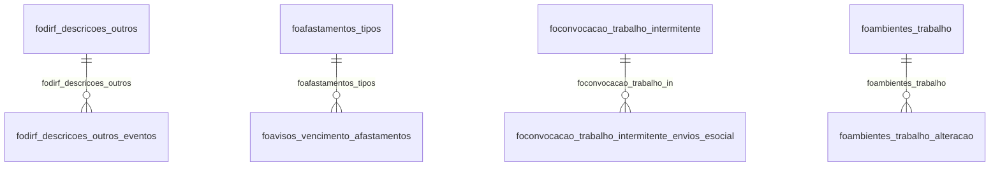

# Modelo — Pessoal - outros (rascunho em lote)

> Gerado por `src/model/gerar_docs_modelo.py` a partir de `src/model/modulos/pessoal_outros.yaml`, do catálogo e do perfil de colunas. **Não edite à mão.**

123 entidades. A coluna *Preench.* é o % de linhas com valor útil (nem nulo, nem em branco, nem zero, nem 1900-01-01; para colunas de código o zero conta como valor).

## Diagrama

## Entidades

| Entidade | Tabela | Linhas | Volume | Filtro obrigatório |
|---|---|---|---|---|
| [focalcmedias_mem_oper](#focalcmedias_mem_oper) | `focalcmedias_mem_oper` | 4.364.870 | grande | empresa; um de: operacao |
| [focalcmedias_mem](#focalcmedias_mem) | `focalcmedias_mem` | 103.306 | medio | empresa |
| [fotermo_rescisao_rais](#fotermo_rescisao_rais) | `FOTERMO_RESCISAO_RAIS` | 361.039 | medio | empresa |
| [foguia_inss_servicos_valores](#foguia_inss_servicos_valores) | `FOGUIA_INSS_SERVICOS_VALORES` | 117.690 | medio | empresa |
| [foguia_iss](#foguia_iss) | `FOGUIA_ISS` | 611 | pequeno | empresa |
| [focalcirrf_empregados](#focalcirrf_empregados) | `FOCALCIRRF_EMPREGADOS` | 55.171 | medio | empresa |
| [fodiferenca_salario](#fodiferenca_salario) | `FODIFERENCA_SALARIO` | 53.272 | medio | empresa |
| [fodiferenca_alteracao_retroativa_piso_salarial](#fodiferenca_alteracao_retroativa_piso_salarial) | `FODIFERENCA_ALTERACAO_RETROATIVA_PISO_SALARIAL` | 1 | pequeno | — |
| [fovariavel_planosaude](#fovariavel_planosaude) | `FOVARIAVEL_PLANOSAUDE` | 17.646 | medio | empresa |
| [fodominio_beneficios_controle_identificador_empregado](#fodominio_beneficios_controle_identificador_empregado) | `FODOMINIO_BENEFICIOS_CONTROLE_IDENTIFICADOR_EMPREGADO` | 16.882 | medio | empresa |
| [fofaltas_lancamentos](#fofaltas_lancamentos) | `FOFALTAS_LANCAMENTOS` | 14.964 | medio | empresa |
| [foencargo_simples_domestico_empregados](#foencargo_simples_domestico_empregados) | `FOENCARGO_SIMPLES_DOMESTICO_EMPREGADOS` | 12.544 | medio | empresa |
| [foencargo_simples_domestico](#foencargo_simples_domestico) | `FOENCARGO_SIMPLES_DOMESTICO` | 6.326 | pequeno | empresa |
| [foencargo_simples_domestico_rescisorio](#foencargo_simples_domestico_rescisorio) | `FOENCARGO_SIMPLES_DOMESTICO_RESCISORIO` | 260 | pequeno | empresa |
| [fojornadas_horarios](#fojornadas_horarios) | `FOJORNADAS_HORARIOS` | 11.086 | medio | empresa |
| [fojornadas_alteracao](#fojornadas_alteracao) | `FOJORNADAS_ALTERACAO` | 3 | pequeno | empresa |
| [fobanking_controle_vinculo_empregaticio](#fobanking_controle_vinculo_empregaticio) | `FOBANKING_CONTROLE_VINCULO_EMPREGATICIO` | 10.025 | medio | empresa |
| [fobanking_controle_pessoa](#fobanking_controle_pessoa) | `FOBANKING_CONTROLE_PESSOA` | 9.873 | pequeno | empresa |
| [fomediascalc_simulacao](#fomediascalc_simulacao) | `FOMEDIASCALC_SIMULACAO` | 7.204 | pequeno | empresa |
| [fovalores_pagamento_ajuste_parcelamento_esocial](#fovalores_pagamento_ajuste_parcelamento_esocial) | `FOVALORES_PAGAMENTO_AJUSTE_PARCELAMENTO_ESOCIAL` | 6.502 | pequeno | — |
| [fovalores_ajuste_parcelamento](#fovalores_ajuste_parcelamento) | `FOVALORES_AJUSTE_PARCELAMENTO` | 1.438 | pequeno | — |
| [fovalores_pagamento_ajuste_parcelamento](#fovalores_pagamento_ajuste_parcelamento) | `FOVALORES_PAGAMENTO_AJUSTE_PARCELAMENTO` | 1.316 | pequeno | — |
| [fosituacoes_avo_13](#fosituacoes_avo_13) | `FOSITUACOES_AVO_13` | 6.115 | pequeno | — |
| [focargos_alteracao](#focargos_alteracao) | `FOCARGOS_ALTERACAO` | 6.052 | pequeno | empresa |
| [focargos_alteracao_envios_esocial](#focargos_alteracao_envios_esocial) | `FOCARGOS_ALTERACAO_ENVIOS_ESOCIAL` | 2.476 | pequeno | empresa |
| [fodirf_outros_dados](#fodirf_outros_dados) | `FODIRF_OUTROS_DADOS` | 4.996 | pequeno | empresa |
| [fodirf_descricoes_outros_eventos](#fodirf_descricoes_outros_eventos) | `FODIRF_DESCRICOES_OUTROS_EVENTOS` | 260 | pequeno | empresa |
| [fodirf_descricoes_outros](#fodirf_descricoes_outros) | `FODIRF_DESCRICOES_OUTROS` | 36 | pequeno | empresa |
| [fopagto_dados_pagamento](#fopagto_dados_pagamento) | `FOPAGTO_DADOS_PAGAMENTO` | 4.928 | pequeno | empresa |
| [fopagto_publicar_documento](#fopagto_publicar_documento) | `FOPAGTO_PUBLICAR_DOCUMENTO` | 2 | pequeno | empresa |
| [fohorarios_alteracao](#fohorarios_alteracao) | `FOHORARIOS_ALTERACAO` | 4.019 | pequeno | empresa |
| [fohorarios_intervalos](#fohorarios_intervalos) | `FOHORARIOS_INTERVALOS` | 2.494 | pequeno | empresa |
| [fohorarios_alteracao_envios_esocial](#fohorarios_alteracao_envios_esocial) | `FOHORARIOS_ALTERACAO_ENVIOS_ESOCIAL` | 1.612 | pequeno | empresa |
| [fofilhos_alteracao](#fofilhos_alteracao) | `FOFILHOS_ALTERACAO` | 3.978 | pequeno | empresa |
| [fofilhos_plano_saude](#fofilhos_plano_saude) | `FOFILHOS_PLANO_SAUDE` | 1.196 | pequeno | empresa |
| [foempreg_contrsind](#foempreg_contrsind) | `foempreg_contrsind` | 3.721 | pequeno | empresa |
| [foempreg_campolivres](#foempreg_campolivres) | `foempreg_campolivres` | 33 | pequeno | empresa |
| [fofiliais_fap](#fofiliais_fap) | `FOFILIAIS_FAP` | 2.957 | pequeno | empresa |
| [fofiliais_historico](#fofiliais_historico) | `FOFILIAIS_HISTORICO` | 1.769 | pequeno | empresa |
| [fofiliais_sindicatos_patronais](#fofiliais_sindicatos_patronais) | `FOFILIAIS_SINDICATOS_PATRONAIS` | 1 | pequeno | empresa |
| [forequerimento_seguro_desemprego_salarios](#forequerimento_seguro_desemprego_salarios) | `FOREQUERIMENTO_SEGURO_DESEMPREGO_SALARIOS` | 1.636 | pequeno | empresa |
| [fovigencia_regime](#fovigencia_regime) | `FOVIGENCIA_REGIME` | 1.464 | pequeno | empresa |
| [fovigencia_unidade_calculo](#fovigencia_unidade_calculo) | `FOVIGENCIA_UNIDADE_CALCULO` | 1.372 | pequeno | empresa |
| [focontribuicao_sindical_sindicatos](#focontribuicao_sindical_sindicatos) | `FOCONTRIBUICAO_SINDICAL_SINDICATOS` | 1.424 | pequeno | — |
| [focontribuicao_sindical](#focontribuicao_sindical) | `FOCONTRIBUICAO_SINDICAL` | 1.260 | pequeno | empresa |
| [focontribuicao_sindical_sindicatos_p](#focontribuicao_sindical_sindicatos_p) | `FOCONTRIBUICAO_SINDICAL_SINDICATOS_P` | 6 | pequeno | — |
| [foaliquota_acidente_trabalho_cnae](#foaliquota_acidente_trabalho_cnae) | `FOALIQUOTA_ACIDENTE_TRABALHO_CNAE` | 1.347 | pequeno | — |
| [foencargos_pensao_alimenticia](#foencargos_pensao_alimenticia) | `FOENCARGOS_PENSAO_ALIMENTICIA` | 789 | pequeno | empresa |
| [foencargos_emprestimo_credito_trabalhador](#foencargos_emprestimo_credito_trabalhador) | `FOENCARGOS_EMPRESTIMO_CREDITO_TRABALHADOR` | 465 | pequeno | empresa |
| [foencargos_emprestimo_credito_trabalhador_rescisao](#foencargos_emprestimo_credito_trabalhador_rescisao) | `FOENCARGOS_EMPRESTIMO_CREDITO_TRABALHADOR_RESCISAO` | 28 | pequeno | empresa |
| [fomedidas_protecao_emprego_covid_19](#fomedidas_protecao_emprego_covid_19) | `FOMEDIDAS_PROTECAO_EMPREGO_COVID_19` | 777 | pequeno | empresa |
| [fomedidas_protecao_emprego_covid_19_afastamentos](#fomedidas_protecao_emprego_covid_19_afastamentos) | `FOMEDIDAS_PROTECAO_EMPREGO_COVID_19_AFASTAMENTOS` | 233 | pequeno | empresa |
| [fomedidas_protecao_emprego_covid_19_prorrogacao_antecipacao](#fomedidas_protecao_emprego_covid_19_prorrogacao_antecipacao) | `FOMEDIDAS_PROTECAO_EMPREGO_COVID_19_PRORROGACAO_ANTECIPACAO` | 43 | pequeno | empresa |
| [foformas_ajuste_parcelamento_competencias](#foformas_ajuste_parcelamento_competencias) | `FOFORMAS_AJUSTE_PARCELAMENTO_COMPETENCIAS` | 653 | pequeno | — |
| [foformas_ajuste_parcelamento](#foformas_ajuste_parcelamento) | `FOFORMAS_AJUSTE_PARCELAMENTO` | 331 | pequeno | — |
| [foalteracao_salarial_complementos](#foalteracao_salarial_complementos) | `FOALTERACAO_SALARIAL_COMPLEMENTOS` | 623 | pequeno | empresa |
| [foalteracao_retroativa_valor_rubricas](#foalteracao_retroativa_valor_rubricas) | `FOALTERACAO_RETROATIVA_VALOR_RUBRICAS` | 376 | pequeno | empresa |
| [fofgtsdigital_competencia](#fofgtsdigital_competencia) | `FOFGTSDIGITAL_COMPETENCIA` | 557 | pequeno | empresa |
| [fofgtsdigital_consulta](#fofgtsdigital_consulta) | `FOFGTSDIGITAL_CONSULTA` | 94 | pequeno | empresa |
| [fofgtsdigital_ocorrencia](#fofgtsdigital_ocorrencia) | `FOFGTSDIGITAL_OCORRENCIA` | 3 | pequeno | empresa |
| [focalcinss_movto](#focalcinss_movto) | `focalcinss_movto` | 553 | pequeno | empresa |
| [fopagamentos_ajuste_parcelamento](#fopagamentos_ajuste_parcelamento) | `FOPAGAMENTOS_AJUSTE_PARCELAMENTO` | 526 | pequeno | — |
| [fosefip_tbtercr](#fosefip_tbtercr) | `fosefip_tbtercr` | 352 | pequeno | — |
| [folinhas_valores_passagem](#folinhas_valores_passagem) | `FOLINHAS_VALORES_PASSAGEM` | 335 | pequeno | — |
| [focodigos_terceiros](#focodigos_terceiros) | `FOCODIGOS_TERCEIROS` | 316 | pequeno | — |
| [focodigos_gps](#focodigos_gps) | `FOCODIGOS_GPS` | 184 | pequeno | — |
| [fotabcalcinss_faixas](#fotabcalcinss_faixas) | `FOTABCALCINSS_FAIXAS` | 298 | pequeno | — |
| [fotabcalcinss_salfam](#fotabcalcinss_salfam) | `FOTABCALCINSS_SALFAM` | 153 | pequeno | — |
| [focoordenador_estagio](#focoordenador_estagio) | `FOCOORDENADOR_ESTAGIO` | 264 | pequeno | — |
| [foinformacoes_complementares_eventos_periodicos_esocial_envi](#foinformacoes_complementares_eventos_periodicos_esocial_envi) | `FOINFORMACOES_COMPLEMENTARES_EVENTOS_PERIODICOS_ESOCIAL_ENVIOS_ESOCIAL` | 238 | pequeno | empresa |
| [foinformacoes_complementares_eventos_periodicos_esocial](#foinformacoes_complementares_eventos_periodicos_esocial) | `FOINFORMACOES_COMPLEMENTARES_EVENTOS_PERIODICOS_ESOCIAL` | 155 | pequeno | empresa |
| [foinstituicao_ensino](#foinstituicao_ensino) | `FOINSTITUICAO_ENSINO` | 212 | pequeno | — |
| [fonatureza_evento](#fonatureza_evento) | `FONATUREZA_EVENTO` | 209 | pequeno | — |
| [fomonitoramento_saude_trabalhador_envios_esocial](#fomonitoramento_saude_trabalhador_envios_esocial) | `FOMONITORAMENTO_SAUDE_TRABALHADOR_ENVIOS_ESOCIAL` | 203 | pequeno | empresa |
| [fomonitoramento_saude_trabalhador](#fomonitoramento_saude_trabalhador) | `FOMONITORAMENTO_SAUDE_TRABALHADOR` | 198 | pequeno | empresa |
| [fomonitoramento_saude_trabalhador_exames](#fomonitoramento_saude_trabalhador_exames) | `FOMONITORAMENTO_SAUDE_TRABALHADOR_EXAMES` | 190 | pequeno | empresa |
| [foguiainss_dados_serv](#foguiainss_dados_serv) | `foguiainss_dados_serv` | 157 | pequeno | empresa |
| [fofuncoes_alteracao](#fofuncoes_alteracao) | `FOFUNCOES_ALTERACAO` | 142 | pequeno | empresa |
| [fofuncoes_alteracao_envios_esocial](#fofuncoes_alteracao_envios_esocial) | `FOFUNCOES_ALTERACAO_ENVIOS_ESOCIAL` | 66 | pequeno | empresa |
| [focodigo_esocial_domestico](#focodigo_esocial_domestico) | `FOCODIGO_ESOCIAL_DOMESTICO` | 120 | pequeno | — |
| [fofatores_risco](#fofatores_risco) | `FOFATORES_RISCO` | 78 | pequeno | — |
| [forescisoesaviso_envios_esocial](#forescisoesaviso_envios_esocial) | `FORESCISOESAVISO_ENVIOS_ESOCIAL` | 77 | pequeno | empresa |
| [foinss_empresa_receita_bruta](#foinss_empresa_receita_bruta) | `FOINSS_EMPRESA_RECEITA_BRUTA` | 73 | pequeno | empresa |
| [foinss_empresa_receita_bruta_envios_esocial](#foinss_empresa_receita_bruta_envios_esocial) | `FOINSS_EMPRESA_RECEITA_BRUTA_ENVIOS_ESOCIAL` | 50 | pequeno | — |
| [foclassificacoes_eventos](#foclassificacoes_eventos) | `FOCLASSIFICACOES_EVENTOS` | 64 | pequeno | — |
| [fosind_diasdesconsiderar](#fosind_diasdesconsiderar) | `fosind_diasdesconsiderar` | 62 | pequeno | — |
| [foibge_salarios_outras_remuneracoes_natureza_rubricas](#foibge_salarios_outras_remuneracoes_natureza_rubricas) | `FOIBGE_SALARIOS_OUTRAS_REMUNERACOES_NATUREZA_RUBRICAS` | 46 | pequeno | empresa |
| [foibge_beneficios_classificacao_rubricas](#foibge_beneficios_classificacao_rubricas) | `FOIBGE_BENEFICIOS_CLASSIFICACAO_RUBRICAS` | 2 | pequeno | empresa |
| [focategoria_celetista_cedido](#focategoria_celetista_cedido) | `FOCATEGORIA_CELETISTA_CEDIDO` | 44 | pequeno | — |
| [focategoria_origem_dirigente_sindical](#focategoria_origem_dirigente_sindical) | `FOCATEGORIA_ORIGEM_DIRIGENTE_SINDICAL` | 33 | pequeno | — |
| [focategoria_agente_publico](#focategoria_agente_publico) | `FOCATEGORIA_AGENTE_PUBLICO` | 3 | pequeno | — |
| [foadvertencia_suspensao](#foadvertencia_suspensao) | `FOADVERTENCIA_SUSPENSAO` | 37 | pequeno | empresa |
| [fomonitoracao_biologica_analise_efetuada](#fomonitoracao_biologica_analise_efetuada) | `FOMONITORACAO_BIOLOGICA_ANALISE_EFETUADA` | 35 | pequeno | — |
| [foantecipacao_salarial_rais](#foantecipacao_salarial_rais) | `FOANTECIPACAO_SALARIAL_RAIS` | 34 | pequeno | empresa |
| [fotipos_itens_prestacao_servico](#fotipos_itens_prestacao_servico) | `FOTIPOS_ITENS_PRESTACAO_SERVICO` | 30 | pequeno | — |
| [foagente_quimico](#foagente_quimico) | `FOAGENTE_QUIMICO` | 26 | pequeno | — |
| [fomensagem_aviso](#fomensagem_aviso) | `FOMENSAGEM_AVISO` | 18 | pequeno | — |
| [foestabilidade_tipos](#foestabilidade_tipos) | `FOESTABILIDADE_TIPOS` | 17 | pequeno | — |
| [foavisos_vencimento_afastamentos](#foavisos_vencimento_afastamentos) | `FOAVISOS_VENCIMENTO_AFASTAMENTOS` | 17 | pequeno | — |
| [foavisos_vencimentos_parametros](#foavisos_vencimentos_parametros) | `FOAVISOS_VENCIMENTOS_PARAMETROS` | 1 | pequeno | — |
| [foconvenios_terceiros](#foconvenios_terceiros) | `FOCONVENIOS_TERCEIROS` | 14 | pequeno | — |
| [foccustos_exposicao_fatores_risco_i](#foccustos_exposicao_fatores_risco_i) | `FOCCUSTOS_EXPOSICAO_FATORES_RISCO_I` | 13 | pequeno | empresa |
| [fovale_alimentacao_vigencias](#fovale_alimentacao_vigencias) | `FOVALE_ALIMENTACAO_VIGENCIAS` | 13 | pequeno | empresa |
| [fovale_alimentacao](#fovale_alimentacao) | `FOVALE_ALIMENTACAO` | 11 | pequeno | empresa |
| [foequipamentos_protecao_individual](#foequipamentos_protecao_individual) | `FOEQUIPAMENTOS_PROTECAO_INDIVIDUAL` | 9 | pequeno | empresa |
| [focadbases_backup](#focadbases_backup) | `FOCADBASES_BACKUP` | 9 | pequeno | — |
| [foagentes_integracao](#foagentes_integracao) | `FOAGENTES_INTEGRACAO` | 8 | pequeno | — |
| [foremuneracao_variavel](#foremuneracao_variavel) | `FOREMUNERACAO_VARIAVEL` | 8 | pequeno | empresa |
| [fomodelos_etiquetas_ctps](#fomodelos_etiquetas_ctps) | `FOMODELOS_ETIQUETAS_CTPS` | 6 | pequeno | — |
| [focontrrpa_outros_valores](#focontrrpa_outros_valores) | `FOCONTRRPA_OUTROS_VALORES` | 6 | pequeno | empresa |
| [foconvocacao_trabalho_intermitente](#foconvocacao_trabalho_intermitente) | `FOCONVOCACAO_TRABALHO_INTERMITENTE` | 5 | pequeno | empresa |
| [foconvocacao_trabalho_intermitente_envios_esocial](#foconvocacao_trabalho_intermitente_envios_esocial) | `FOCONVOCACAO_TRABALHO_INTERMITENTE_ENVIOS_ESOCIAL` | 5 | pequeno | empresa |
| [fohorafolha_backup](#fohorafolha_backup) | `FOHORAFOLHA_BACKUP` | 4 | pequeno | empresa |
| [foavisosconf_fechamento_periodo](#foavisosconf_fechamento_periodo) | `FOAVISOSCONF_FECHAMENTO_PERIODO` | 2 | pequeno | — |
| [fohorasaula_reajustes](#fohorasaula_reajustes) | `fohorasaula_reajustes` | 1 | pequeno | empresa |
| [fopagtoparcial_sindicatos](#fopagtoparcial_sindicatos) | `FOPAGTOPARCIAL_SINDICATOS` | 1 | pequeno | empresa |
| [fodepto_alteracao](#fodepto_alteracao) | `FODEPTO_ALTERACAO` | 1 | pequeno | empresa |
| [foconfiguracoes_etiquetas_ctps](#foconfiguracoes_etiquetas_ctps) | `FOCONFIGURACOES_ETIQUETAS_CTPS` | 1 | pequeno | — |
| [foparametro_thread](#foparametro_thread) | `FOPARAMETRO_THREAD` | 1 | pequeno | — |
| [foambientes_trabalho](#foambientes_trabalho) | `FOAMBIENTES_TRABALHO` | 1 | pequeno | empresa |
| [foambientes_trabalho_alteracao](#foambientes_trabalho_alteracao) | `FOAMBIENTES_TRABALHO_ALTERACAO` | 1 | pequeno | empresa |
| [foportal_empregado](#foportal_empregado) | `FOPORTAL_EMPREGADO` | 1 | pequeno | — |
| [foafastamentos_tipos](#foafastamentos_tipos) | `FOAFASTAMENTOS_TIPOS` | 82 | pequeno | — |

## focalcmedias_mem_oper

**Operacao memoria de calculo** — tabela `focalcmedias_mem_oper` (4.364.870 linhas)

Operacao memoria de calculo. 4.364.870 linhas no catálogo; chave: i_operacao, I_CALCMEDIAS_MEM.

- **Chave:** `i_operacao, I_CALCMEDIAS_MEM`
- **Empresa:** `codi_emp`
- **Período:** `data_calculo` · exige um de: `operacao`
- **Ordem padrão:** `data_calculo desc`, `i_operacao asc`, `I_CALCMEDIAS_MEM asc`

**Regras de negócio validadas:**

- Medido em 2026-10-18: 4.364.960 linhas, 219 empresa(s), data_calculo de 2013-12-26 a 2026-11-30.

| Campo | Coluna | Tipo | Preench. | Domínio | Descrição (banco) |
|---|---|---|---|---|---|
| operacao | `i_operacao` | integer(4) |  |  | Operacao |
| codigo_da_memoria_de_calculo | `i_calcmedias_mem` | uniqueidentifier(16) |  |  | Código da memória de cálculo |
| empresa | `codi_emp` | integer(4) |  |  | Empresa |
| empregado | `i_empregados` | integer(4) |  |  | Empregado |
| is_tipo_de_media | `tipo_media` | tinyint(1) |  |  | is Tipo de media |
| data_calculo | `data_calculo` | date(4) |  |  | Data calculo |
| inicio_aquisitivo | `inicio_aquisitivo` | date(4) |  |  | Inicio aquisitivo |
| tipo_descricao | `tipo` | tinyint(1) |  |  | Tipo descricao |
| descricao_da_operacao 🔒 | `descricao` | varchar(160) |  |  | Descricao da operacao |
| origem_do_registro_0_sistema_1_imp_tabel | `origem_reg` | tinyint(1) |  |  | Origem do registro 0 - Sistema, 1 - Imp. Tabelas, 2 - Imp. Layout, 3- Imp. Tabelas Concorrentes |
| codigo_da_empresa_de_origem | `codi_emp_origem` | integer(4) |  |  | Código da empresa de origem |
| codigo_do_empregado_de_origem | `i_empregados_origem` | integer(4) |  |  | Código do empregado de origem |
| codigo_sequencial_da_simulacao | `simulacao` | integer(4) |  |  | Código sequencial da simulação |
| codigo_da_memoria_de_calculo_renomeado | `i_calcmedias_mem_old` | integer(4) |  |  | Código da memória de cálculo - Renomeado |
| simulacao_de_media_mais_favoravel_por_ru | `simulacao_mais_favoravel` | smallint(2) |  |  | Simulação de média mais favorável por rubrica. |
| valor_de_conversao_de_dias | `valor_conversao_dias` | numeric(13) |  |  | Valor de conversão de dias |
| codigo_do_evento | `i_eventos` | integer(4) |  |  | Código do evento |

**Filtros:** `operacao` (eq/in), `codigo_da_memoria_de_calculo` (eq/in), `data_calculo` (entre/gte/lte), `inicio_aquisitivo` (entre/gte/lte), `empregado` (eq/in), `is_tipo_de_media` (eq/in), `tipo_descricao` (eq/in), `descricao_da_operacao` (contem/prefixo), `codigo_da_empresa_de_origem` (eq/in), `codigo_do_empregado_de_origem` (eq/in), `codigo_da_memoria_de_calculo_renomeado` (eq/in), `codigo_do_evento` (eq/in)

## focalcmedias_mem

**Memoria de calculo** — tabela `focalcmedias_mem` (103.306 linhas)

Memoria de calculo. 103.306 linhas no catálogo; chave: I_CALCMEDIAS_MEM.

- **Chave:** `I_CALCMEDIAS_MEM`
- **Empresa:** `codi_emp`
- **Período:** `data_calculo`
- **Ordem padrão:** `data_calculo desc`, `I_CALCMEDIAS_MEM asc`

**Regras de negócio validadas:**

- Medido em 2026-10-18: 103.308 linhas, 219 empresa(s), data_calculo de 2013-12-26 a 2026-11-30.
- tipo_de_periodo_1_ultimos_meses_2_period: todos os valores reais estão no comentário do banco (3=54.940, 2=46.124, 1=2.244).
- valores_a_considerar_1_todos_2_somente_c: todos os valores reais estão no comentário do banco (1=103.308).
- tipo_periodo_valor: todos os valores reais estão no comentário do banco (3=54.940, 1=25.794, 2=22.574).
- tipo_considerar_valor: todos os valores reais estão no comentário do banco (1=103.308).
- considerou_o_salario_do_mes_anterior_0_n: todos os valores reais estão no comentário do banco (0=103.308).
- considerar_o_mes_de_janeiro_para_buscar: todos os valores reais estão no comentário do banco (0=103.308).
- considerar_o_mes_de_fevereiro_para_busca: todos os valores reais estão no comentário do banco (0=103.308).
- considerar_o_mes_de_marco_para_buscar_os: todos os valores reais estão no comentário do banco (0=103.308).
- considerar_o_mes_de_abril_para_buscar_os: todos os valores reais estão no comentário do banco (0=103.308).
- considerar_o_mes_de_maio_para_buscar_os: todos os valores reais estão no comentário do banco (0=103.308).
- considerar_o_mes_de_junho_para_buscar_os: todos os valores reais estão no comentário do banco (0=103.308).
- considerar_o_mes_de_julho_para_buscar_os: todos os valores reais estão no comentário do banco (0=101.812, 1=1.496).
- considerar_o_mes_de_agosto_para_buscar_o: todos os valores reais estão no comentário do banco (0=101.812, 1=1.496).
- considerar_o_mes_de_setembro_para_buscar: todos os valores reais estão no comentário do banco (0=101.812, 1=1.496).
- considerar_o_mes_de_outubro_para_buscar: todos os valores reais estão no comentário do banco (0=101.812, 1=1.496).
- considerar_o_mes_de_novembro_para_buscar: todos os valores reais estão no comentário do banco (0=101.812, 1=1.496).
- considerar_o_mes_de_dezembro_para_buscar: todos os valores reais estão no comentário do banco (0=101.812, 1=1.496).
- considerar_janeiro_valor: todos os valores reais estão no comentário do banco (0=103.308).
- considerar_fevereiro_valor: todos os valores reais estão no comentário do banco (0=103.308).
- considerar_marco_valor: todos os valores reais estão no comentário do banco (0=103.308).
- considerar_abril_valor: todos os valores reais estão no comentário do banco (0=103.308).
- considerar_maio_valor: todos os valores reais estão no comentário do banco (0=103.308).
- considerar_junho_valor: todos os valores reais estão no comentário do banco (0=103.308).
- considerar_julho_valor: todos os valores reais estão no comentário do banco (0=103.308).
- considerar_agosto_valor: todos os valores reais estão no comentário do banco (0=103.308).
- considerar_setembro_valor: todos os valores reais estão no comentário do banco (0=103.308).
- considerar_outubro_valor: todos os valores reais estão no comentário do banco (0=103.308).
- considerar_novembro_valor: todos os valores reais estão no comentário do banco (0=103.308).
- considerar_dezembro_valor: todos os valores reais estão no comentário do banco (0=103.308).
- Vínculo foempregados (foempregados): 0 de 108 linhas sem registro relacionado (empresa 990).

| Campo | Coluna | Tipo | Preench. | Domínio | Descrição (banco) |
|---|---|---|---|---|---|
| codigo | `i_calcmedias_mem` | uniqueidentifier(16) |  |  | Código |
| empresa | `codi_emp` | integer(4) |  |  | Empresa |
| empregado | `i_empregados` | integer(4) |  |  | Empregado |
| is_tipo_de_media | `tipo_media` | tinyint(1) |  |  | is Tipo de media |
| data_calculo | `data_calculo` | date(4) |  |  | Data calculo |
| mes_inicial_da_media | `meses_media_ini_quantidade` | date(4) |  |  | Mês inicial da média |
| mes_final_da_media | `meses_media_fim_quantidade` | date(4) |  |  | Mês final da média |
| inicio_aquisitivo | `inicio_aquisitivo` | date(4) |  |  | Inicio aquisitivo |
| fim_aquisitivo | `fim_aquisitivo` | date(4) |  |  | Fim aquisitivo |
| sequencia | `sequencia` | tinyint(1) |  |  | Sequencia |
| medias_horas | `medias_horas` | numeric(13) |  |  | Medias horas |
| valor_medias | `medias_valor` | numeric(13) |  |  | Valor medias |
| valor_vantagem | `vantagem` | numeric(13) |  |  | Valor vantagem |
| origem_do_registro_0_sistema_1_imp_tabel | `origem_reg` | tinyint(1) |  |  | Origem do registro 0 - Sistema, 1 - Imp. Tabelas, 2 - Imp. Layout, 3- Imp. Tabelas Concorrentes |
| media_hora_aula | `medias_haula` | numeric(13) |  |  | Media hora-aula |
| codigo_da_empresa_de_origem | `codi_emp_origem` | integer(4) |  |  | Código da empresa de origem |
| codigo_do_empregado_de_origem | `i_empregados_origem` | integer(4) |  |  | Código do empregado de origem |
| base_de_calculo_da_media_hora | `base_media_hora` | numeric(13) |  |  | Base de cálculo da média hora |
| base_de_calculo_da_media_hora_aula | `base_media_hora_aula` | numeric(13) |  |  | Base de cálculo da média hora aula |
| base_de_calculo_da_media_valor | `base_media_valor` | numeric(13) |  |  | Base de cálculo da média valor |
| base_de_calculo_do_adicional | `base_adicional` | numeric(13) |  |  | Base de cálculo do adicional |
| codigo_sequencial_da_simulacao | `simulacao` | integer(4) |  |  | Código sequencial da simulação |
| simulacao_mais_favoravel_0_nao_1_sim | `mais_favoravel` | smallint(2) |  |  | Simulação mais favorável: 0=Não/1=Sim |
| tipo_de_periodo_1_ultimos_meses_2_period | `tipo_periodo_quantidade` | smallint(2) |  | focalcmedias_mem_tipo_de_periodo_1_ultimos_meses | Tipo de período. (1=Últimos meses/2=Período aquisitivo/3=Ano corrente/4=Últimos meses no período aquisitivo/5=Últimos meses no ano corrente/6=Selecionar meses no ano corrente) |
| valores_a_considerar_1_todos_2_somente_c | `tipo_considerar_quantidade` | smallint(2) |  | focalcmedias_mem_valores_a_considerar_1_todos_2_ | Valores a considerar. (1=Todos/2=Somente com valor/3=Maiores/4=Maiores e menores) |
| quantidade_de_meses | `nmeses_quantidade_quantidade` | integer(4) |  |  | Quantidade de meses |
| numero_de_meses_com_os_maiores_valores | `nmeses_quantidade_maiores_quantidade` | integer(4) |  |  | Número de meses com os maiores valores |
| tipo_periodo_valor | `tipo_periodo_valor` | smallint(2) |  | focalcmedias_mem_tipo_de_periodo_1_ultimos_meses | Tipo de período. (1=Últimos meses/2=Período aquisitivo/3=Ano corrente/4=Últimos meses no período aquisitivo/5=Últimos meses no ano corrente/6=Selecionar meses no ano corrente) |
| tipo_considerar_valor | `tipo_considerar_valor` | smallint(2) |  | focalcmedias_mem_valores_a_considerar_1_todos_2_ | Valores a considerar. (1=Todos/2=Somente com valor/3=Maiores/4=Maiores e menores) |
| nmeses_quantidade_valor | `nmeses_quantidade_valor` | integer(4) |  |  | Quantidade de meses |
| nmeses_quantidade_maiores_valor | `nmeses_quantidade_maiores_valor` | integer(4) |  |  | Número de meses com os maiores valores |
| meses_media_ini_valor | `meses_media_ini_valor` | date(4) |  |  | Mês inicial da média |
| meses_media_fim_valor | `meses_media_fim_valor` | date(4) |  |  | Mês final da média |
| tipo_de_calculo_de_13_1_adiantamento_2_a | `tipo_calculo_13` | smallint(2) |  |  | Tipo de cálculo de 13: 1=Adiantamento/2=Adiantamento nas férias/3=Integral/4=Pago em rescisão/5=Ajuste em dezembro |
| considerou_o_salario_do_mes_anterior_0_n | `considerou_salario_mes_anterior` | smallint(2) |  | focalcmedias_mem_considerou_o_salario_do_mes_ant | Considerou o salário do mês anterior: (0=Não/1=Sim) |
| codigo_renomeado | `i_calcmedias_mem_old` | integer(4) |  |  | Código - Renomeado |
| considerar_o_mes_de_janeiro_para_buscar | `considerar_janeiro_quantidade` | smallint(2) |  | focalcmedias_mem_considerar_o_mes_de_janeiro_par | Considerar o mês de janeiro para buscar os valores de médias. (0=Não/1=Sim) |
| considerar_o_mes_de_fevereiro_para_busca | `considerar_fevereiro_quantidade` | smallint(2) |  | focalcmedias_mem_considerar_o_mes_de_fevereiro_p | Considerar o mês de fevereiro para buscar os valores de médias. (0=Não/1=Sim) |
| considerar_o_mes_de_marco_para_buscar_os | `considerar_marco_quantidade` | smallint(2) |  | focalcmedias_mem_considerar_o_mes_de_marco_para_ | Considerar o mês de março para buscar os valores de médias. (0=Não/1=Sim) |
| considerar_o_mes_de_abril_para_buscar_os | `considerar_abril_quantidade` | smallint(2) |  | focalcmedias_mem_considerar_o_mes_de_abril_para_ | Considerar o mês de abril para buscar os valores de médias. (0=Não/1=Sim) |
| considerar_o_mes_de_maio_para_buscar_os | `considerar_maio_quantidade` | smallint(2) |  | focalcmedias_mem_considerar_o_mes_de_maio_para_b | Considerar o mês de maio para buscar os valores de médias. (0=Não/1=Sim) |
| considerar_o_mes_de_junho_para_buscar_os | `considerar_junho_quantidade` | smallint(2) |  | focalcmedias_mem_considerar_o_mes_de_junho_para_ | Considerar o mês de junho para buscar os valores de médias. (0=Não/1=Sim) |
| considerar_o_mes_de_julho_para_buscar_os | `considerar_julho_quantidade` | smallint(2) |  | focalcmedias_mem_considerar_o_mes_de_julho_para_ | Considerar o mês de julho para buscar os valores de médias. (0=Não/1=Sim) |
| considerar_o_mes_de_agosto_para_buscar_o | `considerar_agosto_quantidade` | smallint(2) |  | focalcmedias_mem_considerar_o_mes_de_agosto_para | Considerar o mês de agosto para buscar os valores de médias. (0=Não/1=Sim) |
| considerar_o_mes_de_setembro_para_buscar | `considerar_setembro_quantidade` | smallint(2) |  | focalcmedias_mem_considerar_o_mes_de_setembro_pa | Considerar o mês de setembro para buscar os valores de médias. (0=Não/1=Sim) |
| considerar_o_mes_de_outubro_para_buscar | `considerar_outubro_quantidade` | smallint(2) |  | focalcmedias_mem_considerar_o_mes_de_outubro_par | Considerar o mês de outubro para buscar os valores de médias. (0=Não/1=Sim) |
| considerar_o_mes_de_novembro_para_buscar | `considerar_novembro_quantidade` | smallint(2) |  | focalcmedias_mem_considerar_o_mes_de_novembro_pa | Considerar o mês de novembro para buscar os valores de médias. (0=Não/1=Sim) |
| considerar_o_mes_de_dezembro_para_buscar | `considerar_dezembro_quantidade` | smallint(2) |  | focalcmedias_mem_considerar_o_mes_de_dezembro_pa | Considerar o mês de dezembro para buscar os valores de médias. (0=Não/1=Sim) |
| considerar_janeiro_valor | `considerar_janeiro_valor` | smallint(2) |  | focalcmedias_mem_considerar_o_mes_de_janeiro_par | Considerar o mês de janeiro para buscar os valores de médias. (0=Não/1=Sim) |
| considerar_fevereiro_valor | `considerar_fevereiro_valor` | smallint(2) |  | focalcmedias_mem_considerar_o_mes_de_fevereiro_p | Considerar o mês de fevereiro para buscar os valores de médias. (0=Não/1=Sim) |
| considerar_marco_valor | `considerar_marco_valor` | smallint(2) |  | focalcmedias_mem_considerar_o_mes_de_marco_para_ | Considerar o mês de março para buscar os valores de médias. (0=Não/1=Sim) |
| considerar_abril_valor | `considerar_abril_valor` | smallint(2) |  | focalcmedias_mem_considerar_o_mes_de_abril_para_ | Considerar o mês de abril para buscar os valores de médias. (0=Não/1=Sim) |
| considerar_maio_valor | `considerar_maio_valor` | smallint(2) |  | focalcmedias_mem_considerar_o_mes_de_maio_para_b | Considerar o mês de maio para buscar os valores de médias. (0=Não/1=Sim) |
| considerar_junho_valor | `considerar_junho_valor` | smallint(2) |  | focalcmedias_mem_considerar_o_mes_de_junho_para_ | Considerar o mês de junho para buscar os valores de médias. (0=Não/1=Sim) |
| considerar_julho_valor | `considerar_julho_valor` | smallint(2) |  | focalcmedias_mem_considerar_o_mes_de_julho_para_ | Considerar o mês de julho para buscar os valores de médias. (0=Não/1=Sim) |
| considerar_agosto_valor | `considerar_agosto_valor` | smallint(2) |  | focalcmedias_mem_considerar_o_mes_de_agosto_para | Considerar o mês de agosto para buscar os valores de médias. (0=Não/1=Sim) |
| considerar_setembro_valor | `considerar_setembro_valor` | smallint(2) |  | focalcmedias_mem_considerar_o_mes_de_setembro_pa | Considerar o mês de setembro para buscar os valores de médias. (0=Não/1=Sim) |
| considerar_outubro_valor | `considerar_outubro_valor` | smallint(2) |  | focalcmedias_mem_considerar_o_mes_de_outubro_par | Considerar o mês de outubro para buscar os valores de médias. (0=Não/1=Sim) |
| considerar_novembro_valor | `considerar_novembro_valor` | smallint(2) |  | focalcmedias_mem_considerar_o_mes_de_novembro_pa | Considerar o mês de novembro para buscar os valores de médias. (0=Não/1=Sim) |
| considerar_dezembro_valor | `considerar_dezembro_valor` | smallint(2) |  | focalcmedias_mem_considerar_o_mes_de_dezembro_pa | Considerar o mês de dezembro para buscar os valores de médias. (0=Não/1=Sim) |

**Vínculos (LEFT JOIN, acrescentam colunas legíveis):**

- `foempregados` → `foempregados` por `codi_emp` = `codi_emp` e `i_empregados` = `i_empregados`; colunas: `foempregados_nome`

**Filtros:** `codigo` (eq/in), `data_calculo` (entre/gte/lte), `mes_inicial_da_media` (entre/gte/lte), `mes_final_da_media` (entre/gte/lte), `inicio_aquisitivo` (entre/gte/lte), `fim_aquisitivo` (entre/gte/lte), `meses_media_ini_valor` (entre/gte/lte), `meses_media_fim_valor` (entre/gte/lte), `empregado` (eq/in), `is_tipo_de_media` (eq/in), `codigo_da_empresa_de_origem` (eq/in), `codigo_do_empregado_de_origem` (eq/in), `tipo_de_periodo_1_ultimos_meses_2_period` (eq/in), `valores_a_considerar_1_todos_2_somente_c` (eq/in)

## fotermo_rescisao_rais

**Valores para compor o campo 23 do termo de rescisão.** — tabela `FOTERMO_RESCISAO_RAIS` (361.039 linhas)

Valores para compor o campo 23 do termo de rescisão.. 361.039 linhas no catálogo; chave: CODI_EMP, I_EMPREGADOS, COMPETENCIA, TIPO_PROCESSO, I_SERVICOS, RATEIO, I_CALCULOS.

- **Chave:** `CODI_EMP, I_EMPREGADOS, COMPETENCIA, TIPO_PROCESSO, I_SERVICOS, RATEIO, I_CALCULOS`
- **Empresa:** `CODI_EMP`
- **Período:** `COMPETENCIA`
- **Ordem padrão:** `COMPETENCIA desc`, `I_EMPREGADOS asc`, `TIPO_PROCESSO asc`

**Regras de negócio validadas:**

- Medido em 2026-10-18: 361.049 linhas, 811 empresa(s), COMPETENCIA de 2013-01-01 a 2026-11-01.

| Campo | Coluna | Tipo | Preench. | Domínio | Descrição (banco) |
|---|---|---|---|---|---|
| codigo_da_empresa | `codi_emp` | integer(4) |  |  | Código da empresa. |
| codigo_do_empregado | `i_empregados` | integer(4) |  |  | Código do empregado. |
| competencia_do_calculo | `competencia` | date(4) |  |  | Competência do cálculo. |
| tipo_do_calculo | `tipo_processo` | integer(4) |  |  | Tipo do cálculo. |
| servico_relacionado_no_calculo | `i_servicos` | integer(4) |  |  | Serviço relacionado no cálculo. |
| rateio | `rateio` | integer(4) |  |  | Rateio. |
| codigo_do_calculo | `i_calculos` | uniqueidentifier(16) |  |  | Código do cálculo. |
| codigo_do_calculo_renomeado | `i_calculos_old` | integer(4) |  |  | Código do cálculo - Renomeado |
| valor_que_compoe_o_campo_23_do_termo_de 🔒 | `valor_mes_compoe_campo_23_termo_rescisao` | numeric(30) |  |  | Valor que compoe o campo 23 do termo de rescisão. |
| valor_mes_compoe_campo_23_termo_rescisao 🔒 | `valor_mes_compoe_campo_23_termo_rescisao_complementar` | numeric(30) |  |  | Valor que compoe o campo 23 do termo de rescisão para complementar. |

**Filtros:** `codigo_do_empregado` (eq/in), `competencia_do_calculo` (eq/in), `tipo_do_calculo` (eq/in), `servico_relacionado_no_calculo` (eq/in), `rateio` (eq/in), `codigo_do_calculo` (eq/in), `codigo_do_calculo_renomeado` (eq/in)

## foguia_inss_servicos_valores

**Valores de encargos de INSS pagos por serviço.** — tabela `FOGUIA_INSS_SERVICOS_VALORES` (117.690 linhas)

Valores de encargos de INSS pagos por serviço.. 117.690 linhas no catálogo; chave: CODI_EMP, I_SERVICOS, TIPO_VALOR, I_GUIAINSS.

- **Chave:** `CODI_EMP, I_SERVICOS, TIPO_VALOR, I_GUIAINSS`
- **Empresa:** `CODI_EMP`
- **Período:** `—`
- **Ordem padrão:** `I_SERVICOS asc`, `TIPO_VALOR asc`

**Regras de negócio validadas:**

- Medido em 2026-10-18: 117.694 linhas, 551 empresa(s).
- tipo_valor: todos os valores reais estão no comentário do banco (1=29.170, 3=29.170, 5=29.170, 4=29.170, 8=1.009, 6=5).
- origem_do_registro_0_sistema_1_importaca: todos os valores reais estão no comentário do banco (0=117.694).

| Campo | Coluna | Tipo | Preench. | Domínio | Descrição (banco) |
|---|---|---|---|---|---|
| codigo_da_empresa | `codi_emp` | integer(4) |  |  | Código da empresa |
| codigo_do_servico | `i_servicos` | integer(4) |  |  | Código do Serviço |
| tipo_valor | `tipo_valor` | smallint(2) |  | foguia_inss_servicos_valores_tipo_de_valo | Tipo de valor. (1=Terceiros/2=INSS Frete/3=INSS Empresa empregados/4=INSS Empresa contribuintes/5=RAT/6=RAT Especial 15 anos/7=RAT Especial 20 anos/8=RAT Especial 25 anos) |
| codigo_da_guia_do_inss | `i_guiainss` | uniqueidentifier(16) |  |  | Código da guia do INSS |
| codigo_da_guia_do_inss_renomeado | `i_guiainss_old` | integer(4) |  |  | Código da guia do INSS - Renomeado |
| percentual | `percentual` | numeric(7) |  |  | Percentual. |
| valor | `valor` | numeric(13) |  |  | Valor. |
| origem_do_registro_0_sistema_1_importaca | `origem_registro` | smallint(2) |  | foguia_inss_servicos_valores_origem_do_re | Origem do registro (0=Sistema/1=Importação de tabelas/2=Importação de layout) |
| base_de_calculo | `base_calculo` | numeric(15) |  |  | Base de cálculo. |
| valor_aviso_previo | `valor_aviso_previo` | numeric(13) |  |  | Valor Aviso Prévio |
| base_de_calculo_aviso_previo | `base_calculo_aviso_previo` | numeric(15) |  |  | Base de cálculo Aviso Prévio |

**Filtros:** `codigo_do_servico` (eq/in), `tipo_valor` (eq/in), `codigo_da_guia_do_inss` (eq/in), `codigo_da_guia_do_inss_renomeado` (eq/in)

## foguia_iss

**Guia do ISS** — tabela `FOGUIA_ISS` (611 linhas)

Guia do ISS. 611 linhas no catálogo; chave: I_GUIA_ISS.

- **Chave:** `I_GUIA_ISS`
- **Empresa:** `CODI_EMP`
- **Período:** `DATA_VENCIMENTO`
- **Ordem padrão:** `DATA_VENCIMENTO desc`, `I_GUIA_ISS asc`

**Regras de negócio validadas:**

- Medido em 2026-10-18: 611 linhas, 49 empresa(s), DATA_VENCIMENTO de 0220-12-10 a 2026-10-09.
- Colunas expostas nulas em 100% das linhas (1): sequencial_de_pagamento.
- origem_do_registro_0_sistema_1_importaca: todos os valores reais estão no comentário do banco (0=611).
- Vínculo fofiliais (fofiliais): 0 de 5 linhas sem registro relacionado (empresa 395).

| Campo | Coluna | Tipo | Preench. | Domínio | Descrição (banco) |
|---|---|---|---|---|---|
| sequencial_da_guia | `i_guia_iss` | uniqueidentifier(16) |  |  | Sequencial da guia. |
| sequencial_da_guia_renomeado | `i_guia_iss_old` | integer(4) |  |  | Sequencial da guia - Renomeado |
| codigo_da_empresa | `codi_emp` | integer(4) |  |  | Código da empresa. |
| codigo_da_filial | `i_filiais` | integer(4) |  |  | Código da filial. |
| competencia | `competencia` | date(4) |  |  | Competência. |
| data_de_vencimento | `data_vencimento` | date(4) |  |  | Data de vencimento. |
| valor_da_guia | `valor` | numeric(13) |  |  | Valor da guia. |
| sequencial_de_pagamento | `i_pagto` | integer(4) |  |  | Sequencial de pagamento. |
| origem_do_registro_0_sistema_1_importaca | `origem_registro` | smallint(2) |  | foguia_iss_origem_do_registro_0_sistema_1_importa | Origem do registro. (0=Sistema/1=Importação de tabelas/2=Importação de leiaute/3=Conversão) |

**Vínculos (LEFT JOIN, acrescentam colunas legíveis):**

- `fofiliais` → `fofiliais` por `codi_emp` = `codi_emp` e `i_filiais` = `i_filiais`; colunas: `fofiliais_nome`

**Filtros:** `sequencial_da_guia` (eq/in), `competencia` (entre/gte/lte), `data_de_vencimento` (entre/gte/lte), `sequencial_da_guia_renomeado` (eq/in), `codigo_da_filial` (eq/in), `sequencial_de_pagamento` (eq/in)

## focalcirrf_empregados

**Valores da guia separados por empregado.** — tabela `FOCALCIRRF_EMPREGADOS` (55.171 linhas)

Valores da guia separados por empregado.. 55.171 linhas no catálogo; chave: CODI_EMP, PERIODO_INICIO, CODIGO_REC, CODI_EMP_FILIAL, I_EMPREGADOS, TIPO_GUIA.

- **Chave:** `CODI_EMP, PERIODO_INICIO, CODIGO_REC, CODI_EMP_FILIAL, I_EMPREGADOS, TIPO_GUIA`
- **Empresa:** `CODI_EMP`
- **Período:** `PERIODO_INICIO`
- **Ordem padrão:** `PERIODO_INICIO desc`, `CODIGO_REC asc`, `CODI_EMP_FILIAL asc`

**Regras de negócio validadas:**

- Medido em 2026-10-18: 55.171 linhas, 277 empresa(s), PERIODO_INICIO de 2013-02-01 a 2250-11-01.
- tipo_de_guia_1_empregados_e_contribuinte: todos os valores reais estão no comentário do banco (1=55.171).
- origem_do_registro_0_sistema_1_importaca: todos os valores reais estão no comentário do banco (0=55.171).
- Vínculo foempregados (foempregados): 0 de 40 linhas sem registro relacionado (empresa 1665).

| Campo | Coluna | Tipo | Preench. | Domínio | Descrição (banco) |
|---|---|---|---|---|---|
| codigo_da_empresa | `codi_emp` | integer(4) |  |  | Código da empresa. |
| periodo_inicio | `periodo_inicio` | date(4) |  |  | Período início. |
| codigo_de_recolhimento | `codigo_rec` | integer(4) |  |  | Código de recolhimento. |
| codigo_da_empresa_do_empregado | `codi_emp_filial` | integer(4) |  |  | Código da empresa do empregado. |
| codigo_do_empregado | `i_empregados` | integer(4) |  |  | Código do empregado. |
| tipo_de_guia_1_empregados_e_contribuinte | `tipo_guia` | smallint(2) |  | focalcirrf_empregados_tipo_de_gui | Tipo de guia. (1=Empregados e Contribuintes/2=Domésticos) |
| valor_de_irrf | `valor` | numeric(13) |  |  | Valor de IRRF. |
| origem_do_registro_0_sistema_1_importaca | `origem_registro` | smallint(2) |  | focalcirrf_empregados_origem_do_r | Origem do registro. (0=Sistema/1=Importação de tabelas/3=Importação de layout) |
| valor_da_base_utilizado_para_o_calculo_d | `base` | numeric(13) |  |  | Valor da base utilizado para o calculo do recolhimento |

**Vínculos (LEFT JOIN, acrescentam colunas legíveis):**

- `foempregados` → `foempregados` por `codi_emp_filial` = `codi_emp` e `i_empregados` = `i_empregados`; colunas: `foempregados_nome`

**Filtros:** `periodo_inicio` (eq/in), `codigo_de_recolhimento` (eq/in), `codigo_da_empresa_do_empregado` (eq/in), `codigo_do_empregado` (eq/in), `tipo_de_guia_1_empregados_e_contribuinte` (eq/in)

## fodiferenca_salario

**Espelho da view FOVDIFERENCA_SALARIO.** — tabela `FODIFERENCA_SALARIO` (53.272 linhas)

Espelho da view FOVDIFERENCA_SALARIO.. 53.272 linhas no catálogo; chave: TIPO_RATEIO, CODI_EMP, I_EMPREGADOS, I_CALCULOS_AJUSTADO_OLD, I_CALCULOS_DIFERENCA_OLD, COMPETENCIA_AJUSTADO, COMPETENCIA_DIFERENCA, TIPO_PROCESS_AJUSTADO, TIPO_PROCESS_DIFERENCA, I_SERVICOS_AJUSTADO, I_CALCULOS_COMPLEMENTOS_AJUSTADO_OLD, SITUACAO_MES_AJUSTADO.

- **Chave:** `TIPO_RATEIO, CODI_EMP, I_EMPREGADOS, I_CALCULOS_AJUSTADO_OLD, I_CALCULOS_DIFERENCA_OLD, COMPETENCIA_AJUSTADO, COMPETENCIA_DIFERENCA, TIPO_PROCESS_AJUSTADO, TIPO_PROCESS_DIFERENCA, I_SERVICOS_AJUSTADO, I_CALCULOS_COMPLEMENTOS_AJUSTADO_OLD, SITUACAO_MES_AJUSTADO`
- **Empresa:** `CODI_EMP`
- **Período:** `DATA_PAGAMENTO_DIFERENCA`
- **Ordem padrão:** `DATA_PAGAMENTO_DIFERENCA desc`, `TIPO_RATEIO asc`

**Regras de negócio validadas:**

- Medido em 2026-10-18: 53.308 linhas, 273 empresa(s), DATA_PAGAMENTO_DIFERENCA de 1900-01-01 a 2026-10-16.
- Colunas expostas nulas em 100% das linhas (2): i_calculos_complementos_ajustado_old, codigo_do_calculo_do_pagamento_do_adicio.

| Campo | Coluna | Tipo | Preench. | Domínio | Descrição (banco) |
|---|---|---|---|---|---|
| tipo_rateio | `tipo_rateio` | integer(4) |  |  |  |
| codi_emp | `codi_emp` | integer(4) |  |  |  |
| i_empregados | `i_empregados` | integer(4) |  |  |  |
| renomeado | `i_calculos_ajustado_old` | integer(4) |  |  | Renomeado |
| i_calculos_diferenca_old | `i_calculos_diferenca_old` | integer(4) |  |  | Renomeado |
| competencia_ajustado | `competencia_ajustado` | date(4) |  |  |  |
| competencia_diferenca | `competencia_diferenca` | date(4) |  |  |  |
| tipo_process_ajustado | `tipo_process_ajustado` | integer(4) |  |  |  |
| tipo_process_diferenca | `tipo_process_diferenca` | integer(4) |  |  |  |
| i_servicos_ajustado | `i_servicos_ajustado` | integer(4) |  |  |  |
| i_calculos_complementos_ajustado_old | `i_calculos_complementos_ajustado_old` | integer(4) |  |  | Renomeado |
| situacao_mes_ajustado | `situacao_mes_ajustado` | integer(4) |  |  |  |
| situacao_mes_diferenca | `situacao_mes_diferenca` | integer(4) |  |  |  |
| data_pagamento_diferenca | `data_pagamento_diferenca` | date(4) |  |  |  |
| i_eventos | `i_eventos` | integer(4) |  |  |  |
| valor_real | `valor_real` | numeric(30) |  |  |  |
| valor | `valor` | numeric(30) |  |  |  |
| tipo_evento | `tipo_evento` | varchar(2) |  |  |  |
| classificacao_evento | `classificacao_evento` | integer(4) |  |  |  |
| soma_rais_evento | `soma_rais_evento` | varchar(1) |  |  |  |
| i_forma_ajuste_parcelamento | `i_forma_ajuste_parcelamento` | integer(4) |  |  |  |
| diferenca_cct | `diferenca_cct` | integer(4) |  |  |  |
| antecipacao_salarial | `antecipacao_salarial` | integer(4) |  |  |  |
| rateio | `rateio` | integer(4) |  |  |  |
| i_servicos | `i_servicos` | integer(4) |  |  |  |
| considerar_remuneracao_esocial | `considerar_remuneracao_esocial` | smallint(2) |  |  |  |
| considerar_retencao_pagamento_esocial | `considerar_retencao_pagamento_esocial` | smallint(2) |  |  |  |
| considerar_remuneracao_s_1210_esocial | `considerar_remuneracao_s_1210_esocial` | smallint(2) |  |  |  |
| valor_diferenca_para_esocial | `valor_diferenca_para_esocial` | numeric(30) |  |  |  |
| tem_valor_diferenca_para_esocial | `tem_valor_diferenca_para_esocial` | smallint(2) |  |  |  |
| diferenca_cct_esocial | `diferenca_cct_esocial` | smallint(2) |  |  |  |
| codigo_do_calculo_do_pagamento_do_adicio | `i_calculos_pagamento_adicional_mp_927_old` | integer(4) |  |  | Código do cálculo do pagamento do adicional MP 927 - Renomeado |
| rubrica_desconto_antecipacao_dsr_esocial | `rubrica_desconto_antecipacao_dsr_esocial` | smallint(2) |  |  |  |

**Filtros:** `tipo_rateio` (eq/in), `competencia_ajustado` (entre/gte/lte), `competencia_diferenca` (entre/gte/lte), `data_pagamento_diferenca` (entre/gte/lte), `i_empregados` (eq/in), `renomeado` (eq/in), `i_calculos_diferenca_old` (eq/in), `tipo_process_ajustado` (eq/in), `tipo_process_diferenca` (eq/in), `i_servicos_ajustado` (eq/in), `i_calculos_complementos_ajustado_old` (eq/in), `situacao_mes_ajustado` (eq/in), `situacao_mes_diferenca` (eq/in), `i_eventos` (eq/in)

## fodiferenca_alteracao_retroativa_piso_salarial

**Diferenças referentes a alteração retroativa de piso salarial.** — tabela `FODIFERENCA_ALTERACAO_RETROATIVA_PISO_SALARIAL` (1 linhas)

Diferenças referentes a alteração retroativa de piso salarial.. 1 linhas no catálogo; chave: I_SINDICATOS, I_SINDPISO, COMPETENCIA_ALTERACAO.

- **Chave:** `I_SINDICATOS, I_SINDPISO, COMPETENCIA_ALTERACAO`
- **Empresa:** `não se aplica (tabela global)`
- **Período:** `COMPETENCIA_RETROATIVA`
- **Ordem padrão:** `COMPETENCIA_RETROATIVA desc`, `I_SINDICATOS asc`, `I_SINDPISO asc`

**Regras de negócio validadas:**

- Medido em 2026-10-18: 1 linhas, COMPETENCIA_RETROATIVA de 2019-05-01 a 2019-05-01.
- forma_de_ajuste_1_complementar_mes_a_mes: todos os valores reais estão no comentário do banco (3=1).
- origem_do_registro_0_sistema_1_importaca: todos os valores reais estão no comentário do banco (0=1).
- considerar_a_alteracao_para_pagamento_de: todos os valores reais estão no comentário do banco (0=1).
- calcular_diferenca_referente_a_piso_sala: todos os valores reais estão no comentário do banco (0=1).
- Vínculo fosindpiso (FOSINDPISO): 0 de 1 linhas sem registro relacionado.

| Campo | Coluna | Tipo | Preench. | Domínio | Descrição (banco) |
|---|---|---|---|---|---|
| codigo_do_sindicato | `i_sindicatos` | integer(4) |  |  | Código do sindicato. |
| codigo_do_piso_salarial | `i_sindpiso` | integer(4) |  |  | Código do piso salarial. |
| competencia_da_alteracao 🔒 | `competencia_alteracao` | date(4) |  |  | Competência da alteração. |
| competencia_retroativa | `competencia_retroativa` | date(4) |  |  | Competência retroativa. |
| forma_de_ajuste_1_complementar_mes_a_mes | `forma_ajuste` | smallint(2) |  | fodiferenca_alteracao_retroativa_piso_salarial_forma_de_aj | Forma de ajuste. (1=Complementar mês a mês/2=Folha mensal do mês do aumento/3=Folha complementar do mês do aumento) |
| origem_do_registro_0_sistema_1_importaca | `origem_registro` | smallint(2) |  | fodiferenca_alteracao_retroativa_piso_salarial_origem_do_r | Origem do registro. (0=Sistema/1=Importação de tabelas/2=Importação de layout) |
| considerar_a_alteracao_para_pagamento_de | `considerar_alteracao_pagamento_diferenca_garantia_minima` | smallint(2) |  | fodiferenca_alteracao_retroativa_piso_salarial_considerar_ | Considerar a alteração para pagamento de diferenças de Garantia Mínima. (0=Não/1=Sim) |
| calcular_diferenca_referente_a_piso_sala | `calc_diferenca_referente_piso_sal_convencao_coletiva_trabalho` | integer(4) |  | fodiferenca_alteracao_retroativa_piso_salarial_calcular_di | Calcular Diferença referente a Piso Salarial como Convenção Coletiva de Trabalho (0-Não/1-Sim) |

**Vínculos (LEFT JOIN, acrescentam colunas legíveis):**

- `fosindpiso` → `FOSINDPISO` por `i_sindicatos` = `i_sindicatos` e `i_sindpiso` = `i_sindpiso`; colunas: `fosindpiso_nome`

**Filtros:** `codigo_do_sindicato` (eq/in), `codigo_do_piso_salarial` (eq/in), `competencia_da_alteracao` (eq/in), `competencia_retroativa` (entre/gte/lte)

## fovariavel_planosaude

**Lançamentos - Processos - Plano de saúde** — tabela `FOVARIAVEL_PLANOSAUDE` (17.646 linhas)

Lançamentos - Processos - Plano de saúde. 17.646 linhas no catálogo; chave: CODI_EMP, I_EMPREGADOS, COMPETENCIA, TIPO_PROCES, I_EVENTOS, I_BENEFICIARIO, TIPO_LANCAMENTO, SEQUENCIAL, SEQUENCIAL_LANCAMENTO.

- **Chave:** `CODI_EMP, I_EMPREGADOS, COMPETENCIA, TIPO_PROCES, I_EVENTOS, I_BENEFICIARIO, TIPO_LANCAMENTO, SEQUENCIAL, SEQUENCIAL_LANCAMENTO`
- **Empresa:** `CODI_EMP`
- **Período:** `COMPETENCIA`
- **Ordem padrão:** `COMPETENCIA desc`, `I_EMPREGADOS asc`, `TIPO_PROCES asc`

**Regras de negócio validadas:**

- Medido em 2026-10-18: 17.646 linhas, 86 empresa(s), COMPETENCIA de 2013-06-01 a 2026-10-01.
- Vínculo fofilhos (fofilhos): 17 de 24 linhas sem registro relacionado (empresa 899).
- Vínculo fooperadoraplanosaude (FOOPERADORAPLANOSAUDE): 0 de 24 linhas sem registro relacionado (empresa 899).

| Campo | Coluna | Tipo | Preench. | Domínio | Descrição (banco) |
|---|---|---|---|---|---|
| codigo_da_empresa | `codi_emp` | integer(4) |  |  | Código da empresa |
| codigo_do_empregado | `i_empregados` | integer(4) |  |  | Código do empregado |
| competencia | `competencia` | date(4) |  |  | Competência |
| tipo_de_calculo | `tipo_proces` | smallint(2) |  |  | Tipo de cálculo |
| codigo_do_evento | `i_eventos` | integer(4) |  |  | Código do evento |
| sequencial_de_beneficiario | `i_beneficiario` | integer(4) |  |  | Sequencial de beneficiário |
| tipo_do_lancamento_1_mensal_2_fixo | `tipo_lancamento` | smallint(2) |  |  | Tipo do lançamento: 1=Mensal/2=Fixo |
| sequencial | `sequencial` | integer(4) |  |  | Sequencial |
| sequencial_lancamento | `sequencial_lancamento` | integer(4) |  |  | Sequencial lançamento |
| codigo_do_dependente | `i_filhos` | integer(4) |  |  | Código do dependente |
| valor | `valor` | numeric(13) |  |  | Valor |
| origem_do_registro_0_sistema_1_imp_tabel | `origem_reg` | smallint(2) |  |  | Origem do registro 0 - Sistema, 1 - Imp. Tabelas, 2 - Imp. Layout, 3- Imp. Tabelas Concorrentes |
| codigo_da_operadora_de_plano_de_saude | `i_operadoraplanosaude` | integer(4) |  |  | Código da operadora de plano de saúde |

**Vínculos (LEFT JOIN, acrescentam colunas legíveis):**

- `fofilhos` → `fofilhos` por `codi_emp` = `codi_emp` e `i_empregados` = `i_empregados` e `i_filhos` = `i_filhos`; colunas: `fofilhos_nome`
- `fooperadoraplanosaude` → `FOOPERADORAPLANOSAUDE` por `i_operadoraplanosaude` = `i_operadoraplanosaude`; colunas: `fooperadoraplanosaude_nome`

**Filtros:** `codigo_do_empregado` (eq/in), `competencia` (eq/in), `tipo_de_calculo` (eq/in), `codigo_do_evento` (eq/in), `sequencial_de_beneficiario` (eq/in), `tipo_do_lancamento_1_mensal_2_fixo` (eq/in), `sequencial` (eq/in), `sequencial_lancamento` (eq/in), `codigo_do_dependente` (eq/in), `codigo_da_operadora_de_plano_de_saude` (eq/in)

## fodominio_beneficios_controle_identificador_empregado

**Controle de alterações dos identificadores de empregados para integração com Fintech** — tabela `FODOMINIO_BENEFICIOS_CONTROLE_IDENTIFICADOR_EMPREGADO` (16.882 linhas)

Controle de alterações dos identificadores de empregados para integração com Fintech. 16.882 linhas no catálogo; chave: I_CONTROLE_IDENTIFICADOR.

- **Chave:** `I_CONTROLE_IDENTIFICADOR`
- **Empresa:** `CODI_EMP`
- **Período:** `—`
- **Ordem padrão:** `I_CONTROLE_IDENTIFICADOR asc`

**Regras de negócio validadas:**

- Medido em 2026-10-18: 16.905 linhas, 779 empresa(s).

| Campo | Coluna | Tipo | Preench. | Domínio | Descrição (banco) |
|---|---|---|---|---|---|
| sequencial_do_controle | `i_controle_identificador` | integer(4) |  |  | Sequencial do controle |
| usuario_que_realizou_a_alteracao | `usuario` | varchar(128) |  |  | Usuário que realizou a alteração |
| tipo_de_operacao_insercao_atualizacao 🔒 | `operacao` | varchar(20) |  |  | Tipo de operação (Inserção, Atualização) |
| codigo_da_empresa | `codi_emp` | integer(4) |  |  | Código da empresa |
| codigo_do_empregado | `i_empregados` | integer(4) |  |  | Código do empregado |

**Filtros:** `sequencial_do_controle` (eq/in), `usuario_que_realizou_a_alteracao` (contem/prefixo), `tipo_de_operacao_insercao_atualizacao` (eq/in), `codigo_do_empregado` (eq/in)

## fofaltas_lancamentos

**RELACIONAMENTO ENTRE FALTAS E LANCAMENTOS** — tabela `FOFALTAS_LANCAMENTOS` (14.964 linhas)

RELACIONAMENTO ENTRE FALTAS E LANCAMENTOS. 14.964 linhas no catálogo; chave: CODI_EMP, I_EMPREGADOS, COMPETENCIA, TIPO_PROCES, I_EVENTOS, I_FALTAS, TIPO_LANCAMENTO, SEQUENCIAL.

- **Chave:** `CODI_EMP, I_EMPREGADOS, COMPETENCIA, TIPO_PROCES, I_EVENTOS, I_FALTAS, TIPO_LANCAMENTO, SEQUENCIAL`
- **Empresa:** `CODI_EMP`
- **Período:** `COMPETENCIA`
- **Ordem padrão:** `COMPETENCIA desc`, `I_EMPREGADOS asc`, `TIPO_PROCES asc`

**Regras de negócio validadas:**

- Medido em 2026-10-18: 14.964 linhas, 163 empresa(s), COMPETENCIA de 2008-06-01 a 2026-10-01.

| Campo | Coluna | Tipo | Preench. | Domínio | Descrição (banco) |
|---|---|---|---|---|---|
| codigo_empresa | `codi_emp` | integer(4) |  |  | CODIGO EMPRESA |
| empregado | `i_empregados` | integer(4) |  |  | EMPREGADO |
| competencia | `competencia` | date(4) |  |  | COMPETENCIA |
| tipo_de_calculo | `tipo_proces` | smallint(2) |  |  | TIPO DE CALCULO |
| evento | `i_eventos` | integer(4) |  |  | EVENTO |
| sequencial_de_faltas_do_empregado | `i_faltas` | integer(4) |  |  | SEQUENCIAL DE FALTAS DO EMPREGADO |
| tipo_do_lancamento_1_mensal_2_fixo | `tipo_lancamento` | smallint(2) |  |  | Tipo do lançamento: 1=Mensal/2=Fixo |
| sequencial | `sequencial` | integer(4) |  |  | Sequencial |
| origem_do_registro_0_sistema_1_imp_tabel | `origem_reg` | tinyint(1) |  |  | Origem do registro 0 - Sistema, 1 - Imp. Tabelas, 2 - Imp. Layout, 3- Imp. Tabelas Concorrentes |

**Filtros:** `empregado` (eq/in), `competencia` (eq/in), `tipo_de_calculo` (eq/in), `evento` (eq/in), `sequencial_de_faltas_do_empregado` (eq/in), `tipo_do_lancamento_1_mensal_2_fixo` (eq/in), `sequencial` (eq/in)

## foencargo_simples_domestico_empregados

**Tabela de empregados que formaram a guia do simples doméstico.** — tabela `FOENCARGO_SIMPLES_DOMESTICO_EMPREGADOS` (12.544 linhas)

Tabela de empregados que formaram a guia do simples doméstico.. 12.544 linhas no catálogo; chave: CODI_EMP, COMPETENCIA, TIPO_PROCESSO, I_FILIAIS, I_EMPREGADOS, SEQUENCIAL.

- **Chave:** `CODI_EMP, COMPETENCIA, TIPO_PROCESSO, I_FILIAIS, I_EMPREGADOS, SEQUENCIAL`
- **Empresa:** `CODI_EMP`
- **Período:** `COMPETENCIA`
- **Ordem padrão:** `COMPETENCIA desc`, `TIPO_PROCESSO asc`, `I_FILIAIS asc`

**Regras de negócio validadas:**

- Medido em 2026-10-18: 12.544 linhas, 125 empresa(s), COMPETENCIA de 2017-01-01 a 2026-11-01.
- origem_do_registro_0_sistema_1_importaca: todos os valores reais estão no comentário do banco (0=12.544).
- Vínculo foempregados (foempregados): 0 de 51 linhas sem registro relacionado (empresa 9079).

| Campo | Coluna | Tipo | Preench. | Domínio | Descrição (banco) |
|---|---|---|---|---|---|
| codigo_da_empresa | `codi_emp` | integer(4) |  |  | Código da empresa |
| competencia_do_calculo | `competencia` | date(4) |  |  | Competência do cálculo |
| tipo_de_calculo | `tipo_processo` | integer(4) |  |  | Tipo de cálculo |
| codigo_da_filial | `i_filiais` | integer(4) |  |  | Código da filial |
| codigo_do_empregado | `i_empregados` | integer(4) |  |  | Código do empregado |
| sequencial | `sequencial` | integer(4) |  |  | Sequencial |
| base_de_calculo | `base_calculo` | numeric(13) |  |  | Base de cálculo |
| valor_de_inss | `valor_inss` | numeric(13) |  |  | Valor de INSS |
| valor_de_inss_empresa | `valor_inss_empresa` | numeric(13) |  |  | Valor de INSS Empresa |
| valor_da_contribuicao_social | `valor_contribuicao_social` | numeric(13) |  |  | Valor da contribuição social |
| valor_de_fgts | `valor_fgts` | numeric(13) |  |  | Valor de FGTS |
| valor_de_indenizacao | `valor_indenizacao` | numeric(13) |  |  | Valor de indenização |
| valor_de_irrf | `valor_irrf` | numeric(13) |  |  | Valor de IRRF |
| valor_total_dos_encargos | `valor_total` | numeric(13) |  |  | Valor total dos encargos |
| origem_do_registro_0_sistema_1_importaca | `origem_registro` | smallint(2) |  | foencargo_simples_domestico_empregados_origem_do_r | Origem do registro. (0=Sistema/1=Importação de tabelas/2=Importação de layout) |
| valor_do_salario_familia 🔒 | `valor_salario_familia` | numeric(13) |  |  | Valor do salário família. |

**Vínculos (LEFT JOIN, acrescentam colunas legíveis):**

- `foempregados` → `foempregados` por `codi_emp` = `codi_emp` e `i_empregados` = `i_empregados`; colunas: `foempregados_nome`

**Filtros:** `competencia_do_calculo` (eq/in), `tipo_de_calculo` (eq/in), `codigo_da_filial` (eq/in), `codigo_do_empregado` (eq/in), `sequencial` (eq/in)

## foencargo_simples_domestico

**Tabela de encargos do simples doméstico.** — tabela `FOENCARGO_SIMPLES_DOMESTICO` (6.326 linhas)

Tabela de encargos do simples doméstico.. 6.326 linhas no catálogo; chave: CODI_EMP, COMPETENCIA, TIPO_PROCESSO, I_FILIAIS, SEQUENCIAL.

- **Chave:** `CODI_EMP, COMPETENCIA, TIPO_PROCESSO, I_FILIAIS, SEQUENCIAL`
- **Empresa:** `CODI_EMP`
- **Período:** `VENCIMENTO`
- **Ordem padrão:** `VENCIMENTO desc`, `COMPETENCIA asc`, `TIPO_PROCESSO asc`

**Regras de negócio validadas:**

- Medido em 2026-10-18: 6.326 linhas, 125 empresa(s), VENCIMENTO de 2017-02-07 a 2027-01-20.
- Colunas expostas nulas em 100% das linhas (1): sequencia_de_pagamento.
- origem_do_registro_0_sistema_1_importaca: todos os valores reais estão no comentário do banco (0=6.326).
- Vínculo fofiliais (fofiliais): 0 de 41 linhas sem registro relacionado (empresa 9087).

| Campo | Coluna | Tipo | Preench. | Domínio | Descrição (banco) |
|---|---|---|---|---|---|
| codigo_da_empresa | `codi_emp` | integer(4) |  |  | Código da empresa |
| competencia_do_calculo | `competencia` | date(4) |  |  | Competência do cálculo |
| tipo_de_calculo | `tipo_processo` | integer(4) |  |  | Tipo de cálculo |
| codigo_da_filial | `i_filiais` | integer(4) |  |  | Código da filial |
| sequencial | `sequencial` | integer(4) |  |  | Sequencial |
| valor_do_encargo_na_competencia | `valor` | numeric(13) |  |  | Valor do encargo na competência. |
| sequencia_de_pagamento | `i_pagto` | integer(4) |  |  | Sequência de pagamento |
| data_de_vencimento | `vencimento` | date(4) |  |  | Data de vencimento |
| origem_do_registro_0_sistema_1_importaca | `origem_registro` | smallint(2) |  | foencargo_simples_domestico_origem_do_r | Origem do registro. (0=Sistema/1=Importação de tabelas/2=Importação de layout) |
| valor_de_salario_familia_na_competencia 🔒 | `valor_salario_familia` | numeric(13) |  |  | Valor de salário família na competência. |
| valor_compensado_na_competencia 🔒 | `valor_compensacao_salario_familia` | numeric(13) |  |  | Valor compensado na competência. |
| valor_a_compensar_da_competencia 🔒 | `valor_a_compensar_salario_familia` | numeric(13) |  |  | Valor a compensar da competência. |
| valor_a_compensar_na_competencia 🔒 | `valor_a_compensar_salario_familia_na_competencia` | numeric(13) |  |  | Valor a compensar na competência. |

**Vínculos (LEFT JOIN, acrescentam colunas legíveis):**

- `fofiliais` → `fofiliais` por `codi_emp` = `codi_emp` e `i_filiais` = `i_filiais`; colunas: `fofiliais_nome`

**Filtros:** `competencia_do_calculo` (eq/in), `tipo_de_calculo` (eq/in), `codigo_da_filial` (eq/in), `sequencial` (eq/in), `data_de_vencimento` (entre/gte/lte), `sequencia_de_pagamento` (eq/in)

## foencargo_simples_domestico_rescisorio

**Tabela do encargo rescisório do simples doméstico.** — tabela `FOENCARGO_SIMPLES_DOMESTICO_RESCISORIO` (260 linhas)

Tabela do encargo rescisório do simples doméstico.. 260 linhas no catálogo; chave: CODI_EMP, I_EMPREGADOS, TIPO, SEQUENCIAL, I_CALCULOS.

- **Chave:** `CODI_EMP, I_EMPREGADOS, TIPO, SEQUENCIAL, I_CALCULOS`
- **Empresa:** `CODI_EMP`
- **Período:** `VENCIMENTO`
- **Ordem padrão:** `VENCIMENTO desc`, `I_EMPREGADOS asc`, `TIPO asc`

**Regras de negócio validadas:**

- Medido em 2026-10-18: 260 linhas, 94 empresa(s), VENCIMENTO de 2017-08-11 a 2026-10-01.
- Colunas expostas nulas em 100% das linhas (1): codigo_do_pagamento.
- origem_do_registro_0_sistema_1_importaca: todos os valores reais estão no comentário do banco (0=260).

| Campo | Coluna | Tipo | Preench. | Domínio | Descrição (banco) |
|---|---|---|---|---|---|
| codigo_da_empresa | `codi_emp` | integer(4) |  |  | Código da empresa. |
| codigo_do_empregado | `i_empregados` | integer(4) |  |  | Código do empregado. |
| tipo_da_rescisao 🔒 | `tipo` | integer(4) |  |  | Tipo da rescisão. |
| sequencial | `sequencial` | integer(4) |  |  | Sequencial |
| codigo_do_calculo_da_rescisao | `i_calculos` | uniqueidentifier(16) |  |  | Código do cálculo da rescisão. |
| codigo_do_calculo_da_rescisao_renomeado 🔒 | `i_calculos_old` | integer(4) |  |  | Código do cálculo da rescisão - Renomeado |
| base_de_calculo | `base_calculo` | numeric(13) |  |  | Base de cálculo |
| valor_do_fgts | `valor_fgts` | numeric(13) |  |  | Valor do FGTS. |
| valor_de_indenizacao | `valor_indenizacao` | numeric(13) |  |  | Valor de indenização |
| valor_total_da_guia | `valor_total` | numeric(13) |  |  | Valor total da guia |
| codigo_do_pagamento | `i_pagto` | integer(4) |  |  | Código do pagamento. |
| data_de_vencimento | `vencimento` | date(4) |  |  | Data de vencimento |
| origem_do_registro_0_sistema_1_importaca | `origem_registro` | smallint(2) |  | foencargo_simples_domestico_rescisorio_origem_do_r | Origem do registro. (0=Sistema/1=Importação de tabelas/2=Importação de layout) |

**Filtros:** `codigo_do_empregado` (eq/in), `tipo_da_rescisao` (eq/in), `sequencial` (eq/in), `codigo_do_calculo_da_rescisao` (eq/in), `data_de_vencimento` (entre/gte/lte), `codigo_do_calculo_da_rescisao_renomeado` (eq/in), `codigo_do_pagamento` (eq/in)

## fojornadas_horarios

**Horários da jornada.** — tabela `FOJORNADAS_HORARIOS` (11.086 linhas)

Horários da jornada.. 11.086 linhas no catálogo; chave: CODI_EMP, I_JORNADA, SEQUENCIAL.

- **Chave:** `CODI_EMP, I_JORNADA, SEQUENCIAL`
- **Empresa:** `CODI_EMP`
- **Período:** `—`
- **Ordem padrão:** `I_JORNADA asc`, `SEQUENCIAL asc`

**Regras de negócio validadas:**

- Medido em 2026-10-18: 11.095 linhas, 790 empresa(s).
- dia_da_semana_1_segunda_a_sexta_2_segund: todos os valores reais estão no comentário do banco (6=1.421, 4=1.384, 5=1.383, 3=1.369, 2=1.345, 1=1.263, 7=1.259, 8=1.066).
- Vínculo fojornadas (FOJORNADAS): 0 de 5 linhas sem registro relacionado (empresa 720).

| Campo | Coluna | Tipo | Preench. | Domínio | Descrição (banco) |
|---|---|---|---|---|---|
| codigo_da_empresa | `codi_emp` | integer(4) |  |  | Código da empresa. |
| codigo_do_jornada | `i_jornada` | integer(4) |  |  | Código do jornada. |
| sequencial | `sequencial` | integer(4) |  |  | Sequencial. |
| dia_da_semana_1_segunda_a_sexta_2_segund | `dia_semana` | smallint(2) |  | fojornadas_horarios_dia_da_semana_1_segunda_a_sext | Dia da semana. (1=Segunda a sexta/2=Segunda/3=Terça/4=Quarta/5=Quinta/6=Sexta/7=Sábado/8=Domingo/9=1º dia/10=2º dia/11=3º dia/12=Escala) |
| codigo_do_horario | `i_horario` | integer(4) |  |  | Código do horário. |
| origem_do_registro_0_sistema_1_imp_tabel | `origem_reg` | smallint(2) |  |  | Origem do registro 0 - Sistema, 1 - Imp. Tabelas, 2 - Imp. Layout, 3- Imp. Tabelas Concorrentes |
| sequencial_do_dia_da_semana_para_jornada | `sequencial_dia_semana` | smallint(2) |  |  | Sequencial do dia da semana para jornadas do tipo escala. |

**Vínculos (LEFT JOIN, acrescentam colunas legíveis):**

- `fojornadas` → `FOJORNADAS` por `codi_emp` = `codi_emp` e `i_jornada` = `i_jornada`; colunas: `fojornadas_nome`

**Filtros:** `codigo_do_jornada` (eq/in), `sequencial` (eq/in), `codigo_do_horario` (eq/in)

## fojornadas_alteracao

**Tabela de alteração das jornadas** — tabela `FOJORNADAS_ALTERACAO` (3 linhas)

Tabela de alteração das jornadas. 3 linhas no catálogo; chave: CODI_EMP, I_JORNADA, CAMPO, DATA_ALTERACAO.

- **Chave:** `CODI_EMP, I_JORNADA, CAMPO, DATA_ALTERACAO`
- **Empresa:** `CODI_EMP`
- **Período:** `DATA_GRAVACAO`
- **Ordem padrão:** `DATA_GRAVACAO desc`, `I_JORNADA asc`, `CAMPO asc`

**Regras de negócio validadas:**

- Medido em 2026-10-18: 3 linhas, 2 empresa(s), DATA_GRAVACAO de 2021-03-16 a 2024-07-17.
- campo_alterado_1_tipo_de_jornada_2_tipo: todos os valores reais estão no comentário do banco (3=2, 1=1).
- enviar_para_o_esocial_0_nao_1_sim: todos os valores reais estão no comentário do banco (1=3).
- gerar_retificacao_esocial: todos os valores reais estão no comentário do banco (0=3).
- marcacao_do_evento_para_gerar_o_evento_d: todos os valores reais estão no comentário do banco (0=3).
- Vínculo fojornadas (FOJORNADAS): 0 de 2 linhas sem registro relacionado (empresa 9093).

| Campo | Coluna | Tipo | Preench. | Domínio | Descrição (banco) |
|---|---|---|---|---|---|
| codigo_da_empresa | `codi_emp` | integer(4) |  |  | Código da empresa. |
| codigo_da_jornada | `i_jornada` | integer(4) |  |  | Código da jornada. |
| campo_alterado_1_tipo_de_jornada_2_tipo | `campo` | smallint(2) |  | fojornadas_alteracao_campo_alterado_1_ | Campo alterado. (1=Tipo de jornada/2=Tipo de escala/3=Horários) |
| data_da_alteracao 🔒 | `data_alteracao` | date(4) |  |  | Data da alteração. |
| valor_anterior_a_alteracao | `de` | varchar(150) |  |  | Valor anterior a alteração. |
| valor_posterior_a_alteracao | `para` | varchar(150) |  |  | Valor posterior a alteração. |
| data_de_gravacao_da_alteracao | `data_gravacao` | date(4) |  |  | Data de gravação da alteração. |
| horario_de_gravacao_da_alteracao | `horario_gravacao` | time(8) |  |  | Horário de gravação da alteração. |
| origem_do_registro_0_sistema_1_imp_tabel | `origem_reg` | smallint(2) |  |  | Origem do registro 0 - Sistema, 1 - Imp. Tabelas, 2 - Imp. Layout, 3- Imp. Tabelas Concorrentes |
| enviar_para_o_esocial_0_nao_1_sim | `enviar_esocial` | smallint(2) |  | fojornadas_alteracao_enviar_para_o_eso | Enviar para o eSocial. (0=Não/1=Sim) |
| gerar_retificacao_esocial | `gerar_retificacao_esocial` | smallint(2) |  | fojornadas_alteracao_gerar_retificacao | Gerar retificação para o eSocial. (0=Não/1=Sim) |
| marcacao_do_evento_para_gerar_o_evento_d | `processar_exclusao_esocial` | smallint(2) |  | fojornadas_alteracao_marcacao_do_event | Marcação do evento para gerar o evento de exclusão no eSocial. (0=Não/1=Sim) |

**Vínculos (LEFT JOIN, acrescentam colunas legíveis):**

- `fojornadas` → `FOJORNADAS` por `codi_emp` = `codi_emp` e `i_jornada` = `i_jornada`; colunas: `fojornadas_nome`

**Filtros:** `codigo_da_jornada` (eq/in), `campo_alterado_1_tipo_de_jornada_2_tipo` (eq/in), `data_da_alteracao` (eq/in), `data_de_gravacao_da_alteracao` (entre/gte/lte), `valor_anterior_a_alteracao` (contem/prefixo), `valor_posterior_a_alteracao` (contem/prefixo)

## fobanking_controle_vinculo_empregaticio

**Controla o que deve ou não ser enviado ao banking em relação aos vinculos empregatícios das pessoas.** — tabela `FOBANKING_CONTROLE_VINCULO_EMPREGATICIO` (10.025 linhas)

Controla o que deve ou não ser enviado ao banking em relação aos vinculos empregatícios das pessoas.. 10.025 linhas no catálogo; chave: CODIGO, CODI_EMP, I_EMPREGADOS.

- **Chave:** `CODIGO, CODI_EMP, I_EMPREGADOS`
- **Empresa:** `CODI_EMP`
- **Período:** `COMPETENCIA_CONTROLE_ENVIO_MENSAL`
- **Ordem padrão:** `COMPETENCIA_CONTROLE_ENVIO_MENSAL desc`, `CODIGO asc`, `I_EMPREGADOS asc`

**Regras de negócio validadas:**

- Medido em 2026-10-18: 10.027 linhas, 973 empresa(s), COMPETENCIA_CONTROLE_ENVIO_MENSAL de 2023-09-01 a 2023-09-01.
- Colunas expostas nulas em 100% das linhas (1): armazena_o_ultimo_status_de_afastamento.
- Vínculo geempre (geempre): 0 de 2 linhas sem registro relacionado (empresa 10113).
- Vínculo foempregados (foempregados): 0 de 2 linhas sem registro relacionado (empresa 10113).

| Campo | Coluna | Tipo | Preench. | Domínio | Descrição (banco) |
|---|---|---|---|---|---|
| codigo_sequencial | `codigo` | integer(4) |  |  | Código sequencial |
| codigo_da_empresa | `codi_emp` | integer(4) |  |  | Código da empresa |
| codigo_do_empregado | `i_empregados` | integer(4) |  |  | Código do empregado |
| competencia_para_controle_do_envio_mensa | `competencia_controle_envio_mensal` | date(4) |  |  | Competência para controle do envio mensal. |
| status_do_envio_mensal_dia_15_0_disponiv | `status_envio_mensal` | integer(4) |  |  | Status do envio mensal (dia 15): 0 - Disponível para envio / 1- Indisponível para envio |
| status_por_alteracao_de_afastamento_0_di | `status` | integer(4) |  |  | Status por alteração de afastamento: 0 - Disponível para envio / 1- Indisponível para envio |
| armazena_o_ultimo_status_de_afastamento | `ultimo_status_afastamento_enviado` | char(32) |  |  | Armazena o último status de afastamento enviado ao banking |

**Vínculos (LEFT JOIN, acrescentam colunas legíveis):**

- `geempre` → `geempre` por `codi_emp` = `codi_emp`; colunas: `geempre_nome`
- `foempregados` → `foempregados` por `codi_emp` = `codi_emp` e `i_empregados` = `i_empregados`; colunas: `foempregados_nome`

**Filtros:** `codigo_sequencial` (eq/in), `codigo_do_empregado` (eq/in), `competencia_para_controle_do_envio_mensa` (entre/gte/lte), `armazena_o_ultimo_status_de_afastamento` (contem/prefixo)

## fobanking_controle_pessoa

**Controla o que deve ou não ser enviado ao banking em relação ao cadastro de pessoas.** — tabela `FOBANKING_CONTROLE_PESSOA` (9.873 linhas)

Controla o que deve ou não ser enviado ao banking em relação ao cadastro de pessoas.. 9.873 linhas no catálogo; chave: CODIGO, CODI_EMP, I_EMPREGADOS.

- **Chave:** `CODIGO, CODI_EMP, I_EMPREGADOS`
- **Empresa:** `CODI_EMP`
- **Período:** `COMPETENCIA_CONTROLE_ENVIO_MENSAL`
- **Ordem padrão:** `COMPETENCIA_CONTROLE_ENVIO_MENSAL desc`, `CODIGO asc`, `I_EMPREGADOS asc`

**Regras de negócio validadas:**

- Medido em 2026-10-18: 9.889 linhas, 977 empresa(s), COMPETENCIA_CONTROLE_ENVIO_MENSAL de 2023-02-01 a 2023-09-01.
- Vínculo geempre (geempre): 0 de 2 linhas sem registro relacionado (empresa 640).
- Vínculo foempregados (foempregados): 0 de 2 linhas sem registro relacionado (empresa 640).

| Campo | Coluna | Tipo | Preench. | Domínio | Descrição (banco) |
|---|---|---|---|---|---|
| codigo_sequencial | `codigo` | integer(4) |  |  | Código sequencial |
| codigo_da_empresa | `codi_emp` | integer(4) |  |  | Código da empresa |
| codigo_do_empregado | `i_empregados` | integer(4) |  |  | Código do empregado |
| cpf_da_pessoa 🔒 | `cpf` | char(11) |  |  | CPF da pessoa |
| c_0_disponivel_para_envio_1_indisponivel | `status` | integer(4) |  |  | 0 - Disponível para envio / 1- Indisponível para envio |
| competencia_do_controle_de_envio_mensal | `competencia_controle_envio_mensal` | date(4) |  |  | Competência do controle de envio mensal |
| status_envio_mensal | `status_envio_mensal` | integer(4) |  |  | Status envio mensal |

**Vínculos (LEFT JOIN, acrescentam colunas legíveis):**

- `geempre` → `geempre` por `codi_emp` = `codi_emp`; colunas: `geempre_nome`
- `foempregados` → `foempregados` por `codi_emp` = `codi_emp` e `i_empregados` = `i_empregados`; colunas: `foempregados_nome`

**Filtros:** `codigo_sequencial` (eq/in), `codigo_do_empregado` (eq/in), `competencia_do_controle_de_envio_mensal` (entre/gte/lte), `cpf_da_pessoa` (eq/in)

## fomediascalc_simulacao

**Médias da simulação da rescisão** — tabela `FOMEDIASCALC_SIMULACAO` (7.204 linhas)

Médias da simulação da rescisão. 7.204 linhas no catálogo; chave: CODI_EMP, I_EMPREGADOS, TIPO_INF, TIPO_CALCULO, TIPO, I_CALCULOS.

- **Chave:** `CODI_EMP, I_EMPREGADOS, TIPO_INF, TIPO_CALCULO, TIPO, I_CALCULOS`
- **Empresa:** `CODI_EMP`
- **Período:** `—`
- **Ordem padrão:** `I_EMPREGADOS asc`, `TIPO_INF asc`

**Regras de negócio validadas:**

- Medido em 2026-10-18: 7.204 linhas, 97 empresa(s).

| Campo | Coluna | Tipo | Preench. | Domínio | Descrição (banco) |
|---|---|---|---|---|---|
| codigo_empresa | `codi_emp` | integer(4) |  |  | Codigo empresa |
| empregado | `i_empregados` | integer(4) |  |  | Empregado |
| tipo_informado | `tipo_inf` | tinyint(1) |  |  | Tipo informado |
| tipo_calculo | `tipo_calculo` | tinyint(1) |  |  | Tipo Calculo |
| tipo | `tipo` | integer(4) |  |  | Tipo |
| codigo_do_calculo | `i_calculos` | uniqueidentifier(16) |  |  | Código do cálculo |
| valor | `valor` | numeric(13) |  |  | Valor |
| origem_do_registro_0_sistema_1_imp_tabel | `origem_reg` | tinyint(1) |  |  | Origem do registro 0 - Sistema, 1 - Imp. Tabelas, 2 - Imp. Layout, 3- Imp. Tabelas Concorrentes |
| codigo_do_calculo_renomeado | `i_calculos_old` | integer(4) |  |  | Código do cálculo - Renomeado |

**Filtros:** `empregado` (eq/in), `tipo_informado` (eq/in), `tipo_calculo` (eq/in), `tipo` (eq/in), `codigo_do_calculo` (eq/in), `codigo_do_calculo_renomeado` (eq/in)

## fovalores_pagamento_ajuste_parcelamento_esocial

**Valores do pagamento da alteração retroativa com parcelamento por competência retroativa.** — tabela `FOVALORES_PAGAMENTO_AJUSTE_PARCELAMENTO_ESOCIAL` (6.502 linhas)

Valores do pagamento da alteração retroativa com parcelamento por competência retroativa.. 6.502 linhas no catálogo; chave: I_PARCELA, I_EVENTOS, CODI_EMP_SERVICOS, I_SERVICOS, RATEIO, I_CALCULOS_AJUSTADO, I_CALCULOS_DIFERENCA.

- **Chave:** `I_PARCELA, I_EVENTOS, CODI_EMP_SERVICOS, I_SERVICOS, RATEIO, I_CALCULOS_AJUSTADO, I_CALCULOS_DIFERENCA`
- **Empresa:** `não se aplica (tabela global)`
- **Período:** `COMPETENCIA_AJUSTADO`
- **Ordem padrão:** `COMPETENCIA_AJUSTADO desc`, `I_PARCELA asc`, `I_EVENTOS asc`

**Regras de negócio validadas:**

- Medido em 2026-10-18: 6.502 linhas, COMPETENCIA_AJUSTADO de 2019-06-01 a 2025-08-01.
- retroativo_cct_0_nao_1_sim: todos os valores reais estão no comentário do banco (0=3.890, 1=2.612).
- considerar_para_a_remuneracao_do_esocial: todos os valores reais estão no comentário do banco (0=3.890, 1=2.612).
- considerar_para_a_retencao_de_pagamentos: todos os valores reais estão no comentário do banco (0=6.502).
- considerar_para_a_remuneracao_para_compo: todos os valores reais estão no comentário do banco (0=5.470, 1=1.032).
- criado_na_conversao_0_nao_1_sim: todos os valores reais estão no comentário do banco (0=6.502).
- Vínculo foservicos (foservicos): 0 de 6.502 linhas sem registro relacionado.

| Campo | Coluna | Tipo | Preench. | Domínio | Descrição (banco) |
|---|---|---|---|---|---|
| codigo_da_parcela | `i_parcela` | integer(4) |  |  | Código da parcela |
| codigo_da_rubrica | `i_eventos` | integer(4) |  |  | Código da rubrica |
| codigo_da_empresa_servico | `codi_emp_servicos` | integer(4) |  |  | Código da empresa serviço |
| codigo_do_servico | `i_servicos` | integer(4) |  |  | Código do serviço |
| rateio_do_servico | `rateio` | integer(4) |  |  | Rateio do serviço |
| codigo_do_calculo_ajustado | `i_calculos_ajustado` | uniqueidentifier(16) |  |  | Código do cálculo ajustado |
| codigo_do_calculo_da_diferenca | `i_calculos_diferenca` | uniqueidentifier(16) |  |  | Código do cálculo da diferença |
| codigo_do_calculo_da_diferenca_renomeado | `i_calculos_diferenca_old` | integer(4) |  |  | Código do cálculo da diferença - Renomeado |
| codigo_do_calculo_ajustado_renomeado | `i_calculos_ajustado_old` | integer(4) |  |  | Código do cálculo ajustado - Renomeado |
| competencia_do_calculo_ajustado | `competencia_ajustado` | date(4) |  |  | Competência do cálculo ajustado |
| valor | `valor` | numeric(13) |  |  | Valor |
| retroativo_cct_0_nao_1_sim | `retroativo_cct` | smallint(2) |  | fovalores_pagamento_ajuste_parcelamento_esocial_retroativo_ | Retroativo CCT. (0=Não/1=Sim) |
| considerar_para_a_remuneracao_do_esocial | `considerar_remuneracao_esocial` | smallint(2) |  | fovalores_pagamento_ajuste_parcelamento_esocial_considerar_ | Considerar para a remuneração do eSocial. (0=Não/1=Sim) |
| considerar_para_a_retencao_de_pagamentos | `considerar_retencao_pagamento_esocial` | smallint(2) |  | fovalores_pagamento_ajuste_parcelamento_esocial_considerar_ | Considerar para a retenção de pagamentos do eSocial. (0=Não/1=Sim) |
| considerar_para_a_remuneracao_para_compo | `considerar_remuneracao_s_1210_esocial` | smallint(2) |  | fovalores_pagamento_ajuste_parcelamento_esocial_considerar_ | Considerar para a remuneração para compor liquido evento S-1210 do eSocial. (0=Não/1=Sim) |
| criado_na_conversao_0_nao_1_sim | `conversao` | smallint(2) |  | fovalores_pagamento_ajuste_parcelamento_esocial_criado_na_c | Criado na conversão. (0=Não/1=Sim) |

**Vínculos (LEFT JOIN, acrescentam colunas legíveis):**

- `foservicos` → `foservicos` por `codi_emp_servicos` = `codi_emp` e `i_servicos` = `i_servicos`; colunas: `foservicos_nome`

**Filtros:** `codigo_da_parcela` (eq/in), `codigo_da_rubrica` (eq/in), `codigo_da_empresa_servico` (eq/in), `codigo_do_servico` (eq/in), `rateio_do_servico` (eq/in), `codigo_do_calculo_ajustado` (eq/in), `codigo_do_calculo_da_diferenca` (eq/in), `competencia_do_calculo_ajustado` (entre/gte/lte), `codigo_do_calculo_da_diferenca_renomeado` (eq/in), `codigo_do_calculo_ajustado_renomeado` (eq/in)

## fovalores_ajuste_parcelamento

**Valores de diferenças de competências retroativas do ajuste conforme parcelamento** — tabela `FOVALORES_AJUSTE_PARCELAMENTO` (1.438 linhas)

Valores de diferenças de competências retroativas do ajuste conforme parcelamento. 1.438 linhas no catálogo; chave: I_EVENTOS, I_CALCULOS_AJUSTADO, I_CALCULOS_DIFERENCA.

- **Chave:** `I_EVENTOS, I_CALCULOS_AJUSTADO, I_CALCULOS_DIFERENCA`
- **Empresa:** `não se aplica (tabela global)`
- **Período:** `—`
- **Ordem padrão:** `I_EVENTOS asc`, `I_CALCULOS_AJUSTADO asc`

**Regras de negócio validadas:**

- Medido em 2026-10-18: 1.438 linhas.

| Campo | Coluna | Tipo | Preench. | Domínio | Descrição (banco) |
|---|---|---|---|---|---|
| codigo_do_evento_de_diferenca | `i_eventos` | integer(4) |  |  | Código do evento de diferença. |
| codigo_do_calculo_ajustado | `i_calculos_ajustado` | uniqueidentifier(16) |  |  | Código do cálculo ajustado |
| codigo_do_calculo_da_diferenca | `i_calculos_diferenca` | uniqueidentifier(16) |  |  | Código do cálculo da diferença |
| codigo_do_calculo_da_diferenca_renomeado | `i_calculos_diferenca_old` | integer(4) |  |  | Código do cálculo da diferença - Renomeado |
| codigo_do_calculo_ajustado_renomeado | `i_calculos_ajustado_old` | integer(4) |  |  | Código do cálculo ajustado - Renomeado |
| codigo_da_forma_de_ajuste_conforme_parce | `i_forma_ajuste_parcelamento` | integer(4) |  |  | Código da forma de ajuste conforme parcelamento. |
| valor | `valor` | numeric(13) |  |  | Valor |
| origem_do_registro_0_sistema_1_importaca | `origem_registro` | smallint(2) |  |  | Origem do registro: (0=Sistema, 1=Importação de tabelas, 2=Importação de leiaute, 3=Conversão) |

**Filtros:** `codigo_do_evento_de_diferenca` (eq/in), `codigo_do_calculo_ajustado` (eq/in), `codigo_do_calculo_da_diferenca` (eq/in), `codigo_do_calculo_da_diferenca_renomeado` (eq/in), `codigo_do_calculo_ajustado_renomeado` (eq/in), `codigo_da_forma_de_ajuste_conforme_parce` (eq/in)

## fovalores_pagamento_ajuste_parcelamento

**Valores dos pagamentos das diferenças do ajuste conforme parcelamento** — tabela `FOVALORES_PAGAMENTO_AJUSTE_PARCELAMENTO` (1.316 linhas)

Valores dos pagamentos das diferenças do ajuste conforme parcelamento. 1.316 linhas no catálogo; chave: I_PARCELA, I_EVENTOS, I_CALCULOS_DIFERENCA.

- **Chave:** `I_PARCELA, I_EVENTOS, I_CALCULOS_DIFERENCA`
- **Empresa:** `não se aplica (tabela global)`
- **Período:** `—`
- **Ordem padrão:** `I_PARCELA asc`, `I_EVENTOS asc`

**Regras de negócio validadas:**

- Medido em 2026-10-18: 1.316 linhas.
- tipo_de_processo_ajustado_11_mensal_61_f: todos os valores reais estão no comentário do banco (11=634, 61=453, 52=229).

| Campo | Coluna | Tipo | Preench. | Domínio | Descrição (banco) |
|---|---|---|---|---|---|
| indice_da_parcela | `i_parcela` | integer(4) |  |  | Índice da parcela |
| codigo_do_evento_de_diferenca | `i_eventos` | integer(4) |  |  | Código do evento de diferença. |
| codigo_do_calculo_da_diferenca | `i_calculos_diferenca` | uniqueidentifier(16) |  |  | Código do cálculo da diferença |
| codigo_do_calculo_da_diferenca_renomeado | `i_calculos_diferenca_old` | integer(4) |  |  | Código do cálculo da diferença - Renomeado |
| codigo_da_forma_de_ajuste_conforme_parce | `i_forma_ajuste_parcelamento` | integer(4) |  |  | Código da forma de ajuste conforme parcelamento. |
| valor | `valor` | numeric(13) |  |  | Valor |
| tipo_de_processo_ajustado_11_mensal_61_f | `tipo_processo_ajustado` | smallint(2) |  | fovalores_pagamento_ajuste_parcelamento_tipo_de_proc | Tipo de processo ajustado.(11=Mensal/61=Férias/52-13º Integral) |
| origem_do_registro_0_sistema_1_importaca | `origem_registro` | smallint(2) |  |  | Origem do registro: (0=Sistema 1=Importação de tabelas, 2=Importação de leiaute, 3=Conversão) |

**Filtros:** `indice_da_parcela` (eq/in), `codigo_do_evento_de_diferenca` (eq/in), `codigo_do_calculo_da_diferenca` (eq/in), `codigo_do_calculo_da_diferenca_renomeado` (eq/in), `codigo_da_forma_de_ajuste_conforme_parce` (eq/in), `tipo_de_processo_ajustado_11_mensal_61_f` (eq/in)

## fosituacoes_avo_13

**Situações dos avos do 13º salário** — tabela `FOSITUACOES_AVO_13` (6.115 linhas)

Situações dos avos do 13º salário. 6.115 linhas no catálogo; chave: I_CALCULOS_13.

- **Chave:** `I_CALCULOS_13`
- **Empresa:** `não se aplica (tabela global)`
- **Período:** `—`
- **Ordem padrão:** `I_CALCULOS_13 asc`

**Regras de negócio validadas:**

- Medido em 2026-10-18: 6.115 linhas.
- situacao_do_avo_em_janeiro_1_avo_de_dire: todos os valores reais estão no comentário do banco (1=4.006, 2=2.058, 5=34, 3=17).
- situacao_do_avo_em_marco_1_avo_de_direit: todos os valores reais estão no comentário do banco (1=4.286, 2=1.764, 5=42, 3=23).
- situacao_do_avo_em_abril_1_avo_de_direit: todos os valores reais estão no comentário do banco (1=4.426, 2=1.588, 5=75, 3=26).
- situacao_do_avo_em_maio_1_avo_de_direito: todos os valores reais estão no comentário do banco (1=4.543, 2=1.416, 5=123, 3=33).
- situacao_do_avo_em_fevereiro_1_avo_de_di: todos os valores reais estão no comentário do banco (1=4.123, 2=1.924, 5=46, 3=22).
- situacao_do_avo_em_junho_1_avo_de_direit: todos os valores reais estão no comentário do banco (1=4.753, 2=1.233, 5=101, 3=28).
- situacao_do_avo_em_julho_1_avo_de_direit: todos os valores reais estão no comentário do banco (1=4.973, 2=1.022, 5=91, 3=29).
- situacao_do_avo_em_agosto_1_avo_de_direi: todos os valores reais estão no comentário do banco (1=5.178, 2=798, 5=109, 3=30).
- situacao_do_avo_em_setembro_1_avo_de_dir: todos os valores reais estão no comentário do banco (1=5.429, 2=559, 5=92, 3=35).
- situacao_do_avo_em_outubro_1_avo_de_dire: todos os valores reais estão no comentário do banco (1=5.640, 2=324, 5=118, 3=33).
- situacao_do_avo_em_novembro_1_avo_de_dir: todos os valores reais estão no comentário do banco (1=5.875, 2=113, 5=91, 3=35, 4=1).
- situacao_do_avo_em_dezembro_1_avo_de_dir: todos os valores reais estão no comentário do banco (1=6.067, 3=33, 5=13, 4=2).

| Campo | Coluna | Tipo | Preench. | Domínio | Descrição (banco) |
|---|---|---|---|---|---|
| codigo_do_calculo_do_13o_salario | `i_calculos_13` | uniqueidentifier(16) |  |  | Código do cálculo do 13º salário |
| codigo_do_calculo_do_13o_salario_renomea 🔒 | `i_calculos_13_old` | integer(4) |  |  | Código do cálculo do 13º salário - Renomeado |
| situacao_do_avo_em_janeiro_1_avo_de_dire | `situacao_avo_1` | smallint(2) |  | fosituacoes_avo_13_situacao_do_avo_ | Situação do avo em janeiro (1=Avo de direito/2=Não admitido/3=Perda por afastamentos/4=Perda por faltas/5=Sem direito ao avo) |
| situacao_do_avo_em_marco_1_avo_de_direit | `situacao_avo_3` | smallint(2) |  | fosituacoes_avo_13_situacao_do_avo_ | Situação do avo em março (1=Avo de direito/2=Não admitido/3=Perda por afastamentos/4=Perda por faltas/5=Sem direito ao avo) |
| situacao_do_avo_em_abril_1_avo_de_direit | `situacao_avo_4` | smallint(2) |  | fosituacoes_avo_13_situacao_do_avo_ | Situação do avo em abril (1=Avo de direito/2=Não admitido/3=Perda por afastamentos/4=Perda por faltas/5=Sem direito ao avo) |
| situacao_do_avo_em_maio_1_avo_de_direito | `situacao_avo_5` | smallint(2) |  | fosituacoes_avo_13_situacao_do_avo_ | Situação do avo em maio (1=Avo de direito/2=Não admitido/3=Perda por afastamentos/4=Perda por faltas/5=Sem direito ao avo) |
| situacao_do_avo_em_fevereiro_1_avo_de_di | `situacao_avo_2` | smallint(2) |  | fosituacoes_avo_13_situacao_do_avo_ | Situação do avo em fevereiro (1=Avo de direito/2=Não admitido/3=Perda por afastamentos/4=Perda por faltas/5=Sem direito ao avo) |
| situacao_do_avo_em_junho_1_avo_de_direit | `situacao_avo_6` | smallint(2) |  | fosituacoes_avo_13_situacao_do_avo_ | Situação do avo em junho (1=Avo de direito/2=Não admitido/3=Perda por afastamentos/4=Perda por faltas/5=Sem direito ao avo) |
| situacao_do_avo_em_julho_1_avo_de_direit | `situacao_avo_7` | smallint(2) |  | fosituacoes_avo_13_situacao_do_avo_ | Situação do avo em julho (1=Avo de direito/2=Não admitido/3=Perda por afastamentos/4=Perda por faltas/5=Sem direito ao avo) |
| situacao_do_avo_em_agosto_1_avo_de_direi | `situacao_avo_8` | smallint(2) |  | fosituacoes_avo_13_situacao_do_avo_ | Situação do avo em agosto (1=Avo de direito/2=Não admitido/3=Perda por afastamentos/4=Perda por faltas/5=Sem direito ao avo) |
| situacao_do_avo_em_setembro_1_avo_de_dir | `situacao_avo_9` | smallint(2) |  | fosituacoes_avo_13_situacao_do_avo_ | Situação do avo em setembro (1=Avo de direito/2=Não admitido/3=Perda por afastamentos/4=Perda por faltas/5=Sem direito ao avo) |
| situacao_do_avo_em_outubro_1_avo_de_dire | `situacao_avo_10` | smallint(2) |  | fosituacoes_avo_13_situacao_do_avo_ | Situação do avo em outubro (1=Avo de direito/2=Não admitido/3=Perda por afastamentos/4=Perda por faltas/5=Sem direito ao avo) |
| situacao_do_avo_em_novembro_1_avo_de_dir | `situacao_avo_11` | smallint(2) |  | fosituacoes_avo_13_situacao_do_avo_ | Situação do avo em novembro (1=Avo de direito/2=Não admitido/3=Perda por afastamentos/4=Perda por faltas/5=Sem direito ao avo) |
| situacao_do_avo_em_dezembro_1_avo_de_dir | `situacao_avo_12` | smallint(2) |  | fosituacoes_avo_13_situacao_do_avo_ | Situação do avo em dezembro (1=Avo de direito/2=Não admitido/3=Perda por afastamentos/4=Perda por faltas/5=Sem direito ao avo) |

**Filtros:** `codigo_do_calculo_do_13o_salario` (eq/in), `codigo_do_calculo_do_13o_salario_renomea` (eq/in), `situacao_do_avo_em_janeiro_1_avo_de_dire` (eq/in), `situacao_do_avo_em_marco_1_avo_de_direit` (eq/in), `situacao_do_avo_em_abril_1_avo_de_direit` (eq/in), `situacao_do_avo_em_maio_1_avo_de_direito` (eq/in), `situacao_do_avo_em_fevereiro_1_avo_de_di` (eq/in), `situacao_do_avo_em_junho_1_avo_de_direit` (eq/in), `situacao_do_avo_em_julho_1_avo_de_direit` (eq/in), `situacao_do_avo_em_agosto_1_avo_de_direi` (eq/in), `situacao_do_avo_em_setembro_1_avo_de_dir` (eq/in), `situacao_do_avo_em_outubro_1_avo_de_dire` (eq/in), `situacao_do_avo_em_novembro_1_avo_de_dir` (eq/in), `situacao_do_avo_em_dezembro_1_avo_de_dir` (eq/in)

## focargos_alteracao

**Tabela de alterações.** — tabela `FOCARGOS_ALTERACAO` (6.052 linhas)

Tabela de alterações.. 6.052 linhas no catálogo; chave: CODI_EMP, I_CARGOS, VIGENCIA.

- **Chave:** `CODI_EMP, I_CARGOS, VIGENCIA`
- **Empresa:** `CODI_EMP`
- **Período:** `VIGENCIA`
- **Ordem padrão:** `VIGENCIA desc`, `I_CARGOS asc`

**Regras de negócio validadas:**

- Medido em 2026-10-18: 6.067 linhas, 1.258 empresa(s), VIGENCIA de 1900-01-01 a 2023-06-01.
- enviar_para_o_esocial_0_nao_1_sim: todos os valores reais estão no comentário do banco (1=4.387, 0=1.680).
- gerar_retificacao_esocial: todos os valores reais estão no comentário do banco (0=6.067).
- marcacao_do_evento_para_gerar_o_evento_d: todos os valores reais estão no comentário do banco (0=6.066, 1=1).
- origem_do_registro_1_sistema_2_alteracao: todos os valores reais estão no comentário do banco (1=6.066, 2=1).
- Vínculo focargos (focargos): 0 de 1 linhas sem registro relacionado (empresa 719).

| Campo | Coluna | Tipo | Preench. | Domínio | Descrição (banco) |
|---|---|---|---|---|---|
| codigo_da_empresa | `codi_emp` | integer(4) |  |  | Código da empresa. |
| codigo_do_cargo | `i_cargos` | integer(4) |  |  | Código do cargo. |
| vigencia_da_alteracao | `vigencia` | date(4) |  |  | Vigência da alteração. |
| nome_do_cargo | `nome` | varchar(100) |  |  | Nome do cargo. |
| cbo | `cbo` | integer(4) |  |  | CBO 1994. |
| cbo_2002_c | `cbo_2002` | integer(4) |  |  | CBO 2002. |
| enviar_para_o_esocial_0_nao_1_sim | `enviar_esocial` | smallint(2) |  | focargos_alteracao_enviar_para_o_esocial_0_nao_1 | Enviar para o eSocial. (0=Não/1=Sim) |
| gerar_retificacao_esocial | `gerar_retificacao_esocial` | smallint(2) |  | focargos_alteracao_gerar_retificacao_para_o_esoc | Gerar retificação para o eSocial. (0=Não/1=Sim) |
| marcacao_do_evento_para_gerar_o_evento_d | `processar_exclusao_esocial` | smallint(2) |  | focargos_alteracao_marcacao_do_evento_para_gerar | Marcação do evento para gerar o evento de exclusão no eSocial. (0=Não/1=Sim) |
| origem_do_registro_1_sistema_2_alteracao | `origem_alteracao` | smallint(2) |  | focargos_alteracao_origem_do_registro_1_sistema_ | Origem do registro ( 1=Sistema/2=Alteração de Faseamento do eSocial). |
| codigo_no_esocial | `codigo_esocial` | varchar(30) |  |  | Código no eSocial |

**Vínculos (LEFT JOIN, acrescentam colunas legíveis):**

- `focargos` → `focargos` por `codi_emp` = `codi_emp` e `i_cargos` = `i_cargos`; colunas: `focargos_nome`

**Filtros:** `codigo_do_cargo` (eq/in), `vigencia_da_alteracao` (eq/in), `nome_do_cargo` (contem/prefixo), `codigo_no_esocial` (contem/prefixo)

## focargos_alteracao_envios_esocial

**Envios das alterações dos cargos para o esocial** — tabela `FOCARGOS_ALTERACAO_ENVIOS_ESOCIAL` (2.476 linhas)

Envios das alterações dos cargos para o esocial. 2.476 linhas no catálogo; chave: CODI_EMP, I_CARGOS, VIGENCIA, CODI_EMP_DADOS_EVENTOS, I_DADOS_EVENTOS.

- **Chave:** `CODI_EMP, I_CARGOS, VIGENCIA, CODI_EMP_DADOS_EVENTOS, I_DADOS_EVENTOS`
- **Empresa:** `CODI_EMP`
- **Período:** `VIGENCIA`
- **Ordem padrão:** `VIGENCIA desc`, `I_CARGOS asc`, `CODI_EMP_DADOS_EVENTOS asc`

**Regras de negócio validadas:**

- Medido em 2026-10-18: 2.476 linhas, 372 empresa(s), VIGENCIA de 1900-01-01 a 2018-07-01.
- Vínculo foesocial_dados_eventos (FOESOCIAL_DADOS_EVENTOS): 0 de 1 linhas sem registro relacionado (empresa 252).

| Campo | Coluna | Tipo | Preench. | Domínio | Descrição (banco) |
|---|---|---|---|---|---|
| codigo_da_empresa | `codi_emp` | integer(4) |  |  | Código da empresa |
| codigo_do_cargo_referente_a_focargos_alt | `i_cargos` | integer(4) |  |  | Código do Cargo referente a FOCARGOS_ALTERACAO |
| vigencia | `vigencia` | date(4) |  |  | Vigência |
| codigo_da_empresa_referente_a_foesocial | `codi_emp_dados_eventos` | integer(4) |  |  | Código da empresa referente a FOESOCIAL_DADOS_EVENTOS |
| codigo_do_evento_referente_a_foesocial_d | `i_dados_eventos` | integer(4) |  |  | Código do evento referente a FOESOCIAL_DADOS_EVENTOS |

**Vínculos (LEFT JOIN, acrescentam colunas legíveis):**

- `foesocial_dados_eventos` → `FOESOCIAL_DADOS_EVENTOS` por `codi_emp_dados_eventos` = `codi_emp` e `i_dados_eventos` = `i_dados_eventos`; colunas: `foesocial_dados_eventos_nome`

**Filtros:** `codigo_do_cargo_referente_a_focargos_alt` (eq/in), `vigencia` (eq/in), `codigo_da_empresa_referente_a_foesocial` (eq/in), `codigo_do_evento_referente_a_foesocial_d` (eq/in)

## fodirf_outros_dados

**DIRF - Outros dados** — tabela `FODIRF_OUTROS_DADOS` (4.996 linhas)

DIRF - Outros dados. 4.996 linhas no catálogo; chave: CODI_EMP, ANO_BASE.

- **Chave:** `CODI_EMP, ANO_BASE`
- **Empresa:** `CODI_EMP`
- **Período:** `DATA_EVENTO`
- **Ordem padrão:** `DATA_EVENTO desc`, `ANO_BASE asc`

**Regras de negócio validadas:**

- Medido em 2026-10-18: 4.996 linhas, 1.737 empresa(s), DATA_EVENTO de 2019-12-03 a 2024-12-23.
- Colunas expostas nulas em 100% das linhas (1): data_do_obito.
- limitar_a_60_caracteres_a_descricao_de_o: todos os valores reais estão no comentário do banco (0=3.079, 1=1.917).
- gerar_os_contribuintes_autonomos_de_cond: todos os valores reais estão no comentário do banco (0=3.390, 1=1.606).
- Vínculo geempre (geempre): 0 de 2 linhas sem registro relacionado (empresa 1435).

| Campo | Coluna | Tipo | Preench. | Domínio | Descrição (banco) |
|---|---|---|---|---|---|
| codigo_da_empresa | `codi_emp` | integer(4) |  |  | Código da empresa |
| ano_base | `ano_base` | integer(4) |  |  | Ano base |
| declaracao_retificadora | `declaracao_retificadora` | smallint(2) |  |  | Declaração retificadora |
| certificado_digital | `certificado_digital` | smallint(2) |  |  | Certificado digital |
| numero_do_recibo_da_delaracao 🔒 | `numero_recibo_declaracao` | char(12) |  |  | Número do recibo da delaração |
| declaracao_de_extincao | `declaracao_extincao` | smallint(2) |  |  | Declaração de extinção |
| data_do_evento | `data_evento` | date(4) |  |  | Data do evento |
| tipo_do_evento | `tipo_evento` | smallint(2) |  |  | Tipo do evento |
| socio_ostensivo | `socio_ostensivo` | smallint(2) |  |  | Sócio ostensivo |
| declarante_e_titular_de_servicos_notaria | `declarante_titular` | smallint(2) |  |  | Declarante é titular de serviços notariais e de registros |
| declarar_todos_os_empregados | `declarar_todos_empregados` | smallint(2) |  |  | Declarar todos os empregados |
| gerar_informacoes_complementares_para_o | `gerar_informacoes_complementares` | smallint(2) |  |  | Gerar informações complementares para o comprovante de rendimentos |
| natureza_do_declarante | `natureza_declarante` | smallint(2) |  |  | Natureza do declarante |
| competencia_com_valor_negativo_para_prev | `competencia_valor_negativo_previdencia` | char(1) |  |  | Competência com valor negativo para previdência oficial |
| opcao_da_competencia_com_valor_negativo | `competencia_valor_negativo_previdencia_opcao` | integer(4) |  |  | Opção da competência com valor negativo para previdência oficial |
| efetuou_pagamentos_relacionados_aos_jogo | `efetuou_pagto_olimpiadas` | smallint(2) |  |  | Efetuou pagamentos relacionados aos Jogos Olímpicos 2016 e aos Jogos Paraolímpicos 2016 |
| efetuou_pagamentos_relacionados_a_copa_d | `efetuou_pagto_copa` | smallint(2) |  |  | Efetuou pagamentos relacionados à Copa das Confederações 2013 e a Copa do Mundo 2014 |
| limitar_a_60_caracteres_a_descricao_de_o | `limitar_60_caracteres_descricao_outros_rendimentos_isentos_nao_tributaveis` | smallint(2) |  | fodirf_outros_dados_limitar_a_60_caracteres_a_descri | Limitar a 60 caracteres a descrição de Outros Rendimentos Isentos e não Tributáveis. (0=Não/1=Sim) |
| data_do_obito | `data_obito` | date(4) |  |  | Data do óbito. |
| cpf_do_inventariante 🔒 | `cpf_inventariante` | char(11) |  |  | CPF do inventariante. |
| nome_do_inventariante | `nome_inventariante` | varchar(60) |  |  | Nome do Inventariante |
| gerar_os_contribuintes_autonomos_de_cond | `gerar_contribuintes_autonomos_de_condominio_edilicio` | smallint(2) |  | fodirf_outros_dados_gerar_os_contribuintes_autonomos | Gerar os contribuintes autônomos de condomínio edilício para a DIRF. (0=Não/1=Sim) |

**Vínculos (LEFT JOIN, acrescentam colunas legíveis):**

- `geempre` → `geempre` por `codi_emp` = `codi_emp`; colunas: `geempre_nome`

**Filtros:** `ano_base` (eq/in), `data_do_evento` (entre/gte/lte), `data_do_obito` (entre/gte/lte), `numero_do_recibo_da_delaracao` (eq/in), `tipo_do_evento` (eq/in), `competencia_com_valor_negativo_para_prev` (eq/in), `cpf_do_inventariante` (eq/in), `nome_do_inventariante` (contem/prefixo)

## fodirf_descricoes_outros_eventos

**DIRF - Descrições outros rendimentos isentos e não tributáveis - Eventos** — tabela `FODIRF_DESCRICOES_OUTROS_EVENTOS` (260 linhas)

DIRF - Descrições outros rendimentos isentos e não tributáveis - Eventos. 260 linhas no catálogo; chave: CODI_EMP, ANO_BASE, I_EMPREGADOS, I_EVENTOS.

- **Chave:** `CODI_EMP, ANO_BASE, I_EMPREGADOS, I_EVENTOS`
- **Empresa:** `CODI_EMP`
- **Período:** `—`
- **Ordem padrão:** `ANO_BASE asc`, `I_EMPREGADOS asc`

**Regras de negócio validadas:**

- Medido em 2026-10-18: 260 linhas, 13 empresa(s).
- Vínculo fodirf_descricoes_outros (FODIRF_DESCRICOES_OUTROS): 0 de 8 linhas sem registro relacionado (empresa 9056).

| Campo | Coluna | Tipo | Preench. | Domínio | Descrição (banco) |
|---|---|---|---|---|---|
| codigo_da_empresa | `codi_emp` | integer(4) |  |  | Código da empresa |
| ano_base | `ano_base` | integer(4) |  |  | Ano base |
| codigo_do_empregado | `i_empregados` | integer(4) |  |  | Código do empregado |
| codigo_do_evento | `i_eventos` | integer(4) |  |  | Código do evento |

**Vínculos (LEFT JOIN, acrescentam colunas legíveis):**

- `fodirf_descricoes_outros` → `FODIRF_DESCRICOES_OUTROS` por `codi_emp` = `codi_emp` e `ano_base` = `ano_base` e `i_empregados` = `i_empregados`; colunas: `fodirf_descricoes_outros_nome`

**Filtros:** `ano_base` (eq/in), `codigo_do_empregado` (eq/in), `codigo_do_evento` (eq/in)

## fodirf_descricoes_outros

**DIRF - Descrições outros rendimentos isentos e não tributáveis** — tabela `FODIRF_DESCRICOES_OUTROS` (36 linhas)

DIRF - Descrições outros rendimentos isentos e não tributáveis. 36 linhas no catálogo; chave: CODI_EMP, ANO_BASE, I_EMPREGADOS.

- **Chave:** `CODI_EMP, ANO_BASE, I_EMPREGADOS`
- **Empresa:** `CODI_EMP`
- **Período:** `—`
- **Ordem padrão:** `ANO_BASE asc`, `I_EMPREGADOS asc`

**Regras de negócio validadas:**

- Medido em 2026-10-18: 36 linhas, 13 empresa(s).
- Vínculo foempregados (foempregados): 0 de 1 linhas sem registro relacionado (empresa 734).

| Campo | Coluna | Tipo | Preench. | Domínio | Descrição (banco) |
|---|---|---|---|---|---|
| codigo_da_empresa | `codi_emp` | integer(4) |  |  | Código da empresa |
| ano_base | `ano_base` | integer(4) |  |  | Ano base |
| codigo_do_empregado | `i_empregados` | integer(4) |  |  | Código do empregado |
| descricao | `descricao` | varchar(180) |  |  | Descrição |

**Vínculos (LEFT JOIN, acrescentam colunas legíveis):**

- `foempregados` → `foempregados` por `codi_emp` = `codi_emp` e `i_empregados` = `i_empregados`; colunas: `foempregados_nome`

**Filtros:** `ano_base` (eq/in), `codigo_do_empregado` (eq/in), `descricao` (contem/prefixo)

## fopagto_dados_pagamento

**Pagamentos de Impostos - Publicação** — tabela `FOPAGTO_DADOS_PAGAMENTO` (4.928 linhas)

Pagamentos de Impostos - Publicação. 4.928 linhas no catálogo; chave: CODI_EMP, I_PAGAMENTO_DOCUMENTO.

- **Chave:** `CODI_EMP, I_PAGAMENTO_DOCUMENTO`
- **Empresa:** `CODI_EMP`
- **Período:** `COMPETENCIA`
- **Ordem padrão:** `COMPETENCIA desc`, `I_PAGAMENTO_DOCUMENTO asc`

**Regras de negócio validadas:**

- Medido em 2026-10-18: 4.928 linhas, 564 empresa(s), COMPETENCIA de 2024-04-01 a 2026-09-01.
- Vínculo geempre (geempre): 0 de 6 linhas sem registro relacionado (empresa 1015).

| Campo | Coluna | Tipo | Preench. | Domínio | Descrição (banco) |
|---|---|---|---|---|---|
| empresa | `codi_emp` | integer(4) |  |  | Empresa |
| sequencial | `i_pagamento_documento` | integer(4) |  |  | Sequencial |
| tipo_pagamento_que_gerou_a_guia | `tipo_pagto` | integer(4) |  |  | Tipo pagamento que gerou a guia |
| competencia | `competencia` | date(4) |  |  | Competencia |
| valor_gerado_na_emissao_da_guia | `valor` | numeric(13) |  |  | Valor gerado na emissão da guia. |
| codigo_recolhimento_irrf | `codigo_rec` | integer(4) |  |  | Código Recolhimento IRRF |
| pix_do_pdf | `pix` | varchar(2048) |  |  | Pix do PDF |
| linha_digitavel_do_pdf | `linha_digitavel` | varchar(2048) |  |  | Linha Digitavel do PDF |
| vencimento_gerado_na_emissao_da_guia | `vencimento` | date(4) |  |  | Vencimento gerado na emissão da guia |

**Vínculos (LEFT JOIN, acrescentam colunas legíveis):**

- `geempre` → `geempre` por `codi_emp` = `codi_emp`; colunas: `geempre_nome`

**Filtros:** `sequencial` (eq/in), `competencia` (entre/gte/lte), `vencimento_gerado_na_emissao_da_guia` (entre/gte/lte), `tipo_pagamento_que_gerou_a_guia` (eq/in), `codigo_recolhimento_irrf` (eq/in), `pix_do_pdf` (contem/prefixo), `linha_digitavel_do_pdf` (contem/prefixo)

## fopagto_publicar_documento

**Pagamentos de Impostos - Publicação** — tabela `FOPAGTO_PUBLICAR_DOCUMENTO` (2 linhas)

Pagamentos de Impostos - Publicação. 2 linhas no catálogo; chave: CODI_EMP, I_PAGAMENTO_DOCUMENTO.

- **Chave:** `CODI_EMP, I_PAGAMENTO_DOCUMENTO`
- **Empresa:** `CODI_EMP`
- **Período:** `COMPETENCIA`
- **Ordem padrão:** `COMPETENCIA desc`, `I_PAGAMENTO_DOCUMENTO asc`

**Regras de negócio validadas:**

- Medido em 2026-10-18: 2 linhas, 2 empresa(s), COMPETENCIA de 2022-10-01 a 2022-10-01.
- Vínculo geempre (geempre): 0 de 1 linhas sem registro relacionado (empresa 961).
- Vínculo geatendimento_publicar_d (GEATENDIMENTO_PUBLICAR_DOCUMENTOS): 0 de 1 linhas sem registro relacionado (empresa 961).

| Campo | Coluna | Tipo | Preench. | Domínio | Descrição (banco) |
|---|---|---|---|---|---|
| empresa | `codi_emp` | integer(4) |  |  | Empresa |
| sequencial | `i_pagamento_documento` | integer(4) |  |  | Sequencial |
| c_6_irrf_7_pis | `tipo_pagto` | integer(4) |  |  | 6-IRRF, 7-PIS |
| competencia | `competencia` | date(4) |  |  | Competencia |
| valor | `valor` | numeric(13) |  |  | Valor |
| sequencial_da_publicacao_do_documento | `i_documento` | integer(4) |  |  | Sequencial da publicação do documento |
| codigo_recolhimento_irrf | `codigo_rec` | integer(4) |  |  | Código Recolhimento IRRF |

**Vínculos (LEFT JOIN, acrescentam colunas legíveis):**

- `geempre` → `geempre` por `codi_emp` = `codi_emp`; colunas: `geempre_nome`
- `geatendimento_publicar_d` → `GEATENDIMENTO_PUBLICAR_DOCUMENTOS` por `i_documento` = `i_documento`; colunas: `geatendimento_publicar_d_nome`

**Filtros:** `sequencial` (eq/in), `competencia` (entre/gte/lte), `c_6_irrf_7_pis` (eq/in), `sequencial_da_publicacao_do_documento` (eq/in), `codigo_recolhimento_irrf` (eq/in)

## fohorarios_alteracao

**Tabela de alterações dos horários** — tabela `FOHORARIOS_ALTERACAO` (4.019 linhas)

Tabela de alterações dos horários. 4.019 linhas no catálogo; chave: CODI_EMP, I_HORARIO, VIGENCIA.

- **Chave:** `CODI_EMP, I_HORARIO, VIGENCIA`
- **Empresa:** `CODI_EMP`
- **Período:** `VIGENCIA`
- **Ordem padrão:** `VIGENCIA desc`, `I_HORARIO asc`

**Regras de negócio validadas:**

- Medido em 2026-10-18: 4.020 linhas, 804 empresa(s), VIGENCIA de 1900-01-01 a 2024-01-01.
- tipo_de_horario_1_trabalhando_2_compensa: todos os valores reais estão no comentário do banco (1=3.584, 3=377, 2=59).
- variacao_diario_entrada_saida_0_nao_1_si: todos os valores reais estão no comentário do banco (0=3.985, 1=35).
- enviar_para_o_esocial_0_nao_1_sim: todos os valores reais estão no comentário do banco (1=2.723, 0=1.297).
- gerar_retificacao_esocial: todos os valores reais estão no comentário do banco (0=4.006, 1=14).
- marcacao_do_evento_para_gerar_o_evento_d: todos os valores reais estão no comentário do banco (0=4.020).
- origem_do_registro_1_sistema_2_alteracao: todos os valores reais estão no comentário do banco (1=4.020).
- Vínculo fohorarios (FOHORARIOS): 0 de 2 linhas sem registro relacionado (empresa 465).

| Campo | Coluna | Tipo | Preench. | Domínio | Descrição (banco) |
|---|---|---|---|---|---|
| codigo_da_empresa | `codi_emp` | integer(4) |  |  | Código da empresa. |
| codigo_do_horario | `i_horario` | integer(4) |  |  | Código do horário. |
| vigencia_da_alteracao | `vigencia` | date(4) |  |  | Vigência da alteração. |
| tipo_de_horario_1_trabalhando_2_compensa | `tipo` | smallint(2) |  | fohorarios_alteracao_tipo_de_horario_ | Tipo de horário. (1=Trabalhando/2=Compensado/3=folga) |
| hora_de_entrada | `hora_entrada` | time(8) |  |  | Hora de entrada. |
| hora_de_saida | `hora_saida` | time(8) |  |  | Hora de saída. |
| tipo_intervalo | `tipo_intervalo` | smallint(2) |  |  | Tipo de intervalo (0,1,2,3) 0=Não possui/1=Em horário variável/2=Em horário fixo/3=Em horário variável noturno |
| duracao_da_jornada_em_minutos | `duracao_jornada_minutos` | smallint(2) |  |  | Duração da jornada em minutos. |
| variacao_diario_entrada_saida_0_nao_1_si | `variacao_diaria_entrada_saida` | smallint(2) |  | fohorarios_alteracao_variacao_diario_ | Variação diário entrada/saída. (0=Não/1=Sim) |
| enviar_para_o_esocial_0_nao_1_sim | `enviar_esocial` | smallint(2) |  | fohorarios_alteracao_enviar_para_o_es | Enviar para o eSocial. (0=Não/1=Sim) |
| gerar_retificacao_esocial | `gerar_retificacao_esocial` | smallint(2) |  | fohorarios_alteracao_gerar_retificaca | Gerar retificação para o eSocial. (0=Não/1=Sim) |
| marcacao_do_evento_para_gerar_o_evento_d | `processar_exclusao_esocial` | smallint(2) |  | fohorarios_alteracao_marcacao_do_even | Marcação do evento para gerar o evento de exclusão no eSocial. (0=Não/1=Sim) |
| origem_do_registro_1_sistema_2_alteracao | `origem_alteracao` | smallint(2) |  | fohorarios_alteracao_origem_do_regist | Origem do registro ( 1=Sistema/2=Alteração de Faseamento do eSocial). |
| codigo_no_esocial | `codigo_esocial` | varchar(30) |  |  | Código no eSocial |
| duracao_da_hora_noturna | `duracao_hora_noturna` | numeric(13) |  |  | Duração da hora noturna. |

**Vínculos (LEFT JOIN, acrescentam colunas legíveis):**

- `fohorarios` → `FOHORARIOS` por `codi_emp` = `codi_emp` e `i_horario` = `i_horario`; colunas: `fohorarios_nome`

**Filtros:** `codigo_do_horario` (eq/in), `vigencia_da_alteracao` (eq/in), `tipo_de_horario_1_trabalhando_2_compensa` (eq/in), `tipo_intervalo` (eq/in), `codigo_no_esocial` (contem/prefixo)

## fohorarios_intervalos

**Cadastro de intervalo dos horários** — tabela `FOHORARIOS_INTERVALOS` (2.494 linhas)

Cadastro de intervalo dos horários. 2.494 linhas no catálogo; chave: CODI_EMP, I_HORARIO, I_INTERVALO.

- **Chave:** `CODI_EMP, I_HORARIO, I_INTERVALO`
- **Empresa:** `CODI_EMP`
- **Período:** `—`
- **Ordem padrão:** `I_HORARIO asc`, `I_INTERVALO asc`

**Regras de negócio validadas:**

- Medido em 2026-10-18: 2.494 linhas, 648 empresa(s).
- tipo_de_intervalo_0_nao_1_sim: todos os valores reais estão no comentário do banco (1=2.489, 0=5).
- Vínculo fohorarios (FOHORARIOS): 0 de 2 linhas sem registro relacionado (empresa 334).

| Campo | Coluna | Tipo | Preench. | Domínio | Descrição (banco) |
|---|---|---|---|---|---|
| codigo_da_empresa | `codi_emp` | integer(4) |  |  | Código da empresa. |
| codigo_do_horario | `i_horario` | integer(4) |  |  | Código do horário. |
| codigo_do_intervalo | `i_intervalo` | integer(4) |  |  | Código do intervalo |
| hora_de_inicio_do_intervalo | `hora_inicio` | time(8) |  |  | Hora de início do intervalo. |
| hora_do_fim_do_intervalo | `hora_fim` | time(8) |  |  | Hora do fim do intervalo. |
| tipo_de_intervalo_0_nao_1_sim | `intervalo_principal` | smallint(2) |  | fohorarios_intervalos_tipo_de_interva | Tipo de intervalo. (0=Não/1=Sim) |
| origem_do_registro_0_sistema_1_imp_tabel | `origem_reg` | smallint(2) |  |  | Origem do registro 0 - Sistema, 1 - Imp. Tabelas, 2 - Imp. Layout, 3- Imp. Tabelas Concorrentes |

**Vínculos (LEFT JOIN, acrescentam colunas legíveis):**

- `fohorarios` → `FOHORARIOS` por `codi_emp` = `codi_emp` e `i_horario` = `i_horario`; colunas: `fohorarios_nome`

**Filtros:** `codigo_do_horario` (eq/in), `codigo_do_intervalo` (eq/in)

## fohorarios_alteracao_envios_esocial

**Envios das alterações dos horários ao eSocial** — tabela `FOHORARIOS_ALTERACAO_ENVIOS_ESOCIAL` (1.612 linhas)

Envios das alterações dos horários ao eSocial. 1.612 linhas no catálogo; chave: CODI_EMP, I_HORARIO, VIGENCIA, CODI_EMP_DADOS_EVENTOS, I_DADOS_EVENTOS.

- **Chave:** `CODI_EMP, I_HORARIO, VIGENCIA, CODI_EMP_DADOS_EVENTOS, I_DADOS_EVENTOS`
- **Empresa:** `CODI_EMP`
- **Período:** `VIGENCIA`
- **Ordem padrão:** `VIGENCIA desc`, `I_HORARIO asc`, `CODI_EMP_DADOS_EVENTOS asc`

**Regras de negócio validadas:**

- Medido em 2026-10-18: 1.612 linhas, 166 empresa(s), VIGENCIA de 1900-01-01 a 2019-05-01.
- Vínculo foesocial_dados_eventos (FOESOCIAL_DADOS_EVENTOS): 0 de 4 linhas sem registro relacionado (empresa 710).

| Campo | Coluna | Tipo | Preench. | Domínio | Descrição (banco) |
|---|---|---|---|---|---|
| codigo_da_empresa | `codi_emp` | integer(4) |  |  | Código da empresa |
| codigo_do_horario | `i_horario` | integer(4) |  |  | Código do horário |
| vigencia | `vigencia` | date(4) |  |  | Vigência |
| codigo_da_empresa_referente_a_foesocial | `codi_emp_dados_eventos` | integer(4) |  |  | Código da empresa referente a FOESOCIAL_DADOS_EVENTOS |
| codigo_do_evento_referente_a_foesocial_d | `i_dados_eventos` | integer(4) |  |  | Código do evento referente a FOESOCIAL_DADOS_EVENTOS |

**Vínculos (LEFT JOIN, acrescentam colunas legíveis):**

- `foesocial_dados_eventos` → `FOESOCIAL_DADOS_EVENTOS` por `codi_emp_dados_eventos` = `codi_emp` e `i_dados_eventos` = `i_dados_eventos`; colunas: `foesocial_dados_eventos_nome`

**Filtros:** `codigo_do_horario` (eq/in), `vigencia` (eq/in), `codigo_da_empresa_referente_a_foesocial` (eq/in), `codigo_do_evento_referente_a_foesocial_d` (eq/in)

## fofilhos_alteracao

**Registros de alteração de dependentes.** — tabela `FOFILHOS_ALTERACAO` (3.978 linhas)

Registros de alteração de dependentes.. 3.978 linhas no catálogo; chave: CODI_EMP, I_EMPREGADOS, I_FILHOS, DATA_ALTERACAO.

- **Chave:** `CODI_EMP, I_EMPREGADOS, I_FILHOS, DATA_ALTERACAO`
- **Empresa:** `CODI_EMP`
- **Período:** `DATA_NASCTO`
- **Ordem padrão:** `DATA_NASCTO desc`, `I_EMPREGADOS asc`, `I_FILHOS asc`

**Regras de negócio validadas:**

- Medido em 2026-10-18: 3.983 linhas, 303 empresa(s), DATA_NASCTO de 1927-12-28 a 2026-09-07.
- origem_do_registro_0_sistema_1_imp_tabel: todos os valores reais estão no comentário do banco (0=3.983).
- enviar_para_o_esocial_0_nao_1_sim: todos os valores reais estão no comentário do banco (1=3.983).
- gerar_retificacao_esocial: todos os valores reais estão no comentário do banco (0=3.395, 1=588).
- marcacao_do_evento_para_gerar_o_evento_d: todos os valores reais estão no comentário do banco (0=3.983).
- enviar_dependente_ao_esocial_0_nao_1_sim: todos os valores reais estão no comentário do banco (1=3.982, 0=1).
- sexo_do_dependente_m_masculino_f_feminin: todos os valores reais estão no comentário do banco (M=3.983).
- Vínculo fofilhos (fofilhos): 0 de 3 linhas sem registro relacionado (empresa 759).

| Campo | Coluna | Tipo | Preench. | Domínio | Descrição (banco) |
|---|---|---|---|---|---|
| codigo_da_empresa | `codi_emp` | integer(4) |  |  | Código da empresa. |
| codigo_do_empregado | `i_empregados` | integer(4) |  |  | Código do empregado. |
| codigo_do_dependente | `i_filhos` | integer(4) |  |  | Código do dependente. |
| data_da_alteracao 🔒 | `data_alteracao` | date(4) |  |  | Data da alteração. |
| grau_de_parentesco | `grau_parentesco` | integer(4) |  |  | Grau de parentesco |
| nome_do_dependente 🔒 | `nome` | varchar(60) |  |  | Nome do dependente |
| data_de_nascimento 🔒 | `data_nascto` | date(4) |  |  | Data de nascimento |
| cpf 🔒 | `cpf` | varchar(11) |  |  | CPF |
| e_dependente 🔒 | `dependente` | char(1) |  |  | É dependente |
| e_filho_a | `filho` | char(1) |  |  | É filho(a) |
| possui_deficiencia_fisica_ou_mental | `possui_deficiencia_fisica_mental` | smallint(2) |  |  | Possui deficiência física ou mental |
| origem_do_registro_0_sistema_1_imp_tabel | `origem_registro` | smallint(2) |  | fofilhos_alteracao_origem_do_re | Origem do registro. (0=Sistema/1=Imp. tabelas/2=Imp. layout/3=Imp. tabelas concorrentes) |
| enviar_para_o_esocial_0_nao_1_sim | `enviar_esocial` | smallint(2) |  | fofilhos_alteracao_enviar_para_ | Enviar para o eSocial. (0=Não/1=Sim) |
| gerar_retificacao_esocial | `gerar_retificacao_esocial` | smallint(2) |  | fofilhos_alteracao_gerar_retifi | Gerar retificação para o eSocial. (0=Não/1=Sim) |
| marcacao_do_evento_para_gerar_o_evento_d | `processar_exclusao_esocial` | smallint(2) |  | fofilhos_alteracao_marcacao_do_ | Marcação do evento para gerar o evento de exclusão no eSocial. (0=Não/1=Sim) |
| enviar_dependente_ao_esocial_0_nao_1_sim | `considerar_enviar_esocial` | smallint(2) |  | fofilhos_alteracao_enviar_depen | Enviar dependente ao eSocial. (0=Não/1=Sim) |
| sexo_do_dependente_m_masculino_f_feminin 🔒 | `sexo_dependente` | char(1) |  | fofilhos_alteracao_sexo_do_depe | Sexo do dependente. (M=Masculino/F=Feminino) |

**Vínculos (LEFT JOIN, acrescentam colunas legíveis):**

- `fofilhos` → `fofilhos` por `codi_emp` = `codi_emp` e `i_empregados` = `i_empregados` e `i_filhos` = `i_filhos`; colunas: `fofilhos_nome`

**Filtros:** `codigo_do_empregado` (eq/in), `codigo_do_dependente` (eq/in), `data_da_alteracao` (eq/in), `data_de_nascimento` (entre/gte/lte), `nome_do_dependente` (contem/prefixo), `cpf` (eq/in), `e_dependente` (eq/in), `e_filho_a` (eq/in), `sexo_do_dependente_m_masculino_f_feminin` (eq/in)

## fofilhos_plano_saude

**Cadastro de dependentes - Plano de saúde** — tabela `FOFILHOS_PLANO_SAUDE` (1.196 linhas)

Cadastro de dependentes - Plano de saúde. 1.196 linhas no catálogo; chave: CODI_EMP, I_EMPREGADOS, I_FILHOS, I_OPERADORAPLANOSAUDE, DATA_INICIO.

- **Chave:** `CODI_EMP, I_EMPREGADOS, I_FILHOS, I_OPERADORAPLANOSAUDE, DATA_INICIO`
- **Empresa:** `CODI_EMP`
- **Período:** `DATA_FIM`
- **Ordem padrão:** `DATA_FIM desc`, `I_EMPREGADOS asc`, `I_FILHOS asc`

**Regras de negócio validadas:**

- Medido em 2026-10-18: 1.196 linhas, 60 empresa(s), DATA_FIM de 2017-08-01 a 2026-06-01.
- Colunas expostas nulas em 100% das linhas (1): codigo_da_faixa_etaria.
- enviar_para_o_esocial_0_nao_1_sim: todos os valores reais estão no comentário do banco (1=1.196).
- gerar_retificacao_esocial: todos os valores reais estão no comentário do banco (0=1.196).
- marcacao_do_evento_para_gerar_o_evento_d: todos os valores reais estão no comentário do banco (0=1.196).
- desconto_por_faixa_etaria_0_nao_1_sim: todos os valores reais estão no comentário do banco (0=1.196).
- Vínculo fofilhos (fofilhos): 0 de 4 linhas sem registro relacionado (empresa 1161).
- Vínculo fooperadoraplanosaude (FOOPERADORAPLANOSAUDE): 0 de 4 linhas sem registro relacionado (empresa 1161).
- Vínculo foplano_saude_faixa_etar (FOPLANO_SAUDE_FAIXA_ETARIA): 0 de 4 linhas sem registro relacionado (empresa 1161).

| Campo | Coluna | Tipo | Preench. | Domínio | Descrição (banco) |
|---|---|---|---|---|---|
| codigo_da_empresa | `codi_emp` | integer(4) |  |  | Código da empresa |
| codigo_do_empregado | `i_empregados` | integer(4) |  |  | Código do empregado |
| codigo_do_dependente | `i_filhos` | integer(4) |  |  | Código do dependente |
| codigo_da_operadora_de_plano_de_saude | `i_operadoraplanosaude` | integer(4) |  |  | Código da operadora de plano de saúde |
| data_inicio_periodo | `data_inicio` | date(4) |  |  | Data início período |
| data_fim_periodo | `data_fim` | date(4) |  |  | Data fim período |
| origem_do_registro_0_sistema_1_imp_tabel | `origem_reg` | smallint(2) |  |  | Origem do registro 0 - Sistema, 1 - Imp. Tabelas, 2 - Imp. Layout, 3- Imp. Tabelas Concorrentes |
| enviar_para_o_esocial_0_nao_1_sim | `enviar_esocial` | smallint(2) |  | fofilhos_plano_saude_enviar_para | Enviar para o eSocial. (0=Não/1=Sim) |
| gerar_retificacao_esocial | `gerar_retificacao_esocial` | smallint(2) |  | fofilhos_plano_saude_gerar_retif | Gerar retificação para o eSocial. (0=Não/1=Sim) |
| marcacao_do_evento_para_gerar_o_evento_d | `processar_exclusao_esocial` | smallint(2) |  | fofilhos_plano_saude_marcacao_do | Marcação do evento para gerar o evento de exclusão no eSocial. (0=Não/1=Sim) |
| endpoint_utilizado_para_a_exclusao_do_re | `endpoint_exclusao` | varchar(1024) |  |  | Endpoint utilizado para a exclusão do registro. |
| desconto_por_faixa_etaria_0_nao_1_sim | `possui_desconto_faixa_etaria` | smallint(2) |  | fofilhos_plano_saude_desconto_po | Desconto por faixa etária (0=Não/1=Sim) |
| codigo_da_faixa_etaria | `i_plano_saude_faixa_etaria` | integer(4) |  |  | Código da faixa etária |

**Vínculos (LEFT JOIN, acrescentam colunas legíveis):**

- `fofilhos` → `fofilhos` por `codi_emp` = `codi_emp` e `i_empregados` = `i_empregados` e `i_filhos` = `i_filhos`; colunas: `fofilhos_nome`
- `fooperadoraplanosaude` → `FOOPERADORAPLANOSAUDE` por `i_operadoraplanosaude` = `i_operadoraplanosaude`; colunas: `fooperadoraplanosaude_nome`
- `foplano_saude_faixa_etar` → `FOPLANO_SAUDE_FAIXA_ETARIA` por `i_plano_saude_faixa_etaria` = `i_plano_saude_faixa_etaria`; colunas: `foplano_saude_faixa_etar_nome`

**Filtros:** `codigo_do_empregado` (eq/in), `codigo_do_dependente` (eq/in), `codigo_da_operadora_de_plano_de_saude` (eq/in), `data_inicio_periodo` (eq/in), `data_fim_periodo` (entre/gte/lte), `endpoint_utilizado_para_a_exclusao_do_re` (contem/prefixo), `codigo_da_faixa_etaria` (eq/in)

## foempreg_contrsind

**Empregados - Cadastro - Contribuicao Sindical** — tabela `foempreg_contrsind` (3.721 linhas)

Empregados - Cadastro - Contribuicao Sindical. 3.721 linhas no catálogo; chave: codi_emp, i_empregados, competencia.

- **Chave:** `codi_emp, i_empregados, competencia`
- **Empresa:** `codi_emp`
- **Período:** `competencia`
- **Ordem padrão:** `competencia desc`, `i_empregados asc`

**Regras de negócio validadas:**

- Medido em 2026-10-18: 3.721 linhas, 146 empresa(s), competencia de 1960-03-01 a 2024-05-01.
- origem_1_normal_2_replicacao_por_rescisa: todos os valores reais estão no comentário do banco (1=3.714, 2=7).
- Vínculo foempregados (foempregados): 0 de 7 linhas sem registro relacionado (empresa 577).

| Campo | Coluna | Tipo | Preench. | Domínio | Descrição (banco) |
|---|---|---|---|---|---|
| codigo_empresa | `codi_emp` | integer(4) |  |  | Codigo empresa |
| codigo_empregado | `i_empregados` | integer(4) |  |  | Codigo empregado |
| competencia | `competencia` | date(4) |  |  | Competencia |
| origem_do_registro_0_sistema_1_imp_tabel | `origem_reg` | tinyint(1) |  |  | Origem do registro 0 - Sistema, 1 - Imp. Tabelas, 2 - Imp. Layout, 3- Imp. Tabelas Concorrentes |
| ano_de_referencia | `ano_referencia` | integer(4) |  |  | Ano de referência |
| origem_1_normal_2_replicacao_por_rescisa | `origem` | smallint(2) |  | foempreg_contrsind_origem_1_no | Origem: (1=Normal/2=Replicação por rescisão por transferência) |

**Vínculos (LEFT JOIN, acrescentam colunas legíveis):**

- `foempregados` → `foempregados` por `codi_emp` = `codi_emp` e `i_empregados` = `i_empregados`; colunas: `foempregados_nome`

**Filtros:** `codigo_empregado` (eq/in), `competencia` (eq/in)

## foempreg_campolivres

**Empregados - Cadastro - Campos livres** — tabela `foempreg_campolivres` (33 linhas)

Empregados - Cadastro - Campos livres. 33 linhas no catálogo; chave: codi_emp, i_empregados, i_nume_campo.

- **Chave:** `codi_emp, i_empregados, i_nume_campo`
- **Empresa:** `codi_emp`
- **Período:** `—`
- **Ordem padrão:** `i_empregados asc`, `i_nume_campo asc`

**Regras de negócio validadas:**

- Medido em 2026-10-18: 33 linhas, 2 empresa(s).
- Vínculo foempregados (foempregados): 0 de 32 linhas sem registro relacionado (empresa 8995).

| Campo | Coluna | Tipo | Preench. | Domínio | Descrição (banco) |
|---|---|---|---|---|---|
| codigo_empresa | `codi_emp` | integer(4) |  |  | Codigo empresa |
| codigo_empregado | `i_empregados` | integer(4) |  |  | Codigo empregado |
| numero_campo | `i_nume_campo` | integer(4) |  |  | Numero Campo |
| conteudo | `conteudo` | varchar(256) |  |  | Conteudo |
| origem_do_registro_0_sistema_1_imp_tabel | `origem_reg` | tinyint(1) |  |  | Origem do registro 0 - Sistema, 1 - Imp. Tabelas, 2 - Imp. Layout, 3- Imp. Tabelas Concorrentes |

**Vínculos (LEFT JOIN, acrescentam colunas legíveis):**

- `foempregados` → `foempregados` por `codi_emp` = `codi_emp` e `i_empregados` = `i_empregados`; colunas: `foempregados_nome`

**Filtros:** `codigo_empregado` (eq/in), `numero_campo` (eq/in), `conteudo` (contem/prefixo)

## fofiliais_fap

**Informações do FAP para a filial a partir de 01/2016.** — tabela `FOFILIAIS_FAP` (2.957 linhas)

Informações do FAP para a filial a partir de 01/2016.. 2.957 linhas no catálogo; chave: CODI_EMP, I_FILIAIS, VIGENCIA.

- **Chave:** `CODI_EMP, I_FILIAIS, VIGENCIA`
- **Empresa:** `CODI_EMP`
- **Período:** `VIGENCIA`
- **Ordem padrão:** `VIGENCIA desc`, `I_FILIAIS asc`

**Regras de negócio validadas:**

- Medido em 2026-10-18: 2.957 linhas, 1.668 empresa(s), VIGENCIA de 1973-10-17 a 2026-10-01.
- Colunas expostas nulas em 100% das linhas (2): codigo_do_processo, codigo_de_suspensao_do_processo_que_modi.
- possui_processo_judicial_administrativo: todos os valores reais estão no comentário do banco (0=2.957).
- enviar_para_o_esocial_0_nao_1_sim: todos os valores reais estão no comentário do banco (1=2.957).
- gerar_retificacao_esocial: todos os valores reais estão no comentário do banco (0=2.957).
- marcacao_do_evento_para_gerar_o_evento_d: todos os valores reais estão no comentário do banco (0=2.957).
- Vínculo fofiliais (fofiliais): 0 de 1 linhas sem registro relacionado (empresa 1178).
- Vínculo foprocessos_administrati (FOPROCESSOS_ADMINISTRATIVOS_JUDICIAIS): 1 de 1 linhas sem registro relacionado (empresa 1178).

| Campo | Coluna | Tipo | Preench. | Domínio | Descrição (banco) |
|---|---|---|---|---|---|
| codigo_da_empresa | `codi_emp` | integer(4) |  |  | Código da empresa |
| codigo_da_filial | `i_filiais` | integer(4) |  |  | Código da filial |
| vigencia | `vigencia` | date(4) |  |  | Vigência |
| fator_do_fap | `fator` | numeric(6) |  |  | Fator do FAP |
| possui_processo_judicial_administrativo | `possui_processo_judicial_administrativo_modifica_fator` | smallint(2) |  | fofiliais_fap_possui_proc | Possui processo judicial administrativo (0=Não/1=Sim) |
| codigo_do_processo | `i_processo` | integer(4) |  |  | Código do processo |
| codigo_de_suspensao_do_processo_que_modi | `codigo_suspensao_processo_modifica_fator` | varchar(14) |  |  | Código de suspensão do processo que modifica o fator. |
| enviar_para_o_esocial_0_nao_1_sim | `enviar_esocial` | smallint(2) |  | fofiliais_fap_enviar_para | Enviar para o eSocial. (0=Não/1=Sim) |
| gerar_retificacao_esocial | `gerar_retificacao_esocial` | smallint(2) |  | fofiliais_fap_gerar_retif | Gerar retificação para o eSocial. (0=Não/1=Sim) |
| marcacao_do_evento_para_gerar_o_evento_d | `processar_exclusao_esocial` | smallint(2) |  | fofiliais_fap_marcacao_do | Marcação do evento para gerar o evento de exclusão no eSocial. (0=Não/1=Sim) |

**Vínculos (LEFT JOIN, acrescentam colunas legíveis):**

- `fofiliais` → `fofiliais` por `codi_emp` = `codi_emp` e `i_filiais` = `i_filiais`; colunas: `fofiliais_nome`
- `foprocessos_administrati` → `FOPROCESSOS_ADMINISTRATIVOS_JUDICIAIS` por `codi_emp` = `codi_emp` e `i_processo` = `i_processo`; colunas: `foprocessos_administrati_nome`

**Filtros:** `codigo_da_filial` (eq/in), `vigencia` (eq/in), `codigo_do_processo` (eq/in), `codigo_de_suspensao_do_processo_que_modi` (eq/in)

## fofiliais_historico

**Histórico de alterações no cadastro de filiais.** — tabela `FOFILIAIS_HISTORICO` (1.769 linhas)

Histórico de alterações no cadastro de filiais.. 1.769 linhas no catálogo; chave: CODI_EMP, I_FILIAIS, DATA_TROCA, CAMPO.

- **Chave:** `CODI_EMP, I_FILIAIS, DATA_TROCA, CAMPO`
- **Empresa:** `CODI_EMP`
- **Período:** `DATA_GRAVACAO`
- **Ordem padrão:** `DATA_GRAVACAO desc`, `I_FILIAIS asc`, `DATA_TROCA asc`

**Regras de negócio validadas:**

- Medido em 2026-10-18: 1.769 linhas, 324 empresa(s), DATA_GRAVACAO de 2018-03-09 a 2026-10-06.
- origem_do_registro_0_sistema_1_importaca: todos os valores reais estão no comentário do banco (0=1.769).
- enviar_para_o_esocial_0_nao_1_sim: todos os valores reais estão no comentário do banco (1=1.769).
- gerar_retificacao_esocial: todos os valores reais estão no comentário do banco (0=1.769).
- marcacao_do_evento_para_gerar_o_evento_d: todos os valores reais estão no comentário do banco (0=1.769).
- Vínculo fofiliais (fofiliais): 0 de 6 linhas sem registro relacionado (empresa 527).

| Campo | Coluna | Tipo | Preench. | Domínio | Descrição (banco) |
|---|---|---|---|---|---|
| codigo_da_empresa | `codi_emp` | integer(4) |  |  | Código da empresa. |
| codigo_da_filial | `i_filiais` | integer(4) |  |  | Código da filial. |
| data_da_troca | `data_troca` | date(4) |  |  | Data da troca. |
| campo | `campo` | smallint(2) |  |  | Campo. |
| valor_antigo | `de` | char(255) |  |  | Valor antigo. |
| valor_novo | `para` | char(255) |  |  | Valor novo. |
| data_da_gravacao | `data_gravacao` | date(4) |  |  | Data da gravação. |
| horario_da_gravacao | `horario_gravacao` | time(8) |  |  | Horário da gravação. |
| origem_do_registro_0_sistema_1_importaca | `origem_registro` | smallint(2) |  | fofiliais_historico_origem_do_r | Origem do registro. (0=Sistema/1=Importação de tabelas/2=Importação de layout) |
| enviar_para_o_esocial_0_nao_1_sim | `enviar_esocial` | smallint(2) |  | fofiliais_historico_enviar_para | Enviar para o eSocial. (0=Não/1=Sim) |
| gerar_retificacao_esocial | `gerar_retificacao_esocial` | smallint(2) |  | fofiliais_historico_gerar_retif | Gerar retificação para o eSocial. (0=Não/1=Sim) |
| marcacao_do_evento_para_gerar_o_evento_d | `processar_exclusao_esocial` | smallint(2) |  | fofiliais_historico_marcacao_do | Marcação do evento para gerar o evento de exclusão no eSocial. (0=Não/1=Sim) |

**Vínculos (LEFT JOIN, acrescentam colunas legíveis):**

- `fofiliais` → `fofiliais` por `codi_emp` = `codi_emp` e `i_filiais` = `i_filiais`; colunas: `fofiliais_nome`

**Filtros:** `codigo_da_filial` (eq/in), `data_da_troca` (eq/in), `campo` (eq/in), `data_da_gravacao` (entre/gte/lte), `valor_antigo` (contem/prefixo), `valor_novo` (contem/prefixo)

## fofiliais_sindicatos_patronais

**Filiais/Contribuição Sindical Patronal - Cadastro** — tabela `FOFILIAIS_SINDICATOS_PATRONAIS` (1 linhas)

Filiais/Contribuição Sindical Patronal - Cadastro. 1 linhas no catálogo; chave: CODI_EMP, I_FILIAIS, I_SINDICATOS_P.

- **Chave:** `CODI_EMP, I_FILIAIS, I_SINDICATOS_P`
- **Empresa:** `CODI_EMP`
- **Período:** `—`
- **Ordem padrão:** `I_FILIAIS asc`, `I_SINDICATOS_P asc`

**Regras de negócio validadas:**

- Medido em 2026-10-18: 1 linhas, 1 empresa(s).
- Colunas expostas nulas em 100% das linhas (4): cnae, cnae20, numero_de_alunos, receita_bruta.
- enviar_para_o_esocial_0_nao_1_sim: todos os valores reais estão no comentário do banco (1=1).
- gerar_retificacao_esocial: todos os valores reais estão no comentário do banco (0=1).
- marcacao_do_evento_para_gerar_o_evento_d: todos os valores reais estão no comentário do banco (0=1).
- Vínculo fofiliais (fofiliais): 0 de 1 linhas sem registro relacionado (empresa 9999).
- Vínculo fosindicatospatronal (fosindicatospatronal): 0 de 1 linhas sem registro relacionado (empresa 9999).

| Campo | Coluna | Tipo | Preench. | Domínio | Descrição (banco) |
|---|---|---|---|---|---|
| codigo_da_empresa | `codi_emp` | integer(4) |  |  | Código da empresa |
| codigo_da_filial | `i_filiais` | integer(4) |  |  | Código da filial |
| codigo_do_sindicato_patronal | `i_sindicatos_p` | integer(4) |  |  | Código do sindicato patronal |
| capital_social | `capital_social` | numeric(13) |  |  | Capital social |
| cnae | `cnae` | double(8) |  |  | CNAE |
| cnae20 | `cnae20` | char(15) |  |  | CNAE 2.0 |
| origem_do_registro_0_sistema_1_importaca | `origem_registro` | smallint(2) |  |  | Origem do registro: 0=Sistema/1=Importação de tabelas/2=Importação de leiaute/3=Conversão |
| numero_de_alunos | `numero_alunos` | numeric(11) |  |  | Número de alunos. |
| receita_bruta | `receita_bruta` | numeric(15) |  |  | Receita bruta. |
| enviar_para_o_esocial_0_nao_1_sim | `enviar_esocial` | smallint(2) |  | fofiliais_sindicatos_patronais_enviar_para | Enviar para o eSocial. (0=Não/1=Sim) |
| gerar_retificacao_esocial | `gerar_retificacao_esocial` | smallint(2) |  | fofiliais_sindicatos_patronais_gerar_retif | Gerar retificação para o eSocial. (0=Não/1=Sim) |
| marcacao_do_evento_para_gerar_o_evento_d | `processar_exclusao_esocial` | smallint(2) |  | fofiliais_sindicatos_patronais_marcacao_do | Marcação do evento para gerar o evento de exclusão no eSocial. (0=Não/1=Sim) |

**Vínculos (LEFT JOIN, acrescentam colunas legíveis):**

- `fofiliais` → `fofiliais` por `codi_emp` = `codi_emp` e `i_filiais` = `i_filiais`; colunas: `fofiliais_nome`
- `fosindicatospatronal` → `fosindicatospatronal` por `i_sindicatos_p` = `i_sindicatos_p`; colunas: `fosindicatospatronal_nome`

**Filtros:** `codigo_da_filial` (eq/in), `codigo_do_sindicato_patronal` (eq/in), `cnae20` (eq/in)

## forequerimento_seguro_desemprego_salarios

**Últimos salários para o requerimento de Seguro Desemprego** — tabela `FOREQUERIMENTO_SEGURO_DESEMPREGO_SALARIOS` (1.636 linhas)

Últimos salários para o requerimento de Seguro Desemprego. 1.636 linhas no catálogo; chave: CODI_EMP, I_EMPREGADOS.

- **Chave:** `CODI_EMP, I_EMPREGADOS`
- **Empresa:** `CODI_EMP`
- **Período:** `—`
- **Ordem padrão:** `I_EMPREGADOS asc`

**Regras de negócio validadas:**

- Medido em 2026-10-18: 1.639 linhas, 187 empresa(s).
- origem_do_registro_0_sistema_1_importaca: todos os valores reais estão no comentário do banco (0=1.639).
- Vínculo foempregados (foempregados): 0 de 4 linhas sem registro relacionado (empresa 891).

| Campo | Coluna | Tipo | Preench. | Domínio | Descrição (banco) |
|---|---|---|---|---|---|
| codigo_da_empresa | `codi_emp` | integer(4) |  |  | Código da empresa. |
| codigo_do_empregado | `i_empregados` | integer(4) |  |  | Código do empregado. |
| quantidade_de_meses_trabalhados | `meses_trabalhados` | smallint(2) |  |  | Quantidade de meses trabalhados. |
| valor_do_antepenultimo_salario 🔒 | `valor_antepenultimo_salario` | numeric(13) |  |  | Valor do antepenúltimo salário. |
| valor_do_penultimo_salario 🔒 | `valor_penultimo_salario` | numeric(13) |  |  | Valor do penúltimo salário. |
| valor_do_ultimo_salario 🔒 | `valor_ultimo_salario` | numeric(13) |  |  | Valor do último salário. |
| origem_do_registro_0_sistema_1_importaca | `origem_registro` | smallint(2) |  | forequerimento_seguro_desemprego_salarios_origem_do_r | Origem do registro (0=Sistema/1=Importação de tabelas/2=Importação de layout) |

**Vínculos (LEFT JOIN, acrescentam colunas legíveis):**

- `foempregados` → `foempregados` por `codi_emp` = `codi_emp` e `i_empregados` = `i_empregados`; colunas: `foempregados_nome`

**Filtros:** `codigo_do_empregado` (eq/in)

## fovigencia_regime

**Tabela de vigências do regime da empresa** — tabela `FOVIGENCIA_REGIME` (1.464 linhas)

Tabela de vigências do regime da empresa. 1.464 linhas no catálogo; chave: CODI_EMP, COMPETENCIA.

- **Chave:** `CODI_EMP, COMPETENCIA`
- **Empresa:** `CODI_EMP`
- **Período:** `COMPETENCIA`
- **Ordem padrão:** `COMPETENCIA desc`

**Regras de negócio validadas:**

- Medido em 2026-10-18: 1.465 linhas, 1.356 empresa(s), COMPETENCIA de 1988-10-01 a 2026-10-01.
- possui_inss_empresa_sobre_a_receita_brut: todos os valores reais estão no comentário do banco (0=1.444, 1=21).
- empresa_exclusivamente_prestadora_de_ser: todos os valores reais estão no comentário do banco (nulo=1.251, 0=213, 1=1).
- empresa_exclusivamente_prestadora_ativid: todos os valores reais estão no comentário do banco (nulo=1.252, 0=210, 1=3).
- aliquota_para_receitas_nao_relacionadas: valores reais fora do comentário do banco (7=1); tratar o domínio como hipótese.
- calcular_inss_empresa_sobre_valor_do_13o: todos os valores reais estão no comentário do banco (nulo=1.452, 0=13).
- calc_inss_empresa_13_salario_rescisao_co: todos os valores reais estão no comentário do banco (nulo=1.452, 0=13).
- calcular_inss_empresa_sobre_13o_salario: todos os valores reais estão no comentário do banco (0=1.457, 1=8).
- utilizar_o_percentual_de_receita_bruta_a: todos os valores reais estão no comentário do banco (0=1.465).
- contribui_com_o_pis_0_nao_1_sim: todos os valores reais estão no comentário do banco (0=1.445, 1=20).
- calcular_o_valor_do_pis_na_competencia_d: todos os valores reais estão no comentário do banco (0=1.465).
- enviar_para_o_esocial_0_nao_1_sim: todos os valores reais estão no comentário do banco (1=1.465).
- gerar_retificacao_esocial: todos os valores reais estão no comentário do banco (0=1.465).
- marcacao_do_evento_para_gerar_o_evento_d: todos os valores reais estão no comentário do banco (0=1.465).
- calcular_inss_empresa_13_sem_proporciona: todos os valores reais estão no comentário do banco (0=1.465).

| Campo | Coluna | Tipo | Preench. | Domínio | Descrição (banco) |
|---|---|---|---|---|---|
| codigo_da_empresa | `codi_emp` | integer(4) |  |  | Código da empresa |
| competencia | `competencia` | date(4) |  |  | Competência |
| descricao | `descricao` | char(40) |  |  | Descrição |
| regime_federal | `regime_federal` | smallint(2) |  |  | Regime federal |
| simples_federal | `simples_federal` | smallint(2) |  |  | Simples federal até 06/2007 |
| simples_nacional | `simples_nacional` | smallint(2) |  |  | Simples nacional |
| possui_inss_empresa_sobre_a_receita_brut | `possui_inss_empresa_receita_bruta` | smallint(2) |  | fovigencia_regime_possui_inss | Possui INSS Empresa sobre a receita bruta. (0=Não/1=Sim) |
| atividade_empresa_lei_12546_1_industria | `atividade_empresa_lei_12546` | smallint(2) |  |  | Atividade empresa lei 12546. (1=Indústria/Comércio/2=Serviço/3=Indústria/Comércio e Serviço) |
| empresa_exclusivamente_prestadora_de_ser | `servicos_exclusivos_ti_tic` | smallint(2) |  | fovigencia_regime_empresa_exc | Empresa exclusivamente prestadora de serviços de TI e TIC. (0=Não/1=Sim) |
| empresa_exclusivamente_prestadora_ativid | `fabricante_exclusivo_produtos_relacionados` | smallint(2) |  | fovigencia_regime_empresa_exc | Empresa exclusivamente prestadora atividades relacionadas. (0=Não/1=Sim) |
| aliquota_para_receitas_nao_relacionadas | `aliquota_imposto_nao_relacionada_lei_12546` | smallint(2) |  | fovigencia_regime_aliquota_pa | Alíquota para receitas não relacionadas quando inferior a 5% da receita total. (1=1,00% - Art 8º da Lei 12.546/2=2,00% - Art 7º da Lei 12.546/3=Alíquota com maior receita) |
| calcular_inss_empresa_sobre_valor_do_13o | `calcular_inss_empresa_13_rescisao_sem_proporcionalidade` | smallint(2) |  | fovigencia_regime_calcular_in | Calcular INSS Empresa sobre valor do 13º salário pago em rescisão sem considerar a proporcionalidade no ano base. (0=Não/1=Sim) |
| calc_inss_empresa_13_salario_rescisao_co | `calc_inss_empresa_13_salario_rescisao_conforme_ultimo_servico` | smallint(2) |  | fovigencia_regime_calcular_in | Calcular INSS Empresa sobre valor do 13º salário pago em rescisão conforme último serviço alocado. (0=Não/1=Sim) |
| calcular_inss_empresa_sobre_13o_salario | `calc_perc_inss_emp_13_sal_proporc_avo_des_serv_nao_enquadra_des` | smallint(2) |  | fovigencia_regime_calcular_in | Calcular INSS Empresa sobre 13º salário proporcional aos avos desonerados quando o serviço não estiver enquadrado na desoneração. (0=Não/1=Sim) |
| utilizar_o_percentual_de_receita_bruta_a | `utilizar_perc_reducao_acumulado_comp_13_salario_pago_novembro` | smallint(2) |  | fovigencia_regime_utilizar_o_ | Utilizar o percentual de receita bruta acumulado na competência de novembro, para o cálculo do INSS Empresa sobre o 13º salário quando calculado em novembro. (0=Não/1=Sim) |
| contribui_com_o_pis_0_nao_1_sim | `pis_contribui` | smallint(2) |  | fovigencia_regime_contribui_c | Contribui com o PIS. (0=Não/1=Sim) |
| percentual_de_contribuicao_do_pis | `pis_percentual` | numeric(13) |  |  | Percentual de contribuição do PIS. |
| calcular_o_valor_do_pis_na_competencia_d | `calcular_pis_competencia_pagamento_ferias` | smallint(2) |  | fovigencia_regime_calcular_o_ | Calcular o valor do PIS na competência da data de pagamento das férias. (0=Não/1=Sim). |
| enviar_para_o_esocial_0_nao_1_sim | `enviar_esocial` | smallint(2) |  | fovigencia_regime_enviar_para | Enviar para o eSocial. (0=Não/1=Sim) |
| gerar_retificacao_esocial | `gerar_retificacao_esocial` | smallint(2) |  | fovigencia_regime_gerar_retif | Gerar retificação para o eSocial. (0=Não/1=Sim) |
| marcacao_do_evento_para_gerar_o_evento_d | `processar_exclusao_esocial` | smallint(2) |  | fovigencia_regime_marcacao_do | Marcação do evento para gerar o evento de exclusão no eSocial. (0=Não/1=Sim) |
| calcular_inss_empresa_13_sem_proporciona | `calcular_inss_empresa_13_sem_proporcionalidade` | smallint(2) |  | fovigencia_regime_calcular_in | Calcular INSS Empresa sobre o valor de 13º integral sem considerar a proporcionalidade no ano base. (0=Não/1=Sim) |

**Filtros:** `competencia` (eq/in), `descricao` (contem/prefixo)

## fovigencia_unidade_calculo

**Vigência para o tipo de unidade do cálculo das rubricas.** — tabela `FOVIGENCIA_UNIDADE_CALCULO` (1.372 linhas)

Vigência para o tipo de unidade do cálculo das rubricas.. 1.372 linhas no catálogo; chave: CODI_EMP, COMPETENCIA.

- **Chave:** `CODI_EMP, COMPETENCIA`
- **Empresa:** `CODI_EMP`
- **Período:** `COMPETENCIA`
- **Ordem padrão:** `COMPETENCIA desc`

**Regras de negócio validadas:**

- Medido em 2026-10-18: 1.373 linhas, 1.355 empresa(s), COMPETENCIA de 2000-01-01 a 2026-10-01.
- tipo_de_unidade_do_calculo_1_conforme_un: todos os valores reais estão no comentário do banco (2=1.301, 1=72).
- unidade_do_calculo_para_mensalistas_1_ho: todos os valores reais estão no comentário do banco (2=1.303, 1=70).
- unidade_do_calculo_para_semanalistas_1_h: todos os valores reais estão no comentário do banco (2=1.292, 1=81).
- unidade_do_calculo_para_tarefeiros_1_hor: todos os valores reais estão no comentário do banco (2=1.293, 1=80).
- unidade_do_calculo_para_diaristas_1_hora: todos os valores reais estão no comentário do banco (2=1.293, 1=80).
- unidade_calculo_comissionados: todos os valores reais estão no comentário do banco (2=1.292, 1=81).
- unidade_do_calculo_para_professores_mens: todos os valores reais estão no comentário do banco (1=1.373).
- unidade_calculo_contribuintes: todos os valores reais estão no comentário do banco (2=1.294, 1=79).

| Campo | Coluna | Tipo | Preench. | Domínio | Descrição (banco) |
|---|---|---|---|---|---|
| codigo_da_empresa | `codi_emp` | integer(4) |  |  | Código da empresa. |
| competencia | `competencia` | date(4) |  |  | Competência. |
| descricao | `descricao` | varchar(300) |  |  | Descrição. |
| tipo_de_unidade_do_calculo_1_conforme_un | `tipo_unidade_calculo` | smallint(2) |  | fovigencia_unidade_calculo_tipo_de_uni | Tipo de unidade do cálculo. (1=Conforme unidade das rubricas/2=Conforme a categoria do empregado) |
| unidade_do_calculo_para_mensalistas_1_ho | `unidade_calculo_mensalistas` | smallint(2) |  | fovigencia_unidade_calculo_unidade_do_ | Unidade do cálculo para mensalistas. (1=Horas/2=Dias) |
| unidade_do_calculo_para_semanalistas_1_h | `unidade_calculo_semanalistas` | smallint(2) |  | fovigencia_unidade_calculo_unidade_do_ | Unidade do cálculo para semanalistas. (1=Horas/2=Dias) |
| unidade_do_calculo_para_tarefeiros_1_hor | `unidade_calculo_tarefeiros` | smallint(2) |  | fovigencia_unidade_calculo_unidade_do_ | Unidade do cálculo para tarefeiros. (1=Horas/2=Dias) |
| unidade_do_calculo_para_diaristas_1_hora | `unidade_calculo_diaristas` | smallint(2) |  | fovigencia_unidade_calculo_unidade_do_ | Unidade do cálculo para diaristas. (1=Horas/2=Dias) |
| unidade_calculo_comissionados | `unidade_calculo_comissionados` | smallint(2) |  | fovigencia_unidade_calculo_unidade_do_ | Unidade do cálculo para comissionados. (1=Horas/2=Dias) |
| unidade_do_calculo_para_professores_mens | `unidade_calculo_professor_mensalista` | smallint(2) |  | fovigencia_unidade_calculo_unidade_do_ | Unidade do cálculo para professores mensalistas. (1=Horas/2=Dias) |
| unidade_calculo_contribuintes | `unidade_calculo_contribuintes` | smallint(2) |  | fovigencia_unidade_calculo_unidade_do_ | Unidade do cálculo para contribuintes. (1=Horas/2=Dias) |

**Filtros:** `competencia` (eq/in), `descricao` (contem/prefixo), `tipo_de_unidade_do_calculo_1_conforme_un` (eq/in)

## focontribuicao_sindical_sindicatos

**Tabela de valores de contribuições sindicais por sindicato** — tabela `FOCONTRIBUICAO_SINDICAL_SINDICATOS` (1.424 linhas)

Tabela de valores de contribuições sindicais por sindicato. 1.424 linhas no catálogo; chave: I_SINDICATOS, I_CONTRIBUICAO_SINDICAL.

- **Chave:** `I_SINDICATOS, I_CONTRIBUICAO_SINDICAL`
- **Empresa:** `não se aplica (tabela global)`
- **Período:** `VENCIMENTO`
- **Ordem padrão:** `VENCIMENTO desc`, `I_SINDICATOS asc`, `I_CONTRIBUICAO_SINDICAL asc`

**Regras de negócio validadas:**

- Medido em 2026-10-18: 1.424 linhas, VENCIMENTO de 2013-04-30 a 2026-11-30.
- enviar_para_o_esocial_0_nao_1_sim: todos os valores reais estão no comentário do banco (1=1.424).
- gerar_retificacao_esocial: todos os valores reais estão no comentário do banco (0=1.424).
- marcacao_do_evento_para_gerar_o_evento_d: todos os valores reais estão no comentário do banco (0=1.424).
- Vínculo fosindicatos (fosindicatos): 0 de 1.424 linhas sem registro relacionado.

| Campo | Coluna | Tipo | Preench. | Domínio | Descrição (banco) |
|---|---|---|---|---|---|
| codigo_do_sindicato | `i_sindicatos` | integer(4) |  |  | Código do sindicato |
| codigo_da_contribuicao_sindical | `i_contribuicao_sindical` | uniqueidentifier(16) |  |  | Código da contribuição sindical |
| codigo_da_contribuicao_sindical_renomead | `i_contribuicao_sindical_old` | integer(4) |  |  | Código da contribuição sindical - Renomeado |
| valor_da_contribuicao | `valor` | numeric(13) |  |  | Valor da contribuição |
| data_de_vencimento | `vencimento` | date(4) |  |  | Data de vencimento |
| enviar_para_o_esocial_0_nao_1_sim | `enviar_esocial` | smallint(2) |  | focontribuicao_sindical_sindicatos_enviar_para | Enviar para o eSocial. (0=Não/1=Sim) |
| gerar_retificacao_esocial | `gerar_retificacao_esocial` | smallint(2) |  | focontribuicao_sindical_sindicatos_gerar_retif | Gerar retificação para o eSocial. (0=Não/1=Sim) |
| marcacao_do_evento_para_gerar_o_evento_d | `processar_exclusao_esocial` | smallint(2) |  | focontribuicao_sindical_sindicatos_marcacao_do | Marcação do evento para gerar o evento de exclusão no eSocial. (0=Não/1=Sim) |

**Vínculos (LEFT JOIN, acrescentam colunas legíveis):**

- `fosindicatos` → `fosindicatos` por `i_sindicatos` = `i_sindicatos`; colunas: `fosindicatos_nome`

**Filtros:** `codigo_do_sindicato` (eq/in), `codigo_da_contribuicao_sindical` (eq/in), `data_de_vencimento` (entre/gte/lte), `codigo_da_contribuicao_sindical_renomead` (eq/in)

## focontribuicao_sindical

**Tabela de valores de contribuições sindicais** — tabela `FOCONTRIBUICAO_SINDICAL` (1.260 linhas)

Tabela de valores de contribuições sindicais. 1.260 linhas no catálogo; chave: I_CONTRIBUICAO_SINDICAL.

- **Chave:** `I_CONTRIBUICAO_SINDICAL`
- **Empresa:** `CODI_EMP`
- **Período:** `COMPETENCIA`
- **Ordem padrão:** `COMPETENCIA desc`, `I_CONTRIBUICAO_SINDICAL asc`

**Regras de negócio validadas:**

- Medido em 2026-10-18: 1.260 linhas, 89 empresa(s), COMPETENCIA de 2006-01-01 a 2026-10-01.
- tipo_do_processo_11_mensal_42_complement: valores reais fora do comentário do banco (70=9); tratar o domínio como hipótese.
- tipo_da_contribuicao_1_sindical_2_associ: todos os valores reais estão no comentário do banco (3=887, 1=142, 2=139, 4=86, 5=6).
- enviar_para_o_esocial_0_nao_1_sim: todos os valores reais estão no comentário do banco (1=1.260).
- gerar_retificacao_esocial: todos os valores reais estão no comentário do banco (0=1.260).
- marcacao_do_evento_para_gerar_o_evento_d: todos os valores reais estão no comentário do banco (0=1.260).
- Vínculo fofiliais (fofiliais): 0 de 7 linhas sem registro relacionado (empresa 9999).

| Campo | Coluna | Tipo | Preench. | Domínio | Descrição (banco) |
|---|---|---|---|---|---|
| codigo_da_contribuicao_sindical | `i_contribuicao_sindical` | uniqueidentifier(16) |  |  | Código da contribuição sindical |
| codigo_da_contribuicao_sindical_renomead | `i_contribuicao_sindical_old` | integer(4) |  |  | Código da contribuição sindical - Renomeado |
| codigo_da_empresa | `codi_emp` | integer(4) |  |  | Código da empresa |
| codigo_da_filial | `i_filiais` | integer(4) |  |  | Código da filial |
| competencia_da_contribuicao | `competencia` | date(4) |  |  | Competência da contribuição |
| tipo_do_processo_11_mensal_42_complement | `tipo_process` | smallint(2) |  | focontribuicao_sindical_tipo_do_pro | Tipo do processo (11=Mensal/42=Complementar/52=13º salário integral) |
| tipo_da_contribuicao_1_sindical_2_associ | `tipo` | smallint(2) |  | focontribuicao_sindical_tipo_da_con | Tipo da contribuição. (1=Sindical/2=Associativa/3=Assistencial/4=Confederativa/5=Patronal/6=Assistencial empresa) |
| valor_da_contribuicao | `valor` | numeric(13) |  |  | Valor da contribuição |
| data_de_vencimento | `vencimento` | date(4) |  |  | Data de vencimento |
| codigo_do_pagamento | `i_pagto` | integer(4) |  |  | Código do pagamento |
| enviar_para_o_esocial_0_nao_1_sim | `enviar_esocial` | smallint(2) |  | focontribuicao_sindical_enviar_para | Enviar para o eSocial. (0=Não/1=Sim) |
| gerar_retificacao_esocial | `gerar_retificacao_esocial` | smallint(2) |  | focontribuicao_sindical_gerar_retif | Gerar retificação para o eSocial. (0=Não/1=Sim) |
| marcacao_do_evento_para_gerar_o_evento_d | `processar_exclusao_esocial` | smallint(2) |  | focontribuicao_sindical_marcacao_do | Marcação do evento para gerar o evento de exclusão no eSocial. (0=Não/1=Sim) |

**Vínculos (LEFT JOIN, acrescentam colunas legíveis):**

- `fofiliais` → `fofiliais` por `codi_emp` = `codi_emp` e `i_filiais` = `i_filiais`; colunas: `fofiliais_nome`

**Filtros:** `codigo_da_contribuicao_sindical` (eq/in), `competencia_da_contribuicao` (entre/gte/lte), `data_de_vencimento` (entre/gte/lte), `codigo_da_contribuicao_sindical_renomead` (eq/in), `codigo_da_filial` (eq/in), `tipo_do_processo_11_mensal_42_complement` (eq/in), `tipo_da_contribuicao_1_sindical_2_associ` (eq/in), `codigo_do_pagamento` (eq/in)

## focontribuicao_sindical_sindicatos_p

**Tabela de valores de contribuições sindicais por sindicato patronal** — tabela `FOCONTRIBUICAO_SINDICAL_SINDICATOS_P` (6 linhas)

Tabela de valores de contribuições sindicais por sindicato patronal. 6 linhas no catálogo; chave: I_SINDICATOS_P, I_CONTRIBUICAO_SINDICAL.

- **Chave:** `I_SINDICATOS_P, I_CONTRIBUICAO_SINDICAL`
- **Empresa:** `não se aplica (tabela global)`
- **Período:** `—`
- **Ordem padrão:** `I_SINDICATOS_P asc`, `I_CONTRIBUICAO_SINDICAL asc`

**Regras de negócio validadas:**

- Medido em 2026-10-18: 6 linhas.
- Vínculo fosindicatospatronal (fosindicatospatronal): 0 de 6 linhas sem registro relacionado.

| Campo | Coluna | Tipo | Preench. | Domínio | Descrição (banco) |
|---|---|---|---|---|---|
| codigo_do_sindicato_patronal | `i_sindicatos_p` | integer(4) |  |  | Código do sindicato patronal |
| codigo_da_contribuicao_sindical | `i_contribuicao_sindical` | uniqueidentifier(16) |  |  | Código da contribuição sindical |
| codigo_da_contribuicao_sindical_renomead | `i_contribuicao_sindical_old` | integer(4) |  |  | Código da contribuição sindical - Renomeado |
| valor_da_contribuicao | `valor` | numeric(13) |  |  | Valor da contribuição |

**Vínculos (LEFT JOIN, acrescentam colunas legíveis):**

- `fosindicatospatronal` → `fosindicatospatronal` por `i_sindicatos_p` = `i_sindicatos_p`; colunas: `fosindicatospatronal_nome`

**Filtros:** `codigo_do_sindicato_patronal` (eq/in), `codigo_da_contribuicao_sindical` (eq/in), `codigo_da_contribuicao_sindical_renomead` (eq/in)

## foaliquota_acidente_trabalho_cnae

**Tabela de catálogo dos valores de alíquota conforme acidente de trabalho CNAE** — tabela `FOALIQUOTA_ACIDENTE_TRABALHO_CNAE` (1.347 linhas)

Tabela de catálogo dos valores de alíquota conforme acidente de trabalho CNAE. 1.347 linhas no catálogo; chave: VIGENCIA, I_CNAE20.

- **Chave:** `VIGENCIA, I_CNAE20`
- **Empresa:** `não se aplica (tabela global)`
- **Período:** `VIGENCIA`
- **Ordem padrão:** `VIGENCIA desc`, `I_CNAE20 asc`

**Regras de negócio validadas:**

- Medido em 2026-10-18: 1.347 linhas, VIGENCIA de 1900-01-01 a 1900-01-01.
- Vínculo gecnae20 (gecnae20): 0 de 1.347 linhas sem registro relacionado.

| Campo | Coluna | Tipo | Preench. | Domínio | Descrição (banco) |
|---|---|---|---|---|---|
| vigencia_cnae | `vigencia` | date(4) |  |  | Vigência CNAE |
| codigo_cnae | `i_cnae20` | varchar(15) |  |  | Código CNAE |
| aliquota_cnae | `aliquota` | numeric(5) |  |  | Alíquota CNAE |

**Vínculos (LEFT JOIN, acrescentam colunas legíveis):**

- `gecnae20` → `gecnae20` por `i_cnae20` = `i_cnae20`; colunas: `gecnae20_nome`

**Filtros:** `vigencia_cnae` (eq/in), `codigo_cnae` (eq/in)

## foencargos_pensao_alimenticia

**Encargo de pensão alimentícia.** — tabela `FOENCARGOS_PENSAO_ALIMENTICIA` (789 linhas)

Encargo de pensão alimentícia.. 789 linhas no catálogo; chave: CODI_EMP, COMPETENCIA, TIPO_PROCESSO, DATA_PAGAMENTO, RESCISAO.

- **Chave:** `CODI_EMP, COMPETENCIA, TIPO_PROCESSO, DATA_PAGAMENTO, RESCISAO`
- **Empresa:** `CODI_EMP`
- **Período:** `DATA_PAGAMENTO`
- **Ordem padrão:** `DATA_PAGAMENTO desc`, `COMPETENCIA asc`, `TIPO_PROCESSO asc`

**Regras de negócio validadas:**

- Medido em 2026-10-18: 789 linhas, 39 empresa(s), DATA_PAGAMENTO de 2016-05-05 a 2026-11-06.
- Colunas expostas nulas em 100% das linhas (1): codigo_do_pagamento.
- encargo_referente_a_rescisao_0_nao_1_sim: todos os valores reais estão no comentário do banco (0=758, 1=31).
- origem_do_registro_0_sistema_1_importaca: todos os valores reais estão no comentário do banco (0=789).
- Vínculo geempre (geempre): 0 de 14 linhas sem registro relacionado (empresa 1161).

| Campo | Coluna | Tipo | Preench. | Domínio | Descrição (banco) |
|---|---|---|---|---|---|
| codigo_da_empresa | `codi_emp` | integer(4) |  |  | Código da empresa. |
| competencia | `competencia` | date(4) |  |  | Competência. |
| tipo_de_processo | `tipo_processo` | integer(4) |  |  | Tipo de processo. |
| data_de_pagamento | `data_pagamento` | date(4) |  |  | Data de pagamento. |
| encargo_referente_a_rescisao_0_nao_1_sim | `rescisao` | smallint(2) |  | foencargos_pensao_alimenticia_encargo_referente_a_ | Encargo referente a rescisão (0=Não/1=Sim). |
| valor | `valor` | numeric(13) |  |  | Valor. |
| codigo_do_pagamento | `i_pagto` | integer(4) |  |  | Código do pagamento. |
| origem_do_registro_0_sistema_1_importaca | `origem_registro` | smallint(2) |  | foencargos_pensao_alimenticia_origem_do_registro_0 | Origem do registro. (0=Sistema/1=Importação de tabelas/2=Importação de layout) |

**Vínculos (LEFT JOIN, acrescentam colunas legíveis):**

- `geempre` → `geempre` por `codi_emp` = `codi_emp`; colunas: `geempre_nome`

**Filtros:** `competencia` (eq/in), `tipo_de_processo` (eq/in), `data_de_pagamento` (eq/in), `encargo_referente_a_rescisao_0_nao_1_sim` (eq/in), `codigo_do_pagamento` (eq/in)

## foencargos_emprestimo_credito_trabalhador

**Encargos do empréstimo do crédito do trabalhador da competência** — tabela `FOENCARGOS_EMPRESTIMO_CREDITO_TRABALHADOR` (465 linhas)

Encargos do empréstimo do crédito do trabalhador da competência. 465 linhas no catálogo; chave: CODI_EMP, COMPETENCIA, TIPO_PROCESSO, I_FILIAIS.

- **Chave:** `CODI_EMP, COMPETENCIA, TIPO_PROCESSO, I_FILIAIS`
- **Empresa:** `CODI_EMP`
- **Período:** `VENCIMENTO`
- **Ordem padrão:** `VENCIMENTO desc`, `COMPETENCIA asc`, `TIPO_PROCESSO asc`

**Regras de negócio validadas:**

- Medido em 2026-10-18: 465 linhas, 60 empresa(s), VENCIMENTO de 2025-06-20 a 2026-11-19.
- Colunas expostas nulas em 100% das linhas (1): sequencial_de_pagamento.
- Vínculo geempre (geempre): 0 de 8 linhas sem registro relacionado (empresa 696).
- Vínculo fofiliais (fofiliais): 0 de 8 linhas sem registro relacionado (empresa 696).

| Campo | Coluna | Tipo | Preench. | Domínio | Descrição (banco) |
|---|---|---|---|---|---|
| empresa | `codi_emp` | integer(4) |  |  | Empresa |
| competencia | `competencia` | date(4) |  |  | Competência |
| tipo_calculo_folha | `tipo_processo` | smallint(2) |  |  | Tipo cálculo folha |
| sequencial_da_filial | `i_filiais` | integer(4) |  |  | Sequêncial da filial |
| valor_total | `valor_total` | numeric(13) |  |  | Valor total |
| data_de_vencimento | `vencimento` | date(4) |  |  | Data de vencimento |
| sequencial_de_pagamento | `i_pagto` | integer(4) |  |  | Sequêncial de pagamento |

**Vínculos (LEFT JOIN, acrescentam colunas legíveis):**

- `geempre` → `geempre` por `codi_emp` = `codi_emp`; colunas: `geempre_nome`
- `fofiliais` → `fofiliais` por `codi_emp` = `codi_emp` e `i_filiais` = `i_filiais`; colunas: `fofiliais_nome`

**Filtros:** `competencia` (eq/in), `tipo_calculo_folha` (eq/in), `sequencial_da_filial` (eq/in), `data_de_vencimento` (entre/gte/lte), `sequencial_de_pagamento` (eq/in)

## foencargos_emprestimo_credito_trabalhador_rescisao

**Encargos do empréstimo do crédito do trabalhador rescisões** — tabela `FOENCARGOS_EMPRESTIMO_CREDITO_TRABALHADOR_RESCISAO` (28 linhas)

Encargos do empréstimo do crédito do trabalhador rescisões. 28 linhas no catálogo; chave: CODI_EMP, I_EMPREGADOS, COMPETENCIA, TIPO_PROCESSO, I_FILIAIS.

- **Chave:** `CODI_EMP, I_EMPREGADOS, COMPETENCIA, TIPO_PROCESSO, I_FILIAIS`
- **Empresa:** `CODI_EMP`
- **Período:** `VENCIMENTO`
- **Ordem padrão:** `VENCIMENTO desc`, `I_EMPREGADOS asc`, `COMPETENCIA asc`

**Regras de negócio validadas:**

- Medido em 2026-10-18: 28 linhas, 18 empresa(s), VENCIMENTO de 2025-11-19 a 2026-11-19.
- Colunas expostas nulas em 100% das linhas (1): sequencial_de_pagamento.
- Vínculo geempre (geempre): 0 de 1 linhas sem registro relacionado (empresa 734).
- Vínculo foempregados (foempregados): 0 de 1 linhas sem registro relacionado (empresa 734).
- Vínculo fofiliais (fofiliais): 0 de 1 linhas sem registro relacionado (empresa 734).

| Campo | Coluna | Tipo | Preench. | Domínio | Descrição (banco) |
|---|---|---|---|---|---|
| empresa | `codi_emp` | integer(4) |  |  | Empresa |
| empregado | `i_empregados` | integer(4) |  |  | Empregado |
| competencia | `competencia` | date(4) |  |  | Competência |
| tipo_calculo_folha | `tipo_processo` | smallint(2) |  |  | Tipo cálculo folha |
| sequencial_da_filial | `i_filiais` | integer(4) |  |  | Sequêncial da filial |
| valor_do_encargo | `valor` | numeric(13) |  |  | Valor do encargo |
| data_de_vencimento | `vencimento` | date(4) |  |  | Data de vencimento |
| sequencial_de_pagamento | `i_pagto` | integer(4) |  |  | Sequêncial de pagamento |
| i_calculos | `i_calculos` | uniqueidentifier(16) |  |  | Sequêncial de cálculo |

**Vínculos (LEFT JOIN, acrescentam colunas legíveis):**

- `geempre` → `geempre` por `codi_emp` = `codi_emp`; colunas: `geempre_nome`
- `foempregados` → `foempregados` por `codi_emp` = `codi_emp` e `i_empregados` = `i_empregados`; colunas: `foempregados_nome`
- `fofiliais` → `fofiliais` por `codi_emp` = `codi_emp` e `i_filiais` = `i_filiais`; colunas: `fofiliais_nome`

**Filtros:** `empregado` (eq/in), `competencia` (eq/in), `tipo_calculo_folha` (eq/in), `sequencial_da_filial` (eq/in), `data_de_vencimento` (entre/gte/lte), `sequencial_de_pagamento` (eq/in), `i_calculos` (eq/in)

## fomedidas_protecao_emprego_covid_19

**Medidas de proteção ao empregado devido a COVID-19** — tabela `FOMEDIDAS_PROTECAO_EMPREGO_COVID_19` (777 linhas)

Medidas de proteção ao empregado devido a COVID-19. 777 linhas no catálogo; chave: CODI_EMP, I_EMPREGADOS, DATA_INICIO, SEQUENCIAL.

- **Chave:** `CODI_EMP, I_EMPREGADOS, DATA_INICIO, SEQUENCIAL`
- **Empresa:** `CODI_EMP`
- **Período:** `DATA_FIM`
- **Ordem padrão:** `DATA_FIM desc`, `I_EMPREGADOS asc`, `DATA_INICIO asc`

**Regras de negócio validadas:**

- Medido em 2026-10-18: 777 linhas, 51 empresa(s), DATA_FIM de 2020-05-10 a 2021-08-25.
- tipo_de_medida_1_reducao_de_salario_e_ca: todos os valores reais estão no comentário do banco (1=543, 2=216, 3=18).
- tipo_de_percentual_de_reducao_do_salario: todos os valores reais estão no comentário do banco (1=321, nulo=234, 2=151, 3=71).
- situacao_da_medida_de_protecao_do_empreg: todos os valores reais estão no comentário do banco (1=600, 2=142, 4=30, 5=4, 3=1).
- Vínculo foempregados (foempregados): 0 de 2 linhas sem registro relacionado (empresa 704).

| Campo | Coluna | Tipo | Preench. | Domínio | Descrição (banco) |
|---|---|---|---|---|---|
| codigo_da_empresa | `codi_emp` | integer(4) |  |  | Código da empresa |
| codigo_do_empregado | `i_empregados` | integer(4) |  |  | Código do empregado |
| data_do_inicio_da_vigencia_da_medida | `data_inicio` | date(4) |  |  | Data do início da vigência da medida |
| sequencial_usado_para_quando_houver_uma | `sequencial` | integer(4) |  |  | Sequencial usado para quando houver uma medida cancelada na mesma data de início ao empregado |
| tipo_de_medida_1_reducao_de_salario_e_ca | `tipo_medida` | smallint(2) |  | fomedidas_protecao_emprego_covid_19_tipo_de_med | Tipo de medida. (1=Redução de salário e carga horária/2=Suspensão integral sem remuneração/3=Suspensão integral com remuneração) |
| data_do_fim_da_vigencia_da_medida | `data_fim` | date(4) |  |  | Data do fim da vigência da medida |
| tipo_de_percentual_de_reducao_do_salario | `tipo_percentual_reducao` | smallint(2) |  | fomedidas_protecao_emprego_covid_19_tipo_de_per | Tipo de percentual de redução do salário. (1=Redução 25% MP 936/2=Redução 50% MP 936/3=Redução 70% MP 936/4=Percentual redução CCT) |
| data_do_acordo_da_medida | `data_acordo` | date(4) |  |  | Data do acordo da medida |
| situacao_da_medida_de_protecao_do_empreg | `situacao` | smallint(2) |  | fomedidas_protecao_emprego_covid_19_situacao_da | Situação da medida de proteção do emprego. (1=Válida/2=Alterada/3=Cancelada/4=Prorrogada/5=Antecipada) |
| reduzir_o_salario_do_horista 🔒 | `reduzir_salario_horista` | integer(4) |  |  | Reduzir o salario do horista. |
| reduzir_automaticamente_a_carga_horaria | `reduzir_carga_horaria` | integer(4) |  |  | Reduzir automaticamente a carga horária. |
| percentual_de_reducao | `percentual_reducao` | numeric(5) |  |  | Percentual de redução. |

**Vínculos (LEFT JOIN, acrescentam colunas legíveis):**

- `foempregados` → `foempregados` por `codi_emp` = `codi_emp` e `i_empregados` = `i_empregados`; colunas: `foempregados_nome`

**Filtros:** `codigo_do_empregado` (eq/in), `data_do_inicio_da_vigencia_da_medida` (eq/in), `sequencial_usado_para_quando_houver_uma` (eq/in), `data_do_fim_da_vigencia_da_medida` (entre/gte/lte), `data_do_acordo_da_medida` (entre/gte/lte), `tipo_de_medida_1_reducao_de_salario_e_ca` (eq/in), `tipo_de_percentual_de_reducao_do_salario` (eq/in), `situacao_da_medida_de_protecao_do_empreg` (eq/in)

## fomedidas_protecao_emprego_covid_19_afastamentos

**Relacionamento entre medidas de proteção ao empregado devido a COVID-19 e o afastamento** — tabela `FOMEDIDAS_PROTECAO_EMPREGO_COVID_19_AFASTAMENTOS` (233 linhas)

Relacionamento entre medidas de proteção ao empregado devido a COVID-19 e o afastamento. 233 linhas no catálogo; chave: CODI_EMP, I_EMPREGADOS, DATA_INICIO, DATA_REAL_DN, SEQUENCIAL.

- **Chave:** `CODI_EMP, I_EMPREGADOS, DATA_INICIO, DATA_REAL_DN, SEQUENCIAL`
- **Empresa:** `CODI_EMP`
- **Período:** `DATA_INICIO`
- **Ordem padrão:** `DATA_INICIO desc`, `I_EMPREGADOS asc`, `DATA_REAL_DN asc`

**Regras de negócio validadas:**

- Medido em 2026-10-18: 233 linhas, 28 empresa(s), DATA_INICIO de 2020-04-07 a 2021-08-02.
- Vínculo foafastamentos (FOAFASTAMENTOS): 0 de 3 linhas sem registro relacionado (empresa 805).

| Campo | Coluna | Tipo | Preench. | Domínio | Descrição (banco) |
|---|---|---|---|---|---|
| codigo_da_empresa | `codi_emp` | integer(4) |  |  | Código da empresa |
| codigo_do_empregado | `i_empregados` | integer(4) |  |  | Código do empregado |
| data_do_inicio_da_vigencia_da_medida | `data_inicio` | date(4) |  |  | Data do início da vigência da medida |
| data_do_afastamento | `data_real_dn` | numeric(10) |  |  | Data do afastamento |
| sequencial_usado_para_quando_houver_uma | `sequencial` | integer(4) |  |  | Sequencial usado para quando houver uma medida cancelada na mesma data de início ao empregado |

**Vínculos (LEFT JOIN, acrescentam colunas legíveis):**

- `foafastamentos` → `FOAFASTAMENTOS` por `codi_emp` = `codi_emp` e `i_empregados` = `i_empregados` e `data_real_dn` = `data_real_dn`; colunas: `foafastamentos_nome`

**Filtros:** `codigo_do_empregado` (eq/in), `data_do_inicio_da_vigencia_da_medida` (eq/in), `data_do_afastamento` (eq/in), `sequencial_usado_para_quando_houver_uma` (eq/in)

## fomedidas_protecao_emprego_covid_19_prorrogacao_antecipacao

**Relacionamento entre medidas (prorrogadas, antecipadas) de proteção ao empregado devido a COVID-19** — tabela `FOMEDIDAS_PROTECAO_EMPREGO_COVID_19_PRORROGACAO_ANTECIPACAO` (43 linhas)

Relacionamento entre medidas (prorrogadas, antecipadas) de proteção ao empregado devido a COVID-19. 43 linhas no catálogo; chave: CODI_EMP, I_EMPREGADOS, DATA_INICIO, SEQUENCIAL, SEQUENCIAL_PRORROGACAO_ANTECIPACAO.

- **Chave:** `CODI_EMP, I_EMPREGADOS, DATA_INICIO, SEQUENCIAL, SEQUENCIAL_PRORROGACAO_ANTECIPACAO`
- **Empresa:** `CODI_EMP`
- **Período:** `DATA_INICIO_PRORROGACAO_ANTECIPACAO`
- **Ordem padrão:** `DATA_INICIO_PRORROGACAO_ANTECIPACAO desc`, `I_EMPREGADOS asc`, `DATA_INICIO asc`

**Regras de negócio validadas:**

- Medido em 2026-10-18: 43 linhas, 11 empresa(s), DATA_INICIO_PRORROGACAO_ANTECIPACAO de 2020-07-08 a 2021-08-26.
- tipo_de_medida_1_prorrogacao_2_antecipac: todos os valores reais estão no comentário do banco (1=39, 2=4).

| Campo | Coluna | Tipo | Preench. | Domínio | Descrição (banco) |
|---|---|---|---|---|---|
| codigo_da_empresa | `codi_emp` | integer(4) |  |  | Código da empresa |
| codigo_do_empregado | `i_empregados` | integer(4) |  |  | Código do empregado |
| data_do_inicio_da_vigencia_da_medida | `data_inicio` | date(4) |  |  | Data do início da vigência da medida |
| sequencial_da_tabela_pai_chave_primaria | `sequencial` | integer(4) |  |  | Sequencial da tabela pai, chave primária. |
| sequencial | `sequencial_prorrogacao_antecipacao` | integer(4) |  |  | Sequencial |
| tipo_de_medida_1_prorrogacao_2_antecipac | `tipo` | smallint(2) |  | fomedidas_protecao_emprego_covid_19_prorrogacao_antecipacao_tipo_de_med | Tipo de medida. (1=Prorrogação/2=Antecipação) |
| data_do_inicio_da_vigencia_da_prorrogaca | `data_inicio_prorrogacao_antecipacao` | date(4) |  |  | Data do início da vigência da prorrogação/antecipação |
| data_do_fim_da_vigencia_da_prorrogacao_a | `data_fim_prorrogacao_antecipacao` | date(4) |  |  | Data do fim da vigência da prorrogação/antecipação |

**Filtros:** `codigo_do_empregado` (eq/in), `data_do_inicio_da_vigencia_da_medida` (eq/in), `sequencial_da_tabela_pai_chave_primaria` (eq/in), `sequencial` (eq/in), `data_do_inicio_da_vigencia_da_prorrogaca` (entre/gte/lte), `data_do_fim_da_vigencia_da_prorrogacao_a` (entre/gte/lte), `tipo_de_medida_1_prorrogacao_2_antecipac` (eq/in)

## foformas_ajuste_parcelamento_competencias

**Formas de ajustes conforme parcelamento - Competências** — tabela `FOFORMAS_AJUSTE_PARCELAMENTO_COMPETENCIAS` (653 linhas)

Formas de ajustes conforme parcelamento - Competências. 653 linhas no catálogo; chave: I_FORMA_AJUSTE_PARCELAMENTO, I_PARCELA.

- **Chave:** `I_FORMA_AJUSTE_PARCELAMENTO, I_PARCELA`
- **Empresa:** `não se aplica (tabela global)`
- **Período:** `COMPETENCIA`
- **Ordem padrão:** `COMPETENCIA desc`, `I_FORMA_AJUSTE_PARCELAMENTO asc`, `I_PARCELA asc`

**Regras de negócio validadas:**

- Medido em 2026-10-18: 653 linhas.
- Colunas expostas nulas em 100% das linhas (2): competencia_origem_da_diferenca, percentual_de_diferenca_pago_na_parcela.

| Campo | Coluna | Tipo | Preench. | Domínio | Descrição (banco) |
|---|---|---|---|---|---|
| codigo_da_forma_de_ajuste_conforme_parce | `i_forma_ajuste_parcelamento` | integer(4) |  |  | Código da forma de ajuste conforme parcelamento |
| numero_da_parcela | `i_parcela` | integer(4) |  |  | Número da parcela. |
| competencia_origem_da_diferenca | `competencia` | date(4) |  |  | Competência origem da diferença |
| competencia_para_pagamento | `competencia_pagamento` | date(4) |  |  | Competência para pagamento |
| tipo_da_folha_11_mensal_42_complementar | `tipo_folha` | smallint(2) |  |  | Tipo da folha: (11=Mensal, 42=Complementar) |
| gerar_folhas_complementares_especificas | `gerar_folha_complementar_especifica` | smallint(2) |  |  | Gerar folhas complementares específicas para esta alteração salarial: (0=Não, 1=Sim) |
| origem_do_registro_0_sistema_1_importaca | `origem_registro` | smallint(2) |  |  | Origem do registro: (0=Sistema, 1=Importação de tabelas, 2=Importação de leiaute, 3=Conversão) |
| percentual_de_diferenca_pago_na_parcela | `percentual` | numeric(5) |  |  | Percentual de diferença pago na parcela da competência. |
| diferenca_13o_salario | `diferenca_13_salario` | smallint(2) |  |  | Diferença 13º salário. |

**Filtros:** `codigo_da_forma_de_ajuste_conforme_parce` (eq/in), `numero_da_parcela` (eq/in), `competencia_origem_da_diferenca` (entre/gte/lte), `competencia_para_pagamento` (entre/gte/lte), `tipo_da_folha_11_mensal_42_complementar` (eq/in)

## foformas_ajuste_parcelamento

**Formas de ajustes conforme parcelamento** — tabela `FOFORMAS_AJUSTE_PARCELAMENTO` (331 linhas)

Formas de ajustes conforme parcelamento. 331 linhas no catálogo; chave: I_FORMA_AJUSTE_PARCELAMENTO.

- **Chave:** `I_FORMA_AJUSTE_PARCELAMENTO`
- **Empresa:** `não se aplica (tabela global)`
- **Período:** `—`
- **Ordem padrão:** `I_FORMA_AJUSTE_PARCELAMENTO asc`

**Regras de negócio validadas:**

- Medido em 2026-10-18: 331 linhas.
- inicio_do_parcelamento_1_no_mes_seguinte: valores reais fora do comentário do banco (2=213); tratar o domínio como hipótese.

| Campo | Coluna | Tipo | Preench. | Domínio | Descrição (banco) |
|---|---|---|---|---|---|
| codigo | `i_forma_ajuste_parcelamento` | integer(4) |  |  | Código |
| forma_de_parcelamento_1_conforme_quantid | `forma_parcelamento` | smallint(2) |  |  | Forma de parcelamento: (1=Conforme quantidade de parcelas, 2=Conforme competência informada) |
| efetuar_o_pagamento_do_saldo_das_diferen | `pagar_saldo_diferenca_rescisao` | smallint(2) |  |  | Efetuar o pagamento do saldo das diferenças salariais no cálculo de rescisão: (0=Não, 1=Sim) |
| total_parcelas | `total_parcelas` | integer(4) |  |  | Total de parcelas: (1-999) |
| inicio_do_parcelamento_1_no_mes_seguinte | `inicio_parcelamento` | smallint(2) |  | foformas_ajuste_parcelamento_inicio_do_p | Início do parcelamento: (1=No mês seguinte a alteração salarial, 2=No mês da alteração salarial/3=Conforme definido pelo usuário) |
| tipo_folha | `tipo_folha` | smallint(2) |  |  | Tipo da folha para pagamento: (11=Mensal, 42=Complementar) |
| gerar_folhas_complementares_especificas | `gerar_folha_complementar_especifica` | smallint(2) |  |  | Gerar folhas complementares específicas para esta alteração salarial: (0=Não, 1=Sim) |
| origem_do_registro_0_sistema_1_importaca | `origem_registro` | smallint(2) |  |  | Origem do registro: (0=Sistema, 1=Importação de tabelas, 2=Importação de leiaute, 3=Conversão) |
| forma_do_calculo_dos_encargos_patronais | `forma_calculo_encargos_patronais_cct_dctf_web` | smallint(2) |  |  | Forma do cálculo dos encargos patronais CCT conforme DCTFWeb: (1=Cálculo na competência da alteração salarial, 2=Cálculo na competência do pagamento da parcela) |

**Filtros:** `codigo` (eq/in), `tipo_folha` (eq/in)

## foalteracao_salarial_complementos

**Alterações salariais com complementos de cálculos** — tabela `FOALTERACAO_SALARIAL_COMPLEMENTOS` (623 linhas)

Alterações salariais com complementos de cálculos. 623 linhas no catálogo; chave: CODI_EMP, I_EMPREGADOS, COMPETENCIA, TIPO, ORIGEM, I_CALCULOS_COMPLEMENTOS.

- **Chave:** `CODI_EMP, I_EMPREGADOS, COMPETENCIA, TIPO, ORIGEM, I_CALCULOS_COMPLEMENTOS`
- **Empresa:** `CODI_EMP`
- **Período:** `COMPETENCIA`
- **Ordem padrão:** `COMPETENCIA desc`, `I_EMPREGADOS asc`, `TIPO asc`

**Regras de negócio validadas:**

- Medido em 2026-10-18: 623 linhas, 53 empresa(s), COMPETENCIA de 2019-06-01 a 2024-08-01.
- origem_do_complemento_1_lancamento_de_ev: todos os valores reais estão no comentário do banco (2=362, 1=205, 3=56).

| Campo | Coluna | Tipo | Preench. | Domínio | Descrição (banco) |
|---|---|---|---|---|---|
| codigo_da_empresa | `codi_emp` | integer(4) |  |  | Código da empresa |
| codigo_do_empregado | `i_empregados` | integer(4) |  |  | Código do empregado |
| competencia_da_alteracao_salarial | `competencia` | date(4) |  |  | Competência da alteração salarial |
| tipo_da_alteracao_salarial_1_normal_2_va | `tipo` | smallint(2) |  |  | Tipo da alteração salarial: (1=Normal, 2=Valor hora-aula, 3=Grade salarial) |
| origem_do_complemento_1_lancamento_de_ev | `origem` | smallint(2) |  | foalteracao_salarial_complementos_origem_do_co | Origem do complemento. (1=Lançamento de eventos/2=Alteração salarial/3=Rescisão/4=Alteração salarial CCT) |
| codigo_do_complemento_de_calculo | `i_calculos_complementos` | uniqueidentifier(16) |  |  | Código do complemento de cálculo |
| codigo_do_complemento_de_calculo_renomea | `i_calculos_complementos_old` | integer(4) |  |  | Código do complemento de cálculo - Renomeado |
| origem_do_registro_0_sistema_1_importaca | `origem_registro` | smallint(2) |  |  | Origem do registro: (0=Sistema, 1=Importação de tabelas, 2=Importação de leiaute, 3=Conversão) |

**Filtros:** `codigo_do_empregado` (eq/in), `competencia_da_alteracao_salarial` (eq/in), `tipo_da_alteracao_salarial_1_normal_2_va` (eq/in), `origem_do_complemento_1_lancamento_de_ev` (eq/in), `codigo_do_complemento_de_calculo` (eq/in), `codigo_do_complemento_de_calculo_renomea` (eq/in)

## foalteracao_retroativa_valor_rubricas

**Alteração retroativa de valor das rubricas.** — tabela `FOALTERACAO_RETROATIVA_VALOR_RUBRICAS` (376 linhas)

Alteração retroativa de valor das rubricas.. 376 linhas no catálogo; chave: CODI_EMP, I_EMPREGADOS, I_EVENTOS, COMPETENCIA_ALTERACAO.

- **Chave:** `CODI_EMP, I_EMPREGADOS, I_EVENTOS, COMPETENCIA_ALTERACAO`
- **Empresa:** `CODI_EMP`
- **Período:** `COMPETENCIA_RETROATIVA`
- **Ordem padrão:** `COMPETENCIA_RETROATIVA desc`, `I_EMPREGADOS asc`, `I_EVENTOS asc`

**Regras de negócio validadas:**

- Medido em 2026-10-18: 376 linhas, 34 empresa(s), COMPETENCIA_RETROATIVA de 2017-07-01 a 2022-08-01.
- forma_de_ajuste_1_complementar_mes_a_mes: todos os valores reais estão no comentário do banco (2=355, 3=21).
- origem_do_registro_0_sistema_1_importaca: todos os valores reais estão no comentário do banco (0=376).
- Vínculo foempregados (foempregados): 0 de 4 linhas sem registro relacionado (empresa 46).

| Campo | Coluna | Tipo | Preench. | Domínio | Descrição (banco) |
|---|---|---|---|---|---|
| codigo_da_empresa | `codi_emp` | integer(4) |  |  | Código da empresa. |
| codigo_do_empregado | `i_empregados` | integer(4) |  |  | Código do empregado. |
| codigo_do_evento | `i_eventos` | integer(4) |  |  | Código do evento. |
| competencia_da_alteracao 🔒 | `competencia_alteracao` | date(4) |  |  | Competência da alteração. |
| competencia_retroativa | `competencia_retroativa` | date(4) |  |  | Competência retroativa. |
| forma_de_ajuste_1_complementar_mes_a_mes | `forma_ajuste` | smallint(2) |  | foalteracao_retroativa_valor_rubricas_forma_de_aj | Forma de ajuste. (1=Complementar mês a mês/2=Folha mensal do mês do aumento/3=Folha complementar do mês do aumento/4=1ª semana/5=2ª semana/6=3ª semana/7=4ª semana/8=Última semana) |
| valor_ajustado | `valor` | numeric(13) |  |  | Valor ajustado. |
| origem_do_registro_0_sistema_1_importaca | `origem_registro` | smallint(2) |  | foalteracao_retroativa_valor_rubricas_origem_do_r | Origem do registro. (0=Sistema/1=Importação de tabelas/2=Importação de layout) |

**Vínculos (LEFT JOIN, acrescentam colunas legíveis):**

- `foempregados` → `foempregados` por `codi_emp` = `codi_emp` e `i_empregados` = `i_empregados`; colunas: `foempregados_nome`

**Filtros:** `codigo_do_empregado` (eq/in), `codigo_do_evento` (eq/in), `competencia_da_alteracao` (eq/in), `competencia_retroativa` (entre/gte/lte)

## fofgtsdigital_competencia

**RETRATO ATUAL DAS COMPETENCIAS RETORNADAS PELA CONSULTA NO FGTS DIGITAL** — tabela `FOFGTSDIGITAL_COMPETENCIA` (557 linhas)

RETRATO ATUAL DAS COMPETENCIAS RETORNADAS PELA CONSULTA NO FGTS DIGITAL. 557 linhas no catálogo; chave: I_FGTSDIGITAL_COMPETENCIA.

- **Chave:** `I_FGTSDIGITAL_COMPETENCIA`
- **Empresa:** `CODI_EMP`
- **Período:** `COMPETENCIA_REFERENCIA`
- **Ordem padrão:** `COMPETENCIA_REFERENCIA desc`, `I_FGTSDIGITAL_COMPETENCIA asc`

**Regras de negócio validadas:**

- Medido em 2026-10-18: 557 linhas, 93 empresa(s), COMPETENCIA_REFERENCIA de 2026-05-01 a 2026-10-01.
- Vínculo geempre (geempre): 0 de 6 linhas sem registro relacionado (empresa 901).

| Campo | Coluna | Tipo | Preench. | Domínio | Descrição (banco) |
|---|---|---|---|---|---|
| identificador_do_registro_de_competencia | `i_fgtsdigital_competencia` | uniqueidentifier(16) |  |  | IDENTIFICADOR DO REGISTRO DE COMPETENCIA |
| codigo_da_empresa_cuja_guia_esta_sendo_e | `codi_emp` | integer(4) |  |  | CODIGO DA EMPRESA CUJA GUIA ESTA SENDO EMITIDA |
| competencia_de_referencia_nulo_significa | `competencia_referencia` | date(4) |  |  | COMPETENCIA DE REFERENCIA. NULO SIGNIFICA SEM INFORMACAO |
| indicador_de_13o_salario_da_competencia | `competencia_referencia_13` | smallint(2) |  |  | INDICADOR DE 13o SALARIO DA COMPETENCIA DE REFERENCIA (0=MES REGULAR, 1=13o SALARIO) |
| competencia_de_apuracao_nulo_significa_s 🔒 | `competencia_apuracao` | date(4) |  |  | COMPETENCIA DE APURACAO. NULO SIGNIFICA SEM INFORMACAO |
| competencia_apuracao_13 | `competencia_apuracao_13` | smallint(2) |  |  | INDICADOR DE 13o SALARIO DA COMPETENCIA DE APURACAO (0=MES REGULAR, 1=13o SALARIO) |
| situacao_como_retornada_pelo_portal_sem | `situacao_competencia` | varchar(100) |  |  | SITUACAO COMO RETORNADA PELO PORTAL, SEM TRADUZIR E SEM NORMALIZAR. NULO SIGNIFICA SEM INFORMACAO |
| valor_devido_nulo_significa_coluna_exibi | `valor_devido` | numeric(13) |  |  | VALOR DEVIDO. NULO SIGNIFICA COLUNA EXIBIDA SEM CONTEUDO, DISTINTO DE ZERO |
| valor_arrecadado_nulo_significa_coluna_e | `valor_arrecadado` | numeric(13) |  |  | VALOR ARRECADADO. NULO SIGNIFICA COLUNA EXIBIDA SEM CONTEUDO, DISTINTO DE ZERO |
| debitos_nulo_significa_coluna_exibida_se | `debitos` | numeric(13) |  |  | DEBITOS. NULO SIGNIFICA COLUNA EXIBIDA SEM CONTEUDO, DISTINTO DE ZERO |
| quantidade_de_trabalhadores_nulo_signifi | `quantidade_trabalhadores` | integer(4) |  |  | QUANTIDADE DE TRABALHADORES. NULO SIGNIFICA COLUNA EXIBIDA SEM CONTEUDO, DISTINTO DE ZERO |
| remuneracao_nulo_significa_coluna_exibid 🔒 | `remuneracao` | numeric(13) |  |  | REMUNERACAO. NULO SIGNIFICA COLUNA EXIBIDA SEM CONTEUDO, DISTINTO DE ZERO |
| valor_suspenso_ou_arquivado_nulo_signifi | `valor_suspenso_arquivado` | numeric(13) |  |  | VALOR SUSPENSO OU ARQUIVADO. NULO SIGNIFICA COLUNA EXIBIDA SEM CONTEUDO, DISTINTO DE ZERO |
| utilizado_na_amortizacao_nulo_significa | `utilizado_amortizacao` | numeric(13) |  |  | UTILIZADO NA AMORTIZACAO. NULO SIGNIFICA COLUNA EXIBIDA SEM CONTEUDO, DISTINTO DE ZERO |
| bloqueado_para_estorno_nulo_significa_co | `bloqueado_estorno` | numeric(13) |  |  | BLOQUEADO PARA ESTORNO. NULO SIGNIFICA COLUNA EXIBIDA SEM CONTEUDO, DISTINTO DE ZERO |
| creditos_nulo_significa_coluna_exibida_s | `creditos` | numeric(13) |  |  | CREDITOS. NULO SIGNIFICA COLUNA EXIBIDA SEM CONTEUDO, DISTINTO DE ZERO |
| i_fgtsdigital_consulta | `i_fgtsdigital_consulta` | uniqueidentifier(16) |  |  | IDENTIFICADOR DA ULTIMA CONSULTA QUE ATUALIZOU O REGISTRO |

**Vínculos (LEFT JOIN, acrescentam colunas legíveis):**

- `geempre` → `geempre` por `codi_emp` = `codi_emp`; colunas: `geempre_nome`

**Filtros:** `identificador_do_registro_de_competencia` (eq/in), `competencia_de_referencia_nulo_significa` (entre/gte/lte), `competencia_de_apuracao_nulo_significa_s` (entre/gte/lte), `situacao_como_retornada_pelo_portal_sem` (contem/prefixo), `i_fgtsdigital_consulta` (eq/in)

## fofgtsdigital_consulta

**EXECUCOES DA CONSULTA DE COMPETENCIAS NO FGTS DIGITAL** — tabela `FOFGTSDIGITAL_CONSULTA` (94 linhas)

EXECUCOES DA CONSULTA DE COMPETENCIAS NO FGTS DIGITAL. 94 linhas no catálogo; chave: I_FGTSDIGITAL_CONSULTA.

- **Chave:** `I_FGTSDIGITAL_CONSULTA`
- **Empresa:** `CODI_EMP`
- **Período:** `—`
- **Ordem padrão:** `I_FGTSDIGITAL_CONSULTA asc`

**Regras de negócio validadas:**

- Medido em 2026-10-18: 94 linhas, 94 empresa(s).
- Vínculo geempre (geempre): 0 de 1 linhas sem registro relacionado (empresa 901).

| Campo | Coluna | Tipo | Preench. | Domínio | Descrição (banco) |
|---|---|---|---|---|---|
| codigo_da_execucao_da_consulta | `i_fgtsdigital_consulta` | uniqueidentifier(16) |  |  | CODIGO DA EXECUCAO DA CONSULTA |
| codigo_da_empresa_cuja_guia_esta_sendo_e | `codi_emp` | integer(4) |  |  | CODIGO DA EMPRESA CUJA GUIA ESTA SENDO EMITIDA |
| inscricao_demonstrada_pelo_portal_do_fgt 🔒 | `inscricao_empregador` | varchar(30) |  |  | INSCRICAO DEMONSTRADA PELO PORTAL DO FGTS DIGITAL NO CAMPO EMPREGADOR, SEM MASCARA. PODE SER ALFANUMERICA NO CASO DE CNPJ. NULO SIGNIFICA QUE O PORTAL NAO DEMONSTROU A INSCRICAO |
| tipo_da_inscricao_demonstrada_pelo_porta | `tipo_inscricao_empregador` | smallint(2) |  |  | TIPO DA INSCRICAO DEMONSTRADA PELO PORTAL, NAO O TIPO DE INSCRICAO DA EMPRESA EM GEEMPRE.TINS_EMP. PARA EMPRESA CEI OU CAEPF O PORTAL DEMONSTRA O CPF, ENTAO O VALOR AQUI E 2. NULO SIGNIFICA QUE O PORTAL NAO DEMONSTROU A INSCRICAO |

**Vínculos (LEFT JOIN, acrescentam colunas legíveis):**

- `geempre` → `geempre` por `codi_emp` = `codi_emp`; colunas: `geempre_nome`

**Filtros:** `codigo_da_execucao_da_consulta` (eq/in), `inscricao_demonstrada_pelo_portal_do_fgt` (contem/prefixo), `tipo_da_inscricao_demonstrada_pelo_porta` (eq/in)

## fofgtsdigital_ocorrencia

**OCORRENCIAS REGISTRADAS DURANTE A CONSULTA DE COMPETENCIAS NO FGTS DIGITAL** — tabela `FOFGTSDIGITAL_OCORRENCIA` (3 linhas)

OCORRENCIAS REGISTRADAS DURANTE A CONSULTA DE COMPETENCIAS NO FGTS DIGITAL. 3 linhas no catálogo; chave: I_FGTSDIGITAL_OCORRENCIA.

- **Chave:** `I_FGTSDIGITAL_OCORRENCIA`
- **Empresa:** `CODI_EMP`
- **Período:** `—`
- **Ordem padrão:** `I_FGTSDIGITAL_OCORRENCIA asc`

**Regras de negócio validadas:**

- Medido em 2026-10-18: 3 linhas, 1 empresa(s).
- Vínculo geempre (geempre): 0 de 3 linhas sem registro relacionado (empresa 644).

| Campo | Coluna | Tipo | Preench. | Domínio | Descrição (banco) |
|---|---|---|---|---|---|
| identificador_da_ocorrencia | `i_fgtsdigital_ocorrencia` | uniqueidentifier(16) |  |  | IDENTIFICADOR DA OCORRENCIA |
| codigo_da_empresa_cuja_guia_esta_sendo_e | `codi_emp` | integer(4) |  |  | CODIGO DA EMPRESA CUJA GUIA ESTA SENDO EMITIDA |
| descricao_da_ocorrencia_sem_dado_sensive | `descricao` | varchar(255) |  |  | DESCRICAO DA OCORRENCIA, SEM DADO SENSIVEL COMO SENHA OU CAMINHO DE CERTIFICADO |
| i_fgtsdigital_consulta | `i_fgtsdigital_consulta` | uniqueidentifier(16) |  |  | IDENTIFICADOR DA EXECUCAO DA CONSULTA QUE GEROU A OCORRENCIA |

**Vínculos (LEFT JOIN, acrescentam colunas legíveis):**

- `geempre` → `geempre` por `codi_emp` = `codi_emp`; colunas: `geempre_nome`

**Filtros:** `identificador_da_ocorrencia` (eq/in), `descricao_da_ocorrencia_sem_dado_sensive` (contem/prefixo), `i_fgtsdigital_consulta` (eq/in)

## focalcinss_movto

**Movimento do valor a ser compensado** — tabela `focalcinss_movto` (553 linhas)

Movimento do valor a ser compensado. 553 linhas no catálogo; chave: I_CALCINSS_MOVTO.

- **Chave:** `I_CALCINSS_MOVTO`
- **Empresa:** `codi_emp`
- **Período:** `competencia`
- **Ordem padrão:** `competencia desc`, `I_CALCINSS_MOVTO asc`

**Regras de negócio validadas:**

- Medido em 2026-10-18: 553 linhas, 52 empresa(s), competencia de 2014-03-01 a 2025-01-01.
- Colunas expostas nulas em 100% das linhas (1): servico.
- tipo_do_servico_1_unico_2_separado_3_coo: todos os valores reais estão no comentário do banco (1=550, 4=3).
- Vínculo foservicos (foservicos): 6 de 6 linhas sem registro relacionado (empresa 1447).
- Vínculo fofiliais (fofiliais): 0 de 6 linhas sem registro relacionado (empresa 1447).

| Campo | Coluna | Tipo | Preench. | Domínio | Descrição (banco) |
|---|---|---|---|---|---|
| identificador_unico | `i_calcinss_movto` | uniqueidentifier(16) |  |  | Identificador único |
| empresa | `codi_emp` | integer(4) |  |  | Empresa |
| servico | `i_servicos` | integer(4) |  |  | Servico |
| competencia | `competencia` | date(4) |  |  | Competencia |
| sequencia_renomeado | `i_sequencia_old` | integer(4) |  |  | Sequencia - Renomeado |
| is_tipo_lancamento | `tipo_lanc` | tinyint(1) |  |  | is Tipo lancamento |
| descricao | `descricao` | varchar(128) |  |  | Descricao |
| valor_lancamento | `valor` | numeric(13) |  |  | Valor lancamento |
| is_origem | `origem` | tinyint(1) |  |  | is Origem |
| mes_lancamento | `mes_lancto` | date(4) |  |  | Mes lancamento |
| is_tipo_da_folha | `tipo_process` | integer(4) |  |  | is Tipo da folha |
| is_tipo_de_processamento | `tipo_process_lancto` | integer(4) |  |  | is Tipo de processamento |
| origem_do_registro_0_sistema_1_imp_tabel | `origem_reg` | tinyint(1) |  |  | Origem do registro 0 - Sistema, 1 - Imp. Tabelas, 2 - Imp. Layout, 3- Imp. Tabelas Concorrentes |
| codigo_da_filial_referente_a_fofiliais | `i_filiais` | integer(4) |  |  | Código da filial referente a FOFILIAIS |
| renomeado | `i_calcinss_movto_old` | integer(4) |  |  | Renomeado |
| i_guiainss_old | `i_guiainss_old` | integer(4) |  |  | Renomeado |
| tipo_do_servico | `tipo_servico` | integer(4) |  |  | Tipo do servico |
| tipo_do_servico_1_unico_2_separado_3_coo | `tipo_servico_lanc` | integer(4) |  | focalcinss_movto_tipo_do_servic | Tipo do Serviço (1=Único/2=Separado/3=Cooperados/4=Tomador Serviço/5=Empreitada Parcial/6=Empreitada Total) |
| tipo_inss_1_normal_2_cct | `tipo_inss_lancto` | smallint(2) |  |  | Tipo INSS: 1=Normal/2=CCT |
| i_guiainss | `i_guiainss` | uniqueidentifier(16) |  |  | Identificador único da guia de INSS referente a FOGUIAINSS |

**Vínculos (LEFT JOIN, acrescentam colunas legíveis):**

- `foservicos` → `foservicos` por `codi_emp` = `codi_emp` e `i_servicos` = `i_servicos`; colunas: `foservicos_nome`
- `fofiliais` → `fofiliais` por `codi_emp` = `codi_emp` e `i_filiais` = `i_filiais`; colunas: `fofiliais_nome`

**Filtros:** `identificador_unico` (eq/in), `competencia` (entre/gte/lte), `mes_lancamento` (entre/gte/lte), `servico` (eq/in), `sequencia_renomeado` (eq/in), `is_tipo_lancamento` (eq/in), `descricao` (contem/prefixo), `is_tipo_da_folha` (eq/in), `is_tipo_de_processamento` (eq/in), `codigo_da_filial_referente_a_fofiliais` (eq/in), `renomeado` (eq/in), `i_guiainss_old` (eq/in), `tipo_do_servico` (eq/in), `tipo_do_servico_1_unico_2_separado_3_coo` (eq/in), `i_guiainss` (eq/in)

## fopagamentos_ajuste_parcelamento

**Pagamentos das diferenças do ajuste conforme parcelamento** — tabela `FOPAGAMENTOS_AJUSTE_PARCELAMENTO` (526 linhas)

Pagamentos das diferenças do ajuste conforme parcelamento. 526 linhas no catálogo; chave: I_PARCELA, I_CALCULOS_DIFERENCA.

- **Chave:** `I_PARCELA, I_CALCULOS_DIFERENCA`
- **Empresa:** `não se aplica (tabela global)`
- **Período:** `COMPETENCIA`
- **Ordem padrão:** `COMPETENCIA desc`, `I_PARCELA asc`, `I_CALCULOS_DIFERENCA asc`

**Regras de negócio validadas:**

- Medido em 2026-10-18: 526 linhas, COMPETENCIA de 2020-01-01 a 2025-10-01.
- Vínculo foempregados (foempregados): 0 de 526 linhas sem registro relacionado.

| Campo | Coluna | Tipo | Preench. | Domínio | Descrição (banco) |
|---|---|---|---|---|---|
| indice_da_parcela | `i_parcela` | integer(4) |  |  | Índice da parcela |
| codigo_do_calculo_da_diferenca | `i_calculos_diferenca` | uniqueidentifier(16) |  |  | Código do cálculo da diferença |
| codigo_do_calculo_da_diferenca_renomeado | `i_calculos_diferenca_old` | integer(4) |  |  | Código do cálculo da diferença - Renomeado |
| codigo_da_forma_de_ajuste_conforme_parce | `i_forma_ajuste_parcelamento` | integer(4) |  |  | Código da forma de ajuste conforme parcelamento. |
| codigo_da_empresa_onde_foi_calculada_a_d | `codi_emp_diferenca` | integer(4) |  |  | Código da empresa onde foi calculada a diferença. |
| codigo_do_empregado_onde_foi_calculada_a | `i_empregados_diferenca` | integer(4) |  |  | Código do empregado onde foi calculada a diferença. |
| competencia | `competencia` | date(4) |  |  | Competência |
| tipo_da_folha_11_mensal_42_complementar | `tipo_folha` | smallint(2) |  |  | Tipo da folha: (11=Mensal, 42=Complementar) |
| complemento_de_calculo_onde_sera_paga_a | `i_calculos_complementos_old` | integer(4) |  |  | Complemento de cálculo onde será paga a parcela - Renomeado |
| codigo_do_calculo_do_pagamento_da_parcel | `i_calculos_pagamento_old` | integer(4) |  |  | Código do cálculo do pagamento da parcela - Renomeado |
| origem_do_registro_0_sistema_1_importaca | `origem_registro` | smallint(2) |  |  | Origem do registro: (0=Sistema, 1=Importação de tabelas, 2=Importação de leiaute, 3=Conversão) |
| i_calculos_pagamento | `i_calculos_pagamento` | uniqueidentifier(16) |  |  | Código do cálculo do pagamento da parcela. |
| i_calculos_complementos | `i_calculos_complementos` | uniqueidentifier(16) |  |  | Complemento de cálculo onde será paga a parcela. |

**Vínculos (LEFT JOIN, acrescentam colunas legíveis):**

- `foempregados` → `foempregados` por `codi_emp_diferenca` = `codi_emp` e `i_empregados_diferenca` = `i_empregados`; colunas: `foempregados_nome`

**Filtros:** `indice_da_parcela` (eq/in), `codigo_do_calculo_da_diferenca` (eq/in), `competencia` (entre/gte/lte), `codigo_do_calculo_da_diferenca_renomeado` (eq/in), `codigo_da_forma_de_ajuste_conforme_parce` (eq/in), `codigo_da_empresa_onde_foi_calculada_a_d` (eq/in), `codigo_do_empregado_onde_foi_calculada_a` (eq/in), `tipo_da_folha_11_mensal_42_complementar` (eq/in), `complemento_de_calculo_onde_sera_paga_a` (eq/in), `codigo_do_calculo_do_pagamento_da_parcel` (eq/in), `i_calculos_pagamento` (eq/in), `i_calculos_complementos` (eq/in)

## fosefip_tbtercr

**Relacionamento do Codigo de Terceiro com FPAS** — tabela `fosefip_tbtercr` (352 linhas)

Relacionamento do Codigo de Terceiro com FPAS. 352 linhas no catálogo; chave: fpas, cod_terceiro.

- **Chave:** `fpas, cod_terceiro`
- **Empresa:** `não se aplica (tabela global)`
- **Período:** `—`
- **Ordem padrão:** `fpas asc`, `cod_terceiro asc`

**Regras de negócio validadas:**

- Medido em 2026-10-18: 352 linhas.

| Campo | Coluna | Tipo | Preench. | Domínio | Descrição (banco) |
|---|---|---|---|---|---|
| fpas | `fpas` | integer(4) |  |  | FPAS |
| cod_terceiro | `cod_terceiro` | integer(4) |  |  | Cod. Terceiro |

**Filtros:** `fpas` (eq/in), `cod_terceiro` (eq/in)

## folinhas_valores_passagem

**Valores da passagem por competência.** — tabela `FOLINHAS_VALORES_PASSAGEM` (335 linhas)

Valores da passagem por competência.. 335 linhas no catálogo; chave: I_LINHAS, COMPETENCIA.

- **Chave:** `I_LINHAS, COMPETENCIA`
- **Empresa:** `não se aplica (tabela global)`
- **Período:** `COMPETENCIA`
- **Ordem padrão:** `COMPETENCIA desc`, `I_LINHAS asc`

**Regras de negócio validadas:**

- Medido em 2026-10-18: 336 linhas, COMPETENCIA de 2005-01-01 a 2026-11-01.
- Vínculo folinhas (folinhas): 0 de 336 linhas sem registro relacionado.

| Campo | Coluna | Tipo | Preench. | Domínio | Descrição (banco) |
|---|---|---|---|---|---|
| codigo_da_linha | `i_linhas` | integer(4) |  |  | Código da linha. |
| competencia | `competencia` | date(4) |  |  | Competência. |
| valor_da_passagem | `valor` | numeric(13) |  |  | Valor da passagem. |

**Vínculos (LEFT JOIN, acrescentam colunas legíveis):**

- `folinhas` → `folinhas` por `i_linhas` = `i_linhas`; colunas: `folinhas_nome`

**Filtros:** `codigo_da_linha` (eq/in), `competencia` (eq/in)

## focodigos_terceiros

**Códigos de terceiros** — tabela `FOCODIGOS_TERCEIROS` (316 linhas)

Códigos de terceiros. 316 linhas no catálogo; chave: CODIGO, SEQUENCIAL.

- **Chave:** `CODIGO, SEQUENCIAL`
- **Empresa:** `não se aplica (tabela global)`
- **Período:** `VIGENCIA_INICIAL`
- **Ordem padrão:** `VIGENCIA_INICIAL desc`, `CODIGO asc`, `SEQUENCIAL asc`

**Regras de negócio validadas:**

- Medido em 2026-10-18: 316 linhas, VIGENCIA_INICIAL de 1900-01-01 a 1900-01-01.
- Colunas expostas nulas em 100% das linhas (1): periodo_fim_de_vigencia_do_codigo_de_ter.
- indica_se_e_um_codigo_de_suspensao_0_nao: todos os valores reais estão no comentário do banco (0=301, 1=15).
- determinar_fim_do_uso_do_registro_0_nao: todos os valores reais estão no comentário do banco (0=316).

| Campo | Coluna | Tipo | Preench. | Domínio | Descrição (banco) |
|---|---|---|---|---|---|
| codigo | `codigo` | integer(4) |  |  | Código. |
| sequencia_de_registros | `sequencial` | integer(4) |  |  | Sequencia de registros. |
| descricao | `descricao` | varchar(60) |  |  | Descrição. |
| percentual | `percentual` | numeric(5) |  |  | Percentual. |
| codigo_fpas | `codigo_fpas` | integer(4) |  |  | Código FPAS. |
| indica_se_e_um_codigo_de_suspensao_0_nao | `suspensao` | smallint(2) |  | focodigos_terceiros_indica_se_e_um_codigo_de_susp | Indica se é um código de suspensão. (0=Não/1=Sim) |
| periodo_inicial_de_vigencia_do_codigo_de | `vigencia_inicial` | date(4) |  |  | Período inicial de vigência do código de terceiros. |
| determinar_fim_do_uso_do_registro_0_nao | `determinar_fim` | smallint(2) |  | focodigos_terceiros_determinar_fim_do_uso_do_regi | Determinar fim do uso do registro. (0=Não/1=Sim) |
| periodo_fim_de_vigencia_do_codigo_de_ter | `vigencia_final` | date(4) |  |  | Período fim de vigência do código de terceiros. |

**Filtros:** `codigo` (eq/in), `sequencia_de_registros` (eq/in), `periodo_inicial_de_vigencia_do_codigo_de` (entre/gte/lte), `periodo_fim_de_vigencia_do_codigo_de_ter` (entre/gte/lte), `descricao` (contem/prefixo), `codigo_fpas` (eq/in)

## focodigos_gps

**Tabela de códigos GPS** — tabela `FOCODIGOS_GPS` (184 linhas)

Tabela de códigos GPS. 184 linhas no catálogo; chave: I_CODIGO.

- **Chave:** `I_CODIGO`
- **Empresa:** `não se aplica (tabela global)`
- **Período:** `—`
- **Ordem padrão:** `I_CODIGO asc`

**Regras de negócio validadas:**

- Medido em 2026-10-18: 184 linhas.

| Campo | Coluna | Tipo | Preench. | Domínio | Descrição (banco) |
|---|---|---|---|---|---|
| codigo_gps | `i_codigo` | integer(4) |  |  | Código GPS |
| descricao_gps | `descricao` | char(250) |  |  | Descrição GPS |
| origem_do_registro_0_sistema_1_imp_tabel | `origem_reg` | smallint(2) |  |  | Origem do registro 0 - Sistema, 1 - Imp. Tabelas, 2 - Imp. Layout, 3- Imp. Tabelas Concorrentes |

**Filtros:** `codigo_gps` (eq/in), `descricao_gps` (contem/prefixo)

## fotabcalcinss_faixas

**Tabela de INSS - Faixas** — tabela `FOTABCALCINSS_FAIXAS` (298 linhas)

Tabela de INSS - Faixas. 298 linhas no catálogo; chave: I_TABCALCINSS, VALOR_ATE.

- **Chave:** `I_TABCALCINSS, VALOR_ATE`
- **Empresa:** `não se aplica (tabela global)`
- **Período:** `I_TABCALCINSS`
- **Ordem padrão:** `I_TABCALCINSS desc`, `VALOR_ATE asc`

**Regras de negócio validadas:**

- Medido em 2026-10-18: 298 linhas, I_TABCALCINSS de 1998-01-01 a 2026-01-01.

| Campo | Coluna | Tipo | Preench. | Domínio | Descrição (banco) |
|---|---|---|---|---|---|
| competencia | `i_tabcalcinss` | date(4) |  |  | Competência |
| valor_ate | `valor_ate` | numeric(13) |  |  | Valor até |
| taxa | `taxa` | numeric(13) |  |  | Taxa |

**Filtros:** `competencia` (eq/in), `valor_ate` (eq/in)

## fotabcalcinss_salfam

**Tabela de INSS - Salário Família - Faixas** — tabela `FOTABCALCINSS_SALFAM` (153 linhas)

Tabela de INSS - Salário Família - Faixas. 153 linhas no catálogo; chave: I_TABCALCINSS, VALOR_ATE.

- **Chave:** `I_TABCALCINSS, VALOR_ATE`
- **Empresa:** `não se aplica (tabela global)`
- **Período:** `I_TABCALCINSS`
- **Ordem padrão:** `I_TABCALCINSS desc`, `VALOR_ATE asc`

**Regras de negócio validadas:**

- Medido em 2026-10-18: 153 linhas, I_TABCALCINSS de 1998-01-01 a 2026-01-01.

| Campo | Coluna | Tipo | Preench. | Domínio | Descrição (banco) |
|---|---|---|---|---|---|
| competencia | `i_tabcalcinss` | date(4) |  |  | Competência |
| valor_ate | `valor_ate` | numeric(13) |  |  | Valor até |
| valor | `valor_salfam` | numeric(13) |  |  | Valor |

**Filtros:** `competencia` (eq/in), `valor_ate` (eq/in)

## focoordenador_estagio

**Coordenadores de estágio.** — tabela `FOCOORDENADOR_ESTAGIO` (264 linhas)

Coordenadores de estágio.. 264 linhas no catálogo; chave: I_COORDENADOR_ESTAGIO, TIPO.

- **Chave:** `I_COORDENADOR_ESTAGIO, TIPO`
- **Empresa:** `não se aplica (tabela global)`
- **Período:** `DATA_CADASTRO`
- **Ordem padrão:** `DATA_CADASTRO desc`, `I_COORDENADOR_ESTAGIO asc`, `TIPO asc`

**Regras de negócio validadas:**

- Medido em 2026-10-18: 265 linhas, DATA_CADASTRO de 2000-01-01 a 2026-09-01.
- tipo_1_coordenador_2_supervisor: todos os valores reais estão no comentário do banco (2=165, 1=100).
- origem_do_registro_0_sistema_1_imp_tabel: todos os valores reais estão no comentário do banco (0=265).
- enviar_para_o_esocial_0_nao_1_sim: todos os valores reais estão no comentário do banco (1=265).
- gerar_retificacao_esocial: todos os valores reais estão no comentário do banco (0=265).
- marcacao_do_evento_para_gerar_o_evento_d: todos os valores reais estão no comentário do banco (0=265).

| Campo | Coluna | Tipo | Preench. | Domínio | Descrição (banco) |
|---|---|---|---|---|---|
| codigo_do_coordenador_de_estagio | `i_coordenador_estagio` | integer(4) |  |  | Código do coordenador de estágio. |
| tipo_1_coordenador_2_supervisor | `tipo` | smallint(2) |  | focoordenador_estagio_tipo_1_coordenador_2_supe | Tipo. (1=Coordenador/2=Supervisor) |
| nome | `nome` | varchar(80) |  |  | Nome |
| data_de_cadastro_do_coordenador_de_estag | `data_cadastro` | date(4) |  |  | Data de cadastro do coordenador de estágio. |
| cpf_do_coordenador_de_estagio 🔒 | `cpf` | char(11) |  |  | CPF do coordenador de estágio. |
| origem_do_registro_0_sistema_1_imp_tabel | `origem_registro` | smallint(2) |  | focoordenador_estagio_origem_do_registro_0_sist | Origem do registro (0=Sistema/ 1=Imp Tabelas/ 2=Imp Layout/ 3=Imp tabelas concorrentes) |
| grau_de_instrucao | `grau_instrucao` | smallint(2) |  |  | Grau de instrução. |
| e_mail 🔒 | `email` | varchar(120) |  |  | E-mail. |
| enviar_para_o_esocial_0_nao_1_sim | `enviar_esocial` | smallint(2) |  | focoordenador_estagio_enviar_para_o_esocial_0_n | Enviar para o eSocial. (0=Não/1=Sim) |
| gerar_retificacao_esocial | `gerar_retificacao_esocial` | smallint(2) |  | focoordenador_estagio_gerar_retificacao_para_o_ | Gerar retificação para o eSocial. (0=Não/1=Sim) |
| marcacao_do_evento_para_gerar_o_evento_d | `processar_exclusao_esocial` | smallint(2) |  | focoordenador_estagio_marcacao_do_evento_para_g | Marcação do evento para gerar o evento de exclusão no eSocial. (0=Não/1=Sim) |
| endpoint_utilizado_para_a_exclusao_do_re | `endpoint_exclusao` | varchar(1024) |  |  | Endpoint utilizado para a exclusão do registro. |

**Filtros:** `codigo_do_coordenador_de_estagio` (eq/in), `tipo_1_coordenador_2_supervisor` (eq/in), `data_de_cadastro_do_coordenador_de_estag` (entre/gte/lte), `nome` (contem/prefixo), `cpf_do_coordenador_de_estagio` (eq/in), `e_mail` (contem/prefixo), `endpoint_utilizado_para_a_exclusao_do_re` (contem/prefixo)

## foinformacoes_complementares_eventos_periodicos_esocial_envi

**Envios das informações complementares dos eventos periódicos ao eSocial** — tabela `FOINFORMACOES_COMPLEMENTARES_EVENTOS_PERIODICOS_ESOCIAL_ENVIOS_ESOCIAL` (238 linhas)

Envios das informações complementares dos eventos periódicos ao eSocial. 238 linhas no catálogo; chave: CODI_EMP, COMPETENCIA, TIPO_PROCESSO, CODI_EMP_DADOS_EVENTOS, I_DADOS_EVENTOS.

- **Chave:** `CODI_EMP, COMPETENCIA, TIPO_PROCESSO, CODI_EMP_DADOS_EVENTOS, I_DADOS_EVENTOS`
- **Empresa:** `CODI_EMP`
- **Período:** `COMPETENCIA`
- **Ordem padrão:** `COMPETENCIA desc`, `TIPO_PROCESSO asc`, `CODI_EMP_DADOS_EVENTOS asc`

**Regras de negócio validadas:**

- Medido em 2026-10-18: 238 linhas, 3 empresa(s), COMPETENCIA de 2019-01-01 a 2026-09-01.
- Vínculo foesocial_dados_eventos (FOESOCIAL_DADOS_EVENTOS): 0 de 108 linhas sem registro relacionado (empresa 1046).

| Campo | Coluna | Tipo | Preench. | Domínio | Descrição (banco) |
|---|---|---|---|---|---|
| codigo_da_empresa | `codi_emp` | integer(4) |  |  | Código da empresa |
| competencia | `competencia` | date(4) |  |  | Competência |
| tipo_do_processo | `tipo_processo` | integer(4) |  |  | Tipo do processo |
| codigo_da_empresa_referente_a_foesocial | `codi_emp_dados_eventos` | integer(4) |  |  | Código da empresa referente a FOESOCIAL_DADOS_EVENTOS |
| codigo_do_evento_referente_a_foesocial_d | `i_dados_eventos` | integer(4) |  |  | Código do evento referente a FOESOCIAL_DADOS_EVENTOS |

**Vínculos (LEFT JOIN, acrescentam colunas legíveis):**

- `foesocial_dados_eventos` → `FOESOCIAL_DADOS_EVENTOS` por `codi_emp_dados_eventos` = `codi_emp` e `i_dados_eventos` = `i_dados_eventos`; colunas: `foesocial_dados_eventos_nome`

**Filtros:** `competencia` (eq/in), `tipo_do_processo` (eq/in), `codigo_da_empresa_referente_a_foesocial` (eq/in), `codigo_do_evento_referente_a_foesocial_d` (eq/in)

## foinformacoes_complementares_eventos_periodicos_esocial

**Controle de envio das informações complementares dos eventos períodicos para o eSocial.** — tabela `FOINFORMACOES_COMPLEMENTARES_EVENTOS_PERIODICOS_ESOCIAL` (155 linhas)

Controle de envio das informações complementares dos eventos períodicos para o eSocial.. 155 linhas no catálogo; chave: CODI_EMP, COMPETENCIA, TIPO_PROCESSO.

- **Chave:** `CODI_EMP, COMPETENCIA, TIPO_PROCESSO`
- **Empresa:** `CODI_EMP`
- **Período:** `COMPETENCIA`
- **Ordem padrão:** `COMPETENCIA desc`, `TIPO_PROCESSO asc`

**Regras de negócio validadas:**

- Medido em 2026-10-18: 155 linhas, 3 empresa(s), COMPETENCIA de 2019-01-01 a 2026-09-01.
- enviar_para_o_esocial_0_nao_1_sim: todos os valores reais estão no comentário do banco (0=155).
- gerar_retificacao_esocial: todos os valores reais estão no comentário do banco (0=155).
- marcacao_do_evento_para_gerar_o_evento_d: todos os valores reais estão no comentário do banco (0=155).
- Vínculo geempre (geempre): 0 de 64 linhas sem registro relacionado (empresa 1046).

| Campo | Coluna | Tipo | Preench. | Domínio | Descrição (banco) |
|---|---|---|---|---|---|
| codigo_da_empresa | `codi_emp` | integer(4) |  |  | Código da empresa. |
| competencia | `competencia` | date(4) |  |  | Competência. |
| tipo_processo_enviar_para_o_esocial | `tipo_processo` | integer(4) |  |  | Tipo processo enviar para o eSocial |
| enviar_para_o_esocial_0_nao_1_sim | `enviar_esocial` | smallint(2) |  | foinformacoes_complementares_eventos_periodicos_esocial_enviar_para | Enviar para o eSocial. (0=Não/1=Sim) |
| gerar_retificacao_esocial | `gerar_retificacao_esocial` | smallint(2) |  | foinformacoes_complementares_eventos_periodicos_esocial_gerar_retif | Gerar retificação para o eSocial. (0=Não/1=Sim) |
| marcacao_do_evento_para_gerar_o_evento_d | `processar_exclusao_esocial` | smallint(2) |  | foinformacoes_complementares_eventos_periodicos_esocial_marcacao_do | Marcação do evento para gerar o evento de exclusão no eSocial. (0=Não/1=Sim) |
| controle_de_atualizacao_para_considerar | `considerar_ultimos_12_meses_para_fracao_anual` | smallint(2) |  |  | Controle de atualização para considerar últimos 12 meses para o cálculo da fração |

**Vínculos (LEFT JOIN, acrescentam colunas legíveis):**

- `geempre` → `geempre` por `codi_emp` = `codi_emp`; colunas: `geempre_nome`

**Filtros:** `competencia` (eq/in), `tipo_processo_enviar_para_o_esocial` (eq/in)

## foinstituicao_ensino

**Cadastro de instituições de ensino.** — tabela `FOINSTITUICAO_ENSINO` (212 linhas)

Cadastro de instituições de ensino.. 212 linhas no catálogo; chave: I_INSTITUICAO_ENSINO.

- **Chave:** `I_INSTITUICAO_ENSINO`
- **Empresa:** `não se aplica (tabela global)`
- **Período:** `DATA_CADASTRO`
- **Ordem padrão:** `DATA_CADASTRO desc`, `I_INSTITUICAO_ENSINO asc`

**Regras de negócio validadas:**

- Medido em 2026-10-18: 212 linhas, DATA_CADASTRO de 1900-01-01 a 2026-09-01.
- origem_do_registro_0_sistema_1_imp_tabel: todos os valores reais estão no comentário do banco (0=212).
- enviar_para_o_esocial_0_nao_1_sim: todos os valores reais estão no comentário do banco (1=212).
- gerar_retificacao_esocial: todos os valores reais estão no comentário do banco (0=212).
- marcacao_do_evento_para_gerar_o_evento_d: todos os valores reais estão no comentário do banco (0=212).
- Vínculo gemunicipio (gemunicipio): 0 de 212 linhas sem registro relacionado.
- Vínculo gepais (gepais): 0 de 212 linhas sem registro relacionado.

| Campo | Coluna | Tipo | Preench. | Domínio | Descrição (banco) |
|---|---|---|---|---|---|
| codigo_da_instituicao_de_ensino | `i_instituicao_ensino` | integer(4) |  |  | Código da instituição de ensino. |
| nome_da_instituicao_de_ensino | `nome` | varchar(100) |  |  | Nome da instituição de ensino. |
| data_de_cadastro_da_instituicao_de_ensin | `data_cadastro` | date(4) |  |  | Data de cadastro da instituição de ensino. |
| cnpj_da_instituicao_de_ensino 🔒 | `cnpj` | varchar(14) |  |  | CNPJ da instituição de ensino. |
| endereco_da_instituicao_de_ensino 🔒 | `endereco` | varchar(80) |  |  | Endereço da instituição de ensino. |
| numero | `numero` | integer(4) |  |  | Número |
| complemento_do_endereco_da_instituicao_d 🔒 | `complemento` | varchar(40) |  |  | Complemento do endereço da instituição de ensino. |
| bairro_da_instituicao_de_ensino 🔒 | `bairro` | varchar(30) |  |  | Bairro da instituição de ensino. |
| cep 🔒 | `cep` | varchar(8) |  |  | CEP |
| municipio_da_instituicao_de_ensino | `codigo_municipio` | integer(4) |  |  | Município da instituição de ensino. |
| pais_da_instituicao_de_ensino | `codigo_pais` | integer(4) |  |  | País da instituição de ensino. |
| origem_do_registro_0_sistema_1_imp_tabel | `origem_registro` | smallint(2) |  | foinstituicao_ensino_origem_do_regis | Origem do registro (0=Sistema/ 1=Imp Tabelas/ 2=Imp Layout/ 3=Imp tabelas concorrentes) |
| nome_do_reitor | `nome_reitor` | varchar(80) |  |  | Nome do reitor. |
| ddd_do_telefone 🔒 | `ddd_telefone` | varchar(3) |  |  | DDD do telefone. |
| telefone 🔒 | `telefone` | varchar(11) |  |  | Telefone. |
| enviar_para_o_esocial_0_nao_1_sim | `enviar_esocial` | smallint(2) |  | foinstituicao_ensino_enviar_para_o_e | Enviar para o eSocial. (0=Não/1=Sim) |
| gerar_retificacao_esocial | `gerar_retificacao_esocial` | smallint(2) |  | foinstituicao_ensino_gerar_retificac | Gerar retificação para o eSocial. (0=Não/1=Sim) |
| marcacao_do_evento_para_gerar_o_evento_d | `processar_exclusao_esocial` | smallint(2) |  | foinstituicao_ensino_marcacao_do_eve | Marcação do evento para gerar o evento de exclusão no eSocial. (0=Não/1=Sim) |
| endpoint_utilizado_para_a_exclusao_do_re | `endpoint_exclusao` | varchar(1024) |  |  | Endpoint utilizado para a exclusão do registro. |

**Vínculos (LEFT JOIN, acrescentam colunas legíveis):**

- `gemunicipio` → `gemunicipio` por `codigo_municipio` = `codigo_municipio`; colunas: `gemunicipio_nome`
- `gepais` → `gepais` por `codigo_pais` = `codigo_pais`; colunas: `gepais_nome`

**Filtros:** `codigo_da_instituicao_de_ensino` (eq/in), `data_de_cadastro_da_instituicao_de_ensin` (entre/gte/lte), `nome_da_instituicao_de_ensino` (contem/prefixo), `cnpj_da_instituicao_de_ensino` (eq/in), `endereco_da_instituicao_de_ensino` (contem/prefixo), `complemento_do_endereco_da_instituicao_d` (contem/prefixo), `bairro_da_instituicao_de_ensino` (contem/prefixo), `cep` (eq/in), `municipio_da_instituicao_de_ensino` (eq/in), `pais_da_instituicao_de_ensino` (eq/in), `nome_do_reitor` (contem/prefixo), `ddd_do_telefone` (eq/in), `telefone` (eq/in), `endpoint_utilizado_para_a_exclusao_do_re` (contem/prefixo)

## fonatureza_evento

**Natureza dos eventos.** — tabela `FONATUREZA_EVENTO` (209 linhas)

Natureza dos eventos.. 209 linhas no catálogo; chave: I_NATUREZA.

- **Chave:** `I_NATUREZA`
- **Empresa:** `não se aplica (tabela global)`
- **Período:** `COMPETENCIA_INICIO`
- **Ordem padrão:** `COMPETENCIA_INICIO desc`, `I_NATUREZA asc`

**Regras de negócio validadas:**

- Medido em 2026-10-18: 209 linhas, COMPETENCIA_INICIO de 2014-01-01 a 2024-07-01.

| Campo | Coluna | Tipo | Preench. | Domínio | Descrição (banco) |
|---|---|---|---|---|---|
| codigo_da_natureza | `i_natureza` | integer(4) |  |  | Código da natureza |
| descricao | `descricao` | char(100) |  |  | Descrição |
| competencia_inicio_para_natureza_da_rubr | `competencia_inicio` | date(4) |  |  | Competência inicio para natureza da rubrica. |
| competencia_termino_para_natureza_da_rub | `competencia_termino` | date(4) |  |  | Competência termino para natureza da rubrica. |

**Filtros:** `codigo_da_natureza` (eq/in), `competencia_inicio_para_natureza_da_rubr` (entre/gte/lte), `competencia_termino_para_natureza_da_rub` (entre/gte/lte), `descricao` (contem/prefixo)

## fomonitoramento_saude_trabalhador_envios_esocial

**Monitoramento da saúde do trabalhador - Controle de envios ao eSocial** — tabela `FOMONITORAMENTO_SAUDE_TRABALHADOR_ENVIOS_ESOCIAL` (203 linhas)

Monitoramento da saúde do trabalhador - Controle de envios ao eSocial. 203 linhas no catálogo; chave: CODI_EMP, I_EMPREGADOS, SEQUENCIAL, CODI_EMP_DADOS_EVENTOS, I_DADOS_EVENTOS.

- **Chave:** `CODI_EMP, I_EMPREGADOS, SEQUENCIAL, CODI_EMP_DADOS_EVENTOS, I_DADOS_EVENTOS`
- **Empresa:** `CODI_EMP`
- **Período:** `—`
- **Ordem padrão:** `I_EMPREGADOS asc`, `SEQUENCIAL asc`

**Regras de negócio validadas:**

- Medido em 2026-10-18: 203 linhas, 5 empresa(s).
- Vínculo foesocial_dados_eventos (FOESOCIAL_DADOS_EVENTOS): 0 de 11 linhas sem registro relacionado (empresa 603).

| Campo | Coluna | Tipo | Preench. | Domínio | Descrição (banco) |
|---|---|---|---|---|---|
| codigo_da_empresa | `codi_emp` | integer(4) |  |  | Código da empresa |
| codigo_do_empregado | `i_empregados` | integer(4) |  |  | Código do empregado |
| numero_sequencial | `sequencial` | integer(4) |  |  | Número sequencial |
| codigo_da_empresa_referente_a_foesocial | `codi_emp_dados_eventos` | integer(4) |  |  | Código da empresa referente a FOESOCIAL_DADOS_EVENTOS |
| codigo_do_evento_referente_a_foesocial_d | `i_dados_eventos` | integer(4) |  |  | Código do evento referente a FOESOCIAL_DADOS_EVENTOS |

**Vínculos (LEFT JOIN, acrescentam colunas legíveis):**

- `foesocial_dados_eventos` → `FOESOCIAL_DADOS_EVENTOS` por `codi_emp_dados_eventos` = `codi_emp` e `i_dados_eventos` = `i_dados_eventos`; colunas: `foesocial_dados_eventos_nome`

**Filtros:** `codigo_do_empregado` (eq/in), `numero_sequencial` (eq/in), `codigo_da_empresa_referente_a_foesocial` (eq/in), `codigo_do_evento_referente_a_foesocial_d` (eq/in)

## fomonitoramento_saude_trabalhador

**Monitoramento da Saúde do Trabalhador.** — tabela `FOMONITORAMENTO_SAUDE_TRABALHADOR` (198 linhas)

Monitoramento da Saúde do Trabalhador.. 198 linhas no catálogo; chave: CODI_EMP, I_EMPREGADOS, SEQUENCIAL.

- **Chave:** `CODI_EMP, I_EMPREGADOS, SEQUENCIAL`
- **Empresa:** `CODI_EMP`
- **Período:** `DATA_ASO`
- **Ordem padrão:** `DATA_ASO desc`, `I_EMPREGADOS asc`, `SEQUENCIAL asc`

**Regras de negócio validadas:**

- Medido em 2026-10-18: 198 linhas, 6 empresa(s), DATA_ASO de 2022-01-13 a 2026-10-02.
- tipo_do_aso_1_admissional_2_periodico_co: todos os valores reais estão no comentário do banco (1=97, 2=73, 6=28).
- resultado_1_apto_2_inapto: todos os valores reais estão no comentário do banco (1=198).
- enviar_para_o_esocial_0_nao_1_sim: todos os valores reais estão no comentário do banco (0=196, 1=2).
- gerar_retificacao_esocial: todos os valores reais estão no comentário do banco (0=198).
- marcacao_do_evento_para_gerar_o_evento_d: todos os valores reais estão no comentário do banco (0=198).
- enviar_evento_esocial_anterior_ao_inicio: todos os valores reais estão no comentário do banco (0=163, 1=35).
- Vínculo foempregados (foempregados): 0 de 10 linhas sem registro relacionado (empresa 603).
- Vínculo fomedicos (FOMEDICOS): 0 de 10 linhas sem registro relacionado (empresa 603).

| Campo | Coluna | Tipo | Preench. | Domínio | Descrição (banco) |
|---|---|---|---|---|---|
| codigo_da_empresa | `codi_emp` | integer(4) |  |  | Código da empresa. |
| codigo_do_empregado | `i_empregados` | integer(4) |  |  | Código do empregado. |
| codigo_sequencial | `sequencial` | integer(4) |  |  | Código sequencial. |
| data_do_aso | `data_aso` | date(4) |  |  | Data do ASO. |
| tipo_do_aso_1_admissional_2_periodico_co | `tipo_aso` | smallint(2) |  | fomonitoramento_saude_trabalhador_tipo_do_aso_ | Tipo do ASO (1=Admissional/2=Periódico, conforme NR 07 ou planejamento do PCMSO/3=De retorno ao trabalho/4=De mudança de função/5=De monitoração pontual, não enquadrado nos demais casos/6=Demissional). |
| resultado_1_apto_2_inapto | `resultado` | smallint(2) |  | fomonitoramento_saude_trabalhador_resultado_1_ | Resultado (1=Apto/2=Inapto). |
| data_de_vencimento_do_aso | `vencimento_aso` | date(4) |  |  | Data de vencimento do ASO |
| codigo_do_medico_emitente_do_aso | `i_medicos_emitente_aso` | integer(4) |  |  | Código do médico emitente do ASO. |
| codigo_do_medico_pcmso | `i_medicos_pcmso` | integer(4) |  |  | Código do médico PCMSO. |
| enviar_para_o_esocial_0_nao_1_sim | `enviar_esocial` | smallint(2) |  | fomonitoramento_saude_trabalhador_enviar_para_ | Enviar para o eSocial. (0=Não/1=Sim) |
| gerar_retificacao_esocial | `gerar_retificacao_esocial` | smallint(2) |  | fomonitoramento_saude_trabalhador_gerar_retifi | Gerar retificação para o eSocial. (0=Não/1=Sim) |
| marcacao_do_evento_para_gerar_o_evento_d | `processar_exclusao_esocial` | smallint(2) |  | fomonitoramento_saude_trabalhador_marcacao_do_ | Marcação do evento para gerar o evento de exclusão no eSocial. (0=Não/1=Sim) |
| enviar_evento_esocial_anterior_ao_inicio | `enviar_esocial_periodo_anterior_inicio_banco_contabil` | smallint(2) |  | fomonitoramento_saude_trabalhador_enviar_event | Enviar evento eSocial anterior ao início da utilização do banco de dados (0=Não/1=Sim) |

**Vínculos (LEFT JOIN, acrescentam colunas legíveis):**

- `foempregados` → `foempregados` por `codi_emp` = `codi_emp` e `i_empregados` = `i_empregados`; colunas: `foempregados_nome`
- `fomedicos` → `FOMEDICOS` por `i_medicos_emitente_aso` = `i_medicos`; colunas: `fomedicos_nome`

**Filtros:** `codigo_do_empregado` (eq/in), `codigo_sequencial` (eq/in), `data_do_aso` (entre/gte/lte), `data_de_vencimento_do_aso` (entre/gte/lte), `tipo_do_aso_1_admissional_2_periodico_co` (eq/in), `codigo_do_medico_emitente_do_aso` (eq/in), `codigo_do_medico_pcmso` (eq/in)

## fomonitoramento_saude_trabalhador_exames

**Monitoramento da Saúde do Trabalhador - Exames realizados.** — tabela `FOMONITORAMENTO_SAUDE_TRABALHADOR_EXAMES` (190 linhas)

Monitoramento da Saúde do Trabalhador - Exames realizados.. 190 linhas no catálogo; chave: CODI_EMP, I_EMPREGADOS, SEQUENCIAL, SEQUENCIAL_EXAME.

- **Chave:** `CODI_EMP, I_EMPREGADOS, SEQUENCIAL, SEQUENCIAL_EXAME`
- **Empresa:** `CODI_EMP`
- **Período:** `DATA_EXAME`
- **Ordem padrão:** `DATA_EXAME desc`, `I_EMPREGADOS asc`, `SEQUENCIAL asc`

**Regras de negócio validadas:**

- Medido em 2026-10-18: 190 linhas, 5 empresa(s), DATA_EXAME de 2022-01-13 a 2026-10-02.
- indicacao_dos_resultados_1_normal_2_alte: todos os valores reais estão no comentário do banco (1=186, nulo=3, 2=1).

| Campo | Coluna | Tipo | Preench. | Domínio | Descrição (banco) |
|---|---|---|---|---|---|
| codigo_da_empresa | `codi_emp` | integer(4) |  |  | Código da empresa. |
| codigo_do_empregado | `i_empregados` | integer(4) |  |  | Código do empregado. |
| codigo_sequencial | `sequencial` | integer(4) |  |  | Código sequencial. |
| codigo_sequencial_do_exame | `sequencial_exame` | integer(4) |  |  | Código sequencial do exame. |
| data_do_exame | `data_exame` | date(4) |  |  | Data do exame. |
| codigo_do_exame | `i_exames` | integer(4) |  |  | Código do exame. |
| ordem_do_exame_0_nao_aplicavel_1_inicial | `ordem_exame` | smallint(2) |  |  | Ordem do exame (0=Não aplicável, 1=Inicial, 2=Sequencial) |
| indicacao_dos_resultados_1_normal_2_alte | `indicacao_resultados` | smallint(2) |  | fomonitoramento_saude_trabalhador_exames_indicacao_do | Indicação dos resultados (1=Normal/2=Alterado/3=Estável/4=Agravamento). |
| observacao | `observacao` | varchar(999) |  |  | Observação. |

**Filtros:** `codigo_do_empregado` (eq/in), `codigo_sequencial` (eq/in), `codigo_sequencial_do_exame` (eq/in), `data_do_exame` (entre/gte/lte), `codigo_do_exame` (eq/in), `observacao` (contem/prefixo)

## foguiainss_dados_serv

**Dados da guias de inss por servico** — tabela `foguiainss_dados_serv` (157 linhas)

Dados da guias de inss por servico. 157 linhas no catálogo; chave: codi_emp, i_servicos, competencia.

- **Chave:** `codi_emp, i_servicos, competencia`
- **Empresa:** `codi_emp`
- **Período:** `competencia`
- **Ordem padrão:** `competencia desc`, `i_servicos asc`

**Regras de negócio validadas:**

- Medido em 2026-10-18: 157 linhas, 3 empresa(s), competencia de 2017-07-01 a 2021-09-01.
- Vínculo foservicos (foservicos): 0 de 16 linhas sem registro relacionado (empresa 941).

| Campo | Coluna | Tipo | Preench. | Domínio | Descrição (banco) |
|---|---|---|---|---|---|
| codigo_da_empresa | `codi_emp` | integer(4) |  |  | Codigo da empresa |
| codigo_do_servico | `i_servicos` | integer(4) |  |  | Código do serviço |
| competencia | `competencia` | date(4) |  |  | Competencia |
| valor_retido | `valor_retido` | decimal(20) |  |  | Valor retido |
| valor_total_pago_as_cooperativas | `cooper_total` | decimal(20) |  |  | Valor total pago as cooperativas |
| aposentadoria_especial_15_anos | `coop_esp_15` | decimal(20) |  |  | Aposentadoria especial 15 anos |
| aposentadoria_especial_20_anos | `coop_esp_20` | decimal(20) |  |  | Aposentadoria especial 20 anos |
| aposentadoria_especial_25_anos | `coop_esp_25` | decimal(20) |  |  | Aposentadoria especial 25 anos |
| valor_retido_13_c | `valor_retido_13` | decimal(20) |  |  | Valor retido 13 |

**Vínculos (LEFT JOIN, acrescentam colunas legíveis):**

- `foservicos` → `foservicos` por `codi_emp` = `codi_emp` e `i_servicos` = `i_servicos`; colunas: `foservicos_nome`

**Filtros:** `codigo_do_servico` (eq/in), `competencia` (eq/in)

## fofuncoes_alteracao

**Tabela de alterações.** — tabela `FOFUNCOES_ALTERACAO` (142 linhas)

Tabela de alterações.. 142 linhas no catálogo; chave: CODI_EMP, I_FUNCAO, VIGENCIA.

- **Chave:** `CODI_EMP, I_FUNCAO, VIGENCIA`
- **Empresa:** `CODI_EMP`
- **Período:** `VIGENCIA`
- **Ordem padrão:** `VIGENCIA desc`, `I_FUNCAO asc`

**Regras de negócio validadas:**

- Medido em 2026-10-18: 142 linhas, 19 empresa(s), VIGENCIA de 1900-01-01 a 2018-02-01.
- enviar_para_o_esocial_0_nao_1_sim: todos os valores reais estão no comentário do banco (1=115, 0=27).
- gerar_retificacao_esocial: todos os valores reais estão no comentário do banco (0=142).
- marcacao_do_evento_para_gerar_o_evento_d: todos os valores reais estão no comentário do banco (0=142).
- origem_do_registro_1_sistema_2_alteracao: todos os valores reais estão no comentário do banco (1=142).
- Vínculo fofuncoes (FOFUNCOES): 0 de 1 linhas sem registro relacionado (empresa 978).

| Campo | Coluna | Tipo | Preench. | Domínio | Descrição (banco) |
|---|---|---|---|---|---|
| codigo_da_empresa | `codi_emp` | integer(4) |  |  | Código da empresa. |
| codigo_da_funcao | `i_funcao` | integer(4) |  |  | Código da função. |
| vigencia_da_alteracao | `vigencia` | date(4) |  |  | Vigência da alteração. |
| nome_da_funcao | `nome` | varchar(100) |  |  | Nome da função. |
| cbo_2002_c | `cbo_2002` | integer(4) |  |  | CBO 2002. |
| enviar_para_o_esocial_0_nao_1_sim | `enviar_esocial` | smallint(2) |  | fofuncoes_alteracao_enviar_para_o_esocial_0_nao_1 | Enviar para o eSocial. (0=Não/1=Sim) |
| gerar_retificacao_esocial | `gerar_retificacao_esocial` | smallint(2) |  | fofuncoes_alteracao_gerar_retificacao_para_o_esoc | Gerar retificação para o eSocial. (0=Não/1=Sim) |
| marcacao_do_evento_para_gerar_o_evento_d | `processar_exclusao_esocial` | smallint(2) |  | fofuncoes_alteracao_marcacao_do_evento_para_gerar | Marcação do evento para gerar o evento de exclusão no eSocial. (0=Não/1=Sim) |
| origem_do_registro_1_sistema_2_alteracao | `origem_alteracao` | smallint(2) |  | fofuncoes_alteracao_origem_do_registro_1_sistema_ | Origem do registro ( 1=Sistema/2=Alteração de Faseamento do eSocial). |
| codigo_no_esocial | `codigo_esocial` | varchar(30) |  |  | Código no eSocial |

**Vínculos (LEFT JOIN, acrescentam colunas legíveis):**

- `fofuncoes` → `FOFUNCOES` por `codi_emp` = `codi_emp` e `i_funcao` = `i_funcao`; colunas: `fofuncoes_nome`

**Filtros:** `codigo_da_funcao` (eq/in), `vigencia_da_alteracao` (eq/in), `nome_da_funcao` (contem/prefixo), `codigo_no_esocial` (contem/prefixo)

## fofuncoes_alteracao_envios_esocial

**Envios de alterações das funções ao eSocial** — tabela `FOFUNCOES_ALTERACAO_ENVIOS_ESOCIAL` (66 linhas)

Envios de alterações das funções ao eSocial. 66 linhas no catálogo; chave: CODI_EMP, I_FUNCAO, VIGENCIA, CODI_EMP_DADOS_EVENTOS, I_DADOS_EVENTOS.

- **Chave:** `CODI_EMP, I_FUNCAO, VIGENCIA, CODI_EMP_DADOS_EVENTOS, I_DADOS_EVENTOS`
- **Empresa:** `CODI_EMP`
- **Período:** `VIGENCIA`
- **Ordem padrão:** `VIGENCIA desc`, `I_FUNCAO asc`, `CODI_EMP_DADOS_EVENTOS asc`

**Regras de negócio validadas:**

- Medido em 2026-10-18: 66 linhas, 7 empresa(s), VIGENCIA de 1900-01-01 a 2018-02-01.
- Vínculo foesocial_dados_eventos (FOESOCIAL_DADOS_EVENTOS): 0 de 2 linhas sem registro relacionado (empresa 643).

| Campo | Coluna | Tipo | Preench. | Domínio | Descrição (banco) |
|---|---|---|---|---|---|
| codigo_da_empresa | `codi_emp` | integer(4) |  |  | Código da empresa |
| codigo_da_funcao | `i_funcao` | integer(4) |  |  | Código da função |
| vigencia | `vigencia` | date(4) |  |  | Vigência |
| codigo_da_empresa_referente_a_foesocial | `codi_emp_dados_eventos` | integer(4) |  |  | Código da empresa referente a FOESOCIAL_DADOS_EVENTOS |
| codigo_do_evento_referente_a_foesocial_d | `i_dados_eventos` | integer(4) |  |  | Código do evento referente a FOESOCIAL_DADOS_EVENTOS |

**Vínculos (LEFT JOIN, acrescentam colunas legíveis):**

- `foesocial_dados_eventos` → `FOESOCIAL_DADOS_EVENTOS` por `codi_emp_dados_eventos` = `codi_emp` e `i_dados_eventos` = `i_dados_eventos`; colunas: `foesocial_dados_eventos_nome`

**Filtros:** `codigo_da_funcao` (eq/in), `vigencia` (eq/in), `codigo_da_empresa_referente_a_foesocial` (eq/in), `codigo_do_evento_referente_a_foesocial_d` (eq/in)

## focodigo_esocial_domestico

**Tabela código eSocial Doméstico.** — tabela `FOCODIGO_ESOCIAL_DOMESTICO` (120 linhas)

Tabela código eSocial Doméstico.. 120 linhas no catálogo; chave: CODIGO, TIPO.

- **Chave:** `CODIGO, TIPO`
- **Empresa:** `não se aplica (tabela global)`
- **Período:** `—`
- **Ordem padrão:** `CODIGO asc`, `TIPO asc`

**Regras de negócio validadas:**

- Medido em 2026-10-18: 120 linhas.
- tipo_1_vencimentos_2_desconto_3_informat: todos os valores reais estão no comentário do banco (1=66, 2=44, 3=10).

| Campo | Coluna | Tipo | Preench. | Domínio | Descrição (banco) |
|---|---|---|---|---|---|
| codigo_esocial_domestico | `codigo` | varchar(15) |  |  | Código eSocial Doméstico. |
| tipo_1_vencimentos_2_desconto_3_informat | `tipo` | smallint(2) |  | focodigo_esocial_domestico_tipo_1_vencimentos | Tipo (1=Vencimentos/2=Desconto/3=Informativo). |
| descricao | `descricao` | varchar(100) |  |  | Descrição. |

**Filtros:** `codigo_esocial_domestico` (eq/in), `tipo_1_vencimentos_2_desconto_3_informat` (eq/in), `descricao` (contem/prefixo)

## fofatores_risco

**Fatores de risco.** — tabela `FOFATORES_RISCO` (78 linhas)

Fatores de risco.. 78 linhas no catálogo; chave: CODIGO_FATOR_RISCO.

- **Chave:** `CODIGO_FATOR_RISCO`
- **Empresa:** `não se aplica (tabela global)`
- **Período:** `—`
- **Ordem padrão:** `CODIGO_FATOR_RISCO asc`

**Regras de negócio validadas:**

- Medido em 2026-10-18: 78 linhas.

| Campo | Coluna | Tipo | Preench. | Domínio | Descrição (banco) |
|---|---|---|---|---|---|
| codigo_do_fator_de_risco | `codigo_fator_risco` | varchar(10) |  |  | Código do fator de risco. |
| sequencial_do_fator_de_risco | `sequencial` | integer(4) |  |  | Sequencial do fator de risco. |
| descricao_do_fator_de_risco | `descricao` | varchar(100) |  |  | Descrição do fator de risco. |

**Filtros:** `codigo_do_fator_de_risco` (eq/in), `descricao_do_fator_de_risco` (contem/prefixo)

## forescisoesaviso_envios_esocial

**Envios dos avisos das rescisões ao eSocial** — tabela `FORESCISOESAVISO_ENVIOS_ESOCIAL` (77 linhas)

Envios dos avisos das rescisões ao eSocial. 77 linhas no catálogo; chave: codi_emp, i_empregados, SEQUENCIAL, CODI_EMP_DADOS_EVENTOS, I_DADOS_EVENTOS.

- **Chave:** `codi_emp, i_empregados, SEQUENCIAL, CODI_EMP_DADOS_EVENTOS, I_DADOS_EVENTOS`
- **Empresa:** `codi_emp`
- **Período:** `—`
- **Ordem padrão:** `i_empregados asc`, `SEQUENCIAL asc`

**Regras de negócio validadas:**

- Medido em 2026-10-18: 77 linhas, 24 empresa(s).
- Vínculo foesocial_dados_eventos (FOESOCIAL_DADOS_EVENTOS): 0 de 2 linhas sem registro relacionado (empresa 291).
- Vínculo forescisoesaviso (forescisoesaviso): 0 de 2 linhas sem registro relacionado (empresa 291).

| Campo | Coluna | Tipo | Preench. | Domínio | Descrição (banco) |
|---|---|---|---|---|---|
| codigo_da_empresa | `codi_emp` | integer(4) |  |  | Código da empresa |
| codigo_do_empregado | `i_empregados` | integer(4) |  |  | Código do empregado |
| codigo_sequencial_do_aviso_referente_a_f 🔒 | `sequencial` | integer(4) |  |  | Código sequencial do aviso referente a FORESCISOESAVISO |
| codigo_da_empresa_referente_a_foesocial | `codi_emp_dados_eventos` | integer(4) |  |  | Código da empresa referente a FOESOCIAL_DADOS_EVENTOS |
| codigo_do_evento_referente_a_foesocial_d | `i_dados_eventos` | integer(4) |  |  | Código do evento referente a FOESOCIAL_DADOS_EVENTOS |

**Vínculos (LEFT JOIN, acrescentam colunas legíveis):**

- `foesocial_dados_eventos` → `FOESOCIAL_DADOS_EVENTOS` por `codi_emp_dados_eventos` = `codi_emp` e `i_dados_eventos` = `i_dados_eventos`; colunas: `foesocial_dados_eventos_nome`
- `forescisoesaviso` → `forescisoesaviso` por `codi_emp` = `codi_emp` e `i_empregados` = `i_empregados` e `sequencial` = `sequencial`; colunas: `forescisoesaviso_nome`

**Filtros:** `codigo_do_empregado` (eq/in), `codigo_sequencial_do_aviso_referente_a_f` (eq/in), `codigo_da_empresa_referente_a_foesocial` (eq/in), `codigo_do_evento_referente_a_foesocial_d` (eq/in)

## foinss_empresa_receita_bruta

**INSS Empresa Receita Bruta** — tabela `FOINSS_EMPRESA_RECEITA_BRUTA` (73 linhas)

INSS Empresa Receita Bruta. 73 linhas no catálogo; chave: I_INSS_EMPRESA_RECEITA_BRUTA.

- **Chave:** `I_INSS_EMPRESA_RECEITA_BRUTA`
- **Empresa:** `CODI_EMP`
- **Período:** `COMPETENCIA`
- **Ordem padrão:** `COMPETENCIA desc`, `I_INSS_EMPRESA_RECEITA_BRUTA asc`

**Regras de negócio validadas:**

- Medido em 2026-10-18: 73 linhas, 3 empresa(s), COMPETENCIA de 2017-07-01 a 2026-09-01.
- origem_do_registro_0_sistema_1_importaca: todos os valores reais estão no comentário do banco (0=73).
- demonstrar_registro_na_nova_tela_do_modu: todos os valores reais estão no comentário do banco (1=73).
- enviar_para_o_esocial_0_nao_1_sim: todos os valores reais estão no comentário do banco (0=38, 1=35).
- gerar_retificacao_esocial: todos os valores reais estão no comentário do banco (0=73).
- marcacao_do_evento_para_gerar_o_evento_d: todos os valores reais estão no comentário do banco (0=73).
- Vínculo geempre (geempre): 0 de 24 linhas sem registro relacionado (empresa 1046).

| Campo | Coluna | Tipo | Preench. | Domínio | Descrição (banco) |
|---|---|---|---|---|---|
| codigo_sequencial | `i_inss_empresa_receita_bruta` | integer(4) |  |  | Código sequencial |
| codigo_da_empresa | `codi_emp` | integer(4) |  |  | Código da empresa |
| codigo_da_filial | `i_filiais` | integer(4) |  |  | Código da filial |
| competencia | `competencia` | date(4) |  |  | Competência |
| valor_dos_produtos_nao_relacionados | `valor_nao_relacionado` | numeric(13) |  |  | Valor dos produtos não relacionados |
| valor_das_exclusoes | `valor_exclusao` | numeric(13) |  |  | Valor das exclusões |
| origem_do_registro_0_sistema_1_importaca | `origem_registro` | smallint(2) |  | foinss_empresa_receita_bruta_origem_do_registro_0_si | Origem do registro: (0=Sistema/1=Importação de tabelas/2=Importação de leiaute/3=Conversão) |
| valor_de_ajuste_de_acrescimo | `valor_ajuste_acrescimo` | numeric(13) |  |  | Valor de ajuste de acréscimo |
| valor_de_ajuste_de_reducao | `valor_ajuste_reducao` | numeric(13) |  |  | Valor de ajuste de redução |
| valor_dos_produtos_relacionados | `valor_relacionado` | numeric(13) |  |  | Valor dos produtos relacionados. |
| valor_do_percentual_de_reducao | `percentual_reducao` | numeric(13) |  |  | Valor do percentual de redução |
| demonstrar_registro_na_nova_tela_do_modu | `demonstrar_registro_folha` | smallint(2) |  | foinss_empresa_receita_bruta_demonstrar_registro_na_ | Demonstrar registro na nova tela do módulo Folha. (0=Não/1=Sim) |
| enviar_para_o_esocial_0_nao_1_sim | `enviar_esocial` | smallint(2) |  | foinss_empresa_receita_bruta_enviar_para_o_esocial_0 | Enviar para o eSocial. (0=Não/1=Sim) |
| gerar_retificacao_esocial | `gerar_retificacao_esocial` | smallint(2) |  | foinss_empresa_receita_bruta_gerar_retificacao_para_ | Gerar retificação para o eSocial. (0=Não/1=Sim) |
| marcacao_do_evento_para_gerar_o_evento_d | `processar_exclusao_esocial` | smallint(2) |  | foinss_empresa_receita_bruta_marcacao_do_evento_para | Marcação do evento para gerar o evento de exclusão no eSocial. (0=Não/1=Sim) |

**Vínculos (LEFT JOIN, acrescentam colunas legíveis):**

- `geempre` → `geempre` por `codi_emp` = `codi_emp`; colunas: `geempre_nome`

**Filtros:** `codigo_sequencial` (eq/in), `competencia` (entre/gte/lte), `codigo_da_filial` (eq/in)

## foinss_empresa_receita_bruta_envios_esocial

**Envios do INSS Empresa Receita Bruta ao eSocial** — tabela `FOINSS_EMPRESA_RECEITA_BRUTA_ENVIOS_ESOCIAL` (50 linhas)

Envios do INSS Empresa Receita Bruta ao eSocial. 50 linhas no catálogo; chave: I_INSS_EMPRESA_RECEITA_BRUTA, CODI_EMP_DADOS_EVENTOS, I_DADOS_EVENTOS.

- **Chave:** `I_INSS_EMPRESA_RECEITA_BRUTA, CODI_EMP_DADOS_EVENTOS, I_DADOS_EVENTOS`
- **Empresa:** `não se aplica (tabela global)`
- **Período:** `—`
- **Ordem padrão:** `I_INSS_EMPRESA_RECEITA_BRUTA asc`, `CODI_EMP_DADOS_EVENTOS asc`

**Regras de negócio validadas:**

- Medido em 2026-10-18: 50 linhas.
- Vínculo foesocial_dados_eventos (FOESOCIAL_DADOS_EVENTOS): 0 de 50 linhas sem registro relacionado.

| Campo | Coluna | Tipo | Preench. | Domínio | Descrição (banco) |
|---|---|---|---|---|---|
| codigo_do_registro_de_inss_da_empresa_so | `i_inss_empresa_receita_bruta` | integer(4) |  |  | Código do registro de INSS da empresa sobre receita bruta |
| codigo_da_empresa_referente_a_foesocial | `codi_emp_dados_eventos` | integer(4) |  |  | Código da empresa referente a FOESOCIAL_DADOS_EVENTOS |
| codigo_do_evento_referente_a_foesocial_d | `i_dados_eventos` | integer(4) |  |  | Código do evento referente a FOESOCIAL_DADOS_EVENTOS |

**Vínculos (LEFT JOIN, acrescentam colunas legíveis):**

- `foesocial_dados_eventos` → `FOESOCIAL_DADOS_EVENTOS` por `codi_emp_dados_eventos` = `codi_emp` e `i_dados_eventos` = `i_dados_eventos`; colunas: `foesocial_dados_eventos_nome`

**Filtros:** `codigo_do_registro_de_inss_da_empresa_so` (eq/in), `codigo_da_empresa_referente_a_foesocial` (eq/in), `codigo_do_evento_referente_a_foesocial_d` (eq/in)

## foclassificacoes_eventos

**Classificações dos eventos - Cadastro de eventos** — tabela `FOCLASSIFICACOES_EVENTOS` (64 linhas)

Classificações dos eventos - Cadastro de eventos. 64 linhas no catálogo; chave: I_CLASSIFICACAO.

- **Chave:** `I_CLASSIFICACAO`
- **Empresa:** `não se aplica (tabela global)`
- **Período:** `—`
- **Ordem padrão:** `I_CLASSIFICACAO asc`

**Regras de negócio validadas:**

- Medido em 2026-10-18: 64 linhas.

| Campo | Coluna | Tipo | Preench. | Domínio | Descrição (banco) |
|---|---|---|---|---|---|
| codigo_da_classificacao | `i_classificacao` | integer(4) |  |  | Código da classificação |
| descricao_da_classificacao | `descricao` | char(50) |  |  | Descrição da classificação |

**Filtros:** `codigo_da_classificacao` (eq/in), `descricao_da_classificacao` (contem/prefixo)

## fosind_diasdesconsiderar

**Dias a desconsiderar nas ferias** — tabela `fosind_diasdesconsiderar` (62 linhas)

Dias a desconsiderar nas ferias. 62 linhas no catálogo; chave: i_sindicatos, dia, mes.

- **Chave:** `i_sindicatos, dia, mes`
- **Empresa:** `não se aplica (tabela global)`
- **Período:** `—`
- **Ordem padrão:** `i_sindicatos asc`, `dia asc`

**Regras de negócio validadas:**

- Medido em 2026-10-18: 62 linhas.
- Vínculo fosindicatos (fosindicatos): 0 de 62 linhas sem registro relacionado.

| Campo | Coluna | Tipo | Preench. | Domínio | Descrição (banco) |
|---|---|---|---|---|---|
| codigo_do_sindicato | `i_sindicatos` | integer(4) |  |  | Código do sindicato |
| dia | `dia` | integer(4) |  |  | Dia |
| mes | `mes` | integer(4) |  |  | Mes |

**Vínculos (LEFT JOIN, acrescentam colunas legíveis):**

- `fosindicatos` → `fosindicatos` por `i_sindicatos` = `i_sindicatos`; colunas: `fosindicatos_nome`

**Filtros:** `codigo_do_sindicato` (eq/in), `dia` (eq/in), `mes` (eq/in)

## foibge_salarios_outras_remuneracoes_natureza_rubricas

**Configuração de rúbricas para lançamento do IBGE** — tabela `FOIBGE_SALARIOS_OUTRAS_REMUNERACOES_NATUREZA_RUBRICAS` (46 linhas)

Configuração de rúbricas para lançamento do IBGE. 46 linhas no catálogo; chave: CODI_EMP, COMPETENCIA, SEQUENCIAL, TIPO_PESQUISA.

- **Chave:** `CODI_EMP, COMPETENCIA, SEQUENCIAL, TIPO_PESQUISA`
- **Empresa:** `CODI_EMP`
- **Período:** `COMPETENCIA`
- **Ordem padrão:** `COMPETENCIA desc`, `SEQUENCIAL asc`, `TIPO_PESQUISA asc`

**Regras de negócio validadas:**

- Medido em 2026-10-18: 46 linhas, 1 empresa(s), COMPETENCIA de 2025-01-01 a 2025-01-01.
- Vínculo geempre (geempre): 0 de 46 linhas sem registro relacionado (empresa 1086).

| Campo | Coluna | Tipo | Preench. | Domínio | Descrição (banco) |
|---|---|---|---|---|---|
| codigo_da_empresa | `codi_emp` | integer(4) |  |  | Código da Empresa |
| competencia_da_tela_de_outros_dados_ibge | `competencia` | date(4) |  |  | Competência da tela de outros dados - IBGE |
| sequencial | `sequencial` | integer(4) |  |  | Sequencial |
| c_1_pac_2_pas_3_pia_4_paic | `tipo_pesquisa` | integer(4) |  |  | (1 = PAC, 2 = PAS, 3 = PIA, 4 = PAIC) |
| natureza_da_rubrica | `natureza_rubrica` | integer(4) |  |  | Natureza da rubrica |

**Vínculos (LEFT JOIN, acrescentam colunas legíveis):**

- `geempre` → `geempre` por `codi_emp` = `codi_emp`; colunas: `geempre_nome`

**Filtros:** `competencia_da_tela_de_outros_dados_ibge` (eq/in), `sequencial` (eq/in), `c_1_pac_2_pas_3_pia_4_paic` (eq/in)

## foibge_beneficios_classificacao_rubricas

**Configuração de rúbricas para lançamento do IBGE** — tabela `FOIBGE_BENEFICIOS_CLASSIFICACAO_RUBRICAS` (2 linhas)

Configuração de rúbricas para lançamento do IBGE. 2 linhas no catálogo; chave: CODI_EMP, COMPETENCIA, SEQUENCIAL, TIPO_PESQUISA.

- **Chave:** `CODI_EMP, COMPETENCIA, SEQUENCIAL, TIPO_PESQUISA`
- **Empresa:** `CODI_EMP`
- **Período:** `COMPETENCIA`
- **Ordem padrão:** `COMPETENCIA desc`, `SEQUENCIAL asc`, `TIPO_PESQUISA asc`

**Regras de negócio validadas:**

- Medido em 2026-10-18: 2 linhas, 1 empresa(s), COMPETENCIA de 2025-01-01 a 2025-01-01.
- Vínculo geempre (geempre): 0 de 2 linhas sem registro relacionado (empresa 1086).

| Campo | Coluna | Tipo | Preench. | Domínio | Descrição (banco) |
|---|---|---|---|---|---|
| codigo_da_empresa | `codi_emp` | integer(4) |  |  | Código da Empresa |
| competencia_da_tela_de_outros_dados_ibge | `competencia` | date(4) |  |  | Competencia da tela de outros dados - IBGE |
| sequencial | `sequencial` | integer(4) |  |  | Sequencial |
| c_1_pac_2_pas_3_pia_4_paic | `tipo_pesquisa` | integer(4) |  |  | 1= PAC, 2 = PAS, 3 = PIA, 4 = PAIC |
| classificacao_da_rubrica | `classificacao_rubrica` | integer(4) |  |  | Classificação da rúbrica |

**Vínculos (LEFT JOIN, acrescentam colunas legíveis):**

- `geempre` → `geempre` por `codi_emp` = `codi_emp`; colunas: `geempre_nome`

**Filtros:** `competencia_da_tela_de_outros_dados_ibge` (eq/in), `sequencial` (eq/in), `c_1_pac_2_pas_3_pia_4_paic` (eq/in)

## focategoria_celetista_cedido

**Tabela de catálogo das categorias do tipo Celetista Cedido/ Trabalhador Cedido** — tabela `FOCATEGORIA_CELETISTA_CEDIDO` (44 linhas)

Tabela de catálogo das categorias do tipo Celetista Cedido/ Trabalhador Cedido. 44 linhas no catálogo; chave: I_CATEGORIA.

- **Chave:** `I_CATEGORIA`
- **Empresa:** `não se aplica (tabela global)`
- **Período:** `—`
- **Ordem padrão:** `I_CATEGORIA asc`

**Regras de negócio validadas:**

- Medido em 2026-10-18: 44 linhas.

| Campo | Coluna | Tipo | Preench. | Domínio | Descrição (banco) |
|---|---|---|---|---|---|
| codigo_da_categoria_para_celetista_cedid | `i_categoria` | integer(4) |  |  | Código da categoria para celetista cedido. |
| descricao_da_categoria | `descricao` | varchar(256) |  |  | Descrição da categoria. |

**Filtros:** `codigo_da_categoria_para_celetista_cedid` (eq/in), `descricao_da_categoria` (contem/prefixo)

## focategoria_origem_dirigente_sindical

**Tabela de catálogo das categorias do tipo Dirigente Sindical** — tabela `FOCATEGORIA_ORIGEM_DIRIGENTE_SINDICAL` (33 linhas)

Tabela de catálogo das categorias do tipo Dirigente Sindical. 33 linhas no catálogo; chave: CODIGO.

- **Chave:** `CODIGO`
- **Empresa:** `não se aplica (tabela global)`
- **Período:** `—`
- **Ordem padrão:** `CODIGO asc`

**Regras de negócio validadas:**

- Medido em 2026-10-18: 33 linhas.

| Campo | Coluna | Tipo | Preench. | Domínio | Descrição (banco) |
|---|---|---|---|---|---|
| codigo_da_categoria_da_origem_do_dirigen | `codigo` | integer(4) |  |  | Código da categoria da origem do dirigente sindical |
| descricao | `descricao` | varchar(200) |  |  | Descrição |

**Filtros:** `codigo_da_categoria_da_origem_do_dirigen` (eq/in), `descricao` (contem/prefixo)

## focategoria_agente_publico

**Tabela de catálogo das categorias do tipo Agente público** — tabela `FOCATEGORIA_AGENTE_PUBLICO` (3 linhas)

Tabela de catálogo das categorias do tipo Agente público. 3 linhas no catálogo; chave: I_CATEGORIA.

- **Chave:** `I_CATEGORIA`
- **Empresa:** `não se aplica (tabela global)`
- **Período:** `—`
- **Ordem padrão:** `I_CATEGORIA asc`

**Regras de negócio validadas:**

- Medido em 2026-10-18: 3 linhas.

| Campo | Coluna | Tipo | Preench. | Domínio | Descrição (banco) |
|---|---|---|---|---|---|
| codigo_da_categoria_para_agente_publico | `i_categoria` | integer(4) |  |  | Código da categoria para agente_publico. |
| descricao_da_categoria | `descricao` | varchar(256) |  |  | Descrição da categoria. |

**Filtros:** `codigo_da_categoria_para_agente_publico` (eq/in), `descricao_da_categoria` (contem/prefixo)

## foadvertencia_suspensao

**Cadastro de advertências e suspensões de empregados** — tabela `FOADVERTENCIA_SUSPENSAO` (37 linhas)

Cadastro de advertências e suspensões de empregados. 37 linhas no catálogo; chave: CODI_EMP, I_EMPREGADOS, DATA, SEQUENCIAL.

- **Chave:** `CODI_EMP, I_EMPREGADOS, DATA, SEQUENCIAL`
- **Empresa:** `CODI_EMP`
- **Período:** `DATA_INICIO`
- **Ordem padrão:** `DATA_INICIO desc`, `I_EMPREGADOS asc`, `DATA asc`

**Regras de negócio validadas:**

- Medido em 2026-10-18: 37 linhas, 17 empresa(s), DATA_INICIO de 2020-04-07 a 2026-01-30.
- reincidente_0_nao_1_sim: todos os valores reais estão no comentário do banco (0=34, 1=3).
- suspensao_0_nao_1_sim: todos os valores reais estão no comentário do banco (0=31, 1=6).
- Vínculo foempregados (foempregados): 0 de 1 linhas sem registro relacionado (empresa 1018).

| Campo | Coluna | Tipo | Preench. | Domínio | Descrição (banco) |
|---|---|---|---|---|---|
| codigo_da_empresa | `codi_emp` | integer(4) |  |  | Código da empresa. |
| codigo_do_empregado | `i_empregados` | integer(4) |  |  | Código do empregado. |
| data_da_advertencia_suspensao | `data` | date(4) |  |  | Data da advertência/suspensão. |
| sequencial | `sequencial` | smallint(2) |  |  | Sequencial. |
| reincidente_0_nao_1_sim | `reincidencia` | smallint(2) |  | foadvertencia_suspensao_reincidente_ | Reincidente. (0=Não/1=Sim) |
| suspensao_0_nao_1_sim | `suspensao` | smallint(2) |  | foadvertencia_suspensao_suspensao_0_ | Suspensão. (0=Não/1=Sim) |
| data_inicio_da_advertencia_suspensao | `data_inicio` | date(4) |  |  | Data início da advertência/suspensão. |
| quantidade_de_dias_da_advertencia_suspen 🔒 | `quantidade_dias` | integer(4) |  |  | Quantidade de dias da advertência/suspensão. |
| data_de_retorno_da_advertencia_suspensao | `data_retorno` | date(4) |  |  | Data de retorno da advertência/suspensão. |
| motivo_da_advertencia_suspensao | `motivo` | varchar(1000) |  |  | Motivo da advertência/suspensão. |
| origem_do_registro_0_sistema_1_imp_tabel | `origem_reg` | smallint(2) |  |  | Origem do registro 0 - Sistema, 1 - Imp. Tabelas, 2 - Imp. Layout, 3- Imp. Tabelas Concorrentes |

**Vínculos (LEFT JOIN, acrescentam colunas legíveis):**

- `foempregados` → `foempregados` por `codi_emp` = `codi_emp` e `i_empregados` = `i_empregados`; colunas: `foempregados_nome`

**Filtros:** `codigo_do_empregado` (eq/in), `data_da_advertencia_suspensao` (eq/in), `sequencial` (eq/in), `data_inicio_da_advertencia_suspensao` (entre/gte/lte), `data_de_retorno_da_advertencia_suspensao` (entre/gte/lte), `motivo_da_advertencia_suspensao` (contem/prefixo)

## fomonitoracao_biologica_analise_efetuada

**Agente químico.** — tabela `FOMONITORACAO_BIOLOGICA_ANALISE_EFETUADA` (35 linhas)

Agente químico.. 35 linhas no catálogo; chave: CODIGO.

- **Chave:** `CODIGO`
- **Empresa:** `não se aplica (tabela global)`
- **Período:** `—`
- **Ordem padrão:** `CODIGO asc`

**Regras de negócio validadas:**

- Medido em 2026-10-18: 35 linhas.

| Campo | Coluna | Tipo | Preench. | Domínio | Descrição (banco) |
|---|---|---|---|---|---|
| codigo_da_analise_efetuada | `codigo` | varchar(5) |  |  | Código da análise efetuada. |
| descricao_da_analise_efetuada | `descricao` | varchar(60) |  |  | Descrição da análise efetuada. |

**Filtros:** `codigo_da_analise_efetuada` (eq/in), `descricao_da_analise_efetuada` (contem/prefixo)

## foantecipacao_salarial_rais

**Valores de antecipação calculados por competência** — tabela `FOANTECIPACAO_SALARIAL_RAIS` (34 linhas)

Valores de antecipação calculados por competência. 34 linhas no catálogo; chave: CODI_EMP, I_EMPREGADOS, COMPETENCIA, TIPO_PROCESSO, RATEIO, I_CALCULOS.

- **Chave:** `CODI_EMP, I_EMPREGADOS, COMPETENCIA, TIPO_PROCESSO, RATEIO, I_CALCULOS`
- **Empresa:** `CODI_EMP`
- **Período:** `COMPETENCIA`
- **Ordem padrão:** `COMPETENCIA desc`, `I_EMPREGADOS asc`, `TIPO_PROCESSO asc`

**Regras de negócio validadas:**

- Medido em 2026-10-18: 34 linhas, 9 empresa(s), COMPETENCIA de 2019-12-01 a 2025-10-01.

| Campo | Coluna | Tipo | Preench. | Domínio | Descrição (banco) |
|---|---|---|---|---|---|
| codigo_da_empresa | `codi_emp` | integer(4) |  |  | Código da empresa. |
| codigo_do_empregado | `i_empregados` | integer(4) |  |  | Código do empregado. |
| competencia_do_calculo | `competencia` | date(4) |  |  | Competência do cálculo. |
| tipo_do_calculo | `tipo_processo` | integer(4) |  |  | Tipo do cálculo. |
| rateio | `rateio` | integer(4) |  |  | Rateio. |
| codigo_do_calculo | `i_calculos` | uniqueidentifier(16) |  |  | Código do cálculo. |
| codigo_do_calculo_renomeado | `i_calculos_old` | integer(4) |  |  | Código do cálculo - Renomeado |
| valor_total_de_antecipacao | `valor_cal` | numeric(30) |  |  | Valor total de antecipação. |
| valor_de_antecipacao_desconsiderando_fer | `valor_cal_sem_ferias` | numeric(30) |  |  | Valor de antecipação desconsiderando ferias. |
| valor_total_de_antecipacao_para_recibo_d 🔒 | `valor_cal_para_recibo_rescisao` | numeric(30) |  |  | Valor total de antecipação para recibo de rescisão. |

**Filtros:** `codigo_do_empregado` (eq/in), `competencia_do_calculo` (eq/in), `tipo_do_calculo` (eq/in), `rateio` (eq/in), `codigo_do_calculo` (eq/in), `codigo_do_calculo_renomeado` (eq/in)

## fotipos_itens_prestacao_servico

**Tipos de serviço do tomador de serviço.** — tabela `FOTIPOS_ITENS_PRESTACAO_SERVICO` (30 linhas)

Tipos de serviço do tomador de serviço.. 30 linhas no catálogo; chave: CODIGO.

- **Chave:** `CODIGO`
- **Empresa:** `não se aplica (tabela global)`
- **Período:** `—`
- **Ordem padrão:** `CODIGO asc`

**Regras de negócio validadas:**

- Medido em 2026-10-18: 30 linhas.

| Campo | Coluna | Tipo | Preench. | Domínio | Descrição (banco) |
|---|---|---|---|---|---|
| codigo_do_tipo_de_servico | `codigo` | integer(4) |  |  | Código do tipo de serviço. |
| descricao_do_servico_de_servico | `descricao` | varchar(60) |  |  | Descrição do serviço de serviço. |

**Filtros:** `codigo_do_tipo_de_servico` (eq/in), `descricao_do_servico_de_servico` (contem/prefixo)

## foagente_quimico

**Cadastro de agente químico** — tabela `FOAGENTE_QUIMICO` (26 linhas)

Cadastro de agente químico. 26 linhas no catálogo; chave: CODIGO.

- **Chave:** `CODIGO`
- **Empresa:** `não se aplica (tabela global)`
- **Período:** `—`
- **Ordem padrão:** `CODIGO asc`

**Regras de negócio validadas:**

- Medido em 2026-10-18: 26 linhas.

| Campo | Coluna | Tipo | Preench. | Domínio | Descrição (banco) |
|---|---|---|---|---|---|
| codigo_do_agente_quimico | `codigo` | varchar(5) |  |  | Código do agente químico. |
| descricao_do_agente_quimico | `descricao` | varchar(50) |  |  | Descrição do agente químico. |

**Filtros:** `codigo_do_agente_quimico` (eq/in), `descricao_do_agente_quimico` (contem/prefixo)

## fomensagem_aviso

**Tabela para controle de mensagens e avisos do sistema** — tabela `FOMENSAGEM_AVISO` (18 linhas)

Tabela para controle de mensagens e avisos do sistema. 18 linhas no catálogo; chave: AVISO, USUARIO.

- **Chave:** `AVISO, USUARIO`
- **Empresa:** `não se aplica (tabela global)`
- **Período:** `DATA_AVISO`
- **Ordem padrão:** `DATA_AVISO desc`, `AVISO asc`, `USUARIO asc`

**Regras de negócio validadas:**

- Medido em 2026-10-18: 18 linhas, DATA_AVISO de 2021-01-01 a 2026-04-10.

| Campo | Coluna | Tipo | Preench. | Domínio | Descrição (banco) |
|---|---|---|---|---|---|
| identificacao_do_aviso | `aviso` | integer(4) |  |  | IDENTIFICAÇÃO DO AVISO |
| usuario | `usuario` | char(16) |  |  | USUÁRIO |
| data_do_aviso | `data_aviso` | date(4) |  |  | DATA DO AVISO |
| mostrar_aviso_novamente_s_n | `mostrar` | char(1) |  |  | MOSTRAR AVISO NOVAMENTE(S/N) |

**Filtros:** `identificacao_do_aviso` (eq/in), `usuario` (eq/in), `data_do_aviso` (entre/gte/lte), `mostrar_aviso_novamente_s_n` (eq/in)

## foestabilidade_tipos

**Tipos de estabilidade.** — tabela `FOESTABILIDADE_TIPOS` (17 linhas)

Tipos de estabilidade.. 17 linhas no catálogo; chave: I_ESTABILIDADE.

- **Chave:** `I_ESTABILIDADE`
- **Empresa:** `não se aplica (tabela global)`
- **Período:** `—`
- **Ordem padrão:** `I_ESTABILIDADE asc`

**Regras de negócio validadas:**

- Medido em 2026-10-18: 17 linhas.

| Campo | Coluna | Tipo | Preench. | Domínio | Descrição (banco) |
|---|---|---|---|---|---|
| codigo_do_tipo_de_estabilidade | `i_estabilidade` | integer(4) |  |  | Código do tipo de estabilidade. |
| descricao_do_tipo_de_estabilidade | `descricao` | varchar(100) |  |  | Descrição do tipo de estabilidade. |

**Filtros:** `codigo_do_tipo_de_estabilidade` (eq/in), `descricao_do_tipo_de_estabilidade` (contem/prefixo)

## foavisos_vencimento_afastamentos

**Avisos de vencimento de retorno de afastamentos.** — tabela `FOAVISOS_VENCIMENTO_AFASTAMENTOS` (17 linhas)

Avisos de vencimento de retorno de afastamentos.. 17 linhas no catálogo; chave: I_AVISOSCONF, I_AFASTAMENTOS.

- **Chave:** `I_AVISOSCONF, I_AFASTAMENTOS`
- **Empresa:** `não se aplica (tabela global)`
- **Período:** `—`
- **Ordem padrão:** `I_AVISOSCONF asc`, `I_AFASTAMENTOS asc`

**Regras de negócio validadas:**

- Medido em 2026-10-18: 17 linhas.
- exibir_aviso_0_nao_1_sim: todos os valores reais estão no comentário do banco (0=13, 1=4).
- Vínculo foafastamentos_tipos (FOAFASTAMENTOS_TIPOS): 0 de 17 linhas sem registro relacionado.

| Campo | Coluna | Tipo | Preench. | Domínio | Descrição (banco) |
|---|---|---|---|---|---|
| codigo_do_aviso_de_vencimento 🔒 | `i_avisosconf` | integer(4) |  |  | Código do aviso de vencimento. |
| tipo_do_afastamento_referente_a_foafasta | `i_afastamentos` | integer(4) |  |  | Tipo do afastamento referente a FOAFASTAMENTOS_TIPO |
| exibir_aviso_0_nao_1_sim | `exibir_aviso` | smallint(2) |  | foavisos_vencimento_afastamentos_exibir_avis | Exibir aviso. (0=Não/1=Sim) |
| dias_de_antecedencia_para_exibir_o_aviso | `dias_antecedencia` | integer(4) |  |  | Dias de antecedência para exibir o aviso. |

**Vínculos (LEFT JOIN, acrescentam colunas legíveis):**

- `foafastamentos_tipos` → `FOAFASTAMENTOS_TIPOS` por `i_afastamentos` = `i_afastamentos`; colunas: `foafastamentos_tipos_nome`

**Filtros:** `codigo_do_aviso_de_vencimento` (eq/in), `tipo_do_afastamento_referente_a_foafasta` (eq/in)

## foavisos_vencimentos_parametros

**Parâmetros dos avisos de vencimentos** — tabela `FOAVISOS_VENCIMENTOS_PARAMETROS` (1 linhas)

Parâmetros dos avisos de vencimentos. 1 linhas no catálogo; chave: I_AVISO_VENCIMENTO.

- **Chave:** `I_AVISO_VENCIMENTO`
- **Empresa:** `não se aplica (tabela global)`
- **Período:** `—`
- **Ordem padrão:** `I_AVISO_VENCIMENTO asc`

**Regras de negócio validadas:**

- Medido em 2026-10-18: 1 linhas.
- demonstrar_avisos_de_vencimento_individu: todos os valores reais estão no comentário do banco (1=1).

| Campo | Coluna | Tipo | Preench. | Domínio | Descrição (banco) |
|---|---|---|---|---|---|
| codigo_do_parametro 🔒 | `i_aviso_vencimento` | integer(4) |  |  | Código do parâmetro. |
| demonstrar_avisos_de_vencimento_individu | `demonstrar_avisos_somente_empresa_corrente` | smallint(2) |  | foavisos_vencimentos_parametros_demonstrar_av | Demonstrar avisos de vencimento individualmente por empresa. (0=Não/1=Sim) |

**Filtros:** `codigo_do_parametro` (eq/in)

## foconvenios_terceiros

**Tabela de convênios de terceiros.** — tabela `FOCONVENIOS_TERCEIROS` (14 linhas)

Tabela de convênios de terceiros.. 14 linhas no catálogo; chave: CODIGO_CONVENIO.

- **Chave:** `CODIGO_CONVENIO`
- **Empresa:** `não se aplica (tabela global)`
- **Período:** `—`
- **Ordem padrão:** `CODIGO_CONVENIO asc`

**Regras de negócio validadas:**

- Medido em 2026-10-18: 14 linhas.

| Campo | Coluna | Tipo | Preench. | Domínio | Descrição (banco) |
|---|---|---|---|---|---|
| codigo_do_convenio | `codigo_convenio` | smallint(2) |  |  | Código do convênio. |
| descricao_do_convenio | `descricao` | varchar(30) |  |  | Descrição do convênio. |

**Filtros:** `codigo_do_convenio` (eq/in), `descricao_do_convenio` (contem/prefixo)

## foccustos_exposicao_fatores_risco_i

**Tabela de Exposição a Fatores de Riscos I referente ao cargo do empregado** — tabela `FOCCUSTOS_EXPOSICAO_FATORES_RISCO_I` (13 linhas)

Tabela de Exposição a Fatores de Riscos I referente ao cargo do empregado. 13 linhas no catálogo; chave: CODI_EMP, I_CCUSTOS, CODIGO.

- **Chave:** `CODI_EMP, I_CCUSTOS, CODIGO`
- **Empresa:** `CODI_EMP`
- **Período:** `DATA_INICIO`
- **Ordem padrão:** `DATA_INICIO desc`, `I_CCUSTOS asc`, `CODIGO asc`

**Regras de negócio validadas:**

- Medido em 2026-10-18: 13 linhas, 13 empresa(s), DATA_INICIO de 2022-10-01 a 2023-12-01.
- Colunas expostas nulas em 100% das linhas (1): data_fim.
- tipo_f_fisico_q_quimico_b_biologico_e_er: todos os valores reais estão no comentário do banco (nulo=11, Q=1, F=1).
- epc_eficaz_0_nao_1_sim_2_na: todos os valores reais estão no comentário do banco (0=13).
- epi_eficaz_0_nao_1_sim_2_na: todos os valores reais estão no comentário do banco (0=13).
- origem_do_registro_0_sistema_1_importaca: todos os valores reais estão no comentário do banco (0=13).
- Vínculo foccustos (foccustos): 0 de 1 linhas sem registro relacionado (empresa 9125).

| Campo | Coluna | Tipo | Preench. | Domínio | Descrição (banco) |
|---|---|---|---|---|---|
| codigo_da_empresa | `codi_emp` | integer(4) |  |  | Código da empresa |
| codigo_do_centro_de_custos | `i_ccustos` | integer(4) |  |  | Código do centro de custos. |
| codigo_sequencial | `codigo` | integer(4) |  |  | Código sequencial |
| descricao | `descricao` | char(40) |  |  | Descrição |
| tipo_f_fisico_q_quimico_b_biologico_e_er | `tipo` | char(1) |  | foccustos_exposicao_fatores_risco_i_tipo_f_fisi | Tipo: (F=Físico/Q=Químico/B=Biológico/E=Ergonômico/M=Mecânico) |
| fator_de_risco | `fator_risco` | varchar(80) |  |  | Fator de risco |
| intensidade | `intensidade` | char(15) |  |  | Intensidade |
| tecnica_utilizada | `tecnica_utilizada` | char(40) |  |  | Técnica utilizada |
| epc_eficaz_0_nao_1_sim_2_na | `epc_eficaz` | smallint(2) |  | foccustos_exposicao_fatores_risco_i_epc_eficaz_ | EPC eficaz: (0=Não/1=Sim/2=NA) |
| epi_eficaz_0_nao_1_sim_2_na | `epi_eficaz` | smallint(2) |  | foccustos_exposicao_fatores_risco_i_epi_eficaz_ | EPI eficaz: (0=Não/1=Sim/2=NA) |
| ca_epi | `ca_epi` | char(5) |  |  | CA EPI |
| data_inicio | `data_inicio` | date(4) |  |  | Data início. |
| data_fim | `data_fim` | date(4) |  |  | Data fim. |
| origem_do_registro_0_sistema_1_importaca | `origem_registro` | smallint(2) |  | foccustos_exposicao_fatores_risco_i_origem_do_r | Origem do registro: (0=Sistema/1=Importação de tabelas/2=Importação de leiaute/3=Conversão) |

**Vínculos (LEFT JOIN, acrescentam colunas legíveis):**

- `foccustos` → `foccustos` por `codi_emp` = `codi_emp` e `i_ccustos` = `i_ccustos`; colunas: `foccustos_nome`

**Filtros:** `codigo_do_centro_de_custos` (eq/in), `codigo_sequencial` (eq/in), `data_inicio` (entre/gte/lte), `data_fim` (entre/gte/lte), `descricao` (contem/prefixo), `tipo_f_fisico_q_quimico_b_biologico_e_er` (eq/in), `fator_de_risco` (contem/prefixo), `intensidade` (eq/in), `tecnica_utilizada` (contem/prefixo), `ca_epi` (eq/in)

## fovale_alimentacao_vigencias

**Vale alimentação - Vigências** — tabela `FOVALE_ALIMENTACAO_VIGENCIAS` (13 linhas)

Vale alimentação - Vigências. 13 linhas no catálogo; chave: CODI_EMP, I_VALE_ALIMENTACAO, COMPETENCIA.

- **Chave:** `CODI_EMP, I_VALE_ALIMENTACAO, COMPETENCIA`
- **Empresa:** `CODI_EMP`
- **Período:** `COMPETENCIA`
- **Ordem padrão:** `COMPETENCIA desc`, `I_VALE_ALIMENTACAO asc`

**Regras de negócio validadas:**

- Medido em 2026-10-18: 13 linhas, 8 empresa(s), COMPETENCIA de 2018-01-01 a 2026-06-01.
- origem_do_registro_0_sistema_1_importaca: todos os valores reais estão no comentário do banco (0=13).

| Campo | Coluna | Tipo | Preench. | Domínio | Descrição (banco) |
|---|---|---|---|---|---|
| codigo_da_empresa | `codi_emp` | integer(4) |  |  | Código da empresa. |
| codigo_do_vale_alimentacao | `i_vale_alimentacao` | integer(4) |  |  | Código do vale alimentação. |
| competencia | `competencia` | date(4) |  |  | Competência. |
| valor_diario | `valor_diario` | numeric(13) |  |  | Valor diário. |
| origem_do_registro_0_sistema_1_importaca | `origem_registro` | smallint(2) |  | fovale_alimentacao_vigencias_origem_do_registro_0_si | Origem do registro. (0=Sistema/1=Importação de tabelas/2=Importação de layout) |

**Filtros:** `codigo_do_vale_alimentacao` (eq/in), `competencia` (eq/in)

## fovale_alimentacao

**Vale alimentação** — tabela `FOVALE_ALIMENTACAO` (11 linhas)

Vale alimentação. 11 linhas no catálogo; chave: CODI_EMP, I_VALE_ALIMENTACAO.

- **Chave:** `CODI_EMP, I_VALE_ALIMENTACAO`
- **Empresa:** `CODI_EMP`
- **Período:** `—`
- **Ordem padrão:** `I_VALE_ALIMENTACAO asc`

**Regras de negócio validadas:**

- Medido em 2026-10-18: 11 linhas, 8 empresa(s).
- origem_do_registro_0_sistema_1_importaca: todos os valores reais estão no comentário do banco (0=11).
- Vínculo geempre (geempre): 0 de 1 linhas sem registro relacionado (empresa 1713).

| Campo | Coluna | Tipo | Preench. | Domínio | Descrição (banco) |
|---|---|---|---|---|---|
| codigo_da_empresa | `codi_emp` | integer(4) |  |  | Código da empresa. |
| codigo_do_vale_alimentacao | `i_vale_alimentacao` | integer(4) |  |  | Código do vale alimentação. |
| descricao | `descricao` | varchar(80) |  |  | Descrição. |
| origem_do_registro_0_sistema_1_importaca | `origem_registro` | smallint(2) |  | fovale_alimentacao_origem_do_registro_0_sistema_1_im | Origem do registro. (0=Sistema/1=Importação de tabelas/2=Importação de layout) |

**Vínculos (LEFT JOIN, acrescentam colunas legíveis):**

- `geempre` → `geempre` por `codi_emp` = `codi_emp`; colunas: `geempre_nome`

**Filtros:** `codigo_do_vale_alimentacao` (eq/in), `descricao` (contem/prefixo)

## foequipamentos_protecao_individual

**Equipamento de proteção individual** — tabela `FOEQUIPAMENTOS_PROTECAO_INDIVIDUAL` (9 linhas)

Equipamento de proteção individual. 9 linhas no catálogo; chave: CODI_EMP, I_EPI.

- **Chave:** `CODI_EMP, I_EPI`
- **Empresa:** `CODI_EMP`
- **Período:** `—`
- **Ordem padrão:** `I_EPI asc`

**Regras de negócio validadas:**

- Medido em 2026-10-18: 9 linhas, 3 empresa(s).
- origem_do_registro_0_sistema_1_importaca: todos os valores reais estão no comentário do banco (0=9).
- Vínculo geempre (geempre): 0 de 1 linhas sem registro relacionado (empresa 648).

| Campo | Coluna | Tipo | Preench. | Domínio | Descrição (banco) |
|---|---|---|---|---|---|
| codigo_da_empresa | `codi_emp` | integer(4) |  |  | Código da empresa. |
| codigo_do_epi | `i_epi` | integer(4) |  |  | Código do EPI. |
| descricao_do_epi | `descricao` | varchar(150) |  |  | Descrição do EPI. |
| numero_do_c_a | `numero_ca` | char(255) |  |  | Número do C.A. |
| especificacoes | `especificacoes` | varchar(5000) |  |  | Especificações. |
| origem_do_registro_0_sistema_1_importaca | `origem_registro` | smallint(2) |  | foequipamentos_protecao_individual_origem_do_regis | Origem do registro. (0=Sistema/1=Importação de tabelas/2=Importação de layout/3=Importação tabelas concorrentes ) |

**Vínculos (LEFT JOIN, acrescentam colunas legíveis):**

- `geempre` → `geempre` por `codi_emp` = `codi_emp`; colunas: `geempre_nome`

**Filtros:** `codigo_do_epi` (eq/in), `descricao_do_epi` (contem/prefixo), `numero_do_c_a` (contem/prefixo), `especificacoes` (contem/prefixo)

## focadbases_backup

**FOCADBASES_BACKUP** — tabela `FOCADBASES_BACKUP` (9 linhas)

FOCADBASES_BACKUP. 9 linhas no catálogo; chave: I_CADBASES.

- **Chave:** `I_CADBASES`
- **Empresa:** `não se aplica (tabela global)`
- **Período:** `—`
- **Ordem padrão:** `I_CADBASES asc`

**Regras de negócio validadas:**

- Medido em 2026-10-18: 9 linhas.
- Colunas expostas nulas em 100% das linhas (4): frm_fil1, frm_fil2, frm_fil3, frm_fil4.

| Campo | Coluna | Tipo | Preench. | Domínio | Descrição (banco) |
|---|---|---|---|---|---|
| i_cadbases | `i_cadbases` | integer(4) |  |  |  |
| descricao | `descricao` | char(64) |  |  |  |
| tipo_base | `tipo_base` | integer(4) |  |  |  |
| ordem | `ordem` | tinyint(1) |  |  |  |

**Filtros:** `i_cadbases` (eq/in), `descricao` (contem/prefixo), `tipo_base` (eq/in)

## foagentes_integracao

**Cadastro de agentes de integração.** — tabela `FOAGENTES_INTEGRACAO` (8 linhas)

Cadastro de agentes de integração.. 8 linhas no catálogo; chave: I_AGENTES_INTEGRACAO.

- **Chave:** `I_AGENTES_INTEGRACAO`
- **Empresa:** `não se aplica (tabela global)`
- **Período:** `DATA_CADASTRO`
- **Ordem padrão:** `DATA_CADASTRO desc`, `I_AGENTES_INTEGRACAO asc`

**Regras de negócio validadas:**

- Medido em 2026-10-18: 9 linhas, DATA_CADASTRO de 2000-01-01 a 2025-03-01.
- origem_do_registro_0_sistema_1_imp_tabel: todos os valores reais estão no comentário do banco (0=9).
- enviar_para_o_esocial_0_nao_1_sim: todos os valores reais estão no comentário do banco (1=9).
- gerar_retificacao_esocial: todos os valores reais estão no comentário do banco (0=9).
- marcacao_do_evento_para_gerar_o_evento_d: todos os valores reais estão no comentário do banco (0=9).
- Vínculo gemunicipio (gemunicipio): 0 de 9 linhas sem registro relacionado.
- Vínculo gepais (gepais): 0 de 9 linhas sem registro relacionado.

| Campo | Coluna | Tipo | Preench. | Domínio | Descrição (banco) |
|---|---|---|---|---|---|
| codigo_do_agente_de_integracao | `i_agentes_integracao` | integer(4) |  |  | Código do agente de integração. |
| nome_do_agente_de_integracao | `nome` | varchar(100) |  |  | Nome do agente de integração. |
| data_de_cadastro_do_agente_de_integracao | `data_cadastro` | date(4) |  |  | Data de cadastro do agente de integração. |
| cnpj_do_agente_de_integracao 🔒 | `cnpj` | varchar(14) |  |  | CNPJ do agente de integração. |
| endereco_do_agente_de_integracao 🔒 | `endereco` | varchar(80) |  |  | Endereço do agente de integração. |
| numero | `numero` | integer(4) |  |  | Número |
| complemento_do_endereco_do_agente_de_int 🔒 | `complemento` | varchar(40) |  |  | Complemento do endereço do agente de integração. |
| bairro_do_agente_de_integracao 🔒 | `bairro` | varchar(30) |  |  | Bairro do agente de integração. |
| cep 🔒 | `cep` | varchar(8) |  |  | CEP |
| municipio_do_agente_de_integracao | `codigo_municipio` | integer(4) |  |  | Município do agente de integração. |
| pais_do_agente_de_integracao | `codigo_pais` | integer(4) |  |  | País do agente de integração. |
| origem_do_registro_0_sistema_1_imp_tabel | `origem_registro` | smallint(2) |  | foagentes_integracao_origem_do_regist | Origem do registro (0=Sistema/ 1=Imp Tabelas/ 2=Imp Layout/ 3=Imp tabelas concorrentes) |
| enviar_para_o_esocial_0_nao_1_sim | `enviar_esocial` | smallint(2) |  | foagentes_integracao_enviar_para_o_es | Enviar para o eSocial. (0=Não/1=Sim) |
| gerar_retificacao_esocial | `gerar_retificacao_esocial` | smallint(2) |  | foagentes_integracao_gerar_retificaca | Gerar retificação para o eSocial. (0=Não/1=Sim) |
| marcacao_do_evento_para_gerar_o_evento_d | `processar_exclusao_esocial` | smallint(2) |  | foagentes_integracao_marcacao_do_even | Marcação do evento para gerar o evento de exclusão no eSocial. (0=Não/1=Sim) |
| endpoint_utilizado_para_a_exclusao_do_re | `endpoint_exclusao` | varchar(1024) |  |  | Endpoint utilizado para a exclusão do registro. |

**Vínculos (LEFT JOIN, acrescentam colunas legíveis):**

- `gemunicipio` → `gemunicipio` por `codigo_municipio` = `codigo_municipio`; colunas: `gemunicipio_nome`
- `gepais` → `gepais` por `codigo_pais` = `codigo_pais`; colunas: `gepais_nome`

**Filtros:** `codigo_do_agente_de_integracao` (eq/in), `data_de_cadastro_do_agente_de_integracao` (entre/gte/lte), `nome_do_agente_de_integracao` (contem/prefixo), `cnpj_do_agente_de_integracao` (eq/in), `endereco_do_agente_de_integracao` (contem/prefixo), `complemento_do_endereco_do_agente_de_int` (contem/prefixo), `bairro_do_agente_de_integracao` (contem/prefixo), `cep` (eq/in), `municipio_do_agente_de_integracao` (eq/in), `pais_do_agente_de_integracao` (eq/in), `endpoint_utilizado_para_a_exclusao_do_re` (contem/prefixo)

## foremuneracao_variavel

**Descrição da Remuneração Variável.** — tabela `FOREMUNERACAO_VARIAVEL` (8 linhas)

Descrição da Remuneração Variável.. 8 linhas no catálogo; chave: CODI_EMP, I_REMUNERACAO_VARIAVEL.

- **Chave:** `CODI_EMP, I_REMUNERACAO_VARIAVEL`
- **Empresa:** `CODI_EMP`
- **Período:** `—`
- **Ordem padrão:** `I_REMUNERACAO_VARIAVEL asc`

**Regras de negócio validadas:**

- Medido em 2026-10-18: 8 linhas, 7 empresa(s).
- origem_do_registro_0_sistema_1_imp_tabel: todos os valores reais estão no comentário do banco (0=8).
- enviar_para_o_esocial_0_nao_1_sim: todos os valores reais estão no comentário do banco (1=8).
- gerar_retificacao_esocial: todos os valores reais estão no comentário do banco (0=8).
- marcacao_do_evento_para_gerar_o_evento_d: todos os valores reais estão no comentário do banco (0=8).
- Vínculo geempre (geempre): 0 de 1 linhas sem registro relacionado (empresa 1746).

| Campo | Coluna | Tipo | Preench. | Domínio | Descrição (banco) |
|---|---|---|---|---|---|
| codigo_da_empresa | `codi_emp` | integer(4) |  |  | Código da empresa. |
| codigo_sequencial_da_remuneracao_variave 🔒 | `i_remuneracao_variavel` | integer(4) |  |  | Código sequencial da remuneração variável. |
| descricao_da_remuneracao_variavel | `descricao` | varchar(999) |  |  | Descrição da remuneração variável. |
| origem_do_registro_0_sistema_1_imp_tabel | `origem_registro` | smallint(2) |  | foremuneracao_variavel_origem_do_regist | Origem do registro. (0=Sistema/1=Imp. Tabelas/2=Imp. Layout) |
| enviar_para_o_esocial_0_nao_1_sim | `enviar_esocial` | smallint(2) |  | foremuneracao_variavel_enviar_para_o_es | Enviar para o eSocial. (0=Não/1=Sim) |
| gerar_retificacao_esocial | `gerar_retificacao_esocial` | smallint(2) |  | foremuneracao_variavel_gerar_retificaca | Gerar retificação para o eSocial. (0=Não/1=Sim) |
| marcacao_do_evento_para_gerar_o_evento_d | `processar_exclusao_esocial` | smallint(2) |  | foremuneracao_variavel_marcacao_do_even | Marcação do evento para gerar o evento de exclusão no eSocial. (0=Não/1=Sim) |

**Vínculos (LEFT JOIN, acrescentam colunas legíveis):**

- `geempre` → `geempre` por `codi_emp` = `codi_emp`; colunas: `geempre_nome`

**Filtros:** `codigo_sequencial_da_remuneracao_variave` (eq/in), `descricao_da_remuneracao_variavel` (contem/prefixo)

## fomodelos_etiquetas_ctps

**Modelos das etiquetas de atualização da CTPS.** — tabela `FOMODELOS_ETIQUETAS_CTPS` (6 linhas)

Modelos das etiquetas de atualização da CTPS.. 6 linhas no catálogo; chave: I_MODELO.

- **Chave:** `I_MODELO`
- **Empresa:** `não se aplica (tabela global)`
- **Período:** `—`
- **Ordem padrão:** `I_MODELO asc`

**Regras de negócio validadas:**

- Medido em 2026-10-18: 6 linhas.
- tipo: todos os valores reais estão no comentário do banco (2=1, 1=1, 6=1, 5=1, 4=1, 3=1).
- origem_do_registro_0_sistema_1_importaca: todos os valores reais estão no comentário do banco (0=6).

| Campo | Coluna | Tipo | Preench. | Domínio | Descrição (banco) |
|---|---|---|---|---|---|
| codigo_do_modelo | `i_modelo` | integer(4) |  |  | Código do modelo. |
| tipo | `tipo` | smallint(2) |  | fomodelos_etiquetas_ctps_tipo_de_mod | Tipo de modelo. (1=Contrato de trabalho/2=Contrato de experiência/3=Alteração de salário/4=Anotações de férias/5=Alteração de cargo/6=Livre) |
| origem_do_registro_0_sistema_1_importaca | `origem_registro` | smallint(2) |  | fomodelos_etiquetas_ctps_origem_do_r | Origem do registro. (0=Sistema/1=Importação de tabelas/2=Importação de layout) |

**Filtros:** `codigo_do_modelo` (eq/in), `tipo` (eq/in)

## focontrrpa_outros_valores

**Outros valores RPA** — tabela `FOCONTRRPA_OUTROS_VALORES` (6 linhas)

Outros valores RPA. 6 linhas no catálogo; chave: CODI_EMP, I_EMPREGADOS, NUMERO, SEQUENCIAL.

- **Chave:** `CODI_EMP, I_EMPREGADOS, NUMERO, SEQUENCIAL`
- **Empresa:** `CODI_EMP`
- **Período:** `—`
- **Ordem padrão:** `I_EMPREGADOS asc`, `NUMERO asc`

**Regras de negócio validadas:**

- Medido em 2026-10-18: 6 linhas, 4 empresa(s).
- tipo_de_valor_1_outros_proventos_2_outro: todos os valores reais estão no comentário do banco (1=4, 2=2).
- Vínculo focontrrpa (focontrrpa): 0 de 1 linhas sem registro relacionado (empresa 759).

| Campo | Coluna | Tipo | Preench. | Domínio | Descrição (banco) |
|---|---|---|---|---|---|
| codigo_da_empresa | `codi_emp` | integer(4) |  |  | Código da empresa. |
| codigo_do_empregado | `i_empregados` | integer(4) |  |  | Código do empregado. |
| numero_do_rpa | `numero` | numeric(10) |  |  | Número do RPA. |
| sequencial | `sequencial` | smallint(2) |  |  | Sequencial. |
| tipo_de_valor_1_outros_proventos_2_outro | `tipo_valor` | smallint(2) |  | focontrrpa_outros_valores_tipo_de_valor_1_outros_provento | Tipo de valor. (1=Outros proventos/2=Outros descontos) |
| codigo_da_rubrica | `i_eventos` | integer(4) |  |  | Código da rubrica. |
| valor | `valor` | numeric(13) |  |  | Valor. |

**Vínculos (LEFT JOIN, acrescentam colunas legíveis):**

- `focontrrpa` → `focontrrpa` por `codi_emp` = `codi_emp` e `i_empregados` = `i_empregados` e `numero` = `numero`; colunas: `focontrrpa_nome`

**Filtros:** `codigo_do_empregado` (eq/in), `numero_do_rpa` (eq/in), `sequencial` (eq/in), `tipo_de_valor_1_outros_proventos_2_outro` (eq/in), `codigo_da_rubrica` (eq/in)

## foconvocacao_trabalho_intermitente

**Convocação para trabalho intermitente.** — tabela `FOCONVOCACAO_TRABALHO_INTERMITENTE` (5 linhas)

Convocação para trabalho intermitente.. 5 linhas no catálogo; chave: CODI_EMP, I_EMPREGADOS, I_CONVOCACAO.

- **Chave:** `CODI_EMP, I_EMPREGADOS, I_CONVOCACAO`
- **Empresa:** `CODI_EMP`
- **Período:** `DATA_INICIO`
- **Ordem padrão:** `DATA_INICIO desc`, `I_EMPREGADOS asc`, `I_CONVOCACAO asc`

**Regras de negócio validadas:**

- Medido em 2026-10-18: 5 linhas, 1 empresa(s), DATA_INICIO de 2018-11-08 a 2018-11-08.
- Colunas expostas nulas em 100% das linhas (8): cep, tipo_do_endereco, endereco, numero_do_endereco, complemento_do_endereco, bairro_do_endereco, codigo_do_municipio_referente_a_gemunici, codigo_do_horario_vinculado.
- carga_horaria_fixa_0_nao_1_sim: todos os valores reais estão no comentário do banco (0=5).
- tipo_da_prestacao_de_servico_1_prestacao: todos os valores reais estão no comentário do banco (1=5).
- enviar_para_o_esocial_0_nao_1_sim: todos os valores reais estão no comentário do banco (0=5).
- gerar_retificacao_esocial: todos os valores reais estão no comentário do banco (0=5).
- marcacao_do_evento_para_gerar_o_evento_d: todos os valores reais estão no comentário do banco (0=5).
- Vínculo foempregados (foempregados): 0 de 5 linhas sem registro relacionado (empresa 603).
- Vínculo gemunicipio (gemunicipio): 0 de 5 linhas sem registro relacionado (empresa 603).
- Vínculo fohorarios (FOHORARIOS): 5 de 5 linhas sem registro relacionado (empresa 603).

| Campo | Coluna | Tipo | Preench. | Domínio | Descrição (banco) |
|---|---|---|---|---|---|
| codigo_da_empresa | `codi_emp` | integer(4) |  |  | Código da empresa |
| codigo_do_empregado | `i_empregados` | integer(4) |  |  | Código do empregado |
| codigo_da_convocacao | `i_convocacao` | integer(4) |  |  | Código da convocação |
| descricao | `descricao` | varchar(100) |  |  | Descrição |
| data_de_inicio | `data_inicio` | date(4) |  |  | Data de início |
| data_final | `data_fim` | date(4) |  |  | Data final |
| carga_horaria_fixa_0_nao_1_sim | `carga_horaria_fixa` | smallint(2) |  | foconvocacao_trabalho_intermitente_carga_horari | Carga horária fixa (0=Não/1=Sim) |
| descricao_da_carga_variavel | `descricao_carga_variavel` | varchar(300) |  |  | Descrição da carga variável |
| tipo_da_prestacao_de_servico_1_prestacao | `tipo_prestacao_servico` | smallint(2) |  | foconvocacao_trabalho_intermitente_tipo_da_pres | Tipo da prestação de serviço (1=Prestação de serviços no estabelecimento do empregador/2=Prestação de serviços em apenas um local e fora do estabelecimento do empregador/3=Prestação de serviços de natureza externa ou em mais de um local) |
| cep 🔒 | `cep` | char(8) |  |  | CEP |
| tipo_do_endereco | `tipo_endereco` | smallint(2) |  |  | Tipo do endereço |
| endereco 🔒 | `endereco` | varchar(100) |  |  | Endereço |
| numero_do_endereco 🔒 | `numero_endereco` | varchar(10) |  |  | Número do endereço |
| complemento_do_endereco 🔒 | `complemento_endereco` | varchar(30) |  |  | Complemento do endereço |
| bairro_do_endereco 🔒 | `bairro_endereco` | varchar(90) |  |  | Bairro do endereço |
| codigo_do_municipio_referente_a_gemunici | `codigo_municipio` | integer(4) |  |  | Código do município referente a GEMUNICIPIO |
| enviar_para_o_esocial_0_nao_1_sim | `enviar_esocial` | smallint(2) |  | foconvocacao_trabalho_intermitente_enviar_para_ | Enviar para o eSocial. (0=Não/1=Sim) |
| gerar_retificacao_esocial | `gerar_retificacao_esocial` | smallint(2) |  | foconvocacao_trabalho_intermitente_gerar_retifi | Gerar retificação para o eSocial. (0=Não/1=Sim) |
| data_prevista_do_pagamento | `data_pagamento_prevista` | date(4) |  |  | Data prevista do pagamento. |
| codigo_do_horario_vinculado | `i_horario` | integer(4) |  |  | Código do horário vinculado. |
| marcacao_do_evento_para_gerar_o_evento_d | `processar_exclusao_esocial` | smallint(2) |  | foconvocacao_trabalho_intermitente_marcacao_do_ | Marcação do evento para gerar o evento de exclusão no eSocial. (0=Não/1=Sim) |

**Vínculos (LEFT JOIN, acrescentam colunas legíveis):**

- `foempregados` → `foempregados` por `codi_emp` = `codi_emp` e `i_empregados` = `i_empregados`; colunas: `foempregados_nome`
- `gemunicipio` → `gemunicipio` por `codigo_municipio` = `codigo_municipio`; colunas: `gemunicipio_nome`
- `fohorarios` → `FOHORARIOS` por `codi_emp` = `codi_emp` e `i_horario` = `i_horario`; colunas: `fohorarios_nome`

**Filtros:** `codigo_do_empregado` (eq/in), `codigo_da_convocacao` (eq/in), `data_de_inicio` (entre/gte/lte), `data_final` (entre/gte/lte), `data_prevista_do_pagamento` (entre/gte/lte), `descricao` (contem/prefixo), `descricao_da_carga_variavel` (contem/prefixo), `tipo_da_prestacao_de_servico_1_prestacao` (eq/in), `cep` (eq/in), `tipo_do_endereco` (eq/in), `endereco` (contem/prefixo), `numero_do_endereco` (eq/in), `complemento_do_endereco` (contem/prefixo), `bairro_do_endereco` (contem/prefixo)

## foconvocacao_trabalho_intermitente_envios_esocial

**Envios de convocação para trabalho intermitente ao esocial** — tabela `FOCONVOCACAO_TRABALHO_INTERMITENTE_ENVIOS_ESOCIAL` (5 linhas)

Envios de convocação para trabalho intermitente ao esocial. 5 linhas no catálogo; chave: CODI_EMP, I_EMPREGADOS, I_CONVOCACAO, CODI_EMP_DADOS_EVENTOS, I_DADOS_EVENTOS.

- **Chave:** `CODI_EMP, I_EMPREGADOS, I_CONVOCACAO, CODI_EMP_DADOS_EVENTOS, I_DADOS_EVENTOS`
- **Empresa:** `CODI_EMP`
- **Período:** `—`
- **Ordem padrão:** `I_EMPREGADOS asc`, `I_CONVOCACAO asc`

**Regras de negócio validadas:**

- Medido em 2026-10-18: 5 linhas, 1 empresa(s).
- Vínculo foesocial_dados_eventos (FOESOCIAL_DADOS_EVENTOS): 0 de 5 linhas sem registro relacionado (empresa 603).
- Vínculo foconvocacao_trabalho_in (FOCONVOCACAO_TRABALHO_INTERMITENTE): 0 de 5 linhas sem registro relacionado (empresa 603).

| Campo | Coluna | Tipo | Preench. | Domínio | Descrição (banco) |
|---|---|---|---|---|---|
| codigo_da_empresa | `codi_emp` | integer(4) |  |  | Código da empresa |
| codigo_do_empregado | `i_empregados` | integer(4) |  |  | Código do empregado |
| codigo_da_convocacao | `i_convocacao` | integer(4) |  |  | Código da convocação |
| codigo_da_empresa_referente_a_foesocial | `codi_emp_dados_eventos` | integer(4) |  |  | Código da empresa referente a FOESOCIAL_DADOS_EVENTOS |
| codigo_do_evento_referente_a_foesocial_d | `i_dados_eventos` | integer(4) |  |  | Código do evento referente a FOESOCIAL_DADOS_EVENTOS |

**Vínculos (LEFT JOIN, acrescentam colunas legíveis):**

- `foesocial_dados_eventos` → `FOESOCIAL_DADOS_EVENTOS` por `codi_emp_dados_eventos` = `codi_emp` e `i_dados_eventos` = `i_dados_eventos`; colunas: `foesocial_dados_eventos_nome`
- `foconvocacao_trabalho_in` → `FOCONVOCACAO_TRABALHO_INTERMITENTE` por `codi_emp` = `codi_emp` e `i_empregados` = `i_empregados` e `i_convocacao` = `i_convocacao`; colunas: `foconvocacao_trabalho_in_nome`

**Filtros:** `codigo_do_empregado` (eq/in), `codigo_da_convocacao` (eq/in), `codigo_da_empresa_referente_a_foesocial` (eq/in), `codigo_do_evento_referente_a_foesocial_d` (eq/in)

## fohorafolha_backup

**Horario - Cadastro** — tabela `FOHORAFOLHA_BACKUP` (4 linhas)

Horario - Cadastro. 4 linhas no catálogo; chave: codi_emp, i_horaemp.

- **Chave:** `codi_emp, i_horaemp`
- **Empresa:** `codi_emp`
- **Período:** `—`
- **Ordem padrão:** `i_horaemp asc`

**Regras de negócio validadas:**

- Medido em 2026-10-18: 4 linhas, 4 empresa(s).
- Vínculo geempre (geempre): 0 de 1 linhas sem registro relacionado (empresa 9998).

| Campo | Coluna | Tipo | Preench. | Domínio | Descrição (banco) |
|---|---|---|---|---|---|
| codigo_empresa | `codi_emp` | integer(4) |  |  | Codigo empresa |
| codigo | `i_horaemp` | integer(4) |  |  | Codigo |
| descricao | `decricao` | varchar(100) |  |  | Descricao |
| origem_do_registro_0_sistema_1_imp_tabel | `origem_reg` | tinyint(1) |  |  | Origem do registro 0 - Sistema, 1 - Imp. Tabelas, 2 - Imp. Layout, 3- Imp. Tabelas Concorrentes |
| regime_de_revezamento_ppp | `revezamento` | char(15) |  |  | Regime de Revezamento PPP |

**Vínculos (LEFT JOIN, acrescentam colunas legíveis):**

- `geempre` → `geempre` por `codi_emp` = `codi_emp`; colunas: `geempre_nome`

**Filtros:** `codigo` (eq/in), `descricao` (contem/prefixo), `regime_de_revezamento_ppp` (eq/in)

## foavisosconf_fechamento_periodo

**Configurações do aviso de competências sem fechamento no eSocial** — tabela `FOAVISOSCONF_FECHAMENTO_PERIODO` (2 linhas)

Configurações do aviso de competências sem fechamento no eSocial. 2 linhas no catálogo; chave: I_AVISOSCONF, TIPO_CALCULO.

- **Chave:** `I_AVISOSCONF, TIPO_CALCULO`
- **Empresa:** `não se aplica (tabela global)`
- **Período:** `—`
- **Ordem padrão:** `I_AVISOSCONF asc`, `TIPO_CALCULO asc`

**Regras de negócio validadas:**

- Medido em 2026-10-18: 2 linhas.
- tipo_de_calculo_0_folha_mensal_1_folha_a: todos os valores reais estão no comentário do banco (0=1, 1=1).
- exibir_aviso_0_nao_1_sim: todos os valores reais estão no comentário do banco (0=2).

| Campo | Coluna | Tipo | Preench. | Domínio | Descrição (banco) |
|---|---|---|---|---|---|
| codigo_do_aviso_de_vencimento 🔒 | `i_avisosconf` | integer(4) |  |  | Código do aviso de vencimento. |
| tipo_de_calculo_0_folha_mensal_1_folha_a | `tipo_calculo` | smallint(2) |  | foavisosconf_fechamento_periodo_tipo_de_cal | Tipo de cálculo. (0=Folha Mensal/1=Folha Anual) |
| exibir_aviso_0_nao_1_sim | `exibir_aviso` | smallint(2) |  | foavisosconf_fechamento_periodo_exibir_avis | Exibir aviso. (0=Não/1=Sim) |
| dias_de_antecedencia_para_exibir_o_aviso | `dias_antecedencia` | integer(4) |  |  | Dias de antecedência para exibir o aviso. |

**Filtros:** `codigo_do_aviso_de_vencimento` (eq/in), `tipo_de_calculo_0_folha_mensal_1_folha_a` (eq/in)

## fohorasaula_reajustes

**Tabela com reajuste de horas aula** — tabela `fohorasaula_reajustes` (1 linhas)

Tabela com reajuste de horas aula. 1 linhas no catálogo; chave: codi_emp, i_horasaula, i_horasaula_reajustes.

- **Chave:** `codi_emp, i_horasaula, i_horasaula_reajustes`
- **Empresa:** `codi_emp`
- **Período:** `data_reajuste`
- **Ordem padrão:** `data_reajuste desc`, `i_horasaula asc`, `i_horasaula_reajustes asc`

**Regras de negócio validadas:**

- Medido em 2026-10-18: 1 linhas, 1 empresa(s), data_reajuste de 1900-01-01 a 1900-01-01.
- Colunas expostas nulas em 100% das linhas (1): competencia_retroativa.
- alteracao_retroativa_0_nao_1_sim: todos os valores reais estão no comentário do banco (0=1).
- enviar_para_o_esocial_0_nao_1_sim: todos os valores reais estão no comentário do banco (1=1).
- gerar_retificacao_esocial: todos os valores reais estão no comentário do banco (0=1).
- marcacao_do_evento_para_gerar_o_evento_d: todos os valores reais estão no comentário do banco (0=1).
- Vínculo fohorasaula (fohorasaula): 0 de 1 linhas sem registro relacionado (empresa 9999).

| Campo | Coluna | Tipo | Preench. | Domínio | Descrição (banco) |
|---|---|---|---|---|---|
| codigo_da_empresa | `codi_emp` | integer(4) |  |  | codigo da empresa |
| codigo_das_horas_aula | `i_horasaula` | integer(4) |  |  | codigo das horas aula |
| codigo_das_horas_aula_reajuste | `i_horasaula_reajustes` | integer(4) |  |  | codigo das horas aula reajuste |
| data_do_reajuste | `data_reajuste` | date(4) |  |  | data do reajuste |
| valor_do_reajuste | `valor` | decimal(13) |  |  | valor do reajuste |
| periodo_inicial | `periodo_inicio` | date(4) |  |  | periodo inicial |
| periodo_final | `periodo_fim` | date(4) |  |  | periodo final |
| forma_de_alteracao_1_novo_valor_2_adcion | `forma_alteracao` | tinyint(1) |  |  | Forma de alteracao 1=Novo valor 2=Adcionar valor 3=Percentual de almento |
| valor_da_alteracao | `valor_alteracao` | decimal(13) |  |  | Valor da alteracao |
| origem_do_registro_0_sistema_1_imp_tabel | `origem_reg` | tinyint(1) |  |  | Origem do registro 0 - Sistema, 1 - Imp. Tabelas, 2 - Imp. Layout, 3- Imp. Tabelas Concorrentes |
| alteracao_retroativa_0_nao_1_sim | `alteracao_retroativa` | smallint(2) |  | fohorasaula_reajustes_alteracao_retroa | Alteração retroativa. (0=Não/1=Sim) |
| competencia_retroativa | `competencia_retroativa` | date(4) |  |  | Competência retroativa. |
| enviar_para_o_esocial_0_nao_1_sim | `enviar_esocial` | smallint(2) |  | fohorasaula_reajustes_enviar_para_o_es | Enviar para o eSocial. (0=Não/1=Sim) |
| gerar_retificacao_esocial | `gerar_retificacao_esocial` | smallint(2) |  | fohorasaula_reajustes_gerar_retificaca | Gerar retificação para o eSocial. (0=Não/1=Sim) |
| marcacao_do_evento_para_gerar_o_evento_d | `processar_exclusao_esocial` | smallint(2) |  | fohorasaula_reajustes_marcacao_do_even | Marcação do evento para gerar o evento de exclusão no eSocial. (0=Não/1=Sim) |

**Vínculos (LEFT JOIN, acrescentam colunas legíveis):**

- `fohorasaula` → `fohorasaula` por `codi_emp` = `codi_emp` e `i_horasaula` = `i_horasaula`; colunas: `fohorasaula_nome`

**Filtros:** `codigo_das_horas_aula` (eq/in), `codigo_das_horas_aula_reajuste` (eq/in), `data_do_reajuste` (entre/gte/lte), `periodo_inicial` (entre/gte/lte), `periodo_final` (entre/gte/lte), `competencia_retroativa` (entre/gte/lte)

## fopagtoparcial_sindicatos

**Informações dos valores de contribuição dos sindicatos** — tabela `FOPAGTOPARCIAL_SINDICATOS` (1 linhas)

Informações dos valores de contribuição dos sindicatos. 1 linhas no catálogo; chave: I_PAGTO, I_PAGTOITEM, I_SINDICATOS, CODI_EMP.

- **Chave:** `I_PAGTO, I_PAGTOITEM, I_SINDICATOS, CODI_EMP`
- **Empresa:** `CODI_EMP`
- **Período:** `—`
- **Ordem padrão:** `I_PAGTO asc`, `I_PAGTOITEM asc`

**Regras de negócio validadas:**

- Medido em 2026-10-18: 1 linhas, 1 empresa(s).
- Colunas expostas nulas em 100% das linhas (2): codigo_da_empresa_lancamento, numero_do_lancamento.
- Vínculo fosindicatos (fosindicatos): 0 de 1 linhas sem registro relacionado (empresa 1).

| Campo | Coluna | Tipo | Preench. | Domínio | Descrição (banco) |
|---|---|---|---|---|---|
| sequencia_de_pagamento | `i_pagto` | integer(4) |  |  | SEQUENCIA DE PAGAMENTO |
| sequencial_de_pagamentos | `i_pagtoitem` | integer(4) |  |  | SEQUENCIAL DE PAGAMENTOS |
| codigo_do_sindicato | `i_sindicatos` | integer(4) |  |  | CODIGO DO SINDICATO |
| codigo_da_empresa | `codi_emp` | integer(4) |  |  | CODIGO DA EMPRESA |
| codigo_da_empresa_lancamento | `codi_emp_lan` | integer(4) |  |  | CODIGO DA EMPRESA LANCAMENTO |
| numero_do_lancamento | `nume_lan` | integer(4) |  |  | NUMERO DO LANCAMENTO |
| valor_pago 🔒 | `valor` | numeric(13) |  |  | VALOR PAGO |

**Vínculos (LEFT JOIN, acrescentam colunas legíveis):**

- `fosindicatos` → `fosindicatos` por `i_sindicatos` = `i_sindicatos`; colunas: `fosindicatos_nome`

**Filtros:** `sequencia_de_pagamento` (eq/in), `sequencial_de_pagamentos` (eq/in), `codigo_do_sindicato` (eq/in), `codigo_da_empresa_lancamento` (eq/in)

## fodepto_alteracao

**Alterações da tabela do departamento.** — tabela `FODEPTO_ALTERACAO` (1 linhas)

Alterações da tabela do departamento.. 1 linhas no catálogo; chave: CODI_EMP, I_DEPTO, CAMPO, DATA_ALTERACAO.

- **Chave:** `CODI_EMP, I_DEPTO, CAMPO, DATA_ALTERACAO`
- **Empresa:** `CODI_EMP`
- **Período:** `DATA_GRAVACAO`
- **Ordem padrão:** `DATA_GRAVACAO desc`, `I_DEPTO asc`, `CAMPO asc`

**Regras de negócio validadas:**

- Medido em 2026-10-18: 1 linhas, 1 empresa(s), DATA_GRAVACAO de 2019-10-17 a 2019-10-17.
- origem_do_registro_0_sistema_1_imp_tabel: todos os valores reais estão no comentário do banco (0=1).
- enviar_para_o_esocial_0_nao_1_sim: todos os valores reais estão no comentário do banco (1=1).
- gerar_retificacao_esocial: todos os valores reais estão no comentário do banco (0=1).
- marcacao_do_evento_para_gerar_o_evento_d: todos os valores reais estão no comentário do banco (0=1).
- Vínculo fodepto (fodepto): 0 de 1 linhas sem registro relacionado (empresa 648).

| Campo | Coluna | Tipo | Preench. | Domínio | Descrição (banco) |
|---|---|---|---|---|---|
| codigo_da_empresa | `codi_emp` | integer(4) |  |  | Código da empresa. |
| codigo_do_departamento | `i_depto` | integer(4) |  |  | Código do departamento. |
| campo_alterado_1_nome | `campo` | smallint(2) |  |  | Campo alterado. (1=Nome |
| data_da_alteracao 🔒 | `data_alteracao` | date(4) |  |  | Data da alteração. |
| valor_anterior_a_alteracao | `de` | varchar(40) |  |  | Valor anterior a alteração. |
| valor_posterior_a_alteracao | `para` | varchar(40) |  |  | Valor posterior a alteração. |
| data_de_gravacao_da_alteracao | `data_gravacao` | date(4) |  |  | Data de gravação da alteração. |
| horario_de_gravacao_da_alteracao | `horario_gravacao` | time(8) |  |  | Horário de gravação da alteração. |
| origem_do_registro_0_sistema_1_imp_tabel | `origem_registro` | smallint(2) |  | fodepto_alteracao_origem_do_reg | Origem do registro (0=Sistema/ 1=Imp Tabelas/ 2=Imp Layout) |
| enviar_para_o_esocial_0_nao_1_sim | `enviar_esocial` | smallint(2) |  | fodepto_alteracao_enviar_para_o | Enviar para o eSocial. (0=Não/1=Sim) |
| gerar_retificacao_esocial | `gerar_retificacao_esocial` | smallint(2) |  | fodepto_alteracao_gerar_retific | Gerar retificação para o eSocial. (0=Não/1=Sim) |
| marcacao_do_evento_para_gerar_o_evento_d | `processar_exclusao_esocial` | smallint(2) |  | fodepto_alteracao_marcacao_do_e | Marcação do evento para gerar o evento de exclusão no eSocial. (0=Não/1=Sim) |

**Vínculos (LEFT JOIN, acrescentam colunas legíveis):**

- `fodepto` → `fodepto` por `codi_emp` = `codi_emp` e `i_depto` = `i_depto`; colunas: `fodepto_nome`

**Filtros:** `codigo_do_departamento` (eq/in), `campo_alterado_1_nome` (eq/in), `data_da_alteracao` (eq/in), `data_de_gravacao_da_alteracao` (entre/gte/lte), `valor_anterior_a_alteracao` (contem/prefixo), `valor_posterior_a_alteracao` (contem/prefixo)

## foconfiguracoes_etiquetas_ctps

**Configuração das etiquetas de atualização da CTPS.** — tabela `FOCONFIGURACOES_ETIQUETAS_CTPS` (1 linhas)

Configuração das etiquetas de atualização da CTPS.. 1 linhas no catálogo; chave: I_CONFIGURACAO.

- **Chave:** `I_CONFIGURACAO`
- **Empresa:** `não se aplica (tabela global)`
- **Período:** `—`
- **Ordem padrão:** `I_CONFIGURACAO asc`

**Regras de negócio validadas:**

- Medido em 2026-10-18: 1 linhas.
- origem_do_registro_0_sistema_1_importaca: todos os valores reais estão no comentário do banco (0=1).

| Campo | Coluna | Tipo | Preench. | Domínio | Descrição (banco) |
|---|---|---|---|---|---|
| codigo_da_configuracao | `i_configuracao` | integer(4) |  |  | Código da configuração. |
| descricao | `descricao` | varchar(100) |  |  | Descrição. |
| altura | `altura` | smallint(2) |  |  | Altura. |
| largura | `largura` | smallint(2) |  |  | Largura. |
| quantidade_de_etiquetas_por_linha | `quantidade_etiquetas_linha` | smallint(2) |  |  | Quantidade de etiquetas por linha. |
| quantidade_de_etiquetas_por_coluna | `quantidade_etiquetas_coluna` | smallint(2) |  |  | Quantidade de etiquetas por coluna. |
| margem_superior | `margem_superior` | numeric(13) |  |  | Margem superior. |
| margem_inferior | `margem_inferior` | numeric(13) |  |  | Margem inferior. |
| margem_esquerda | `margem_esquerda` | numeric(13) |  |  | Margem esquerda. |
| margem_direita | `margem_direita` | numeric(13) |  |  | Margem direita. |
| espacamento_entre_linhas | `espacamento_linhas` | numeric(13) |  |  | Espaçamento entre linhas. |
| espacamento_entre_colunas | `espacamento_colunas` | numeric(13) |  |  | Espaçamento entre colunas. |
| origem_do_registro_0_sistema_1_importaca | `origem_registro` | smallint(2) |  | foconfiguracoes_etiquetas_ctps_origem_do_r | Origem do registro. (0=Sistema/1=Importação de tabelas/2=Importação de layout) |

**Filtros:** `codigo_da_configuracao` (eq/in), `descricao` (contem/prefixo)

## foparametro_thread

**Informa se o sitema irá utilizar thread para processos de cálculo** — tabela `FOPARAMETRO_THREAD` (1 linhas)

Informa se o sitema irá utilizar thread para processos de cálculo. 1 linhas no catálogo; chave: I_PARAMETRO_THREAD.

- **Chave:** `I_PARAMETRO_THREAD`
- **Empresa:** `não se aplica (tabela global)`
- **Período:** `—`
- **Ordem padrão:** `I_PARAMETRO_THREAD asc`

**Regras de negócio validadas:**

- Medido em 2026-10-18: 1 linhas.
- utiliza_thread_0_nao_1_sim: todos os valores reais estão no comentário do banco (1=1).

| Campo | Coluna | Tipo | Preench. | Domínio | Descrição (banco) |
|---|---|---|---|---|---|
| codigo_do_parametro | `i_parametro_thread` | integer(4) |  |  | Código do parâmetro. |
| utiliza_thread_0_nao_1_sim | `utiliza_thread` | smallint(2) |  | foparametro_thread_utiliza_thr | Utiliza thread. (0=Não/1=Sim). |
| c_0_minimo_1_medio_2_maximo_3_definir | `tipo_processamento` | tinyint(1) |  |  | 0 - Mínimo, 1 - Médio, 2 - Máximo, 3 - Definir |
| numero_de_threads_para_o_tipo_de_process | `quantidade_threads` | tinyint(1) |  |  | Número de threads para o tipo de processamento 3 - Definir |

**Filtros:** `codigo_do_parametro` (eq/in), `c_0_minimo_1_medio_2_maximo_3_definir` (eq/in)

## foambientes_trabalho

**Ambiente de trabalho.** — tabela `FOAMBIENTES_TRABALHO` (1 linhas)

Ambiente de trabalho.. 1 linhas no catálogo; chave: CODI_EMP, I_AMBIENTE_TRABALHO.

- **Chave:** `CODI_EMP, I_AMBIENTE_TRABALHO`
- **Empresa:** `CODI_EMP`
- **Período:** `DATA_INICIO`
- **Ordem padrão:** `DATA_INICIO desc`, `I_AMBIENTE_TRABALHO asc`

**Regras de negócio validadas:**

- Medido em 2026-10-18: 1 linhas, 1 empresa(s), DATA_INICIO de 2021-12-01 a 2021-12-01.
- Colunas expostas nulas em 100% das linhas (3): data_de_inativacao, tipo_de_inscricao_1_cnpj_2_cpf_3_cei_6_c, inscricao.
- situacao_0_inativo_1_ativo: todos os valores reais estão no comentário do banco (1=1).
- local_1_estabelecimento_do_proprio_empre: todos os valores reais estão no comentário do banco (1=1).
- tipo_de_inscricao_1_cnpj_2_cpf_3_cei_6_c: coluna sem nenhum valor preenchido; o domínio do comentário do banco não pôde ser verificado.
- enviar_para_o_esocial_0_nao_1_sim: todos os valores reais estão no comentário do banco (1=1).
- gerar_retificacao_esocial: todos os valores reais estão no comentário do banco (0=1).
- marcacao_do_evento_para_gerar_o_evento_d: todos os valores reais estão no comentário do banco (0=1).
- Vínculo geempre (geempre): 0 de 1 linhas sem registro relacionado (empresa 1).
- Vínculo foservicos (foservicos): 0 de 1 linhas sem registro relacionado (empresa 1).

| Campo | Coluna | Tipo | Preench. | Domínio | Descrição (banco) |
|---|---|---|---|---|---|
| codigo_da_empresa | `codi_emp` | integer(4) |  |  | Código da empresa. |
| codigo_do_ambiente_de_trabalho | `i_ambiente_trabalho` | integer(4) |  |  | Código do ambiente de trabalho. |
| nome_do_ambiente_de_trabalho | `nome` | varchar(100) |  |  | Nome do ambiente de trabalho. |
| data_inicio | `data_inicio` | date(4) |  |  | Data início. |
| situacao_0_inativo_1_ativo | `situacao` | smallint(2) |  | foambientes_trabalho_situacao_0_inativo_1_ativo | Situação (0=Inativo/1=Ativo). |
| data_de_inativacao | `data_inativacao` | date(4) |  |  | Data de inativação. |
| codigo_no_esocial | `codigo_esocial` | varchar(30) |  |  | Código no eSocial. |
| local_1_estabelecimento_do_proprio_empre | `local` | smallint(2) |  | foambientes_trabalho_local_1_estabelecimento_do_pr | LOCAL. (1=ESTABELECIMENTO DO PRÓPRIO EMPREGADOR/2=ESTABELECIMENTO DE TERCEIROS) |
| codigo_do_servico | `i_servicos` | integer(4) |  |  | Código do serviço. |
| tipo_de_inscricao_1_cnpj_2_cpf_3_cei_6_c | `tipo_inscricao` | smallint(2) |  | foambientes_trabalho_tipo_de_inscricao_1_cnpj_2_cp | Tipo de inscrição (1=CNPJ/2=CPF/3=CEI/6=CAEPF/7=CNO). |
| inscricao 🔒 | `inscricao` | varchar(14) |  |  | Inscrição. |
| descricao_do_ambiente_de_trabalho | `descricao` | varchar(8000) |  |  | Descrição do ambiente de trabalho. |
| enviar_para_o_esocial_0_nao_1_sim | `enviar_esocial` | smallint(2) |  | foambientes_trabalho_enviar_para_o_esocial_0_nao_1 | Enviar para o eSocial. (0=Não/1=Sim) |
| gerar_retificacao_esocial | `gerar_retificacao_esocial` | smallint(2) |  | foambientes_trabalho_gerar_retificacao_para_o_esoc | Gerar retificação para o eSocial. (0=Não/1=Sim) |
| marcacao_do_evento_para_gerar_o_evento_d | `processar_exclusao_esocial` | smallint(2) |  | foambientes_trabalho_marcacao_do_evento_para_gerar | Marcação do evento para gerar o evento de exclusão no eSocial. (0=Não/1=Sim) |

**Vínculos (LEFT JOIN, acrescentam colunas legíveis):**

- `geempre` → `geempre` por `codi_emp` = `codi_emp`; colunas: `geempre_nome`
- `foservicos` → `foservicos` por `codi_emp` = `codi_emp` e `i_servicos` = `i_servicos`; colunas: `foservicos_nome`

**Filtros:** `codigo_do_ambiente_de_trabalho` (eq/in), `data_inicio` (entre/gte/lte), `data_de_inativacao` (entre/gte/lte), `nome_do_ambiente_de_trabalho` (contem/prefixo), `situacao_0_inativo_1_ativo` (eq/in), `codigo_no_esocial` (contem/prefixo), `codigo_do_servico` (eq/in), `tipo_de_inscricao_1_cnpj_2_cpf_3_cei_6_c` (eq/in), `inscricao` (eq/in), `descricao_do_ambiente_de_trabalho` (contem/prefixo)

## foambientes_trabalho_alteracao

**Alterações do ambiente de trabalho.** — tabela `FOAMBIENTES_TRABALHO_ALTERACAO` (1 linhas)

Alterações do ambiente de trabalho.. 1 linhas no catálogo; chave: CODI_EMP, I_AMBIENTE_TRABALHO, VIGENCIA.

- **Chave:** `CODI_EMP, I_AMBIENTE_TRABALHO, VIGENCIA`
- **Empresa:** `CODI_EMP`
- **Período:** `VIGENCIA`
- **Ordem padrão:** `VIGENCIA desc`, `I_AMBIENTE_TRABALHO asc`

**Regras de negócio validadas:**

- Medido em 2026-10-18: 1 linhas, 1 empresa(s), VIGENCIA de 1900-01-01 a 1900-01-01.
- Colunas expostas nulas em 100% das linhas (2): tipo_de_inscricao_1_cnpj_2_cpf_3_cei_6_c, inscricao.
- local_1_estabelecimento_do_proprio_empre: todos os valores reais estão no comentário do banco (1=1).
- tipo_de_inscricao_1_cnpj_2_cpf_3_cei_6_c: coluna sem nenhum valor preenchido; o domínio do comentário do banco não pôde ser verificado.
- enviar_para_o_esocial_0_nao_1_sim: todos os valores reais estão no comentário do banco (1=1).
- gerar_retificacao_esocial: todos os valores reais estão no comentário do banco (0=1).
- marcacao_do_evento_para_gerar_o_evento_d: todos os valores reais estão no comentário do banco (0=1).
- Vínculo foambientes_trabalho (FOAMBIENTES_TRABALHO): 0 de 1 linhas sem registro relacionado (empresa 1).

| Campo | Coluna | Tipo | Preench. | Domínio | Descrição (banco) |
|---|---|---|---|---|---|
| codigo_da_empresa | `codi_emp` | integer(4) |  |  | Código da empresa. |
| codigo_do_ambiente_de_trabalho | `i_ambiente_trabalho` | integer(4) |  |  | Código do ambiente de trabalho. |
| vigencia | `vigencia` | date(4) |  |  | Vigência. |
| nome_do_ambiente_de_trabalho | `nome` | varchar(100) |  |  | Nome do ambiente de trabalho. |
| local_1_estabelecimento_do_proprio_empre | `local` | smallint(2) |  | foambientes_trabalho_alteracao_local_1_estabel | Local. (1=Estabelecimento do próprio empregador/2=Estabelecimento de terceiros/3=Prestação de serviços em instalações de terceiros sem relação de cessão de mão de obra) |
| codigo_do_servico | `i_servicos` | integer(4) |  |  | Código do serviço. |
| tipo_de_inscricao_1_cnpj_2_cpf_3_cei_6_c | `tipo_inscricao` | smallint(2) |  | foambientes_trabalho_alteracao_tipo_de_inscric | Tipo de inscrição (1=CNPJ/2=CPF/3=CEI/6=CAEPF/7=CNO). |
| inscricao 🔒 | `inscricao` | varchar(14) |  |  | Inscrição. |
| descricao_do_ambiente_de_trabalho | `descricao` | varchar(8000) |  |  | Descrição do ambiente de trabalho. |
| enviar_para_o_esocial_0_nao_1_sim | `enviar_esocial` | smallint(2) |  | foambientes_trabalho_alteracao_enviar_para_o_e | Enviar para o eSocial. (0=Não/1=Sim) |
| gerar_retificacao_esocial | `gerar_retificacao_esocial` | smallint(2) |  | foambientes_trabalho_alteracao_gerar_retificac | Gerar retificação para o eSocial. (0=Não/1=Sim) |
| marcacao_do_evento_para_gerar_o_evento_d | `processar_exclusao_esocial` | smallint(2) |  | foambientes_trabalho_alteracao_marcacao_do_eve | Marcação do evento para gerar o evento de exclusão no eSocial. (0=Não/1=Sim) |

**Vínculos (LEFT JOIN, acrescentam colunas legíveis):**

- `foambientes_trabalho` → `FOAMBIENTES_TRABALHO` por `codi_emp` = `codi_emp` e `i_ambiente_trabalho` = `i_ambiente_trabalho`; colunas: `foambientes_trabalho_nome`

**Filtros:** `codigo_do_ambiente_de_trabalho` (eq/in), `vigencia` (eq/in), `nome_do_ambiente_de_trabalho` (contem/prefixo), `codigo_do_servico` (eq/in), `tipo_de_inscricao_1_cnpj_2_cpf_3_cei_6_c` (eq/in), `inscricao` (eq/in), `descricao_do_ambiente_de_trabalho` (contem/prefixo)

## foportal_empregado

**Dados gerais referente ao portal do empregado** — tabela `FOPORTAL_EMPREGADO` (1 linhas)

Dados gerais referente ao portal do empregado. 1 linhas no catálogo; chave: CHAVE.

- **Chave:** `CHAVE`
- **Empresa:** `não se aplica (tabela global)`
- **Período:** `DATA_ULTIMA_LIMPEZA`
- **Ordem padrão:** `DATA_ULTIMA_LIMPEZA desc`, `CHAVE asc`

**Regras de negócio validadas:**

- Medido em 2026-10-18: 1 linhas, DATA_ULTIMA_LIMPEZA de 2021-09-23 a 2021-09-23.

| Campo | Coluna | Tipo | Preench. | Domínio | Descrição (banco) |
|---|---|---|---|---|---|
| codigo_chave | `chave` | integer(4) |  |  | Código chave |
| c_0_nao_executar_limpeza_1_executar_limp | `status_limpeza_dados` | tinyint(1) |  |  | 0 - Não executar limpeza, 1 - Executar limpeza, 2 - Limpeza concluída |
| data_da_ultima_limpeza_de_dados_executad | `data_ultima_limpeza` | date(4) |  |  | Data da última limpeza de dados executada |

**Filtros:** `codigo_chave` (eq/in), `data_da_ultima_limpeza_de_dados_executad` (entre/gte/lte)

## foafastamentos_tipos

**TIPOS DE AFASTAMENTOS** — tabela `FOAFASTAMENTOS_TIPOS` (82 linhas)

TIPOS DE AFASTAMENTOS. 82 linhas no catálogo; chave: I_AFASTAMENTOS.

- **Chave:** `I_AFASTAMENTOS`
- **Empresa:** `não se aplica (tabela global)`
- **Período:** `—`
- **Ordem padrão:** `I_AFASTAMENTOS asc`

**Regras de negócio validadas:**

- Medido em 2026-10-18: 82 linhas.

| Campo | Coluna | Tipo | Preench. | Domínio | Descrição (banco) |
|---|---|---|---|---|---|
| codigo_do_afastamento | `i_afastamentos` | integer(4) |  |  | CODIGO DO AFASTAMENTO |
| descricao | `descricao` | char(70) |  |  | DESCRICAO |
| agrupamento_de_afastamentos_para_ferias | `agrupadores_ferias` | integer(4) |  |  | AGRUPAMENTO DE AFASTAMENTOS PARA FERIAS |
| origem_do_registro_0_sistema_1_imp_tabel | `origem_reg` | tinyint(1) |  |  | Origem do registro 0 - Sistema, 1 - Imp. Tabelas, 2 - Imp. Layout, 3- Imp. Tabelas Concorrentes |

**Filtros:** `codigo_do_afastamento` (eq/in), `descricao` (contem/prefixo)

## Domínios (significado dos códigos)

`confirmado`: **sim** = vem do comentário do banco e/ou foi conferido nos dados; **parcial** = parte dos valores; **não** = hipótese, não use como regra.

### status_empresa

Situação da empresa no cadastro (geempre.stat_emp)

Confirmado: sim

| Código | Significado |
|---|---|
| A | Ativa |
| I | Inativa |
| C | Em constituição |
| M | Ativo sem movimento |
| B | Em processo de baixa |
| E | Excluindo |

### motivo_inatividade

Motivo da inatividade (geempre.tipoi_emp). Só aparece em empresas inativas.

Confirmado: sim

| Código | Significado |
|---|---|
| 1 | Outros |
| 2 | Baixada |
| 3 | Transferida |
| 4 | Inadimplente |

### tipo_inscricao

Tipo da inscrição (CNPJ/CPF/CEI/CAEPF)

Confirmado: sim

| Código | Significado |
|---|---|
| 1 | CNPJ |
| 2 | CPF |
| 3 | CEI |
| 6 | CAEPF |

### regime_federal_empresa

Regime federal da folha (geempre.rfed_emp)

Confirmado: parcial

| Código | Significado |
|---|---|
| 1 | Normal |
| 2 | Microempresa |
| 3 | Empresa de pequeno porte |

### tipo_honorario_empresa

Como a empresa usa o módulo Honorários (geempre.honorario_tipo)

Confirmado: sim

| Código | Significado |
|---|---|
| E | Escritório (quem fatura) |
| C | Cliente |

### sim_nao_texto

Confirmado: sim

| Código | Significado |
|---|---|
| S | Sim |
| N | Não |

### sim_nao_numerico

Confirmado: sim

| Código | Significado |
|---|---|
| 1 | Sim |
| 0 | Não |

### focalcmedias_mem_tipo_de_periodo_1_ultimos_meses

Confirmado: sim

> Todos os valores observados em focalcmedias_mem.TIPO_PERIODO_VALOR estão no comentário do banco (2026-10-18). Distribuição: 3=54.940, 1=25.794, 2=22.574.

| Código | Significado |
|---|---|
| 1 | Últimos meses |
| 2 | Período aquisitivo |
| 3 | Ano corrente |
| 4 | Últimos meses no período aquisitivo |
| 5 | Últimos meses no ano corrente |
| 6 | Selecionar meses no ano corrente |

### focalcmedias_mem_valores_a_considerar_1_todos_2_

Confirmado: sim

> Todos os valores observados em focalcmedias_mem.TIPO_CONSIDERAR_VALOR estão no comentário do banco (2026-10-18). Distribuição: 1=103.308.

| Código | Significado |
|---|---|
| 1 | Todos |
| 2 | Somente com valor |
| 3 | Maiores |
| 4 | Maiores e menores |

### focalcmedias_mem_considerou_o_salario_do_mes_ant

Confirmado: sim

> Todos os valores observados em focalcmedias_mem.CONSIDEROU_SALARIO_MES_ANTERIOR estão no comentário do banco (2026-10-18). Distribuição: 0=103.308.

| Código | Significado |
|---|---|
| 0 | Não |
| 1 | Sim |

### focalcmedias_mem_considerar_o_mes_de_janeiro_par

Confirmado: sim

> Todos os valores observados em focalcmedias_mem.CONSIDERAR_JANEIRO_VALOR estão no comentário do banco (2026-10-18). Distribuição: 0=103.308.

| Código | Significado |
|---|---|
| 0 | Não |
| 1 | Sim |

### focalcmedias_mem_considerar_o_mes_de_fevereiro_p

Confirmado: sim

> Todos os valores observados em focalcmedias_mem.CONSIDERAR_FEVEREIRO_VALOR estão no comentário do banco (2026-10-18). Distribuição: 0=103.308.

| Código | Significado |
|---|---|
| 0 | Não |
| 1 | Sim |

### focalcmedias_mem_considerar_o_mes_de_marco_para_

Confirmado: sim

> Todos os valores observados em focalcmedias_mem.CONSIDERAR_MARCO_VALOR estão no comentário do banco (2026-10-18). Distribuição: 0=103.308.

| Código | Significado |
|---|---|
| 0 | Não |
| 1 | Sim |

### focalcmedias_mem_considerar_o_mes_de_abril_para_

Confirmado: sim

> Todos os valores observados em focalcmedias_mem.CONSIDERAR_ABRIL_VALOR estão no comentário do banco (2026-10-18). Distribuição: 0=103.308.

| Código | Significado |
|---|---|
| 0 | Não |
| 1 | Sim |

### focalcmedias_mem_considerar_o_mes_de_maio_para_b

Confirmado: sim

> Todos os valores observados em focalcmedias_mem.CONSIDERAR_MAIO_VALOR estão no comentário do banco (2026-10-18). Distribuição: 0=103.308.

| Código | Significado |
|---|---|
| 0 | Não |
| 1 | Sim |

### focalcmedias_mem_considerar_o_mes_de_junho_para_

Confirmado: sim

> Todos os valores observados em focalcmedias_mem.CONSIDERAR_JUNHO_VALOR estão no comentário do banco (2026-10-18). Distribuição: 0=103.308.

| Código | Significado |
|---|---|
| 0 | Não |
| 1 | Sim |

### focalcmedias_mem_considerar_o_mes_de_julho_para_

Confirmado: sim

> Todos os valores observados em focalcmedias_mem.CONSIDERAR_JULHO_VALOR estão no comentário do banco (2026-10-18). Distribuição: 0=103.308.

| Código | Significado |
|---|---|
| 0 | Não |
| 1 | Sim |

### focalcmedias_mem_considerar_o_mes_de_agosto_para

Confirmado: sim

> Todos os valores observados em focalcmedias_mem.CONSIDERAR_AGOSTO_VALOR estão no comentário do banco (2026-10-18). Distribuição: 0=103.308.

| Código | Significado |
|---|---|
| 0 | Não |
| 1 | Sim |

### focalcmedias_mem_considerar_o_mes_de_setembro_pa

Confirmado: sim

> Todos os valores observados em focalcmedias_mem.CONSIDERAR_SETEMBRO_VALOR estão no comentário do banco (2026-10-18). Distribuição: 0=103.308.

| Código | Significado |
|---|---|
| 0 | Não |
| 1 | Sim |

### focalcmedias_mem_considerar_o_mes_de_outubro_par

Confirmado: sim

> Todos os valores observados em focalcmedias_mem.CONSIDERAR_OUTUBRO_VALOR estão no comentário do banco (2026-10-18). Distribuição: 0=103.308.

| Código | Significado |
|---|---|
| 0 | Não |
| 1 | Sim |

### focalcmedias_mem_considerar_o_mes_de_novembro_pa

Confirmado: sim

> Todos os valores observados em focalcmedias_mem.CONSIDERAR_NOVEMBRO_VALOR estão no comentário do banco (2026-10-18). Distribuição: 0=103.308.

| Código | Significado |
|---|---|
| 0 | Não |
| 1 | Sim |

### focalcmedias_mem_considerar_o_mes_de_dezembro_pa

Confirmado: sim

> Todos os valores observados em focalcmedias_mem.CONSIDERAR_DEZEMBRO_VALOR estão no comentário do banco (2026-10-18). Distribuição: 0=103.308.

| Código | Significado |
|---|---|
| 0 | Não |
| 1 | Sim |

### foguia_inss_servicos_valores_tipo_de_valo

Confirmado: sim

> Todos os valores observados em FOGUIA_INSS_SERVICOS_VALORES.TIPO_VALOR estão no comentário do banco (2026-10-18). Distribuição: 1=29.170, 3=29.170, 5=29.170, 4=29.170, 8=1.009, 6=5.

| Código | Significado |
|---|---|
| 1 | Terceiros |
| 2 | INSS Frete |
| 3 | INSS Empresa empregados |
| 4 | INSS Empresa contribuintes |
| 5 | RAT |
| 6 | RAT Especial 15 anos |
| 7 | RAT Especial 20 anos |
| 8 | RAT Especial 25 anos |

### foguia_inss_servicos_valores_origem_do_re

Confirmado: sim

> Todos os valores observados em FOGUIA_INSS_SERVICOS_VALORES.ORIGEM_REGISTRO estão no comentário do banco (2026-10-18). Distribuição: 0=117.694.

| Código | Significado |
|---|---|
| 0 | Sistema |
| 1 | Importação de tabelas |
| 2 | Importação de layout |

### foguia_iss_origem_do_registro_0_sistema_1_importa

Confirmado: sim

> Todos os valores observados em FOGUIA_ISS.ORIGEM_REGISTRO estão no comentário do banco (2026-10-18). Distribuição: 0=611.

| Código | Significado |
|---|---|
| 0 | Sistema |
| 1 | Importação de tabelas |
| 2 | Importação de leiaute |
| 3 | Conversão |

### focalcirrf_empregados_tipo_de_gui

Confirmado: sim

> Todos os valores observados em FOCALCIRRF_EMPREGADOS.TIPO_GUIA estão no comentário do banco (2026-10-18). Distribuição: 1=55.171.

| Código | Significado |
|---|---|
| 1 | Empregados e Contribuintes |
| 2 | Domésticos |

### focalcirrf_empregados_origem_do_r

Confirmado: sim

> Todos os valores observados em FOCALCIRRF_EMPREGADOS.ORIGEM_REGISTRO estão no comentário do banco (2026-10-18). Distribuição: 0=55.171.

| Código | Significado |
|---|---|
| 0 | Sistema |
| 1 | Importação de tabelas |
| 3 | Importação de layout |

### fodiferenca_alteracao_retroativa_piso_salarial_forma_de_aj

Confirmado: sim

> Todos os valores observados em FODIFERENCA_ALTERACAO_RETROATIVA_PISO_SALARIAL.FORMA_AJUSTE estão no comentário do banco (2026-10-18). Distribuição: 3=1.

| Código | Significado |
|---|---|
| 1 | Complementar mês a mês |
| 2 | Folha mensal do mês do aumento |
| 3 | Folha complementar do mês do aumento |

### fodiferenca_alteracao_retroativa_piso_salarial_origem_do_r

Confirmado: sim

> Todos os valores observados em FODIFERENCA_ALTERACAO_RETROATIVA_PISO_SALARIAL.ORIGEM_REGISTRO estão no comentário do banco (2026-10-18). Distribuição: 0=1.

| Código | Significado |
|---|---|
| 0 | Sistema |
| 1 | Importação de tabelas |
| 2 | Importação de layout |

### fodiferenca_alteracao_retroativa_piso_salarial_considerar_

Confirmado: sim

> Todos os valores observados em FODIFERENCA_ALTERACAO_RETROATIVA_PISO_SALARIAL.CONSIDERAR_ALTERACAO_PAGAMENTO_DIFERENCA_GARANTIA_MINIMA estão no comentário do banco (2026-10-18). Distribuição: 0=1.

| Código | Significado |
|---|---|
| 0 | Não |
| 1 | Sim |

### fodiferenca_alteracao_retroativa_piso_salarial_calcular_di

Confirmado: sim

> Todos os valores observados em FODIFERENCA_ALTERACAO_RETROATIVA_PISO_SALARIAL.CALC_DIFERENCA_REFERENTE_PISO_SAL_CONVENCAO_COLETIVA_TRABALHO estão no comentário do banco (2026-10-18). Distribuição: 0=1.

| Código | Significado |
|---|---|
| 0 | Não |
| 1 | Sim |

### foencargo_simples_domestico_empregados_origem_do_r

Confirmado: sim

> Todos os valores observados em FOENCARGO_SIMPLES_DOMESTICO_EMPREGADOS.ORIGEM_REGISTRO estão no comentário do banco (2026-10-18). Distribuição: 0=12.544.

| Código | Significado |
|---|---|
| 0 | Sistema |
| 1 | Importação de tabelas |
| 2 | Importação de layout |

### foencargo_simples_domestico_origem_do_r

Confirmado: sim

> Todos os valores observados em FOENCARGO_SIMPLES_DOMESTICO.ORIGEM_REGISTRO estão no comentário do banco (2026-10-18). Distribuição: 0=6.326.

| Código | Significado |
|---|---|
| 0 | Sistema |
| 1 | Importação de tabelas |
| 2 | Importação de layout |

### foencargo_simples_domestico_rescisorio_origem_do_r

Confirmado: sim

> Todos os valores observados em FOENCARGO_SIMPLES_DOMESTICO_RESCISORIO.ORIGEM_REGISTRO estão no comentário do banco (2026-10-18). Distribuição: 0=260.

| Código | Significado |
|---|---|
| 0 | Sistema |
| 1 | Importação de tabelas |
| 2 | Importação de layout |

### fojornadas_horarios_dia_da_semana_1_segunda_a_sext

Confirmado: sim

> Todos os valores observados em FOJORNADAS_HORARIOS.DIA_SEMANA estão no comentário do banco (2026-10-18). Distribuição: 6=1.421, 4=1.384, 5=1.383, 3=1.369, 2=1.345, 1=1.263, 7=1.259, 8=1.066.

| Código | Significado |
|---|---|
| 1 | Segunda a sexta |
| 2 | Segunda |
| 3 | Terça |
| 4 | Quarta |
| 5 | Quinta |
| 6 | Sexta |
| 7 | Sábado |
| 8 | Domingo |
| 9 | 1º dia |
| 10 | 2º dia |
| 11 | 3º dia |
| 12 | Escala |

### fojornadas_alteracao_campo_alterado_1_

Confirmado: sim

> Todos os valores observados em FOJORNADAS_ALTERACAO.CAMPO estão no comentário do banco (2026-10-18). Distribuição: 3=2, 1=1.

| Código | Significado |
|---|---|
| 1 | Tipo de jornada |
| 2 | Tipo de escala |
| 3 | Horários |

### fojornadas_alteracao_enviar_para_o_eso

Confirmado: sim

> Todos os valores observados em FOJORNADAS_ALTERACAO.ENVIAR_ESOCIAL estão no comentário do banco (2026-10-18). Distribuição: 1=3.

| Código | Significado |
|---|---|
| 0 | Não |
| 1 | Sim |

### fojornadas_alteracao_gerar_retificacao

Confirmado: sim

> Todos os valores observados em FOJORNADAS_ALTERACAO.GERAR_RETIFICACAO_ESOCIAL estão no comentário do banco (2026-10-18). Distribuição: 0=3.

| Código | Significado |
|---|---|
| 0 | Não |
| 1 | Sim |

### fojornadas_alteracao_marcacao_do_event

Confirmado: sim

> Todos os valores observados em FOJORNADAS_ALTERACAO.PROCESSAR_EXCLUSAO_ESOCIAL estão no comentário do banco (2026-10-18). Distribuição: 0=3.

| Código | Significado |
|---|---|
| 0 | Não |
| 1 | Sim |

### fovalores_pagamento_ajuste_parcelamento_esocial_retroativo_

Confirmado: sim

> Todos os valores observados em FOVALORES_PAGAMENTO_AJUSTE_PARCELAMENTO_ESOCIAL.RETROATIVO_CCT estão no comentário do banco (2026-10-18). Distribuição: 0=3.890, 1=2.612.

| Código | Significado |
|---|---|
| 0 | Não |
| 1 | Sim |

### fovalores_pagamento_ajuste_parcelamento_esocial_considerar_

Confirmado: sim

> Todos os valores observados em FOVALORES_PAGAMENTO_AJUSTE_PARCELAMENTO_ESOCIAL.CONSIDERAR_REMUNERACAO_S_1210_ESOCIAL estão no comentário do banco (2026-10-18). Distribuição: 0=5.470, 1=1.032.

| Código | Significado |
|---|---|
| 0 | Não |
| 1 | Sim |

### fovalores_pagamento_ajuste_parcelamento_esocial_criado_na_c

Confirmado: sim

> Todos os valores observados em FOVALORES_PAGAMENTO_AJUSTE_PARCELAMENTO_ESOCIAL.CONVERSAO estão no comentário do banco (2026-10-18). Distribuição: 0=6.502.

| Código | Significado |
|---|---|
| 0 | Não |
| 1 | Sim |

### fovalores_pagamento_ajuste_parcelamento_tipo_de_proc

Confirmado: sim

> Todos os valores observados em FOVALORES_PAGAMENTO_AJUSTE_PARCELAMENTO.TIPO_PROCESSO_AJUSTADO estão no comentário do banco (2026-10-18). Distribuição: 11=634, 61=453, 52=229.

| Código | Significado |
|---|---|
| 11 | Mensal |
| 61 | Férias |
| 52 | 13º Integral |

### fosituacoes_avo_13_situacao_do_avo_

Confirmado: sim

> Todos os valores observados em FOSITUACOES_AVO_13.SITUACAO_AVO_12 estão no comentário do banco (2026-10-18). Distribuição: 1=6.067, 3=33, 5=13, 4=2.

| Código | Significado |
|---|---|
| 1 | Avo de direito |
| 2 | Não admitido |
| 3 | Perda por afastamentos |
| 4 | Perda por faltas |
| 5 | Sem direito ao avo |

### focargos_alteracao_enviar_para_o_esocial_0_nao_1

Confirmado: sim

> Todos os valores observados em FOCARGOS_ALTERACAO.ENVIAR_ESOCIAL estão no comentário do banco (2026-10-18). Distribuição: 1=4.387, 0=1.680.

| Código | Significado |
|---|---|
| 0 | Não |
| 1 | Sim |

### focargos_alteracao_gerar_retificacao_para_o_esoc

Confirmado: sim

> Todos os valores observados em FOCARGOS_ALTERACAO.GERAR_RETIFICACAO_ESOCIAL estão no comentário do banco (2026-10-18). Distribuição: 0=6.067.

| Código | Significado |
|---|---|
| 0 | Não |
| 1 | Sim |

### focargos_alteracao_marcacao_do_evento_para_gerar

Confirmado: sim

> Todos os valores observados em FOCARGOS_ALTERACAO.PROCESSAR_EXCLUSAO_ESOCIAL estão no comentário do banco (2026-10-18). Distribuição: 0=6.066, 1=1.

| Código | Significado |
|---|---|
| 0 | Não |
| 1 | Sim |

### focargos_alteracao_origem_do_registro_1_sistema_

Confirmado: sim

> Todos os valores observados em FOCARGOS_ALTERACAO.ORIGEM_ALTERACAO estão no comentário do banco (2026-10-18). Distribuição: 1=6.066, 2=1.

| Código | Significado |
|---|---|
| 1 | Sistema |
| 2 | Alteração de Faseamento do eSocial |

### fodirf_outros_dados_limitar_a_60_caracteres_a_descri

Confirmado: sim

> Todos os valores observados em FODIRF_OUTROS_DADOS.LIMITAR_60_CARACTERES_DESCRICAO_OUTROS_RENDIMENTOS_ISENTOS_NAO_TRIBUTAVEIS estão no comentário do banco (2026-10-18). Distribuição: 0=3.079, 1=1.917.

| Código | Significado |
|---|---|
| 0 | Não |
| 1 | Sim |

### fodirf_outros_dados_gerar_os_contribuintes_autonomos

Confirmado: sim

> Todos os valores observados em FODIRF_OUTROS_DADOS.GERAR_CONTRIBUINTES_AUTONOMOS_DE_CONDOMINIO_EDILICIO estão no comentário do banco (2026-10-18). Distribuição: 0=3.390, 1=1.606.

| Código | Significado |
|---|---|
| 0 | Não |
| 1 | Sim |

### fohorarios_alteracao_tipo_de_horario_

Confirmado: sim

> Todos os valores observados em FOHORARIOS_ALTERACAO.TIPO estão no comentário do banco (2026-10-18). Distribuição: 1=3.584, 3=377, 2=59.

| Código | Significado |
|---|---|
| 1 | Trabalhando |
| 2 | Compensado |
| 3 | folga |

### fohorarios_alteracao_variacao_diario_

Confirmado: sim

> Todos os valores observados em FOHORARIOS_ALTERACAO.VARIACAO_DIARIA_ENTRADA_SAIDA estão no comentário do banco (2026-10-18). Distribuição: 0=3.985, 1=35.

| Código | Significado |
|---|---|
| 0 | Não |
| 1 | Sim |

### fohorarios_alteracao_enviar_para_o_es

Confirmado: sim

> Todos os valores observados em FOHORARIOS_ALTERACAO.ENVIAR_ESOCIAL estão no comentário do banco (2026-10-18). Distribuição: 1=2.723, 0=1.297.

| Código | Significado |
|---|---|
| 0 | Não |
| 1 | Sim |

### fohorarios_alteracao_gerar_retificaca

Confirmado: sim

> Todos os valores observados em FOHORARIOS_ALTERACAO.GERAR_RETIFICACAO_ESOCIAL estão no comentário do banco (2026-10-18). Distribuição: 0=4.006, 1=14.

| Código | Significado |
|---|---|
| 0 | Não |
| 1 | Sim |

### fohorarios_alteracao_marcacao_do_even

Confirmado: sim

> Todos os valores observados em FOHORARIOS_ALTERACAO.PROCESSAR_EXCLUSAO_ESOCIAL estão no comentário do banco (2026-10-18). Distribuição: 0=4.020.

| Código | Significado |
|---|---|
| 0 | Não |
| 1 | Sim |

### fohorarios_alteracao_origem_do_regist

Confirmado: sim

> Todos os valores observados em FOHORARIOS_ALTERACAO.ORIGEM_ALTERACAO estão no comentário do banco (2026-10-18). Distribuição: 1=4.020.

| Código | Significado |
|---|---|
| 1 | Sistema |
| 2 | Alteração de Faseamento do eSocial |

### fohorarios_intervalos_tipo_de_interva

Confirmado: sim

> Todos os valores observados em FOHORARIOS_INTERVALOS.INTERVALO_PRINCIPAL estão no comentário do banco (2026-10-18). Distribuição: 1=2.489, 0=5.

| Código | Significado |
|---|---|
| 0 | Não |
| 1 | Sim |

### fofilhos_alteracao_origem_do_re

Confirmado: sim

> Todos os valores observados em FOFILHOS_ALTERACAO.ORIGEM_REGISTRO estão no comentário do banco (2026-10-18). Distribuição: 0=3.983.

| Código | Significado |
|---|---|
| 0 | Sistema |
| 1 | Imp. tabelas |
| 2 | Imp. layout |
| 3 | Imp. tabelas concorrentes |

### fofilhos_alteracao_enviar_para_

Confirmado: sim

> Todos os valores observados em FOFILHOS_ALTERACAO.ENVIAR_ESOCIAL estão no comentário do banco (2026-10-18). Distribuição: 1=3.983.

| Código | Significado |
|---|---|
| 0 | Não |
| 1 | Sim |

### fofilhos_alteracao_gerar_retifi

Confirmado: sim

> Todos os valores observados em FOFILHOS_ALTERACAO.GERAR_RETIFICACAO_ESOCIAL estão no comentário do banco (2026-10-18). Distribuição: 0=3.395, 1=588.

| Código | Significado |
|---|---|
| 0 | Não |
| 1 | Sim |

### fofilhos_alteracao_marcacao_do_

Confirmado: sim

> Todos os valores observados em FOFILHOS_ALTERACAO.PROCESSAR_EXCLUSAO_ESOCIAL estão no comentário do banco (2026-10-18). Distribuição: 0=3.983.

| Código | Significado |
|---|---|
| 0 | Não |
| 1 | Sim |

### fofilhos_alteracao_enviar_depen

Confirmado: sim

> Todos os valores observados em FOFILHOS_ALTERACAO.CONSIDERAR_ENVIAR_ESOCIAL estão no comentário do banco (2026-10-18). Distribuição: 1=3.982, 0=1.

| Código | Significado |
|---|---|
| 0 | Não |
| 1 | Sim |

### fofilhos_alteracao_sexo_do_depe

Confirmado: sim

> Todos os valores observados em FOFILHOS_ALTERACAO.SEXO_DEPENDENTE estão no comentário do banco (2026-10-18). Distribuição: M=3.983.

| Código | Significado |
|---|---|
| M | Masculino |
| F | Feminino |

### fofilhos_plano_saude_enviar_para

Confirmado: sim

> Todos os valores observados em FOFILHOS_PLANO_SAUDE.ENVIAR_ESOCIAL estão no comentário do banco (2026-10-18). Distribuição: 1=1.196.

| Código | Significado |
|---|---|
| 0 | Não |
| 1 | Sim |

### fofilhos_plano_saude_gerar_retif

Confirmado: sim

> Todos os valores observados em FOFILHOS_PLANO_SAUDE.GERAR_RETIFICACAO_ESOCIAL estão no comentário do banco (2026-10-18). Distribuição: 0=1.196.

| Código | Significado |
|---|---|
| 0 | Não |
| 1 | Sim |

### fofilhos_plano_saude_marcacao_do

Confirmado: sim

> Todos os valores observados em FOFILHOS_PLANO_SAUDE.PROCESSAR_EXCLUSAO_ESOCIAL estão no comentário do banco (2026-10-18). Distribuição: 0=1.196.

| Código | Significado |
|---|---|
| 0 | Não |
| 1 | Sim |

### fofilhos_plano_saude_desconto_po

Confirmado: sim

> Todos os valores observados em FOFILHOS_PLANO_SAUDE.POSSUI_DESCONTO_FAIXA_ETARIA estão no comentário do banco (2026-10-18). Distribuição: 0=1.196.

| Código | Significado |
|---|---|
| 0 | Não |
| 1 | Sim |

### foempreg_contrsind_origem_1_no

Confirmado: sim

> Todos os valores observados em foempreg_contrsind.ORIGEM estão no comentário do banco (2026-10-18). Distribuição: 1=3.714, 2=7.

| Código | Significado |
|---|---|
| 1 | Normal |
| 2 | Replicação por rescisão por transferência |

### fofiliais_fap_possui_proc

Confirmado: sim

> Todos os valores observados em FOFILIAIS_FAP.POSSUI_PROCESSO_JUDICIAL_ADMINISTRATIVO_MODIFICA_FATOR estão no comentário do banco (2026-10-18). Distribuição: 0=2.957.

| Código | Significado |
|---|---|
| 0 | Não |
| 1 | Sim |

### fofiliais_fap_enviar_para

Confirmado: sim

> Todos os valores observados em FOFILIAIS_FAP.ENVIAR_ESOCIAL estão no comentário do banco (2026-10-18). Distribuição: 1=2.957.

| Código | Significado |
|---|---|
| 0 | Não |
| 1 | Sim |

### fofiliais_fap_gerar_retif

Confirmado: sim

> Todos os valores observados em FOFILIAIS_FAP.GERAR_RETIFICACAO_ESOCIAL estão no comentário do banco (2026-10-18). Distribuição: 0=2.957.

| Código | Significado |
|---|---|
| 0 | Não |
| 1 | Sim |

### fofiliais_fap_marcacao_do

Confirmado: sim

> Todos os valores observados em FOFILIAIS_FAP.PROCESSAR_EXCLUSAO_ESOCIAL estão no comentário do banco (2026-10-18). Distribuição: 0=2.957.

| Código | Significado |
|---|---|
| 0 | Não |
| 1 | Sim |

### fofiliais_historico_origem_do_r

Confirmado: sim

> Todos os valores observados em FOFILIAIS_HISTORICO.ORIGEM_REGISTRO estão no comentário do banco (2026-10-18). Distribuição: 0=1.769.

| Código | Significado |
|---|---|
| 0 | Sistema |
| 1 | Importação de tabelas |
| 2 | Importação de layout |

### fofiliais_historico_enviar_para

Confirmado: sim

> Todos os valores observados em FOFILIAIS_HISTORICO.ENVIAR_ESOCIAL estão no comentário do banco (2026-10-18). Distribuição: 1=1.769.

| Código | Significado |
|---|---|
| 0 | Não |
| 1 | Sim |

### fofiliais_historico_gerar_retif

Confirmado: sim

> Todos os valores observados em FOFILIAIS_HISTORICO.GERAR_RETIFICACAO_ESOCIAL estão no comentário do banco (2026-10-18). Distribuição: 0=1.769.

| Código | Significado |
|---|---|
| 0 | Não |
| 1 | Sim |

### fofiliais_historico_marcacao_do

Confirmado: sim

> Todos os valores observados em FOFILIAIS_HISTORICO.PROCESSAR_EXCLUSAO_ESOCIAL estão no comentário do banco (2026-10-18). Distribuição: 0=1.769.

| Código | Significado |
|---|---|
| 0 | Não |
| 1 | Sim |

### fofiliais_sindicatos_patronais_enviar_para

Confirmado: sim

> Todos os valores observados em FOFILIAIS_SINDICATOS_PATRONAIS.ENVIAR_ESOCIAL estão no comentário do banco (2026-10-18). Distribuição: 1=1.

| Código | Significado |
|---|---|
| 0 | Não |
| 1 | Sim |

### fofiliais_sindicatos_patronais_gerar_retif

Confirmado: sim

> Todos os valores observados em FOFILIAIS_SINDICATOS_PATRONAIS.GERAR_RETIFICACAO_ESOCIAL estão no comentário do banco (2026-10-18). Distribuição: 0=1.

| Código | Significado |
|---|---|
| 0 | Não |
| 1 | Sim |

### fofiliais_sindicatos_patronais_marcacao_do

Confirmado: sim

> Todos os valores observados em FOFILIAIS_SINDICATOS_PATRONAIS.PROCESSAR_EXCLUSAO_ESOCIAL estão no comentário do banco (2026-10-18). Distribuição: 0=1.

| Código | Significado |
|---|---|
| 0 | Não |
| 1 | Sim |

### forequerimento_seguro_desemprego_salarios_origem_do_r

Confirmado: sim

> Todos os valores observados em FOREQUERIMENTO_SEGURO_DESEMPREGO_SALARIOS.ORIGEM_REGISTRO estão no comentário do banco (2026-10-18). Distribuição: 0=1.639.

| Código | Significado |
|---|---|
| 0 | Sistema |
| 1 | Importação de tabelas |
| 2 | Importação de layout |

### fovigencia_regime_possui_inss

Confirmado: sim

> Todos os valores observados em FOVIGENCIA_REGIME.POSSUI_INSS_EMPRESA_RECEITA_BRUTA estão no comentário do banco (2026-10-18). Distribuição: 0=1.444, 1=21.

| Código | Significado |
|---|---|
| 0 | Não |
| 1 | Sim |

### fovigencia_regime_empresa_exc

Confirmado: sim

> Todos os valores observados em FOVIGENCIA_REGIME.FABRICANTE_EXCLUSIVO_PRODUTOS_RELACIONADOS estão no comentário do banco (2026-10-18). Distribuição: nulo=1.252, 0=210, 1=3.

| Código | Significado |
|---|---|
| 0 | Não |
| 1 | Sim |

### fovigencia_regime_aliquota_pa

Confirmado: parcial

> Valores em FOVIGENCIA_REGIME.ALIQUOTA_IMPOSTO_NAO_RELACIONADA_LEI_12546 fora do comentário do banco: 7=1. Distribuição: nulo=1.445, 1=11, 2=6, 3=2, 7=1 (2026-10-18).

| Código | Significado |
|---|---|
| 1 | 1,00% - Art 8º da Lei 12.546 |
| 2 | 2,00% - Art 7º da Lei 12.546 |
| 3 | Alíquota com maior receita |

### fovigencia_regime_calcular_in

Confirmado: sim

> Todos os valores observados em FOVIGENCIA_REGIME.CALCULAR_INSS_EMPRESA_13_SEM_PROPORCIONALIDADE estão no comentário do banco (2026-10-18). Distribuição: 0=1.465.

| Código | Significado |
|---|---|
| 0 | Não |
| 1 | Sim |

### fovigencia_regime_utilizar_o_

Confirmado: sim

> Todos os valores observados em FOVIGENCIA_REGIME.UTILIZAR_PERC_REDUCAO_ACUMULADO_COMP_13_SALARIO_PAGO_NOVEMBRO estão no comentário do banco (2026-10-18). Distribuição: 0=1.465.

| Código | Significado |
|---|---|
| 0 | Não |
| 1 | Sim |

### fovigencia_regime_contribui_c

Confirmado: sim

> Todos os valores observados em FOVIGENCIA_REGIME.PIS_CONTRIBUI estão no comentário do banco (2026-10-18). Distribuição: 0=1.445, 1=20.

| Código | Significado |
|---|---|
| 0 | Não |
| 1 | Sim |

### fovigencia_regime_calcular_o_

Confirmado: sim

> Todos os valores observados em FOVIGENCIA_REGIME.CALCULAR_PIS_COMPETENCIA_PAGAMENTO_FERIAS estão no comentário do banco (2026-10-18). Distribuição: 0=1.465.

| Código | Significado |
|---|---|
| 0 | Não |
| 1 | Sim |

### fovigencia_regime_enviar_para

Confirmado: sim

> Todos os valores observados em FOVIGENCIA_REGIME.ENVIAR_ESOCIAL estão no comentário do banco (2026-10-18). Distribuição: 1=1.465.

| Código | Significado |
|---|---|
| 0 | Não |
| 1 | Sim |

### fovigencia_regime_gerar_retif

Confirmado: sim

> Todos os valores observados em FOVIGENCIA_REGIME.GERAR_RETIFICACAO_ESOCIAL estão no comentário do banco (2026-10-18). Distribuição: 0=1.465.

| Código | Significado |
|---|---|
| 0 | Não |
| 1 | Sim |

### fovigencia_regime_marcacao_do

Confirmado: sim

> Todos os valores observados em FOVIGENCIA_REGIME.PROCESSAR_EXCLUSAO_ESOCIAL estão no comentário do banco (2026-10-18). Distribuição: 0=1.465.

| Código | Significado |
|---|---|
| 0 | Não |
| 1 | Sim |

### fovigencia_unidade_calculo_tipo_de_uni

Confirmado: sim

> Todos os valores observados em FOVIGENCIA_UNIDADE_CALCULO.TIPO_UNIDADE_CALCULO estão no comentário do banco (2026-10-18). Distribuição: 2=1.301, 1=72.

| Código | Significado |
|---|---|
| 1 | Conforme unidade das rubricas |
| 2 | Conforme a categoria do empregado |

### fovigencia_unidade_calculo_unidade_do_

Confirmado: sim

> Todos os valores observados em FOVIGENCIA_UNIDADE_CALCULO.UNIDADE_CALCULO_CONTRIBUINTES estão no comentário do banco (2026-10-18). Distribuição: 2=1.294, 1=79.

| Código | Significado |
|---|---|
| 1 | Horas |
| 2 | Dias |

### focontribuicao_sindical_sindicatos_enviar_para

Confirmado: sim

> Todos os valores observados em FOCONTRIBUICAO_SINDICAL_SINDICATOS.ENVIAR_ESOCIAL estão no comentário do banco (2026-10-18). Distribuição: 1=1.424.

| Código | Significado |
|---|---|
| 0 | Não |
| 1 | Sim |

### focontribuicao_sindical_sindicatos_gerar_retif

Confirmado: sim

> Todos os valores observados em FOCONTRIBUICAO_SINDICAL_SINDICATOS.GERAR_RETIFICACAO_ESOCIAL estão no comentário do banco (2026-10-18). Distribuição: 0=1.424.

| Código | Significado |
|---|---|
| 0 | Não |
| 1 | Sim |

### focontribuicao_sindical_sindicatos_marcacao_do

Confirmado: sim

> Todos os valores observados em FOCONTRIBUICAO_SINDICAL_SINDICATOS.PROCESSAR_EXCLUSAO_ESOCIAL estão no comentário do banco (2026-10-18). Distribuição: 0=1.424.

| Código | Significado |
|---|---|
| 0 | Não |
| 1 | Sim |

### focontribuicao_sindical_tipo_do_pro

Confirmado: parcial

> Valores em FOCONTRIBUICAO_SINDICAL.TIPO_PROCESS fora do comentário do banco: 70=9. Distribuição: 11=1.229, 52=20, 70=9, 42=2 (2026-10-18).

| Código | Significado |
|---|---|
| 11 | Mensal |
| 42 | Complementar |
| 52 | 13º salário integral |

### focontribuicao_sindical_tipo_da_con

Confirmado: sim

> Todos os valores observados em FOCONTRIBUICAO_SINDICAL.TIPO estão no comentário do banco (2026-10-18). Distribuição: 3=887, 1=142, 2=139, 4=86, 5=6.

| Código | Significado |
|---|---|
| 1 | Sindical |
| 2 | Associativa |
| 3 | Assistencial |
| 4 | Confederativa |
| 5 | Patronal |
| 6 | Assistencial empresa |

### focontribuicao_sindical_enviar_para

Confirmado: sim

> Todos os valores observados em FOCONTRIBUICAO_SINDICAL.ENVIAR_ESOCIAL estão no comentário do banco (2026-10-18). Distribuição: 1=1.260.

| Código | Significado |
|---|---|
| 0 | Não |
| 1 | Sim |

### focontribuicao_sindical_gerar_retif

Confirmado: sim

> Todos os valores observados em FOCONTRIBUICAO_SINDICAL.GERAR_RETIFICACAO_ESOCIAL estão no comentário do banco (2026-10-18). Distribuição: 0=1.260.

| Código | Significado |
|---|---|
| 0 | Não |
| 1 | Sim |

### focontribuicao_sindical_marcacao_do

Confirmado: sim

> Todos os valores observados em FOCONTRIBUICAO_SINDICAL.PROCESSAR_EXCLUSAO_ESOCIAL estão no comentário do banco (2026-10-18). Distribuição: 0=1.260.

| Código | Significado |
|---|---|
| 0 | Não |
| 1 | Sim |

### foencargos_pensao_alimenticia_encargo_referente_a_

Confirmado: sim

> Todos os valores observados em FOENCARGOS_PENSAO_ALIMENTICIA.RESCISAO estão no comentário do banco (2026-10-18). Distribuição: 0=758, 1=31.

| Código | Significado |
|---|---|
| 0 | Não |
| 1 | Sim |

### foencargos_pensao_alimenticia_origem_do_registro_0

Confirmado: sim

> Todos os valores observados em FOENCARGOS_PENSAO_ALIMENTICIA.ORIGEM_REGISTRO estão no comentário do banco (2026-10-18). Distribuição: 0=789.

| Código | Significado |
|---|---|
| 0 | Sistema |
| 1 | Importação de tabelas |
| 2 | Importação de layout |

### fomedidas_protecao_emprego_covid_19_tipo_de_med

Confirmado: sim

> Todos os valores observados em FOMEDIDAS_PROTECAO_EMPREGO_COVID_19.TIPO_MEDIDA estão no comentário do banco (2026-10-18). Distribuição: 1=543, 2=216, 3=18.

| Código | Significado |
|---|---|
| 1 | Redução de salário e carga horária |
| 2 | Suspensão integral sem remuneração |
| 3 | Suspensão integral com remuneração |

### fomedidas_protecao_emprego_covid_19_tipo_de_per

Confirmado: sim

> Todos os valores observados em FOMEDIDAS_PROTECAO_EMPREGO_COVID_19.TIPO_PERCENTUAL_REDUCAO estão no comentário do banco (2026-10-18). Distribuição: 1=321, nulo=234, 2=151, 3=71.

| Código | Significado |
|---|---|
| 1 | Redução 25% MP 936 |
| 2 | Redução 50% MP 936 |
| 3 | Redução 70% MP 936 |
| 4 | Percentual redução CCT |

### fomedidas_protecao_emprego_covid_19_situacao_da

Confirmado: sim

> Todos os valores observados em FOMEDIDAS_PROTECAO_EMPREGO_COVID_19.SITUACAO estão no comentário do banco (2026-10-18). Distribuição: 1=600, 2=142, 4=30, 5=4, 3=1.

| Código | Significado |
|---|---|
| 1 | Válida |
| 2 | Alterada |
| 3 | Cancelada |
| 4 | Prorrogada |
| 5 | Antecipada |

### fomedidas_protecao_emprego_covid_19_prorrogacao_antecipacao_tipo_de_med

Confirmado: sim

> Todos os valores observados em FOMEDIDAS_PROTECAO_EMPREGO_COVID_19_PRORROGACAO_ANTECIPACAO.TIPO estão no comentário do banco (2026-10-18). Distribuição: 1=39, 2=4.

| Código | Significado |
|---|---|
| 1 | Prorrogação |
| 2 | Antecipação |

### foformas_ajuste_parcelamento_inicio_do_p

Confirmado: parcial

> Valores em FOFORMAS_AJUSTE_PARCELAMENTO.INICIO_PARCELAMENTO fora do comentário do banco: 2=213. Distribuição: 2=213, 1=118 (2026-10-18).

| Código | Significado |
|---|---|
| 1 | No mês seguinte a alteração salarial, 2=No mês da alteração salarial |
| 3 | Conforme definido pelo usuário |

### foalteracao_salarial_complementos_origem_do_co

Confirmado: sim

> Todos os valores observados em FOALTERACAO_SALARIAL_COMPLEMENTOS.ORIGEM estão no comentário do banco (2026-10-18). Distribuição: 2=362, 1=205, 3=56.

| Código | Significado |
|---|---|
| 1 | Lançamento de eventos |
| 2 | Alteração salarial |
| 3 | Rescisão |
| 4 | Alteração salarial CCT |

### foalteracao_retroativa_valor_rubricas_forma_de_aj

Confirmado: sim

> Todos os valores observados em FOALTERACAO_RETROATIVA_VALOR_RUBRICAS.FORMA_AJUSTE estão no comentário do banco (2026-10-18). Distribuição: 2=355, 3=21.

| Código | Significado |
|---|---|
| 1 | Complementar mês a mês |
| 2 | Folha mensal do mês do aumento |
| 3 | Folha complementar do mês do aumento |
| 4 | 1ª semana |
| 5 | 2ª semana |
| 6 | 3ª semana |
| 7 | 4ª semana |
| 8 | Última semana |

### foalteracao_retroativa_valor_rubricas_origem_do_r

Confirmado: sim

> Todos os valores observados em FOALTERACAO_RETROATIVA_VALOR_RUBRICAS.ORIGEM_REGISTRO estão no comentário do banco (2026-10-18). Distribuição: 0=376.

| Código | Significado |
|---|---|
| 0 | Sistema |
| 1 | Importação de tabelas |
| 2 | Importação de layout |

### focalcinss_movto_tipo_do_servic

Confirmado: sim

> Todos os valores observados em focalcinss_movto.tipo_servico_lanc estão no comentário do banco (2026-10-18). Distribuição: 1=550, 4=3.

| Código | Significado |
|---|---|
| 1 | Único |
| 2 | Separado |
| 3 | Cooperados |
| 4 | Tomador Serviço |
| 5 | Empreitada Parcial |
| 6 | Empreitada Total |

### focodigos_terceiros_indica_se_e_um_codigo_de_susp

Confirmado: sim

> Todos os valores observados em FOCODIGOS_TERCEIROS.SUSPENSAO estão no comentário do banco (2026-10-18). Distribuição: 0=301, 1=15.

| Código | Significado |
|---|---|
| 0 | Não |
| 1 | Sim |

### focodigos_terceiros_determinar_fim_do_uso_do_regi

Confirmado: sim

> Todos os valores observados em FOCODIGOS_TERCEIROS.DETERMINAR_FIM estão no comentário do banco (2026-10-18). Distribuição: 0=316.

| Código | Significado |
|---|---|
| 0 | Não |
| 1 | Sim |

### focoordenador_estagio_tipo_1_coordenador_2_supe

Confirmado: sim

> Todos os valores observados em FOCOORDENADOR_ESTAGIO.TIPO estão no comentário do banco (2026-10-18). Distribuição: 2=165, 1=100.

| Código | Significado |
|---|---|
| 1 | Coordenador |
| 2 | Supervisor |

### focoordenador_estagio_origem_do_registro_0_sist

Confirmado: sim

> Todos os valores observados em FOCOORDENADOR_ESTAGIO.ORIGEM_REGISTRO estão no comentário do banco (2026-10-18). Distribuição: 0=265.

| Código | Significado |
|---|---|
| 0 | Sistema |
| 1 | Imp Tabelas |
| 2 | Imp Layout |
| 3 | Imp tabelas concorrentes |

### focoordenador_estagio_enviar_para_o_esocial_0_n

Confirmado: sim

> Todos os valores observados em FOCOORDENADOR_ESTAGIO.ENVIAR_ESOCIAL estão no comentário do banco (2026-10-18). Distribuição: 1=265.

| Código | Significado |
|---|---|
| 0 | Não |
| 1 | Sim |

### focoordenador_estagio_gerar_retificacao_para_o_

Confirmado: sim

> Todos os valores observados em FOCOORDENADOR_ESTAGIO.GERAR_RETIFICACAO_ESOCIAL estão no comentário do banco (2026-10-18). Distribuição: 0=265.

| Código | Significado |
|---|---|
| 0 | Não |
| 1 | Sim |

### focoordenador_estagio_marcacao_do_evento_para_g

Confirmado: sim

> Todos os valores observados em FOCOORDENADOR_ESTAGIO.PROCESSAR_EXCLUSAO_ESOCIAL estão no comentário do banco (2026-10-18). Distribuição: 0=265.

| Código | Significado |
|---|---|
| 0 | Não |
| 1 | Sim |

### foinformacoes_complementares_eventos_periodicos_esocial_enviar_para

Confirmado: sim

> Todos os valores observados em FOINFORMACOES_COMPLEMENTARES_EVENTOS_PERIODICOS_ESOCIAL.ENVIAR_ESOCIAL estão no comentário do banco (2026-10-18). Distribuição: 0=155.

| Código | Significado |
|---|---|
| 0 | Não |
| 1 | Sim |

### foinformacoes_complementares_eventos_periodicos_esocial_gerar_retif

Confirmado: sim

> Todos os valores observados em FOINFORMACOES_COMPLEMENTARES_EVENTOS_PERIODICOS_ESOCIAL.GERAR_RETIFICACAO_ESOCIAL estão no comentário do banco (2026-10-18). Distribuição: 0=155.

| Código | Significado |
|---|---|
| 0 | Não |
| 1 | Sim |

### foinformacoes_complementares_eventos_periodicos_esocial_marcacao_do

Confirmado: sim

> Todos os valores observados em FOINFORMACOES_COMPLEMENTARES_EVENTOS_PERIODICOS_ESOCIAL.PROCESSAR_EXCLUSAO_ESOCIAL estão no comentário do banco (2026-10-18). Distribuição: 0=155.

| Código | Significado |
|---|---|
| 0 | Não |
| 1 | Sim |

### foinstituicao_ensino_origem_do_regis

Confirmado: sim

> Todos os valores observados em FOINSTITUICAO_ENSINO.ORIGEM_REGISTRO estão no comentário do banco (2026-10-18). Distribuição: 0=212.

| Código | Significado |
|---|---|
| 0 | Sistema |
| 1 | Imp Tabelas |
| 2 | Imp Layout |
| 3 | Imp tabelas concorrentes |

### foinstituicao_ensino_enviar_para_o_e

Confirmado: sim

> Todos os valores observados em FOINSTITUICAO_ENSINO.ENVIAR_ESOCIAL estão no comentário do banco (2026-10-18). Distribuição: 1=212.

| Código | Significado |
|---|---|
| 0 | Não |
| 1 | Sim |

### foinstituicao_ensino_gerar_retificac

Confirmado: sim

> Todos os valores observados em FOINSTITUICAO_ENSINO.GERAR_RETIFICACAO_ESOCIAL estão no comentário do banco (2026-10-18). Distribuição: 0=212.

| Código | Significado |
|---|---|
| 0 | Não |
| 1 | Sim |

### foinstituicao_ensino_marcacao_do_eve

Confirmado: sim

> Todos os valores observados em FOINSTITUICAO_ENSINO.PROCESSAR_EXCLUSAO_ESOCIAL estão no comentário do banco (2026-10-18). Distribuição: 0=212.

| Código | Significado |
|---|---|
| 0 | Não |
| 1 | Sim |

### fomonitoramento_saude_trabalhador_tipo_do_aso_

Confirmado: sim

> Todos os valores observados em FOMONITORAMENTO_SAUDE_TRABALHADOR.TIPO_ASO estão no comentário do banco (2026-10-18). Distribuição: 1=97, 2=73, 6=28.

| Código | Significado |
|---|---|
| 1 | Admissional |
| 2 | Periódico, conforme NR 07 ou planejamento do PCMSO |
| 3 | De retorno ao trabalho |
| 4 | De mudança de função |
| 5 | De monitoração pontual, não enquadrado nos demais casos |
| 6 | Demissional |

### fomonitoramento_saude_trabalhador_resultado_1_

Confirmado: sim

> Todos os valores observados em FOMONITORAMENTO_SAUDE_TRABALHADOR.RESULTADO estão no comentário do banco (2026-10-18). Distribuição: 1=198.

| Código | Significado |
|---|---|
| 1 | Apto |
| 2 | Inapto |

### fomonitoramento_saude_trabalhador_enviar_para_

Confirmado: sim

> Todos os valores observados em FOMONITORAMENTO_SAUDE_TRABALHADOR.ENVIAR_ESOCIAL estão no comentário do banco (2026-10-18). Distribuição: 0=196, 1=2.

| Código | Significado |
|---|---|
| 0 | Não |
| 1 | Sim |

### fomonitoramento_saude_trabalhador_gerar_retifi

Confirmado: sim

> Todos os valores observados em FOMONITORAMENTO_SAUDE_TRABALHADOR.GERAR_RETIFICACAO_ESOCIAL estão no comentário do banco (2026-10-18). Distribuição: 0=198.

| Código | Significado |
|---|---|
| 0 | Não |
| 1 | Sim |

### fomonitoramento_saude_trabalhador_marcacao_do_

Confirmado: sim

> Todos os valores observados em FOMONITORAMENTO_SAUDE_TRABALHADOR.PROCESSAR_EXCLUSAO_ESOCIAL estão no comentário do banco (2026-10-18). Distribuição: 0=198.

| Código | Significado |
|---|---|
| 0 | Não |
| 1 | Sim |

### fomonitoramento_saude_trabalhador_enviar_event

Confirmado: sim

> Todos os valores observados em FOMONITORAMENTO_SAUDE_TRABALHADOR.ENVIAR_ESOCIAL_PERIODO_ANTERIOR_INICIO_BANCO_CONTABIL estão no comentário do banco (2026-10-18). Distribuição: 0=163, 1=35.

| Código | Significado |
|---|---|
| 0 | Não |
| 1 | Sim |

### fomonitoramento_saude_trabalhador_exames_indicacao_do

Confirmado: sim

> Todos os valores observados em FOMONITORAMENTO_SAUDE_TRABALHADOR_EXAMES.INDICACAO_RESULTADOS estão no comentário do banco (2026-10-18). Distribuição: 1=186, nulo=3, 2=1.

| Código | Significado |
|---|---|
| 1 | Normal |
| 2 | Alterado |
| 3 | Estável |
| 4 | Agravamento |

### fofuncoes_alteracao_enviar_para_o_esocial_0_nao_1

Confirmado: sim

> Todos os valores observados em FOFUNCOES_ALTERACAO.ENVIAR_ESOCIAL estão no comentário do banco (2026-10-18). Distribuição: 1=115, 0=27.

| Código | Significado |
|---|---|
| 0 | Não |
| 1 | Sim |

### fofuncoes_alteracao_gerar_retificacao_para_o_esoc

Confirmado: sim

> Todos os valores observados em FOFUNCOES_ALTERACAO.GERAR_RETIFICACAO_ESOCIAL estão no comentário do banco (2026-10-18). Distribuição: 0=142.

| Código | Significado |
|---|---|
| 0 | Não |
| 1 | Sim |

### fofuncoes_alteracao_marcacao_do_evento_para_gerar

Confirmado: sim

> Todos os valores observados em FOFUNCOES_ALTERACAO.PROCESSAR_EXCLUSAO_ESOCIAL estão no comentário do banco (2026-10-18). Distribuição: 0=142.

| Código | Significado |
|---|---|
| 0 | Não |
| 1 | Sim |

### fofuncoes_alteracao_origem_do_registro_1_sistema_

Confirmado: sim

> Todos os valores observados em FOFUNCOES_ALTERACAO.ORIGEM_ALTERACAO estão no comentário do banco (2026-10-18). Distribuição: 1=142.

| Código | Significado |
|---|---|
| 1 | Sistema |
| 2 | Alteração de Faseamento do eSocial |

### focodigo_esocial_domestico_tipo_1_vencimentos

Confirmado: sim

> Todos os valores observados em FOCODIGO_ESOCIAL_DOMESTICO.TIPO estão no comentário do banco (2026-10-18). Distribuição: 1=66, 2=44, 3=10.

| Código | Significado |
|---|---|
| 1 | Vencimentos |
| 2 | Desconto |
| 3 | Informativo |

### foinss_empresa_receita_bruta_origem_do_registro_0_si

Confirmado: sim

> Todos os valores observados em FOINSS_EMPRESA_RECEITA_BRUTA.ORIGEM_REGISTRO estão no comentário do banco (2026-10-18). Distribuição: 0=73.

| Código | Significado |
|---|---|
| 0 | Sistema |
| 1 | Importação de tabelas |
| 2 | Importação de leiaute |
| 3 | Conversão |

### foinss_empresa_receita_bruta_demonstrar_registro_na_

Confirmado: sim

> Todos os valores observados em FOINSS_EMPRESA_RECEITA_BRUTA.DEMONSTRAR_REGISTRO_FOLHA estão no comentário do banco (2026-10-18). Distribuição: 1=73.

| Código | Significado |
|---|---|
| 0 | Não |
| 1 | Sim |

### foinss_empresa_receita_bruta_enviar_para_o_esocial_0

Confirmado: sim

> Todos os valores observados em FOINSS_EMPRESA_RECEITA_BRUTA.ENVIAR_ESOCIAL estão no comentário do banco (2026-10-18). Distribuição: 0=38, 1=35.

| Código | Significado |
|---|---|
| 0 | Não |
| 1 | Sim |

### foinss_empresa_receita_bruta_gerar_retificacao_para_

Confirmado: sim

> Todos os valores observados em FOINSS_EMPRESA_RECEITA_BRUTA.GERAR_RETIFICACAO_ESOCIAL estão no comentário do banco (2026-10-18). Distribuição: 0=73.

| Código | Significado |
|---|---|
| 0 | Não |
| 1 | Sim |

### foinss_empresa_receita_bruta_marcacao_do_evento_para

Confirmado: sim

> Todos os valores observados em FOINSS_EMPRESA_RECEITA_BRUTA.PROCESSAR_EXCLUSAO_ESOCIAL estão no comentário do banco (2026-10-18). Distribuição: 0=73.

| Código | Significado |
|---|---|
| 0 | Não |
| 1 | Sim |

### foadvertencia_suspensao_reincidente_

Confirmado: sim

> Todos os valores observados em FOADVERTENCIA_SUSPENSAO.REINCIDENCIA estão no comentário do banco (2026-10-18). Distribuição: 0=34, 1=3.

| Código | Significado |
|---|---|
| 0 | Não |
| 1 | Sim |

### foadvertencia_suspensao_suspensao_0_

Confirmado: sim

> Todos os valores observados em FOADVERTENCIA_SUSPENSAO.SUSPENSAO estão no comentário do banco (2026-10-18). Distribuição: 0=31, 1=6.

| Código | Significado |
|---|---|
| 0 | Não |
| 1 | Sim |

### foavisos_vencimento_afastamentos_exibir_avis

Confirmado: sim

> Todos os valores observados em FOAVISOS_VENCIMENTO_AFASTAMENTOS.EXIBIR_AVISO estão no comentário do banco (2026-10-18). Distribuição: 0=13, 1=4.

| Código | Significado |
|---|---|
| 0 | Não |
| 1 | Sim |

### foavisos_vencimentos_parametros_demonstrar_av

Confirmado: sim

> Todos os valores observados em FOAVISOS_VENCIMENTOS_PARAMETROS.DEMONSTRAR_AVISOS_SOMENTE_EMPRESA_CORRENTE estão no comentário do banco (2026-10-18). Distribuição: 1=1.

| Código | Significado |
|---|---|
| 0 | Não |
| 1 | Sim |

### foccustos_exposicao_fatores_risco_i_tipo_f_fisi

Confirmado: sim

> Todos os valores observados em FOCCUSTOS_EXPOSICAO_FATORES_RISCO_I.TIPO estão no comentário do banco (2026-10-18). Distribuição: nulo=11, Q=1, F=1.

| Código | Significado |
|---|---|
| F | Físico |
| Q | Químico |
| B | Biológico |
| E | Ergonômico |
| M | Mecânico |

### foccustos_exposicao_fatores_risco_i_epc_eficaz_

Confirmado: sim

> Todos os valores observados em FOCCUSTOS_EXPOSICAO_FATORES_RISCO_I.EPC_EFICAZ estão no comentário do banco (2026-10-18). Distribuição: 0=13.

| Código | Significado |
|---|---|
| 0 | Não |
| 1 | Sim |
| 2 | NA |

### foccustos_exposicao_fatores_risco_i_epi_eficaz_

Confirmado: sim

> Todos os valores observados em FOCCUSTOS_EXPOSICAO_FATORES_RISCO_I.EPI_EFICAZ estão no comentário do banco (2026-10-18). Distribuição: 0=13.

| Código | Significado |
|---|---|
| 0 | Não |
| 1 | Sim |
| 2 | NA |

### foccustos_exposicao_fatores_risco_i_origem_do_r

Confirmado: sim

> Todos os valores observados em FOCCUSTOS_EXPOSICAO_FATORES_RISCO_I.ORIGEM_REGISTRO estão no comentário do banco (2026-10-18). Distribuição: 0=13.

| Código | Significado |
|---|---|
| 0 | Sistema |
| 1 | Importação de tabelas |
| 2 | Importação de leiaute |
| 3 | Conversão |

### fovale_alimentacao_vigencias_origem_do_registro_0_si

Confirmado: sim

> Todos os valores observados em FOVALE_ALIMENTACAO_VIGENCIAS.ORIGEM_REGISTRO estão no comentário do banco (2026-10-18). Distribuição: 0=13.

| Código | Significado |
|---|---|
| 0 | Sistema |
| 1 | Importação de tabelas |
| 2 | Importação de layout |

### fovale_alimentacao_origem_do_registro_0_sistema_1_im

Confirmado: sim

> Todos os valores observados em FOVALE_ALIMENTACAO.ORIGEM_REGISTRO estão no comentário do banco (2026-10-18). Distribuição: 0=11.

| Código | Significado |
|---|---|
| 0 | Sistema |
| 1 | Importação de tabelas |
| 2 | Importação de layout |

### foequipamentos_protecao_individual_origem_do_regis

Confirmado: sim

> Todos os valores observados em FOEQUIPAMENTOS_PROTECAO_INDIVIDUAL.ORIGEM_REGISTRO estão no comentário do banco (2026-10-18). Distribuição: 0=9.

| Código | Significado |
|---|---|
| 0 | Sistema |
| 1 | Importação de tabelas |
| 2 | Importação de layout |
| 3 | Importação tabelas concorrentes |

### foagentes_integracao_origem_do_regist

Confirmado: sim

> Todos os valores observados em FOAGENTES_INTEGRACAO.ORIGEM_REGISTRO estão no comentário do banco (2026-10-18). Distribuição: 0=9.

| Código | Significado |
|---|---|
| 0 | Sistema |
| 1 | Imp Tabelas |
| 2 | Imp Layout |
| 3 | Imp tabelas concorrentes |

### foagentes_integracao_enviar_para_o_es

Confirmado: sim

> Todos os valores observados em FOAGENTES_INTEGRACAO.ENVIAR_ESOCIAL estão no comentário do banco (2026-10-18). Distribuição: 1=9.

| Código | Significado |
|---|---|
| 0 | Não |
| 1 | Sim |

### foagentes_integracao_gerar_retificaca

Confirmado: sim

> Todos os valores observados em FOAGENTES_INTEGRACAO.GERAR_RETIFICACAO_ESOCIAL estão no comentário do banco (2026-10-18). Distribuição: 0=9.

| Código | Significado |
|---|---|
| 0 | Não |
| 1 | Sim |

### foagentes_integracao_marcacao_do_even

Confirmado: sim

> Todos os valores observados em FOAGENTES_INTEGRACAO.PROCESSAR_EXCLUSAO_ESOCIAL estão no comentário do banco (2026-10-18). Distribuição: 0=9.

| Código | Significado |
|---|---|
| 0 | Não |
| 1 | Sim |

### foremuneracao_variavel_origem_do_regist

Confirmado: sim

> Todos os valores observados em FOREMUNERACAO_VARIAVEL.ORIGEM_REGISTRO estão no comentário do banco (2026-10-18). Distribuição: 0=8.

| Código | Significado |
|---|---|
| 0 | Sistema |
| 1 | Imp. Tabelas |
| 2 | Imp. Layout |

### foremuneracao_variavel_enviar_para_o_es

Confirmado: sim

> Todos os valores observados em FOREMUNERACAO_VARIAVEL.ENVIAR_ESOCIAL estão no comentário do banco (2026-10-18). Distribuição: 1=8.

| Código | Significado |
|---|---|
| 0 | Não |
| 1 | Sim |

### foremuneracao_variavel_gerar_retificaca

Confirmado: sim

> Todos os valores observados em FOREMUNERACAO_VARIAVEL.GERAR_RETIFICACAO_ESOCIAL estão no comentário do banco (2026-10-18). Distribuição: 0=8.

| Código | Significado |
|---|---|
| 0 | Não |
| 1 | Sim |

### foremuneracao_variavel_marcacao_do_even

Confirmado: sim

> Todos os valores observados em FOREMUNERACAO_VARIAVEL.PROCESSAR_EXCLUSAO_ESOCIAL estão no comentário do banco (2026-10-18). Distribuição: 0=8.

| Código | Significado |
|---|---|
| 0 | Não |
| 1 | Sim |

### fomodelos_etiquetas_ctps_tipo_de_mod

Confirmado: sim

> Todos os valores observados em FOMODELOS_ETIQUETAS_CTPS.TIPO estão no comentário do banco (2026-10-18). Distribuição: 2=1, 1=1, 6=1, 5=1, 4=1, 3=1.

| Código | Significado |
|---|---|
| 1 | Contrato de trabalho |
| 2 | Contrato de experiência |
| 3 | Alteração de salário |
| 4 | Anotações de férias |
| 5 | Alteração de cargo |
| 6 | Livre |

### fomodelos_etiquetas_ctps_origem_do_r

Confirmado: sim

> Todos os valores observados em FOMODELOS_ETIQUETAS_CTPS.ORIGEM_REGISTRO estão no comentário do banco (2026-10-18). Distribuição: 0=6.

| Código | Significado |
|---|---|
| 0 | Sistema |
| 1 | Importação de tabelas |
| 2 | Importação de layout |

### focontrrpa_outros_valores_tipo_de_valor_1_outros_provento

Confirmado: sim

> Todos os valores observados em FOCONTRRPA_OUTROS_VALORES.TIPO_VALOR estão no comentário do banco (2026-10-18). Distribuição: 1=4, 2=2.

| Código | Significado |
|---|---|
| 1 | Outros proventos |
| 2 | Outros descontos |

### foconvocacao_trabalho_intermitente_carga_horari

Confirmado: sim

> Todos os valores observados em FOCONVOCACAO_TRABALHO_INTERMITENTE.CARGA_HORARIA_FIXA estão no comentário do banco (2026-10-18). Distribuição: 0=5.

| Código | Significado |
|---|---|
| 0 | Não |
| 1 | Sim |

### foconvocacao_trabalho_intermitente_tipo_da_pres

Confirmado: sim

> Todos os valores observados em FOCONVOCACAO_TRABALHO_INTERMITENTE.TIPO_PRESTACAO_SERVICO estão no comentário do banco (2026-10-18). Distribuição: 1=5.

| Código | Significado |
|---|---|
| 1 | Prestação de serviços no estabelecimento do empregador |
| 2 | Prestação de serviços em apenas um local e fora do estabelecimento do empregador |
| 3 | Prestação de serviços de natureza externa ou em mais de um local |

### foconvocacao_trabalho_intermitente_enviar_para_

Confirmado: sim

> Todos os valores observados em FOCONVOCACAO_TRABALHO_INTERMITENTE.ENVIAR_ESOCIAL estão no comentário do banco (2026-10-18). Distribuição: 0=5.

| Código | Significado |
|---|---|
| 0 | Não |
| 1 | Sim |

### foconvocacao_trabalho_intermitente_gerar_retifi

Confirmado: sim

> Todos os valores observados em FOCONVOCACAO_TRABALHO_INTERMITENTE.GERAR_RETIFICACAO_ESOCIAL estão no comentário do banco (2026-10-18). Distribuição: 0=5.

| Código | Significado |
|---|---|
| 0 | Não |
| 1 | Sim |

### foconvocacao_trabalho_intermitente_marcacao_do_

Confirmado: sim

> Todos os valores observados em FOCONVOCACAO_TRABALHO_INTERMITENTE.PROCESSAR_EXCLUSAO_ESOCIAL estão no comentário do banco (2026-10-18). Distribuição: 0=5.

| Código | Significado |
|---|---|
| 0 | Não |
| 1 | Sim |

### foavisosconf_fechamento_periodo_tipo_de_cal

Confirmado: sim

> Todos os valores observados em FOAVISOSCONF_FECHAMENTO_PERIODO.TIPO_CALCULO estão no comentário do banco (2026-10-18). Distribuição: 0=1, 1=1.

| Código | Significado |
|---|---|
| 0 | Folha Mensal |
| 1 | Folha Anual |

### foavisosconf_fechamento_periodo_exibir_avis

Confirmado: sim

> Todos os valores observados em FOAVISOSCONF_FECHAMENTO_PERIODO.EXIBIR_AVISO estão no comentário do banco (2026-10-18). Distribuição: 0=2.

| Código | Significado |
|---|---|
| 0 | Não |
| 1 | Sim |

### fohorasaula_reajustes_alteracao_retroa

Confirmado: sim

> Todos os valores observados em fohorasaula_reajustes.ALTERACAO_RETROATIVA estão no comentário do banco (2026-10-18). Distribuição: 0=1.

| Código | Significado |
|---|---|
| 0 | Não |
| 1 | Sim |

### fohorasaula_reajustes_enviar_para_o_es

Confirmado: sim

> Todos os valores observados em fohorasaula_reajustes.ENVIAR_ESOCIAL estão no comentário do banco (2026-10-18). Distribuição: 1=1.

| Código | Significado |
|---|---|
| 0 | Não |
| 1 | Sim |

### fohorasaula_reajustes_gerar_retificaca

Confirmado: sim

> Todos os valores observados em fohorasaula_reajustes.GERAR_RETIFICACAO_ESOCIAL estão no comentário do banco (2026-10-18). Distribuição: 0=1.

| Código | Significado |
|---|---|
| 0 | Não |
| 1 | Sim |

### fohorasaula_reajustes_marcacao_do_even

Confirmado: sim

> Todos os valores observados em fohorasaula_reajustes.PROCESSAR_EXCLUSAO_ESOCIAL estão no comentário do banco (2026-10-18). Distribuição: 0=1.

| Código | Significado |
|---|---|
| 0 | Não |
| 1 | Sim |

### fodepto_alteracao_origem_do_reg

Confirmado: sim

> Todos os valores observados em FODEPTO_ALTERACAO.ORIGEM_REGISTRO estão no comentário do banco (2026-10-18). Distribuição: 0=1.

| Código | Significado |
|---|---|
| 0 | Sistema |
| 1 | Imp Tabelas |
| 2 | Imp Layout |

### fodepto_alteracao_enviar_para_o

Confirmado: sim

> Todos os valores observados em FODEPTO_ALTERACAO.ENVIAR_ESOCIAL estão no comentário do banco (2026-10-18). Distribuição: 1=1.

| Código | Significado |
|---|---|
| 0 | Não |
| 1 | Sim |

### fodepto_alteracao_gerar_retific

Confirmado: sim

> Todos os valores observados em FODEPTO_ALTERACAO.GERAR_RETIFICACAO_ESOCIAL estão no comentário do banco (2026-10-18). Distribuição: 0=1.

| Código | Significado |
|---|---|
| 0 | Não |
| 1 | Sim |

### fodepto_alteracao_marcacao_do_e

Confirmado: sim

> Todos os valores observados em FODEPTO_ALTERACAO.PROCESSAR_EXCLUSAO_ESOCIAL estão no comentário do banco (2026-10-18). Distribuição: 0=1.

| Código | Significado |
|---|---|
| 0 | Não |
| 1 | Sim |

### foconfiguracoes_etiquetas_ctps_origem_do_r

Confirmado: sim

> Todos os valores observados em FOCONFIGURACOES_ETIQUETAS_CTPS.ORIGEM_REGISTRO estão no comentário do banco (2026-10-18). Distribuição: 0=1.

| Código | Significado |
|---|---|
| 0 | Sistema |
| 1 | Importação de tabelas |
| 2 | Importação de layout |

### foparametro_thread_utiliza_thr

Confirmado: sim

> Todos os valores observados em FOPARAMETRO_THREAD.UTILIZA_THREAD estão no comentário do banco (2026-10-18). Distribuição: 1=1.

| Código | Significado |
|---|---|
| 0 | Não |
| 1 | Sim |

### foambientes_trabalho_situacao_0_inativo_1_ativo

Confirmado: sim

> Todos os valores observados em FOAMBIENTES_TRABALHO.SITUACAO estão no comentário do banco (2026-10-18). Distribuição: 1=1.

| Código | Significado |
|---|---|
| 0 | Inativo |
| 1 | Ativo |

### foambientes_trabalho_local_1_estabelecimento_do_pr

Confirmado: sim

> Todos os valores observados em FOAMBIENTES_TRABALHO.LOCAL estão no comentário do banco (2026-10-18). Distribuição: 1=1.

| Código | Significado |
|---|---|
| 1 | ESTABELECIMENTO DO PRÓPRIO EMPREGADOR |
| 2 | ESTABELECIMENTO DE TERCEIROS |

### foambientes_trabalho_tipo_de_inscricao_1_cnpj_2_cp

Confirmado: parcial

> Coluna FOAMBIENTES_TRABALHO.TIPO_INSCRICAO só tem valores nulos na data da medição (2026-10-18): sem evidência para confirmar o comentário do banco.

| Código | Significado |
|---|---|
| 1 | CNPJ |
| 2 | CPF |
| 3 | CEI |
| 6 | CAEPF |
| 7 | CNO |

### foambientes_trabalho_enviar_para_o_esocial_0_nao_1

Confirmado: sim

> Todos os valores observados em FOAMBIENTES_TRABALHO.ENVIAR_ESOCIAL estão no comentário do banco (2026-10-18). Distribuição: 1=1.

| Código | Significado |
|---|---|
| 0 | Não |
| 1 | Sim |

### foambientes_trabalho_gerar_retificacao_para_o_esoc

Confirmado: sim

> Todos os valores observados em FOAMBIENTES_TRABALHO.GERAR_RETIFICACAO_ESOCIAL estão no comentário do banco (2026-10-18). Distribuição: 0=1.

| Código | Significado |
|---|---|
| 0 | Não |
| 1 | Sim |

### foambientes_trabalho_marcacao_do_evento_para_gerar

Confirmado: sim

> Todos os valores observados em FOAMBIENTES_TRABALHO.PROCESSAR_EXCLUSAO_ESOCIAL estão no comentário do banco (2026-10-18). Distribuição: 0=1.

| Código | Significado |
|---|---|
| 0 | Não |
| 1 | Sim |

### foambientes_trabalho_alteracao_local_1_estabel

Confirmado: sim

> Todos os valores observados em FOAMBIENTES_TRABALHO_ALTERACAO.LOCAL estão no comentário do banco (2026-10-18). Distribuição: 1=1.

| Código | Significado |
|---|---|
| 1 | Estabelecimento do próprio empregador |
| 2 | Estabelecimento de terceiros |
| 3 | Prestação de serviços em instalações de terceiros sem relação de cessão de mão de obra |

### foambientes_trabalho_alteracao_tipo_de_inscric

Confirmado: parcial

> Coluna FOAMBIENTES_TRABALHO_ALTERACAO.TIPO_INSCRICAO só tem valores nulos na data da medição (2026-10-18): sem evidência para confirmar o comentário do banco.

| Código | Significado |
|---|---|
| 1 | CNPJ |
| 2 | CPF |
| 3 | CEI |
| 6 | CAEPF |
| 7 | CNO |

### foambientes_trabalho_alteracao_enviar_para_o_e

Confirmado: sim

> Todos os valores observados em FOAMBIENTES_TRABALHO_ALTERACAO.ENVIAR_ESOCIAL estão no comentário do banco (2026-10-18). Distribuição: 1=1.

| Código | Significado |
|---|---|
| 0 | Não |
| 1 | Sim |

### foambientes_trabalho_alteracao_gerar_retificac

Confirmado: sim

> Todos os valores observados em FOAMBIENTES_TRABALHO_ALTERACAO.GERAR_RETIFICACAO_ESOCIAL estão no comentário do banco (2026-10-18). Distribuição: 0=1.

| Código | Significado |
|---|---|
| 0 | Não |
| 1 | Sim |

### foambientes_trabalho_alteracao_marcacao_do_eve

Confirmado: sim

> Todos os valores observados em FOAMBIENTES_TRABALHO_ALTERACAO.PROCESSAR_EXCLUSAO_ESOCIAL estão no comentário do banco (2026-10-18). Distribuição: 0=1.

| Código | Significado |
|---|---|
| 0 | Não |
| 1 | Sim |

