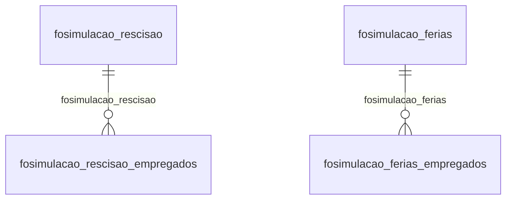

# Modelo — Pessoal - simulacao (rascunho em lote)

> Gerado por `src/model/gerar_docs_modelo.py` a partir de `src/model/modulos/pessoal_simulacao.yaml`, do catálogo e do perfil de colunas. **Não edite à mão.**

4 entidades. A coluna *Preench.* é o % de linhas com valor útil (nem nulo, nem em branco, nem zero, nem 1900-01-01; para colunas de código o zero conta como valor).

## Diagrama

## Entidades

| Entidade | Tabela | Linhas | Volume | Filtro obrigatório |
|---|---|---|---|---|
| [fosimulacao_rescisao_empregados](#fosimulacao_rescisao_empregados) | `FOSIMULACAO_RESCISAO_EMPREGADOS` | 1.889 | pequeno | empresa |
| [fosimulacao_rescisao](#fosimulacao_rescisao) | `FOSIMULACAO_RESCISAO` | 1.100 | pequeno | empresa |
| [fosimulacao_ferias_empregados](#fosimulacao_ferias_empregados) | `FOSIMULACAO_FERIAS_EMPREGADOS` | 551 | pequeno | empresa |
| [fosimulacao_ferias](#fosimulacao_ferias) | `FOSIMULACAO_FERIAS` | 462 | pequeno | empresa |

## fosimulacao_rescisao_empregados

**Simulação de rescisão - Empregados** — tabela `FOSIMULACAO_RESCISAO_EMPREGADOS` (1.889 linhas)

Simulação de rescisão - Empregados. 1.889 linhas no catálogo; chave: CODI_EMP, I_SIMULACAO_RESCISAO, I_EMPREGADOS.

- **Chave:** `CODI_EMP, I_SIMULACAO_RESCISAO, I_EMPREGADOS`
- **Empresa:** `CODI_EMP`
- **Período:** `—`
- **Ordem padrão:** `I_SIMULACAO_RESCISAO asc`, `I_EMPREGADOS asc`

**Regras de negócio validadas:**

- Medido em 2026-10-18: 1.889 linhas, 183 empresa(s).
- Colunas expostas nulas em 100% das linhas (7): media_hora_de_ferias, media_hora_aula_de_ferias, vantagem_de_ferias, media_valor_de_13o, media_hora_de_13o, media_hora_aula_de_13o, vantagem_de_13o.
- usa_media_manual_0_nao_1_sim: todos os valores reais estão no comentário do banco (0=1.889).
- Vínculo fosimulacao_rescisao (FOSIMULACAO_RESCISAO): 0 de 4 linhas sem registro relacionado (empresa 886).
- Vínculo foempregados (foempregados): 0 de 4 linhas sem registro relacionado (empresa 886).

| Campo | Coluna | Tipo | Preench. | Domínio | Descrição (banco) |
|---|---|---|---|---|---|
| codigo_da_empresa | `codi_emp` | integer(4) |  |  | Código da empresa. |
| sequencial_de_simulacao_da_rescisao 🔒 | `i_simulacao_rescisao` | integer(4) |  |  | Sequencial de simulação da rescisão. |
| codigo_do_empregado | `i_empregados` | integer(4) |  |  | Código do empregado. |
| codigo_do_calculo_de_rescisao_vinculado 🔒 | `i_calculos_old` | integer(4) |  |  | Código do cálculo de rescisão vinculado à simulação - Renomeado |
| usa_media_manual_0_nao_1_sim | `media_manual` | smallint(2) |  | fosimulacao_rescisao_empregados_usa_media_manual_ | Usa média manual. (0=Não/1=Sim) |
| media_valor_de_ferias | `valor_manual_media_valor_ferias` | numeric(13) |  |  | Média valor de férias |
| media_hora_de_ferias | `valor_manual_media_hora_ferias` | numeric(13) |  |  | Média hora de férias |
| media_hora_aula_de_ferias | `valor_manual_media_hora_aula_ferias` | numeric(13) |  |  | Média hora aula de férias |
| vantagem_de_ferias | `valor_manual_vantagem_ferias` | numeric(13) |  |  | Vantagem de férias |
| media_valor_de_13o | `valor_manual_media_valor_13` | numeric(13) |  |  | Média valor de 13º |
| media_hora_de_13o | `valor_manual_media_hora_13` | numeric(13) |  |  | Média hora de 13º |
| media_hora_aula_de_13o | `valor_manual_media_hora_aula_13` | numeric(13) |  |  | Média hora aula de 13º |
| vantagem_de_13o | `valor_manual_vantagem_13` | numeric(13) |  |  | Vantagem de 13º |
| i_calculos | `i_calculos` | uniqueidentifier(16) |  |  | Código do cálculo de rescisão vinculado à simulação. |

**Vínculos (LEFT JOIN, acrescentam colunas legíveis):**

- `fosimulacao_rescisao` → `FOSIMULACAO_RESCISAO` por `codi_emp` = `codi_emp` e `i_simulacao_rescisao` = `i_simulacao_rescisao`; colunas: `fosimulacao_rescisao_nome`
- `foempregados` → `foempregados` por `codi_emp` = `codi_emp` e `i_empregados` = `i_empregados`; colunas: `foempregados_nome`

**Filtros:** `sequencial_de_simulacao_da_rescisao` (eq/in), `codigo_do_empregado` (eq/in), `codigo_do_calculo_de_rescisao_vinculado` (eq/in), `i_calculos` (eq/in)

## fosimulacao_rescisao

**Simulação de rescisão** — tabela `FOSIMULACAO_RESCISAO` (1.100 linhas)

Simulação de rescisão. 1.100 linhas no catálogo; chave: CODI_EMP, I_SIMULACAO_RESCISAO.

- **Chave:** `CODI_EMP, I_SIMULACAO_RESCISAO`
- **Empresa:** `CODI_EMP`
- **Período:** `DATA_DEMISSAO`
- **Ordem padrão:** `DATA_DEMISSAO desc`, `I_SIMULACAO_RESCISAO asc`

**Regras de negócio validadas:**

- Medido em 2026-10-18: 1.100 linhas, 185 empresa(s), DATA_DEMISSAO de 2018-06-29 a 2026-12-31.
- tipo_de_aviso_previo_1_trabalhado_2_inde: todos os valores reais estão no comentário do banco (2=586, 1=380, 3=134).
- informar_o_valor_liquido_do_mes_anterior: todos os valores reais estão no comentário do banco (0=1.099, 1=1).
- cumpriu_toda_a_carga_horaria_da_semana_d: todos os valores reais estão no comentário do banco (0=1.092, 1=8).
- sabado_compensado_2_nao_1_sim: todos os valores reais estão no comentário do banco (2=1.099, 1=1).
- origem_do_registro_0_sistema_1_importaca: todos os valores reais estão no comentário do banco (0=1.100).
- Vínculo geempre (geempre): 0 de 3 linhas sem registro relacionado (empresa 374).

| Campo | Coluna | Tipo | Preench. | Domínio | Descrição (banco) |
|---|---|---|---|---|---|
| codigo_da_empresa | `codi_emp` | integer(4) |  |  | Código da empresa. |
| sequencial_de_simulacao_da_rescisao 🔒 | `i_simulacao_rescisao` | integer(4) |  |  | Sequencial de simulação da rescisão. |
| descricao | `descricao` | varchar(100) |  |  | Descrição. |
| data_de_demissao | `data_demissao` | date(4) |  |  | Data de demissão. |
| motivo_da_rescisao | `motivo` | smallint(2) |  |  | Motivo da rescisão. |
| data_do_aviso_previo | `data_aviso_previo` | date(4) |  |  | Data do aviso prévio. |
| tipo_de_aviso_previo_1_trabalhado_2_inde | `tipo_aviso_previo` | smallint(2) |  | fosimulacao_rescisao_tipo_de_aviso_previo_1_traba | Tipo de aviso prévio. (1=Trabalhado/2=Indenizado/3=Ausência/Dispensa) |
| data_de_pagamento | `data_pagamento` | date(4) |  |  | Data de pagamento. |
| informar_o_valor_liquido_do_mes_anterior | `informar_valor_liquido_mes_anterior` | smallint(2) |  | fosimulacao_rescisao_informar_o_valor_liquido_do_ | Informar o valor líquido do mês anterior. (0=Não/1=Sim) |
| cumpriu_toda_a_carga_horaria_da_semana_d | `cumpriu_toda_carga_horaria_semana_rescisao` | smallint(2) |  | fosimulacao_rescisao_cumpriu_toda_a_carga_horaria | Cumpriu toda a carga horária da semana da rescisão. (0=Não/1=Sim) |
| sabado_compensado_2_nao_1_sim | `sabado_compensado` | smallint(2) |  | fosimulacao_rescisao_sabado_compensado_2_nao_1_si | Sábado compensado. (2=Não/1=Sim) |
| codigo_do_saque_fgts | `codigo_saque_fgts` | char(2) |  |  | Código do saque FGTS. |
| codigo_causa_do_afastamento | `codigo_causa_afastamento` | char(3) |  |  | Código/Causa do afastamento. |
| origem_do_registro_0_sistema_1_importaca | `origem_registro` | smallint(2) |  | fosimulacao_rescisao_origem_do_registro_0_sistema | Origem do registro. (0=Sistema/1=Importação de tabelas/2=Importação de layout) |
| calcular_saldo_de_salario_proporcional_a | `calcular_saldo_salario_mp_936` | smallint(2) |  |  | Calcular saldo de salário proporcional a redução da MP 936. 0=Não/1=Sim |
| descontar_ferias_pagas_a_maior_0_nao_1_s | `descontar_ferias_pagas_maior` | smallint(2) |  |  | Descontar férias pagas a maior. 0=Não/1=Sim |
| considerar_o_sabado_compensado_para_cont | `considerar_sabado_compensado_avo_13_ferias` | smallint(2) |  |  | Considerar o sabado compensado para contagem de avos de 13 e ferias: 0=Não/1=Sim |

**Vínculos (LEFT JOIN, acrescentam colunas legíveis):**

- `geempre` → `geempre` por `codi_emp` = `codi_emp`; colunas: `geempre_nome`

**Filtros:** `sequencial_de_simulacao_da_rescisao` (eq/in), `data_de_demissao` (entre/gte/lte), `data_do_aviso_previo` (entre/gte/lte), `data_de_pagamento` (entre/gte/lte), `descricao` (contem/prefixo), `tipo_de_aviso_previo_1_trabalhado_2_inde` (eq/in), `codigo_do_saque_fgts` (eq/in), `codigo_causa_do_afastamento` (eq/in)

## fosimulacao_ferias_empregados

**Simulação de férias - Empregados** — tabela `FOSIMULACAO_FERIAS_EMPREGADOS` (551 linhas)

Simulação de férias - Empregados. 551 linhas no catálogo; chave: CODI_EMP, I_SIMULACAO_FERIAS, I_EMPREGADOS.

- **Chave:** `CODI_EMP, I_SIMULACAO_FERIAS, I_EMPREGADOS`
- **Empresa:** `CODI_EMP`
- **Período:** `GOZO_INICIO`
- **Ordem padrão:** `GOZO_INICIO desc`, `I_SIMULACAO_FERIAS asc`, `I_EMPREGADOS asc`

**Regras de negócio validadas:**

- Medido em 2026-10-18: 551 linhas, 67 empresa(s), GOZO_INICIO de 2018-08-15 a 2027-01-26.
- Colunas expostas nulas em 100% das linhas (7): media_hora_de_ferias, media_hora_aula_de_ferias, vantagem_de_ferias, media_valor_de_13o, media_hora_de_13o, media_hora_aula_de_13o, vantagem_de_13o.
- pagar_abono_pecuniario_0_nao_1_sim: todos os valores reais estão no comentário do banco (0=522, 1=29).
- usa_media_manual_0_nao_1_sim: todos os valores reais estão no comentário do banco (0=538, 1=13).
- Vínculo fosimulacao_ferias (FOSIMULACAO_FERIAS): 0 de 2 linhas sem registro relacionado (empresa 644).
- Vínculo foempregados (foempregados): 0 de 2 linhas sem registro relacionado (empresa 644).

| Campo | Coluna | Tipo | Preench. | Domínio | Descrição (banco) |
|---|---|---|---|---|---|
| codigo_da_empresa | `codi_emp` | integer(4) |  |  | Código da empresa. |
| sequencial_de_simulacao_de_ferias | `i_simulacao_ferias` | integer(4) |  |  | Sequencial de simulação de férias. |
| codigo_do_empregado | `i_empregados` | integer(4) |  |  | Código do empregado. |
| sequencial_do_periodo_aquisitivo | `i_ferias_aquisitivos` | integer(4) |  |  | Sequencial do período aquisitivo. |
| sequencial_do_periodo_de_gozo | `i_ferias_gozo` | integer(4) |  |  | Sequencial do período de gozo. |
| data_de_inicio_do_periodo_de_gozo | `gozo_inicio` | date(4) |  |  | Data de início do período de gozo. |
| data_do_fim_do_periodo_de_gozo | `gozo_fim` | date(4) |  |  | Data do fim do período de gozo. |
| pagar_abono_pecuniario_0_nao_1_sim | `paga_abono` | smallint(2) |  | fosimulacao_ferias_empregados_pagar_abono_pecunia | Pagar abono pecuniário. (0=Não/1=Sim) |
| data_de_inicio_do_periodo_de_abono | `abono_inicio` | date(4) |  |  | Data de início do período de abono. |
| data_do_fim_do_periodo_de_abono | `abono_fim` | date(4) |  |  | Data do fim do período de abono. |
| dias_de_direito_do_periodo_aquisitivo_co | `dias_direito` | numeric(10) |  |  | Dias de direito do período aquisitivo com as configurações da simulação. |
| inicio_do_periodo_de_gozo_numerico | `gozo_inicio_dn` | numeric(13) |  |  | Início do período de gozo numérico. |
| fim_do_periodo_de_gozo_numerico | `gozo_fim_dn` | numeric(13) |  |  | Fim do período de gozo numérico. |
| inicio_do_periodo_de_abono_numerico | `abono_inicio_dn` | numeric(13) |  |  | Início do período de abono numérico. |
| fim_do_periodo_de_abono_numerico | `abono_fim_dn` | numeric(13) |  |  | Fim do período de abono numérico. |
| usa_media_manual_0_nao_1_sim | `media_manual` | smallint(2) |  | fosimulacao_ferias_empregados_usa_media_manual_0_ | Usa média manual. (0=Não/1=Sim) |
| media_valor_de_ferias | `valor_manual_media_valor_ferias` | numeric(13) |  |  | Média valor de férias |
| media_hora_de_ferias | `valor_manual_media_hora_ferias` | numeric(13) |  |  | Média hora de férias |
| media_hora_aula_de_ferias | `valor_manual_media_hora_aula_ferias` | numeric(13) |  |  | Média hora aula de férias |
| vantagem_de_ferias | `valor_manual_vantagem_ferias` | numeric(13) |  |  | Vantagem de férias |
| media_valor_de_13o | `valor_manual_media_valor_13` | numeric(13) |  |  | Média valor de 13º |
| media_hora_de_13o | `valor_manual_media_hora_13` | numeric(13) |  |  | Média hora de 13º |
| media_hora_aula_de_13o | `valor_manual_media_hora_aula_13` | numeric(13) |  |  | Média hora aula de 13º |
| vantagem_de_13o | `valor_manual_vantagem_13` | numeric(13) |  |  | Vantagem de 13º |

**Vínculos (LEFT JOIN, acrescentam colunas legíveis):**

- `fosimulacao_ferias` → `FOSIMULACAO_FERIAS` por `codi_emp` = `codi_emp` e `i_simulacao_ferias` = `i_simulacao_ferias`; colunas: `fosimulacao_ferias_nome`
- `foempregados` → `foempregados` por `codi_emp` = `codi_emp` e `i_empregados` = `i_empregados`; colunas: `foempregados_nome`

**Filtros:** `sequencial_de_simulacao_de_ferias` (eq/in), `codigo_do_empregado` (eq/in), `data_de_inicio_do_periodo_de_gozo` (entre/gte/lte), `data_do_fim_do_periodo_de_gozo` (entre/gte/lte), `data_de_inicio_do_periodo_de_abono` (entre/gte/lte), `data_do_fim_do_periodo_de_abono` (entre/gte/lte), `sequencial_do_periodo_aquisitivo` (eq/in), `sequencial_do_periodo_de_gozo` (eq/in)

## fosimulacao_ferias

**Simulação do cálculo de férias** — tabela `FOSIMULACAO_FERIAS` (462 linhas)

Simulação do cálculo de férias. 462 linhas no catálogo; chave: CODI_EMP, I_SIMULACAO_FERIAS.

- **Chave:** `CODI_EMP, I_SIMULACAO_FERIAS`
- **Empresa:** `CODI_EMP`
- **Período:** `DATA_PAGTO`
- **Ordem padrão:** `DATA_PAGTO desc`, `I_SIMULACAO_FERIAS asc`

**Regras de negócio validadas:**

- Medido em 2026-10-18: 462 linhas, 72 empresa(s), DATA_PAGTO de 2018-08-13 a 2027-01-18.
- adiantar_1a_parcela_do_13o_salario_0_nao: todos os valores reais estão no comentário do banco (0=461, 1=1).
- descontar_faltas_0_nao_1_sim: todos os valores reais estão no comentário do banco (1=462).
- descontar_faltas_noturnas_0_nao_1_sim: todos os valores reais estão no comentário do banco (0=462).
- descontar_faltas_suspensas_0_nao_1_sim: todos os valores reais estão no comentário do banco (0=462).
- descontar_faltas_parciais_0_nao_1_sim: todos os valores reais estão no comentário do banco (0=456, 1=6).
- pagar_abono_pecuniario_0_nao_1_sim: todos os valores reais estão no comentário do banco (0=439, 1=23).
- origem_do_registro_0_sistema_1_importaca: todos os valores reais estão no comentário do banco (0=462).
- Vínculo geempre (geempre): 0 de 2 linhas sem registro relacionado (empresa 800).

| Campo | Coluna | Tipo | Preench. | Domínio | Descrição (banco) |
|---|---|---|---|---|---|
| codigo_da_empresa | `codi_emp` | integer(4) |  |  | Código da empresa. |
| sequencial_de_simulacao_de_ferias | `i_simulacao_ferias` | integer(4) |  |  | Sequencial de simulação de férias. |
| descricao | `descricao` | varchar(100) |  |  | Descrição. |
| adiantar_1a_parcela_do_13o_salario_0_nao | `adiantar_primeira_parcela_13_salario` | smallint(2) |  | fosimulacao_ferias_adiantar_1a_parcela | Adiantar 1ª parcela do 13º salário. (0=Não/1=Sim) |
| descontar_faltas_0_nao_1_sim | `descontar_faltas` | smallint(2) |  | fosimulacao_ferias_descontar_faltas_0_ | Descontar faltas. (0=Não/1=Sim) |
| descontar_faltas_noturnas_0_nao_1_sim | `descontar_faltas_noturnas` | smallint(2) |  | fosimulacao_ferias_descontar_faltas_no | Descontar faltas noturnas. (0=Não/1=Sim) |
| descontar_faltas_suspensas_0_nao_1_sim | `descontar_faltas_suspensas` | smallint(2) |  | fosimulacao_ferias_descontar_faltas_su | Descontar faltas suspensas. (0=Não/1=Sim) |
| descontar_faltas_parciais_0_nao_1_sim | `descontar_faltas_parciais` | smallint(2) |  | fosimulacao_ferias_descontar_faltas_pa | Descontar faltas parciais. (0=Não/1=Sim) |
| data_de_inicio_do_periodo_de_gozo | `gozo_inicio` | date(4) |  |  | Data de início do período de gozo. |
| data_do_fim_do_periodo_de_gozo | `gozo_fim` | date(4) |  |  | Data do fim do período de gozo. |
| pagar_abono_pecuniario_0_nao_1_sim | `paga_abono` | smallint(2) |  | fosimulacao_ferias_pagar_abono_pecunia | Pagar abono pecuniário. (0=Não/1=Sim) |
| data_de_inicio_do_periodo_de_abono | `abono_inicio` | date(4) |  |  | Data de início do período de abono. |
| data_do_fim_do_periodo_de_abono | `abono_fim` | date(4) |  |  | Data do fim do período de abono. |
| inicio_do_periodo_de_gozo_numerico | `gozo_inicio_dn` | numeric(13) |  |  | Início do período de gozo numérico. |
| fim_do_periodo_de_gozo_numerico | `gozo_fim_dn` | numeric(13) |  |  | Fim do período de gozo numérico. |
| inicio_do_periodo_de_abono_numerico | `abono_inicio_dn` | numeric(13) |  |  | Início do período de abono numérico. |
| fim_do_periodo_de_abono_numerico | `abono_fim_dn` | numeric(13) |  |  | Fim do período de abono numérico. |
| data_de_pagamento | `data_pagto` | date(4) |  |  | Data de pagamento |
| origem_do_registro_0_sistema_1_importaca | `origem_registro` | smallint(2) |  | fosimulacao_ferias_origem_do_registro_ | Origem do registro. (0=Sistema/1-Importação de tabelas/2=Importação de layout) |
| nao_calcular_adicional_mp_927 | `nao_calcular_adicional_mp_927` | smallint(2) |  |  | Não calcular 1/3 férias MP 927 |
| indica_se_as_ferias_foram_pagas | `paga_ferias` | smallint(2) |  |  | Indica se as férias foram pagas |

**Vínculos (LEFT JOIN, acrescentam colunas legíveis):**

- `geempre` → `geempre` por `codi_emp` = `codi_emp`; colunas: `geempre_nome`

**Filtros:** `sequencial_de_simulacao_de_ferias` (eq/in), `data_de_inicio_do_periodo_de_gozo` (entre/gte/lte), `data_do_fim_do_periodo_de_gozo` (entre/gte/lte), `data_de_inicio_do_periodo_de_abono` (entre/gte/lte), `data_do_fim_do_periodo_de_abono` (entre/gte/lte), `data_de_pagamento` (entre/gte/lte), `descricao` (contem/prefixo)

## Domínios (significado dos códigos)

`confirmado`: **sim** = vem do comentário do banco e/ou foi conferido nos dados; **parcial** = parte dos valores; **não** = hipótese, não use como regra.

### status_empresa

Situação da empresa no cadastro (geempre.stat_emp)

Confirmado: sim

| Código | Significado |
|---|---|
| A | Ativa |
| I | Inativa |
| C | Em constituição |
| M | Ativo sem movimento |
| B | Em processo de baixa |
| E | Excluindo |

### motivo_inatividade

Motivo da inatividade (geempre.tipoi_emp). Só aparece em empresas inativas.

Confirmado: sim

| Código | Significado |
|---|---|
| 1 | Outros |
| 2 | Baixada |
| 3 | Transferida |
| 4 | Inadimplente |

### tipo_inscricao

Tipo da inscrição (CNPJ/CPF/CEI/CAEPF)

Confirmado: sim

| Código | Significado |
|---|---|
| 1 | CNPJ |
| 2 | CPF |
| 3 | CEI |
| 6 | CAEPF |

### regime_federal_empresa

Regime federal da folha (geempre.rfed_emp)

Confirmado: parcial

| Código | Significado |
|---|---|
| 1 | Normal |
| 2 | Microempresa |
| 3 | Empresa de pequeno porte |

### tipo_honorario_empresa

Como a empresa usa o módulo Honorários (geempre.honorario_tipo)

Confirmado: sim

| Código | Significado |
|---|---|
| E | Escritório (quem fatura) |
| C | Cliente |

### sim_nao_texto

Confirmado: sim

| Código | Significado |
|---|---|
| S | Sim |
| N | Não |

### sim_nao_numerico

Confirmado: sim

| Código | Significado |
|---|---|
| 1 | Sim |
| 0 | Não |

### fosimulacao_rescisao_empregados_usa_media_manual_

Confirmado: sim

> Todos os valores observados em FOSIMULACAO_RESCISAO_EMPREGADOS.MEDIA_MANUAL estão no comentário do banco (2026-10-18). Distribuição: 0=1.889.

| Código | Significado |
|---|---|
| 0 | Não |
| 1 | Sim |

### fosimulacao_rescisao_tipo_de_aviso_previo_1_traba

Confirmado: sim

> Todos os valores observados em FOSIMULACAO_RESCISAO.TIPO_AVISO_PREVIO estão no comentário do banco (2026-10-18). Distribuição: 2=586, 1=380, 3=134.

| Código | Significado |
|---|---|
| 1 | Trabalhado |
| 2 | Indenizado |
| 3 | Ausência |

### fosimulacao_rescisao_informar_o_valor_liquido_do_

Confirmado: sim

> Todos os valores observados em FOSIMULACAO_RESCISAO.INFORMAR_VALOR_LIQUIDO_MES_ANTERIOR estão no comentário do banco (2026-10-18). Distribuição: 0=1.099, 1=1.

| Código | Significado |
|---|---|
| 0 | Não |
| 1 | Sim |

### fosimulacao_rescisao_cumpriu_toda_a_carga_horaria

Confirmado: sim

> Todos os valores observados em FOSIMULACAO_RESCISAO.CUMPRIU_TODA_CARGA_HORARIA_SEMANA_RESCISAO estão no comentário do banco (2026-10-18). Distribuição: 0=1.092, 1=8.

| Código | Significado |
|---|---|
| 0 | Não |
| 1 | Sim |

### fosimulacao_rescisao_sabado_compensado_2_nao_1_si

Confirmado: sim

> Todos os valores observados em FOSIMULACAO_RESCISAO.SABADO_COMPENSADO estão no comentário do banco (2026-10-18). Distribuição: 2=1.099, 1=1.

| Código | Significado |
|---|---|
| 2 | Não |
| 1 | Sim |

### fosimulacao_rescisao_origem_do_registro_0_sistema

Confirmado: sim

> Todos os valores observados em FOSIMULACAO_RESCISAO.ORIGEM_REGISTRO estão no comentário do banco (2026-10-18). Distribuição: 0=1.100.

| Código | Significado |
|---|---|
| 0 | Sistema |
| 1 | Importação de tabelas |
| 2 | Importação de layout |

### fosimulacao_ferias_empregados_pagar_abono_pecunia

Confirmado: sim

> Todos os valores observados em FOSIMULACAO_FERIAS_EMPREGADOS.PAGA_ABONO estão no comentário do banco (2026-10-18). Distribuição: 0=522, 1=29.

| Código | Significado |
|---|---|
| 0 | Não |
| 1 | Sim |

### fosimulacao_ferias_empregados_usa_media_manual_0_

Confirmado: sim

> Todos os valores observados em FOSIMULACAO_FERIAS_EMPREGADOS.MEDIA_MANUAL estão no comentário do banco (2026-10-18). Distribuição: 0=538, 1=13.

| Código | Significado |
|---|---|
| 0 | Não |
| 1 | Sim |

### fosimulacao_ferias_adiantar_1a_parcela

Confirmado: sim

> Todos os valores observados em FOSIMULACAO_FERIAS.ADIANTAR_PRIMEIRA_PARCELA_13_SALARIO estão no comentário do banco (2026-10-18). Distribuição: 0=461, 1=1.

| Código | Significado |
|---|---|
| 0 | Não |
| 1 | Sim |

### fosimulacao_ferias_descontar_faltas_0_

Confirmado: sim

> Todos os valores observados em FOSIMULACAO_FERIAS.DESCONTAR_FALTAS estão no comentário do banco (2026-10-18). Distribuição: 1=462.

| Código | Significado |
|---|---|
| 0 | Não |
| 1 | Sim |

### fosimulacao_ferias_descontar_faltas_no

Confirmado: sim

> Todos os valores observados em FOSIMULACAO_FERIAS.DESCONTAR_FALTAS_NOTURNAS estão no comentário do banco (2026-10-18). Distribuição: 0=462.

| Código | Significado |
|---|---|
| 0 | Não |
| 1 | Sim |

### fosimulacao_ferias_descontar_faltas_su

Confirmado: sim

> Todos os valores observados em FOSIMULACAO_FERIAS.DESCONTAR_FALTAS_SUSPENSAS estão no comentário do banco (2026-10-18). Distribuição: 0=462.

| Código | Significado |
|---|---|
| 0 | Não |
| 1 | Sim |

### fosimulacao_ferias_descontar_faltas_pa

Confirmado: sim

> Todos os valores observados em FOSIMULACAO_FERIAS.DESCONTAR_FALTAS_PARCIAIS estão no comentário do banco (2026-10-18). Distribuição: 0=456, 1=6.

| Código | Significado |
|---|---|
| 0 | Não |
| 1 | Sim |

### fosimulacao_ferias_pagar_abono_pecunia

Confirmado: sim

> Todos os valores observados em FOSIMULACAO_FERIAS.PAGA_ABONO estão no comentário do banco (2026-10-18). Distribuição: 0=439, 1=23.

| Código | Significado |
|---|---|
| 0 | Não |
| 1 | Sim |

### fosimulacao_ferias_origem_do_registro_

Confirmado: sim

> Todos os valores observados em FOSIMULACAO_FERIAS.ORIGEM_REGISTRO estão no comentário do banco (2026-10-18). Distribuição: 0=462.

| Código | Significado |
|---|---|
| 0 | Sistema |
| 1 | Importação de tabelas |
| 2 | Importação de layout |

