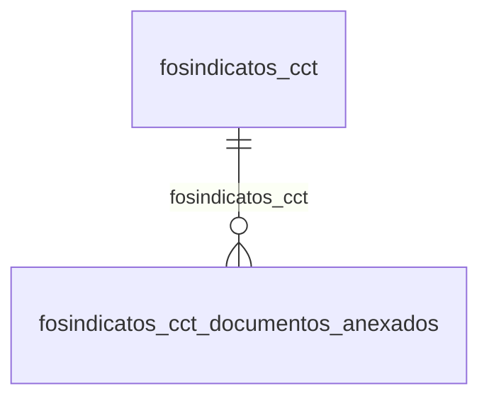

# Modelo — Pessoal - sindicatos (rascunho em lote)

> Gerado por `src/model/gerar_docs_modelo.py` a partir de `src/model/modulos/pessoal_sindicatos.yaml`, do catálogo e do perfil de colunas. **Não edite à mão.**

13 entidades. A coluna *Preench.* é o % de linhas com valor útil (nem nulo, nem em branco, nem zero, nem 1900-01-01; para colunas de código o zero conta como valor).

## Diagrama

## Entidades

| Entidade | Tabela | Linhas | Volume | Filtro obrigatório |
|---|---|---|---|---|
| [fosindicatos_empresas](#fosindicatos_empresas) | `FOSINDICATOS_EMPRESAS` | 292.571 | medio | empresa |
| [fosindicatos_medias](#fosindicatos_medias) | `FOSINDICATOS_MEDIAS` | 1.294 | pequeno | — |
| [fosindicatos_cadastro](#fosindicatos_cadastro) | `FOSINDICATOS_CADASTRO` | 121 | pequeno | — |
| [fosindicatos_cct](#fosindicatos_cct) | `FOSINDICATOS_CCT` | 63 | pequeno | — |
| [fosindicatos_cct_documentos_anexados](#fosindicatos_cct_documentos_anexados) | `FOSINDICATOS_CCT_DOCUMENTOS_ANEXADOS` | 33 | pequeno | — |
| [fosindicatos_indenizacao_especial](#fosindicatos_indenizacao_especial) | `FOSINDICATOS_INDENIZACAO_ESPECIAL` | 27 | pequeno | — |
| [fosindicatos_estabilidade_afastamentos](#fosindicatos_estabilidade_afastamentos) | `FOSINDICATOS_ESTABILIDADE_AFASTAMENTOS` | 17 | pequeno | — |
| [fosindicatos_plr](#fosindicatos_plr) | `FOSINDICATOS_PLR` | 8 | pequeno | — |
| [fosindicatos_diasaviso](#fosindicatos_diasaviso) | `FOSINDICATOS_DIASAVISO` | 5 | pequeno | — |
| [fosindicatos_garantia_comissionados](#fosindicatos_garantia_comissionados) | `FOSINDICATOS_GARANTIA_COMISSIONADOS` | 4 | pequeno | — |
| [fosindicatos_garantia_semestral](#fosindicatos_garantia_semestral) | `FOSINDICATOS_GARANTIA_SEMESTRAL` | 4 | pequeno | — |
| [fosindicatos_config_motivos_rescisao_estab_afast](#fosindicatos_config_motivos_rescisao_estab_afast) | `FOSINDICATOS_CONFIG_MOTIVOS_RESCISAO_ESTAB_AFAST` | 3 | pequeno | — |
| [fosindicatos_adicional_ferias](#fosindicatos_adicional_ferias) | `FOSINDICATOS_ADICIONAL_FERIAS` | 1 | pequeno | — |

## fosindicatos_empresas

**Lista de empresas que utilizam o sindicato.** — tabela `FOSINDICATOS_EMPRESAS` (292.571 linhas)

Lista de empresas que utilizam o sindicato.. 292.571 linhas no catálogo; chave: I_SINDICATOS, CODI_EMP.

- **Chave:** `I_SINDICATOS, CODI_EMP`
- **Empresa:** `CODI_EMP`
- **Período:** `—`
- **Ordem padrão:** `I_SINDICATOS asc`

**Regras de negócio validadas:**

- Medido em 2026-10-18: 294.540 linhas, 1.969 empresa(s).
- Vínculo fosindicatos (fosindicatos): 0 de 151 linhas sem registro relacionado (empresa 1146).
- Vínculo geempre (geempre): 0 de 151 linhas sem registro relacionado (empresa 1146).

| Campo | Coluna | Tipo | Preench. | Domínio | Descrição (banco) |
|---|---|---|---|---|---|
| codigo_do_sindicato | `i_sindicatos` | integer(4) |  |  | Código do sindicato. |
| codigo_da_empresa | `codi_emp` | integer(4) |  |  | Código da empresa. |

**Vínculos (LEFT JOIN, acrescentam colunas legíveis):**

- `fosindicatos` → `fosindicatos` por `i_sindicatos` = `i_sindicatos`; colunas: `fosindicatos_nome`
- `geempre` → `geempre` por `codi_emp` = `codi_emp`; colunas: `geempre_nome`

**Filtros:** `codigo_do_sindicato` (eq/in)

## fosindicatos_medias

**CADASTRO DE SINDICATOS - MÉDIAS** — tabela `FOSINDICATOS_MEDIAS` (1.294 linhas)

CADASTRO DE SINDICATOS - MÉDIAS. 1.294 linhas no catálogo; chave: i_sindicatos, TIPO_MEDIA, CODIGO, CONFIGURACAO_MEDIA_COMISSOES.

- **Chave:** `i_sindicatos, TIPO_MEDIA, CODIGO, CONFIGURACAO_MEDIA_COMISSOES`
- **Empresa:** `não se aplica (tabela global)`
- **Período:** `—`
- **Ordem padrão:** `i_sindicatos asc`, `TIPO_MEDIA asc`

**Regras de negócio validadas:**

- Medido em 2026-10-18: 1.302 linhas.
- Colunas expostas nulas em 100% das linhas (2): meses_com_menor_valor_a_desconsiderar_pa, quantidade_de_meses_que_devem_ter_valor.
- tipo_de_media_1_ferias_2_13o_salario_3_a: todos os valores reais estão no comentário do banco (3=324, 1=324, 2=324, 5=322, 4=8).
- configuracao_de_media_para_comissoes_0_n: todos os valores reais estão no comentário do banco (0=1.254, 1=48).
- tipo_de_periodo_1_ultimos_meses_2_period: todos os valores reais estão no comentário do banco (1=790, 3=321, 2=190, 6=1).
- valores_a_considerar_1_todos_2_somente_c: todos os valores reais estão no comentário do banco (1=1.302).
- considerar_o_mes_de_janeiro_para_buscar: todos os valores reais estão no comentário do banco (0=1.302).
- considerar_o_mes_de_fevereiro_para_busca: todos os valores reais estão no comentário do banco (0=1.302).
- considerar_o_mes_de_marco_para_buscar_os: todos os valores reais estão no comentário do banco (0=1.302).
- considerar_o_mes_de_abril_para_buscar_os: todos os valores reais estão no comentário do banco (0=1.302).
- considerar_o_mes_de_maio_para_buscar_os: todos os valores reais estão no comentário do banco (0=1.302).
- considerar_o_mes_de_junho_para_buscar_os: todos os valores reais estão no comentário do banco (0=1.302).
- considerar_o_mes_de_julho_para_buscar_os: todos os valores reais estão no comentário do banco (0=1.301, 1=1).
- considerar_o_mes_de_agosto_para_buscar_o: todos os valores reais estão no comentário do banco (0=1.301, 1=1).
- considerar_o_mes_de_setembro_para_buscar: todos os valores reais estão no comentário do banco (0=1.301, 1=1).
- considerar_o_mes_de_outubro_para_buscar: todos os valores reais estão no comentário do banco (0=1.301, 1=1).
- considerar_o_mes_de_novembro_para_buscar: todos os valores reais estão no comentário do banco (0=1.301, 1=1).
- considerar_o_mes_de_dezembro_para_buscar: todos os valores reais estão no comentário do banco (0=1.301, 1=1).
- periodo_a_considerar_na_media_da_opcao_u: todos os valores reais estão no comentário do banco (1=1.302).
- tipo_de_calculo_de_ferias_0_todos_1_feri: todos os valores reais estão no comentário do banco (nulo=978, 0=324).
- considerar_o_mes_da_admissao_se_o_empreg: todos os valores reais estão no comentário do banco (1=1.302).
- considerar_a_competencia_que_possua_a_so: todos os valores reais estão no comentário do banco (0=1.302).
- considerar_a_existencia_de_valor_nos_ult: todos os valores reais estão no comentário do banco (0=1.302).
- calcular_a_media_proporcional_aos_avos_d: todos os valores reais estão no comentário do banco (1=1.302).
- considerar_os_meses_em_que_nao_houver_va: todos os valores reais estão no comentário do banco (1=1.302).
- Vínculo fosindicatos (fosindicatos): 0 de 1.302 linhas sem registro relacionado.

| Campo | Coluna | Tipo | Preench. | Domínio | Descrição (banco) |
|---|---|---|---|---|---|
| codigo | `i_sindicatos` | integer(4) |  |  | Codigo |
| tipo_de_media_1_ferias_2_13o_salario_3_a | `tipo_media` | smallint(2) |  | fosindicatos_medias_tipo_de_media_1_feri | Tipo de média. (1=Férias/2=13º salário/3=Aviso prévio/4=Saldo de salário/5=Afastamentos) |
| codigo_da_configuracao | `codigo` | integer(4) |  |  | Código da configuração |
| configuracao_de_media_para_comissoes_0_n | `configuracao_media_comissoes` | smallint(2) |  | fosindicatos_medias_configuracao_de_medi | Configuração de média para comissões. (0=Não/1=Sim) |
| tipo_de_unidade_1_quantidade_2_valor_3_q | `tipo_unidade` | smallint(2) |  |  | Tipo de unidade: 1=Quantidade/2=Valor/3=Quantidade e valor |
| tipo_de_periodo_1_ultimos_meses_2_period | `tipo_periodo` | smallint(2) |  | fosindicatos_medias_tipo_de_periodo_1_ul | Tipo de período. (1=Últimos meses/2=Período aquisitivo/3=Ano corrente/4=Últimos meses no período aquisitivo/5=Últimos meses no ano corrente/6=Selecionar meses no ano corrente) |
| c_1_todos_2_somente_com_valor | `periodo_considerar` | smallint(2) |  |  | 1 Todos 2 Somente com Valor |
| valores_a_considerar_1_todos_2_somente_c | `nmeses_considerar` | smallint(2) |  | fosindicatos_medias_valores_a_considerar | Valores a considerar. (1=Todos/2=Somente com valor/3=Maiores/4=Maiores e menores) |
| quantidade_de_meses | `nmeses_quantidade` | integer(4) |  |  | Quantidade de meses |
| numero_de_meses_com_os_maiores_valores | `nmeses_quantidade_maiores` | integer(4) |  |  | Numero de meses com os maiores valores |
| tipo_de_calculo_de_13_0_todos_1_adiantam | `tipo_calculo_13` | smallint(2) |  |  | Tipo de cálculo de 13: 0=Todos/1=Adiantamento/2=Adiantamento nas férias/3=Integral/4=Pago em rescisão/5=Ajuste em dezembro |
| meses_com_menor_valor_a_desconsiderar_pa 🔒 | `meses_desconto_menor_media_rescisao` | integer(4) |  |  | Meses com menor valor a desconsiderar para o cálculo de médias em rescisão |
| considerar_o_mes_de_janeiro_para_buscar | `considerar_janeiro` | smallint(2) |  | fosindicatos_medias_considerar_o_mes_de_ | Considerar o mês de janeiro para buscar os valores de médias. (0=Não/1=Sim) |
| considerar_o_mes_de_fevereiro_para_busca | `considerar_fevereiro` | smallint(2) |  | fosindicatos_medias_considerar_o_mes_de_ | Considerar o mês de fevereiro para buscar os valores de médias. (0=Não/1=Sim) |
| considerar_o_mes_de_marco_para_buscar_os | `considerar_marco` | smallint(2) |  | fosindicatos_medias_considerar_o_mes_de_ | Considerar o mês de março para buscar os valores de médias. (0=Não/1=Sim) |
| considerar_o_mes_de_abril_para_buscar_os | `considerar_abril` | smallint(2) |  | fosindicatos_medias_considerar_o_mes_de_ | Considerar o mês de abril para buscar os valores de médias. (0=Não/1=Sim) |
| considerar_o_mes_de_maio_para_buscar_os | `considerar_maio` | smallint(2) |  | fosindicatos_medias_considerar_o_mes_de_ | Considerar o mês de maio para buscar os valores de médias. (0=Não/1=Sim) |
| considerar_o_mes_de_junho_para_buscar_os | `considerar_junho` | smallint(2) |  | fosindicatos_medias_considerar_o_mes_de_ | Considerar o mês de junho para buscar os valores de médias. (0=Não/1=Sim) |
| considerar_o_mes_de_julho_para_buscar_os | `considerar_julho` | smallint(2) |  | fosindicatos_medias_considerar_o_mes_de_ | Considerar o mês de julho para buscar os valores de médias. (0=Não/1=Sim) |
| considerar_o_mes_de_agosto_para_buscar_o | `considerar_agosto` | smallint(2) |  | fosindicatos_medias_considerar_o_mes_de_ | Considerar o mês de agosto para buscar os valores de médias. (0=Não/1=Sim) |
| considerar_o_mes_de_setembro_para_buscar | `considerar_setembro` | smallint(2) |  | fosindicatos_medias_considerar_o_mes_de_ | Considerar o mês de setembro para buscar os valores de médias. (0=Não/1=Sim) |
| considerar_o_mes_de_outubro_para_buscar | `considerar_outubro` | smallint(2) |  | fosindicatos_medias_considerar_o_mes_de_ | Considerar o mês de outubro para buscar os valores de médias. (0=Não/1=Sim) |
| considerar_o_mes_de_novembro_para_buscar | `considerar_novembro` | smallint(2) |  | fosindicatos_medias_considerar_o_mes_de_ | Considerar o mês de novembro para buscar os valores de médias. (0=Não/1=Sim) |
| considerar_o_mes_de_dezembro_para_buscar | `considerar_dezembro` | smallint(2) |  | fosindicatos_medias_considerar_o_mes_de_ | Considerar o mês de dezembro para buscar os valores de médias. (0=Não/1=Sim) |
| numero_de_meses_com_os_menores_valores | `nmeses_considerar_menores` | integer(4) |  |  | Número de meses com os menores valores. |
| periodo_a_considerar_na_media_da_opcao_u | `periodo_considerar_ultimos_meses_ferias` | smallint(2) |  | fosindicatos_medias_periodo_a_considerar | Período a considerar na média da opção últimos meses das férias. (1=Anteriores ao gozo/2=Anteriores ao pagamento) |
| tipo_de_calculo_de_ferias_0_todos_1_feri | `tipo_calculo_ferias` | smallint(2) |  | fosindicatos_medias_tipo_de_calculo_de_f | Tipo de cálculo de férias. (0=Todos/1=Férias gozadas/2=Férias pagas em rescisão) |
| considerar_o_mes_da_admissao_se_o_empreg | `considerar_mes_admissao_periodo_trabalhado_inferior_15_dias` | smallint(2) |  | fosindicatos_medias_considerar_o_mes_da_ | Considerar o mês da admissão se o empregado trabalhou período inferior a 15 dias. (0=Não/1=Sim) |
| considerar_a_competencia_que_possua_a_so | `considerar_competencia_soma_medias_mesma_unidade_maior_valor` | smallint(2) |  | fosindicatos_medias_considerar_a_compete | Considerar a competência que possua a soma das médias de mesma unidade com maior valor. (0=Não/1=Sim) |
| considerar_a_existencia_de_valor_nos_ult | `considerar_existencia_valor_ultimos_meses_calculo_media` | smallint(2) |  | fosindicatos_medias_considerar_a_existen | Considerar a existência de valor nos últimos meses para calcular a média. (0=Não/1=Sim) |
| quantidade_de_meses_que_devem_ter_valor | `quantidade_ultimos_meses_verificar_valor` | smallint(2) |  |  | Quantidade de meses que devem ter valor para calcular a média. |
| calcular_a_media_proporcional_aos_avos_d | `calcular_media_proporcional_avos_direito` | smallint(2) |  | fosindicatos_medias_calcular_a_media_pro | Calcular a média proporcional aos avos de direito. (0=Não/1=Sim) |
| considerar_os_meses_em_que_nao_houver_va | `considerar_meses_sem_valor_lancado_para_divisor` | smallint(2) |  | fosindicatos_medias_considerar_os_meses_ | Considerar os meses em que não houver valor lançado para o divisor. (0=Não/1=Sim) |

**Vínculos (LEFT JOIN, acrescentam colunas legíveis):**

- `fosindicatos` → `fosindicatos` por `i_sindicatos` = `i_sindicatos`; colunas: `fosindicatos_nome`

**Filtros:** `codigo` (eq/in), `tipo_de_media_1_ferias_2_13o_salario_3_a` (eq/in), `codigo_da_configuracao` (eq/in), `configuracao_de_media_para_comissoes_0_n` (eq/in), `tipo_de_unidade_1_quantidade_2_valor_3_q` (eq/in), `tipo_de_periodo_1_ultimos_meses_2_period` (eq/in), `tipo_de_calculo_de_13_0_todos_1_adiantam` (eq/in), `tipo_de_calculo_de_ferias_0_todos_1_feri` (eq/in)

## fosindicatos_cadastro

**Sindicato - Cadastro** — tabela `FOSINDICATOS_CADASTRO` (121 linhas)

Sindicato - Cadastro. 121 linhas no catálogo; chave: I_SINDICATOS_CADASTRO.

- **Chave:** `I_SINDICATOS_CADASTRO`
- **Empresa:** `não se aplica (tabela global)`
- **Período:** `—`
- **Ordem padrão:** `I_SINDICATOS_CADASTRO asc`

**Regras de negócio validadas:**

- Medido em 2026-10-18: 122 linhas.
- Colunas expostas nulas em 100% das linhas (1): codigo_do_banco.

| Campo | Coluna | Tipo | Preench. | Domínio | Descrição (banco) |
|---|---|---|---|---|---|
| codigo_do_sindicato | `i_sindicatos_cadastro` | integer(4) |  |  | Código do sindicato |
| apelido_do_sindicato | `apelido` | char(20) |  |  | Apelido do sindicato |
| nome_do_sindicato | `nome` | varchar(115) |  |  | Nome do sindicato |
| cep 🔒 | `cep` | char(8) |  |  | CEP |
| endereco 🔒 | `endereco` | char(40) |  |  | Endereço |
| numero | `numero` | integer(4) |  |  | Número |
| complemento | `complemento` | char(25) |  |  | Complemento |
| bairro 🔒 | `bairro` | char(30) |  |  | Bairro |
| cidade | `cidade` | char(40) |  |  | Cidade |
| estado | `estado` | char(2) |  |  | Estado |
| cnpj 🔒 | `cgc` | char(18) |  |  | CNPJ |
| telefone 🔒 | `fone` | char(15) |  |  | Telefone |
| fax | `fax` | char(15) |  |  | Fax |
| endereco_da_pagina_na_internet 🔒 | `pagina_internet` | char(40) |  |  | Endereço da página na Internet |
| correio_eletronico 🔒 | `email` | char(255) |  |  | Correio eletrônico |
| codigo_do_banco | `i_bancos` | integer(4) |  |  | Código do banco |
| agencia | `agencia` | integer(4) |  |  | Agência |
| tipo_da_entidade_1_sindicato_2_federacao | `tipo_entidade` | tinyint(1) |  |  | Tipo da entidade:(1=Sindicato, 2=Federação, 3=Confederação, 4=CEES) |
| codigo_da_entidade_sindical | `codi_entidade` | char(18) |  |  | Código da entidade sindical |

**Filtros:** `codigo_do_sindicato` (eq/in), `apelido_do_sindicato` (eq/in), `nome_do_sindicato` (contem/prefixo), `cep` (eq/in), `endereco` (contem/prefixo), `complemento` (contem/prefixo), `bairro` (contem/prefixo), `cidade` (contem/prefixo), `estado` (eq/in), `cnpj` (eq/in), `telefone` (eq/in), `fax` (eq/in), `endereco_da_pagina_na_internet` (contem/prefixo), `correio_eletronico` (contem/prefixo)

## fosindicatos_cct

**Sindicato - Cadastro - Convencao Coletiva** — tabela `FOSINDICATOS_CCT` (63 linhas)

Sindicato - Cadastro - Convencao Coletiva. 63 linhas no catálogo; chave: I_SINDICATOS, DATA_REGISTRO.

- **Chave:** `I_SINDICATOS, DATA_REGISTRO`
- **Empresa:** `não se aplica (tabela global)`
- **Período:** `DATA_REGISTRO_CONVENCAO_COLETIVA`
- **Ordem padrão:** `DATA_REGISTRO_CONVENCAO_COLETIVA desc`, `I_SINDICATOS asc`, `DATA_REGISTRO asc`

**Regras de negócio validadas:**

- Medido em 2026-10-18: 63 linhas.
- Colunas expostas nulas em 100% das linhas (1): data_de_registro_da_convencao_coletiva_q.
- tipo_percentual_de_reajuste_1_fixo_2_con: todos os valores reais estão no comentário do banco (1=63).
- alterar_salario_de_empregado_admitido_de: todos os valores reais estão no comentário do banco (0=55, 1=8).
- permitir_alteracao_salarial_de_empregado: todos os valores reais estão no comentário do banco (0=63).
- considerar_o_mes_da_admissao_independent: todos os valores reais estão no comentário do banco (0=53, 1=10).
- possui_termo_aditivo_0_nao_1_sim: todos os valores reais estão no comentário do banco (0=61, 1=2).
- indica_se_o_registro_de_convencao_e_um_t: todos os valores reais estão no comentário do banco (0=63).
- considerar_o_periodo_afastado_do_emprega: todos os valores reais estão no comentário do banco (0=62, 1=1).
- considerar_periodo_afastado_alteracao_sa: todos os valores reais estão no comentário do banco (0=63).
- enviar_para_o_esocial_0_nao_1_sim: todos os valores reais estão no comentário do banco (1=63).
- gerar_retificacao_esocial: todos os valores reais estão no comentário do banco (0=63).
- marcacao_do_evento_para_gerar_o_evento_d: todos os valores reais estão no comentário do banco (0=63).
- Vínculo fosindicatos (fosindicatos): 0 de 63 linhas sem registro relacionado.

| Campo | Coluna | Tipo | Preench. | Domínio | Descrição (banco) |
|---|---|---|---|---|---|
| codigo_do_sindicato | `i_sindicatos` | integer(4) |  |  | Codigo do Sindicato |
| data_do_registro | `data_registro` | date(4) |  |  | Data do registro |
| numero_do_processo | `processo` | char(20) |  |  | Numero do Processo |
| descricao_da_convencao_coletiva | `descricao` | char(115) |  |  | Descricao da Convencao Coletiva |
| aumento_retroativo_0_nao_retroativo_1_re | `retroativo` | tinyint(1) |  |  | Aumento Retroativo -  0=Nao Retroativo\1=Retroativo |
| competencia_da_alteracao 🔒 | `competencia_alteracao` | date(4) |  |  | Competência da alteração |
| competencia_retroativa | `retroativo_data` | date(4) |  |  | Competencia Retroativa |
| retroativo_ajuste | `retroativo_ajuste` | tinyint(1) |  |  | Forma do ajuste: (0-4) |
| origem_do_registro_0_sistema_1_imp_tabel | `origem_reg` | tinyint(1) |  |  | Origem do registro 0 - Sistema, 1 - Imp. Tabelas, 2 - Imp. Layout, 3- Imp. Tabelas Concorrentes |
| gerar_folhas_complementares_especificas | `gerar_folha_complementar_especifica` | smallint(2) |  |  | Gerar folhas complementares específicas para essa alteração salarial: (0=Não, 1=Sim) |
| inicio_vigencia | `vigencia_inicio` | date(4) |  |  | Início vigência |
| fim_vigencia | `vigencia_fim` | date(4) |  |  | Fim vigência |
| percentual_de_reajuste | `percentual_reajuste` | numeric(6) |  |  | Percentual de reajuste |
| alteracao_proporcional_conforme_percentu | `alteracao_proporcional_meses_trabalhados` | smallint(2) |  |  | Alteração proporcional conforme percentual de reajuste: (0=Não, 1=Sim) |
| percentual_reajuste_01_meses | `percentual_reajuste_01_meses` | numeric(6) |  |  | Percentual de reajuste proporcional a 1 mês trabalhado anterior à vigência |
| percentual_reajuste_02_meses | `percentual_reajuste_02_meses` | numeric(6) |  |  | Percentual de reajuste proporcional a 2 meses trabalhados anteriores à vigência |
| percentual_reajuste_03_meses | `percentual_reajuste_03_meses` | numeric(6) |  |  | Percentual de reajuste proporcional a 3 meses trabalhados anteriores à vigência |
| percentual_reajuste_04_meses | `percentual_reajuste_04_meses` | numeric(6) |  |  | Percentual de reajuste proporcional a 4 meses trabalhados anteriores à vigência |
| percentual_reajuste_05_meses | `percentual_reajuste_05_meses` | numeric(6) |  |  | Percentual de reajuste proporcional a 5 meses trabalhados anteriores à vigência |
| percentual_reajuste_06_meses | `percentual_reajuste_06_meses` | numeric(6) |  |  | Percentual de reajuste proporcional a 6 meses trabalhados anteriores à vigência |
| percentual_reajuste_07_meses | `percentual_reajuste_07_meses` | numeric(6) |  |  | Percentual de reajuste proporcional a 7 meses trabalhados anteriores à vigência |
| percentual_reajuste_08_meses | `percentual_reajuste_08_meses` | numeric(6) |  |  | Percentual de reajuste proporcional a 8 meses trabalhados anteriores à vigência |
| percentual_reajuste_09_meses | `percentual_reajuste_09_meses` | numeric(6) |  |  | Percentual de reajuste proporcional a 9 meses trabalhados anteriores à vigência |
| percentual_reajuste_10_meses | `percentual_reajuste_10_meses` | numeric(6) |  |  | Percentual de reajuste proporcional a 10 meses trabalhados anteriores à vigência |
| percentual_reajuste_11_meses | `percentual_reajuste_11_meses` | numeric(6) |  |  | Percentual de reajuste proporcional a 11 meses trabalhados anteriores à vigência |
| percentual_reajuste_12_meses | `percentual_reajuste_12_meses` | numeric(6) |  |  | Percentual de reajuste proporcional a 12 meses trabalhados anteriores à vigência |
| considerar_o_mes_da_admissao_apenas_se_t | `considerar_mes_admissao_ate_15_dias_trabalho` | smallint(2) |  |  | Considerar o mês da admissão apenas se trabalhou período superior a 15 dias: (0=Não, 1=Sim) |
| codigo_da_forma_de_ajuste_conforme_parce | `i_forma_ajuste_parcelamento` | integer(4) |  |  | Código da forma de ajuste conforme parcelamento |
| tipo_de_acordo_1_acordo_coletivo_2_conve | `tipo_acordo` | smallint(2) |  |  | Tipo de acordo: (1=Acordo Coletivo, 2=Convenção, 3=Dissídio) |
| tipo_percentual_de_reajuste_1_fixo_2_con | `tipo_percentual_reajuste` | smallint(2) |  | fosindicatos_cct_tipo_percent | Tipo percentual de reajuste. (1=Fixo/2=Conforme cargo) |
| alterar_salario_de_empregado_admitido_de | `alterar_salario_empregado_admitido_dentro_vigencia_convencao` | smallint(2) |  | fosindicatos_cct_alterar_sala | Alterar salário de empregado admitido dentro da vigência da convenção coletiva. (0=Não/1=Sim) |
| permitir_alteracao_salarial_de_empregado | `permitir_alteracao_empregado_retorno_afastamento_mes_anterior_vigencia` | smallint(2) |  | fosindicatos_cct_permitir_alt | Permitir alteração salarial de empregado que retornou do afastamento no mês anterior ao início da vigência. (0=Não/1=Sim) |
| considerar_o_mes_da_admissao_independent | `considerar_mes_admissao_independentemente_quantidade_dias_trabalhados` | smallint(2) |  | fosindicatos_cct_considerar_o | Considerar o mês da admissão independentemente da quantidade de dias trabalhados. (0=Não/1=Sim) |
| possui_termo_aditivo_0_nao_1_sim | `possui_termo_aditivo` | smallint(2) |  | fosindicatos_cct_possui_termo | Possui termo aditivo. (0=Não/1=Sim) |
| indica_se_o_registro_de_convencao_e_um_t | `termo_aditivo` | smallint(2) |  | fosindicatos_cct_indica_se_o_ | Indica se o registro de convenção é um termo aditivo. (0=Não/1=Sim) |
| data_de_registro_da_convencao_coletiva_q | `data_registro_convencao_coletiva` | date(4) |  |  | Data de registro da convenção coletiva que possui o termo aditivo. |
| competencia_para_pagamento_do_percentual | `competencia_percentual_reajuste_01_mes` | date(4) |  |  | Competência para pagamento do percentual de reajuste de 01 mês. |
| competencia_percentual_reajuste_02_meses | `competencia_percentual_reajuste_02_meses` | date(4) |  |  | Competência para pagamento do percentual de reajuste de 02 meses. |
| competencia_percentual_reajuste_03_meses | `competencia_percentual_reajuste_03_meses` | date(4) |  |  | Competência para pagamento do percentual de reajuste de 03 meses. |
| competencia_percentual_reajuste_04_meses | `competencia_percentual_reajuste_04_meses` | date(4) |  |  | Competência para pagamento do percentual de reajuste de 04 meses. |
| competencia_percentual_reajuste_05_meses | `competencia_percentual_reajuste_05_meses` | date(4) |  |  | Competência para pagamento do percentual de reajuste de 05 meses. |
| competencia_percentual_reajuste_06_meses | `competencia_percentual_reajuste_06_meses` | date(4) |  |  | Competência para pagamento do percentual de reajuste de 06 meses. |
| competencia_percentual_reajuste_07_meses | `competencia_percentual_reajuste_07_meses` | date(4) |  |  | Competência para pagamento do percentual de reajuste de 07 meses. |
| competencia_percentual_reajuste_08_meses | `competencia_percentual_reajuste_08_meses` | date(4) |  |  | Competência para pagamento do percentual de reajuste de 08 meses. |
| competencia_percentual_reajuste_09_meses | `competencia_percentual_reajuste_09_meses` | date(4) |  |  | Competência para pagamento do percentual de reajuste de 09 meses. |
| competencia_percentual_reajuste_10_meses | `competencia_percentual_reajuste_10_meses` | date(4) |  |  | Competência para pagamento do percentual de reajuste de 10 meses. |
| competencia_percentual_reajuste_11_meses | `competencia_percentual_reajuste_11_meses` | date(4) |  |  | Competência para pagamento do percentual de reajuste de 11 meses. |
| competencia_percentual_reajuste_12_meses | `competencia_percentual_reajuste_12_meses` | date(4) |  |  | Competência para pagamento do percentual de reajuste de 12 meses. |
| considerar_o_periodo_afastado_do_emprega | `considerar_periodo_afastado_alteracao_salarial` | smallint(2) |  | fosindicatos_cct_considerar_o | Considerar o período afastado do empregado para a alteração salarial. (0=Não/1=Sim) |
| considerar_periodo_afastado_alteracao_sa | `considerar_periodo_afastado_alteracao_salarial_conforme_cargo` | smallint(2) |  | fosindicatos_cct_considerar_o | Considerar o período afastado do empregado para alteração salarial conforme cargo. (0=Não/1=Sim) |
| enviar_para_o_esocial_0_nao_1_sim | `enviar_esocial` | smallint(2) |  | fosindicatos_cct_enviar_para_ | Enviar para o eSocial. (0=Não/1=Sim) |
| gerar_retificacao_esocial | `gerar_retificacao_esocial` | smallint(2) |  | fosindicatos_cct_gerar_retifi | Gerar retificação para o eSocial. (0=Não/1=Sim) |
| marcacao_do_evento_para_gerar_o_evento_d | `processar_exclusao_esocial` | smallint(2) |  | fosindicatos_cct_marcacao_do_ | Marcação do evento para gerar o evento de exclusão no eSocial. (0=Não/1=Sim) |

**Vínculos (LEFT JOIN, acrescentam colunas legíveis):**

- `fosindicatos` → `fosindicatos` por `i_sindicatos` = `i_sindicatos`; colunas: `fosindicatos_nome`

**Filtros:** `codigo_do_sindicato` (eq/in), `data_do_registro` (eq/in), `competencia_da_alteracao` (entre/gte/lte), `competencia_retroativa` (entre/gte/lte), `inicio_vigencia` (entre/gte/lte), `fim_vigencia` (entre/gte/lte), `data_de_registro_da_convencao_coletiva_q` (entre/gte/lte), `competencia_para_pagamento_do_percentual` (entre/gte/lte), `competencia_percentual_reajuste_02_meses` (entre/gte/lte), `competencia_percentual_reajuste_03_meses` (entre/gte/lte), `competencia_percentual_reajuste_04_meses` (entre/gte/lte), `competencia_percentual_reajuste_05_meses` (entre/gte/lte), `competencia_percentual_reajuste_06_meses` (entre/gte/lte), `competencia_percentual_reajuste_07_meses` (entre/gte/lte)

## fosindicatos_cct_documentos_anexados

**Documentos anexados na coleção coletiva.** — tabela `FOSINDICATOS_CCT_DOCUMENTOS_ANEXADOS` (33 linhas)

Documentos anexados na coleção coletiva.. 33 linhas no catálogo; chave: I_SINDICATOS, DATA_REGISTRO, SEQUENCIAL.

- **Chave:** `I_SINDICATOS, DATA_REGISTRO, SEQUENCIAL`
- **Empresa:** `não se aplica (tabela global)`
- **Período:** `DATA_REGISTRO`
- **Ordem padrão:** `DATA_REGISTRO desc`, `I_SINDICATOS asc`, `SEQUENCIAL asc`

**Regras de negócio validadas:**

- Medido em 2026-10-18: 33 linhas, DATA_REGISTRO de 2018-06-12 a 2024-09-03.
- origem_do_registro_0_sistema_1_importaca: todos os valores reais estão no comentário do banco (0=33).
- Vínculo fosindicatos_cct (FOSINDICATOS_CCT): 0 de 33 linhas sem registro relacionado.

| Campo | Coluna | Tipo | Preench. | Domínio | Descrição (banco) |
|---|---|---|---|---|---|
| codigo_do_sindicato | `i_sindicatos` | integer(4) |  |  | Código do sindicato. |
| data_de_registro_da_convencao_coletiva | `data_registro` | date(4) |  |  | Data de registro da convenção coletiva. |
| numero_sequencial_do_cadastro_do_arquivo | `sequencial` | smallint(2) |  |  | Número sequencial do cadastro do arquivo. |
| nome_do_arquivo | `nome_arquivo` | varchar(128) |  |  | Nome do arquivo. |
| vigencia_inicial | `vigencia_inicial` | date(4) |  |  | Vigência inicial. |
| vigencia_final | `vigencia_final` | date(4) |  |  | Vigência final. |
| origem_do_registro_0_sistema_1_importaca | `origem_registro` | smallint(2) |  | fosindicatos_cct_documentos_anexados_origem_do_r | Origem do registro. (0=Sistema/1=Importação de tabela/2=Importação de layout) |

**Vínculos (LEFT JOIN, acrescentam colunas legíveis):**

- `fosindicatos_cct` → `FOSINDICATOS_CCT` por `i_sindicatos` = `i_sindicatos` e `data_registro` = `data_registro`; colunas: `fosindicatos_cct_nome`

**Filtros:** `codigo_do_sindicato` (eq/in), `data_de_registro_da_convencao_coletiva` (eq/in), `numero_sequencial_do_cadastro_do_arquivo` (eq/in), `vigencia_inicial` (entre/gte/lte), `vigencia_final` (entre/gte/lte), `nome_do_arquivo` (contem/prefixo)

## fosindicatos_indenizacao_especial

**Cadastro de Sindicatos - Indenização Especial** — tabela `FOSINDICATOS_INDENIZACAO_ESPECIAL` (27 linhas)

Cadastro de Sindicatos - Indenização Especial. 27 linhas no catálogo; chave: I_SINDICATOS, I_REGRAS, I_REGRASEQ.

- **Chave:** `I_SINDICATOS, I_REGRAS, I_REGRASEQ`
- **Empresa:** `não se aplica (tabela global)`
- **Período:** `DATA_CONSIDERAR`
- **Ordem padrão:** `DATA_CONSIDERAR desc`, `I_SINDICATOS asc`, `I_REGRAS asc`

**Regras de negócio validadas:**

- Medido em 2026-10-18: 27 linhas.
- Colunas expostas nulas em 100% das linhas (8): limite, vinculo_empregaticio_1_cel_3_trab_avulso, data_para_considerar_na_regra, quantidade_de_parcelas, acrescentar_dias_informados_para_cada_an, considerar_ano_de_idade_completo_a_parti, periodo_inicial, periodo_final.
- campo_1_idade_2_meses_trabalhados_3_moti: todos os valores reais estão no comentário do banco (2=12, 3=12, 1=3).
- operador_de_comparacao_1_igual_2_maior_q: todos os valores reais estão no comentário do banco (4=15, 1=12).
- operador_logico_1_e_2_ou_3_resultado: todos os valores reais estão no comentário do banco (1=15, 3=12).
- base_de_calculo_1_salario_contratual_2_s: todos os valores reais estão no comentário do banco (nulo=15, 4=7, 1=5).
- tipo_de_indenizacao_1_rescisao_2_afastam: todos os valores reais estão no comentário do banco (1=17, 3=10).
- unidade_do_resultado_1_dias_2_valor_3_pe: todos os valores reais estão no comentário do banco (1=22, 3=5).
- tipo_de_folha_1_folha_mensal_do_inicio_d: todos os valores reais estão no comentário do banco (1=27).
- vinculo_empregaticio_1_cel_3_trab_avulso: coluna sem nenhum valor preenchido; o domínio do comentário do banco não pôde ser verificado.
- parcelar_0_nao_1_sim: todos os valores reais estão no comentário do banco (0=27).
- inicio_do_parcelamento_1_na_rescisao_nor: todos os valores reais estão no comentário do banco (1=27).
- acrescentar_dias_informados_para_cada_an: coluna sem nenhum valor preenchido; o domínio do comentário do banco não pôde ser verificado.
- considerar_ano_de_idade_completo_a_parti: coluna sem nenhum valor preenchido; o domínio do comentário do banco não pôde ser verificado.
- somar_condicoes_0_nao_1_sim: todos os valores reais estão no comentário do banco (0=26, 1=1).
- acrescentar_os_dias_informados_a_cada_an: todos os valores reais estão no comentário do banco (0=27).
- acrescentar_o_percentual_informado_a_cad: todos os valores reais estão no comentário do banco (0=27).
- informar_periodo_0_nao_1_sim: todos os valores reais estão no comentário do banco (0=27).
- definir_limite_para_o_valor_de_indenizac: todos os valores reais estão no comentário do banco (0=27).
- acrescentar_os_dias_indenizados_somente: todos os valores reais estão no comentário do banco (0=27).
- Vínculo fosindicatos (fosindicatos): 0 de 27 linhas sem registro relacionado.

| Campo | Coluna | Tipo | Preench. | Domínio | Descrição (banco) |
|---|---|---|---|---|---|
| codigo_do_sindicato | `i_sindicatos` | integer(4) |  |  | Código do sindicato |
| codigo_da_regra | `i_regras` | integer(4) |  |  | Código da regra |
| sequencial_da_regra | `i_regraseq` | integer(4) |  |  | Sequencial da regra |
| campo_1_idade_2_meses_trabalhados_3_moti | `campo` | smallint(2) |  | fosindicatos_indenizacao_especial_campo_1_ida | Campo. (1=Idade/2=Meses trabalhados/3=Motivo demissão/4=CBO 2002/5=Piso salarial/6=Salário base/7=Motivo afastamento/8=Vínculo empregatício/9=Data de demissão) |
| operador_de_comparacao_1_igual_2_maior_q | `operador_comparacao` | smallint(2) |  | fosindicatos_indenizacao_especial_operador_de | Operador de comparação: (1=Igual/2=Maior que/3=Menor que/4=Maior igual/5=Menor igual/6=A cada quantidade completa de/7=A cada quantidade completa ou superior a metade de) |
| valor_de_comparacao 🔒 | `valor_comparacao` | char(13) |  |  | Valor de comparação |
| operador_logico_1_e_2_ou_3_resultado | `operador_logico` | smallint(2) |  | fosindicatos_indenizacao_especial_operador_lo | Operador lógico: (1=E/2=Ou/3=Resultado) |
| dias_indenizados | `dias_indenizados` | numeric(5) |  |  | Dias indenizados |
| limite | `limite` | numeric(5) |  |  | Limite |
| base_de_calculo_1_salario_contratual_2_s | `base_calculo` | smallint(2) |  | fosindicatos_indenizacao_especial_base_de_cal | Base de cálculo: (1=Salário contratual/2=Salário base/3=Piso salarial/4=Mesma base do aviso prévio/5=Salário mínimo federal/6=Aviso prévio) |
| origem_do_registro_0_sistema_1_importaca | `origem_registro` | smallint(2) |  |  | Origem do registro: 0=Sistema/1=Importação de tabelas/2=Importação de leiaute/3=Conversão |
| valor_final_de_comparacao | `valor_comparacao_final` | numeric(13) |  |  | Valor final de comparação |
| tipo_de_indenizacao_1_rescisao_2_afastam | `tipo_indenizacao` | smallint(2) |  | fosindicatos_indenizacao_especial_tipo_de_ind | Tipo de indenização.(1=Rescisão/2=Afastamento/3=Aviso Prévio) |
| unidade_do_resultado_1_dias_2_valor_3_pe | `unidade_resultado` | smallint(2) |  | fosindicatos_indenizacao_especial_unidade_do_ | Unidade do resultado. (1=Dias/2=Valor/3=Percentual) |
| valor_da_indenizacao | `valor_indenizacao` | numeric(13) |  |  | Valor da indenização. |
| tipo_de_folha_1_folha_mensal_do_inicio_d | `tipo_folha` | smallint(2) |  | fosindicatos_indenizacao_especial_tipo_de_fol | Tipo de folha. (1=Folha mensal do início do afastamento/2=Folha mensal do retorno do afastamento) |
| vinculo_empregaticio_1_cel_3_trab_avulso | `vinculo_empregaticio` | smallint(2) |  | fosindicatos_indenizacao_especial_vinculo_emp | Vínculo empregatício. (1=Cel./3=Trab. avulso não port./4=Trab. temp. Lei6.019/74/5=Cel. cont. prazo det./6=Trab. rural/9=Trab. rural cont. prazo det./10=Cont. prazo det. Lei9.601/98/52=Emp. dom./53=Aprendiz/54=Emp. Dom. Reg. Tempo Parc./55=Trab. Rural Tempo Parc./56=Celetista Contrato Intermitente/59=Trab. Avulso Port./60=Contrato verde amarelo com acordo./61=Contrato verde amarelo sem acordo./62=Celetista Trabalhador Cedido/99=Cel. reg. tempo parc.) |
| data_para_considerar_na_regra | `data_considerar` | date(4) |  |  | Data para considerar na regra. |
| parcelar_0_nao_1_sim | `parcelar` | smallint(2) |  | fosindicatos_indenizacao_especial_parcelar_0_ | Parcelar. (0=Não/1=Sim) |
| inicio_do_parcelamento_1_na_rescisao_nor | `inicio_parcelamento` | smallint(2) |  | fosindicatos_indenizacao_especial_inicio_do_p | Início do parcelamento. (1=Na rescisão normal/2=Na rescisão complementar) |
| quantidade_de_parcelas | `quantidade_parcelas` | smallint(2) |  |  | Quantidade de parcelas. |
| acrescentar_dias_informados_para_cada_an | `acrescentar_dias_apos_cada_ano_idade_completo` | smallint(2) |  | fosindicatos_indenizacao_especial_acrescentar | Acrescentar dias informados para cada ano de idade completo. (0=Não/1=Sim) |
| considerar_ano_de_idade_completo_a_parti | `considerar_ano_idade_completo_a_partir_6_meses_completos` | smallint(2) |  | fosindicatos_indenizacao_especial_considerar_ | Considerar ano de idade completo a partir de 6 meses completos. (0=Não/1=Sim) |
| somar_condicoes_0_nao_1_sim | `somar_condicoes` | smallint(2) |  | fosindicatos_indenizacao_especial_somar_condi | Somar condições. (0=Não/1=Sim) |
| acrescentar_os_dias_informados_a_cada_an | `acrescentar_dias_informados_ano_completo_apos_quantidade_meses_trabalhados_informados` | smallint(2) |  | fosindicatos_indenizacao_especial_acrescentar | Acrescentar os dias informados a cada ano completo após a quantidade de meses trabalhados informados. (0=Não/1=Sim) |
| acrescentar_o_percentual_informado_a_cad | `acrescentar_percentual_informado_cada_ano_completo_apos_quantidade_meses_trabalhados` | smallint(2) |  | fosindicatos_indenizacao_especial_acrescentar | Acrescentar o percentual informado a cada ano completo após a quantidade de meses trabalhados informados. (0=Não/1=Sim) |
| informar_periodo_0_nao_1_sim | `informar_periodo` | smallint(2) |  | fosindicatos_indenizacao_especial_informar_pe | Informar período. (0=Não/1=Sim) |
| periodo_inicial | `periodo_inicial` | date(4) |  |  | Período inicial. |
| periodo_final | `periodo_final` | date(4) |  |  | Período final. |
| definir_limite_para_o_valor_de_indenizac | `definir_limite_valor` | smallint(2) |  | fosindicatos_indenizacao_especial_definir_lim | Definir limite para o valor de indenização. (0=Não/1=Sim) |
| valor_limite_inicial | `valor_limite_inicial` | numeric(13) |  |  | Valor limite inicial. |
| valor_limite_final | `valor_limite_final` | numeric(13) |  |  | Valor limite final. |
| acrescentar_os_dias_indenizados_somente | `acrescentar_dias_indenizados_somente_a_partir_inicio_segundo_ano_empresa` | smallint(2) |  | fosindicatos_indenizacao_especial_acrescentar | Acrescentar os dias indenizados somente a partir do segundo ano de empresa. (0=Não/1=Sim) |

**Vínculos (LEFT JOIN, acrescentam colunas legíveis):**

- `fosindicatos` → `fosindicatos` por `i_sindicatos` = `i_sindicatos`; colunas: `fosindicatos_nome`

**Filtros:** `codigo_do_sindicato` (eq/in), `codigo_da_regra` (eq/in), `sequencial_da_regra` (eq/in), `data_para_considerar_na_regra` (entre/gte/lte), `periodo_inicial` (entre/gte/lte), `periodo_final` (entre/gte/lte), `valor_de_comparacao` (eq/in), `tipo_de_indenizacao_1_rescisao_2_afastam` (eq/in), `tipo_de_folha_1_folha_mensal_do_inicio_d` (eq/in)

## fosindicatos_estabilidade_afastamentos

**Cadastro de Sindicatos - Estabilidade Afastamentos** — tabela `FOSINDICATOS_ESTABILIDADE_AFASTAMENTOS` (17 linhas)

Cadastro de Sindicatos - Estabilidade Afastamentos. 17 linhas no catálogo; chave: I_SINDICATOS, I_REGRAS, I_REGRASEQ.

- **Chave:** `I_SINDICATOS, I_REGRAS, I_REGRASEQ`
- **Empresa:** `não se aplica (tabela global)`
- **Período:** `—`
- **Ordem padrão:** `I_SINDICATOS asc`, `I_REGRAS asc`

**Regras de negócio validadas:**

- Medido em 2026-10-18: 17 linhas.
- Colunas expostas nulas em 100% das linhas (1): valor_quando_indenizado.
- operador_de_comparacao_1_igual_2_maior_q: todos os valores reais estão no comentário do banco (4=9, 1=8).
- operador_logico_1_e_2_ou_3_resultado: todos os valores reais estão no comentário do banco (3=17).
- origem_do_registro_0_sistema_1_importaca: todos os valores reais estão no comentário do banco (0=17).
- campo_1_meses_trabalhados_2_afastamento: todos os valores reais estão no comentário do banco (2=16, 3=1).
- forma_de_calculo_quando_indenizado_1_val: todos os valores reais estão no comentário do banco (2=17).
- base_de_calculo_quando_indenizado_1_sala: todos os valores reais estão no comentário do banco (2=15, 3=2).
- utilizar_os_dias_afastados_como_dias_de: todos os valores reais estão no comentário do banco (0=14, 1=3).
- definir_a_unidade_de_calculo_0_nao_1_sim: todos os valores reais estão no comentário do banco (0=17).
- Vínculo fosindicatos (fosindicatos): 0 de 17 linhas sem registro relacionado.
- Vínculo foafastamentos_tipos (FOAFASTAMENTOS_TIPOS): 0 de 17 linhas sem registro relacionado.

| Campo | Coluna | Tipo | Preench. | Domínio | Descrição (banco) |
|---|---|---|---|---|---|
| codigo_do_sindicato | `i_sindicatos` | integer(4) |  |  | Código do sindicato |
| codigo_da_regra | `i_regras` | integer(4) |  |  | Código da regra |
| sequencial_da_regra | `i_regraseq` | integer(4) |  |  | Sequencial da regra |
| codigo_do_afastamento | `i_afastamentos` | integer(4) |  |  | Código do afastamento |
| operador_de_comparacao_1_igual_2_maior_q | `operador_comparacao` | smallint(2) |  | fosindicatos_estabilidade_afastamentos_operador_de | Operador de comparação. (1-Igual/2=Maior que/3=Menor que/4=Maior igual/5=Menor igual/6=A cada) |
| quantidade_de_dias_afastamento | `dias_afastamento` | integer(4) |  |  | Quantidade de dias afastamento |
| operador_logico_1_e_2_ou_3_resultado | `operador_logico` | smallint(2) |  | fosindicatos_estabilidade_afastamentos_operador_lo | Operador lógico: (1=E/2=Ou/3=Resultado) |
| quantidade_de_dias_apos_o_retorno | `dias_apos_retorno` | integer(4) |  |  | Quantidade de dias após o retorno |
| origem_do_registro_0_sistema_1_importaca | `origem_registro` | smallint(2) |  | fosindicatos_estabilidade_afastamentos_origem_do_r | Origem do registro: (0=Sistema/1=Importação de tabelas/2=Importação de leiaute/3=Conversão) |
| campo_1_meses_trabalhados_2_afastamento | `campo` | smallint(2) |  | fosindicatos_estabilidade_afastamentos_campo_1_mes | Campo. (1=Meses trabalhados/2=Afastamento/3=Data do parto) |
| quantidade_limite_de_dias_de_estabilidad | `limite` | integer(4) |  |  | Quantidade limite de dias de estabilidade. |
| forma_de_calculo_quando_indenizado_1_val | `forma_calculo_indenizacao` | smallint(2) |  | fosindicatos_estabilidade_afastamentos_forma_de_ca | Forma de cálculo quando indenizado. (1=Valor fixo/2=Valor proporcional) |
| base_de_calculo_quando_indenizado_1_sala | `base_calculo_indenizacao` | smallint(2) |  | fosindicatos_estabilidade_afastamentos_base_de_cal | Base de cálculo quando indenizado. (1=Salário mínimo/2=Salário contratual/3=Salário base/4=Piso salarial/5=Valor informado) |
| valor_quando_indenizado | `valor_indenizacao` | numeric(13) |  |  | Valor quando indenizado. |
| utilizar_os_dias_afastados_como_dias_de | `utilizar_dias_afastados` | smallint(2) |  | fosindicatos_estabilidade_afastamentos_utilizar_os | Utilizar os dias afastados como dias de estabilidade. (0=Não/1=Sim) |
| definir_a_unidade_de_calculo_0_nao_1_sim | `definir_unidade_calculo` | smallint(2) |  | fosindicatos_estabilidade_afastamentos_definir_a_u | Definir a unidade de cálculo. (0=Não/1=Sim) |
| unidade_de_calculo_1_percentual | `unidade_calculo` | smallint(2) |  |  | Unidade de cálculo. (1=Percentual) |

**Vínculos (LEFT JOIN, acrescentam colunas legíveis):**

- `fosindicatos` → `fosindicatos` por `i_sindicatos` = `i_sindicatos`; colunas: `fosindicatos_nome`
- `foafastamentos_tipos` → `FOAFASTAMENTOS_TIPOS` por `i_afastamentos` = `i_afastamentos`; colunas: `foafastamentos_tipos_nome`

**Filtros:** `codigo_do_sindicato` (eq/in), `codigo_da_regra` (eq/in), `sequencial_da_regra` (eq/in), `codigo_do_afastamento` (eq/in)

## fosindicatos_plr

**Configuração das regras para pagamento de PLR.** — tabela `FOSINDICATOS_PLR` (8 linhas)

Configuração das regras para pagamento de PLR.. 8 linhas no catálogo; chave: I_SINDICATOS, I_REGRAS, SEQUENCIAL, TIPO.

- **Chave:** `I_SINDICATOS, I_REGRAS, SEQUENCIAL, TIPO`
- **Empresa:** `não se aplica (tabela global)`
- **Período:** `DATA_ADMISSAO`
- **Ordem padrão:** `DATA_ADMISSAO desc`, `I_SINDICATOS asc`, `I_REGRAS asc`

**Regras de negócio validadas:**

- Medido em 2026-10-18: 8 linhas.
- Colunas expostas nulas em 100% das linhas (2): data_de_admissao_para_consideracao_na_re, tipo_desconto_avos.
- tipo_de_configuracao_1_pagamento_2_desco: todos os valores reais estão no comentário do banco (1=6, 2=2).
- campo_1_faltas_justificadas_2_faltas_inj: todos os valores reais estão no comentário do banco (1=2, 7=2, 9=2, 3=2).
- operador_de_comparacao_1_igual_2_diferen: todos os valores reais estão no comentário do banco (7=2, 6=2, 5=2, 1=2).
- operador_logico_1_e_2_ou_3_resultado: todos os valores reais estão no comentário do banco (3=8).
- unidade_1_valor_2_percentual_3_dias_4_me: todos os valores reais estão no comentário do banco (1=6, 2=2).
- base_de_calculo_1_salario_contratual_2_s: todos os valores reais estão no comentário do banco (1=6, nulo=2).
- tipo_processo_pagamento_11_mensal_42_com: todos os valores reais estão no comentário do banco (70=6, nulo=2).
- origem_do_registro_0_sistema_1_importaca: todos os valores reais estão no comentário do banco (0=8).
- desocntar_o_correspondente_a_1_365_avos: todos os valores reais estão no comentário do banco (0=8).
- definir_limite_0_nao_1_sim: todos os valores reais estão no comentário do banco (0=8).
- unidade_limite: todos os valores reais estão no comentário do banco (2=6, 1=2).
- calcular_proporcional_ao_mes_de_admissao: todos os valores reais estão no comentário do banco (0=8).
- descontar_20_do_valor_total_do_plr_a_cad: todos os valores reais estão no comentário do banco (0=6, 1=2).
- calcular_em_avos_0_nao_1_sim: todos os valores reais estão no comentário do banco (0=8).
- pagamento_parcelado_0_nao_1_sim: todos os valores reais estão no comentário do banco (0=5, 1=3).
- Vínculo fosindicatos (fosindicatos): 0 de 8 linhas sem registro relacionado.

| Campo | Coluna | Tipo | Preench. | Domínio | Descrição (banco) |
|---|---|---|---|---|---|
| codigo_do_sindicato | `i_sindicatos` | integer(4) |  |  | Código do sindicato. |
| codigo_da_regra | `i_regras` | integer(4) |  |  | Código da regra. |
| codigo_sequencial_da_regra | `sequencial` | integer(4) |  |  | Código sequencial da regra. |
| tipo_de_configuracao_1_pagamento_2_desco | `tipo` | smallint(2) |  | fosindicatos_plr_tipo_de_con | Tipo de configuração. (1=Pagamento/2=Desconto) |
| vigencia_inicial | `vigencia_inicial` | date(4) |  |  | Vigência inicial. |
| vigencia_final | `vigencia_final` | date(4) |  |  | Vigência final. |
| campo_1_faltas_justificadas_2_faltas_inj | `campo` | smallint(2) |  | fosindicatos_plr_campo_1_fal | Campo. (1=Faltas justificadas/2=Faltas injustificadas/3=Meses trabalhados/4=Idade/5=Cargo/6=Data admissão/7=Quant. de Empregados/8=Motivo afastamento/9=Faltas justificadas/injustificadas/10=Advertências/11=Suspensões/12=Advertências/Suspensões/13=Salário Base/14=Faltas parciais/15=Mês aniversário) |
| operador_de_comparacao_1_igual_2_diferen | `operador_comparacao` | smallint(2) |  | fosindicatos_plr_operador_de | Operador de comparação. (1=Igual/2=Diferente/3=Maior que/4=Menor que/5=Maior igual/6=Menor igual/7=Entre/8=A cada) |
| operador_logico_1_e_2_ou_3_resultado | `operador_logico` | smallint(2) |  | fosindicatos_plr_operador_lo | Operador lógico. (1=E/2=Ou/3=Resultado) |
| valor_de_comparacao | `valor_comparacao` | integer(4) |  |  | Valor de comparação. |
| unidade_1_valor_2_percentual_3_dias_4_me | `unidade` | smallint(2) |  | fosindicatos_plr_unidade_1_v | Unidade. (1=Valor/2=Percentual/3=Dias/4=Mês/5=Semestre/6=Horas) |
| valor_da_unidade | `valor_unidade` | numeric(13) |  |  | Valor da unidade. |
| base_de_calculo_1_salario_contratual_2_s | `base_calculo` | smallint(2) |  | fosindicatos_plr_base_de_cal | Base de cálculo. (1=Salário contratual/2=Salário base/3=Piso salarial/4=Salário contratual da competência/5=Média vigência/6=Salário base da competência) |
| competencia_de_pagamento | `competencia_pagamento` | date(4) |  |  | Competência de pagamento. |
| tipo_processo_pagamento_11_mensal_42_com | `tipo_processo_pagamento` | smallint(2) |  | fosindicatos_plr_tipo_proces | Tipo processo pagamento. (11=Mensal/42=Complementar/52=Décimo terceiro integral/70=Participação de lucros) |
| origem_do_registro_0_sistema_1_importaca | `origem_registro` | smallint(2) |  | fosindicatos_plr_origem_do_r | Origem do registro. (0=Sistema/1=Importação de tabelas/2=Importação de layout) |
| data_de_admissao_para_consideracao_na_re | `data_admissao` | date(4) |  |  | Data de admissão para consideração na regra. |
| desocntar_o_correspondente_a_1_365_avos | `descontar_1_365_avos_valor_por_cada_falta_injustificada_periodo_vigencia` | smallint(2) |  | fosindicatos_plr_desocntar_o | Desocntar o correspondente a 1/365 avos a cada falta injustificada dentro do período de vigência. (0=Não/1=Sim) |
| definir_limite_0_nao_1_sim | `definir_limite` | smallint(2) |  | fosindicatos_plr_definir_lim | Definir limite. (0=Não/1=Sim) |
| valor_limite_para_pagamento_do_plr | `valor_limite` | numeric(13) |  |  | Valor limite para pagamento do PLR. |
| unidade_limite | `unidade_limite` | smallint(2) |  | fosindicatos_plr_unidade_1_v | Unidade. (1=Valor/2=Percentual/3=Dias/4=Mês/5=Semestre/6=Horas) |
| calcular_proporcional_ao_mes_de_admissao | `calcular_proporcional_mes_admissao` | smallint(2) |  | fosindicatos_plr_calcular_pr | Calcular proporcional ao mês de admissão. (0=Não/1=Sim) |
| percentual_proporcional_para_01_mes_trab | `percentual_proporcional_admissao_mes_01` | numeric(7) |  |  | Percentual proporcional para 01 mês trabalhado. |
| percentual_proporcional_para_02_meses_tr | `percentual_proporcional_admissao_mes_02` | numeric(7) |  |  | Percentual proporcional para 02 meses trabalhados. |
| percentual_proporcional_para_03_meses_tr | `percentual_proporcional_admissao_mes_03` | numeric(7) |  |  | Percentual proporcional para 03 meses trabalhados. |
| percentual_proporcional_para_04_meses_tr | `percentual_proporcional_admissao_mes_04` | numeric(7) |  |  | Percentual proporcional para 04 meses trabalhados. |
| percentual_proporcional_para_05_meses_tr | `percentual_proporcional_admissao_mes_05` | numeric(7) |  |  | Percentual proporcional para 05 meses trabalhados. |
| percentual_proporcional_para_06_meses_tr | `percentual_proporcional_admissao_mes_06` | numeric(7) |  |  | Percentual proporcional para 06 meses trabalhados. |
| percentual_proporcional_para_07_meses_tr | `percentual_proporcional_admissao_mes_07` | numeric(7) |  |  | Percentual proporcional para 07 meses trabalhados. |
| percentual_proporcional_para_08_meses_tr | `percentual_proporcional_admissao_mes_08` | numeric(7) |  |  | Percentual proporcional para 08 meses trabalhados. |
| percentual_proporcional_para_09_meses_tr | `percentual_proporcional_admissao_mes_09` | numeric(7) |  |  | Percentual proporcional para 09 meses trabalhados. |
| percentual_proporcional_para_10_meses_tr | `percentual_proporcional_admissao_mes_10` | numeric(7) |  |  | Percentual proporcional para 10 meses trabalhados. |
| percentual_proporcional_para_11_meses_tr | `percentual_proporcional_admissao_mes_11` | numeric(7) |  |  | Percentual proporcional para 11 meses trabalhados. |
| percentual_proporcional_para_12_meses_tr | `percentual_proporcional_admissao_mes_12` | numeric(7) |  |  | Percentual proporcional para 12 meses trabalhados. |
| descontar_20_do_valor_total_do_plr_a_cad | `descontar_20_por_cento_valor_total_plr_por_cada_falta_periodo_vigencia` | smallint(2) |  | fosindicatos_plr_descontar_2 | Descontar 20% do valor total do PLR a cada falta justificada/injustificada dentro do período de vigência. (0=Não/1=Sim) |
| competencia_do_salario_para_a_base_de_ca | `competencia_salario_base_calculo` | date(4) |  |  | Competência do salário para a base de cálculo. |
| calcular_em_avos_0_nao_1_sim | `calcular_avos` | smallint(2) |  | fosindicatos_plr_calcular_em | Calcular em avos. (0=Não/1=Sim) |
| tipo_desconto_avos | `tipo_desconto_avos` | smallint(2) |  |  | Tipo de desconto dos avos. (1=1/365/2=1/12/3=1/6) |
| salario_inicial 🔒 | `salario_inicial` | numeric(13) |  |  | Salário inicial. |
| salario_final 🔒 | `salario_final` | numeric(13) |  |  | Salário inicial. |
| valor_final_do_limite | `valor_limite_final` | numeric(13) |  |  | Valor final do limite. |
| pagamento_parcelado_0_nao_1_sim | `pagamento_parcelado` | smallint(2) |  | fosindicatos_plr_pagamento_p | Pagamento parcelado. (0=Não/1=Sim) |
| quantidade_de_parcelas | `quantidade_parcelas` | smallint(2) |  |  | Quantidade de parcelas. |
| soma_binaria_dos_meses_para_pagamento_do | `meses_pagamento_parcelamento` | smallint(2) |  |  | Soma binária dos meses para pagamento do parcelamento. |

**Vínculos (LEFT JOIN, acrescentam colunas legíveis):**

- `fosindicatos` → `fosindicatos` por `i_sindicatos` = `i_sindicatos`; colunas: `fosindicatos_nome`

**Filtros:** `codigo_do_sindicato` (eq/in), `codigo_da_regra` (eq/in), `codigo_sequencial_da_regra` (eq/in), `tipo_de_configuracao_1_pagamento_2_desco` (eq/in), `vigencia_inicial` (entre/gte/lte), `vigencia_final` (entre/gte/lte), `competencia_de_pagamento` (entre/gte/lte), `data_de_admissao_para_consideracao_na_re` (entre/gte/lte), `competencia_do_salario_para_a_base_de_ca` (entre/gte/lte), `tipo_processo_pagamento_11_mensal_42_com` (eq/in), `tipo_desconto_avos` (eq/in)

## fosindicatos_diasaviso

**SINDICATO - CADASTRO - AVISO PREVIO** — tabela `FOSINDICATOS_DIASAVISO` (5 linhas)

SINDICATO - CADASTRO - AVISO PREVIO. 5 linhas no catálogo; chave: I_SINDICATOS, I_REGRAS, I_REGRASEQ.

- **Chave:** `I_SINDICATOS, I_REGRAS, I_REGRASEQ`
- **Empresa:** `não se aplica (tabela global)`
- **Período:** `—`
- **Ordem padrão:** `I_SINDICATOS asc`, `I_REGRAS asc`

**Regras de negócio validadas:**

- Medido em 2026-10-18: 5 linhas.
- Colunas expostas nulas em 100% das linhas (1): faixa_salarial_final.
- codigo_do_campo_da_empressao_1_idade_2_m: todos os valores reais estão no comentário do banco (2=3, 5=1, 1=1).
- somar_condicoes_0_nao_1_sim: todos os valores reais estão no comentário do banco (0=4, 1=1).
- Vínculo fosindicatos (fosindicatos): 0 de 5 linhas sem registro relacionado.

| Campo | Coluna | Tipo | Preench. | Domínio | Descrição (banco) |
|---|---|---|---|---|---|
| codigo_do_sindicato | `i_sindicatos` | integer(4) |  |  | CODIGO DO SINDICATO |
| numero_da_regra | `i_regras` | integer(4) |  |  | NUMERO DA REGRA |
| sequencial_de_expressoes_da_regra | `i_regraseq` | integer(4) |  |  | SEQUENCIAL DE EXPRESSOES DA REGRA |
| codigo_do_campo_da_empressao_1_idade_2_m 🔒 | `campo` | integer(4) |  | fosindicatos_diasaviso_codigo_do_campo_da | Codigo do campo da empressão: (1=Idade/2=Meses trabalhados/3=Sexo/4=Admissão/5=Motivo demissão/6=Salário Contratual/7=Salário Mínimo/8=Salário Base/9=Piso Salarial) |
| forma_de_comparacao_entre_campo_e_valor | `oper_comparacao` | integer(4) |  |  | FORMA DE COMPARACAO ENTRE CAMPO E VALOR |
| operador_logico_que_liga_uma_expressao_a | `oper_logico` | integer(4) |  |  | OPERADOR LOGICO QUE LIGA UMA EXPRESSAO A OUTRA |
| valor_a_ser_comparado_com_a_coluna 🔒 | `valor_comparacao` | char(13) |  |  | Valor a ser comparado com a coluna |
| resultado_da_regra | `valor_resultado` | numeric(5) |  |  | RESULTADO DA REGRA |
| origem_do_registro_0_sistema_1_imp_tabel | `origem_reg` | tinyint(1) |  |  | Origem do registro 0 - Sistema, 1 - Imp. Tabelas, 2 - Imp. Layout, 3- Imp. Tabelas Concorrentes |
| faixa_salarial_final | `valor_comparacao_final` | numeric(13) |  |  | Faixa salarial final |
| somar_condicoes_0_nao_1_sim | `somar_condicoes` | smallint(2) |  | fosindicatos_diasaviso_somar_condicoes_0_ | Somar condições. (0=Não/1=Sim) |

**Vínculos (LEFT JOIN, acrescentam colunas legíveis):**

- `fosindicatos` → `fosindicatos` por `i_sindicatos` = `i_sindicatos`; colunas: `fosindicatos_nome`

**Filtros:** `codigo_do_sindicato` (eq/in), `numero_da_regra` (eq/in), `sequencial_de_expressoes_da_regra` (eq/in), `valor_a_ser_comparado_com_a_coluna` (eq/in)

## fosindicatos_garantia_comissionados

**Regras para o cálculo da garantia mínima para empregados comissionados.** — tabela `FOSINDICATOS_GARANTIA_COMISSIONADOS` (4 linhas)

Regras para o cálculo da garantia mínima para empregados comissionados.. 4 linhas no catálogo; chave: I_SINDICATOS, I_REGRA.

- **Chave:** `I_SINDICATOS, I_REGRA`
- **Empresa:** `não se aplica (tabela global)`
- **Período:** `COMPETENCIA_INICIO`
- **Ordem padrão:** `COMPETENCIA_INICIO desc`, `I_SINDICATOS asc`, `I_REGRA asc`

**Regras de negócio validadas:**

- Medido em 2026-10-18: 4 linhas, COMPETENCIA_INICIO de 2016-11-01 a 2025-11-01.
- Colunas expostas nulas em 100% das linhas (4): regime_federal, campo_1_meses_trabalhados, operador_de_comparacao_1_igual_3_maior_q, valor_de_comparacao.
- calcular_no_13o_salario_0_nao_1_sim: todos os valores reais estão no comentário do banco (1=4).
- calcular_nas_ferias_0_nao_1_sim: todos os valores reais estão no comentário do banco (1=4).
- calcular_no_aviso_previo_0_nao_1_sim: todos os valores reais estão no comentário do banco (1=4).
- determinar_competencia_para_o_fim_da_reg: todos os valores reais estão no comentário do banco (1=3, 0=1).
- calcular_no_13o_adiantamento_0_nao_1_sim: todos os valores reais estão no comentário do banco (1=4).
- calcular_multa_estabilidade: todos os valores reais estão no comentário do banco (0=4).
- utilizar_para_o_calculo_de_rubricas_de_f: todos os valores reais estão no comentário do banco (0=4).
- regime_federal: coluna sem nenhum valor preenchido; o domínio do comentário do banco não pôde ser verificado.
- calcular_no_aviso_previo_reavido: todos os valores reais estão no comentário do banco (0=4).
- operador_de_comparacao_1_igual_3_maior_q: coluna sem nenhum valor preenchido; o domínio do comentário do banco não pôde ser verificado.
- Vínculo fosindicatos (fosindicatos): 0 de 4 linhas sem registro relacionado.

| Campo | Coluna | Tipo | Preench. | Domínio | Descrição (banco) |
|---|---|---|---|---|---|
| codigo_do_sindicato | `i_sindicatos` | integer(4) |  |  | Código do sindicato. |
| sequencial_da_regra | `i_regra` | integer(4) |  |  | Sequencial da regra. |
| competencia_de_inicio_da_regra | `competencia_inicio` | date(4) |  |  | Competência de início da regra. |
| forma_de_calculo_1_piso_salarial_2_valor | `forma_calculo` | smallint(2) |  |  | Forma de cálculo. (1=Piso salarial/2=Valor informado/3=Salário mínimo |
| valor_da_garantia_minima_da_regra | `valor` | numeric(30) |  |  | Valor da garantia mínima da regra. |
| calcular_no_13o_salario_0_nao_1_sim | `calcular_no_13_salario` | smallint(2) |  | fosindicatos_garantia_comissionados_calcular_no | Calcular no 13º salário. (0=Não/1=Sim) |
| calcular_nas_ferias_0_nao_1_sim | `calcular_nas_ferias` | smallint(2) |  | fosindicatos_garantia_comissionados_calcular_na | Calcular nas férias. (0=Não/1=Sim) |
| calcular_no_aviso_previo_0_nao_1_sim | `calcular_no_aviso_previo` | smallint(2) |  | fosindicatos_garantia_comissionados_calcular_no | Calcular no aviso prévio. (0=Não/1=Sim) |
| determinar_competencia_para_o_fim_da_reg | `determinar_fim` | smallint(2) |  | fosindicatos_garantia_comissionados_determinar_ | Determinar competência para o fim da regra. (0=Não/1=Sim) |
| competencia_para_o_fim_da_regra | `competencia_fim` | date(4) |  |  | Competência para o fim da regra. |
| origem_do_registro_0_sistema_1_imp_tabel | `origem_reg` | smallint(2) |  |  | Origem do registro 0 - Sistema, 1 - Imp. Tabelas, 2 - Imp. Layout, 3- Imp. Tabelas Concorrentes |
| calcular_no_13o_adiantamento_0_nao_1_sim | `calcular_no_13_adiantamento` | smallint(2) |  | fosindicatos_garantia_comissionados_calcular_no | Calcular no 13º adiantamento. (0=Não/1=Sim) |
| calcular_multa_estabilidade | `calcular_multa_estabilidade` | smallint(2) |  | fosindicatos_garantia_comissionados_calcular_mu | Calcular multa por estabilidade. (0=Não/1=Sim) |
| utilizar_para_o_calculo_de_rubricas_de_f | `utilizar_para_faltas` | smallint(2) |  | fosindicatos_garantia_comissionados_utilizar_pa | Utilizar para o cálculo de rubricas de faltas. (0=Não/1=Sim) |
| regime_federal | `regime_federal` | smallint(2) |  | fosindicatos_garantia_comissionados_regime_fede | Regime federal. (1=Normal/2=Microempresa/3=Empresa de pequeno porte) |
| calcular_no_aviso_previo_reavido | `calcular_no_aviso_previo_reavido` | smallint(2) |  | fosindicatos_garantia_comissionados_calcular_no | Calcular no aviso prévio reavido. (0=Não/1=Sim) |
| campo_1_meses_trabalhados | `campo` | smallint(2) |  |  | Campo. (1=Meses trabalhados) |
| operador_de_comparacao_1_igual_3_maior_q | `operador_comparacao` | smallint(2) |  | fosindicatos_garantia_comissionados_operador_de | Operador de comparação. (1=Igual/3=Maior que/4=Menor que/5=Maior igual/6=Menor igual) |
| valor_de_comparacao | `valor_comparacao` | numeric(13) |  |  | Valor de comparação. |
| calcular_proporcional_mp_936 | `calcular_proporcional_mp_936` | smallint(2) |  |  | Calcula proporcional à redução MP 936. 0=Não/1=Sim |

**Vínculos (LEFT JOIN, acrescentam colunas legíveis):**

- `fosindicatos` → `fosindicatos` por `i_sindicatos` = `i_sindicatos`; colunas: `fosindicatos_nome`

**Filtros:** `codigo_do_sindicato` (eq/in), `sequencial_da_regra` (eq/in), `competencia_de_inicio_da_regra` (entre/gte/lte), `competencia_para_o_fim_da_regra` (entre/gte/lte)

## fosindicatos_garantia_semestral

**Garantia semestral.** — tabela `FOSINDICATOS_GARANTIA_SEMESTRAL` (4 linhas)

Garantia semestral.. 4 linhas no catálogo; chave: I_SINDICATOS, I_REGRAS, I_REGRASEQ.

- **Chave:** `I_SINDICATOS, I_REGRAS, I_REGRASEQ`
- **Empresa:** `não se aplica (tabela global)`
- **Período:** `DATA_COMPARACAO`
- **Ordem padrão:** `DATA_COMPARACAO desc`, `I_SINDICATOS asc`, `I_REGRAS asc`

**Regras de negócio validadas:**

- Medido em 2026-10-18: 4 linhas.
- Colunas expostas nulas em 100% das linhas (5): data_para_comparaaao, vigencia_inicial, vigencia_final, inicio_pagamento, fim_pagamento.
- campo_1_motivo_da_rescisao_2_meses_traba: todos os valores reais estão no comentário do banco (1=2, 2=2).
- operador_de_comparacao_1_igual_2_maior_q: todos os valores reais estão no comentário do banco (4=2, 1=2).
- operador_logico_1_e_2_ou_3_resultado: todos os valores reais estão no comentário do banco (1=2, 3=2).
- tipo_de_pagamento_1_dias_restantes_do_se: todos os valores reais estão no comentário do banco (1=4).
- origem_do_registro_0_sistema_1_importaca: todos os valores reais estão no comentário do banco (0=4).
- somar_condicoes_0_nao_1_sim: todos os valores reais estão no comentário do banco (0=4).

| Campo | Coluna | Tipo | Preench. | Domínio | Descrição (banco) |
|---|---|---|---|---|---|
| codigo_do_sindicato | `i_sindicatos` | integer(4) |  |  | Código do sindicato |
| codigo_da_regra | `i_regras` | integer(4) |  |  | Código da regra |
| sequencial_da_regra | `i_regraseq` | integer(4) |  |  | Sequencial da regra |
| campo_1_motivo_da_rescisao_2_meses_traba | `campo` | smallint(2) |  | fosindicatos_garantia_semestral_campo_1_motivo_da_rescisao_2_me | Campo. (1=Motivo da rescisão/2=Meses trabalhados/3=Data admissão/4=Data demissão) |
| quantidade_de_meses_trabalhados_motivo_d | `quantidade` | smallint(2) |  |  | Quantidade de meses trabalhados/Motivo da rescisão. |
| operador_de_comparacao_1_igual_2_maior_q | `operador_comparacao` | smallint(2) |  | fosindicatos_garantia_semestral_operador_de_comparacao_1_igual_ | Operador de comparação. (1-Igual/2=Maior que/3=Menor que/4=Maior igual/5=Menor igual) |
| operador_logico_1_e_2_ou_3_resultado | `operador_logico` | smallint(2) |  | fosindicatos_garantia_semestral_operador_logico_1_e_2_ou_3_resu | Operador lógico: (1=E/2=Ou/3=Resultado) |
| tipo_de_pagamento_1_dias_restantes_do_se | `tipo_pagamento` | smallint(2) |  | fosindicatos_garantia_semestral_tipo_de_pagamento_1_dias_restan | Tipo de pagamento. (1=Dias restantes do semestre/2=Pagar 1/12 avos a cada mês até o restante do semestre/3=Pagar durante o recesso escolar/4=Pagar até a data fim) |
| origem_do_registro_0_sistema_1_importaca | `origem_registro` | smallint(2) |  | fosindicatos_garantia_semestral_origem_do_registro_0_sistema_1_ | Origem do registro: (0=Sistema/1=Importação de tabelas/2=Importação de leiaute/3=Conversão) |
| data_para_comparaaao 🔒 | `data_comparacao` | date(4) |  |  | Data para comparação. |
| vigencia_inicial | `vigencia_inicial` | date(4) |  |  | Vigência inicial. |
| vigencia_final | `vigencia_final` | date(4) |  |  | Vigência final. |
| inicio_pagamento | `inicio_pagamento` | date(4) |  |  | Início pagamento. |
| fim_pagamento | `fim_pagamento` | date(4) |  |  | Fim pagamento. |
| somar_condicoes_0_nao_1_sim | `somar_condicoes` | smallint(2) |  | fosindicatos_garantia_semestral_somar_condicoes_0_nao_1_sim | Somar condições. (0=Não/1=Sim) |

**Filtros:** `codigo_do_sindicato` (eq/in), `codigo_da_regra` (eq/in), `sequencial_da_regra` (eq/in), `data_para_comparaaao` (entre/gte/lte), `vigencia_inicial` (entre/gte/lte), `vigencia_final` (entre/gte/lte), `inicio_pagamento` (entre/gte/lte), `fim_pagamento` (entre/gte/lte), `tipo_de_pagamento_1_dias_restantes_do_se` (eq/in)

## fosindicatos_config_motivos_rescisao_estab_afast

**Configuração dos motivos de rescisão que utilizam a estabilidade por afastamento informada no sindicato.** — tabela `FOSINDICATOS_CONFIG_MOTIVOS_RESCISAO_ESTAB_AFAST` (3 linhas)

Configuração dos motivos de rescisão que utilizam a estabilidade por afastamento informada no sindicato.. 3 linhas no catálogo; chave: I_SINDICATOS, MOTIVO_RESCISAO.

- **Chave:** `I_SINDICATOS, MOTIVO_RESCISAO`
- **Empresa:** `não se aplica (tabela global)`
- **Período:** `—`
- **Ordem padrão:** `I_SINDICATOS asc`, `MOTIVO_RESCISAO asc`

**Regras de negócio validadas:**

- Medido em 2026-10-18: 3 linhas.
- Vínculo fosindicatos (fosindicatos): 0 de 3 linhas sem registro relacionado.

| Campo | Coluna | Tipo | Preench. | Domínio | Descrição (banco) |
|---|---|---|---|---|---|
| codigo_do_sindicato | `i_sindicatos` | integer(4) |  |  | Código do sindicato. |
| codigo_do_motivo_de_rescisao | `motivo_rescisao` | smallint(2) |  |  | Código do motivo de rescisão. |

**Vínculos (LEFT JOIN, acrescentam colunas legíveis):**

- `fosindicatos` → `fosindicatos` por `i_sindicatos` = `i_sindicatos`; colunas: `fosindicatos_nome`

**Filtros:** `codigo_do_sindicato` (eq/in), `codigo_do_motivo_de_rescisao` (eq/in)

## fosindicatos_adicional_ferias

**Cadastro de sindicatos - Percentual de adicional de férias** — tabela `FOSINDICATOS_ADICIONAL_FERIAS` (1 linhas)

Cadastro de sindicatos - Percentual de adicional de férias. 1 linhas no catálogo; chave: I_SINDICATOS, I_REGRAS, I_REGRASEQ.

- **Chave:** `I_SINDICATOS, I_REGRAS, I_REGRASEQ`
- **Empresa:** `não se aplica (tabela global)`
- **Período:** `—`
- **Ordem padrão:** `I_SINDICATOS asc`, `I_REGRAS asc`

**Regras de negócio validadas:**

- Medido em 2026-10-18: 1 linhas.
- campo_1_meses_trabalhados_2_falta_justif: todos os valores reais estão no comentário do banco (1=1).
- operador_de_comparacao_1_igual_2_diferen: todos os valores reais estão no comentário do banco (5=1).
- operador_logico_1_e_2_ou_3_resultado: todos os valores reais estão no comentário do banco (3=1).
- origem_do_registro_0_sistema_1_importaca: todos os valores reais estão no comentário do banco (3=1).
- base_de_calculo_1_salario_contratual_2_s: todos os valores reais estão no comentário do banco (10=1).
- Vínculo fosindicatos (fosindicatos): 0 de 1 linhas sem registro relacionado.

| Campo | Coluna | Tipo | Preench. | Domínio | Descrição (banco) |
|---|---|---|---|---|---|
| codigo_do_sindicato | `i_sindicatos` | integer(4) |  |  | Código do sindicato |
| codigo_da_regra | `i_regras` | integer(4) |  |  | Código da regra |
| sequencial_da_regra | `i_regraseq` | integer(4) |  |  | Sequencial da regra |
| campo_1_meses_trabalhados_2_falta_justif | `campo` | smallint(2) |  | fosindicatos_adicional_ferias_campo_1_mes | Campo. (1=Meses trabalhados/2=Falta justificada/3=Falta injustificada/4=Forma de cálculo/5=Salário base) |
| operador_de_comparacao_1_igual_2_diferen | `operador_comparacao` | smallint(2) |  | fosindicatos_adicional_ferias_operador_de | Operador de comparação: (1=Igual/2=Diferente/3=Maior que/4=Menor que/5=Maior igual/6=Menor igual) |
| valor_de_comparacao | `valor_comparacao` | numeric(13) |  |  | Valor de comparação |
| operador_logico_1_e_2_ou_3_resultado | `operador_logico` | smallint(2) |  | fosindicatos_adicional_ferias_operador_lo | Operador lógico: (1=E/2=OU/3=Resultado) |
| adicional_de_ferias | `valor_resultado` | numeric(13) |  |  | Adicional de férias |
| origem_do_registro_0_sistema_1_importaca | `origem_registro` | smallint(2) |  | fosindicatos_adicional_ferias_origem_do_r | Origem do registro: (0=Sistema/1=Importação de tabelas/2=Importação de leiaute/3=Conversão) |
| base_de_calculo_1_salario_contratual_2_s | `base_calculo` | smallint(2) |  | fosindicatos_adicional_ferias_base_de_cal | Base de cálculo. (1=Salário contratual/2=Salário base/3=Piso salarial/10=Salário, médias e adicionais) |

**Vínculos (LEFT JOIN, acrescentam colunas legíveis):**

- `fosindicatos` → `fosindicatos` por `i_sindicatos` = `i_sindicatos`; colunas: `fosindicatos_nome`

**Filtros:** `codigo_do_sindicato` (eq/in), `codigo_da_regra` (eq/in), `sequencial_da_regra` (eq/in)

## Domínios (significado dos códigos)

`confirmado`: **sim** = vem do comentário do banco e/ou foi conferido nos dados; **parcial** = parte dos valores; **não** = hipótese, não use como regra.

### status_empresa

Situação da empresa no cadastro (geempre.stat_emp)

Confirmado: sim

| Código | Significado |
|---|---|
| A | Ativa |
| I | Inativa |
| C | Em constituição |
| M | Ativo sem movimento |
| B | Em processo de baixa |
| E | Excluindo |

### motivo_inatividade

Motivo da inatividade (geempre.tipoi_emp). Só aparece em empresas inativas.

Confirmado: sim

| Código | Significado |
|---|---|
| 1 | Outros |
| 2 | Baixada |
| 3 | Transferida |
| 4 | Inadimplente |

### tipo_inscricao

Tipo da inscrição (CNPJ/CPF/CEI/CAEPF)

Confirmado: sim

| Código | Significado |
|---|---|
| 1 | CNPJ |
| 2 | CPF |
| 3 | CEI |
| 6 | CAEPF |

### regime_federal_empresa

Regime federal da folha (geempre.rfed_emp)

Confirmado: parcial

| Código | Significado |
|---|---|
| 1 | Normal |
| 2 | Microempresa |
| 3 | Empresa de pequeno porte |

### tipo_honorario_empresa

Como a empresa usa o módulo Honorários (geempre.honorario_tipo)

Confirmado: sim

| Código | Significado |
|---|---|
| E | Escritório (quem fatura) |
| C | Cliente |

### sim_nao_texto

Confirmado: sim

| Código | Significado |
|---|---|
| S | Sim |
| N | Não |

### sim_nao_numerico

Confirmado: sim

| Código | Significado |
|---|---|
| 1 | Sim |
| 0 | Não |

### fosindicatos_medias_tipo_de_media_1_feri

Confirmado: sim

> Todos os valores observados em FOSINDICATOS_MEDIAS.TIPO_MEDIA estão no comentário do banco (2026-10-18). Distribuição: 3=324, 1=324, 2=324, 5=322, 4=8.

| Código | Significado |
|---|---|
| 1 | Férias |
| 2 | 13º salário |
| 3 | Aviso prévio |
| 4 | Saldo de salário |
| 5 | Afastamentos |

### fosindicatos_medias_configuracao_de_medi

Confirmado: sim

> Todos os valores observados em FOSINDICATOS_MEDIAS.CONFIGURACAO_MEDIA_COMISSOES estão no comentário do banco (2026-10-18). Distribuição: 0=1.254, 1=48.

| Código | Significado |
|---|---|
| 0 | Não |
| 1 | Sim |

### fosindicatos_medias_tipo_de_periodo_1_ul

Confirmado: sim

> Todos os valores observados em FOSINDICATOS_MEDIAS.TIPO_PERIODO estão no comentário do banco (2026-10-18). Distribuição: 1=790, 3=321, 2=190, 6=1.

| Código | Significado |
|---|---|
| 1 | Últimos meses |
| 2 | Período aquisitivo |
| 3 | Ano corrente |
| 4 | Últimos meses no período aquisitivo |
| 5 | Últimos meses no ano corrente |
| 6 | Selecionar meses no ano corrente |

### fosindicatos_medias_valores_a_considerar

Confirmado: sim

> Todos os valores observados em FOSINDICATOS_MEDIAS.NMESES_CONSIDERAR estão no comentário do banco (2026-10-18). Distribuição: 1=1.302.

| Código | Significado |
|---|---|
| 1 | Todos |
| 2 | Somente com valor |
| 3 | Maiores |
| 4 | Maiores e menores |

### fosindicatos_medias_considerar_o_mes_de_

Confirmado: sim

> Todos os valores observados em FOSINDICATOS_MEDIAS.CONSIDERAR_DEZEMBRO estão no comentário do banco (2026-10-18). Distribuição: 0=1.301, 1=1.

| Código | Significado |
|---|---|
| 0 | Não |
| 1 | Sim |

### fosindicatos_medias_periodo_a_considerar

Confirmado: sim

> Todos os valores observados em FOSINDICATOS_MEDIAS.PERIODO_CONSIDERAR_ULTIMOS_MESES_FERIAS estão no comentário do banco (2026-10-18). Distribuição: 1=1.302.

| Código | Significado |
|---|---|
| 1 | Anteriores ao gozo |
| 2 | Anteriores ao pagamento |

### fosindicatos_medias_tipo_de_calculo_de_f

Confirmado: sim

> Todos os valores observados em FOSINDICATOS_MEDIAS.TIPO_CALCULO_FERIAS estão no comentário do banco (2026-10-18). Distribuição: nulo=978, 0=324.

| Código | Significado |
|---|---|
| 0 | Todos |
| 1 | Férias gozadas |
| 2 | Férias pagas em rescisão |

### fosindicatos_medias_considerar_o_mes_da_

Confirmado: sim

> Todos os valores observados em FOSINDICATOS_MEDIAS.CONSIDERAR_MES_ADMISSAO_PERIODO_TRABALHADO_INFERIOR_15_DIAS estão no comentário do banco (2026-10-18). Distribuição: 1=1.302.

| Código | Significado |
|---|---|
| 0 | Não |
| 1 | Sim |

### fosindicatos_medias_considerar_a_compete

Confirmado: sim

> Todos os valores observados em FOSINDICATOS_MEDIAS.CONSIDERAR_COMPETENCIA_SOMA_MEDIAS_MESMA_UNIDADE_MAIOR_VALOR estão no comentário do banco (2026-10-18). Distribuição: 0=1.302.

| Código | Significado |
|---|---|
| 0 | Não |
| 1 | Sim |

### fosindicatos_medias_considerar_a_existen

Confirmado: sim

> Todos os valores observados em FOSINDICATOS_MEDIAS.CONSIDERAR_EXISTENCIA_VALOR_ULTIMOS_MESES_CALCULO_MEDIA estão no comentário do banco (2026-10-18). Distribuição: 0=1.302.

| Código | Significado |
|---|---|
| 0 | Não |
| 1 | Sim |

### fosindicatos_medias_calcular_a_media_pro

Confirmado: sim

> Todos os valores observados em FOSINDICATOS_MEDIAS.CALCULAR_MEDIA_PROPORCIONAL_AVOS_DIREITO estão no comentário do banco (2026-10-18). Distribuição: 1=1.302.

| Código | Significado |
|---|---|
| 0 | Não |
| 1 | Sim |

### fosindicatos_medias_considerar_os_meses_

Confirmado: sim

> Todos os valores observados em FOSINDICATOS_MEDIAS.CONSIDERAR_MESES_SEM_VALOR_LANCADO_PARA_DIVISOR estão no comentário do banco (2026-10-18). Distribuição: 1=1.302.

| Código | Significado |
|---|---|
| 0 | Não |
| 1 | Sim |

### fosindicatos_cct_tipo_percent

Confirmado: sim

> Todos os valores observados em FOSINDICATOS_CCT.TIPO_PERCENTUAL_REAJUSTE estão no comentário do banco (2026-10-18). Distribuição: 1=63.

| Código | Significado |
|---|---|
| 1 | Fixo |
| 2 | Conforme cargo |

### fosindicatos_cct_alterar_sala

Confirmado: sim

> Todos os valores observados em FOSINDICATOS_CCT.ALTERAR_SALARIO_EMPREGADO_ADMITIDO_DENTRO_VIGENCIA_CONVENCAO estão no comentário do banco (2026-10-18). Distribuição: 0=55, 1=8.

| Código | Significado |
|---|---|
| 0 | Não |
| 1 | Sim |

### fosindicatos_cct_permitir_alt

Confirmado: sim

> Todos os valores observados em FOSINDICATOS_CCT.PERMITIR_ALTERACAO_EMPREGADO_RETORNO_AFASTAMENTO_MES_ANTERIOR_VIGENCIA estão no comentário do banco (2026-10-18). Distribuição: 0=63.

| Código | Significado |
|---|---|
| 0 | Não |
| 1 | Sim |

### fosindicatos_cct_considerar_o

Confirmado: sim

> Todos os valores observados em FOSINDICATOS_CCT.CONSIDERAR_PERIODO_AFASTADO_ALTERACAO_SALARIAL_CONFORME_CARGO estão no comentário do banco (2026-10-18). Distribuição: 0=63.

| Código | Significado |
|---|---|
| 0 | Não |
| 1 | Sim |

### fosindicatos_cct_possui_termo

Confirmado: sim

> Todos os valores observados em FOSINDICATOS_CCT.POSSUI_TERMO_ADITIVO estão no comentário do banco (2026-10-18). Distribuição: 0=61, 1=2.

| Código | Significado |
|---|---|
| 0 | Não |
| 1 | Sim |

### fosindicatos_cct_indica_se_o_

Confirmado: sim

> Todos os valores observados em FOSINDICATOS_CCT.TERMO_ADITIVO estão no comentário do banco (2026-10-18). Distribuição: 0=63.

| Código | Significado |
|---|---|
| 0 | Não |
| 1 | Sim |

### fosindicatos_cct_enviar_para_

Confirmado: sim

> Todos os valores observados em FOSINDICATOS_CCT.ENVIAR_ESOCIAL estão no comentário do banco (2026-10-18). Distribuição: 1=63.

| Código | Significado |
|---|---|
| 0 | Não |
| 1 | Sim |

### fosindicatos_cct_gerar_retifi

Confirmado: sim

> Todos os valores observados em FOSINDICATOS_CCT.GERAR_RETIFICACAO_ESOCIAL estão no comentário do banco (2026-10-18). Distribuição: 0=63.

| Código | Significado |
|---|---|
| 0 | Não |
| 1 | Sim |

### fosindicatos_cct_marcacao_do_

Confirmado: sim

> Todos os valores observados em FOSINDICATOS_CCT.PROCESSAR_EXCLUSAO_ESOCIAL estão no comentário do banco (2026-10-18). Distribuição: 0=63.

| Código | Significado |
|---|---|
| 0 | Não |
| 1 | Sim |

### fosindicatos_cct_documentos_anexados_origem_do_r

Confirmado: sim

> Todos os valores observados em FOSINDICATOS_CCT_DOCUMENTOS_ANEXADOS.ORIGEM_REGISTRO estão no comentário do banco (2026-10-18). Distribuição: 0=33.

| Código | Significado |
|---|---|
| 0 | Sistema |
| 1 | Importação de tabela |
| 2 | Importação de layout |

### fosindicatos_indenizacao_especial_campo_1_ida

Confirmado: sim

> Todos os valores observados em FOSINDICATOS_INDENIZACAO_ESPECIAL.CAMPO estão no comentário do banco (2026-10-18). Distribuição: 2=12, 3=12, 1=3.

| Código | Significado |
|---|---|
| 1 | Idade |
| 2 | Meses trabalhados |
| 3 | Motivo demissão |
| 4 | CBO 2002 |
| 5 | Piso salarial |
| 6 | Salário base |
| 7 | Motivo afastamento |
| 8 | Vínculo empregatício |
| 9 | Data de demissão |

### fosindicatos_indenizacao_especial_operador_de

Confirmado: sim

> Todos os valores observados em FOSINDICATOS_INDENIZACAO_ESPECIAL.OPERADOR_COMPARACAO estão no comentário do banco (2026-10-18). Distribuição: 4=15, 1=12.

| Código | Significado |
|---|---|
| 1 | Igual |
| 2 | Maior que |
| 3 | Menor que |
| 4 | Maior igual |
| 5 | Menor igual |
| 6 | A cada quantidade completa de |
| 7 | A cada quantidade completa ou superior a metade de |

### fosindicatos_indenizacao_especial_operador_lo

Confirmado: sim

> Todos os valores observados em FOSINDICATOS_INDENIZACAO_ESPECIAL.OPERADOR_LOGICO estão no comentário do banco (2026-10-18). Distribuição: 1=15, 3=12.

| Código | Significado |
|---|---|
| 1 | E |
| 2 | Ou |
| 3 | Resultado |

### fosindicatos_indenizacao_especial_base_de_cal

Confirmado: sim

> Todos os valores observados em FOSINDICATOS_INDENIZACAO_ESPECIAL.BASE_CALCULO estão no comentário do banco (2026-10-18). Distribuição: nulo=15, 4=7, 1=5.

| Código | Significado |
|---|---|
| 1 | Salário contratual |
| 2 | Salário base |
| 3 | Piso salarial |
| 4 | Mesma base do aviso prévio |
| 5 | Salário mínimo federal |
| 6 | Aviso prévio |

### fosindicatos_indenizacao_especial_tipo_de_ind

Confirmado: sim

> Todos os valores observados em FOSINDICATOS_INDENIZACAO_ESPECIAL.TIPO_INDENIZACAO estão no comentário do banco (2026-10-18). Distribuição: 1=17, 3=10.

| Código | Significado |
|---|---|
| 1 | Rescisão |
| 2 | Afastamento |
| 3 | Aviso Prévio |

### fosindicatos_indenizacao_especial_unidade_do_

Confirmado: sim

> Todos os valores observados em FOSINDICATOS_INDENIZACAO_ESPECIAL.UNIDADE_RESULTADO estão no comentário do banco (2026-10-18). Distribuição: 1=22, 3=5.

| Código | Significado |
|---|---|
| 1 | Dias |
| 2 | Valor |
| 3 | Percentual |

### fosindicatos_indenizacao_especial_tipo_de_fol

Confirmado: sim

> Todos os valores observados em FOSINDICATOS_INDENIZACAO_ESPECIAL.TIPO_FOLHA estão no comentário do banco (2026-10-18). Distribuição: 1=27.

| Código | Significado |
|---|---|
| 1 | Folha mensal do início do afastamento |
| 2 | Folha mensal do retorno do afastamento |

### fosindicatos_indenizacao_especial_vinculo_emp

Confirmado: parcial

> Coluna FOSINDICATOS_INDENIZACAO_ESPECIAL.VINCULO_EMPREGATICIO só tem valores nulos na data da medição (2026-10-18): sem evidência para confirmar o comentário do banco.

| Código | Significado |
|---|---|
| 1 | Cel. |
| 3 | Trab. avulso não port. |
| 4 | Trab. temp. Lei6.019 |
| 5 | Cel. cont. prazo det. |
| 6 | Trab. rural |
| 9 | Trab. rural cont. prazo det. |
| 10 | Cont. prazo det. Lei9.601 |
| 52 | Emp. dom. |
| 53 | Aprendiz |
| 54 | Emp. Dom. Reg. Tempo Parc. |
| 55 | Trab. Rural Tempo Parc. |
| 56 | Celetista Contrato Intermitente |
| 59 | Trab. Avulso Port. |
| 60 | Contrato verde amarelo com acordo. |
| 61 | Contrato verde amarelo sem acordo. |
| 62 | Celetista Trabalhador Cedido |
| 99 | Cel. reg. tempo parc. |

### fosindicatos_indenizacao_especial_parcelar_0_

Confirmado: sim

> Todos os valores observados em FOSINDICATOS_INDENIZACAO_ESPECIAL.PARCELAR estão no comentário do banco (2026-10-18). Distribuição: 0=27.

| Código | Significado |
|---|---|
| 0 | Não |
| 1 | Sim |

### fosindicatos_indenizacao_especial_inicio_do_p

Confirmado: sim

> Todos os valores observados em FOSINDICATOS_INDENIZACAO_ESPECIAL.INICIO_PARCELAMENTO estão no comentário do banco (2026-10-18). Distribuição: 1=27.

| Código | Significado |
|---|---|
| 1 | Na rescisão normal |
| 2 | Na rescisão complementar |

### fosindicatos_indenizacao_especial_acrescentar

Confirmado: sim

> Todos os valores observados em FOSINDICATOS_INDENIZACAO_ESPECIAL.ACRESCENTAR_DIAS_INDENIZADOS_SOMENTE_A_PARTIR_INICIO_SEGUNDO_ANO_EMPRESA estão no comentário do banco (2026-10-18). Distribuição: 0=27.

| Código | Significado |
|---|---|
| 0 | Não |
| 1 | Sim |

### fosindicatos_indenizacao_especial_considerar_

Confirmado: parcial

> Coluna FOSINDICATOS_INDENIZACAO_ESPECIAL.CONSIDERAR_ANO_IDADE_COMPLETO_A_PARTIR_6_MESES_COMPLETOS só tem valores nulos na data da medição (2026-10-18): sem evidência para confirmar o comentário do banco.

| Código | Significado |
|---|---|
| 0 | Não |
| 1 | Sim |

### fosindicatos_indenizacao_especial_somar_condi

Confirmado: sim

> Todos os valores observados em FOSINDICATOS_INDENIZACAO_ESPECIAL.SOMAR_CONDICOES estão no comentário do banco (2026-10-18). Distribuição: 0=26, 1=1.

| Código | Significado |
|---|---|
| 0 | Não |
| 1 | Sim |

### fosindicatos_indenizacao_especial_informar_pe

Confirmado: sim

> Todos os valores observados em FOSINDICATOS_INDENIZACAO_ESPECIAL.INFORMAR_PERIODO estão no comentário do banco (2026-10-18). Distribuição: 0=27.

| Código | Significado |
|---|---|
| 0 | Não |
| 1 | Sim |

### fosindicatos_indenizacao_especial_definir_lim

Confirmado: sim

> Todos os valores observados em FOSINDICATOS_INDENIZACAO_ESPECIAL.DEFINIR_LIMITE_VALOR estão no comentário do banco (2026-10-18). Distribuição: 0=27.

| Código | Significado |
|---|---|
| 0 | Não |
| 1 | Sim |

### fosindicatos_estabilidade_afastamentos_operador_de

Confirmado: sim

> Todos os valores observados em FOSINDICATOS_ESTABILIDADE_AFASTAMENTOS.OPERADOR_COMPARACAO estão no comentário do banco (2026-10-18). Distribuição: 4=9, 1=8.

| Código | Significado |
|---|---|
| 1 | Igual |
| 2 | Maior que |
| 3 | Menor que |
| 4 | Maior igual |
| 5 | Menor igual |
| 6 | A cada |

### fosindicatos_estabilidade_afastamentos_operador_lo

Confirmado: sim

> Todos os valores observados em FOSINDICATOS_ESTABILIDADE_AFASTAMENTOS.OPERADOR_LOGICO estão no comentário do banco (2026-10-18). Distribuição: 3=17.

| Código | Significado |
|---|---|
| 1 | E |
| 2 | Ou |
| 3 | Resultado |

### fosindicatos_estabilidade_afastamentos_origem_do_r

Confirmado: sim

> Todos os valores observados em FOSINDICATOS_ESTABILIDADE_AFASTAMENTOS.ORIGEM_REGISTRO estão no comentário do banco (2026-10-18). Distribuição: 0=17.

| Código | Significado |
|---|---|
| 0 | Sistema |
| 1 | Importação de tabelas |
| 2 | Importação de leiaute |
| 3 | Conversão |

### fosindicatos_estabilidade_afastamentos_campo_1_mes

Confirmado: sim

> Todos os valores observados em FOSINDICATOS_ESTABILIDADE_AFASTAMENTOS.CAMPO estão no comentário do banco (2026-10-18). Distribuição: 2=16, 3=1.

| Código | Significado |
|---|---|
| 1 | Meses trabalhados |
| 2 | Afastamento |
| 3 | Data do parto |

### fosindicatos_estabilidade_afastamentos_forma_de_ca

Confirmado: sim

> Todos os valores observados em FOSINDICATOS_ESTABILIDADE_AFASTAMENTOS.FORMA_CALCULO_INDENIZACAO estão no comentário do banco (2026-10-18). Distribuição: 2=17.

| Código | Significado |
|---|---|
| 1 | Valor fixo |
| 2 | Valor proporcional |

### fosindicatos_estabilidade_afastamentos_base_de_cal

Confirmado: sim

> Todos os valores observados em FOSINDICATOS_ESTABILIDADE_AFASTAMENTOS.BASE_CALCULO_INDENIZACAO estão no comentário do banco (2026-10-18). Distribuição: 2=15, 3=2.

| Código | Significado |
|---|---|
| 1 | Salário mínimo |
| 2 | Salário contratual |
| 3 | Salário base |
| 4 | Piso salarial |
| 5 | Valor informado |

### fosindicatos_estabilidade_afastamentos_utilizar_os

Confirmado: sim

> Todos os valores observados em FOSINDICATOS_ESTABILIDADE_AFASTAMENTOS.UTILIZAR_DIAS_AFASTADOS estão no comentário do banco (2026-10-18). Distribuição: 0=14, 1=3.

| Código | Significado |
|---|---|
| 0 | Não |
| 1 | Sim |

### fosindicatos_estabilidade_afastamentos_definir_a_u

Confirmado: sim

> Todos os valores observados em FOSINDICATOS_ESTABILIDADE_AFASTAMENTOS.DEFINIR_UNIDADE_CALCULO estão no comentário do banco (2026-10-18). Distribuição: 0=17.

| Código | Significado |
|---|---|
| 0 | Não |
| 1 | Sim |

### fosindicatos_plr_tipo_de_con

Confirmado: sim

> Todos os valores observados em FOSINDICATOS_PLR.TIPO estão no comentário do banco (2026-10-18). Distribuição: 1=6, 2=2.

| Código | Significado |
|---|---|
| 1 | Pagamento |
| 2 | Desconto |

### fosindicatos_plr_campo_1_fal

Confirmado: sim

> Todos os valores observados em FOSINDICATOS_PLR.CAMPO estão no comentário do banco (2026-10-18). Distribuição: 1=2, 7=2, 9=2, 3=2.

| Código | Significado |
|---|---|
| 1 | Faltas justificadas |
| 2 | Faltas injustificadas |
| 3 | Meses trabalhados |
| 4 | Idade |
| 5 | Cargo |
| 6 | Data admissão |
| 7 | Quant. de Empregados |
| 8 | Motivo afastamento |
| 9 | Faltas justificadas |
| 10 | Advertências |
| 11 | Suspensões |
| 12 | Advertências |
| 13 | Salário Base |
| 14 | Faltas parciais |
| 15 | Mês aniversário |

### fosindicatos_plr_operador_de

Confirmado: sim

> Todos os valores observados em FOSINDICATOS_PLR.OPERADOR_COMPARACAO estão no comentário do banco (2026-10-18). Distribuição: 7=2, 6=2, 5=2, 1=2.

| Código | Significado |
|---|---|
| 1 | Igual |
| 2 | Diferente |
| 3 | Maior que |
| 4 | Menor que |
| 5 | Maior igual |
| 6 | Menor igual |
| 7 | Entre |
| 8 | A cada |

### fosindicatos_plr_operador_lo

Confirmado: sim

> Todos os valores observados em FOSINDICATOS_PLR.OPERADOR_LOGICO estão no comentário do banco (2026-10-18). Distribuição: 3=8.

| Código | Significado |
|---|---|
| 1 | E |
| 2 | Ou |
| 3 | Resultado |

### fosindicatos_plr_unidade_1_v

Confirmado: sim

> Todos os valores observados em FOSINDICATOS_PLR.UNIDADE_LIMITE estão no comentário do banco (2026-10-18). Distribuição: 2=6, 1=2.

| Código | Significado |
|---|---|
| 1 | Valor |
| 2 | Percentual |
| 3 | Dias |
| 4 | Mês |
| 5 | Semestre |
| 6 | Horas |

### fosindicatos_plr_base_de_cal

Confirmado: sim

> Todos os valores observados em FOSINDICATOS_PLR.BASE_CALCULO estão no comentário do banco (2026-10-18). Distribuição: 1=6, nulo=2.

| Código | Significado |
|---|---|
| 1 | Salário contratual |
| 2 | Salário base |
| 3 | Piso salarial |
| 4 | Salário contratual da competência |
| 5 | Média vigência |
| 6 | Salário base da competência |

### fosindicatos_plr_tipo_proces

Confirmado: sim

> Todos os valores observados em FOSINDICATOS_PLR.TIPO_PROCESSO_PAGAMENTO estão no comentário do banco (2026-10-18). Distribuição: 70=6, nulo=2.

| Código | Significado |
|---|---|
| 11 | Mensal |
| 42 | Complementar |
| 52 | Décimo terceiro integral |
| 70 | Participação de lucros |

### fosindicatos_plr_origem_do_r

Confirmado: sim

> Todos os valores observados em FOSINDICATOS_PLR.ORIGEM_REGISTRO estão no comentário do banco (2026-10-18). Distribuição: 0=8.

| Código | Significado |
|---|---|
| 0 | Sistema |
| 1 | Importação de tabelas |
| 2 | Importação de layout |

### fosindicatos_plr_desocntar_o

Confirmado: sim

> Todos os valores observados em FOSINDICATOS_PLR.DESCONTAR_1_365_AVOS_VALOR_POR_CADA_FALTA_INJUSTIFICADA_PERIODO_VIGENCIA estão no comentário do banco (2026-10-18). Distribuição: 0=8.

| Código | Significado |
|---|---|
| 0 | Não |
| 1 | Sim |

### fosindicatos_plr_definir_lim

Confirmado: sim

> Todos os valores observados em FOSINDICATOS_PLR.DEFINIR_LIMITE estão no comentário do banco (2026-10-18). Distribuição: 0=8.

| Código | Significado |
|---|---|
| 0 | Não |
| 1 | Sim |

### fosindicatos_plr_calcular_pr

Confirmado: sim

> Todos os valores observados em FOSINDICATOS_PLR.CALCULAR_PROPORCIONAL_MES_ADMISSAO estão no comentário do banco (2026-10-18). Distribuição: 0=8.

| Código | Significado |
|---|---|
| 0 | Não |
| 1 | Sim |

### fosindicatos_plr_descontar_2

Confirmado: sim

> Todos os valores observados em FOSINDICATOS_PLR.DESCONTAR_20_POR_CENTO_VALOR_TOTAL_PLR_POR_CADA_FALTA_PERIODO_VIGENCIA estão no comentário do banco (2026-10-18). Distribuição: 0=6, 1=2.

| Código | Significado |
|---|---|
| 0 | Não |
| 1 | Sim |

### fosindicatos_plr_calcular_em

Confirmado: sim

> Todos os valores observados em FOSINDICATOS_PLR.CALCULAR_AVOS estão no comentário do banco (2026-10-18). Distribuição: 0=8.

| Código | Significado |
|---|---|
| 0 | Não |
| 1 | Sim |

### fosindicatos_plr_pagamento_p

Confirmado: sim

> Todos os valores observados em FOSINDICATOS_PLR.PAGAMENTO_PARCELADO estão no comentário do banco (2026-10-18). Distribuição: 0=5, 1=3.

| Código | Significado |
|---|---|
| 0 | Não |
| 1 | Sim |

### fosindicatos_diasaviso_codigo_do_campo_da

Confirmado: sim

> Todos os valores observados em FOSINDICATOS_DIASAVISO.CAMPO estão no comentário do banco (2026-10-18). Distribuição: 2=3, 5=1, 1=1.

| Código | Significado |
|---|---|
| 1 | Idade |
| 2 | Meses trabalhados |
| 3 | Sexo |
| 4 | Admissão |
| 5 | Motivo demissão |
| 6 | Salário Contratual |
| 7 | Salário Mínimo |
| 8 | Salário Base |
| 9 | Piso Salarial |

### fosindicatos_diasaviso_somar_condicoes_0_

Confirmado: sim

> Todos os valores observados em FOSINDICATOS_DIASAVISO.SOMAR_CONDICOES estão no comentário do banco (2026-10-18). Distribuição: 0=4, 1=1.

| Código | Significado |
|---|---|
| 0 | Não |
| 1 | Sim |

### fosindicatos_garantia_comissionados_calcular_no

Confirmado: sim

> Todos os valores observados em FOSINDICATOS_GARANTIA_COMISSIONADOS.CALCULAR_NO_AVISO_PREVIO_REAVIDO estão no comentário do banco (2026-10-18). Distribuição: 0=4.

| Código | Significado |
|---|---|
| 0 | Não |
| 1 | Sim |

### fosindicatos_garantia_comissionados_calcular_na

Confirmado: sim

> Todos os valores observados em FOSINDICATOS_GARANTIA_COMISSIONADOS.CALCULAR_NAS_FERIAS estão no comentário do banco (2026-10-18). Distribuição: 1=4.

| Código | Significado |
|---|---|
| 0 | Não |
| 1 | Sim |

### fosindicatos_garantia_comissionados_determinar_

Confirmado: sim

> Todos os valores observados em FOSINDICATOS_GARANTIA_COMISSIONADOS.DETERMINAR_FIM estão no comentário do banco (2026-10-18). Distribuição: 1=3, 0=1.

| Código | Significado |
|---|---|
| 0 | Não |
| 1 | Sim |

### fosindicatos_garantia_comissionados_calcular_mu

Confirmado: sim

> Todos os valores observados em FOSINDICATOS_GARANTIA_COMISSIONADOS.CALCULAR_MULTA_ESTABILIDADE estão no comentário do banco (2026-10-18). Distribuição: 0=4.

| Código | Significado |
|---|---|
| 0 | Não |
| 1 | Sim |

### fosindicatos_garantia_comissionados_utilizar_pa

Confirmado: sim

> Todos os valores observados em FOSINDICATOS_GARANTIA_COMISSIONADOS.UTILIZAR_PARA_FALTAS estão no comentário do banco (2026-10-18). Distribuição: 0=4.

| Código | Significado |
|---|---|
| 0 | Não |
| 1 | Sim |

### fosindicatos_garantia_comissionados_regime_fede

Confirmado: parcial

> Coluna FOSINDICATOS_GARANTIA_COMISSIONADOS.REGIME_FEDERAL só tem valores nulos na data da medição (2026-10-18): sem evidência para confirmar o comentário do banco.

| Código | Significado |
|---|---|
| 1 | Normal |
| 2 | Microempresa |
| 3 | Empresa de pequeno porte |

### fosindicatos_garantia_comissionados_operador_de

Confirmado: parcial

> Coluna FOSINDICATOS_GARANTIA_COMISSIONADOS.OPERADOR_COMPARACAO só tem valores nulos na data da medição (2026-10-18): sem evidência para confirmar o comentário do banco.

| Código | Significado |
|---|---|
| 1 | Igual |
| 3 | Maior que |
| 4 | Menor que |
| 5 | Maior igual |
| 6 | Menor igual |

### fosindicatos_garantia_semestral_campo_1_motivo_da_rescisao_2_me

Confirmado: sim

> Todos os valores observados em FOSINDICATOS_GARANTIA_SEMESTRAL.CAMPO estão no comentário do banco (2026-10-18). Distribuição: 1=2, 2=2.

| Código | Significado |
|---|---|
| 1 | Motivo da rescisão |
| 2 | Meses trabalhados |
| 3 | Data admissão |
| 4 | Data demissão |

### fosindicatos_garantia_semestral_operador_de_comparacao_1_igual_

Confirmado: sim

> Todos os valores observados em FOSINDICATOS_GARANTIA_SEMESTRAL.OPERADOR_COMPARACAO estão no comentário do banco (2026-10-18). Distribuição: 4=2, 1=2.

| Código | Significado |
|---|---|
| 1 | Igual |
| 2 | Maior que |
| 3 | Menor que |
| 4 | Maior igual |
| 5 | Menor igual |

### fosindicatos_garantia_semestral_operador_logico_1_e_2_ou_3_resu

Confirmado: sim

> Todos os valores observados em FOSINDICATOS_GARANTIA_SEMESTRAL.OPERADOR_LOGICO estão no comentário do banco (2026-10-18). Distribuição: 1=2, 3=2.

| Código | Significado |
|---|---|
| 1 | E |
| 2 | Ou |
| 3 | Resultado |

### fosindicatos_garantia_semestral_tipo_de_pagamento_1_dias_restan

Confirmado: sim

> Todos os valores observados em FOSINDICATOS_GARANTIA_SEMESTRAL.TIPO_PAGAMENTO estão no comentário do banco (2026-10-18). Distribuição: 1=4.

| Código | Significado |
|---|---|
| 1 | Dias restantes do semestre |
| 2 | Pagar 1 |
| 3 | Pagar durante o recesso escolar |
| 4 | Pagar até a data fim |

### fosindicatos_garantia_semestral_origem_do_registro_0_sistema_1_

Confirmado: sim

> Todos os valores observados em FOSINDICATOS_GARANTIA_SEMESTRAL.ORIGEM_REGISTRO estão no comentário do banco (2026-10-18). Distribuição: 0=4.

| Código | Significado |
|---|---|
| 0 | Sistema |
| 1 | Importação de tabelas |
| 2 | Importação de leiaute |
| 3 | Conversão |

### fosindicatos_garantia_semestral_somar_condicoes_0_nao_1_sim

Confirmado: sim

> Todos os valores observados em FOSINDICATOS_GARANTIA_SEMESTRAL.SOMAR_CONDICOES estão no comentário do banco (2026-10-18). Distribuição: 0=4.

| Código | Significado |
|---|---|
| 0 | Não |
| 1 | Sim |

### fosindicatos_adicional_ferias_campo_1_mes

Confirmado: sim

> Todos os valores observados em FOSINDICATOS_ADICIONAL_FERIAS.CAMPO estão no comentário do banco (2026-10-18). Distribuição: 1=1.

| Código | Significado |
|---|---|
| 1 | Meses trabalhados |
| 2 | Falta justificada |
| 3 | Falta injustificada |
| 4 | Forma de cálculo |
| 5 | Salário base |

### fosindicatos_adicional_ferias_operador_de

Confirmado: sim

> Todos os valores observados em FOSINDICATOS_ADICIONAL_FERIAS.OPERADOR_COMPARACAO estão no comentário do banco (2026-10-18). Distribuição: 5=1.

| Código | Significado |
|---|---|
| 1 | Igual |
| 2 | Diferente |
| 3 | Maior que |
| 4 | Menor que |
| 5 | Maior igual |
| 6 | Menor igual |

### fosindicatos_adicional_ferias_operador_lo

Confirmado: sim

> Todos os valores observados em FOSINDICATOS_ADICIONAL_FERIAS.OPERADOR_LOGICO estão no comentário do banco (2026-10-18). Distribuição: 3=1.

| Código | Significado |
|---|---|
| 1 | E |
| 2 | OU |
| 3 | Resultado |

### fosindicatos_adicional_ferias_origem_do_r

Confirmado: sim

> Todos os valores observados em FOSINDICATOS_ADICIONAL_FERIAS.ORIGEM_REGISTRO estão no comentário do banco (2026-10-18). Distribuição: 3=1.

| Código | Significado |
|---|---|
| 0 | Sistema |
| 1 | Importação de tabelas |
| 2 | Importação de leiaute |
| 3 | Conversão |

### fosindicatos_adicional_ferias_base_de_cal

Confirmado: sim

> Todos os valores observados em FOSINDICATOS_ADICIONAL_FERIAS.BASE_CALCULO estão no comentário do banco (2026-10-18). Distribuição: 10=1.

| Código | Significado |
|---|---|
| 1 | Salário contratual |
| 2 | Salário base |
| 3 | Piso salarial |
| 10 | Salário, médias e adicionais |

