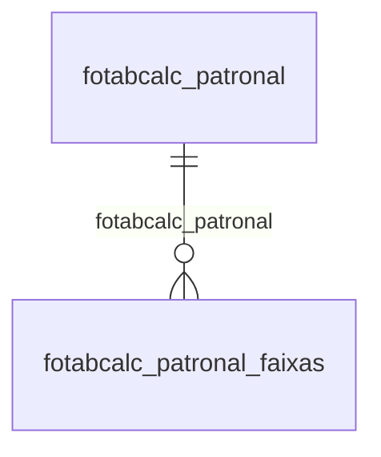

# Modelo — Pessoal - tabcalc (rascunho em lote)

> Gerado por `src/model/gerar_docs_modelo.py` a partir de `src/model/modulos/pessoal_tabcalc.yaml`, do catálogo e do perfil de colunas. **Não edite à mão.**

6 entidades. A coluna *Preench.* é o % de linhas com valor útil (nem nulo, nem em branco, nem zero, nem 1900-01-01; para colunas de código o zero conta como valor).

## Diagrama

## Entidades

| Entidade | Tabela | Linhas | Volume | Filtro obrigatório |
|---|---|---|---|---|
| [fotabcalc_patronal_faixas](#fotabcalc_patronal_faixas) | `fotabcalc_patronal_faixas` | 459 | pequeno | — |
| [fotabcalc_patronal](#fotabcalc_patronal) | `fotabcalc_patronal` | 24 | pequeno | — |
| [fotabcalc_salario_minimo_estadual_vigencias_categorias](#fotabcalc_salario_minimo_estadual_vigencias_categorias) | `FOTABCALC_SALARIO_MINIMO_ESTADUAL_VIGENCIAS_CATEGORIAS` | 6 | pequeno | — |
| [fotabcalc_salario_minimo_estadual_vigencias](#fotabcalc_salario_minimo_estadual_vigencias) | `FOTABCALC_SALARIO_MINIMO_ESTADUAL_VIGENCIAS` | 3 | pequeno | — |
| [fotabcalc_salario_minimo_estadual_categorias](#fotabcalc_salario_minimo_estadual_categorias) | `FOTABCALC_SALARIO_MINIMO_ESTADUAL_CATEGORIAS` | 2 | pequeno | — |
| [fotabcalc_salario_minimo_estadual](#fotabcalc_salario_minimo_estadual) | `FOTABCALC_SALARIO_MINIMO_ESTADUAL` | 1 | pequeno | — |

## fotabcalc_patronal_faixas

**Tabela de Contribuição Sindical Patronal - Faixas** — tabela `fotabcalc_patronal_faixas` (459 linhas)

Tabela de Contribuição Sindical Patronal - Faixas. 459 linhas no catálogo; chave: i_fotabcalc_patronal, ano, valor_inicial.

- **Chave:** `i_fotabcalc_patronal, ano, valor_inicial`
- **Empresa:** `não se aplica (tabela global)`
- **Período:** `—`
- **Ordem padrão:** `i_fotabcalc_patronal asc`, `ano asc`

**Regras de negócio validadas:**

- Medido em 2026-10-18: 459 linhas.
- Vínculo fotabcalc_patronal (fotabcalc_patronal): 0 de 459 linhas sem registro relacionado.

| Campo | Coluna | Tipo | Preench. | Domínio | Descrição (banco) |
|---|---|---|---|---|---|
| codigo | `i_fotabcalc_patronal` | integer(4) |  |  | Código |
| ano | `ano` | integer(4) |  |  | Ano |
| valor_de | `valor_inicial` | numeric(13) |  |  | Valor de |
| valor_ate | `valor_final` | numeric(13) |  |  | Valor até |
| percentual | `perc` | numeric(7) |  |  | Percentual |
| valor_a_adicionar | `valor` | numeric(13) |  |  | Valor a adicionar |

**Vínculos (LEFT JOIN, acrescentam colunas legíveis):**

- `fotabcalc_patronal` → `fotabcalc_patronal` por `i_fotabcalc_patronal` = `i_fotabcalc_patronal`; colunas: `fotabcalc_patronal_nome`

**Filtros:** `codigo` (eq/in), `ano` (eq/in), `valor_de` (eq/in)

## fotabcalc_patronal

**Tabela de Contribuição Sindical Patronal** — tabela `fotabcalc_patronal` (24 linhas)

Tabela de Contribuição Sindical Patronal. 24 linhas no catálogo; chave: i_fotabcalc_patronal.

- **Chave:** `i_fotabcalc_patronal`
- **Empresa:** `não se aplica (tabela global)`
- **Período:** `—`
- **Ordem padrão:** `i_fotabcalc_patronal asc`

**Regras de negócio validadas:**

- Medido em 2026-10-18: 24 linhas.
- atividade_de_ensino_0_nao_1_sim: todos os valores reais estão no comentário do banco (0=24).
- utilizar_receita_bruta: todos os valores reais estão no comentário do banco (0=24).

| Campo | Coluna | Tipo | Preench. | Domínio | Descrição (banco) |
|---|---|---|---|---|---|
| codigo | `i_fotabcalc_patronal` | integer(4) |  |  | Código |
| nome | `nome` | char(40) |  |  | Nome |
| atividade_de_ensino_0_nao_1_sim | `atividade_ensino` | smallint(2) |  | fotabcalc_patronal_atividade_d | Atividade de ensino. (0=Não/1=Sim) |
| utilizar_receita_bruta | `utilizar_receita_bruta` | smallint(2) |  | fotabcalc_patronal_utilizar_re | Utilizar receita bruta para o cálculo. (0=Não/1=Sim) |

**Filtros:** `codigo` (eq/in), `nome` (contem/prefixo)

## fotabcalc_salario_minimo_estadual_vigencias_categorias

**Valores do salário mínimo estadual por categoria na vigência.** — tabela `FOTABCALC_SALARIO_MINIMO_ESTADUAL_VIGENCIAS_CATEGORIAS` (6 linhas)

Valores do salário mínimo estadual por categoria na vigência.. 6 linhas no catálogo; chave: I_TABCALC_SALARIO_MINIMO_ESTADUAL, VIGENCIA, I_CATEGORIA.

- **Chave:** `I_TABCALC_SALARIO_MINIMO_ESTADUAL, VIGENCIA, I_CATEGORIA`
- **Empresa:** `não se aplica (tabela global)`
- **Período:** `VIGENCIA`
- **Ordem padrão:** `VIGENCIA desc`, `I_TABCALC_SALARIO_MINIMO_ESTADUAL asc`, `I_CATEGORIA asc`

**Regras de negócio validadas:**

- Medido em 2026-10-18: 6 linhas, VIGENCIA de 2015-01-01 a 2017-01-01.

| Campo | Coluna | Tipo | Preench. | Domínio | Descrição (banco) |
|---|---|---|---|---|---|
| codigo_sequencial_da_tabela_de_salario_m 🔒 | `i_tabcalc_salario_minimo_estadual` | integer(4) |  |  | Código sequencial da tabela de salário mínimo estadual. |
| competencia_de_inicio_da_vigencia_da_tab | `vigencia` | date(4) |  |  | Competência de início da vigência da tabela. |
| codigo_da_categoria | `i_categoria` | integer(4) |  |  | Código da categoria |
| valor_do_salario_minimo 🔒 | `valor` | numeric(13) |  |  | Valor do salário mínimo. |

**Filtros:** `codigo_sequencial_da_tabela_de_salario_m` (eq/in), `competencia_de_inicio_da_vigencia_da_tab` (eq/in), `codigo_da_categoria` (eq/in)

## fotabcalc_salario_minimo_estadual_vigencias

**Vigência da tabela de salário mínimo estadual.** — tabela `FOTABCALC_SALARIO_MINIMO_ESTADUAL_VIGENCIAS` (3 linhas)

Vigência da tabela de salário mínimo estadual.. 3 linhas no catálogo; chave: I_TABCALC_SALARIO_MINIMO_ESTADUAL, VIGENCIA.

- **Chave:** `I_TABCALC_SALARIO_MINIMO_ESTADUAL, VIGENCIA`
- **Empresa:** `não se aplica (tabela global)`
- **Período:** `VIGENCIA`
- **Ordem padrão:** `VIGENCIA desc`, `I_TABCALC_SALARIO_MINIMO_ESTADUAL asc`

**Regras de negócio validadas:**

- Medido em 2026-10-18: 3 linhas, VIGENCIA de 2015-01-01 a 2017-01-01.

| Campo | Coluna | Tipo | Preench. | Domínio | Descrição (banco) |
|---|---|---|---|---|---|
| codigo_sequencial_da_tabela_de_salario_m 🔒 | `i_tabcalc_salario_minimo_estadual` | integer(4) |  |  | Código sequencial da tabela de salário mínimo estadual. |
| competencia_de_inicio_da_vigencia_da_tab | `vigencia` | date(4) |  |  | Competência de início da vigência da tabela. |

**Filtros:** `codigo_sequencial_da_tabela_de_salario_m` (eq/in), `competencia_de_inicio_da_vigencia_da_tab` (eq/in)

## fotabcalc_salario_minimo_estadual_categorias

**Categorias para a tabela de salário mínimo estadual.** — tabela `FOTABCALC_SALARIO_MINIMO_ESTADUAL_CATEGORIAS` (2 linhas)

Categorias para a tabela de salário mínimo estadual.. 2 linhas no catálogo; chave: I_CATEGORIA.

- **Chave:** `I_CATEGORIA`
- **Empresa:** `não se aplica (tabela global)`
- **Período:** `—`
- **Ordem padrão:** `I_CATEGORIA asc`

**Regras de negócio validadas:**

- Medido em 2026-10-18: 2 linhas.
- Colunas expostas nulas em 100% das linhas (1): descricao.

| Campo | Coluna | Tipo | Preench. | Domínio | Descrição (banco) |
|---|---|---|---|---|---|
| codigo_da_categoria | `i_categoria` | integer(4) |  |  | Código da categoria |
| nome | `nome` | varchar(150) |  |  | Nome |
| descricao | `descricao` | varchar(500) |  |  | Descrição. |

**Filtros:** `codigo_da_categoria` (eq/in), `nome` (contem/prefixo), `descricao` (contem/prefixo)

## fotabcalc_salario_minimo_estadual

**Tabela de salário mínimo estadual.** — tabela `FOTABCALC_SALARIO_MINIMO_ESTADUAL` (1 linhas)

Tabela de salário mínimo estadual.. 1 linhas no catálogo; chave: I_TABCALC_SALARIO_MINIMO_ESTADUAL.

- **Chave:** `I_TABCALC_SALARIO_MINIMO_ESTADUAL`
- **Empresa:** `não se aplica (tabela global)`
- **Período:** `—`
- **Ordem padrão:** `I_TABCALC_SALARIO_MINIMO_ESTADUAL asc`

**Regras de negócio validadas:**

- Medido em 2026-10-18: 1 linhas.
- Vínculo geestado (geestado): 0 de 1 linhas sem registro relacionado.

| Campo | Coluna | Tipo | Preench. | Domínio | Descrição (banco) |
|---|---|---|---|---|---|
| codigo_sequencial_da_tabela_de_salario_m 🔒 | `i_tabcalc_salario_minimo_estadual` | integer(4) |  |  | Código sequencial da tabela de salário mínimo estadual. |
| uf_da_tabela | `codigo_uf` | integer(4) |  |  | UF da tabela. |

**Vínculos (LEFT JOIN, acrescentam colunas legíveis):**

- `geestado` → `geestado` por `codigo_uf` = `codigo_uf`; colunas: `geestado_nome`

**Filtros:** `codigo_sequencial_da_tabela_de_salario_m` (eq/in), `uf_da_tabela` (eq/in)

## Domínios (significado dos códigos)

`confirmado`: **sim** = vem do comentário do banco e/ou foi conferido nos dados; **parcial** = parte dos valores; **não** = hipótese, não use como regra.

### status_empresa

Situação da empresa no cadastro (geempre.stat_emp)

Confirmado: sim

| Código | Significado |
|---|---|
| A | Ativa |
| I | Inativa |
| C | Em constituição |
| M | Ativo sem movimento |
| B | Em processo de baixa |
| E | Excluindo |

### motivo_inatividade

Motivo da inatividade (geempre.tipoi_emp). Só aparece em empresas inativas.

Confirmado: sim

| Código | Significado |
|---|---|
| 1 | Outros |
| 2 | Baixada |
| 3 | Transferida |
| 4 | Inadimplente |

### tipo_inscricao

Tipo da inscrição (CNPJ/CPF/CEI/CAEPF)

Confirmado: sim

| Código | Significado |
|---|---|
| 1 | CNPJ |
| 2 | CPF |
| 3 | CEI |
| 6 | CAEPF |

### regime_federal_empresa

Regime federal da folha (geempre.rfed_emp)

Confirmado: parcial

| Código | Significado |
|---|---|
| 1 | Normal |
| 2 | Microempresa |
| 3 | Empresa de pequeno porte |

### tipo_honorario_empresa

Como a empresa usa o módulo Honorários (geempre.honorario_tipo)

Confirmado: sim

| Código | Significado |
|---|---|
| E | Escritório (quem fatura) |
| C | Cliente |

### sim_nao_texto

Confirmado: sim

| Código | Significado |
|---|---|
| S | Sim |
| N | Não |

### sim_nao_numerico

Confirmado: sim

| Código | Significado |
|---|---|
| 1 | Sim |
| 0 | Não |

### fotabcalc_patronal_atividade_d

Confirmado: sim

> Todos os valores observados em fotabcalc_patronal.ATIVIDADE_ENSINO estão no comentário do banco (2026-10-18). Distribuição: 0=24.

| Código | Significado |
|---|---|
| 0 | Não |
| 1 | Sim |

### fotabcalc_patronal_utilizar_re

Confirmado: sim

> Todos os valores observados em fotabcalc_patronal.UTILIZAR_RECEITA_BRUTA estão no comentário do banco (2026-10-18). Distribuição: 0=24.

| Código | Significado |
|---|---|
| 0 | Não |
| 1 | Sim |

