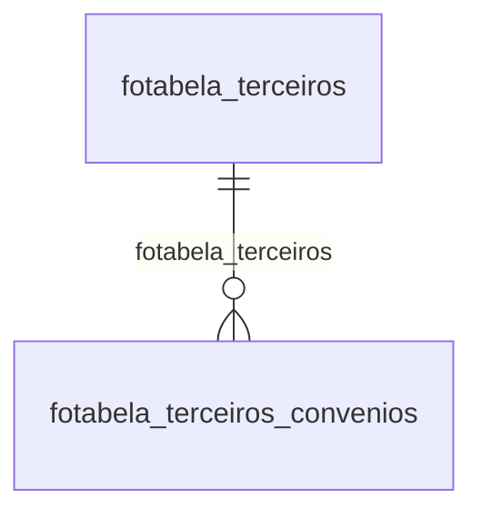

# Modelo — Pessoal - tabela (rascunho em lote)

> Gerado por `src/model/gerar_docs_modelo.py` a partir de `src/model/modulos/pessoal_tabela.yaml`, do catálogo e do perfil de colunas. **Não edite à mão.**

6 entidades. A coluna *Preench.* é o % de linhas com valor útil (nem nulo, nem em branco, nem zero, nem 1900-01-01; para colunas de código o zero conta como valor).

## Diagrama

## Entidades

| Entidade | Tabela | Linhas | Volume | Filtro obrigatório |
|---|---|---|---|---|
| [fotabela_tuss](#fotabela_tuss) | `FOTABELA_TUSS` | 5.665 | pequeno | — |
| [fotabela_exames](#fotabela_exames) | `FOTABELA_EXAMES` | 1.450 | pequeno | — |
| [fotabela_terceiros_convenios](#fotabela_terceiros_convenios) | `FOTABELA_TERCEIROS_CONVENIOS` | 625 | pequeno | — |
| [fotabela_terceiros](#fotabela_terceiros) | `FOTABELA_TERCEIROS` | 309 | pequeno | — |
| [fotabela_calculo_irrf_participacao_lucros_faixas](#fotabela_calculo_irrf_participacao_lucros_faixas) | `FOTABELA_CALCULO_IRRF_PARTICIPACAO_LUCROS_FAIXAS` | 227 | pequeno | — |
| [fotabela_calculo_irrf_participacao_lucros](#fotabela_calculo_irrf_participacao_lucros) | `FOTABELA_CALCULO_IRRF_PARTICIPACAO_LUCROS` | 68 | pequeno | — |

## fotabela_tuss

**Tabela TUSS** — tabela `FOTABELA_TUSS` (5.665 linhas)

Tabela TUSS. 5.665 linhas no catálogo; chave: CODIGO.

- **Chave:** `CODIGO`
- **Empresa:** `não se aplica (tabela global)`
- **Período:** `—`
- **Ordem padrão:** `CODIGO asc`

**Regras de negócio validadas:**

- Medido em 2026-10-18: 5.665 linhas.

| Campo | Coluna | Tipo | Preench. | Domínio | Descrição (banco) |
|---|---|---|---|---|---|
| codigo | `codigo` | varchar(8) |  |  | Código. |
| descricao | `descricao` | varchar(350) |  |  | Descrição. |

**Filtros:** `codigo` (eq/in), `descricao` (contem/prefixo)

## fotabela_exames

**Código do exame.** — tabela `FOTABELA_EXAMES` (1.450 linhas)

Código do exame.. 1.450 linhas no catálogo; chave: I_EXAMES.

- **Chave:** `I_EXAMES`
- **Empresa:** `não se aplica (tabela global)`
- **Período:** `—`
- **Ordem padrão:** `I_EXAMES asc`

**Regras de negócio validadas:**

- Medido em 2026-10-18: 1.450 linhas.

| Campo | Coluna | Tipo | Preench. | Domínio | Descrição (banco) |
|---|---|---|---|---|---|
| codigo_do_exame | `i_exames` | integer(4) |  |  | Código do exame |
| procedimento_realizado | `procedimento` | varchar(150) |  |  | Procedimento realizado. |

**Filtros:** `codigo_do_exame` (eq/in), `procedimento_realizado` (contem/prefixo)

## fotabela_terceiros_convenios

**Tabela de alíquotas dos convênios para os códigos de terceiros.** — tabela `FOTABELA_TERCEIROS_CONVENIOS` (625 linhas)

Tabela de alíquotas dos convênios para os códigos de terceiros.. 625 linhas no catálogo; chave: I_TERCEIROS, CODIGO_CONVENIO.

- **Chave:** `I_TERCEIROS, CODIGO_CONVENIO`
- **Empresa:** `não se aplica (tabela global)`
- **Período:** `—`
- **Ordem padrão:** `I_TERCEIROS asc`, `CODIGO_CONVENIO asc`

**Regras de negócio validadas:**

- Medido em 2026-10-18: 625 linhas.
- Vínculo fotabela_terceiros (FOTABELA_TERCEIROS): 0 de 625 linhas sem registro relacionado.
- Vínculo foconvenios_terceiros (FOCONVENIOS_TERCEIROS): 0 de 625 linhas sem registro relacionado.

| Campo | Coluna | Tipo | Preench. | Domínio | Descrição (banco) |
|---|---|---|---|---|---|
| codigo_de_terceiros | `i_terceiros` | integer(4) |  |  | Código de terceiros. |
| codigo_do_convenio | `codigo_convenio` | smallint(2) |  |  | Código do convênio. |
| aliquota | `aliquota` | decimal(4) |  |  | Alíquota. |
| aliquota_mp_932_2020_c | `aliquota_mp_932_2020` | decimal(4) |  |  | Alíquota MP 932/2020 |

**Vínculos (LEFT JOIN, acrescentam colunas legíveis):**

- `fotabela_terceiros` → `FOTABELA_TERCEIROS` por `i_terceiros` = `i_terceiros`; colunas: `fotabela_terceiros_nome`
- `foconvenios_terceiros` → `FOCONVENIOS_TERCEIROS` por `codigo_convenio` = `codigo_convenio`; colunas: `foconvenios_terceiros_nome`

**Filtros:** `codigo_de_terceiros` (eq/in), `codigo_do_convenio` (eq/in)

## fotabela_terceiros

**Tabela de códigos de terceiros.** — tabela `FOTABELA_TERCEIROS` (309 linhas)

Tabela de códigos de terceiros.. 309 linhas no catálogo; chave: I_TERCEIROS.

- **Chave:** `I_TERCEIROS`
- **Empresa:** `não se aplica (tabela global)`
- **Período:** `—`
- **Ordem padrão:** `I_TERCEIROS asc`

**Regras de negócio validadas:**

- Medido em 2026-10-18: 309 linhas.

| Campo | Coluna | Tipo | Preench. | Domínio | Descrição (banco) |
|---|---|---|---|---|---|
| identificador_da_tabela_de_terceiros | `i_terceiros` | integer(4) |  |  | Identificador da tabela de terceiros. |
| codigo_do_fpas | `codigo_fpas` | integer(4) |  |  | Código do FPAS |
| codigo_de_terceiros | `codigo_terceiros` | integer(4) |  |  | Código de terceiros. |
| descricao | `descricao` | varchar(60) |  |  | Descrição. |

**Filtros:** `identificador_da_tabela_de_terceiros` (eq/in), `codigo_do_fpas` (eq/in), `codigo_de_terceiros` (eq/in), `descricao` (contem/prefixo)

## fotabela_calculo_irrf_participacao_lucros_faixas

**Faixas da tabela de cálculo de IRRF sobre participação nos lucros.** — tabela `FOTABELA_CALCULO_IRRF_PARTICIPACAO_LUCROS_FAIXAS` (227 linhas)

Faixas da tabela de cálculo de IRRF sobre participação nos lucros.. 227 linhas no catálogo; chave: COMPETENCIA, VALOR_ATE.

- **Chave:** `COMPETENCIA, VALOR_ATE`
- **Empresa:** `não se aplica (tabela global)`
- **Período:** `COMPETENCIA`
- **Ordem padrão:** `COMPETENCIA desc`, `VALOR_ATE asc`

**Regras de negócio validadas:**

- Medido em 2026-10-18: 227 linhas, COMPETENCIA de 1998-01-01 a 2025-05-01.

| Campo | Coluna | Tipo | Preench. | Domínio | Descrição (banco) |
|---|---|---|---|---|---|
| competencia | `competencia` | date(4) |  |  | Competência. |
| valor_maximo_da_faixa | `valor_ate` | numeric(13) |  |  | Valor máximo da faixa. |
| valor_da_aliquota_para_o_calculo | `aliquota` | numeric(13) |  |  | Valor da alíquota para o cálculo. |
| valor_do_desconto | `valor_desconto` | numeric(13) |  |  | Valor do desconto. |

**Filtros:** `competencia` (eq/in), `valor_maximo_da_faixa` (eq/in)

## fotabela_calculo_irrf_participacao_lucros

**Tabela de cálculo do IRRF sobre participação nos lucros.** — tabela `FOTABELA_CALCULO_IRRF_PARTICIPACAO_LUCROS` (68 linhas)

Tabela de cálculo do IRRF sobre participação nos lucros.. 68 linhas no catálogo; chave: COMPETENCIA.

- **Chave:** `COMPETENCIA`
- **Empresa:** `não se aplica (tabela global)`
- **Período:** `COMPETENCIA`
- **Ordem padrão:** `COMPETENCIA desc`

**Regras de negócio validadas:**

- Medido em 2026-10-18: 68 linhas, COMPETENCIA de 1998-01-01 a 2025-05-01.
- tabela_incluida_atraves_do_processo_de_a: todos os valores reais estão no comentário do banco (0=64, 1=4).

| Campo | Coluna | Tipo | Preench. | Domínio | Descrição (banco) |
|---|---|---|---|---|---|
| competencia | `competencia` | date(4) |  |  | Competência. |
| valor_do_desconto_por_dependente | `valor_desconto_dependente` | numeric(13) |  |  | Valor do desconto por dependente. |
| valor_minimo_para_retencao | `valor_minimo_retencao` | numeric(13) |  |  | Valor mínimo para retenção. |
| tabela_incluida_atraves_do_processo_de_a | `origem_sgd` | smallint(2) |  | fotabela_calculo_irrf_participacao_lucros_tabela_incl | Tabela incluída através do processo de atualização automática do SGD. (0=Não/1=Sim) |
| versao_da_tabela_atualizada_pelo_sgd | `versao_tabela_sgd` | smallint(2) |  |  | Versão da tabela atualizada pelo SGD |

**Filtros:** `competencia` (eq/in)

## Domínios (significado dos códigos)

`confirmado`: **sim** = vem do comentário do banco e/ou foi conferido nos dados; **parcial** = parte dos valores; **não** = hipótese, não use como regra.

### status_empresa

Situação da empresa no cadastro (geempre.stat_emp)

Confirmado: sim

| Código | Significado |
|---|---|
| A | Ativa |
| I | Inativa |
| C | Em constituição |
| M | Ativo sem movimento |
| B | Em processo de baixa |
| E | Excluindo |

### motivo_inatividade

Motivo da inatividade (geempre.tipoi_emp). Só aparece em empresas inativas.

Confirmado: sim

| Código | Significado |
|---|---|
| 1 | Outros |
| 2 | Baixada |
| 3 | Transferida |
| 4 | Inadimplente |

### tipo_inscricao

Tipo da inscrição (CNPJ/CPF/CEI/CAEPF)

Confirmado: sim

| Código | Significado |
|---|---|
| 1 | CNPJ |
| 2 | CPF |
| 3 | CEI |
| 6 | CAEPF |

### regime_federal_empresa

Regime federal da folha (geempre.rfed_emp)

Confirmado: parcial

| Código | Significado |
|---|---|
| 1 | Normal |
| 2 | Microempresa |
| 3 | Empresa de pequeno porte |

### tipo_honorario_empresa

Como a empresa usa o módulo Honorários (geempre.honorario_tipo)

Confirmado: sim

| Código | Significado |
|---|---|
| E | Escritório (quem fatura) |
| C | Cliente |

### sim_nao_texto

Confirmado: sim

| Código | Significado |
|---|---|
| S | Sim |
| N | Não |

### sim_nao_numerico

Confirmado: sim

| Código | Significado |
|---|---|
| 1 | Sim |
| 0 | Não |

### fotabela_calculo_irrf_participacao_lucros_tabela_incl

Confirmado: sim

> Todos os valores observados em FOTABELA_CALCULO_IRRF_PARTICIPACAO_LUCROS.ORIGEM_SGD estão no comentário do banco (2026-10-18). Distribuição: 0=64, 1=4.

| Código | Significado |
|---|---|
| 0 | Não |
| 1 | Sim |

