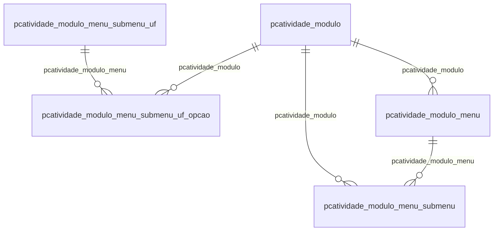

# Modelo — Processos - atividade (rascunho em lote)

> Gerado por `src/model/gerar_docs_modelo.py` a partir de `src/model/modulos/processos_atividade.yaml`, do catálogo e do perfil de colunas. **Não edite à mão.**

6 entidades. A coluna *Preench.* é o % de linhas com valor útil (nem nulo, nem em branco, nem zero, nem 1900-01-01; para colunas de código o zero conta como valor).

## Diagrama

## Entidades

| Entidade | Tabela | Linhas | Volume | Filtro obrigatório |
|---|---|---|---|---|
| [pcatividade_modulo_menu_submenu_uf_opcao](#pcatividade_modulo_menu_submenu_uf_opcao) | `PCATIVIDADE_MODULO_MENU_SUBMENU_UF_OPCAO` | 850 | pequeno | — |
| [pcatividade_modulo_menu_submenu](#pcatividade_modulo_menu_submenu) | `PCATIVIDADE_MODULO_MENU_SUBMENU` | 62 | pequeno | — |
| [pcatividade_modulo_menu_submenu_uf](#pcatividade_modulo_menu_submenu_uf) | `PCATIVIDADE_MODULO_MENU_SUBMENU_UF` | 27 | pequeno | — |
| [pcatividade_responsavel](#pcatividade_responsavel) | `PCATIVIDADE_RESPONSAVEL` | 26 | pequeno | — |
| [pcatividade_modulo_menu](#pcatividade_modulo_menu) | `PCATIVIDADE_MODULO_MENU` | 12 | pequeno | — |
| [pcatividade_modulo](#pcatividade_modulo) | `PCATIVIDADE_MODULO` | 6 | pequeno | — |

## pcatividade_modulo_menu_submenu_uf_opcao

**Módulos - Menu - Submenu - UF - Opção** — tabela `PCATIVIDADE_MODULO_MENU_SUBMENU_UF_OPCAO` (850 linhas)

Módulos - Menu - Submenu - UF - Opção. 850 linhas no catálogo; chave: I_OPCAO.

- **Chave:** `I_OPCAO`
- **Empresa:** `não se aplica (tabela global)`
- **Período:** `—`
- **Ordem padrão:** `I_OPCAO asc`

**Regras de negócio validadas:**

- Medido em 2026-10-18: 850 linhas.
- Vínculo pcatividade_modulo (PCATIVIDADE_MODULO): 0 de 850 linhas sem registro relacionado.
- Vínculo pcatividade_modulo_menu (PCATIVIDADE_MODULO_MENU_SUBMENU_UF): 0 de 850 linhas sem registro relacionado.

| Campo | Coluna | Tipo | Preench. | Domínio | Descrição (banco) |
|---|---|---|---|---|---|
| codigo | `i_opcao` | integer(4) |  |  | Código |
| modulo | `i_modulo` | integer(4) |  |  | Módulo |
| menu | `i_menu` | integer(4) |  |  | Menu |
| submenu | `i_submenu` | integer(4) |  |  | Submenu |
| i_uf | `i_uf` | integer(4) |  |  | UF |
| nome | `nome` | varchar(128) |  |  | Nome |
| ordem | `ordem` | integer(4) |  |  | Ordem |
| a_opcao_representa_um_imposto_s_n | `conforme_imposto` | char(1) |  |  | A opção representa um imposto (S/N) |
| codigo_do_imposto_no_sistema | `codigo_imposto` | integer(4) |  |  | Código do imposto no sistema |
| inativo_s_n | `inativo` | char(1) |  |  | Inativo (S/N) |

**Vínculos (LEFT JOIN, acrescentam colunas legíveis):**

- `pcatividade_modulo` → `PCATIVIDADE_MODULO` por `i_modulo` = `i_modulo`; colunas: `pcatividade_modulo_nome`
- `pcatividade_modulo_menu` → `PCATIVIDADE_MODULO_MENU_SUBMENU_UF` por `i_uf` = `i_uf`; colunas: `pcatividade_modulo_menu_nome`

**Filtros:** `codigo` (eq/in), `modulo` (eq/in), `menu` (eq/in), `submenu` (eq/in), `i_uf` (eq/in), `nome` (contem/prefixo), `a_opcao_representa_um_imposto_s_n` (eq/in), `codigo_do_imposto_no_sistema` (eq/in), `inativo_s_n` (eq/in)

## pcatividade_modulo_menu_submenu

**Módulos - Menu - Submenu** — tabela `PCATIVIDADE_MODULO_MENU_SUBMENU` (62 linhas)

Módulos - Menu - Submenu. 62 linhas no catálogo; chave: I_SUBMENU.

- **Chave:** `I_SUBMENU`
- **Empresa:** `não se aplica (tabela global)`
- **Período:** `—`
- **Ordem padrão:** `I_SUBMENU asc`

**Regras de negócio validadas:**

- Medido em 2026-10-18: 62 linhas.
- Vínculo pcatividade_modulo (PCATIVIDADE_MODULO): 0 de 62 linhas sem registro relacionado.
- Vínculo pcatividade_modulo_menu (PCATIVIDADE_MODULO_MENU): 0 de 62 linhas sem registro relacionado.

| Campo | Coluna | Tipo | Preench. | Domínio | Descrição (banco) |
|---|---|---|---|---|---|
| codigo | `i_submenu` | integer(4) |  |  | Código |
| modulo | `i_modulo` | integer(4) |  |  | Módulo |
| menu | `i_menu` | integer(4) |  |  | Menu |
| nome | `nome` | varchar(60) |  |  | Nome |
| conforme_uf_s_n | `conforme_uf` | char(1) |  |  | Conforme UF (S/N) |
| ordem | `ordem` | integer(4) |  |  | Ordem |

**Vínculos (LEFT JOIN, acrescentam colunas legíveis):**

- `pcatividade_modulo` → `PCATIVIDADE_MODULO` por `i_modulo` = `i_modulo`; colunas: `pcatividade_modulo_nome`
- `pcatividade_modulo_menu` → `PCATIVIDADE_MODULO_MENU` por `i_menu` = `i_menu`; colunas: `pcatividade_modulo_menu_nome`

**Filtros:** `codigo` (eq/in), `modulo` (eq/in), `menu` (eq/in), `nome` (contem/prefixo), `conforme_uf_s_n` (eq/in)

## pcatividade_modulo_menu_submenu_uf

**Módulos - Menu - Submenu - UF** — tabela `PCATIVIDADE_MODULO_MENU_SUBMENU_UF` (27 linhas)

Módulos - Menu - Submenu - UF. 27 linhas no catálogo; chave: I_UF.

- **Chave:** `I_UF`
- **Empresa:** `não se aplica (tabela global)`
- **Período:** `—`
- **Ordem padrão:** `I_UF asc`

**Regras de negócio validadas:**

- Medido em 2026-10-18: 27 linhas.

| Campo | Coluna | Tipo | Preench. | Domínio | Descrição (banco) |
|---|---|---|---|---|---|
| codigo | `i_uf` | integer(4) |  |  | Código |
| nome | `nome` | varchar(60) |  |  | Nome |
| ordem | `ordem` | integer(4) |  |  | Ordem |

**Filtros:** `codigo` (eq/in), `nome` (contem/prefixo)

## pcatividade_responsavel

**Atividades - Responsáveis** — tabela `PCATIVIDADE_RESPONSAVEL` (26 linhas)

Atividades - Responsáveis. 26 linhas no catálogo; chave: I_ATIVIDADE, I_RESPONSAVEL, RESPONSAVEL_TIPO.

- **Chave:** `I_ATIVIDADE, I_RESPONSAVEL, RESPONSAVEL_TIPO`
- **Empresa:** `não se aplica (tabela global)`
- **Período:** `—`
- **Ordem padrão:** `I_ATIVIDADE asc`, `I_RESPONSAVEL asc`

**Regras de negócio validadas:**

- Medido em 2026-10-18: 26 linhas.
- Vínculo pcatividade (PCATIVIDADE): 0 de 26 linhas sem registro relacionado.
- Vínculo usconfusuario (usConfUsuario): 0 de 26 linhas sem registro relacionado.

| Campo | Coluna | Tipo | Preench. | Domínio | Descrição (banco) |
|---|---|---|---|---|---|
| codigo_da_atividade | `i_atividade` | integer(4) |  |  | Código da atividade |
| codigo_do_responsavel | `i_responsavel` | integer(4) |  |  | Código do responsável |
| responsavel_tipo | `responsavel_tipo` | smallint(2) |  |  | Tipo do responsável (Fixo 1) |

**Vínculos (LEFT JOIN, acrescentam colunas legíveis):**

- `pcatividade` → `PCATIVIDADE` por `i_atividade` = `i_atividade`; colunas: `pcatividade_nome`
- `usconfusuario` → `usConfUsuario` por `responsavel_tipo` = `tipo` e `i_responsavel` = `i_confusuario`; colunas: `usconfusuario_nome`

**Filtros:** `codigo_da_atividade` (eq/in), `codigo_do_responsavel` (eq/in), `responsavel_tipo` (eq/in)

## pcatividade_modulo_menu

**Módulos - Menu** — tabela `PCATIVIDADE_MODULO_MENU` (12 linhas)

Módulos - Menu. 12 linhas no catálogo; chave: I_MENU.

- **Chave:** `I_MENU`
- **Empresa:** `não se aplica (tabela global)`
- **Período:** `—`
- **Ordem padrão:** `I_MENU asc`

**Regras de negócio validadas:**

- Medido em 2026-10-18: 12 linhas.
- Vínculo pcatividade_modulo (PCATIVIDADE_MODULO): 0 de 12 linhas sem registro relacionado.

| Campo | Coluna | Tipo | Preench. | Domínio | Descrição (banco) |
|---|---|---|---|---|---|
| codigo | `i_menu` | integer(4) |  |  | Código |
| modulo | `i_modulo` | integer(4) |  |  | Módulo |
| nome | `nome` | varchar(60) |  |  | Nome |
| ordem | `ordem` | integer(4) |  |  | Ordem |

**Vínculos (LEFT JOIN, acrescentam colunas legíveis):**

- `pcatividade_modulo` → `PCATIVIDADE_MODULO` por `i_modulo` = `i_modulo`; colunas: `pcatividade_modulo_nome`

**Filtros:** `codigo` (eq/in), `modulo` (eq/in), `nome` (contem/prefixo)

## pcatividade_modulo

**Módulos** — tabela `PCATIVIDADE_MODULO` (6 linhas)

Módulos. 6 linhas no catálogo; chave: I_MODULO.

- **Chave:** `I_MODULO`
- **Empresa:** `não se aplica (tabela global)`
- **Período:** `—`
- **Ordem padrão:** `I_MODULO asc`

**Regras de negócio validadas:**

- Medido em 2026-10-18: 6 linhas.

| Campo | Coluna | Tipo | Preench. | Domínio | Descrição (banco) |
|---|---|---|---|---|---|
| codigo | `i_modulo` | integer(4) |  |  | Código |
| nome | `nome` | varchar(60) |  |  | Nome |
| codigo_do_sistema | `codigo_sistema` | integer(4) |  |  | Código do sistema |
| ordem | `ordem` | integer(4) |  |  | Ordem |

**Filtros:** `codigo` (eq/in), `nome` (contem/prefixo), `codigo_do_sistema` (eq/in)

## Domínios (significado dos códigos)

`confirmado`: **sim** = vem do comentário do banco e/ou foi conferido nos dados; **parcial** = parte dos valores; **não** = hipótese, não use como regra.

### status_empresa

Situação da empresa no cadastro (geempre.stat_emp)

Confirmado: sim

| Código | Significado |
|---|---|
| A | Ativa |
| I | Inativa |
| C | Em constituição |
| M | Ativo sem movimento |
| B | Em processo de baixa |
| E | Excluindo |

### motivo_inatividade

Motivo da inatividade (geempre.tipoi_emp). Só aparece em empresas inativas.

Confirmado: sim

| Código | Significado |
|---|---|
| 1 | Outros |
| 2 | Baixada |
| 3 | Transferida |
| 4 | Inadimplente |

### tipo_inscricao

Tipo da inscrição (CNPJ/CPF/CEI/CAEPF)

Confirmado: sim

| Código | Significado |
|---|---|
| 1 | CNPJ |
| 2 | CPF |
| 3 | CEI |
| 6 | CAEPF |

### regime_federal_empresa

Regime federal da folha (geempre.rfed_emp)

Confirmado: parcial

| Código | Significado |
|---|---|
| 1 | Normal |
| 2 | Microempresa |
| 3 | Empresa de pequeno porte |

### tipo_honorario_empresa

Como a empresa usa o módulo Honorários (geempre.honorario_tipo)

Confirmado: sim

| Código | Significado |
|---|---|
| E | Escritório (quem fatura) |
| C | Cliente |

### sim_nao_texto

Confirmado: sim

| Código | Significado |
|---|---|
| S | Sim |
| N | Não |

### sim_nao_numerico

Confirmado: sim

| Código | Significado |
|---|---|
| 1 | Sim |
| 0 | Não |

