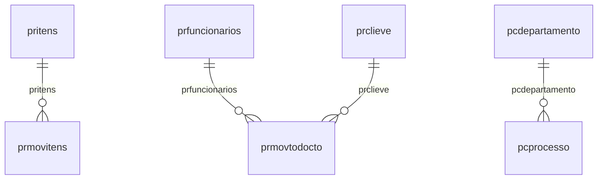

# Modelo — Processos - nucleo (rascunho em lote)

> Gerado por `src/model/gerar_docs_modelo.py` a partir de `src/model/modulos/processos_nucleo.yaml`, do catálogo e do perfil de colunas. **Não edite à mão.**

10 entidades. A coluna *Preench.* é o % de linhas com valor útil (nem nulo, nem em branco, nem zero, nem 1900-01-01; para colunas de código o zero conta como valor).

## Diagrama

## Entidades

| Entidade | Tabela | Linhas | Volume | Filtro obrigatório |
|---|---|---|---|---|
| [prmovitens](#prmovitens) | `prMovitens` | 21.624 | medio | — |
| [prmovtodocto](#prmovtodocto) | `prMovtoDocto` | 10.747 | medio | empresa |
| [pritens](#pritens) | `prItens` | 356 | pequeno | — |
| [prclieve](#prclieve) | `prCliEve` | 23 | pequeno | — |
| [prfuncionarios](#prfuncionarios) | `prFuncionarios` | 22 | pequeno | — |
| [prparam](#prparam) | `prparam` | 1 | pequeno | — |
| [pcatividade](#pcatividade) | `PCATIVIDADE` | 20 | pequeno | — |
| [pcprocesso](#pcprocesso) | `PCPROCESSO` | 20 | pequeno | — |
| [pcdepartamento](#pcdepartamento) | `PCDEPARTAMENTO` | 6 | pequeno | — |
| [pcparametro](#pcparametro) | `PCPARAMETRO` | 1 | pequeno | empresa |

## prmovitens

**Movimento de documentos - Itens** — tabela `prMovitens` (21.624 linhas)

Movimento de documentos - Itens. 21.624 linhas no catálogo; chave: nume_mod, codi_ite, sequ_mov.

- **Chave:** `nume_mod, codi_ite, sequ_mov`
- **Empresa:** `não se aplica (tabela global)`
- **Período:** `vcto_mov`
- **Ordem padrão:** `vcto_mov desc`, `nume_mod asc`, `codi_ite asc`

**Regras de negócio validadas:**

- Medido em 2026-10-18: 21.624 linhas.
- Colunas expostas nulas em 100% das linhas (7): codigo_receita, vencimento, valor, observacao_imposto, observacao_de_retorno, competencia, codigo_observacao.
- Vínculo pritens (prItens): 0 de 21.624 linhas sem registro relacionado.
- Vínculo probservacoes (probservacoes): 0 de 21.624 linhas sem registro relacionado.

| Campo | Coluna | Tipo | Preench. | Domínio | Descrição (banco) |
|---|---|---|---|---|---|
| nro_protocolo | `nume_mod` | integer(4) |  |  | Nro Protocolo |
| item | `codi_ite` | integer(4) |  |  | Item |
| sequencial | `sequ_mov` | integer(4) |  |  | Sequencial |
| codigo_receita | `crec_mov` | char(6) |  |  | Codigo Receita |
| vencimento | `vcto_mov` | date(4) |  |  | Vencimento |
| valor | `vlor_mov` | numeric(12) |  |  | valor |
| nro_livro | `nliv_mov` | integer(4) |  |  | Nro Livro |
| observacao_imposto | `obse_imp` | char(40) |  |  | Observacao Imposto |
| periodo_inicial | `peri_ini` | date(4) |  |  | Periodo Inicial |
| periodo_final | `peri_fim` | date(4) |  |  | Periodo Final |
| observao_outro | `obse_out` | char(80) |  |  | Observao Outro |
| data_de_retorno | `dret_mov` | date(4) |  |  | Data de Retorno |
| funcionario | `codi_fun` | integer(4) |  |  | Funcionario |
| observacao_de_retorno | `obse_ret` | char(200) |  |  | Observacao de Retorno |
| observao_livro | `obse_liv` | char(40) |  |  | Observao Livro |
| baixado_1_sim_0_nao | `baix_mov` | tinyint(1) |  |  | Baixado (1=Sim, 0=Nao) |
| competencia | `competencia` | date(4) |  |  | Competência |
| hora_da_baixa | `hora_baixa` | time(8) |  |  | Hora da baixa |
| recepcao_dos_documentos_no_cliente | `funcionario_recepcao_documento_cliente` | varchar(60) |  |  | Recepcao dos documentos no cliente |
| codigo_observacao | `codi_obs` | integer(4) |  |  | Codigo Observacao |
| usuario_da_baixa | `cod_usu_baixa` | varchar(30) |  |  | Usuário da Baixa |

**Vínculos (LEFT JOIN, acrescentam colunas legíveis):**

- `pritens` → `prItens` por `codi_ite` = `codi_ite`; colunas: `pritens_nome`
- `probservacoes` → `probservacoes` por `codi_obs` = `codi_obs`; colunas: `probservacoes_nome`

**Filtros:** `nro_protocolo` (eq/in), `item` (eq/in), `sequencial` (eq/in), `vencimento` (entre/gte/lte), `periodo_inicial` (entre/gte/lte), `periodo_final` (entre/gte/lte), `data_de_retorno` (entre/gte/lte), `competencia` (entre/gte/lte), `codigo_receita` (eq/in), `observacao_imposto` (contem/prefixo), `observao_outro` (contem/prefixo), `funcionario` (eq/in), `observacao_de_retorno` (contem/prefixo), `observao_livro` (contem/prefixo)

## prmovtodocto

**Movimento de documentos** — tabela `prMovtoDocto` (10.747 linhas)

Movimento de documentos. 10.747 linhas no catálogo; chave: nume_mod.

- **Chave:** `nume_mod`
- **Empresa:** `codi_emp`
- **Período:** `dret_mod`
- **Ordem padrão:** `dret_mod desc`, `nume_mod asc`

**Regras de negócio validadas:**

- Medido em 2026-10-18: 10.747 linhas, 681 empresa(s).
- Colunas expostas nulas em 100% das linhas (2): data_de_retorno_se_ouver_retorno, codigo_da_observacao.
- Vínculo prfuncionarios (prFuncionarios): 0 de 3 linhas sem registro relacionado (empresa 715).
- Vínculo prclieve (prCliEve): 0 de 3 linhas sem registro relacionado (empresa 715).
- Vínculo probservacoes (probservacoes): 0 de 3 linhas sem registro relacionado (empresa 715).

| Campo | Coluna | Tipo | Preench. | Domínio | Descrição (banco) |
|---|---|---|---|---|---|
| nro_protocolo | `nume_mod` | integer(4) |  |  | Nro. Protocolo |
| cliente | `codi_emp` | integer(4) |  |  | Cliente |
| funcionario | `codi_fun` | integer(4) |  |  | Funcionario |
| data_de_retorno_se_ouver_retorno | `dret_mod` | date(4) |  |  | Data de retorno, se ouver retorno |
| competencia | `comp_mod` | date(4) |  |  | Competencia |
| tipo_1_saiu_2_entrou | `stat_mod` | tinyint(1) |  |  | Tipo (1=Saiu, 2=Entrou) |
| cliente_eventual | `codi_cev` | integer(4) |  |  | Cliente Eventual |
| tipo_de_cliente_n_normal_e_eventual | `tipo_cli` | char(1) |  |  | Tipo de Cliente (N=Normal, E=Eventual) |
| observacao | `obs_mod` | varchar(600) |  |  | Observacao |
| baixado_nulo_pendente_1_total_0_parcial | `baix_mod` | tinyint(1) |  |  | Baixado (Nulo=Pendente, 1=Total, 0=Parcial) |
| recebido_por | `recb_mod` | char(50) |  |  | Recebido por |
| usuario | `codi_usu` | char(30) |  |  | Usuário |
| codigo_da_observacao | `codi_obs` | integer(4) |  |  | Código da Observação |

**Vínculos (LEFT JOIN, acrescentam colunas legíveis):**

- `prfuncionarios` → `prFuncionarios` por `codi_fun` = `codi_fun`; colunas: `prfuncionarios_nome`
- `prclieve` → `prCliEve` por `codi_cev` = `codi_cev`; colunas: `prclieve_nome`
- `probservacoes` → `probservacoes` por `codi_obs` = `codi_obs`; colunas: `probservacoes_nome`

**Filtros:** `nro_protocolo` (eq/in), `data_de_retorno_se_ouver_retorno` (entre/gte/lte), `competencia` (entre/gte/lte), `funcionario` (eq/in), `cliente_eventual` (eq/in), `tipo_de_cliente_n_normal_e_eventual` (eq/in), `observacao` (contem/prefixo), `recebido_por` (contem/prefixo), `usuario` (contem/prefixo), `codigo_da_observacao` (eq/in)

## pritens

**Itens - Cadastro** — tabela `prItens` (356 linhas)

Itens - Cadastro. 356 linhas no catálogo; chave: codi_ite.

- **Chave:** `codi_ite`
- **Empresa:** `não se aplica (tabela global)`
- **Período:** `—`
- **Ordem padrão:** `codi_ite asc`

**Regras de negócio validadas:**

- Medido em 2026-10-18: 356 linhas.
- Colunas expostas nulas em 100% das linhas (3): imposto, periodicidade_m_mensal_1q_1aq_2q_2aq_1d, depende_de_sistema_s_sim_n_nao.

| Campo | Coluna | Tipo | Preench. | Domínio | Descrição (banco) |
|---|---|---|---|---|---|
| codigo | `codi_ite` | integer(4) |  |  | Codigo |
| descricao | `desc_ite` | char(40) |  |  | Descricao |
| tipo_i_imposto_l_livro_o_outro | `impo_ite` | char(1) |  |  | Tipo (I=Imposto, L=Livro, O=Outro) |
| imposto | `cimp_esc` | integer(4) |  |  | Imposto |
| periodicidade_m_mensal_1q_1aq_2q_2aq_1d | `peri_ite` | char(2) |  |  | Periodicidade (M=Mensal, 1Q=1aQ, 2Q=2aQ, 1D=1oD, 2D=2oD, 3D=3oD, 1T=1oT, 2T=2oT, 3T=3oT, 4T=4oT) |
| deve_retornar_s_sim_n_nao | `reto_ite` | char(1) |  |  | Deve Retornar (S=Sim, N=Nao) |
| depende_de_sistema_s_sim_n_nao | `depe_ite` | char(1) |  |  | Depende de Sistema (S=Sim, N=Nao) |
| origem_do_registro_0_sistema_1_imp_tabel | `origem_reg` | tinyint(1) |  |  | Origem do registro 0 - Sistema, 1 - Imp. Tabelas, 2 - Imp. Layout, 3- Imp. Tabelas Concorrentes |

**Filtros:** `codigo` (eq/in), `descricao` (contem/prefixo), `tipo_i_imposto_l_livro_o_outro` (eq/in), `periodicidade_m_mensal_1q_1aq_2q_2aq_1d` (eq/in), `deve_retornar_s_sim_n_nao` (eq/in), `depende_de_sistema_s_sim_n_nao` (eq/in)

## prclieve

**Clientes Eventuais - Cadastro** — tabela `prCliEve` (23 linhas)

Clientes Eventuais - Cadastro. 23 linhas no catálogo; chave: codi_cev.

- **Chave:** `codi_cev`
- **Empresa:** `não se aplica (tabela global)`
- **Período:** `—`
- **Ordem padrão:** `codi_cev asc`

**Regras de negócio validadas:**

- Medido em 2026-10-18: 23 linhas.

| Campo | Coluna | Tipo | Preench. | Domínio | Descrição (banco) |
|---|---|---|---|---|---|
| codigo | `codi_cev` | integer(4) |  |  | Codigo |
| nome | `nome_cev` | char(40) |  |  | Nome |
| contato | `cont_cev` | char(40) |  |  | Contato |
| endereco 🔒 | `ende_cev` | char(40) |  |  | Endereco |
| complemento | `comp_cev` | char(25) |  |  | Complemento |
| bairro 🔒 | `bair_cev` | char(25) |  |  | Bairro |
| cep 🔒 | `cepe_cev` | char(8) |  |  | CEP |
| cidade | `cida_cev` | char(30) |  |  | Cidade |
| fone 🔒 | `fone_cev` | char(14) |  |  | Fone |
| esta_cev | `esta_cev` | char(2) |  |  | UF |
| apelido | `apel_cev` | char(15) |  |  | Apelido |
| origem_do_registro_0_sistema_1_imp_tabel | `origem_reg` | tinyint(1) |  |  | Origem do registro 0 - Sistema, 1 - Imp. Tabelas, 2 - Imp. Layout, 3- Imp. Tabelas Concorrentes |

**Filtros:** `codigo` (eq/in), `nome` (contem/prefixo), `contato` (contem/prefixo), `endereco` (contem/prefixo), `complemento` (contem/prefixo), `bairro` (contem/prefixo), `cep` (eq/in), `cidade` (contem/prefixo), `fone` (eq/in), `esta_cev` (eq/in), `apelido` (eq/in)

## prfuncionarios

**Funcionarios - Cadastro** — tabela `prFuncionarios` (22 linhas)

Funcionarios - Cadastro. 22 linhas no catálogo; chave: codi_fun.

- **Chave:** `codi_fun`
- **Empresa:** `não se aplica (tabela global)`
- **Período:** `—`
- **Ordem padrão:** `codi_fun asc`

**Regras de negócio validadas:**

- Medido em 2026-10-18: 22 linhas.

| Campo | Coluna | Tipo | Preench. | Domínio | Descrição (banco) |
|---|---|---|---|---|---|
| codigo | `codi_fun` | integer(4) |  |  | Codigo |
| nome | `nome_fun` | char(30) |  |  | Nome |
| origem_do_registro_0_sistema_1_imp_tabel | `origem_reg` | tinyint(1) |  |  | Origem do registro 0 - Sistema, 1 - Imp. Tabelas, 2 - Imp. Layout, 3- Imp. Tabelas Concorrentes |
| usuario_no_sistema | `codi_usu` | char(30) |  |  | Usuário no sistema |

**Filtros:** `codigo` (eq/in), `nome` (contem/prefixo), `usuario_no_sistema` (contem/prefixo)

## prparam

**Parametros - Cadastro - Protocolos** — tabela `prparam` (1 linhas)

Parametros - Cadastro - Protocolos. 1 linhas no catálogo; chave: seqn_par.

- **Chave:** `seqn_par`
- **Empresa:** `não se aplica (tabela global)`
- **Período:** `—`
- **Ordem padrão:** `seqn_par asc`

**Regras de negócio validadas:**

- Medido em 2026-10-18: 1 linhas.

| Campo | Coluna | Tipo | Preench. | Domínio | Descrição (banco) |
|---|---|---|---|---|---|
| sequencial | `seqn_par` | integer(4) |  |  | Sequencial |
| protocolar_recebimento_s_sim_n_nao | `emit_par` | char(1) |  |  | Protocolar recebimento (S=Sim, N=Nao) |
| modelo_do_relatorio | `mode_par` | varchar(80) |  |  | Modelo do relatorio |
| ultimo_nro_de_protocolo | `ulti_par` | integer(4) |  |  | Ultimo nro de Protocolo |
| empresa_do_escritorio | `codi_emp_escritorio` | integer(4) |  |  | Empresa do escritório |
| emitir_comprovante_na_emissao_do_protoco | `emitir_comprovante_emissao_protocolo` | char(1) |  |  | Emitir comprovante na emissão do protocolo (S/N) |
| modelo_para_a_emissao_de_protocolo | `modelo_emissao_protocolo` | varchar(80) |  |  | Modelo para a emissão de protocolo |
| checkbox_para_cadastrar_funcionario_auto | `cadastrar_func_automatico` | varchar(1) |  |  | Checkbox para cadastrar funcionário automaticamente após cadastro de um usuário do Contábil |

**Filtros:** `sequencial` (eq/in), `protocolar_recebimento_s_sim_n_nao` (eq/in), `modelo_do_relatorio` (contem/prefixo), `empresa_do_escritorio` (eq/in), `emitir_comprovante_na_emissao_do_protoco` (eq/in), `modelo_para_a_emissao_de_protocolo` (contem/prefixo), `checkbox_para_cadastrar_funcionario_auto` (eq/in)

## pcatividade

**Atividades** — tabela `PCATIVIDADE` (20 linhas)

Atividades. 20 linhas no catálogo; chave: I_ATIVIDADE.

- **Chave:** `I_ATIVIDADE`
- **Empresa:** `não se aplica (tabela global)`
- **Período:** `—`
- **Ordem padrão:** `I_ATIVIDADE asc`

**Regras de negócio validadas:**

- Medido em 2026-10-18: 20 linhas.
- Colunas expostas nulas em 100% das linhas (1): codigo_da_uf.
- periodicidade_1_mensal_2_bimestral_3_tri: todos os valores reais estão no comentário do banco (1=15, 12=5).
- vencimento_tipo: todos os valores reais estão no comentário do banco (2=16, 1=3, 4=1).
- inicio_mes_1_anterior_ao_vencimento_2_in: todos os valores reais estão no comentário do banco (3=14, 1=5, 2=1).
- competencia_de_referencia_mes_1_anterior: todos os valores reais estão no comentário do banco (1=12, 3=6, 2=2).
- vencimento_legal_tipo_1_dias_corridos_di: todos os valores reais estão no comentário do banco (1=20).
- vencimento_legal_mes_1_anterior_ao_venci: todos os valores reais estão no comentário do banco (1=20).
- Vínculo pcatividade_modulo (PCATIVIDADE_MODULO): 0 de 20 linhas sem registro relacionado.
- Vínculo pcatividade_modulo_menu (PCATIVIDADE_MODULO_MENU_SUBMENU_UF_OPCAO): 0 de 20 linhas sem registro relacionado.

| Campo | Coluna | Tipo | Preench. | Domínio | Descrição (banco) |
|---|---|---|---|---|---|
| codigo | `i_atividade` | integer(4) |  |  | Código |
| nome | `nome` | varchar(60) |  |  | Nome |
| periodicidade_1_mensal_2_bimestral_3_tri | `periodicidade` | tinyint(1) |  | pcatividade_periodicidade_1_mensal_2_bimestral_3_tr | PERIODICIDADE (1=MENSAL/ 2=BIMESTRAL/ 3=TRIMESTRAL/ 4=QUADRIMESTRAL/ 6=SEMESTRAL/ 12=ANUAL / 24=BIENAL / 36=TRIENAL / 48=QUADRIENAL / 60=QUINQUENAL / 98=DIÁRIA / 99=SEM PERIODICIDADE) |
| vencimento_dias | `vencimento_dia` | tinyint(1) |  |  | Vencimento - Dias |
| vencimento_tipo | `vencimento_tipo` | tinyint(1) |  | pcatividade_vencimento_tipo_1_dias_corridos_direto_ | Vencimento - Tipo (1=Dias corridos direto/ 2=Dias corridos antecipados/ 3=Dias corridos adiado/ 4=Dias úteis) |
| vencimento_mes_1o_bimestre | `vencimento_bimestre1` | tinyint(1) |  |  | Vencimento - Mês 1o Bimestre |
| vencimento_mes_2o_bimestre | `vencimento_bimestre2` | tinyint(1) |  |  | Vencimento - Mês 2o Bimestre |
| vencimento_mes_3o_bimestre | `vencimento_bimestre3` | tinyint(1) |  |  | Vencimento - Mês 3o Bimestre |
| vencimento_mes_4o_bimestre | `vencimento_bimestre4` | tinyint(1) |  |  | Vencimento - Mês 4o Bimestre |
| vencimento_mes_5o_bimestre | `vencimento_bimestre5` | tinyint(1) |  |  | Vencimento - Mês 5o Bimestre |
| vencimento_mes_6o_bimestre | `vencimento_bimestre6` | tinyint(1) |  |  | Vencimento - Mês 6o Bimestre |
| vencimento_mes_1o_trimestre | `vencimento_trimestre1` | tinyint(1) |  |  | Vencimento - Mês 1o Trimestre |
| vencimento_mes_2o_trimestre | `vencimento_trimestre2` | tinyint(1) |  |  | Vencimento - Mês 2o Trimestre |
| vencimento_mes_3o_trimestre | `vencimento_trimestre3` | tinyint(1) |  |  | Vencimento - Mês 3o Trimestre |
| vencimento_mes_4o_trimestre | `vencimento_trimestre4` | tinyint(1) |  |  | Vencimento - Mês 4o Trimestre |
| vencimento_mes_1o_quadrimestre | `vencimento_quadrimestre1` | tinyint(1) |  |  | Vencimento - Mês 1o Quadrimestre |
| vencimento_mes_2o_quadrimestre | `vencimento_quadrimestre2` | tinyint(1) |  |  | Vencimento - Mês 2o Quadrimestre |
| vencimento_mes_3o_quadrimestre | `vencimento_quadrimestre3` | tinyint(1) |  |  | Vencimento - Mês 3o Quadrimestre |
| vencimento_mes_1o_semestre | `vencimento_semestre1` | tinyint(1) |  |  | Vencimento - Mês 1o Semestre |
| vencimento_mes_2o_semestre | `vencimento_semestre2` | tinyint(1) |  |  | Vencimento - Mês 2o Semestre |
| vencimento_mes_ano | `vencimento_anual` | tinyint(1) |  |  | Vencimento - Mês Ano |
| inicio_dias | `inicio_dia` | tinyint(1) |  |  | Início - Dias |
| inicio_mes_1_anterior_ao_vencimento_2_in | `inicio_mes` | tinyint(1) |  | pcatividade_inicio_mes_1_anterior_ao_vencimento_2_i | Início - Mês (1=Anterior ao vencimento/ 2=Informar quantidade de meses anteriores ao vencimento/ 3=No mesmo do vencimento) |
| inicio_meses_anteriores | `inicio_mes_anterior` | tinyint(1) |  |  | Início - Meses anteriores |
| competencia_de_referencia_mes_1_anterior | `competencia_mes` | tinyint(1) |  | pcatividade_competencia_de_referencia_mes_1_anterio | Competência de referencia - Mês (1=Anterior ao vencimento/ 2=Informar quantidade de meses anteriores ao vencimento/ 3=No mesmo do vencimento) |
| competencia_de_referencia_meses_anterior | `competencia_mes_anterior` | tinyint(1) |  |  | Competência de referencia - Meses anteriores |
| e_uma_atividade_executada_e_concluida_no | `atividade_sistema` | char(1) |  |  | É uma atividade executada e concluída no sistema (S/N) |
| faz_parte_da_agenda_de_obrigacao_da_empr | `agenda_obrigacao` | char(1) |  |  | Faz parte da agenda de obrigação da empresa (S/N) |
| vencimento_legal_dias | `vencimento_legal_dia` | tinyint(1) |  |  | Vencimento legal - Dias |
| vencimento_legal_tipo_1_dias_corridos_di | `vencimento_legal_tipo` | tinyint(1) |  | pcatividade_vencimento_legal_tipo_1_dias_corridos_d | Vencimento legal - Tipo (1=Dias corridos direto/ 2=Dias corridos antecipados/ 3=Dias corridos adiado/ 4=Dias úteis) |
| vencimento_legal_mes_1_anterior_ao_venci | `vencimento_legal_mes` | tinyint(1) |  | pcatividade_vencimento_legal_mes_1_anterior_ao_venc | Vencimento legal - Mês (1=Anterior ao vencimento/ 2=Informar quantidade de meses anteriores ao vencimento/ 3=No mesmo do vencimento) |
| vencimento_legal_meses_anteriores | `vencimento_legal_mes_anterior` | tinyint(1) |  |  | Vencimento legal - Meses anteriores |
| vencimento_legal_mes_1o_bimestre | `vencimento_legal_bimestre1` | tinyint(1) |  |  | Vencimento legal - Mês 1o Bimestre |
| vencimento_legal_mes_2o_bimestre | `vencimento_legal_bimestre2` | tinyint(1) |  |  | Vencimento legal - Mês 2o Bimestre |
| vencimento_legal_mes_3o_bimestre | `vencimento_legal_bimestre3` | tinyint(1) |  |  | Vencimento legal - Mês 3o Bimestre |
| vencimento_legal_mes_4o_bimestre | `vencimento_legal_bimestre4` | tinyint(1) |  |  | Vencimento legal - Mês 4o Bimestre |
| vencimento_legal_mes_5o_bimestre | `vencimento_legal_bimestre5` | tinyint(1) |  |  | Vencimento legal - Mês 5o Bimestre |
| vencimento_legal_mes_6o_bimestre | `vencimento_legal_bimestre6` | tinyint(1) |  |  | Vencimento legal - Mês 6o Bimestre |
| vencimento_legal_mes_1o_trimestre | `vencimento_legal_trimestre1` | tinyint(1) |  |  | Vencimento legal - Mês 1o Trimestre |
| vencimento_legal_mes_2o_trimestre | `vencimento_legal_trimestre2` | tinyint(1) |  |  | Vencimento legal - Mês 2o Trimestre |
| vencimento_legal_mes_3o_trimestre | `vencimento_legal_trimestre3` | tinyint(1) |  |  | Vencimento legal - Mês 3o Trimestre |
| vencimento_legal_mes_4o_trimestre | `vencimento_legal_trimestre4` | tinyint(1) |  |  | Vencimento legal - Mês 4o Trimestre |
| vencimento_legal_mes_1o_quadrimestre | `vencimento_legal_quadrimestre1` | tinyint(1) |  |  | Vencimento legal - Mês 1o Quadrimestre |
| vencimento_legal_mes_2o_quadrimestre | `vencimento_legal_quadrimestre2` | tinyint(1) |  |  | Vencimento legal - Mês 2o Quadrimestre |
| vencimento_legal_mes_3o_quadrimestre | `vencimento_legal_quadrimestre3` | tinyint(1) |  |  | Vencimento legal - Mês 3o Quadrimestre |
| vencimento_legal_mes_1o_semestre | `vencimento_legal_semestre1` | tinyint(1) |  |  | Vencimento legal - Mês 1o Semestre |
| vencimento_legal_mes_2o_semestre | `vencimento_legal_semestre2` | tinyint(1) |  |  | Vencimento legal - Mês 2o Semestre |
| vencimento_legal_mes_ano | `vencimento_legal_anual` | tinyint(1) |  |  | Vencimento legal - Mês Ano |
| emitir_avisos_sobre_inicio_da_atividade | `aviso_inicio_atividade` | char(1) |  |  | Emitir avisos sobre início da atividade ao acessar o sistema (S/N) |
| numero_de_dias_uteis_de_antecedencia_ini | `aviso_inicio_atividade_dia` | tinyint(1) |  |  | Número de dias úteis de antecedência - Início |
| emitir_avisos_sobre_vencimento_da_ativid | `aviso_vencimento_atividade` | char(1) |  |  | Emitir avisos sobre vencimento da atividade ao acessar o sistema (S/N) |
| numero_de_dias_uteis_de_antecedencia_ven | `aviso_vencimento_atividade_dia` | tinyint(1) |  |  | Número de dias úteis de antecedência - Vencimento |
| codigo_do_modulo | `i_modulo` | integer(4) |  |  | Código do módulo |
| codigo_do_menu | `i_menu` | integer(4) |  |  | Código do menu |
| codigo_da_opcao | `i_submenu` | integer(4) |  |  | Código da opção |
| codigo_da_uf | `i_uf` | integer(4) |  |  | Código da UF |
| i_opcao | `i_opcao` | integer(4) |  |  | Código da opção |
| considerar_sabado_como_dia_util_s_n | `considerar_sabado_dia_util` | char(1) |  |  | Considerar sábado como dia útil (S/N) |
| vencimento_legal_considerar_sabado_como | `vencimento_legal_considerar_sabado_dia_util` | char(1) |  |  | Vencimento legal - Considerar sábado como dia útil (S/N) |
| permite_anexar_comprovante | `permitir_anexar_comprovante` | char(1) |  |  | Permite anexar comprovante |

**Vínculos (LEFT JOIN, acrescentam colunas legíveis):**

- `pcatividade_modulo` → `PCATIVIDADE_MODULO` por `i_modulo` = `i_modulo`; colunas: `pcatividade_modulo_nome`
- `pcatividade_modulo_menu` → `PCATIVIDADE_MODULO_MENU_SUBMENU_UF_OPCAO` por `i_opcao` = `i_opcao`; colunas: `pcatividade_modulo_menu_nome`

**Filtros:** `codigo` (eq/in), `nome` (contem/prefixo), `vencimento_tipo` (eq/in), `e_uma_atividade_executada_e_concluida_no` (eq/in), `faz_parte_da_agenda_de_obrigacao_da_empr` (eq/in), `vencimento_legal_tipo_1_dias_corridos_di` (eq/in), `emitir_avisos_sobre_inicio_da_atividade` (eq/in), `emitir_avisos_sobre_vencimento_da_ativid` (eq/in), `codigo_do_modulo` (eq/in), `codigo_do_menu` (eq/in), `codigo_da_opcao` (eq/in), `codigo_da_uf` (eq/in), `i_opcao` (eq/in), `considerar_sabado_como_dia_util_s_n` (eq/in)

## pcprocesso

**Processos** — tabela `PCPROCESSO` (20 linhas)

Processos. 20 linhas no catálogo; chave: I_PROCESSO.

- **Chave:** `I_PROCESSO`
- **Empresa:** `não se aplica (tabela global)`
- **Período:** `—`
- **Ordem padrão:** `I_PROCESSO asc`

**Regras de negócio validadas:**

- Medido em 2026-10-18: 20 linhas.
- periodicidade_1_mensal_2_bimestral_3_tri: todos os valores reais estão no comentário do banco (1=15, 12=5).
- Vínculo pcdepartamento (PCDEPARTAMENTO): 0 de 20 linhas sem registro relacionado.

| Campo | Coluna | Tipo | Preench. | Domínio | Descrição (banco) |
|---|---|---|---|---|---|
| codigo | `i_processo` | integer(4) |  |  | Código |
| nome | `nome` | varchar(60) |  |  | Nome |
| periodicidade_1_mensal_2_bimestral_3_tri | `periodicidade` | tinyint(1) |  | pcprocesso_periodicidade_1_mensal_2_bimestral_3_tri | PERIODICIDADE (1=MENSAL/ 2=BIMESTRAL/ 3=TRIMESTRAL/ 4=QUADRIMESTRAL/ 6=SEMESTRAL/ 12=ANUAL / 24=BIENAL / 36=TRIENAL / 48=QUADRIENAL / 60=QUINQUENAL / 98=DIÁRIA / 99=SEM PERIODICIDADE) |
| codigo_do_departamento | `i_departamento` | integer(4) |  |  | Código do departamento |

**Vínculos (LEFT JOIN, acrescentam colunas legíveis):**

- `pcdepartamento` → `PCDEPARTAMENTO` por `i_departamento` = `i_departamento`; colunas: `pcdepartamento_nome`

**Filtros:** `codigo` (eq/in), `nome` (contem/prefixo), `codigo_do_departamento` (eq/in)

## pcdepartamento

**Departamentos** — tabela `PCDEPARTAMENTO` (6 linhas)

Departamentos. 6 linhas no catálogo; chave: I_DEPARTAMENTO.

- **Chave:** `I_DEPARTAMENTO`
- **Empresa:** `não se aplica (tabela global)`
- **Período:** `—`
- **Ordem padrão:** `I_DEPARTAMENTO asc`

**Regras de negócio validadas:**

- Medido em 2026-10-18: 6 linhas.

| Campo | Coluna | Tipo | Preench. | Domínio | Descrição (banco) |
|---|---|---|---|---|---|
| codigo | `i_departamento` | integer(4) |  |  | Código |
| nome | `nome` | varchar(60) |  |  | Nome |

**Filtros:** `codigo` (eq/in), `nome` (contem/prefixo)

## pcparametro

**Parâmetros** — tabela `PCPARAMETRO` (1 linhas)

Parâmetros. 1 linhas no catálogo; chave: I_PARAMETRO.

- **Chave:** `I_PARAMETRO`
- **Empresa:** `CODI_EMP`
- **Período:** `—`
- **Ordem padrão:** `I_PARAMETRO asc`

**Regras de negócio validadas:**

- Medido em 2026-10-18: 1 linhas, 1 empresa(s).
- Vínculo geempre (geempre): 0 de 1 linhas sem registro relacionado (empresa 1).

| Campo | Coluna | Tipo | Preench. | Domínio | Descrição (banco) |
|---|---|---|---|---|---|
| codigo | `i_parametro` | integer(4) |  |  | Código |
| empresa_do_escritorio | `codi_emp` | integer(4) |  |  | Empresa do escritório |
| nome_da_coluna_definida_para_a_ordem_da | `ordem_consulta_processo` | varchar(128) |  |  | Nome da coluna definida para a ordem da consulta processo |
| demonstrar_empresas_bloqueadas_pelo_modu | `demonstrar_empresa_bloqueada` | char(1) |  |  | Demonstrar empresas bloqueadas pelo módulo Honorários (S/N) |
| incluir_todos_os_responsaveis_informados | `incluir_todos_responsaveis_vinculo` | char(1) |  |  | Incluir todos os responsáveis informados no cadastro de atividades ao vincular o processo a empresa (S/N) |
| demonstrar_empresas_inativas | `demonstrar_empresas_inativas` | char(1) |  |  | Demonstrar Empresas Inativas |

**Vínculos (LEFT JOIN, acrescentam colunas legíveis):**

- `geempre` → `geempre` por `codi_emp` = `codi_emp`; colunas: `geempre_nome`

**Filtros:** `codigo` (eq/in), `nome_da_coluna_definida_para_a_ordem_da` (contem/prefixo), `demonstrar_empresas_bloqueadas_pelo_modu` (eq/in), `incluir_todos_os_responsaveis_informados` (eq/in), `demonstrar_empresas_inativas` (eq/in)

## Domínios (significado dos códigos)

`confirmado`: **sim** = vem do comentário do banco e/ou foi conferido nos dados; **parcial** = parte dos valores; **não** = hipótese, não use como regra.

### status_empresa

Situação da empresa no cadastro (geempre.stat_emp)

Confirmado: sim

| Código | Significado |
|---|---|
| A | Ativa |
| I | Inativa |
| C | Em constituição |
| M | Ativo sem movimento |
| B | Em processo de baixa |
| E | Excluindo |

### motivo_inatividade

Motivo da inatividade (geempre.tipoi_emp). Só aparece em empresas inativas.

Confirmado: sim

| Código | Significado |
|---|---|
| 1 | Outros |
| 2 | Baixada |
| 3 | Transferida |
| 4 | Inadimplente |

### tipo_inscricao

Tipo da inscrição (CNPJ/CPF/CEI/CAEPF)

Confirmado: sim

| Código | Significado |
|---|---|
| 1 | CNPJ |
| 2 | CPF |
| 3 | CEI |
| 6 | CAEPF |

### regime_federal_empresa

Regime federal da folha (geempre.rfed_emp)

Confirmado: parcial

| Código | Significado |
|---|---|
| 1 | Normal |
| 2 | Microempresa |
| 3 | Empresa de pequeno porte |

### tipo_honorario_empresa

Como a empresa usa o módulo Honorários (geempre.honorario_tipo)

Confirmado: sim

| Código | Significado |
|---|---|
| E | Escritório (quem fatura) |
| C | Cliente |

### sim_nao_texto

Confirmado: sim

| Código | Significado |
|---|---|
| S | Sim |
| N | Não |

### sim_nao_numerico

Confirmado: sim

| Código | Significado |
|---|---|
| 1 | Sim |
| 0 | Não |

### pcatividade_periodicidade_1_mensal_2_bimestral_3_tr

Confirmado: sim

> Todos os valores observados em PCATIVIDADE.PERIODICIDADE estão no comentário do banco (2026-10-18). Distribuição: 1=15, 12=5.

| Código | Significado |
|---|---|
| 1 | MENSAL |
| 2 | BIMESTRAL |
| 3 | TRIMESTRAL |
| 4 | QUADRIMESTRAL |
| 6 | SEMESTRAL |
| 12 | ANUAL |
| 24 | BIENAL |
| 36 | TRIENAL |
| 48 | QUADRIENAL |
| 60 | QUINQUENAL |
| 98 | DIÁRIA |
| 99 | SEM PERIODICIDADE |

### pcatividade_vencimento_tipo_1_dias_corridos_direto_

Confirmado: sim

> Todos os valores observados em PCATIVIDADE.VENCIMENTO_TIPO estão no comentário do banco (2026-10-18). Distribuição: 2=16, 1=3, 4=1.

| Código | Significado |
|---|---|
| 1 | Dias corridos direto |
| 2 | Dias corridos antecipados |
| 3 | Dias corridos adiado |
| 4 | Dias úteis |

### pcatividade_inicio_mes_1_anterior_ao_vencimento_2_i

Confirmado: sim

> Todos os valores observados em PCATIVIDADE.INICIO_MES estão no comentário do banco (2026-10-18). Distribuição: 3=14, 1=5, 2=1.

| Código | Significado |
|---|---|
| 1 | Anterior ao vencimento |
| 2 | Informar quantidade de meses anteriores ao vencimento |
| 3 | No mesmo do vencimento |

### pcatividade_competencia_de_referencia_mes_1_anterio

Confirmado: sim

> Todos os valores observados em PCATIVIDADE.COMPETENCIA_MES estão no comentário do banco (2026-10-18). Distribuição: 1=12, 3=6, 2=2.

| Código | Significado |
|---|---|
| 1 | Anterior ao vencimento |
| 2 | Informar quantidade de meses anteriores ao vencimento |
| 3 | No mesmo do vencimento |

### pcatividade_vencimento_legal_tipo_1_dias_corridos_d

Confirmado: sim

> Todos os valores observados em PCATIVIDADE.VENCIMENTO_LEGAL_TIPO estão no comentário do banco (2026-10-18). Distribuição: 1=20.

| Código | Significado |
|---|---|
| 1 | Dias corridos direto |
| 2 | Dias corridos antecipados |
| 3 | Dias corridos adiado |
| 4 | Dias úteis |

### pcatividade_vencimento_legal_mes_1_anterior_ao_venc

Confirmado: sim

> Todos os valores observados em PCATIVIDADE.VENCIMENTO_LEGAL_MES estão no comentário do banco (2026-10-18). Distribuição: 1=20.

| Código | Significado |
|---|---|
| 1 | Anterior ao vencimento |
| 2 | Informar quantidade de meses anteriores ao vencimento |
| 3 | No mesmo do vencimento |

### pcprocesso_periodicidade_1_mensal_2_bimestral_3_tri

Confirmado: sim

> Todos os valores observados em PCPROCESSO.PERIODICIDADE estão no comentário do banco (2026-10-18). Distribuição: 1=15, 12=5.

| Código | Significado |
|---|---|
| 1 | MENSAL |
| 2 | BIMESTRAL |
| 3 | TRIMESTRAL |
| 4 | QUADRIMESTRAL |
| 6 | SEMESTRAL |
| 12 | ANUAL |
| 24 | BIENAL |
| 36 | TRIENAL |
| 48 | QUADRIENAL |
| 60 | QUINQUENAL |
| 98 | DIÁRIA |
| 99 | SEM PERIODICIDADE |

