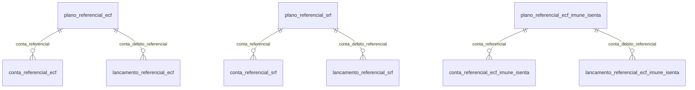

# Modelo — Contabilidade referencial (SPED ECF e SRF)

> Gerado por `src/model/gerar_docs_modelo.py` a partir de `src/model/modulos/referencial.yaml`, do catálogo e do perfil de colunas. **Não edite à mão.**

10 entidades. A coluna *Preench.* é o % de linhas com valor útil (nem nulo, nem em branco, nem zero, nem 1900-01-01; para colunas de código o zero conta como valor).

## Diagrama

## Entidades

| Entidade | Tabela | Linhas | Volume | Filtro obrigatório |
|---|---|---|---|---|
| [plano_referencial_ecf](#plano_referencial_ecf) | `ctcontas_sped_ecf_geral` | 1.133 | pequeno | — |
| [plano_referencial_srf](#plano_referencial_srf) | `ctcontas_srf` | 809 | pequeno | — |
| [plano_referencial_ecf_imune_isenta](#plano_referencial_ecf_imune_isenta) | `ctcontas_sped_ecf_imune_isenta` | 515 | pequeno | — |
| [conta_referencial_ecf](#conta_referencial_ecf) | `ctcontas_sped_ecf_geral_ref` | 922.444 | medio | empresa |
| [conta_referencial_srf](#conta_referencial_srf) | `ctcontas_srf_ref` | 635.418 | medio | empresa |
| [conta_referencial_ecf_imune_isenta](#conta_referencial_ecf_imune_isenta) | `ctcontas_sped_ecf_imune_isenta_ref` | 17.511 | pequeno | empresa |
| [lancamento_referencial_ecf](#lancamento_referencial_ecf) | `ctlancto_sped_ecf_geral` | 21.735.224 | grande | empresa; um de: lancamento_numero, lote_codigo, periodo |
| [lancamento_referencial_srf](#lancamento_referencial_srf) | `ctlancto_referencial_srf` | 1.152.027 | grande | empresa; um de: lancamento_numero, lote_codigo, periodo |
| [lancamento_referencial_ecf_imune_isenta](#lancamento_referencial_ecf_imune_isenta) | `ctlancto_sped_ecf_imune_isenta` | 469.590 | medio | empresa; um de: lancamento_numero, lote_codigo, periodo |
| [lancamento_scp](#lancamento_scp) | `ctlancto_scp` | 2.742 | pequeno | empresa |

## plano_referencial_ecf

**Plano de contas referencial SPED ECF (Geral)** — tabela `ctcontas_sped_ecf_geral` (1.133 linhas)

Plano referencial da Receita para a ECF (1.133 contas), com vigência e regime de utilização. Tabela global.

- **Chave:** `codigo_cta_sped_ecf_geral`
- **Empresa:** `não se aplica (tabela global)`
- **Período:** `—`
- **Ordem padrão:** `classificacao_sped_ecf_geral asc`

**Regras de negócio validadas:**

- Estrutura (1.133 contas): 985 analíticas (níveis 5 e 6) e 148 sintéticas (níveis 1 a 5). A natureza 4 (Resultado) tem 399 contas, a 1 (Ativo) 474, a 2 (Passivo) 200 e a 3 (PL) 60.

| Campo | Coluna | Tipo | Preench. | Domínio | Descrição (banco) |
|---|---|---|---|---|---|
| codigo | `codigo_cta_sped_ecf_geral` | integer(4) |  |  | Código |
| classificacao | `classificacao_sped_ecf_geral` | varchar(20) |  |  | Classificação |
| descricao | `descricao` | varchar(255) |  |  | Descrição |
| tipo | `tipo` | char(1) |  | tipo_conta_referencial | Tipo (A = Analítica / S = Sintética) |
| nivel | `nivel` | integer(4) |  |  | Nível |
| conta_superior | `conta_superior` | varchar(20) |  |  | Conta pai (superior) |
| natureza | `natureza` | integer(4) |  | natureza_conta_referencial | Natureza (1 - Ativo / 2 - Passivo / 3 - Patrimônio Líquido / 4 - Resultado) |
| utilizacao | `utilizacao` | integer(4) |  | utilizacao_ecf | UTILIZAÇÃO (1 - REAL/PRESUMIDO / 2 - REAL / 3 - PRESUMIDO) |
| validade_inicio | `validade_inicio` | date(4) |  |  | Início validade |
| validade_fim | `validade_fim` | date(4) |  |  | Fim validade |
| layout_inicio | `layout_inicio` | integer(4) |  |  | Layout de início de utilização da conta |
| layout_fim | `layout_fim` | integer(4) |  |  | Layout de fim de utilização da conta |

**Filtros:** `codigo` (eq/in), `classificacao` (eq/prefixo), `descricao` (contem), `tipo` (eq), `natureza` (eq/in), `utilizacao` (eq/in)

## plano_referencial_srf

**Plano de contas referencial SRF** — tabela `ctcontas_srf` (809 linhas)

Plano referencial da Receita Federal (809 contas) usado no lançamento referencial SRF. Tabela global.

- **Chave:** `codigo_cta_srf`
- **Empresa:** `não se aplica (tabela global)`
- **Período:** `—`
- **Ordem padrão:** `classificacao_srf asc`

**Regras de negócio validadas:**

- Utilização x tipo: A/A 589, A/S 109, F/A 44, F/S 12, S/A 45, S/S 10 (total 809). A coluna `natureza_srf` indica analítica/sintética, não ativo/passivo.

| Campo | Coluna | Tipo | Preench. | Domínio | Descrição (banco) |
|---|---|---|---|---|---|
| codigo | `codigo_cta_srf` | integer(4) |  |  | Codigo |
| classificacao | `classificacao_srf` | varchar(20) |  |  | Classificacao |
| descricao | `descricao_srf` | varchar(100) |  |  | Descricao |
| utilizacao | `utilizacao_srf` | char(1) |  | utilizacao_srf | Utilização (F=Fiscal / S=Societária / A=Ambas) |
| tipo | `natureza_srf` | char(1) |  | natureza_srf | Natureza (S=Sintética / A=Analítica) |
| validade_inicio | `validade_inicio_srf` | date(4) |  |  | Inicio validade |
| validade_fim | `validade_fim_srf` | date(4) |  |  | Fim validade |

**Filtros:** `codigo` (eq/in), `classificacao` (eq/prefixo), `descricao` (contem), `utilizacao` (eq/in), `tipo` (eq)

## plano_referencial_ecf_imune_isenta

**Plano de contas referencial SPED ECF - Imunes e Isentas** — tabela `ctcontas_sped_ecf_imune_isenta` (515 linhas)

Plano referencial da ECF para entidades imunes e isentas (515 contas). Tabela global.

- **Chave:** `codigo_cta_sped_ecf_imune_isenta`
- **Empresa:** `não se aplica (tabela global)`
- **Período:** `—`
- **Ordem padrão:** `ordem asc`

| Campo | Coluna | Tipo | Preench. | Domínio | Descrição (banco) |
|---|---|---|---|---|---|
| codigo | `codigo_cta_sped_ecf_imune_isenta` | integer(4) |  |  | Código |
| classificacao | `classificacao_sped_ecf_imune_isenta` | varchar(20) |  |  | Classificação |
| descricao | `descricao` | varchar(255) |  |  | Descrição |
| tipo | `tipo` | char(1) |  | tipo_conta_referencial | Tipo (A = Analítica / S = Sintética) |
| nivel | `nivel` | integer(4) |  |  | Nível |
| conta_superior | `conta_superior` | varchar(20) |  |  | Conta pai (superior) |
| natureza | `natureza` | integer(4) |  | natureza_conta_referencial | Natureza (1 - Ativo / 2 - Passivo / 3 - Patrimônio Líquido / 4 - Resultado) |
| ordem | `ordem` | integer(4) |  |  | Ordem |
| validade_inicio | `validade_inicio` | date(4) |  |  | Início validade |
| validade_fim | `validade_fim` | date(4) |  |  | Fim validade |

**Filtros:** `codigo` (eq/in), `classificacao` (eq/prefixo), `descricao` (contem), `tipo` (eq), `natureza` (eq/in)

## conta_referencial_ecf

**Mapeamento das contas da empresa para o plano ECF Geral** — tabela `ctcontas_sped_ecf_geral_ref` (922.444 linhas)

Liga cada conta contábil da empresa (ctcontas) à conta do plano referencial ECF. Chave completa (empresa, conta, conta ECF): uma conta do livro pode apontar para mais de uma conta ECF (922 pares para 920 contas na empresa 1017).

- **Chave:** `codi_emp, codi_cta, codigo_cta_sped_ecf_geral`
- **Empresa:** `codi_emp`
- **Período:** `—`
- **Ordem padrão:** `codi_cta asc`, `codigo_cta_sped_ecf_geral asc`

**Regras de negócio validadas:**

- Empresa 1017: 4.500 contas no plano, 920 com mapeamento ECF (922 pares). Só as contas mapeadas geram partida no lançamento referencial.

| Campo | Coluna | Tipo | Preench. | Domínio | Descrição (banco) |
|---|---|---|---|---|---|
| conta_codigo | `codi_cta` | integer(4) |  |  | Conta contábil |
| conta_referencial_codigo | `codigo_cta_sped_ecf_geral` | integer(4) |  |  | Conta SPED ECF |

**Vínculos (LEFT JOIN, acrescentam colunas legíveis):**

- `conta` → `ctcontas` por `codi_emp` = `codi_emp` e `codi_cta` = `codi_cta`; colunas: `conta_classificacao`, `conta_nome`
- `conta_referencial` → `ctcontas_sped_ecf_geral` por `codigo_cta_sped_ecf_geral` = `codigo_cta_sped_ecf_geral`; colunas: `conta_referencial_classificacao`, `conta_referencial_descricao`

**Filtros:** `conta_codigo` (eq/in), `conta_referencial_codigo` (eq/in)

## conta_referencial_srf

**Mapeamento das contas da empresa para o plano SRF** — tabela `ctcontas_srf_ref` (635.418 linhas)

Liga cada conta contábil da empresa ao plano referencial SRF (635.418 pares).

- **Chave:** `codi_emp, codi_cta, codigo_cta_srf`
- **Empresa:** `codi_emp`
- **Período:** `—`
- **Ordem padrão:** `codi_cta asc`, `codigo_cta_srf asc`

**Regras de negócio validadas:**

- Empresa 596: 5.260 contas no plano, 515 com mapeamento SRF (539 pares).

| Campo | Coluna | Tipo | Preench. | Domínio | Descrição (banco) |
|---|---|---|---|---|---|
| conta_codigo | `codi_cta` | integer(4) |  |  | Conta contabil |
| conta_referencial_codigo | `codigo_cta_srf` | integer(4) |  |  | Conta SRF |

**Vínculos (LEFT JOIN, acrescentam colunas legíveis):**

- `conta` → `ctcontas` por `codi_emp` = `codi_emp` e `codi_cta` = `codi_cta`; colunas: `conta_classificacao`, `conta_nome`
- `conta_referencial` → `ctcontas_srf` por `codigo_cta_srf` = `codigo_cta_srf`; colunas: `conta_referencial_classificacao`, `conta_referencial_descricao`

**Filtros:** `conta_codigo` (eq/in), `conta_referencial_codigo` (eq/in)

## conta_referencial_ecf_imune_isenta

**Mapeamento das contas da empresa para o plano ECF Imunes e Isentas** — tabela `ctcontas_sped_ecf_imune_isenta_ref` (17.511 linhas)

Liga cada conta contábil da empresa ao plano referencial ECF de imunes e isentas (17.511 pares).

- **Chave:** `codi_emp, codi_cta, codigo_cta_sped_ecf_imune_isenta`
- **Empresa:** `codi_emp`
- **Período:** `—`
- **Ordem padrão:** `codi_cta asc`, `codigo_cta_sped_ecf_imune_isenta asc`

| Campo | Coluna | Tipo | Preench. | Domínio | Descrição (banco) |
|---|---|---|---|---|---|
| conta_codigo | `codi_cta` | integer(4) |  |  | Conta contábil |
| conta_referencial_codigo | `codigo_cta_sped_ecf_imune_isenta` | integer(4) |  |  | Conta SPED ECF |

**Vínculos (LEFT JOIN, acrescentam colunas legíveis):**

- `conta` → `ctcontas` por `codi_emp` = `codi_emp` e `codi_cta` = `codi_cta`; colunas: `conta_classificacao`, `conta_nome`
- `conta_referencial` → `ctcontas_sped_ecf_imune_isenta` por `codigo_cta_sped_ecf_imune_isenta` = `codigo_cta_sped_ecf_imune_isenta`; colunas: `conta_referencial_classificacao`, `conta_referencial_descricao`

**Filtros:** `conta_codigo` (eq/in), `conta_referencial_codigo` (eq/in)

## lancamento_referencial_ecf

**Lançamentos referenciais SPED ECF (Geral)** — tabela `ctlancto_sped_ecf_geral` (21.735.224 linhas)

Partidas do livro diário traduzidas para o plano referencial ECF Geral: cada linha é UMA perna do lançamento (débito OU crédito; a outra conta vale 0), identificada por (lançamento, sequencial). 21,7 milhões de linhas em 754 empresas.

- **Chave:** `codi_emp, nume_lan, sequencial`
- **Empresa:** `codi_emp`
- **Período:** `lancamento.data_lan` · exige um de: `lancamento_numero, lote_codigo, periodo`
- **Ordem padrão:** `nume_lan asc`, `sequencial asc`

**Regras de negócio validadas:**

- Cada linha é uma perna: na empresa 1017 todas as 1.158.926 linhas têm só o débito (579.198) ou só o crédito (579.728) preenchido; valor nunca é 0. Um lançamento tem 2 linhas (578.660) ou 1 (1.606).
- Conciliação com o livro (empresa 1017, 580.266 lançamentos): a soma das pernas de débito é igual a ctlancto.vlor_lan em 579.198 e a das pernas de crédito em 579.728; todo lançamento do livro tem linha referencial. Não some `valor` direto como se fosse o valor do lançamento: soma as duas pernas, o dobro.
- Conta referencial = conta do livro mapeada em conta_referencial_ecf: em 100% das pernas de débito (579.198) a conta do livro (cdeb_lan) tem o par (conta, conta_debito) no mapeamento.
- Integridade: 0 contas fora do plano referencial, 0 lançamentos órfãos, 0 lotes órfãos, e codi_lote igual ao do lançamento em 100%.

| Campo | Coluna | Tipo | Preench. | Domínio | Descrição (banco) |
|---|---|---|---|---|---|
| lancamento_numero | `nume_lan` | integer(4) |  |  | Número do lançamento |
| sequencial | `sequencial` | integer(4) |  |  | Sequencial |
| lote_codigo | `codi_lote` | integer(4) |  |  | Lançamento em lote |
| valor | `valor` | numeric(14) |  |  | Valor |
| conta_debito | `conta_debito` | integer(4) |  |  | Conta Débito |
| conta_credito | `conta_credito` | integer(4) |  |  | Conta Crédito |
| origem_registro | `origem_reg` | tinyint(1) |  | origem_registro_referencial | Origem do registro 0 - Sistema, 1 - Imp. Tabelas, 2 - Imp. Layout, 3- Imp. Tabelas Concorrentes |

**Vínculos (LEFT JOIN, acrescentam colunas legíveis):**

- `lancamento` → `ctlancto` por `codi_emp` = `codi_emp` e `nume_lan` = `nume_lan`; colunas: `lancamento_data`, `lancamento_valor`, `lancamento_conta_debito`, `lancamento_conta_credito`
- `conta_debito_referencial` → `ctcontas_sped_ecf_geral` por `conta_debito` = `codigo_cta_sped_ecf_geral`; colunas: `conta_debito_classificacao`, `conta_debito_descricao`
- `conta_credito_referencial` → `ctcontas_sped_ecf_geral` por `conta_credito` = `codigo_cta_sped_ecf_geral`; colunas: `conta_credito_classificacao`, `conta_credito_descricao`

**Filtros:** `lancamento_numero` (eq/in/entre), `lote_codigo` (eq/in), `conta_debito` (eq/in), `conta_credito` (eq/in), `valor` (gte/lte/entre)

## lancamento_referencial_srf

**Lançamentos referenciais SRF** — tabela `ctlancto_referencial_srf` (1.152.027 linhas)

Partidas do livro diário no plano referencial SRF (1,15 milhão de linhas, 573 empresas). Mesma estrutura do ECF, porém só existe partida para contas que têm mapeamento SRF, então muitos lançamentos têm uma só perna.

- **Chave:** `codi_emp, nume_lan, sequencial`
- **Empresa:** `codi_emp`
- **Período:** `lancamento.data_lan` · exige um de: `lancamento_numero, lote_codigo, periodo`
- **Ordem padrão:** `nume_lan asc`, `sequencial asc`

**Regras de negócio validadas:**

- Cada linha é uma perna (débito OU crédito). Empresa 596 (55.423 linhas, 52.961 lançamentos): 52.275 pernas de débito e 3.148 de crédito; 50.499 lançamentos têm 1 linha e 2.462 têm 2. A perna só existe se a conta do livro tem mapeamento SRF (52.961 de 54.974 lançamentos do livro têm linha referencial).
- Conciliação (empresa 596): a soma das pernas de débito é igual a ctlancto.vlor_lan em 52.238 de 52.961 lançamentos e a das pernas de crédito em 3.111.
- Integridade: 0 contas fora do plano SRF, 0 lançamentos órfãos e 0 lotes órfãos; origem_registro é sempre 0.

| Campo | Coluna | Tipo | Preench. | Domínio | Descrição (banco) |
|---|---|---|---|---|---|
| lancamento_numero | `nume_lan` | integer(4) |  |  | Número do lançamento |
| sequencial | `sequencial` | integer(4) |  |  | Sequêncial |
| lote_codigo | `codi_lote` | integer(4) |  |  | Lançamento em lote |
| valor | `valor` | numeric(14) |  |  | Valor |
| conta_debito | `conta_debito` | integer(4) |  |  | Conta Débito |
| conta_credito | `conta_credito` | integer(4) |  |  | Conta Crédito |
| origem_registro | `origem_reg` | tinyint(1) |  | origem_registro_referencial | Origem do registro 0 - Sistema, 1 - Imp. Tabelas, 2 - Imp. Layout, 3- Imp. Tabelas Concorrentes |

**Vínculos (LEFT JOIN, acrescentam colunas legíveis):**

- `lancamento` → `ctlancto` por `codi_emp` = `codi_emp` e `nume_lan` = `nume_lan`; colunas: `lancamento_data`, `lancamento_valor`, `lancamento_conta_debito`, `lancamento_conta_credito`
- `conta_debito_referencial` → `ctcontas_srf` por `conta_debito` = `codigo_cta_srf`; colunas: `conta_debito_classificacao`, `conta_debito_descricao`
- `conta_credito_referencial` → `ctcontas_srf` por `conta_credito` = `codigo_cta_srf`; colunas: `conta_credito_classificacao`, `conta_credito_descricao`

**Filtros:** `lancamento_numero` (eq/in/entre), `lote_codigo` (eq/in), `conta_debito` (eq/in), `conta_credito` (eq/in), `valor` (gte/lte/entre)

## lancamento_referencial_ecf_imune_isenta

**Lançamentos referenciais SPED ECF - Imunes e Isentas** — tabela `ctlancto_sped_ecf_imune_isenta` (469.590 linhas)

Partidas do livro diário no plano referencial ECF de imunes e isentas (469.590 linhas, 32 empresas). Mesma estrutura do ECF Geral.

- **Chave:** `codi_emp, nume_lan, sequencial`
- **Empresa:** `codi_emp`
- **Período:** `lancamento.data_lan` · exige um de: `lancamento_numero, lote_codigo, periodo`
- **Ordem padrão:** `nume_lan asc`, `sequencial asc`

| Campo | Coluna | Tipo | Preench. | Domínio | Descrição (banco) |
|---|---|---|---|---|---|
| lancamento_numero | `nume_lan` | integer(4) |  |  | Número do lançamento |
| sequencial | `sequencial` | integer(4) |  |  | Sequencial |
| lote_codigo | `codi_lote` | integer(4) |  |  | Lançamento em lote |
| valor | `valor` | numeric(14) |  |  | Valor |
| conta_debito | `conta_debito` | integer(4) |  |  | Conta Débito |
| conta_credito | `conta_credito` | integer(4) |  |  | Conta Crédito |
| origem_registro | `origem_reg` | tinyint(1) |  | origem_registro_referencial | Origem do registro 0 - Sistema, 1 - Imp. Tabelas, 2 - Imp. Layout, 3- Imp. Tabelas Concorrentes |

**Vínculos (LEFT JOIN, acrescentam colunas legíveis):**

- `lancamento` → `ctlancto` por `codi_emp` = `codi_emp` e `nume_lan` = `nume_lan`; colunas: `lancamento_data`, `lancamento_valor`, `lancamento_conta_debito`, `lancamento_conta_credito`
- `conta_debito_referencial` → `ctcontas_sped_ecf_imune_isenta` por `conta_debito` = `codigo_cta_sped_ecf_imune_isenta`; colunas: `conta_debito_classificacao`, `conta_debito_descricao`
- `conta_credito_referencial` → `ctcontas_sped_ecf_imune_isenta` por `conta_credito` = `codigo_cta_sped_ecf_imune_isenta`; colunas: `conta_credito_classificacao`, `conta_credito_descricao`

**Filtros:** `lancamento_numero` (eq/in/entre), `lote_codigo` (eq/in), `conta_debito` (eq/in), `conta_credito` (eq/in), `valor` (gte/lte/entre)

## lancamento_scp

**Lançamentos de SCP (Sociedade em Conta de Participação)** — tabela `ctlancto_scp` (2.742 linhas)

Marca os lançamentos do livro que pertencem a uma SCP: um registro por lançamento e lado (débito ou crédito), com o código do SCP e a empresa do SCP. 2.742 linhas, 6 empresas, 11 SCPs.

- **Chave:** `codi_emp, nume_lan, tipo`
- **Empresa:** `codi_emp`
- **Período:** `lancamento.data_lan`
- **Ordem padrão:** `nume_lan asc`, `tipo asc`

**Regras de negócio validadas:**

- Distribuição: 1.374 registros de débito e 1.298 de crédito de origem 0 (6 empresas, 11 SCPs) e 35 de cada lado de origem 2 (1 empresa, 1 SCP).

| Campo | Coluna | Tipo | Preench. | Domínio | Descrição (banco) |
|---|---|---|---|---|---|
| lancamento_numero | `nume_lan` | integer(4) |  |  | Número do lançamento |
| tipo | `tipo` | char(1) |  | tipo_partida | Tipo (D=Débito/ C=Crédito) |
| lote_codigo | `codi_lote` | integer(4) |  |  | Número do lote |
| empresa_scp | `filial` | integer(4) |  |  | Empresa do SCP |
| scp_codigo | `i_scp` | integer(4) |  |  | SCP |
| origem_registro | `origem_reg` | tinyint(1) |  | origem_registro_referencial | Origem do registro 0 - Sistema, 1 - Imp. Tabelas, 2 - Imp. Layout, 3- Imp. Tabelas Concorrentes |

**Vínculos (LEFT JOIN, acrescentam colunas legíveis):**

- `lancamento` → `ctlancto` por `codi_emp` = `codi_emp` e `nume_lan` = `nume_lan`; colunas: `lancamento_data`, `lancamento_valor`, `lancamento_conta_debito`, `lancamento_conta_credito`

**Filtros:** `lancamento_numero` (eq/in/entre), `tipo` (eq), `scp_codigo` (eq/in), `lote_codigo` (eq/in)

## Domínios (significado dos códigos)

`confirmado`: **sim** = vem do comentário do banco e/ou foi conferido nos dados; **parcial** = parte dos valores; **não** = hipótese, não use como regra.

### status_empresa

Situação da empresa no cadastro (geempre.stat_emp)

Confirmado: sim

| Código | Significado |
|---|---|
| A | Ativa |
| I | Inativa |
| C | Em constituição |
| M | Ativo sem movimento |
| B | Em processo de baixa |
| E | Excluindo |

### motivo_inatividade

Motivo da inatividade (geempre.tipoi_emp). Só aparece em empresas inativas.

Confirmado: sim

| Código | Significado |
|---|---|
| 1 | Outros |
| 2 | Baixada |
| 3 | Transferida |
| 4 | Inadimplente |

### tipo_inscricao

Tipo da inscrição (CNPJ/CPF/CEI/CAEPF)

Confirmado: sim

| Código | Significado |
|---|---|
| 1 | CNPJ |
| 2 | CPF |
| 3 | CEI |
| 6 | CAEPF |

### regime_federal_empresa

Regime federal da folha (geempre.rfed_emp)

Confirmado: parcial

| Código | Significado |
|---|---|
| 1 | Normal |
| 2 | Microempresa |
| 3 | Empresa de pequeno porte |

### tipo_honorario_empresa

Como a empresa usa o módulo Honorários (geempre.honorario_tipo)

Confirmado: sim

| Código | Significado |
|---|---|
| E | Escritório (quem fatura) |
| C | Cliente |

### sim_nao_texto

Confirmado: sim

| Código | Significado |
|---|---|
| S | Sim |
| N | Não |

### sim_nao_numerico

Confirmado: sim

| Código | Significado |
|---|---|
| 1 | Sim |
| 0 | Não |

### tipo_conta_referencial

Tipo da conta do plano referencial (tipo)

Confirmado: sim

| Código | Significado |
|---|---|
| A | Analítica |
| S | Sintética |

### natureza_conta_referencial

Natureza da conta do plano referencial SPED ECF (natureza)

Confirmado: sim

| Código | Significado |
|---|---|
| 1 | Ativo |
| 2 | Passivo |
| 3 | Patrimônio Líquido |
| 4 | Resultado |

### utilizacao_ecf

Para quais regimes a conta do plano ECF Geral se aplica (utilizacao)

Confirmado: parcial

> O comentário lista 1, 2 e 3, mas só 1 (1.025 contas) e 2 (108 contas) existem nos dados; o 3 nunca aparece.

| Código | Significado |
|---|---|
| 1 | Real e Presumido |
| 2 | Somente Real |
| 3 | Somente Presumido |

### utilizacao_srf

Utilização da conta do plano SRF (utilizacao_srf)

Confirmado: sim

| Código | Significado |
|---|---|
| F | Fiscal |
| S | Societária |
| A | Ambas |

### natureza_srf

Natureza (tipo) da conta do plano SRF (natureza_srf). Apesar do nome, é analítica/sintética.

Confirmado: sim

| Código | Significado |
|---|---|
| S | Sintética |
| A | Analítica |

### tipo_partida

Lado da partida do lançamento de SCP (ctlancto_scp.tipo)

Confirmado: sim

| Código | Significado |
|---|---|
| D | Débito |
| C | Crédito |

### origem_registro_referencial

Origem do registro (origem_reg) dos lançamentos referenciais e de SCP

Confirmado: parcial

> Valores do comentário do banco. Nos lançamentos referenciais só aparece 0: SRF 1.152.043 de 1.152.043, ECF Imunes e Isentas 469.645 de 469.645 e ECF Geral nas empresas 1010 e 1017 (2.606.454 de 2.606.454). Em SCP há 0 (2.672) e 2 (70, de uma só empresa).

| Código | Significado |
|---|---|
| 0 | Sistema |
| 1 | Importação de tabelas |
| 2 | Importação de layout |
| 3 | Importação de tabelas concorrentes |

