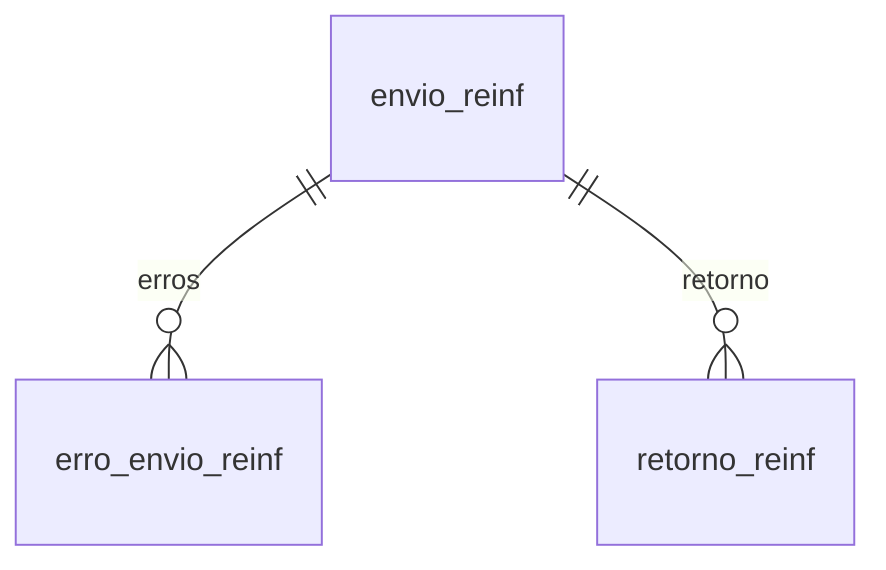

# Modelo — EFD-Reinf

> Gerado por `src/model/gerar_docs_modelo.py` a partir de `src/model/modulos/reinf.yaml`, do catálogo e do perfil de colunas. **Não edite à mão.**

3 entidades. A coluna *Preench.* é o % de linhas com valor útil (nem nulo, nem em branco, nem zero, nem 1900-01-01; para colunas de código o zero conta como valor).

## Diagrama

## Entidades

| Entidade | Tabela | Linhas | Volume | Filtro obrigatório |
|---|---|---|---|---|
| [envio_reinf](#envio_reinf) | `efd_reinf_envio_arquivos` | 74.952 | grande | empresa |
| [erro_envio_reinf](#erro_envio_reinf) | `efd_reinf_envio_arquivos_erros` | 11.960 | medio | empresa; um de: envio |
| [retorno_reinf](#retorno_reinf) | `efd_reinf_retorno_arquivos` | 25.114 | medio | empresa; um de: envio, data_consulta |

## envio_reinf

**Envios da EFD-Reinf (um evento por linha)** — tabela `efd_reinf_envio_arquivos` (74.952 linhas)

Controle de cada evento gerado/transmitido à Receita pela Domínio: competência, evento (R-xxxx), tipo de envio, situação, recibo, protocolo e data de envio. Chave (empresa, envio, filial); `i_filial` é diferente de 0 em todas as linhas. Cobre 875 empresas, competências de 2018-12 a 2026-09.

- **Chave:** `codi_emp, i_envio, i_filial`
- **Empresa:** `codi_emp`
- **Período:** `competencia`
- **Ordem padrão:** `competencia desc`, `i_envio desc`

**Regras de negócio validadas:**

- Recibo x situação: situação 1 tem número de recibo em 57.770 de 57.924 envios (99,7%); situações 0, 3, 4, 5 e 6 nunca têm recibo; a 2 tem em 2 de 4.485. Use `numero_recibo` preenchido para afirmar que a Receita recebeu o evento.
- Rejeição x erro: 8.680 de 8.702 envios com situação 3 têm erro em efd_reinf_envio_arquivos_erros (99,8%); nas demais situações os erros são raros (situação 1: 31 de 57.924).
- Tipo x evento: tipo E só no R-9000, F só em 2099/4099, B só em 2098/4099, A só no R-1000.
- Eventos excluídos (`evento_excluido = S`, 17.939 linhas) continuam na tabela; filtre `evento_excluido = N` para ver o que está vigente.
- Não há duplicidade na chave (empresa, envio, filial) e todo erro e todo retorno tem o envio correspondente (0 órfãos).

| Campo | Coluna | Tipo | Preench. | Domínio | Descrição (banco) |
|---|---|---|---|---|---|
| envio | `i_envio` | integer(4) | 100% |  | Código sequencial de envio dos arquivos |
| filial | `i_filial` | integer(4) | 100% |  | Código da filial |
| competencia | `competencia` | date(4) | 100% |  | Competência |
| evento | `i_evento` | integer(4) | 100% | evento_reinf | Código do evento |
| situacao | `situacao` | integer(4) | 100% | situacao_envio_reinf | Situação processo |
| tipo_envio | `tipo_envio` | char(1) | 100% | tipo_envio_reinf | Tipo de envio |
| ambiente | `ambiente` | char(1) | 100% | ambiente_reinf | Ambiente |
| id_evento | `id_evento` | varchar(36) | 100% |  | Identificação única do evento |
| numero_recibo | `numero_recibo` | varchar(60) | 77% |  | Número do recibo |
| numero_recibo_excluido_retificado | `numero_recibo_excluido_retificado` | varchar(60) | 8% |  | Número do recibo Excluído/Retificado |
| numero_protocolo_entrega | `numero_protocolo_entrega` | varchar(60) | 89% |  | Número do protocolo de entrega do evento |
| data_envio | `data_envio` | date(4) | 97% |  | Data de envio |
| horario_envio | `horario_envio` | time(8) | 97% |  | Hora de envio |
| data_inicio_processamento | `data_inicio_processamento` | date(4) | 89% |  | Data do início do processamento da consulta |
| inscricao 🔒 | `inscricao` | varchar(14) | 54% |  | Inscrição Empresa/Cliente/Fornecedor/CNO |
| inscricao_cliente_fornecedor 🔒 | `inscricao_cli_for` | varchar(14) | 53% |  | Inscrição Cliente/Fornecedor para os eventos R-2010/R-2020 |
| nome_arquivo | `nome_arquivo` | varchar(100) | 100% |  | Nome do arquivo |
| evento_excluido | `evento_excluido` | char(1) | 100% | sim_nao_texto | Evento Excluído(S/N) |
| evento_excluido_por | `evento_excluido_por` | char(1) | 5% | evento_excluido_por | Evento Excluído Por(U-Usuário) |
| data_hora_exclusao | `data_hora_exclusao` | timestamp(8) | 5% |  | Usuário |
| validacao_envio | `validacao_envio` | char(1) | 76% |  | Validação |
| situacao_especial | `situacao_especial` | char(1) | 7% |  | Situação Especial Evento R-1000 |
| gerado_em | `data_hora` | timestamp(8) | 100% |  | Data e Hora da geração |

**Filhos (1:N):**

- `erros` → [erro_envio_reinf](#erro_envio_reinf)
- `retorno` → [retorno_reinf](#retorno_reinf)

**Filtros:** `envio` (eq/in), `competencia` (eq/entre/gte/lte), `evento` (eq/in), `situacao` (eq/in), `tipo_envio` (eq/in), `data_envio` (eq/entre/gte/lte), `numero_recibo` (eq), `evento_excluido` (eq)

## erro_envio_reinf

**Erros dos envios da EFD-Reinf** — tabela `efd_reinf_envio_arquivos_erros` (11.960 linhas)

Erros de validação ou do retorno da Receita, vinculados ao envio. Um envio pode ter vários erros. `codigo_erro` 0 aparece em todos os erros de origem D (validação local).

- **Chave:** `codi_emp, i_envio, i_erro, i_filial`
- **Empresa:** `codi_emp`
- **Período:** `—` · exige um de: `envio`
- **Ordem padrão:** `i_envio desc`, `i_erro asc`

**Regras de negócio validadas:**

- Códigos mais frequentes: 1005 (4.129), 0 (1.291, origem D), 1353 (1.092), 13 (947), 1556 (858), 15 (842). A tabela não traz descrição do código; use `mensagem`.

| Campo | Coluna | Tipo | Preench. | Domínio | Descrição (banco) |
|---|---|---|---|---|---|
| envio | `i_envio` | integer(4) | 100% |  | Código sequencial de envio dos arquivos |
| filial | `i_filial` | integer(4) | 100% |  | Código da filial |
| sequencia | `i_erro` | integer(4) | 100% |  | Código sequencial de erros |
| codigo_erro | `codigo_erro` | integer(4) | 89% |  | Código do erro |
| mensagem | `mensagem_erro` | varchar(1024) | 100% |  | Mensagem do erro |
| localizacao | `localizacao_erro` | varchar(1024) | 60% |  | Localização do erro no arquivo |
| identificador_retorno_lote | `identificador_retorno_lote` | varchar(100) | 89% |  | Identificação única do retorno do Lote. |
| origem | `origem_erro` | char(1) | 100% | origem_erro_reinf | Origem do erro(D/R) |

**Vínculos (LEFT JOIN, acrescentam colunas legíveis):**

- `envio_ref` → `efd_reinf_envio_arquivos` por `codi_emp` = `codi_emp` e `i_envio` = `i_envio` e `i_filial` = `i_filial`; colunas: `competencia`, `evento`, `situacao_envio`, `data_envio`

**Filtros:** `envio` (eq/in), `codigo_erro` (eq/in), `origem` (eq)

## retorno_reinf

**Retorno do web service da EFD-Reinf** — tabela `efd_reinf_retorno_arquivos` (25.114 linhas)

Dados da consulta de retorno de cada envio (hash, data da consulta e estabelecimento). Com o fechamento R-2099 traz também o indicador de movimento da competência.

- **Chave:** `codi_emp, i_envio, i_filial`
- **Empresa:** `codi_emp`
- **Período:** `—` · exige um de: `envio, data_consulta`
- **Ordem padrão:** `i_envio desc`

**Regras de negócio validadas:**

- Todo retorno tem o envio correspondente em efd_reinf_envio_arquivos (0 órfãos em 25.231); o hash vem preenchido em 100%.
- possui_movimento (R-2099): N em 10.623 e S em 987 fechamentos; todos correspondem a envios com i_evento = 2099.

| Campo | Coluna | Tipo | Preench. | Domínio | Descrição (banco) |
|---|---|---|---|---|---|
| envio | `i_envio` | integer(4) | 100% |  | Sequencial |
| filial | `i_filial` | integer(4) | 100% |  | Filial |
| hash | `hash` | varchar(200) | 100% |  | Hash de retorno |
| data_consulta | `data_consulta` | date(4) | 100% |  | Data de consulta |
| tipo_inscricao_estabelecimento | `tipo_inscricao_estabelecimento` | integer(4) | 100% |  | Tipo de inscrição do estabelecimento |
| inscricao_estabelecimento 🔒 | `inscricao_estabelecimento` | varchar(14) | 16% |  | Inscrição do estabelecimento |

**Vínculos (LEFT JOIN, acrescentam colunas legíveis):**

- `fechamento_r2099` → `efd_reinf_retorno_arquivos_r2099` por `codi_emp` = `codi_emp` e `i_envio` = `i_envio` e `i_filial` = `i_filial`; colunas: `possui_movimento`
- `envio_ref` → `efd_reinf_envio_arquivos` por `codi_emp` = `codi_emp` e `i_envio` = `i_envio` e `i_filial` = `i_filial`; colunas: `competencia`, `evento`, `numero_recibo`

**Filtros:** `envio` (eq/in), `data_consulta` (eq/entre/gte/lte)

## Domínios (significado dos códigos)

`confirmado`: **sim** = vem do comentário do banco e/ou foi conferido nos dados; **parcial** = parte dos valores; **não** = hipótese, não use como regra.

### status_empresa

Situação da empresa no cadastro (geempre.stat_emp)

Confirmado: sim

| Código | Significado |
|---|---|
| A | Ativa |
| I | Inativa |
| C | Em constituição |
| M | Ativo sem movimento |
| B | Em processo de baixa |
| E | Excluindo |

### motivo_inatividade

Motivo da inatividade (geempre.tipoi_emp). Só aparece em empresas inativas.

Confirmado: sim

| Código | Significado |
|---|---|
| 1 | Outros |
| 2 | Baixada |
| 3 | Transferida |
| 4 | Inadimplente |

### tipo_inscricao

Tipo da inscrição (CNPJ/CPF/CEI/CAEPF)

Confirmado: sim

| Código | Significado |
|---|---|
| 1 | CNPJ |
| 2 | CPF |
| 3 | CEI |
| 6 | CAEPF |

### regime_federal_empresa

Regime federal da folha (geempre.rfed_emp)

Confirmado: parcial

| Código | Significado |
|---|---|
| 1 | Normal |
| 2 | Microempresa |
| 3 | Empresa de pequeno porte |

### tipo_honorario_empresa

Como a empresa usa o módulo Honorários (geempre.honorario_tipo)

Confirmado: sim

| Código | Significado |
|---|---|
| E | Escritório (quem fatura) |
| C | Cliente |

### sim_nao_texto

Confirmado: sim

| Código | Significado |
|---|---|
| S | Sim |
| N | Não |

### sim_nao_numerico

Confirmado: sim

| Código | Significado |
|---|---|
| 1 | Sim |
| 0 | Não |

### evento_reinf

Evento da EFD-Reinf (efd_reinf_envio_arquivos.i_evento), numeração oficial do layout R-xxxx.

Confirmado: parcial

> Os códigos seguem o layout oficial da EFD-Reinf (R-1000 … R-9000). Não há tabela de descrição no banco; a descrição vem do layout, não do banco. Presentes nos dados: 1000, 2010, 2020, 2050, 2060, 2098, 2099, 4010, 4020, 4080, 4099, 9000.

| Código | Significado |
|---|---|
| 1000 | R-1000 Informações do contribuinte |
| 2010 | R-2010 Retenção contribuição previdenciária - serviços tomados |
| 2020 | R-2020 Retenção contribuição previdenciária - serviços prestados |
| 2050 | R-2050 Comercialização da produção por produtor rural PJ/agroindústria |
| 2060 | R-2060 Contribuição previdenciária sobre a receita bruta (CPRB) |
| 2098 | R-2098 Reabertura dos eventos da série R-2000 |
| 2099 | R-2099 Fechamento dos eventos da série R-2000 |
| 4010 | R-4010 Pagamentos/créditos a beneficiário pessoa física |
| 4020 | R-4020 Pagamentos/créditos a beneficiário pessoa jurídica |
| 4080 | R-4080 Retenção no recebimento |
| 4099 | R-4099 Fechamento/reabertura dos eventos da série R-4000 |
| 9000 | R-9000 Exclusão de eventos |

### tipo_envio_reinf

Tipo de envio (efd_reinf_envio_arquivos.tipo_envio).

Confirmado: parcial

> O comentário do banco só diz "Tipo de envio". Significados deduzidos do cruzamento com o evento: E só aparece no R-9000 (1.217 de 1.217); F só em fechamentos (2099 e 4099); B só em 2098 e 4099 (reabertura); A só no R-1000; I e R em eventos de movimento. Sem confirmação da Domínio.

| Código | Significado |
|---|---|
| I | Inclusão (envio original) |
| R | Retificação |
| E | Exclusão (R-9000) |
| F | Fechamento |
| B | Reabertura |
| A | Alteração (R-1000) |

### situacao_envio_reinf

Situação do processo de envio (efd_reinf_envio_arquivos.situacao).

Confirmado: parcial

> Comentário do banco: "Situação processo", sem lista. Evidência nos dados - 1: 99,7% têm número de recibo (57.770 de 57.924), logo recebido/processado com sucesso; 3: 99,8% têm erro registrado (8.680 de 8.702) e nenhum recibo, logo rejeitado; 0: nunca tem recibo e tem protocolo, logo enviado/aguardando retorno; 2: 86% têm evento excluído, 19% erro, quase sem recibo (hipótese - cancelado/excluído); 4, 5 e 6 (1.160 linhas): sem recibo nem protocolo, significado desconhecido.

| Código | Significado |
|---|---|
| 0 | Enviado, aguardando retorno (hipótese) |
| 1 | Processado com recibo (hipótese forte) |
| 2 | Excluído/cancelado (hipótese) |
| 3 | Rejeitado com erro (hipótese forte) |
| 4 | Desconhecido |
| 5 | Desconhecido |
| 6 | Desconhecido |

### ambiente_reinf

Confirmado: parcial

> O = 75.106 e T = 81 linhas. O padrão da coluna é 'T'. Por analogia com a EFD-Reinf, O seria produção (ambiente oficial) e T teste/produção restrita; o comentário do banco só diz "Ambiente".

| Código | Significado |
|---|---|
| O | Produção (hipótese) |
| T | Teste (hipótese) |

### origem_erro_reinf

Confirmado: parcial

> O comentário diz "Origem do erro (D/R)". D (1.291) tem sempre codigo_erro = 0, R (10.733) traz o código do retorno. Hipótese - D = validação da Domínio antes do envio, R = retorno da Receita.

| Código | Significado |
|---|---|
| D | Domínio (validação local |
| hipótese) | None |
| R | Receita/retorno do web service (hipótese) |

### evento_excluido_por

Confirmado: parcial

> Comentário - "Evento Excluído Por (U-Usuário)". Só U (3.779) e vazio aparecem.

| Código | Significado |
|---|---|
| U | Usuário |

