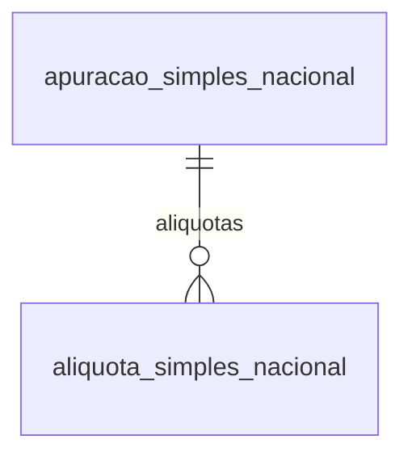

# Modelo — Simples Nacional

> Gerado por `src/model/gerar_docs_modelo.py` a partir de `src/model/modulos/simples.yaml`, do catálogo e do perfil de colunas. **Não edite à mão.**

3 entidades. A coluna *Preench.* é o % de linhas com valor útil (nem nulo, nem em branco, nem zero, nem 1900-01-01; para colunas de código o zero conta como valor).

## Diagrama

## Entidades

| Entidade | Tabela | Linhas | Volume | Filtro obrigatório |
|---|---|---|---|---|
| [apuracao_simples_nacional](#apuracao_simples_nacional) | `efsdoimp_simples_nacional` | 31.723 | medio | empresa |
| [aliquota_simples_nacional](#aliquota_simples_nacional) | `EFSDOIMP_SIMPLES_NACIONAL_ALIQUOTAS` | 34.074 | medio | empresa |
| [receita_bruta_anterior_simples](#receita_bruta_anterior_simples) | `efsimples_nacional_receita_bruta_anterior` | 5.334 | pequeno | empresa |

## apuracao_simples_nacional

**Apuração mensal do Simples Nacional** — tabela `efsdoimp_simples_nacional` (31.723 linhas)

Resultado da apuração do Simples de cada empresa e competência: base de cálculo (receita bruta) e imposto por anexo, seção e tabela, com a repartição por tributo (IRPJ, CSLL, COFINS, PIS, INSS, IPI, ICMS, ISS), as alíquotas efetivas, o excedente do sublimite e as devoluções de venda. 31.758 linhas, 503 empresas, 2015-01 a 2026-09. Para cada filial e tipo de receita há uma LINHA DE TOTAL (anexo, seção e tabela = 0) além das linhas de detalhe: nunca some todas as linhas juntas (dobra o valor).

- **Chave:** `codi_emp, codi_imp, data_sim, pdic_sim, filial, anexo, secao, tabela, arbcicms, arbciss, SITUACOES, SEQUENCIAL, MUNICIPIO, ARBCPIS, ARBCCOFINS, TIPO_RECEITA, ANEXO_ORIGEM, SECAO_ORIGEM, TABELA_ORIGEM, APLICA_REDUCAO_BASE_CALCULO_ICMS, APLICA_REDUCAO_ISS`
- **Empresa:** `codi_emp`
- **Período:** `data_sim`
- **Ordem padrão:** `data_sim desc`, `filial asc`, `anexo asc`

**Regras de negócio validadas:**

- Linha de total x detalhes: para cada (empresa, competência, filial, tipo de receita) existe uma linha de TOTAL (anexo = seção = tabela = 0) cuja base e cujo imposto são iguais à soma das linhas de detalhe (anexo > 0) em 18.355 de 18.355 grupos. Some só os detalhes OU só o total; somar tudo dobra.
- Imposto: valor_imposto é a soma dos tributos (IRPJ + CSLL + COFINS + PIS + INSS + IPI + ICMS + ISS) em 13.403 de 13.403 linhas de detalhe (tolerância 0,02); `soma_tributos` recalcula.
- Receita bruta (base_calculo) = saídas não canceladas de acumuladores que incidem sobre receita bruta (IREC_ACU = S) + serviços (idem) + cupons fiscais (CF-e vigentes, acumulador idem) - devoluções de venda lançadas em entradas com acumulador que incide sobre devolução (IDEV_ACU = S); a vigência do acumulador é a mais recente até a data da nota. Conferido numa amostra aleatória de 40 empresa/competências (mensal, desde 2023): 38 fecham ao centavo; 1110/2025-10 tem receita de serviços maior que a base em 87.948,65 e 1649/2026-03 difere em 198,27 no grupo de substituição tributária (causas não apuradas).
- valor_devolucao_venda é a soma das devoluções de venda do mês: empresa 644, 2026-09: 10.355,94 = devoluções lançadas em entradas com CFOP de devolução de venda; vendas 48.850,63 - 10.355,94 = base 38.494,69.
- A periodicidade é sempre 6 (mensal); só há o imposto 44 (Simples Nacional); tipo de receita 1 (mercado interno) em 30.701 linhas e 2 (exportação) em 1.057.

| Campo | Coluna | Tipo | Preench. | Domínio | Descrição (banco) |
|---|---|---|---|---|---|
| imposto_codigo | `codi_imp` | integer(4) |  | codigo_imposto_simples | Imposto |
| competencia | `data_sim` | date(4) |  |  | Competencia |
| periodicidade | `pdic_sim` | integer(4) |  | periodicidade_simples | Periodicidade |
| filial | `filial` | integer(4) |  |  | Codigo da filial |
| anexo | `anexo` | tinyint(1) |  |  | Anexo |
| secao | `secao` | tinyint(1) |  |  | Secao |
| tabela_aliquota | `tabela` | tinyint(1) |  |  | Tabela |
| tipo_receita | `tipo_receita` | integer(4) |  | tipo_receita_simples | Tipo Receita (1- Mercado Interno / 2- Exportação) |
| anexo_origem | `anexo_origem` | integer(4) |  |  | Anexo Origem |
| secao_origem | `secao_origem` | integer(4) |  |  | Seção Origem |
| tabela_origem | `tabela_origem` | integer(4) |  |  | Tabela Origem |
| situacoes | `situacoes` | char(16) |  |  | Situacoes fiscais |
| sequencial | `sequencial` | integer(4) |  |  | Sequencial |
| municipio | `municipio` | integer(4) |  |  | Código do município |
| reducao_icms_aliquota | `arbcicms` | numeric(13) |  |  | Aliquota de reducao da base de calculo do ICMS |
| reducao_iss_aliquota | `arbciss` | numeric(13) |  |  | Aliquota de reducao da base de calculo do ISS |
| reducao_pis_aliquota | `arbcpis` | numeric(13) |  |  | Alíquota de Redução de Base de Cálculo do PIS |
| reducao_cofins_aliquota | `arbccofins` | numeric(13) |  |  | Alíquota de Redução de Base de Cálculo do COFINS |
| aplica_reducao_icms | `aplica_reducao_base_calculo_icms` | char(1) |  | sim_nao_texto | Aplica redução na base de calculo do ICMS |
| aplica_reducao_iss | `aplica_reducao_iss` | char(1) |  | sim_nao_texto | Redução do ISS aplicado na Alíquota ou na Base de Calculo |
| incidencia | `incidencia` | integer(4) |  |  | Incidencia de impostos |
| faixa | `faixa` | tinyint(1) |  |  | Faixa de enquadramento |
| base_calculo | `basen` | numeric(13) |  |  | Base de calculo |
| base_excedente_sublimite | `bases` | numeric(13) |  |  | Base de calculo excedente do sublimite |
| base_excedente | `basee` | numeric(13) |  |  | Base de calculo excedente |
| valor_imposto | `valorn` | numeric(13) |  |  | Valor do imposto |
| valor_imposto_excedente_sublimite | `valors` | numeric(13) |  |  | Valor do imposto excedente do sublimite |
| valor_imposto_excedente | `valore` | numeric(13) |  |  | Valor do imposto do excedente |
| aliquota | `aliquotan` | numeric(23) |  |  | Aliquota do imposto |
| aliquota_excedente_sublimite | `aliquotas` | numeric(23) |  |  | Aliquota do imposto excedente do sublimite |
| aliquota_excedente | `aliquotae` | numeric(23) |  |  | Aliquota do imposto excedente |
| aliquota_efetiva_calculada | `aliquota_efetiva_calculada` | numeric(23) |  |  | Alíquota Efetiva Calculada |
| base_irpj | `birpj` | numeric(13) |  |  | Base do IRPJ |
| valor_irpj | `virpj` | numeric(13) |  |  | Valor do IRPJ |
| aliquota_irpj | `airpj` | numeric(23) |  |  | Aliquota do IRPJ |
| base_csll | `bcsll` | numeric(13) |  |  | Base da CSLL |
| valor_csll | `vcsll` | numeric(13) |  |  | Valor da CSLL |
| aliquota_csll | `acsll` | numeric(23) |  |  | Aliquota da CSLL |
| base_pis | `bpis` | numeric(13) |  |  | Base do PIS |
| valor_pis | `vpis` | numeric(13) |  |  | Valor do PIS |
| aliquota_pis | `apis` | numeric(23) |  |  | Aliquota do PIS |
| base_cofins | `bcofins` | numeric(13) |  |  | Base da COFINS |
| valor_cofins | `vcofins` | numeric(13) |  |  | Valor do COFINS |
| aliquota_cofins | `acofins` | numeric(23) |  |  | Aliquota da COFINS |
| base_inss | `binss` | numeric(13) |  |  | Base do INSS |
| valor_inss | `vinss` | numeric(13) |  |  | Valor do INSS |
| aliquota_inss | `ainss` | numeric(23) |  |  | Aliquota do INSS |
| base_ipi | `bipi` | numeric(13) |  |  | Base do IPI |
| valor_ipi | `vipi` | numeric(13) |  |  | Valor do IPI |
| aliquota_ipi | `aipi` | numeric(23) |  |  | Aliquota do IPI |
| base_icms | `bicms` | numeric(13) |  |  | Base do ICMS |
| valor_icms | `vicms` | numeric(13) |  |  | Valor do ICMS |
| aliquota_icms | `aicms` | numeric(23) |  |  | Aliquota do ICMS |
| base_iss | `biss` | numeric(13) |  |  | Base do ISS |
| valor_iss | `viss` | numeric(13) |  |  | Valor do ISS |
| aliquota_iss | `aiss` | numeric(23) |  |  | Aliquota do ISS |
| valor_iss_retido | `vissr` | numeric(13) |  |  | Valor do ISS Retido |
| isentas_icms | `iicms` | numeric(13) |  |  | Isentas de ICMS |
| isentas_iss | `iiss` | numeric(13) |  |  | Isentas de ISS |
| icms_fixo | `icms_fixo` | numeric(13) |  |  | Valor do ICMS fixo |
| iss_fixo | `iss_fixo` | numeric(13) |  |  | Valor do ISS fixo |
| valor_devolucao_venda | `valor_devolucao_venda` | numeric(13) |  |  | Valor de devoluções de venda |
| receita_excedente_estadual | `receita_excedente_estadual` | numeric(13) |  |  | Valor de receita excedente do sublimite |
| fator_federal | `fator_federal` | numeric(13) |  |  | Fator de cálculo da base majorada |
| fator_estadual | `fator_estadual` | numeric(13) |  |  | Fator de cálculo da majoração do sublimite |
| base_negativa | `base_negativa` | numeric(13) |  |  | Base negativa acumulada |
| base_negativa_secundaria | `base_negativa_secundaria` | numeric(13) |  |  | Base negativa secundária acumulada (utilizada para apuração por regime de caixa) |
| valor_estoque | `valor_estoque` | numeric(13) |  |  | Valor do estoque |
| estoque_disponivel | `estoque_disponivel` | numeric(13) |  |  | Saldo do estoque disponivel para o mes seguinte |
| deducao_emissoras_radio_tv | `deducao_emissoras_radio_tv` | char(1) |  | sim_nao_texto | Dedução para Emissoras de Rádio e Televisão pela Cessão do Horário Gratuito |
| soma_tributos (calculada) | `virpj + vcsll + vcofins + vpis + vinss + vipi + vicms + viss` | — | — | | Calculada pelo modelo: virpj + vcsll + vcofins + vpis + vinss + vipi + vicms + viss |

**Vínculos (LEFT JOIN, acrescentam colunas legíveis):**

- `empresa` → `geempre` por `codi_emp` = `codi_emp`; colunas: `empresa_nome`

**Filhos (1:N):**

- `aliquotas` → [aliquota_simples_nacional](#aliquota_simples_nacional)

**Filtros:** `competencia` (eq/entre/gte/lte), `filial` (eq/in), `anexo` (eq/in), `secao` (eq/in), `tipo_receita` (eq)

## aliquota_simples_nacional

**Alíquotas efetivas do Simples Nacional por anexo** — tabela `EFSDOIMP_SIMPLES_NACIONAL_ALIQUOTAS` (34.074 linhas)

Alíquota efetiva de cada tributo na competência, por anexo, seção e tabela (34.090 linhas, 493 empresas, 2018-01 a 2026-09). Complementa a apuração. Só existem os anexos 1 e 2.

- **Chave:** `CODI_EMP, CODI_IMP, DATA_SIM, PDIC_SIM, ANEXO, SECAO, TABELA`
- **Empresa:** `CODI_EMP`
- **Período:** `DATA_SIM`
- **Ordem padrão:** `DATA_SIM desc`, `ANEXO asc`, `SECAO asc`

**Regras de negócio validadas:**

- Chave (empresa, imposto, competência, periodicidade, anexo, seção, tabela) é a PK; as colunas GUID de integração (Contábil e Onvio) ficam fora da entidade.
- Soma das partes: aliquota_total é igual à soma das alíquotas de IRPJ, CSLL, COFINS, PIS, INSS, ICMS e ISS em 17.045 de 17.045 linhas do anexo 1 e em 0 de 17.045 do anexo 2 (no anexo 2 o total é maior que a soma das partes; a causa não foi apurada — a tabela não tem coluna de IPI). Use aliquota_total, não `soma_aliquotas`, como alíquota efetiva.
- Conferência com a apuração: nas empresas 644, 679, 718 e 762, a alíquota efetiva da apuração (apuracao_simples_nacional.aliquota) é igual a aliquota_total em 397 de 397 linhas de detalhe cruzadas.

| Campo | Coluna | Tipo | Preench. | Domínio | Descrição (banco) |
|---|---|---|---|---|---|
| imposto_codigo | `codi_imp` | integer(4) |  | codigo_imposto_simples | Imposto |
| competencia | `data_sim` | date(4) |  |  | Competência |
| periodicidade | `pdic_sim` | integer(4) |  | periodicidade_simples | Periodicidade |
| anexo | `anexo` | integer(4) |  |  | Anexo |
| secao | `secao` | integer(4) |  |  | Seção |
| tabela_aliquota | `tabela` | integer(4) |  |  | Tabela |
| aliquota_irpj | `aliquota_irpj` | numeric(23) |  |  | Alíquota IRPJ |
| aliquota_csll | `aliquota_csll` | numeric(23) |  |  | Alíquota CSLL |
| aliquota_cofins | `aliquota_cofins` | numeric(23) |  |  | Alíquota COFINS |
| aliquota_pis | `aliquota_pis` | numeric(23) |  |  | Alíquota PIS |
| aliquota_inss | `aliquota_inss` | numeric(23) |  |  | Alíquota INSS |
| aliquota_icms | `aliquota_icms` | numeric(23) |  |  | Alíquota ICMS |
| aliquota_iss | `aliquota_iss` | numeric(23) |  |  | Alíquota ISS |
| aliquota_total | `aliquota_total` | numeric(23) |  |  | Alíquota Total |
| soma_aliquotas (calculada) | `ALIQUOTA_IRPJ + ALIQUOTA_CSLL + ALIQUOTA_COFINS + ALIQUOTA_PIS + ALIQUOTA_INSS + ALIQUOTA_ICMS + ALIQUOTA_ISS` | — | — | | Calculada pelo modelo: ALIQUOTA_IRPJ + ALIQUOTA_CSLL + ALIQUOTA_COFINS + ALIQUOTA_PIS + ALIQUOTA_INSS + ALIQUOTA_ICMS + ALIQUOTA_ISS |

**Filtros:** `competencia` (eq/entre/gte/lte), `anexo` (eq/in), `secao` (eq/in)

## receita_bruta_anterior_simples

**Receita bruta de períodos anteriores (Simples Nacional)** — tabela `efsimples_nacional_receita_bruta_anterior` (5.334 linhas)

Receita bruta informada manualmente para períodos anteriores ao uso do sistema, que entra no RBT12 do Simples (mercado interno e exportação). 5.347 linhas, 342 empresas, por empresa e mês, de 2016-07 a 2026 (mais 12 linhas com período em 2170-2171).

- **Chave:** `codi_emp, periodo`
- **Empresa:** `codi_emp`
- **Período:** `periodo`
- **Ordem padrão:** `periodo desc`

**Regras de negócio validadas:**

- receita_bruta = receita_mercado_interno + receita_exportacao em 5.347 de 5.347 linhas (tolerância 0,01); 134 linhas têm exportação diferente de zero.
- Dado suspeito: 12 linhas da empresa 715 têm período de 2170-10 a 2171-09 (valor 0), provável erro de digitação do ano; filtre `periodo` até a data atual para ignorá-las.

| Campo | Coluna | Tipo | Preench. | Domínio | Descrição (banco) |
|---|---|---|---|---|---|
| periodo | `periodo` | date(4) |  |  | periodo |
| receita_bruta | `valor` | numeric(13) |  |  | Valor de receita bruta |
| receita_mercado_interno | `receita_bruta_mercado_interno` | numeric(13) |  |  | Receita bruta mercado interno |
| receita_exportacao | `receita_bruta_exportacao` | numeric(13) |  |  | Receita bruta de exportação |
| mercado_interno_mais_exportacao (calculada) | `RECEITA_BRUTA_MERCADO_INTERNO + RECEITA_BRUTA_EXPORTACAO` | — | — | | Calculada pelo modelo: RECEITA_BRUTA_MERCADO_INTERNO + RECEITA_BRUTA_EXPORTACAO |

**Filtros:** `periodo` (eq/entre/gte/lte)

## Domínios (significado dos códigos)

`confirmado`: **sim** = vem do comentário do banco e/ou foi conferido nos dados; **parcial** = parte dos valores; **não** = hipótese, não use como regra.

### status_empresa

Situação da empresa no cadastro (geempre.stat_emp)

Confirmado: sim

| Código | Significado |
|---|---|
| A | Ativa |
| I | Inativa |
| C | Em constituição |
| M | Ativo sem movimento |
| B | Em processo de baixa |
| E | Excluindo |

### motivo_inatividade

Motivo da inatividade (geempre.tipoi_emp). Só aparece em empresas inativas.

Confirmado: sim

| Código | Significado |
|---|---|
| 1 | Outros |
| 2 | Baixada |
| 3 | Transferida |
| 4 | Inadimplente |

### tipo_inscricao

Tipo da inscrição (CNPJ/CPF/CEI/CAEPF)

Confirmado: sim

| Código | Significado |
|---|---|
| 1 | CNPJ |
| 2 | CPF |
| 3 | CEI |
| 6 | CAEPF |

### regime_federal_empresa

Regime federal da folha (geempre.rfed_emp)

Confirmado: parcial

| Código | Significado |
|---|---|
| 1 | Normal |
| 2 | Microempresa |
| 3 | Empresa de pequeno porte |

### tipo_honorario_empresa

Como a empresa usa o módulo Honorários (geempre.honorario_tipo)

Confirmado: sim

| Código | Significado |
|---|---|
| E | Escritório (quem fatura) |
| C | Cliente |

### sim_nao_texto

Confirmado: sim

| Código | Significado |
|---|---|
| S | Sim |
| N | Não |

### sim_nao_numerico

Confirmado: sim

| Código | Significado |
|---|---|
| 1 | Sim |
| 0 | Não |

### periodicidade_simples

Periodicidade do saldo (efsdoimp_simples_nacional.pdic_sim). Mesma codificação de efsdoimp.pdic_sim (6 = mensal), diferente de geimposto_vigencia.pdic_imp.

Confirmado: sim

> Na tabela do Simples só existe 6 (mensal): 31.758 de 31.758 linhas.

| Código | Significado |
|---|---|
| 6 | Mensal |

### tipo_receita_simples

Tipo de receita (tipo_receita)

Confirmado: sim

| Código | Significado |
|---|---|
| 1 | Mercado interno |
| 2 | Exportação |

### codigo_imposto_simples

Código do imposto (codi_imp) nesta tabela

Confirmado: sim

> A tabela só tem o código 44, cujo nome no cadastro de impostos (geimposto) é SIMPLES NACIONAL (sigla SIMPLESN).

| Código | Significado |
|---|---|
| 44 | Simples Nacional |

