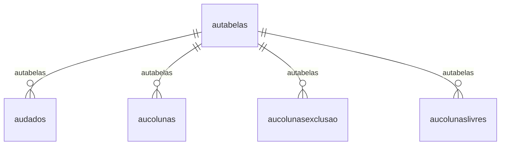

# Modelo — Sistema - nucleo (rascunho em lote)

> Gerado por `src/model/gerar_docs_modelo.py` a partir de `src/model/modulos/sistema_nucleo.yaml`, do catálogo e do perfil de colunas. **Não edite à mão.**

13 entidades. A coluna *Preench.* é o % de linhas com valor útil (nem nulo, nem em branco, nem zero, nem 1900-01-01; para colunas de código o zero conta como valor).

## Diagrama

## Entidades

| Entidade | Tabela | Linhas | Volume | Filtro obrigatório |
|---|---|---|---|---|
| [audados](#audados) | `audados` | 31.761.864 | grande | empresa; um de: sequencial |
| [aucolunas](#aucolunas) | `aucolunas` | 15.014 | medio | — |
| [auvalores](#auvalores) | `auvalores` | 8.360 | pequeno | — |
| [aufiltroempresas](#aufiltroempresas) | `aufiltroempresas` | 1.960 | pequeno | empresa |
| [autabelas](#autabelas) | `autabelas` | 895 | pequeno | — |
| [aufiltrousuarios](#aufiltrousuarios) | `aufiltrousuarios` | 193 | pequeno | — |
| [auusuarios](#auusuarios) | `auusuarios` | 169 | pequeno | — |
| [aufiltrotabelas](#aufiltrotabelas) | `aufiltrotabelas` | 144 | pequeno | — |
| [aucolunasexclusao](#aucolunasexclusao) | `aucolunasexclusao` | 107 | pequeno | — |
| [aucolunaslivres](#aucolunaslivres) | `aucolunaslivres` | 18 | pequeno | — |
| [austatus](#austatus) | `austatus` | 1 | pequeno | — |
| [auparametros](#auparametros) | `auparametros` | 1 | pequeno | — |
| [aucontrole](#aucontrole) | `aucontrole` | 1 | pequeno | — |

## audados

**Movimentos da auditoria** — tabela `audados` (31.761.864 linhas)

Movimentos da auditoria. 31.761.864 linhas no catálogo; chave: sequencial.

- **Chave:** `sequencial`
- **Empresa:** `codi_emp`
- **Período:** `—` · exige um de: `sequencial`
- **Ordem padrão:** `sequencial asc`

**Regras de negócio validadas:**

- Medido em 2026-10-18: 31.765.829 linhas, 1.602 empresa(s).
- tipo_do_movimento_1_inclusao_2_alteracao: todos os valores reais estão no comentário do banco (1=17.309.140, 3=12.449.527, 2=2.007.162).
- Vínculo autabelas (autabelas): 0 de 584 linhas sem registro relacionado (empresa 1039).

| Campo | Coluna | Tipo | Preench. | Domínio | Descrição (banco) |
|---|---|---|---|---|---|
| sequencial | `sequencial` | numeric(15) |  |  | Sequencial |
| codigo_da_tabela | `table_id` | integer(4) |  |  | Codigo da tabela |
| empresa | `codi_emp` | integer(4) |  |  | Empresa |
| usuario | `usuario` | char(30) |  |  | Usuario |
| tipo_do_movimento_1_inclusao_2_alteracao | `tipo` | tinyint(1) |  | audados_tipo_do_movimento_1_inclus | Tipo do movimento (1 - Inclusao/2 - Alteracao/3 - Exclusao) |

**Vínculos (LEFT JOIN, acrescentam colunas legíveis):**

- `autabelas` → `autabelas` por `table_id` = `table_id`; colunas: `autabelas_nome`

**Filtros:** `sequencial` (eq/in), `usuario` (contem/prefixo), `tipo_do_movimento_1_inclusao_2_alteracao` (eq/in)

## aucolunas

**Comentario das colunas auditadas** — tabela `aucolunas` (15.014 linhas)

Comentario das colunas auditadas. 15.014 linhas no catálogo; chave: table_id, coluna.

- **Chave:** `table_id, coluna`
- **Empresa:** `não se aplica (tabela global)`
- **Período:** `—`
- **Ordem padrão:** `table_id asc`, `coluna asc`

**Regras de negócio validadas:**

- Medido em 2026-10-18: 15.014 linhas.
- Vínculo autabelas (autabelas): 0 de 15.014 linhas sem registro relacionado.

| Campo | Coluna | Tipo | Preench. | Domínio | Descrição (banco) |
|---|---|---|---|---|---|
| tabela | `table_id` | integer(4) |  |  | Tabela |
| coluna | `coluna` | char(128) |  |  | Coluna |
| comentario | `comentario` | char(128) |  |  | Comentario |

**Vínculos (LEFT JOIN, acrescentam colunas legíveis):**

- `autabelas` → `autabelas` por `table_id` = `table_id`; colunas: `autabelas_nome`

**Filtros:** `tabela` (eq/in), `coluna` (eq/in), `comentario` (contem/prefixo)

## auvalores

**Valores das colunas valoradas** — tabela `auvalores` (8.360 linhas)

Valores das colunas valoradas. 8.360 linhas no catálogo; chave: table_id, coluna, valor.

- **Chave:** `table_id, coluna, valor`
- **Empresa:** `não se aplica (tabela global)`
- **Período:** `—`
- **Ordem padrão:** `table_id asc`, `coluna asc`

**Regras de negócio validadas:**

- Medido em 2026-10-18: 8.360 linhas.

| Campo | Coluna | Tipo | Preench. | Domínio | Descrição (banco) |
|---|---|---|---|---|---|
| codigo_da_tabela_no_banco | `table_id` | integer(4) |  |  | Codigo da tabela no banco |
| nome_da_coluna | `coluna` | char(128) |  |  | Nome da coluna |
| valor_da_coluna | `valor` | char(10) |  |  | Valor da coluna |
| descricao_do_valor_da_coluna | `descricao` | char(100) |  |  | Descricao do valor da coluna |

**Filtros:** `codigo_da_tabela_no_banco` (eq/in), `nome_da_coluna` (eq/in), `valor_da_coluna` (eq/in), `descricao_do_valor_da_coluna` (contem/prefixo)

## aufiltroempresas

**Empresas auditadas - filtro** — tabela `aufiltroempresas` (1.960 linhas)

Empresas auditadas - filtro. 1.960 linhas no catálogo; chave: codi_emp.

- **Chave:** `codi_emp`
- **Empresa:** `codi_emp`
- **Período:** `—`
- **Ordem padrão:** 

**Regras de negócio validadas:**

- Medido em 2026-10-18: 1.960 linhas, 1.960 empresa(s).

| Campo | Coluna | Tipo | Preench. | Domínio | Descrição (banco) |
|---|---|---|---|---|---|
| empresa | `codi_emp` | integer(4) |  |  | Empresa |

## autabelas

**Tabelas que serao auditadas** — tabela `autabelas` (895 linhas)

Tabelas que serao auditadas. 895 linhas no catálogo; chave: table_id.

- **Chave:** `table_id`
- **Empresa:** `não se aplica (tabela global)`
- **Período:** `—`
- **Ordem padrão:** `table_id asc`

**Regras de negócio validadas:**

- Medido em 2026-10-18: 895 linhas.
- selecionada_1_sim_0_nao: todos os valores reais estão no comentário do banco (0=894, 1=1).

| Campo | Coluna | Tipo | Preench. | Domínio | Descrição (banco) |
|---|---|---|---|---|---|
| codigo_da_tabela_no_banco | `table_id` | integer(4) |  |  | Codigo da tabela no banco |
| nome_da_tabela | `tabela` | char(128) |  |  | Nome da tabela |
| modulo_da_tabela | `modulo` | char(20) |  |  | Modulo da tabela |
| tabela_pai | `tabela_pai` | char(128) |  |  | Tabela pai |
| descricao_da_tabela | `descricao` | char(50) |  |  | Descricao da tabela |
| selecionada_1_sim_0_nao | `seleciona` | tinyint(1) |  | autabelas_selecionada_1_sim_0_na | Selecionada (1 - Sim/0 - Nao) |
| comentario | `comentario` | char(128) |  |  | Comentario |
| tabela_foi_inativada_na_auditoria_s_n | `inativa` | char(1) |  |  | Tabela foi inativada na auditoria(S/N) |

**Filtros:** `codigo_da_tabela_no_banco` (eq/in), `nome_da_tabela` (contem/prefixo), `modulo_da_tabela` (eq/in), `tabela_pai` (contem/prefixo), `descricao_da_tabela` (contem/prefixo), `comentario` (contem/prefixo), `tabela_foi_inativada_na_auditoria_s_n` (eq/in)

## aufiltrousuarios

**Usuarios auditados - filtro** — tabela `aufiltrousuarios` (193 linhas)

Usuarios auditados - filtro. 193 linhas no catálogo; chave: usuario.

- **Chave:** `usuario`
- **Empresa:** `não se aplica (tabela global)`
- **Período:** `—`
- **Ordem padrão:** `usuario asc`

**Regras de negócio validadas:**

- Medido em 2026-10-18: 193 linhas.

| Campo | Coluna | Tipo | Preench. | Domínio | Descrição (banco) |
|---|---|---|---|---|---|
| nome | `usuario` | char(128) |  |  | Nome |

**Filtros:** `nome` (eq/in)

## auusuarios

**Usuarios selecionados** — tabela `auusuarios` (169 linhas)

Usuarios selecionados. 169 linhas no catálogo; chave: usuario.

- **Chave:** `usuario`
- **Empresa:** `não se aplica (tabela global)`
- **Período:** `—`
- **Ordem padrão:** `usuario asc`

**Regras de negócio validadas:**

- Medido em 2026-10-18: 169 linhas.

| Campo | Coluna | Tipo | Preench. | Domínio | Descrição (banco) |
|---|---|---|---|---|---|
| usuario | `usuario` | char(128) |  |  | Usuario |

**Filtros:** `usuario` (eq/in)

## aufiltrotabelas

**Tabelas auditadas - filtro** — tabela `aufiltrotabelas` (144 linhas)

Tabelas auditadas - filtro. 144 linhas no catálogo; chave: table_id.

- **Chave:** `table_id`
- **Empresa:** `não se aplica (tabela global)`
- **Período:** `—`
- **Ordem padrão:** `table_id asc`

**Regras de negócio validadas:**

- Medido em 2026-10-18: 144 linhas.

| Campo | Coluna | Tipo | Preench. | Domínio | Descrição (banco) |
|---|---|---|---|---|---|
| tabela | `table_id` | integer(4) |  |  | Tabela |

**Filtros:** `tabela` (eq/in)

## aucolunasexclusao

**Colunas gravadas na exclusao** — tabela `aucolunasexclusao` (107 linhas)

Colunas gravadas na exclusao. 107 linhas no catálogo; chave: table_id, coluna.

- **Chave:** `table_id, coluna`
- **Empresa:** `não se aplica (tabela global)`
- **Período:** `—`
- **Ordem padrão:** `table_id asc`, `coluna asc`

**Regras de negócio validadas:**

- Medido em 2026-10-18: 107 linhas.
- Vínculo autabelas (autabelas): 0 de 107 linhas sem registro relacionado.

| Campo | Coluna | Tipo | Preench. | Domínio | Descrição (banco) |
|---|---|---|---|---|---|
| tabela | `table_id` | integer(4) |  |  | Tabela |
| nome_da_coluna | `coluna` | char(128) |  |  | Nome da coluna |

**Vínculos (LEFT JOIN, acrescentam colunas legíveis):**

- `autabelas` → `autabelas` por `table_id` = `table_id`; colunas: `autabelas_nome`

**Filtros:** `tabela` (eq/in), `nome_da_coluna` (eq/in)

## aucolunaslivres

**Colunas que nao sao auditadas** — tabela `aucolunaslivres` (18 linhas)

Colunas que nao sao auditadas. 18 linhas no catálogo; chave: table_id, coluna.

- **Chave:** `table_id, coluna`
- **Empresa:** `não se aplica (tabela global)`
- **Período:** `—`
- **Ordem padrão:** `table_id asc`, `coluna asc`

**Regras de negócio validadas:**

- Medido em 2026-10-18: 18 linhas.
- Vínculo autabelas (autabelas): 0 de 18 linhas sem registro relacionado.

| Campo | Coluna | Tipo | Preench. | Domínio | Descrição (banco) |
|---|---|---|---|---|---|
| codigo_da_tabela_no_banco | `table_id` | integer(4) |  |  | Codigo da tabela no banco |
| nome_da_coluna | `coluna` | char(128) |  |  | Nome da coluna |

**Vínculos (LEFT JOIN, acrescentam colunas legíveis):**

- `autabelas` → `autabelas` por `table_id` = `table_id`; colunas: `autabelas_nome`

**Filtros:** `codigo_da_tabela_no_banco` (eq/in), `nome_da_coluna` (eq/in)

## austatus

**Status da auditoria** — tabela `austatus` (1 linhas)

Status da auditoria. 1 linhas no catálogo; chave: sequencial.

- **Chave:** `sequencial`
- **Empresa:** `não se aplica (tabela global)`
- **Período:** `data`
- **Ordem padrão:** `data desc`, `sequencial asc`

**Regras de negócio validadas:**

- Medido em 2026-10-18: 1 linhas, data de 2018-03-07 a 2018-03-07.

| Campo | Coluna | Tipo | Preench. | Domínio | Descrição (banco) |
|---|---|---|---|---|---|
| sequencial | `sequencial` | integer(4) |  |  | Sequencial |
| status_iniciado_ou_parado_i_p | `status` | char(1) |  |  | Status iniciado ou parado (I/P) |
| data_atual | `data` | date(4) |  |  | Data atual |
| hora_atual | `hora` | time(8) |  |  | Hora atual |
| usuario_atual | `usuario` | char(30) |  |  | Usuario atual |

**Filtros:** `sequencial` (eq/in), `data_atual` (entre/gte/lte), `status_iniciado_ou_parado_i_p` (eq/in), `usuario_atual` (contem/prefixo)

## auparametros

**Parametros da auditoria** — tabela `auparametros` (1 linhas)

Parametros da auditoria. 1 linhas no catálogo; chave: novas_empresas, novos_usuarios, novas_tabelas, filtro_empresa, filtro_usuario, filtro_tabela, EXCLUIR_DADOS_ANTERIORES_A.

- **Chave:** `novas_empresas, novos_usuarios, novas_tabelas, filtro_empresa, filtro_usuario, filtro_tabela, EXCLUIR_DADOS_ANTERIORES_A`
- **Empresa:** `não se aplica (tabela global)`
- **Período:** `—`
- **Ordem padrão:** `novas_empresas asc`

**Regras de negócio validadas:**

- Medido em 2026-10-18: 1 linhas.
- excluir_dados_anteriores_a_0_nunca_exclu: todos os valores reais estão no comentário do banco (0=1).

| Campo | Coluna | Tipo | Preench. | Domínio | Descrição (banco) |
|---|---|---|---|---|---|
| auditar_novas_empresas | `novas_empresas` | tinyint(1) |  |  | Auditar novas empresas |
| auditar_novos_usuarios | `novos_usuarios` | tinyint(1) |  |  | Auditar novos usuarios |
| auditar_novas_tabelas | `novas_tabelas` | tinyint(1) |  |  | Auditar novas tabelas |
| filtrar_auditoria_por_empresa | `filtro_empresa` | tinyint(1) |  |  | Filtrar auditoria por empresa |
| filtrar_auditoria_por_usuario | `filtro_usuario` | tinyint(1) |  |  | Filtrar auditoria por usuario |
| filtrar_auditoria_por_tabelas | `filtro_tabela` | tinyint(1) |  |  | Filtrar auditoria por tabelas |
| excluir_dados_anteriores_a_0_nunca_exclu | `excluir_dados_anteriores_a` | integer(4) |  | auparametros_excluir_dados_anteriores_a | Excluir dados anteriores a: (0 - Nunca excluir / 1 - 3 meses / 2 - 1 Ano / 3 - 5 anos) |

**Filtros:** `auditar_novas_empresas` (eq/in)

## aucontrole

**Controle do sequencial** — tabela `aucontrole` (1 linhas)

Controle do sequencial. 1 linhas no catálogo; chave: sequencial.

- **Chave:** `sequencial`
- **Empresa:** `não se aplica (tabela global)`
- **Período:** `—`
- **Ordem padrão:** `sequencial asc`

**Regras de negócio validadas:**

- Medido em 2026-10-18: 1 linhas.

| Campo | Coluna | Tipo | Preench. | Domínio | Descrição (banco) |
|---|---|---|---|---|---|
| maior_sequencial_disponivel_na_tabela_au | `sequencial` | integer(4) |  |  | Maior sequencial disponivel na tabela audados |

**Filtros:** `maior_sequencial_disponivel_na_tabela_au` (eq/in)

## Domínios (significado dos códigos)

`confirmado`: **sim** = vem do comentário do banco e/ou foi conferido nos dados; **parcial** = parte dos valores; **não** = hipótese, não use como regra.

### status_empresa

Situação da empresa no cadastro (geempre.stat_emp)

Confirmado: sim

| Código | Significado |
|---|---|
| A | Ativa |
| I | Inativa |
| C | Em constituição |
| M | Ativo sem movimento |
| B | Em processo de baixa |
| E | Excluindo |

### motivo_inatividade

Motivo da inatividade (geempre.tipoi_emp). Só aparece em empresas inativas.

Confirmado: sim

| Código | Significado |
|---|---|
| 1 | Outros |
| 2 | Baixada |
| 3 | Transferida |
| 4 | Inadimplente |

### tipo_inscricao

Tipo da inscrição (CNPJ/CPF/CEI/CAEPF)

Confirmado: sim

| Código | Significado |
|---|---|
| 1 | CNPJ |
| 2 | CPF |
| 3 | CEI |
| 6 | CAEPF |

### regime_federal_empresa

Regime federal da folha (geempre.rfed_emp)

Confirmado: parcial

| Código | Significado |
|---|---|
| 1 | Normal |
| 2 | Microempresa |
| 3 | Empresa de pequeno porte |

### tipo_honorario_empresa

Como a empresa usa o módulo Honorários (geempre.honorario_tipo)

Confirmado: sim

| Código | Significado |
|---|---|
| E | Escritório (quem fatura) |
| C | Cliente |

### sim_nao_texto

Confirmado: sim

| Código | Significado |
|---|---|
| S | Sim |
| N | Não |

### sim_nao_numerico

Confirmado: sim

| Código | Significado |
|---|---|
| 1 | Sim |
| 0 | Não |

### audados_tipo_do_movimento_1_inclus

Confirmado: sim

> Todos os valores observados em audados.tipo estão no comentário do banco (2026-10-18). Distribuição: 1=17.309.140, 3=12.449.527, 2=2.007.162.

| Código | Significado |
|---|---|
| 1 | Inclusao |
| 2 | Alteracao |
| 3 | Exclusao |

### autabelas_selecionada_1_sim_0_na

Confirmado: sim

> Todos os valores observados em autabelas.seleciona estão no comentário do banco (2026-10-18). Distribuição: 0=894, 1=1.

| Código | Significado |
|---|---|
| 1 | Sim |
| 0 | Nao |

### auparametros_excluir_dados_anteriores_a

Confirmado: sim

> Todos os valores observados em auparametros.EXCLUIR_DADOS_ANTERIORES_A estão no comentário do banco (2026-10-18). Distribuição: 0=1.

| Código | Significado |
|---|---|
| 0 | Nunca excluir |
| 1 | 3 meses |
| 2 | 1 Ano |
| 3 | 5 anos |

