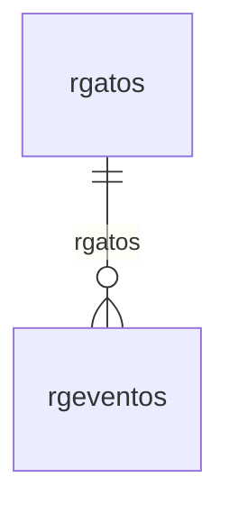

# Modelo — Societário - nucleo (rascunho em lote)

> Gerado por `src/model/gerar_docs_modelo.py` a partir de `src/model/modulos/societario_nucleo.yaml`, do catálogo e do perfil de colunas. **Não edite à mão.**

10 entidades. A coluna *Preench.* é o % de linhas com valor útil (nem nulo, nem em branco, nem zero, nem 1900-01-01; para colunas de código o zero conta como valor).

## Diagrama

## Entidades

| Entidade | Tabela | Linhas | Volume | Filtro obrigatório |
|---|---|---|---|---|
| [rgeventos](#rgeventos) | `rgeventos` | 557 | pequeno | — |
| [rgatos](#rgatos) | `rgatos` | 127 | pequeno | — |
| [rgcondicoes](#rgcondicoes) | `rgcondicoes` | 48 | pequeno | — |
| [rgtestemunhas](#rgtestemunhas) | `rgtestemunhas` | 8 | pequeno | — |
| [rgdocumentos](#rgdocumentos) | `rgdocumentos` | 6 | pequeno | — |
| [rgadvogados](#rgadvogados) | `rgadvogados` | 4 | pequeno | — |
| [rgavisos](#rgavisos) | `rgavisos` | 3 | pequeno | — |
| [rgdocumentacao](#rgdocumentacao) | `rgdocumentacao` | 2 | pequeno | — |
| [rgparmto](#rgparmto) | `rgparmto` | 1 | pequeno | — |
| [rgdadosdw](#rgdadosdw) | `rgdadosdw` | 1 | pequeno | empresa |

## rgeventos

**Eventos - Cadastro** — tabela `rgeventos` (557 linhas)

Eventos - Cadastro. 557 linhas no catálogo; chave: i_ato, i_evento.

- **Chave:** `i_ato, i_evento`
- **Empresa:** `não se aplica (tabela global)`
- **Período:** `—`
- **Ordem padrão:** `i_ato asc`, `i_evento asc`

**Regras de negócio validadas:**

- Medido em 2026-10-18: 557 linhas.
- Vínculo rgatos (rgatos): 0 de 557 linhas sem registro relacionado.

| Campo | Coluna | Tipo | Preench. | Domínio | Descrição (banco) |
|---|---|---|---|---|---|
| ato | `i_ato` | integer(4) |  |  | Ato |
| codigo | `i_evento` | integer(4) |  |  | Codigo |
| descricao | `descricao` | varchar(100) |  |  | Descricao |

**Vínculos (LEFT JOIN, acrescentam colunas legíveis):**

- `rgatos` → `rgatos` por `i_ato` = `i_ato`; colunas: `rgatos_nome`

**Filtros:** `ato` (eq/in), `codigo` (eq/in), `descricao` (contem/prefixo)

## rgatos

**Atos - Cadastro** — tabela `rgatos` (127 linhas)

Atos - Cadastro. 127 linhas no catálogo; chave: i_ato.

- **Chave:** `i_ato`
- **Empresa:** `não se aplica (tabela global)`
- **Período:** `—`
- **Ordem padrão:** `i_ato asc`

**Regras de negócio validadas:**

- Medido em 2026-10-18: 127 linhas.

| Campo | Coluna | Tipo | Preench. | Domínio | Descrição (banco) |
|---|---|---|---|---|---|
| codigo | `i_ato` | integer(4) |  |  | Codigo |
| descricao | `descricao` | varchar(100) |  |  | Descricao |

**Filtros:** `codigo` (eq/in), `descricao` (contem/prefixo)

## rgcondicoes

**Relacao de Condicoes dos Socios** — tabela `rgcondicoes` (48 linhas)

Relacao de Condicoes dos Socios. 48 linhas no catálogo; chave: codigo.

- **Chave:** `codigo`
- **Empresa:** `não se aplica (tabela global)`
- **Período:** `—`
- **Ordem padrão:** `codigo asc`

**Regras de negócio validadas:**

- Medido em 2026-10-18: 48 linhas.

| Campo | Coluna | Tipo | Preench. | Domínio | Descrição (banco) |
|---|---|---|---|---|---|
| codigo | `codigo` | integer(4) |  |  | Codigo |
| descricao | `descricao` | char(50) |  |  | Descricao |
| cadastros_onde_o_item_pode_aparecer | `filtro` | char(1) |  |  | Cadastros onde o item pode aparecer |

**Filtros:** `codigo` (eq/in), `descricao` (contem/prefixo), `cadastros_onde_o_item_pode_aparecer` (eq/in)

## rgtestemunhas

**Testemunhas** — tabela `rgtestemunhas` (8 linhas)

Testemunhas. 8 linhas no catálogo; chave: i_testemunha.

- **Chave:** `i_testemunha`
- **Empresa:** `não se aplica (tabela global)`
- **Período:** `—`
- **Ordem padrão:** `i_testemunha asc`

**Regras de negócio validadas:**

- Medido em 2026-10-18: 8 linhas.

| Campo | Coluna | Tipo | Preench. | Domínio | Descrição (banco) |
|---|---|---|---|---|---|
| codigo | `i_testemunha` | integer(4) |  |  | Codigo |
| nome | `nome` | char(40) |  |  | Nome |
| numero_da_identidade | `identidade` | char(20) |  |  | Numero da identidade |
| orgao_emissor_da_identidade | `orgao` | char(14) |  |  | Orgão emissor da identidade |
| uf_da_identidade | `uf_id` | char(2) |  |  | UF da identidade |
| cpf 🔒 | `cpf` | char(11) |  |  | CPF |

**Filtros:** `codigo` (eq/in), `nome` (contem/prefixo), `numero_da_identidade` (eq/in), `orgao_emissor_da_identidade` (eq/in), `uf_da_identidade` (eq/in), `cpf` (eq/in)

## rgdocumentos

**Documentos** — tabela `rgdocumentos` (6 linhas)

Documentos. 6 linhas no catálogo; chave: i_documento.

- **Chave:** `i_documento`
- **Empresa:** `não se aplica (tabela global)`
- **Período:** `—`
- **Ordem padrão:** `i_documento asc`

**Regras de negócio validadas:**

- Medido em 2026-10-18: 6 linhas.

| Campo | Coluna | Tipo | Preench. | Domínio | Descrição (banco) |
|---|---|---|---|---|---|
| codigo | `i_documento` | integer(4) |  |  | Codigo |
| descricao | `descricao` | char(70) |  |  | Descricao |

**Filtros:** `codigo` (eq/in), `descricao` (contem/prefixo)

## rgadvogados

**Advogados - Cadastro** — tabela `rgadvogados` (4 linhas)

Advogados - Cadastro. 4 linhas no catálogo; chave: i_advogado.

- **Chave:** `i_advogado`
- **Empresa:** `não se aplica (tabela global)`
- **Período:** `—`
- **Ordem padrão:** `i_advogado asc`

**Regras de negócio validadas:**

- Medido em 2026-10-18: 4 linhas.

| Campo | Coluna | Tipo | Preench. | Domínio | Descrição (banco) |
|---|---|---|---|---|---|
| codigo | `i_advogado` | integer(4) |  |  | Codigo |
| nome | `nome` | char(40) |  |  | Nome |
| registro_na_oab | `oab` | char(13) |  |  | Registro na OAB |
| uf_do_registro_na_oab | `uf_oab` | char(2) |  |  | UF do registro na OAB |
| cpf 🔒 | `cpf` | char(11) |  |  | CPF |

**Filtros:** `codigo` (eq/in), `nome` (contem/prefixo), `registro_na_oab` (eq/in), `uf_do_registro_na_oab` (eq/in), `cpf` (eq/in)

## rgavisos

**Avisos** — tabela `rgavisos` (3 linhas)

Avisos. 3 linhas no catálogo; chave: usuario.

- **Chave:** `usuario`
- **Empresa:** `não se aplica (tabela global)`
- **Período:** `data`
- **Ordem padrão:** `data desc`, `usuario asc`

**Regras de negócio validadas:**

- Medido em 2026-10-18: 3 linhas, data de 2018-09-14 a 2021-01-05.

| Campo | Coluna | Tipo | Preench. | Domínio | Descrição (banco) |
|---|---|---|---|---|---|
| usuario | `usuario` | char(128) |  |  | Usuario |
| data_do_aviso | `data` | date(4) |  |  | Data do aviso |
| mostrar_aviso_novamente_s_n | `mostrar` | char(1) |  |  | Mostrar aviso novamente(S/N) |

**Filtros:** `usuario` (eq/in), `data_do_aviso` (entre/gte/lte), `mostrar_aviso_novamente_s_n` (eq/in)

## rgdocumentacao

**Documentacao** — tabela `rgdocumentacao` (2 linhas)

Documentacao. 2 linhas no catálogo; chave: i_documentacao.

- **Chave:** `i_documentacao`
- **Empresa:** `não se aplica (tabela global)`
- **Período:** `—`
- **Ordem padrão:** `i_documentacao asc`

**Regras de negócio validadas:**

- Medido em 2026-10-18: 2 linhas.

| Campo | Coluna | Tipo | Preench. | Domínio | Descrição (banco) |
|---|---|---|---|---|---|
| codigo | `i_documentacao` | integer(4) |  |  | Codigo |
| descricao | `descricao` | char(70) |  |  | Descricao |
| observacao | `observacao` | varchar(500) |  |  | Observacao |

**Filtros:** `codigo` (eq/in), `descricao` (contem/prefixo), `observacao` (contem/prefixo)

## rgparmto

**Aviso de processos** — tabela `rgparmto` (1 linhas)

Aviso de processos. 1 linhas no catálogo; chave: i_codigo.

- **Chave:** `i_codigo`
- **Empresa:** `não se aplica (tabela global)`
- **Período:** `—`
- **Ordem padrão:** `i_codigo asc`

**Regras de negócio validadas:**

- Medido em 2026-10-18: 1 linhas.

| Campo | Coluna | Tipo | Preench. | Domínio | Descrição (banco) |
|---|---|---|---|---|---|
| codigo | `i_codigo` | integer(4) |  |  | Codigo |
| numero_de_dias_da_antecedencia_do_aviso | `dias_antecedencia` | integer(4) |  |  | Numero de dias da antecedencia do aviso |

**Filtros:** `codigo` (eq/in)

## rgdadosdw

**Dados do relatorios** — tabela `rgdadosdw` (1 linhas)

Dados do relatorios. 1 linhas no catálogo; chave: codi_emp, tipo, codigo, nomedw.

- **Chave:** `codi_emp, tipo, codigo, nomedw`
- **Empresa:** `codi_emp`
- **Período:** `—`
- **Ordem padrão:** `tipo asc`, `codigo asc`

**Regras de negócio validadas:**

- Medido em 2026-10-18: 1 linhas, 1 empresa(s).
- Vínculo geempre (geempre): 0 de 1 linhas sem registro relacionado (empresa 1).

| Campo | Coluna | Tipo | Preench. | Domínio | Descrição (banco) |
|---|---|---|---|---|---|
| empresa | `codi_emp` | integer(4) |  |  | Empresa |
| tipo_do_documento | `tipo` | char(128) |  |  | Tipo do documento |
| codigo | `codigo` | integer(4) |  |  | Codigo |
| dataobject_ou_codigo_do_relatorio_do_ger | `nomedw` | char(100) |  |  | Dataobject ou codigo do relatorio do gerador |
| total_de_linhas | `total_linhas` | integer(4) |  |  | Total de linhas |

**Vínculos (LEFT JOIN, acrescentam colunas legíveis):**

- `geempre` → `geempre` por `codi_emp` = `codi_emp`; colunas: `geempre_nome`

**Filtros:** `tipo_do_documento` (eq/in), `codigo` (eq/in), `dataobject_ou_codigo_do_relatorio_do_ger` (eq/in)

## Domínios (significado dos códigos)

`confirmado`: **sim** = vem do comentário do banco e/ou foi conferido nos dados; **parcial** = parte dos valores; **não** = hipótese, não use como regra.

### status_empresa

Situação da empresa no cadastro (geempre.stat_emp)

Confirmado: sim

| Código | Significado |
|---|---|
| A | Ativa |
| I | Inativa |
| C | Em constituição |
| M | Ativo sem movimento |
| B | Em processo de baixa |
| E | Excluindo |

### motivo_inatividade

Motivo da inatividade (geempre.tipoi_emp). Só aparece em empresas inativas.

Confirmado: sim

| Código | Significado |
|---|---|
| 1 | Outros |
| 2 | Baixada |
| 3 | Transferida |
| 4 | Inadimplente |

### tipo_inscricao

Tipo da inscrição (CNPJ/CPF/CEI/CAEPF)

Confirmado: sim

| Código | Significado |
|---|---|
| 1 | CNPJ |
| 2 | CPF |
| 3 | CEI |
| 6 | CAEPF |

### regime_federal_empresa

Regime federal da folha (geempre.rfed_emp)

Confirmado: parcial

| Código | Significado |
|---|---|
| 1 | Normal |
| 2 | Microempresa |
| 3 | Empresa de pequeno porte |

### tipo_honorario_empresa

Como a empresa usa o módulo Honorários (geempre.honorario_tipo)

Confirmado: sim

| Código | Significado |
|---|---|
| E | Escritório (quem fatura) |
| C | Cliente |

### sim_nao_texto

Confirmado: sim

| Código | Significado |
|---|---|
| S | Sim |
| N | Não |

### sim_nao_numerico

Confirmado: sim

| Código | Significado |
|---|---|
| 1 | Sim |
| 0 | Não |

