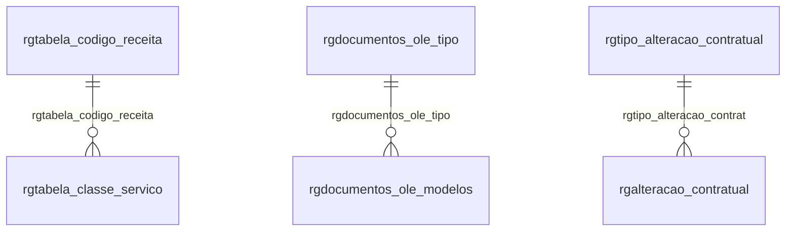

# Modelo — Societário - outros (rascunho em lote)

> Gerado por `src/model/gerar_docs_modelo.py` a partir de `src/model/modulos/societario_outros.yaml`, do catálogo e do perfil de colunas. **Não edite à mão.**

9 entidades. A coluna *Preench.* é o % de linhas com valor útil (nem nulo, nem em branco, nem zero, nem 1900-01-01; para colunas de código o zero conta como valor).

## Diagrama

## Entidades

| Entidade | Tabela | Linhas | Volume | Filtro obrigatório |
|---|---|---|---|---|
| [rgtabela_classe_servico](#rgtabela_classe_servico) | `rgtabela_classe_servico` | 782 | pequeno | — |
| [rgtabela_codigo_receita](#rgtabela_codigo_receita) | `rgtabela_codigo_receita` | 11 | pequeno | — |
| [rgdadosdw_linhas](#rgdadosdw_linhas) | `rgdadosdw_linhas` | 81 | pequeno | empresa |
| [rgdocumentos_ole_modelos](#rgdocumentos_ole_modelos) | `rgdocumentos_ole_modelos` | 70 | pequeno | — |
| [rgdocumentos_ole_tipo](#rgdocumentos_ole_tipo) | `rgdocumentos_ole_tipo` | 15 | pequeno | — |
| [rgdocumentos_documentacao](#rgdocumentos_documentacao) | `rgdocumentos_documentacao` | 6 | pequeno | — |
| [rgtipo_requerimentos](#rgtipo_requerimentos) | `rgtipo_requerimentos` | 8 | pequeno | — |
| [rgtipo_alteracao_contratual](#rgtipo_alteracao_contratual) | `rgtipo_alteracao_contratual` | 6 | pequeno | — |
| [rgalteracao_contratual](#rgalteracao_contratual) | `rgalteracao_contratual` | 1 | pequeno | empresa |

## rgtabela_classe_servico

**Classe do Servico** — tabela `rgtabela_classe_servico` (782 linhas)

Classe do Servico. 782 linhas no catálogo; chave: codigo_receita, codigo_classe.

- **Chave:** `codigo_receita, codigo_classe`
- **Empresa:** `não se aplica (tabela global)`
- **Período:** `—`
- **Ordem padrão:** `codigo_receita asc`, `codigo_classe asc`

**Regras de negócio validadas:**

- Medido em 2026-10-18: 782 linhas.
- Vínculo rgtabela_codigo_receita (rgtabela_codigo_receita): 0 de 782 linhas sem registro relacionado.

| Campo | Coluna | Tipo | Preench. | Domínio | Descrição (banco) |
|---|---|---|---|---|---|
| codigo_da_receita | `codigo_receita` | integer(4) |  |  | Codigo da receita |
| codigo_da_classe_do_servico | `codigo_classe` | integer(4) |  |  | Codigo da classe do servico |
| descricao | `descricao` | varchar(200) |  |  | Descricao |

**Vínculos (LEFT JOIN, acrescentam colunas legíveis):**

- `rgtabela_codigo_receita` → `rgtabela_codigo_receita` por `codigo_receita` = `codigo_receita`; colunas: `rgtabela_codigo_receita_nome`

**Filtros:** `codigo_da_receita` (eq/in), `codigo_da_classe_do_servico` (eq/in), `descricao` (contem/prefixo)

## rgtabela_codigo_receita

**Codigo da Receita** — tabela `rgtabela_codigo_receita` (11 linhas)

Codigo da Receita. 11 linhas no catálogo; chave: codigo_receita.

- **Chave:** `codigo_receita`
- **Empresa:** `não se aplica (tabela global)`
- **Período:** `—`
- **Ordem padrão:** `codigo_receita asc`

**Regras de negócio validadas:**

- Medido em 2026-10-18: 11 linhas.

| Campo | Coluna | Tipo | Preench. | Domínio | Descrição (banco) |
|---|---|---|---|---|---|
| codigo_da_receita | `codigo_receita` | integer(4) |  |  | Codigo da receita |
| descricao | `descricao` | varchar(200) |  |  | Descricao |

**Filtros:** `codigo_da_receita` (eq/in), `descricao` (contem/prefixo)

## rgdadosdw_linhas

**Dados do relatorios - Linhas** — tabela `rgdadosdw_linhas` (81 linhas)

Dados do relatorios - Linhas. 81 linhas no catálogo; chave: codi_emp, tipo, codigo, nomedw, linha, nome.

- **Chave:** `codi_emp, tipo, codigo, nomedw, linha, nome`
- **Empresa:** `codi_emp`
- **Período:** `—`
- **Ordem padrão:** `tipo asc`, `codigo asc`

**Regras de negócio validadas:**

- Medido em 2026-10-18: 81 linhas, 1 empresa(s).

| Campo | Coluna | Tipo | Preench. | Domínio | Descrição (banco) |
|---|---|---|---|---|---|
| empresa | `codi_emp` | integer(4) |  |  | Empresa |
| tipo_de_documento | `tipo` | char(128) |  |  | Tipo de documento |
| codigo | `codigo` | integer(4) |  |  | Codigo |
| dataobject_ou_codigo_do_relatorio_do_ger | `nomedw` | char(100) |  |  | Dataobject ou codigo do relatorio do gerador |
| linha | `linha` | integer(4) |  |  | Linha |
| nome_do_campo_coluna | `nome` | varchar(100) |  |  | Nome do campo/coluna |
| tipo_dado | `tipo_dado` | tinyint(1) |  |  | Tipo do dado (1=String, 2=Long, 3=Decimal, 4=Date, 5=Time, 6=DateTime) |
| dados_da_coluna | `dados` | varchar(5000) |  |  | Dados da coluna |

**Filtros:** `tipo_de_documento` (eq/in), `codigo` (eq/in), `dataobject_ou_codigo_do_relatorio_do_ger` (eq/in), `linha` (eq/in), `nome_do_campo_coluna` (eq/in), `tipo_dado` (eq/in), `dados_da_coluna` (contem/prefixo)

## rgdocumentos_ole_modelos

**Modelos de Documento** — tabela `rgdocumentos_ole_modelos` (70 linhas)

Modelos de Documento. 70 linhas no catálogo; chave: i_modelo, i_tipo.

- **Chave:** `i_modelo, i_tipo`
- **Empresa:** `não se aplica (tabela global)`
- **Período:** `—`
- **Ordem padrão:** `i_modelo asc`, `i_tipo asc`

**Regras de negócio validadas:**

- Medido em 2026-10-18: 70 linhas.
- Vínculo rgdocumentos_ole_tipo (rgdocumentos_ole_tipo): 0 de 70 linhas sem registro relacionado.

| Campo | Coluna | Tipo | Preench. | Domínio | Descrição (banco) |
|---|---|---|---|---|---|
| codigo | `i_modelo` | integer(4) |  |  | Codigo |
| tipo | `i_tipo` | integer(4) |  |  | Tipo |
| descricao | `descricao` | char(100) |  |  | Descricao |
| codigo_padrao | `padrao` | char(10) |  |  | Codigo padrao |
| c_1_office_2_openoffice | `editor` | integer(4) |  |  | 1- Office, 2-OpenOffice |

**Vínculos (LEFT JOIN, acrescentam colunas legíveis):**

- `rgdocumentos_ole_tipo` → `rgdocumentos_ole_tipo` por `i_tipo` = `i_tipo`; colunas: `rgdocumentos_ole_tipo_nome`

**Filtros:** `codigo` (eq/in), `tipo` (eq/in), `descricao` (contem/prefixo), `codigo_padrao` (eq/in)

## rgdocumentos_ole_tipo

**Tipos de Documentos** — tabela `rgdocumentos_ole_tipo` (15 linhas)

Tipos de Documentos. 15 linhas no catálogo; chave: i_tipo.

- **Chave:** `i_tipo`
- **Empresa:** `não se aplica (tabela global)`
- **Período:** `—`
- **Ordem padrão:** `i_tipo asc`

**Regras de negócio validadas:**

- Medido em 2026-10-18: 15 linhas.

| Campo | Coluna | Tipo | Preench. | Domínio | Descrição (banco) |
|---|---|---|---|---|---|
| codigo | `i_tipo` | integer(4) |  |  | Codigo |
| descricao | `descricao` | char(100) |  |  | Descricao |

**Filtros:** `codigo` (eq/in), `descricao` (contem/prefixo)

## rgdocumentos_documentacao

**Documentos - Documentacao** — tabela `rgdocumentos_documentacao` (6 linhas)

Documentos - Documentacao. 6 linhas no catálogo; chave: i_documentacao, i_documento.

- **Chave:** `i_documentacao, i_documento`
- **Empresa:** `não se aplica (tabela global)`
- **Período:** `—`
- **Ordem padrão:** `i_documentacao asc`, `i_documento asc`

**Regras de negócio validadas:**

- Medido em 2026-10-18: 6 linhas.
- Vínculo rgdocumentacao (rgdocumentacao): 0 de 6 linhas sem registro relacionado.
- Vínculo rgdocumentos (rgdocumentos): 0 de 6 linhas sem registro relacionado.

| Campo | Coluna | Tipo | Preench. | Domínio | Descrição (banco) |
|---|---|---|---|---|---|
| documentacao | `i_documentacao` | integer(4) |  |  | Documentacao |
| documento | `i_documento` | integer(4) |  |  | Documento |

**Vínculos (LEFT JOIN, acrescentam colunas legíveis):**

- `rgdocumentacao` → `rgdocumentacao` por `i_documentacao` = `i_documentacao`; colunas: `rgdocumentacao_nome`
- `rgdocumentos` → `rgdocumentos` por `i_documento` = `i_documento`; colunas: `rgdocumentos_nome`

**Filtros:** `documentacao` (eq/in), `documento` (eq/in)

## rgtipo_requerimentos

**Tipos de Requerimentos** — tabela `rgtipo_requerimentos` (8 linhas)

Tipos de Requerimentos. 8 linhas no catálogo; chave: i_tiporequerimento.

- **Chave:** `i_tiporequerimento`
- **Empresa:** `não se aplica (tabela global)`
- **Período:** `—`
- **Ordem padrão:** `i_tiporequerimento asc`

**Regras de negócio validadas:**

- Medido em 2026-10-18: 8 linhas.

| Campo | Coluna | Tipo | Preench. | Domínio | Descrição (banco) |
|---|---|---|---|---|---|
| codigo | `i_tiporequerimento` | integer(4) |  |  | Codigo |
| descricao | `descricao` | char(50) |  |  | Descricao |
| modelo | `modelo` | char(80) |  |  | Modelo |

**Filtros:** `codigo` (eq/in), `descricao` (contem/prefixo), `modelo` (contem/prefixo)

## rgtipo_alteracao_contratual

**Tipo de Alteracao Contratual** — tabela `rgtipo_alteracao_contratual` (6 linhas)

Tipo de Alteracao Contratual. 6 linhas no catálogo; chave: i_tipoalteracao.

- **Chave:** `i_tipoalteracao`
- **Empresa:** `não se aplica (tabela global)`
- **Período:** `—`
- **Ordem padrão:** `i_tipoalteracao asc`

**Regras de negócio validadas:**

- Medido em 2026-10-18: 6 linhas.
- tipo_da_alteracao_da_filial_i_inclusao_e: todos os valores reais estão no comentário do banco (A=6).

| Campo | Coluna | Tipo | Preench. | Domínio | Descrição (banco) |
|---|---|---|---|---|---|
| codigo | `i_tipoalteracao` | integer(4) |  |  | Codigo |
| descricao | `descricao` | char(50) |  |  | Descricao |
| alteracao_cadastral_s_n | `cadastral` | char(1) |  |  | Alteracao cadastral(S/N) |
| alteracao_do_quadro_societario_s_n | `quadrosocietario` | char(1) |  |  | Alteracao do quadro societario(S/N) |
| alteracao_de_dados_da_filial_s_n | `filial` | char(1) |  |  | Alteracao de dados da filial(S/N) |
| tipo_da_alteracao_da_filial_i_inclusao_e | `tipofilial` | char(1) |  | rgtipo_alteracao_contratual_tipo_da_alteracao_da_ | Tipo da alteracao da filial(I-Inclusao/E-Exclusao/A-Alteracao Cadastral) |
| outros_tipos_de_alteracao_s_n | `outros` | char(1) |  |  | Outros tipos de alteracao(S/N) |
| natureza_jur_ca_s_n | `natureza_juridica` | char(1) |  |  | Natureza Jur?ca (S/N) |
| capital_social_s_n | `capital_social` | char(1) |  |  | Capital Social (S/N) |

**Filtros:** `codigo` (eq/in), `descricao` (contem/prefixo), `alteracao_cadastral_s_n` (eq/in), `alteracao_do_quadro_societario_s_n` (eq/in), `alteracao_de_dados_da_filial_s_n` (eq/in), `tipo_da_alteracao_da_filial_i_inclusao_e` (eq/in), `outros_tipos_de_alteracao_s_n` (eq/in), `natureza_jur_ca_s_n` (eq/in), `capital_social_s_n` (eq/in)

## rgalteracao_contratual

**Alteracao Contratual** — tabela `rgalteracao_contratual` (1 linhas)

Alteracao Contratual. 1 linhas no catálogo; chave: codi_emp, i_alteracao.

- **Chave:** `codi_emp, i_alteracao`
- **Empresa:** `codi_emp`
- **Período:** `data`
- **Ordem padrão:** `data desc`, `i_alteracao asc`

**Regras de negócio validadas:**

- Medido em 2026-10-18: 1 linhas, 1 empresa(s), data de 2018-03-07 a 2018-03-07.
- Colunas expostas nulas em 100% das linhas (10): codigo_da_filial, advogado, testemunha, i_testemunha2, ato, i_evento1, i_evento2, i_evento3, codigo_ole, numero_do_nire.
- situacao_da_natureza_juridica_e_empresar: todos os valores reais estão no comentário do banco (S=1).
- Vínculo rgadvogados (rgadvogados): 0 de 1 linhas sem registro relacionado (empresa 1).
- Vínculo rgtestemunhas (rgtestemunhas): 0 de 1 linhas sem registro relacionado (empresa 1).
- Vínculo rgtipo_alteracao_contrat (rgtipo_alteracao_contratual): 0 de 1 linhas sem registro relacionado (empresa 1).
- Vínculo geempre (geempre): 0 de 1 linhas sem registro relacionado (empresa 1).
- Vínculo rgeventos (rgeventos): 0 de 1 linhas sem registro relacionado (empresa 1).
- Vínculo rgatos (rgatos): 0 de 1 linhas sem registro relacionado (empresa 1).

| Campo | Coluna | Tipo | Preench. | Domínio | Descrição (banco) |
|---|---|---|---|---|---|
| empresa | `codi_emp` | integer(4) |  |  | Empresa |
| codigo | `i_alteracao` | integer(4) |  |  | Codigo |
| data | `data` | date(4) |  |  | Data |
| tipo_da_alteracao | `i_tipoalteracao` | integer(4) |  |  | Tipo da alteracao |
| codigo_da_filial | `filial` | integer(4) |  |  | Codigo da filial |
| advogado | `i_advogado` | integer(4) |  |  | Advogado |
| testemunha | `i_testemunha1` | integer(4) |  |  | Testemunha |
| i_testemunha2 | `i_testemunha2` | integer(4) |  |  | Testemunha |
| ato | `i_ato` | integer(4) |  |  | Ato |
| i_evento1 | `i_evento1` | integer(4) |  |  | Evento 1 |
| i_evento2 | `i_evento2` | integer(4) |  |  | Evento 2 |
| i_evento3 | `i_evento3` | integer(4) |  |  | Evento 3 |
| transferencia_de_uf_da_matriz | `outra_uf_matriz` | char(1) |  |  | Transferencia de UF da matriz |
| transferencia_de_uf_da_filial | `outra_uf_filial` | char(1) |  |  | Transferencia de UF da filial |
| codigo_ole | `i_ole` | integer(4) |  |  | Codigo ole |
| data_do_protocolo | `dataprotocolo` | date(4) |  |  | Data do Protocolo |
| numero_do_protocolo | `nroprotocolo` | char(15) |  |  | Numero do Protocolo |
| avisar_s_n | `avisar` | char(1) |  |  | Avisar (S/N) |
| numero_de_dias_para_conclusao | `nrodias` | integer(4) |  |  | Numero de dias para conclusao |
| data_de_aviso_do_processo | `dataaviso` | date(4) |  |  | Data de aviso do processo |
| alteracao_finalizada_s_n | `finalizado` | char(1) |  |  | Alteracao finalizada (S/N) |
| numero_do_nire | `nire` | char(11) |  |  | Numero do NIRE |
| data_da_finalizacao | `datafinalizado` | date(4) |  |  | Data da finalizacao |
| inutilizar_campos_nao_preenchidos_s_n | `inutilizar_campo_nao_preenchido` | char(1) |  |  | Inutilizar campos não preenchidos (S/N) |
| alteracao_de_transformacao_s_n | `alteracao_transformacao` | char(1) |  |  | Alteração de transformação (S/N) |
| situacao_da_natureza_juridica_e_empresar | `situacao_natureza_juridica` | char(1) |  | rgalteracao_contratual_situacao_da_natureza_juridica | Situação da natureza jurídica (E=Empresário individual/ S=Sociedade LTDA/ R=EIRELI) |
| informar_valor_do_capital_social | `informar_valor_capital_social` | char(1) |  |  | Informar valor do capital social |
| capital_social | `valor_capital_social` | numeric(13) |  |  | Capital social |
| habilita_grupo_de_modelo_de_relatorio | `habilita_modelo` | char(1) |  |  | Habilita grupo de modelo de relatório. |
| habilita_grupo_de_documento_vinculado | `habilita_documento_vinculado` | char(1) |  |  | Habilita grupo de documento vinculado. |

**Vínculos (LEFT JOIN, acrescentam colunas legíveis):**

- `rgadvogados` → `rgadvogados` por `i_advogado` = `i_advogado`; colunas: `rgadvogados_nome`
- `rgtestemunhas` → `rgtestemunhas` por `i_testemunha1` = `i_testemunha`; colunas: `rgtestemunhas_nome`
- `rgtipo_alteracao_contrat` → `rgtipo_alteracao_contratual` por `i_tipoalteracao` = `i_tipoalteracao`; colunas: `rgtipo_alteracao_contrat_nome`
- `geempre` → `geempre` por `codi_emp` = `codi_emp`; colunas: `geempre_nome`
- `rgeventos` → `rgeventos` por `i_ato` = `i_ato` e `i_evento1` = `i_evento`; colunas: `rgeventos_nome`
- `rgatos` → `rgatos` por `i_ato` = `i_ato`; colunas: `rgatos_nome`

**Filtros:** `codigo` (eq/in), `data` (entre/gte/lte), `data_do_protocolo` (entre/gte/lte), `data_de_aviso_do_processo` (entre/gte/lte), `data_da_finalizacao` (entre/gte/lte), `tipo_da_alteracao` (eq/in), `advogado` (eq/in), `testemunha` (eq/in), `i_testemunha2` (eq/in), `ato` (eq/in), `i_evento1` (eq/in), `i_evento2` (eq/in), `i_evento3` (eq/in), `transferencia_de_uf_da_matriz` (eq/in)

## Domínios (significado dos códigos)

`confirmado`: **sim** = vem do comentário do banco e/ou foi conferido nos dados; **parcial** = parte dos valores; **não** = hipótese, não use como regra.

### status_empresa

Situação da empresa no cadastro (geempre.stat_emp)

Confirmado: sim

| Código | Significado |
|---|---|
| A | Ativa |
| I | Inativa |
| C | Em constituição |
| M | Ativo sem movimento |
| B | Em processo de baixa |
| E | Excluindo |

### motivo_inatividade

Motivo da inatividade (geempre.tipoi_emp). Só aparece em empresas inativas.

Confirmado: sim

| Código | Significado |
|---|---|
| 1 | Outros |
| 2 | Baixada |
| 3 | Transferida |
| 4 | Inadimplente |

### tipo_inscricao

Tipo da inscrição (CNPJ/CPF/CEI/CAEPF)

Confirmado: sim

| Código | Significado |
|---|---|
| 1 | CNPJ |
| 2 | CPF |
| 3 | CEI |
| 6 | CAEPF |

### regime_federal_empresa

Regime federal da folha (geempre.rfed_emp)

Confirmado: parcial

| Código | Significado |
|---|---|
| 1 | Normal |
| 2 | Microempresa |
| 3 | Empresa de pequeno porte |

### tipo_honorario_empresa

Como a empresa usa o módulo Honorários (geempre.honorario_tipo)

Confirmado: sim

| Código | Significado |
|---|---|
| E | Escritório (quem fatura) |
| C | Cliente |

### sim_nao_texto

Confirmado: sim

| Código | Significado |
|---|---|
| S | Sim |
| N | Não |

### sim_nao_numerico

Confirmado: sim

| Código | Significado |
|---|---|
| 1 | Sim |
| 0 | Não |

### rgtipo_alteracao_contratual_tipo_da_alteracao_da_

Confirmado: sim

> Todos os valores observados em rgtipo_alteracao_contratual.tipofilial estão no comentário do banco (2026-10-18). Distribuição: A=6.

| Código | Significado |
|---|---|
| I | Inclusao |
| E | Exclusao |
| A | Alteracao Cadastral |

### rgalteracao_contratual_situacao_da_natureza_juridica

Confirmado: sim

> Todos os valores observados em rgalteracao_contratual.SITUACAO_NATUREZA_JURIDICA estão no comentário do banco (2026-10-18). Distribuição: S=1.

| Código | Significado |
|---|---|
| E | Empresário individual |
| S | Sociedade LTDA |
| R | EIRELI |

