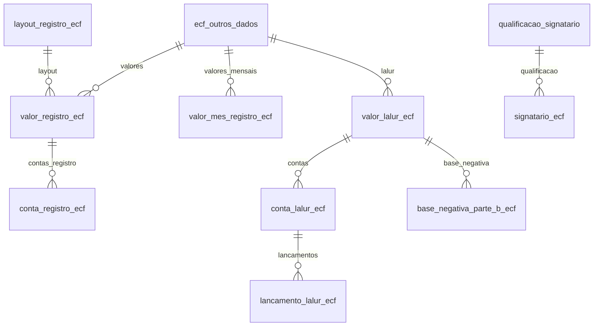

# Modelo — SPED ECF - Outros Dados

> Gerado por `src/model/gerar_docs_modelo.py` a partir de `src/model/modulos/sped_ecf.yaml`, do catálogo e do perfil de colunas. **Não edite à mão.**

11 entidades. A coluna *Preench.* é o % de linhas com valor útil (nem nulo, nem em branco, nem zero, nem 1900-01-01; para colunas de código o zero conta como valor).

## Diagrama

## Entidades

| Entidade | Tabela | Linhas | Volume | Filtro obrigatório |
|---|---|---|---|---|
| [ecf_outros_dados](#ecf_outros_dados) | `ctsped_ecf_od` | 2.533 | medio | empresa |
| [layout_registro_ecf](#layout_registro_ecf) | `cttabela_sped_ecf_od_registro` | 10.776 | medio | — |
| [valor_registro_ecf](#valor_registro_ecf) | `ctsped_ecf_od_registro` | 8.584.047 | grande | empresa; um de: outros_dados, periodo |
| [conta_registro_ecf](#conta_registro_ecf) | `ctsped_ecf_od_registro_conta` | 4.866 | medio | empresa; um de: outros_dados |
| [valor_mes_registro_ecf](#valor_mes_registro_ecf) | `ctsped_ecf_od_mes` | 32.556 | medio | empresa; um de: outros_dados, registro |
| [valor_lalur_ecf](#valor_lalur_ecf) | `ctsped_ecf_od_registro_lalur` | 4.078.361 | grande | empresa; um de: outros_dados, periodo |
| [conta_lalur_ecf](#conta_lalur_ecf) | `ctsped_ecf_od_registro_lalur_conta` | 1.825 | medio | empresa; um de: outros_dados |
| [lancamento_lalur_ecf](#lancamento_lalur_ecf) | `ctsped_ecf_od_registro_lalur_lancamento` | 14.978 | medio | empresa; um de: outros_dados |
| [base_negativa_parte_b_ecf](#base_negativa_parte_b_ecf) | `ctsped_ecf_od_registro_lalur_base_negativa_parte_b` | 194 | pequeno | empresa; um de: outros_dados |
| [signatario_ecf](#signatario_ecf) | `ctsped_ecf_signatario` | 1.051 | pequeno | empresa |
| [qualificacao_signatario](#qualificacao_signatario) | `ctsped_signatario_qualificacao` | 21 | pequeno | — |

## ecf_outros_dados

**ECF - Parâmetros da escrituração (Outros Dados)** — tabela `ctsped_ecf_od` (2.533 linhas)

Um registro por empresa, ano-calendário e SCP, com os parâmetros que a Domínio usa para gerar a ECF: forma de tributação, período de apuração, retificação, situação especial e as respostas S/N das fichas de operações. 2.533 registros, 613 empresas, anos-calendário 2017 a 2025. Usa 56 dos 110 campos do cadastro (as respostas S/N de regimes especiais mais raros ficaram fora).

- **Chave:** `codi_emp, i_outros_dados`
- **Empresa:** `codi_emp`
- **Período:** `ano_calendario`
- **Ordem padrão:** `ano_calendario desc`, `i_outros_dados desc`

**Regras de negócio validadas:**

- Chave de negócio: há exatamente um registro por (empresa, ano-calendário, SCP): os 2.533 grupos têm 1 linha. 65 registros são de SCP (`scp_codigo` preenchido).
- Forma de tributação x período: lucro presumido (5) é trimestral em 2.112 registros; lucro real (1) é anual em 229 e trimestral em 9; isento (9) 170 e imune (8) 13.
- Retificação: 2.454 originais (N), 78 retificadoras (S) e 1 original com mudança de forma de tributação (F). 67 registros têm situação especial.
- Critério de reconhecimento da receita: 1.556 por competência (2) e 977 por caixa (1).

| Campo | Coluna | Tipo | Preench. | Domínio | Descrição (banco) |
|---|---|---|---|---|---|
| codigo | `i_outros_dados` | integer(4) |  |  | Sequencial |
| ano_calendario | `ano_calendario` | date(4) |  |  | Ano da emissão do SPED |
| scp_codigo | `i_scp` | integer(4) |  |  | SCP |
| empresa_scp | `codi_emp_i_scp` | integer(4) |  |  | Empresa - SCP |
| situacao_especial | `indicador_situacao_especial` | char(1) |  | sim_nao_texto | Indicador de situação especial (S/N) |
| situacao_especial_evento | `indicador_situacao_especial_evento` | integer(4) |  | evento_situacao_especial_ecf | Evento do indicador de situação especial (1 - Extinção / 2 - Fusão 3 - Incorporação/Incorporada / 4 - Incorporação/Incorporadora / 5 - Cisão Total / 6 - Cisão Parcial / 7 - Transformação / 8 - Desenquadramento de Imune/Isenta / 9 - Inclusão no SN) |
| situacao_especial_data | `indicador_situacao_especial_data_evento` | date(4) |  |  | Data do evento do indicador de situação especial |
| patrimonio_remanescente_cisao | `patrimonio_remanescente_cisao` | numeric(7) |  |  | Patrimônio remanescente em caso de cisão do indicador de situação especial |
| retificadora | `retificadora` | char(1) |  | retificadora_ecf | TIPO DA ESCRITURAÇÃO RETIFICADORA (N - ECF ORIGINAL / S - ECF RETIFICADORA / F - ECF ORIGINAL COM MUDANÇA DE FORMA DE TRIBUTAÇÃO (IN Nº 166/1999)) |
| numero_recibo_retificadora | `retificadora_numero_recibo` | varchar(41) |  |  | Número do recibo da retificadora |
| indicador_inicio_periodo | `indicador_inicio_periodo` | integer(4) |  |  | Indicador de início de período |
| forma_tributacao | `forma_tributacao` | integer(4) |  | forma_tributacao_ecf | FORMA DE TRIBUTAÇÃO DO LUCRO (1 - LUCRO REAL / 2 - LUCRO REAL/ARBITRADO / 3 - LUCRO PRESUMIDO/REAL / 5 - LUCRO PRESUMIDO / 6 - LUCRO ARBITRADO / 7 - LUCRO PRESUMIDO/ARBITRADO / 8 - IMUNE DE IRPJ / 9 - ISENTO DO IRPJ) |
| forma_tributacao_trimestre_1 | `forma_tributacao_trimestre_1` | integer(4) |  | forma_tributacao_ecf | FORMA DE TRIBUTA?O DO TRIMESTRE 1 (1 - LUCRO REAL / 5 - LUCRO PRESUMIDO / 6 - ARBITRADO) |
| forma_tributacao_trimestre_2 | `forma_tributacao_trimestre_2` | integer(4) |  | forma_tributacao_ecf | FORMA DE TRIBUTA?O DO TRIMESTRE 2 (1 - LUCRO REAL / 5 - LUCRO PRESUMIDO / 6 - ARBITRADO) |
| forma_tributacao_trimestre_3 | `forma_tributacao_trimestre_3` | integer(4) |  | forma_tributacao_ecf | FORMA DE TRIBUTA?O DO TRIMESTRE 3 (1 - LUCRO REAL / 5 - LUCRO PRESUMIDO / 6 - ARBITRADO) |
| forma_tributacao_trimestre_4 | `forma_tributacao_trimestre_4` | integer(4) |  | forma_tributacao_ecf | FORMA DE TRIBUTA?O DO TRIMESTRE 4 (1 - LUCRO REAL / 5 - LUCRO PRESUMIDO / 6 - ARBITRADO) |
| periodo_apuracao | `periodo_apuracao_irpj_csll` | char(1) |  | periodo_apuracao_ecf | Período de apuração do IRPJ e CSLL (T - Trimestral / A - Anual) |
| qualificacao_pj | `qualificacao_pessoa_juridica` | integer(4) |  | qualificacao_pj_ecf | QUALIFICACAO DA PESSOA JURIDICA (1 - PJ EM GERAL / 2 - PJ COMPONENTE DO SISTEMA FINANCEIRO / 3 - SOCIEDADES SEGURADORAS, DE CAPITALIZACAO OU ENTIDADE ABERTA DE PREVIDENCIA COMPLEMENTAR / 4 - SOCIEDADE ANONIMA DO FUTEBOL) |
| tipo_entidade_isenta_imune | `tipo_entidade_isenta_imune` | integer(4) |  |  | Tipo de entidade imune/isenta |
| tipo_escrituracao | `tipo_escrituracao` | char(1) |  | tipo_escrituracao_ecf | Tipo de escrituração (L - Livro Caixa (Lucro Presumido) ou Sem Escrituração / C - Contábil (Lucro Presumido, Imunes ou Isentas)) |
| criterio_reconhecimento_receita | `criterio_de_reconhecimento_de_receitas` | integer(4) |  | criterio_receita_ecf | Critério de reconhecimento de receitas (1 - Regime de caixa / 2 - Regime de competência) |
| atividade_tributada_irpj_csll | `existencia_atividade_tributada_irpj_csll` | char(1) |  | sim_nao_texto | Existência atividade tributada pelo IRPJ e CSLL |
| aliquota_csll_2019 | `pj_sujeita_aliquota_csll_2019` | numeric(30) |  |  | Alíquota da PJ CSLL (9=9% 15=15%/15=15%-20%/20=20%-25%/12=9%-12%/17=15%-17,5%) |
| optante_refis | `optante_refis` | char(1) |  | sim_nao_texto | Optante pelo Refis (S/N) |
| optante_paes | `optante_paes` | char(1) |  | sim_nao_texto | Optante pelo Paes (S/N) |
| optante_extincao_rtt_2014 | `optante_extincao_rtt_2014` | char(1) |  | sim_nao_texto | Optante pela extinção do RTT no ano-calendário de 2014 (S/N) |
| gerar_contas_por_centro_custo | `gerar_contas_ccu` | char(1) |  | sim_nao_texto | Gerar contas por centros de custos (S/N) |
| gerar_somente_contas_com_movimento | `gerar_somente_contas_com_movimento` | char(1) |  | sim_nao_texto | Gerar somente contas com movimento |
| gerar_somente_tabelas_com_movimento | `gerar_somente_tabelas_com_movimento` | char(1) |  | sim_nao_texto | Gerar somente tabelas com movimento |
| gerar_bloco_q_livro_caixa | `gerar_bloco_q_livro_caixa` | char(1) |  | sim_nao_texto | Gerar bloco Q - Livro Caixa |
| gerar_registros_u100_u150 | `gerar_registro_u100_u150_balanco_patrimonial` | char(1) |  | sim_nao_texto | Gerar os registros U100 e U150 com o Balanço patrimonial e a Demonstração do resultado (S/N) |
| operacao_exterior | `operacao_exterior` | char(1) |  | sim_nao_texto | operações com o exterior (S/N) |
| operacao_pessoa_vinculada | `operacao_pessoa_vinculada` | char(1) |  | sim_nao_texto | operações com pessoa vinculada/interposta pessoa/pais com tributação favorecida (S/N) |
| participacao_exterior | `participacao_exterior` | char(1) |  | sim_nao_texto | Participações no exterior (S/N) |
| participacao_coligada_controlada | `participacao_permanente_coligada` | char(1) |  | sim_nao_texto | Participação permanente em colignadas ou controladas (S/N) |
| participacao_consorcio | `participacao_consorcio` | char(1) |  | sim_nao_texto | Participações em consórcios de empresas (S/N) |
| vendas_exportacao | `pj_efetuou_vendas_exportacao` | char(1) |  | sim_nao_texto | PJ efetuou vendas a empresa comercial exportadora com fim específico de exportação (S/N) |
| recebimento_exterior | `recebimento_exterior` | char(1) |  | sim_nao_texto | Recebimentos do exterior ou de não residentes (S/N) |
| pagamento_exterior | `pagamento_exterior` | char(1) |  | sim_nao_texto | Pagamentos ao exterior ou a não residentes (S/N) |
| ativo_exterior | `ativo_exterior` | char(1) |  | sim_nao_texto | Ativos no exterior (S/N) |
| atividade_rural | `atividade_rural` | char(1) |  | sim_nao_texto | Atividade rural (S/N) |
| lucro_exploracao | `lucro_exploracao` | char(1) |  | sim_nao_texto | Lucro da exploração (S/N) |
| doacao_campanha_eleitoral | `doacao_campanha_eleitoral` | char(1) |  | sim_nao_texto | Doações a campanhas eleitorais (S/N) |
| comercio_eletronico_ti | `comercio_eletronico_tecnologia_informacao` | char(1) |  | sim_nao_texto | Comércio eletrônico e tecnologia da informação (S/N) |
| inovacao_tecnologica | `inovacao_tecnologica` | char(1) |  | sim_nao_texto | Inovação tencológica e desenvolvimento tencológico (S/N) |
| pj_comercial_exportadora | `pj_comercial_exportadora` | char(1) |  | sim_nao_texto | PJ comercial exportadora (S/N) |
| royalties_recebidos | `royalties_recebido_brasil_exterior` | char(1) |  | sim_nao_texto | Royalties recebidos do Brasil e do exterior (S/N) |
| royalties_pagos | `royalties_pago_brasil_exterior` | char(1) |  | sim_nao_texto | Royalties pagos a beneficiários do Brasil e do exterior (S/N) |
| zona_franca_manaus | `polo_industrial_manaus_amazonia_ocidental` | char(1) |  | sim_nao_texto | Pólo industrial de Manaus e Amazônia Ocidental (S/N) |
| area_livre_comercio | `area_livre_comercio` | char(1) |  | sim_nao_texto | Áreas de livre comércio (S/N) |
| zona_processamento_exportacao | `zona_processamento_exportacao` | char(1) |  | sim_nao_texto | Zonas de processamento de exportação (S/N) |
| regime_repes_recap_padis | `repes_recap_padis` | char(1) |  | sim_nao_texto | Repes, Recap, Padis, PATVD, Reidi, Repenec, Reicomp, Retaero, Recine, Resíduos sólidos, Recopa, Copa do mundo, Retid, REPNBL-Redes, Reif e Olimpíadas (S/N) |
| pais_a_pais | `obrigado_entrega_declaracao_pais_a_pais` | char(1) |  | sim_nao_texto | Obrigado à entrega da Declaração País-a-País |
| preco_transferencia_2023 | `preco_transferencia` | char(1) |  | sim_nao_texto | Opção pelas novas regras de preços de transferência no ano-calendário 2023 |
| possui_cebas | `possui_cebas` | char(1) |  | sim_nao_texto | Possui número CEBAS (Certificado de Entidade Beneficente de Assistência Social) |
| cebas | `cebas` | varchar(255) |  |  | Número CEBAS (Certificado de Entidade Beneficente de Assistência Social) |

**Vínculos (LEFT JOIN, acrescentam colunas legíveis):**

- `empresa` → `geempre` por `codi_emp` = `codi_emp`; colunas: `empresa_nome`, `empresa_cnpj_cpf` 🔒

**Filhos (1:N):**

- `valores` → [valor_registro_ecf](#valor_registro_ecf)
- `valores_mensais` → [valor_mes_registro_ecf](#valor_mes_registro_ecf)
- `lalur` → [valor_lalur_ecf](#valor_lalur_ecf)

**Filtros:** `codigo` (eq/in), `ano_calendario` (eq/entre/gte/lte), `scp_codigo` (eq/in), `forma_tributacao` (eq/in), `periodo_apuracao` (eq), `retificadora` (eq/in), `tipo_escrituracao` (eq)

## layout_registro_ecf

**Layout dos registros do SPED ECF (tabela de colunas)** — tabela `cttabela_sped_ecf_od_registro` (10.776 linhas)

Catálogo global das linhas de cada registro da ECF, por vigência do layout: descrição, tipo da linha, fórmula e, para o Lalur, o tipo de lançamento. 10.776 linhas, 52 registros, 14 vigências. É a "legenda" de `valor_registro_ecf`; as linhas do Lalur (`valor_lalur_ecf`) NÃO usam este layout (ver regras).

- **Chave:** `registro, codigo, vigencia`
- **Empresa:** `não se aplica (tabela global)`
- **Período:** `—`
- **Ordem padrão:** `registro asc`, `vigencia desc`, `codigo asc`

**Regras de negócio validadas:**

- Todo valor de registro (`valor_registro_ecf`) tem a linha correspondente neste layout pela chave (registro, código, vigência): 0 sem layout em 149.616 valores conferidos (3 empresas mais recentes).

| Campo | Coluna | Tipo | Preench. | Domínio | Descrição (banco) |
|---|---|---|---|---|---|
| registro | `registro` | varchar(4) |  |  | Registro |
| codigo | `codigo` | numeric(10) |  |  | Código do registro |
| vigencia | `vigencia` | date(4) |  |  | Vigência do registro |
| descricao | `descricao` | varchar(512) |  |  | Descrição |
| tipo | `tipo` | integer(4) |  | tipo_registro_layout_ecf | TIPO (1=TÍTULO / 2=VALOR / 3=CALCULADO / 4=VALOR DE OUTRO REGISTRO / 5=FÓRMULA CONDICIONAL COM VALOR DE OUTRO REGISTRO / 6=VALOR CONTA DESABILITADA / 7=FÓRMULA CONDICIONAL COM VALOR DE OUTRO REGISTRO HABILITADO) |
| formula | `formula` | varchar(1024) |  |  | Fórmula |
| tipo_lancamento_lalur | `tipo_lancamento_lalur` | char(1) |  | tipo_lancamento_lalur | Tipo do Lançamento (R=Rótulo / L=Lucro / A=Adição / E=Exclusão / P=Compensação de prejuízo) |
| mascara | `mascara_campo` | varchar(10) |  |  | Mascara para o campo. |

**Filtros:** `registro` (eq/in), `codigo` (eq/in), `vigencia` (eq/gte/lte), `descricao` (contem), `tipo` (eq/in)

## valor_registro_ecf

**ECF - Valores dos registros por competência** — tabela `ctsped_ecf_od_registro` (8.584.047 linhas)

Cada linha é o valor de uma linha do layout (registro + código + vigência) numa competência do Outros Dados. 8,58 milhões de linhas, 2017 a 2025. 99% valem 0 (8.496.748), pois o sistema grava todas as linhas do layout. Registros mais frequentes: L210 (1,69 mi), N610, X480, N600, Y681, U182, P130.

- **Chave:** `codi_emp, i_outros_dados, competencia, registro, codigo, vigencia`
- **Empresa:** `codi_emp`
- **Período:** `competencia` · exige um de: `outros_dados, periodo`
- **Ordem padrão:** `competencia desc`, `registro asc`, `codigo asc`

**Regras de negócio validadas:**

- Volume: 99% das linhas têm valor 0 (8.496.748 de 8.584.047). Para ver só o que foi declarado, filtre `valor` diferente de zero (use `gte`/`lte`).
- Origem do valor: 8.581.577 linhas têm forma de importação 1 com indicador 'determinar forma' = N (padrão); só 2.470 têm forma definida (4: 1.165, 1: 556, 3: 416, 2: 333) e 3.223 trazem a lista de contas.
- Sem órfãos: 0 valores sem cabeçalho (`ecf_outros_dados`) e 0 sem layout, em 149.616 valores das 3 empresas mais recentes.

| Campo | Coluna | Tipo | Preench. | Domínio | Descrição (banco) |
|---|---|---|---|---|---|
| outros_dados | `i_outros_dados` | integer(4) |  |  | Sequencial |
| competencia | `competencia` | date(4) |  |  | Competência |
| registro | `registro` | varchar(4) |  |  | Registro |
| codigo | `codigo` | numeric(10) |  |  | Código do registro |
| vigencia | `vigencia` | date(4) |  |  | Vigência do registro |
| valor | `valor` | numeric(19) |  |  | Valor |
| saldo_anterior | `saldo_anterior` | numeric(14) |  |  | Saldo anterior |
| contas | `contas` | varchar(4096) |  |  | Contas |
| determinar_forma_importacao | `determinar_forma_importar_saldo_conta_contabil` | char(1) |  | sim_nao_texto | Determinar a forma de importar o saldo das contas contábeis |
| forma_importacao | `forma_importacao` | integer(4) |  | forma_importacao_saldo | Forma de importação (1-Total Débito / 2-Total Crédito / 3-Saldo Período / 4-Saldo Exercício) |

**Vínculos (LEFT JOIN, acrescentam colunas legíveis):**

- `layout` → `cttabela_sped_ecf_od_registro` por `registro` = `registro` e `codigo` = `codigo` e `vigencia` = `vigencia`; colunas: `layout_descricao`, `layout_tipo`
- `cabecalho` → `ctsped_ecf_od` por `codi_emp` = `codi_emp` e `i_outros_dados` = `i_outros_dados`; colunas: `ano_calendario`, `forma_tributacao`

**Filhos (1:N):**

- `contas_registro` → [conta_registro_ecf](#conta_registro_ecf)

**Filtros:** `outros_dados` (eq/in), `competencia` (eq/entre/gte/lte), `registro` (eq/in), `codigo` (eq/in), `valor` (gte/lte/entre)

## conta_registro_ecf

**ECF - Contas contábeis que compõem um valor de registro** — tabela `ctsped_ecf_od_registro_conta` (4.866 linhas)

Detalha de quais contas contábeis da empresa vem o valor de uma linha do registro (forma de importação e operação de somar ou subtrair). 4.866 linhas. `plano_empresa` é a empresa dona do plano de contas, que pode ser outra.

- **Chave:** `i_conta, codi_emp, i_outros_dados, competencia, registro, codigo, vigencia`
- **Empresa:** `codi_emp`
- **Período:** `—` · exige um de: `outros_dados`
- **Ordem padrão:** `competencia desc`, `registro asc`, `codigo asc`, `i_conta asc`

**Regras de negócio validadas:**

- Forma de importação x operação: 5 (saldo anterior) com somar: 2.808; 1 (total débito) sem operação 858, somar 832, subtrair 26; 4 (saldo do exercício) somar 221; 2 (total crédito) sem operação 69, somar 26; 3 (saldo do período) sem operação 13, somar 13. A operação só é nula nas formas 1, 2 e 3.

| Campo | Coluna | Tipo | Preench. | Domínio | Descrição (banco) |
|---|---|---|---|---|---|
| sequencial | `i_conta` | integer(4) |  |  | Sequencial da tabela |
| outros_dados | `i_outros_dados` | integer(4) |  |  | Sequencial dos outros dados |
| competencia | `competencia` | date(4) |  |  | Competência |
| registro | `registro` | varchar(4) |  |  | Registro |
| codigo | `codigo` | numeric(10) |  |  | Código do registro |
| vigencia | `vigencia` | date(4) |  |  | Vigência do registro |
| conta_codigo | `codi_cta` | integer(4) |  |  | Conta contábil |
| plano_empresa | `codi_emp_plano` | integer(4) |  |  | Empresa do plano de contas |
| forma_importacao | `forma_importacao` | integer(4) |  | forma_importacao_saldo | Forma de importação (1-Total Débito / 2-Total Crédito / 3-Saldo Período / 4-Saldo Exercício / 5-Saldo Anterior) |
| operacao | `operacao` | integer(4) |  | operacao_conta_ecf | Operação (1-Somar (+) / 2-Subtrair (-)) |

**Vínculos (LEFT JOIN, acrescentam colunas legíveis):**

- `conta` → `ctcontas` por `codi_emp_plano` = `codi_emp` e `codi_cta` = `codi_cta`; colunas: `conta_classificacao`, `conta_nome`

**Filtros:** `outros_dados` (eq/in), `registro` (eq/in), `conta_codigo` (eq/in)

## valor_mes_registro_ecf

**ECF - Valores mensais de registros** — tabela `ctsped_ecf_od_mes` (32.556 linhas)

Valor por mês (1 a 12) de registros que têm colunas mensais. 32.556 linhas, só dos registros Y690 (30.372) e Y682 (2.184).

- **Chave:** `codi_emp, i_outros_dados, registro, i_mes`
- **Empresa:** `codi_emp`
- **Período:** `—` · exige um de: `outros_dados, registro`
- **Ordem padrão:** `i_outros_dados desc`, `registro asc`, `i_mes asc`

| Campo | Coluna | Tipo | Preench. | Domínio | Descrição (banco) |
|---|---|---|---|---|---|
| outros_dados | `i_outros_dados` | integer(4) |  |  | Sequencial Outros Dados |
| registro | `registro` | varchar(4) |  |  | Registro |
| mes | `i_mes` | integer(4) |  |  | Mês |
| valor | `valor` | numeric(14) |  |  | Valor |

**Filtros:** `outros_dados` (eq/in), `registro` (eq/in), `mes` (eq/in/entre)

## valor_lalur_ecf

**ECF - Registros do Lalur (Parte A/B)** — tabela `ctsped_ecf_od_registro_lalur` (4.078.361 linhas)

Valores e históricos das linhas de Lalur da ECF. 4,08 milhões de linhas, só dos registros M30G (2.144.041) e M35G (1.934.320); só 3.359 e 3.090 têm histórico preenchido.

- **Chave:** `codi_emp, i_outros_dados, competencia, registro, codigo, vigencia`
- **Empresa:** `codi_emp`
- **Período:** `competencia` · exige um de: `outros_dados, periodo`
- **Ordem padrão:** `competencia desc`, `registro asc`, `codigo asc`

**Regras de negócio validadas:**

- O `codigo` do Lalur NÃO é o código do layout `layout_registro_ecf`: na empresa 1420 só 2.067 de 53.508 linhas casam por (registro, código, vigência) e é coincidência numérica (726 códigos distintos em M30G contra ~330 no layout), por isso o vínculo foi removido. Os programas da Domínio ligam este código às tabelas LRTABELA_GRUPO_* (IRPJ/CSLL, adição/exclusão, geral/rural/seguradora/sistema financeiro), que ainda não estão modeladas (módulo Lalur).
- Só 192 das 53.508 linhas da empresa 1420 têm valor diferente de 0.

| Campo | Coluna | Tipo | Preench. | Domínio | Descrição (banco) |
|---|---|---|---|---|---|
| outros_dados | `i_outros_dados` | integer(4) |  |  | Sequencial |
| competencia | `competencia` | date(4) |  |  | Competência |
| registro | `registro` | varchar(4) |  |  | Registro |
| codigo | `codigo` | numeric(10) |  |  | Código do registro |
| vigencia | `vigencia` | date(4) |  |  | Vigência do registro |
| valor | `valor` | numeric(14) |  |  | Valor |
| historico | `historico` | varchar(500) |  |  | Histórico |

**Filhos (1:N):**

- `contas` → [conta_lalur_ecf](#conta_lalur_ecf)
- `base_negativa` → [base_negativa_parte_b_ecf](#base_negativa_parte_b_ecf)

**Filtros:** `outros_dados` (eq/in), `competencia` (eq/entre/gte/lte), `registro` (eq/in), `codigo` (eq/in), `valor` (gte/lte/entre)

## conta_lalur_ecf

**ECF - Contas do Lalur** — tabela `ctsped_ecf_od_registro_lalur_conta` (1.825 linhas)

Contas contábeis (da Parte B) ligadas a uma linha do Lalur, com valor e tipo de saldo. 1.825 linhas.

- **Chave:** `codi_emp, i_outros_dados, competencia, registro, codigo, vigencia, i_conta`
- **Empresa:** `codi_emp`
- **Período:** `—` · exige um de: `outros_dados`
- **Ordem padrão:** `competencia desc`, `registro asc`, `codigo asc`, `i_conta asc`

**Regras de negócio validadas:**

- Tipo de saldo: devedor (D) em 974 contas, credor (C) em 234 e vazio em 617. O vazio não consta no comentário do banco.

| Campo | Coluna | Tipo | Preench. | Domínio | Descrição (banco) |
|---|---|---|---|---|---|
| outros_dados | `i_outros_dados` | integer(4) |  |  | Sequencial |
| competencia | `competencia` | date(4) |  |  | Competência |
| registro | `registro` | varchar(4) |  |  | Registro |
| codigo | `codigo` | numeric(10) |  |  | Código do registro |
| vigencia | `vigencia` | date(4) |  |  | Vigência do registro |
| sequencial | `i_conta` | integer(4) |  |  | Sequencial da conta |
| conta_codigo | `codi_cta` | integer(4) |  |  | Conta contábil |
| plano_empresa | `codi_emp_plano` | integer(4) |  |  | Empresa do plano de contas |
| valor | `valor` | numeric(14) |  |  | Valor |
| tipo_saldo | `tipo_saldo` | char(1) |  | tipo_saldo | Tipo Saldo:  D-Devedor ou C-Credor. |

**Vínculos (LEFT JOIN, acrescentam colunas legíveis):**

- `conta` → `ctcontas` por `codi_emp_plano` = `codi_emp` e `codi_cta` = `codi_cta`; colunas: `conta_classificacao`, `conta_nome`

**Filhos (1:N):**

- `lancamentos` → [lancamento_lalur_ecf](#lancamento_lalur_ecf)

**Filtros:** `outros_dados` (eq/in), `registro` (eq/in), `conta_codigo` (eq/in), `tipo_saldo` (eq)

## lancamento_lalur_ecf

**ECF - Lançamentos contábeis do Lalur** — tabela `ctsped_ecf_od_registro_lalur_lancamento` (14.978 linhas)

Lançamentos (data, lote, histórico, valor) que compõem a conta do Lalur. 14.978 linhas, de 2019-01 a 2025-12.

- **Chave:** `codi_emp, i_outros_dados, competencia, registro, codigo, vigencia, i_lancamento, i_conta`
- **Empresa:** `codi_emp`
- **Período:** `—` · exige um de: `outros_dados`
- **Ordem padrão:** `competencia desc`, `registro asc`, `i_conta asc`, `i_lancamento asc`

**Regras de negócio validadas:**

- Tipo de saldo: devedor (D) 9.022, credor (C) 1.572 e vazio 4.384. Os lançamentos com saldo D vão de 2024-01 a 2025-12 e com C de 2024-07 a 2025-12; os vazios cobrem 2019-01 a 2024-12 (a explicação provável, tipo gravado só nas versões recentes, não foi confirmada).

| Campo | Coluna | Tipo | Preench. | Domínio | Descrição (banco) |
|---|---|---|---|---|---|
| outros_dados | `i_outros_dados` | integer(4) |  |  | Sequencial |
| competencia | `competencia` | date(4) |  |  | Competência |
| registro | `registro` | varchar(4) |  |  | Registro |
| codigo | `codigo` | numeric(10) |  |  | Código do registro |
| vigencia | `vigencia` | date(4) |  |  | Vigência do registro |
| sequencial_conta | `i_conta` | integer(4) |  |  | Sequencial da conta |
| sequencial | `i_lancamento` | integer(4) |  |  | Sequencial do lançamento |
| lote_numero | `numero_lote` | integer(4) |  |  | Número do lote |
| data | `data_lancamento` | date(4) |  |  | Data do lançamento |
| valor | `valor` | numeric(14) |  |  | Valor do lançamento |
| historico_codigo | `codigo_historico` | integer(4) |  |  | Código do histórico do lançamento |
| historico | `historico` | varchar(1000) |  |  | Histórico do lançamento |
| tipo_saldo | `tipo_saldo` | char(1) |  | tipo_saldo | Tipo Saldo:  D-Devedor ou C-Credor. |

**Filtros:** `outros_dados` (eq/in), `registro` (eq/in), `data` (eq/entre/gte/lte), `valor` (gte/lte/entre)

## base_negativa_parte_b_ecf

**ECF - Base negativa da Parte B do Lalur** — tabela `ctsped_ecf_od_registro_lalur_base_negativa_parte_b` (194 linhas)

Saldos de base de cálculo negativa da CSLL na Parte B do Lalur (194 linhas, indicador sempre C).

- **Chave:** `codi_emp, i_outros_dados, competencia, registro, codigo, vigencia, i_base_negativa_parte_b`
- **Empresa:** `codi_emp`
- **Período:** `—` · exige um de: `outros_dados`
- **Ordem padrão:** `competencia desc`, `registro asc`, `i_base_negativa_parte_b asc`

| Campo | Coluna | Tipo | Preench. | Domínio | Descrição (banco) |
|---|---|---|---|---|---|
| outros_dados | `i_outros_dados` | integer(4) |  |  | Sequencial |
| competencia | `competencia` | date(4) |  |  | Competência |
| registro | `registro` | varchar(4) |  |  | Registro |
| codigo | `codigo` | numeric(10) |  |  | Código do registro |
| vigencia | `vigencia` | date(4) |  |  | Vigência do registro |
| sequencial | `i_base_negativa_parte_b` | integer(4) |  |  | Sequencial da parte b |
| valor | `valor` | numeric(14) |  |  | Valor |
| descricao | `descricao` | varchar(140) |  |  | Descrição |
| indicador_lancamento | `indicador_lancamento` | char(1) |  |  | Indicador de lançamento |
| identificador_sped_ecf | `identificador_sped_ecf` | varchar(15) |  |  | Identificador SPED ECF |

**Filtros:** `outros_dados` (eq/in), `registro` (eq/in)

## signatario_ecf

**ECF - Signatários** — tabela `ctsped_ecf_signatario` (1.051 linhas)

Pessoas e empresas que assinam a ECF por empresa, com a qualificação (contador, diretor etc.). 1.051 linhas. Só identificação e qualificação: e-mail e telefone ficaram de fora.

- **Chave:** `i_signatario, codi_emp`
- **Empresa:** `codi_emp`
- **Período:** `—`
- **Ordem padrão:** `i_signatario asc`

**Regras de negócio validadas:**

- Qualificação mais comum: 16 (Contador), com 587 dos 1.051 signatários (583 por CPF e 4 por CNPJ); 18 (Outros) 308; 1 (Diretor) 131.

| Campo | Coluna | Tipo | Preench. | Domínio | Descrição (banco) |
|---|---|---|---|---|---|
| codigo | `i_signatario` | integer(4) |  |  | Código Signatário. |
| tipo_inscricao | `tipo_inscricao` | tinyint(1) |  | tipo_inscricao_signatario | 1 - CNPJ/2 - CPF |
| inscricao 🔒 | `inscricao` | varchar(14) |  |  | Inscricao do CNPJ ou CPF. |
| nome 🔒 | `razao` | varchar(255) |  |  | Nome da Entidade. |
| qualificacao_codigo | `i_qualificacao` | integer(4) |  |  | Qualificação da Entidade. |
| crc 🔒 | `crc` | varchar(15) |  |  | Inscrição do Contabilista. |

**Vínculos (LEFT JOIN, acrescentam colunas legíveis):**

- `qualificacao` → `ctsped_signatario_qualificacao` por `i_qualificacao` = `i_qualificacao`; colunas: `qualificacao_codigo_sped`, `qualificacao_descricao`, `qualificacao_registro_sped`

> 🔒 **Privacidade:** Contém nome, CPF/CNPJ e CRC de pessoas físicas (contadores e administradores).

**Filtros:** `codigo` (eq/in), `tipo_inscricao` (eq), `qualificacao_codigo` (eq/in)

## qualificacao_signatario

**Qualificações de signatário (SPED Contábil e ECF)** — tabela `ctsped_signatario_qualificacao` (21 linhas)

Catálogo global das 21 qualificações de signatário. `registro_sped` diz em qual SPED a qualificação vale (A ambos, E ECF, C Contábil).

- **Chave:** `i_qualificacao`
- **Empresa:** `não se aplica (tabela global)`
- **Período:** `—`
- **Ordem padrão:** `i_qualificacao asc`

**Regras de negócio validadas:**

- O código SPED não é único: 900 aparece para Contador (E), Contabilista (E) e Contador/Contabilista (C). Identifique a qualificação pelo código sequencial.

| Campo | Coluna | Tipo | Preench. | Domínio | Descrição (banco) |
|---|---|---|---|---|---|
| codigo | `i_qualificacao` | integer(4) |  |  | Identificador de qualificação |
| codigo_sped | `codigo` | integer(4) |  |  | Código de qualificação |
| descricao | `descricao` | varchar(150) |  |  | Descrição da qualificação |
| registro_sped | `registro_sped` | char(1) |  | registro_sped_qualificacao | A - AMBOS / E - SPED ECF / C - SPED CONTABIL |

**Filtros:** `codigo` (eq/in), `registro_sped` (eq/in)

## Domínios (significado dos códigos)

`confirmado`: **sim** = vem do comentário do banco e/ou foi conferido nos dados; **parcial** = parte dos valores; **não** = hipótese, não use como regra.

### status_empresa

Situação da empresa no cadastro (geempre.stat_emp)

Confirmado: sim

| Código | Significado |
|---|---|
| A | Ativa |
| I | Inativa |
| C | Em constituição |
| M | Ativo sem movimento |
| B | Em processo de baixa |
| E | Excluindo |

### motivo_inatividade

Motivo da inatividade (geempre.tipoi_emp). Só aparece em empresas inativas.

Confirmado: sim

| Código | Significado |
|---|---|
| 1 | Outros |
| 2 | Baixada |
| 3 | Transferida |
| 4 | Inadimplente |

### tipo_inscricao

Tipo da inscrição (CNPJ/CPF/CEI/CAEPF)

Confirmado: sim

| Código | Significado |
|---|---|
| 1 | CNPJ |
| 2 | CPF |
| 3 | CEI |
| 6 | CAEPF |

### regime_federal_empresa

Regime federal da folha (geempre.rfed_emp)

Confirmado: parcial

| Código | Significado |
|---|---|
| 1 | Normal |
| 2 | Microempresa |
| 3 | Empresa de pequeno porte |

### tipo_honorario_empresa

Como a empresa usa o módulo Honorários (geempre.honorario_tipo)

Confirmado: sim

| Código | Significado |
|---|---|
| E | Escritório (quem fatura) |
| C | Cliente |

### sim_nao_texto

Confirmado: sim

| Código | Significado |
|---|---|
| S | Sim |
| N | Não |

### sim_nao_numerico

Confirmado: sim

| Código | Significado |
|---|---|
| 1 | Sim |
| 0 | Não |

### forma_tributacao_ecf

Forma de tributação do lucro (forma_tributacao e forma_tributacao_trimestre_1 a 4)

Confirmado: sim

> Nos dados aparecem 1, 5, 8 e 9; os demais códigos do comentário não ocorrem.

| Código | Significado |
|---|---|
| 1 | Lucro real |
| 2 | Lucro real/arbitrado |
| 3 | Lucro presumido/real |
| 5 | Lucro presumido |
| 6 | Lucro arbitrado |
| 7 | Lucro presumido/arbitrado |
| 8 | Imune de IRPJ |
| 9 | Isento do IRPJ |

### periodo_apuracao_ecf

Período de apuração do IRPJ e da CSLL

Confirmado: sim

| Código | Significado |
|---|---|
| T | Trimestral |
| A | Anual |

### retificadora_ecf

Tipo da escrituração (retificadora)

Confirmado: sim

| Código | Significado |
|---|---|
| N | ECF original |
| S | ECF retificadora |
| F | ECF original com mudança de forma de tributação (IN 166/1999) |

### tipo_escrituracao_ecf

Confirmado: sim

| Código | Significado |
|---|---|
| L | Livro caixa (lucro presumido) ou sem escrituração |
| C | Contábil (lucro presumido |
| imunes ou isentas) | None |

### qualificacao_pj_ecf

Confirmado: sim

> Só 1 existe nos dados (2.533 de 2.533).

| Código | Significado |
|---|---|
| 1 | PJ em geral |
| 2 | PJ componente do sistema financeiro |
| 3 | Seguradoras |
| capitalização ou previdência complementar aberta | None |
| 4 | Sociedade anônima do futebol |

### evento_situacao_especial_ecf

Confirmado: sim

| Código | Significado |
|---|---|
| 1 | Extinção |
| 2 | Fusão |
| 3 | Incorporação/incorporada |
| 4 | Incorporação/incorporadora |
| 5 | Cisão total |
| 6 | Cisão parcial |
| 7 | Transformação |
| 8 | Desenquadramento de imune/isenta |
| 9 | Inclusão no Simples Nacional |

### criterio_receita_ecf

Confirmado: sim

| Código | Significado |
|---|---|
| 1 | Regime de caixa |
| 2 | Regime de competência |

### tipo_registro_layout_ecf

Tipo da linha do layout (cttabela_sped_ecf_od_registro.tipo)

Confirmado: sim

| Código | Significado |
|---|---|
| 1 | Título |
| 2 | Valor |
| 3 | Calculado |
| 4 | Valor de outro registro |
| 5 | Fórmula condicional com valor de outro registro |
| 6 | Valor conta desabilitada |
| 7 | Fórmula condicional com valor de outro registro habilitado |

### tipo_lancamento_lalur

Confirmado: sim

| Código | Significado |
|---|---|
| R | Rótulo |
| L | Lucro |
| A | Adição |
| E | Exclusão |
| P | Compensação de prejuízo |

### forma_importacao_saldo

Como o valor do registro é obtido das contas contábeis

Confirmado: parcial

> O comentário de ctsped_ecf_od_registro lista 1 a 4 e o de ctsped_ecf_od_registro_conta lista 1 a 5. Em ctsped_ecf_od_registro 99,97% das linhas têm 1 (8.581.577 de 8.584.047), sempre com o indicador "determinar forma" = N, ou seja, é o padrão.

| Código | Significado |
|---|---|
| 1 | Total débito |
| 2 | Total crédito |
| 3 | Saldo do período |
| 4 | Saldo do exercício |
| 5 | Saldo anterior |

### operacao_conta_ecf

Confirmado: sim

| Código | Significado |
|---|---|
| 1 | Somar (+) |
| 2 | Subtrair (-) |

### tipo_saldo

Confirmado: parcial

> O comentário diz D (devedor) ou C (credor); o valor vazio (''), que não consta no comentário, aparece em 617 contas e 4.384 lançamentos do Lalur.

| Código | Significado |
|---|---|
| D | Devedor |
| C | Credor |
|  | Não informado |

### tipo_inscricao_signatario

Confirmado: sim

| Código | Significado |
|---|---|
| 1 | CNPJ |
| 2 | CPF |

### registro_sped_qualificacao

Confirmado: sim

| Código | Significado |
|---|---|
| A | Ambos |
| E | SPED ECF |
| C | SPED Contábil |

